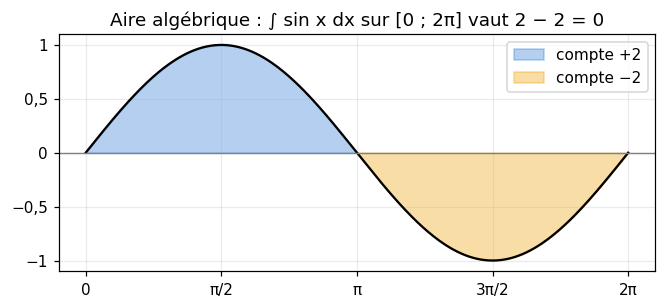
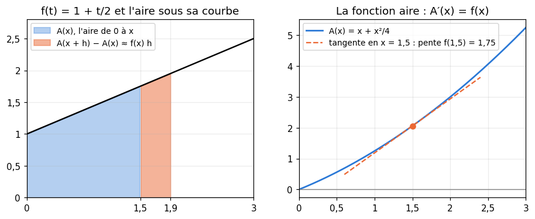
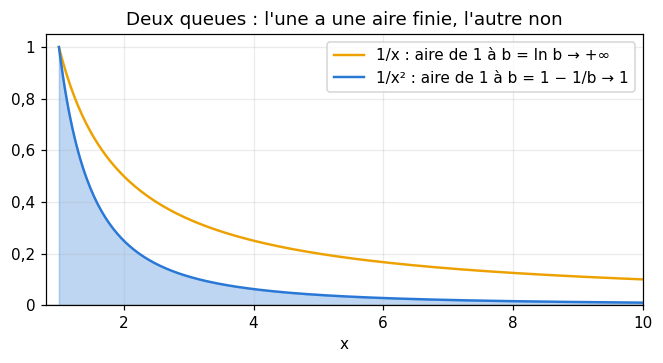
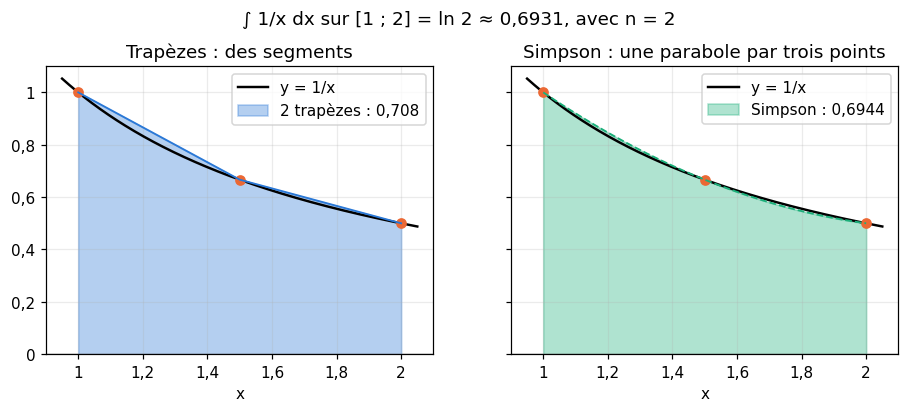
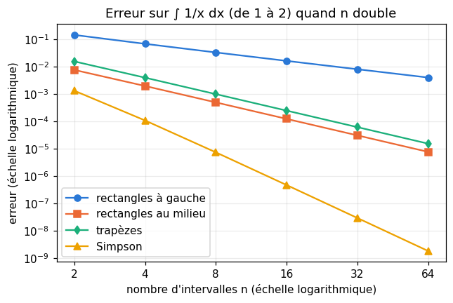
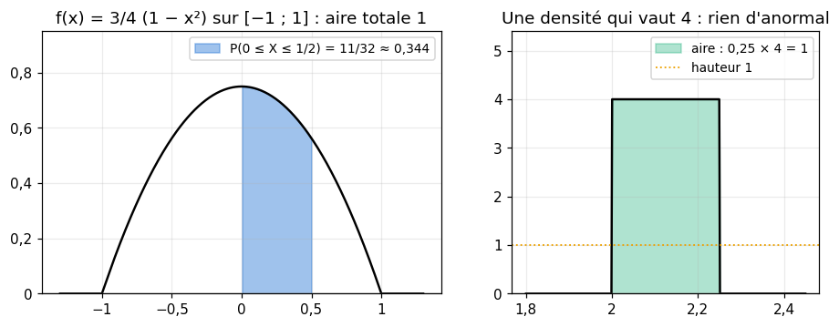
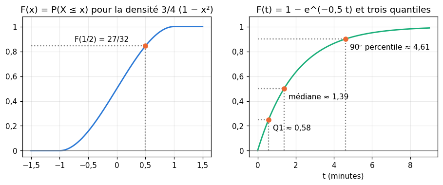
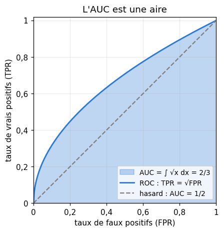
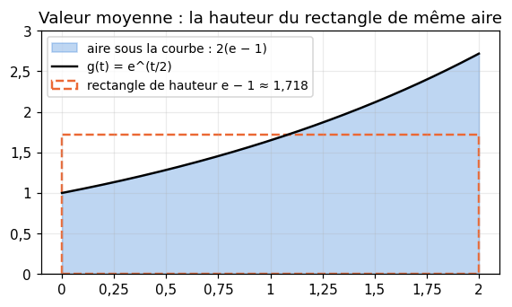

# M02a · Intégrales et densités — fiche de cours

> Le chapitre 2 de workbookIA parle de lois **continues** : une durée, une taille, un score peuvent prendre n'importe quelle valeur, et leur probabilité se lit comme une **aire sous une courbe**, la densité. Ce chapitre construit l'outil qui mesure ces aires : l'**intégrale**. Tu l'approches d'abord par des rectangles, puis tu la calcules exactement par une **primitive**, avec trois méthodes de calcul ; tu prolonges l'intégrale jusqu'à l'infini, et tu programmes les méthodes numériques qu'utilisent les ordinateurs. Enfin, tout cela sert les probabilités : densité, fonction de répartition, quantiles et percentiles ; et deux aires du machine learning, l'AUC et la valeur moyenne d'une fonction. C'est le premier chapitre de la partie I.

| | |
|---|---|
| **Sections** | §1 à §8 |
| **Temps total estimé** | ≈ 12,6 h : lecture et calculs de la fiche ≈ 3 h, exercices ≈ 8 h 50, flashcards ≈ 45 min (parcours essentiel ≈ 8,7 h) |
| **Prérequis** | R3 (fonctions affines) ; R4 (Σ) ; R6 (exp et ln) ; R7 (dérivées usuelles, règle de la chaîne, limites en l'infini, dichotomie) ; R8 (probabilité d'un événement) ; R9 (sin, cos et leurs dérivées) ; workbookIA 0A (fonctions, boucles, arrays NumPy) |
| **Fichiers du chapitre** | `02_exercices.md` (quiz, papier) · `03_notebook.ipynb` · `04_indices.md` · `05_solutions.md` et `05_solutions.ipynb` · `06_mes_reponses.md` · `flashcards.csv` |
| **mymath** | `integrate.py` : `riemann_sum`, `trapezoid`, `simpson`, `cdf_from_pdf`, `quantile` |
| **MML** | prérequis de §6.2 : le livre suppose les intégrales connues ; tu en liras la partie continue de §6.2 en M02a.14 |

## Comment utiliser ce chapitre

**Ordre conseillé.**
1. `python tools/start_chapter.py M02a` (sur Colab : `00_setup/COLAB.md` §2) : il copie le notebook, ta feuille de réponses et le squelette `mymath/integrate.py`.
2. Section par section : lis **crayon en main**, refais chaque calcul, dessine chaque courbe et chaque aire ; puis fais les exercices de la section, quiz 🧠 d'abord.
3. Les exercices ✏️ et 🔗 se font sur papier, dans ta copie de `06_mes_reponses.md`, puis se vérifient dans la **partie 0** du notebook. Les démonstrations ∂ se rédigent dans ta copie et se jugent avec la grille de relecture de `05_solutions.md`.

**Garde les valeurs exactes** ($\frac{8}{3}$, $\ln 2$, $e - 1$, $\sqrt{\pi}$) jusqu'au bout, et n'arrondis qu'à la fin, si l'énoncé le demande.

| Section | Quiz 🧠 | Papier et réflexion | Notebook |
|---|---|---|---|
| §1 L'aire sous une courbe : sommes de Riemann | Q1, R2 🔁 | M02a.1 ✏️, M02a.12 ∂ | M02a.16 🔨, M02a.22 🎨 |
| §2 Primitives et intégrale : le théorème fondamental | Q1, Q2, R1 🔁 | M02a.2 ✏️, M02a.3 ✏️, M02a.11 ∂ | M02a.19 📦, M02a.22 🎨, M02a.23 🐛, M02a.24 🛠️ |
| §3 Calculer : linéarité, parties, changement de variable | Q3 | M02a.4 ✏️, M02a.5 ✏️ | M02a.23 🐛 |
| §4 Intégrales impropres et intégrale de Gauss | Q4, R3 🔁 | M02a.6 ✏️ | M02a.19 📦, M02a.21 🔬 |
| §5 Méthodes numériques : rectangles, trapèzes, Simpson | Q5 | M02a.7 ✏️, M02a.12 ∂ | M02a.16 🔨, M02a.17 🔨, M02a.20 🔮, M02a.25 🏆 |
| §6 Densité de probabilité | Q6 | M02a.8 ✏️, M02a.9 ✏️, M02a.14 📖, M02a.15 🗣️, M02a.E1 💼 | |
| §7 Fonction de répartition, quantiles et percentiles | Q7 | M02a.10 ✏️, M02a.14 📖 | M02a.18 🔨 |
| §8 Des aires en ML : l'AUC et la valeur moyenne | | M02a.9 ✏️, M02a.13 🔗 | |

Parcours essentiel : tout sauf M02a.Q3, M02a.R3, M02a.4, M02a.5, M02a.7, M02a.11, M02a.12, M02a.14, M02a.17, M02a.21, M02a.23, M02a.24 et M02a.25. Le §3 (intégration par parties et changement de variable) se lit quand même : la fiche s'en sert ensuite, mais workbookIA 2 n'en a pas besoin.

## Guide de lecture de MML

*Mathematics for Machine Learning* (MML) ne traite pas l'intégrale : il la suppose connue, comme un livre de première année d'université. **Cette fiche est donc le cours** des §1 à §5. Le livre n'intervient qu'aux §6 et §7, quand l'intégrale sert les probabilités : lis la partie de **MML §6.2** sur les probabilités continues (la densité, la fonction de répartition, puis la comparaison d'une loi discrète et d'une loi continue) **après** le §7 de la fiche, avec l'exercice M02a.14. Survole la partie discrète de §6.2 : M02b la lira en entier, avec §6.1.

Vocabulaire anglais de ce chapitre : *integral*, *antiderivative* (primitive), *definite* / *indefinite integral*, *Riemann sum*, *improper integral*, *integration by parts*, *change of variables* (ou *substitution*), *trapezoidal rule*, *Simpson's rule*, *probability density function* (*pdf*), *cumulative distribution function* (*cdf*), *quantile*, *percentile*, *support*.

## Objectifs d'apprentissage

À la fin du chapitre, tu sais :
- **approcher** une aire par des sommes de Riemann, et la **calculer** exactement par une primitive ;
- **calculer** une intégrale par linéarité, par parties ou par un changement de variable ;
- **reconnaître** une intégrale impropre convergente et la calculer ;
- **programmer** les méthodes des rectangles, des trapèzes et de Simpson, et **comparer** leurs erreurs ;
- **vérifier** qu'une fonction est une densité, et en **déduire** des probabilités et sa fonction de répartition ;
- **calculer** un quantile, un percentile et la médiane d'une loi continue.

## L'essentiel en 10 lignes

1. L'**intégrale** $\int_a^b f(x)\,dx$ est l'aire **algébrique** entre la courbe de $f$ et l'axe des abscisses, de $a$ à $b$ : ce qui est sous l'axe compte négativement.
2. On l'approche par des **sommes de Riemann** : $n$ rectangles de largeur $h = \frac{b - a}{n}$, de hauteur lue à gauche, à droite ou au milieu ; quand $n$ grandit, elles tendent vers l'intégrale.
3. Une **primitive** de $f$ est une fonction $F$ telle que $F' = f$. **Théorème fondamental** : $\int_a^b f(x)\,dx = F(b) - F(a)$, noté $\big[F(x)\big]_a^b$.
4. Primitives à connaître : $x^n \to \frac{x^{n+1}}{n+1}$ ($n \ne -1$), $\frac{1}{x} \to \ln \lvert x \rvert$, $e^{ax} \to \frac{e^{ax}}{a}$, $\cos \to \sin$, $\sin \to -\cos$ ; l'intégrale est **linéaire**.
5. **Par parties** : $\int_a^b u v' = \big[uv\big]_a^b - \int_a^b u' v$. **Changement de variable** : $\int_a^b f(g(x))\,g'(x)\,dx = \int_{g(a)}^{g(b)} f(u)\,du$.
6. Une intégrale **impropre** est une limite : $\int_1^{+\infty} \frac{dx}{x^p}$ converge si et seulement si $p > 1$ ; $\int_0^1 \frac{dx}{x^p}$ si et seulement si $p < 1$. **Gauss** : $\int_{-\infty}^{+\infty} e^{-x^2}\,dx = \sqrt{\pi}$.
7. **Méthodes numériques** : rectangles (erreur en $h$), trapèzes et point milieu (en $h^2$), Simpson (en $h^4$) ; diviser le pas par 2 divise l'erreur par environ 2, 4 et 16, pour une fonction régulière.
8. Une **densité** $f$ est positive, d'intégrale totale 1, et $P(a \le X \le b) = \int_a^b f(x)\,dx$. Une valeur exacte a une probabilité nulle ; une densité peut dépasser 1.
9. La **fonction de répartition** $F(x) = P(X \le x) = \int_{-\infty}^x f(t)\,dt$ croît de 0 à 1, et $F' = f$. Le **quantile** d'ordre $p$ est le plus petit $x$ tel que $F(x) \ge p$ : la médiane pour $p = 0{,}5$, le percentile 90 pour $p = 0{,}9$.
10. Deux aires du ML : l'**AUC**, l'aire sous la courbe ROC ; la **valeur moyenne** $\frac{1}{b-a}\int_a^b f$, la hauteur du rectangle de même aire.

---

## §1 · L'aire sous une courbe : sommes de Riemann

### Une distance est une aire

Une voiture roule 2 heures à 50 km/h : elle parcourt $50 \times 2 = 100$ km. Sur le graphique de la vitesse en fonction du temps, ce produit est l'**aire d'un rectangle** de largeur 2 (les heures) et de hauteur 50 (la vitesse). Si la vitesse change, on découpe le temps en petits intervalles, sur lesquels elle change peu : la distance totale est presque la somme des aires de rectangles étroits, et elle est exactement l'**aire sous la courbe** de la vitesse.

C'est l'idée de tout le chapitre : une grandeur qui s'accumule (une distance, une quantité, une probabilité) est une aire, et cette aire se calcule en découpant.

### Les sommes de Riemann

Soit $f$ une fonction continue sur $[a ; b]$. On découpe l'intervalle en $n$ morceaux de même largeur

$$h = \frac{b - a}{n}, \qquad x_i = a + i\,h \quad (i = 0, 1, \ldots, n),$$

de sorte que $x_0 = a$ et $x_n = b$. Sur chaque morceau $[x_i ; x_{i+1}]$, on dresse un rectangle de largeur $h$ dont la hauteur est une valeur de $f$ : on la lit **à gauche** ($f(x_i)$), **à droite** ($f(x_{i+1})$) ou **au milieu** ($f\big(x_i + \frac{h}{2}\big)$). La somme des aires des $n$ rectangles est une **somme de Riemann** (*Riemann sum*) :

$$L_n = h \sum_{i=0}^{n-1} f(x_i), \qquad R_n = h \sum_{i=1}^{n} f(x_i), \qquad M_n = h \sum_{i=0}^{n-1} f\Big(x_i + \frac{h}{2}\Big).$$

Exemple : $f(x) = x^2$ sur $[0 ; 2]$, avec $n = 4$ rectangles. Le pas vaut $h = \frac{2 - 0}{4} = 0{,}5$, et les points sont $0$ ; $0{,}5$ ; $1$ ; $1{,}5$ ; $2$.
- À gauche : $L_4 = 0{,}5 \times (0 + 0{,}25 + 1 + 2{,}25) = 0{,}5 \times 3{,}5 = 1{,}75$.
- À droite : $R_4 = 0{,}5 \times (0{,}25 + 1 + 2{,}25 + 4) = 0{,}5 \times 7{,}5 = 3{,}75$.
- Au milieu (en $0{,}25$ ; $0{,}75$ ; $1{,}25$ ; $1{,}75$) : $M_4 = 0{,}5 \times (0{,}0625 + 0{,}5625 + 1{,}5625 + 3{,}0625) = 0{,}5 \times 5{,}25 = 2{,}625$.

![Les trois sommes de Riemann de x² sur [0 ; 2] avec 4 rectangles](figures/riemann.png)

La fonction $x^2$ est croissante sur $[0 ; 2]$ : chaque rectangle à gauche est **sous** la courbe, chaque rectangle à droite **au-dessus**. L'aire cherchée est donc entre les deux : $1{,}75 \le \text{aire} \le 3{,}75$. Le point milieu, lui, compense : il dépasse un peu d'un côté du rectangle et manque un peu de l'autre. Tu verras au §2 que l'aire exacte vaut $\frac{8}{3} \approx 2{,}667$.

En Python, une somme de Riemann est une somme de hauteurs multipliée par le pas :

```python
>>> h = 0.5
>>> heights = [(i * h) ** 2 for i in range(4)]    # x² at 0, 0.5, 1 and 1.5: the left ends
>>> heights, h * sum(heights)
([0.0, 0.25, 1.0, 2.25], 1.75)
```

Tu écriras la fonction générale, pour les trois règles, en M02a.16.

### L'intégrale, limite des sommes de Riemann

Quand $n$ grandit, les rectangles deviennent plus étroits et les trois sommes se rapprochent. Pour $x^2$ sur $[0 ; 2]$ :

| $n$ | à gauche | à droite | au milieu |
|---|---|---|---|
| 4 | 1,75 | 3,75 | 2,625 |
| 40 | 2,5675 | 2,7675 | 2,66625 |
| 400 | 2,656675 | 2,676675 | 2,6666625 |

Pour une fonction **continue** sur $[a ; b]$, les trois sommes ont la même limite quand $n \to +\infty$ (le théorème est admis ; M02a.12 le démontre pour une fonction croissante). Cette limite est l'**intégrale** (*integral*) de $f$ de $a$ à $b$ :

$$\int_a^b f(x)\,dx = \lim_{n \to +\infty} h \sum_{i=0}^{n-1} f(x_i).$$

Le signe $\int$ est un S allongé, celui de « somme » ; $f(x)\,dx$ rappelle l'aire $f(x_i) \times h$ d'un rectangle, et $dx$ la largeur qui devient infiniment petite. La lettre $x$ est **muette** : $\int_0^2 x^2\,dx = \int_0^2 t^2\,dt$. Les nombres $a$ et $b$ sont les **bornes** de l'intégrale.

📐 On lit « intégrale de $a$ à $b$ de $f$ de $x$, $dx$ » (`annexes/symboles.md`).

### Une aire algébrique

Si $f$ prend des valeurs négatives, les rectangles correspondants ont une « hauteur » négative : ils comptent **négativement**. L'intégrale est une **aire algébrique** : l'aire au-dessus de l'axe, moins l'aire en dessous.



Pour obtenir l'aire **géométrique** (toujours positive) d'une région qui traverse l'axe, on coupe l'intervalle là où $f$ change de signe, et on additionne les valeurs absolues des morceaux : pour $\sin$ sur $[0 ; 2\pi]$, l'intégrale vaut 0, mais l'aire de la région colorée vaut $2 + 2 = 4$.

⚠️ **Erreur de calcul classique.** « L'intégrale vaut 0, donc l'aire est nulle » : non, des aires positives et négatives peuvent se compenser. Dessine toujours la courbe avant de parler d'aire.

🔗 **Dans workbookIA** — une probabilité continue est une aire (chapitre 2), et l'AUC d'un classifieur aussi (chapitre 3) ; au chapitre B6, une méthode d'explication de réseaux remplace une intégrale par une somme de Riemann, exactement comme ici.

---

## §2 · Primitives et intégrale : le théorème fondamental

### Primitive

Une **primitive** (*antiderivative*) d'une fonction $f$ sur un intervalle est une fonction $F$ dont la dérivée est $f$ : $F' = f$. Chercher une primitive, c'est dériver à l'envers.

Exemple : $F(x) = \frac{x^3}{3}$ est une primitive de $f(x) = x^2$, car $F'(x) = \frac{3x^2}{3} = x^2$. Mais $\frac{x^3}{3} + 5$ aussi, et $\frac{x^3}{3} - 1$ : ajouter une constante ne change pas la dérivée. Sur un **intervalle**, deux primitives d'une même fonction diffèrent toujours d'une constante (une fonction de dérivée nulle sur un intervalle est constante, R7). On écrit souvent « les primitives de $x^2$ sont les $\frac{x^3}{3} + C$ », $C$ étant une constante quelconque, ou $\int x^2\,dx = \frac{x^3}{3} + C$ (une **intégrale indéfinie**, sans bornes).

| $f(x)$ | une primitive $F(x)$ | sur |
|---|---|---|
| $k$ (constante) | $kx$ | $\mathbb{R}$ |
| $x^n$, $n \ne -1$ | $\frac{x^{n+1}}{n+1}$ | $\mathbb{R}$ si $n$ est un entier $\ge 0$ ; $]0 ; +\infty[$ sinon (et aussi $]-\infty ; 0[$ si $n$ est un entier négatif) |
| $\frac{1}{x}$ | $\ln \lvert x \rvert$ ($\ln x$ pour $x > 0$) | $]0 ; +\infty[$ ou $]-\infty ; 0[$ |
| $e^{ax}$, $a \ne 0$ | $\frac{e^{ax}}{a}$ | $\mathbb{R}$ |
| $\cos x$ | $\sin x$ | $\mathbb{R}$ |
| $\sin x$ | $-\cos x$ | $\mathbb{R}$ |
| $f(ax + b)$, $a \ne 0$ | $\frac{1}{a} F(ax + b)$ | |

La deuxième ligne couvre les racines et les inverses de puissances : $\sqrt{x} = x^{1/2}$ a pour primitive $\frac{x^{3/2}}{3/2} = \frac{2}{3}x^{3/2}$, et $\frac{1}{x^2} = x^{-2}$ a pour primitive $\frac{x^{-1}}{-1} = -\frac{1}{x}$. La dernière ligne vient de la règle de la chaîne (R7) : la dérivée de $\frac{1}{a}F(ax + b)$ est $\frac{1}{a} \times a\,f(ax + b) = f(ax + b)$. Par exemple, une primitive de $e^{-3x}$ est $-\frac{1}{3}e^{-3x}$.

**Vérifier une primitive est facile** : il suffit de la dériver. C'est le réflexe à prendre, à la main ou avec SymPy :

```python
>>> import sympy as sp
>>> x = sp.Symbol("x")
>>> sp.integrate(x ** 2, x), sp.diff(x ** 3 / 3, x)
(x**3/3, x**2)
```

⚠️ **Erreur de calcul classique.** Une primitive de $x^{-1}$ n'est pas $\frac{x^0}{0}$ : la formule de $x^n$ exclut $n = -1$, et c'est $\ln \lvert x \rvert$. Autre piège : une primitive de $e^{2x}$ n'est pas $e^{2x}$ (sa dérivée vaut $2e^{2x}$), c'est $\frac{e^{2x}}{2}$.

### Le théorème fondamental de l'analyse

Voici le pont entre les aires du §1 et les primitives. Pour $f$ continue sur $[a ; b]$ et $F$ une primitive de $f$ :

$$\int_a^b f(x)\,dx = F(b) - F(a), \qquad \text{noté} \quad \big[F(x)\big]_a^b.$$

Le choix de la primitive n'importe pas : la constante $C$ disparaît dans la différence. Pour $x^2$ sur $[0 ; 2]$ :

$$\int_0^2 x^2\,dx = \left[\frac{x^3}{3}\right]_0^2 = \frac{8}{3} - 0 = \frac{8}{3} \approx 2{,}667,$$

la valeur vers laquelle tendaient les sommes de Riemann du §1. De même, $\int_1^e \frac{dx}{x} = \big[\ln x\big]_1^e = 1 - 0 = 1$.

**Pourquoi ?** Considère la **fonction aire** $A(x) = \int_a^x f(t)\,dt$, l'aire de $a$ jusqu'à $x$. Quand $x$ avance de $h$, l'aire gagne une bande étroite, presque un rectangle de largeur $h$ et de hauteur $f(x)$ : $A(x + h) - A(x) \approx f(x)\,h$. En divisant par $h$ et en faisant tendre $h$ vers 0, on trouve $A'(x) = f(x)$ : **la fonction aire est une primitive de $f$**. Elle vaut 0 en $a$, donc $A(x) = F(x) - F(a)$ pour toute primitive $F$, et $\int_a^b f = A(b) = F(b) - F(a)$. Tu rédigeras cette démonstration en M02a.11.



Conséquence remarquable : même sans formule pour une intégrale, on connaît la dérivée de la fonction aire. La dérivée de $x \mapsto \int_0^x e^{-t^2}\,dt$ est $e^{-x^2}$, alors qu'aucune formule usuelle ne donne cette intégrale (§4).

### Les règles de calcul

Pour $f$ et $g$ continues, et des nombres $a$, $b$, $c$, $\lambda$ :
- **linéarité** : $\int_a^b \big(f(x) + g(x)\big)\,dx = \int_a^b f + \int_a^b g$ et $\int_a^b \lambda f = \lambda \int_a^b f$ ;
- **relation de Chasles** : $\int_a^b f + \int_b^c f = \int_a^c f$ (les aires s'ajoutent bout à bout) ;
- **bornes inversées** : $\int_b^a f = -\int_a^b f$, et $\int_a^a f = 0$ ;
- **positivité** : si $a \le b$ et $f \ge 0$ sur $[a ; b]$, alors $\int_a^b f \ge 0$ ; si $a \le b$ et $f \le g$ sur $[a ; b]$, alors $\int_a^b f \le \int_a^b g$.

⚠️ **Erreur de calcul classique.** $\big[F(x)\big]_a^b = F(b) - F(a)$, la borne du **haut** d'abord. Écrire $F(a) - F(b)$ change le signe du résultat.

### L'aire entre deux courbes

Si $f \le g$ sur $[a ; b]$, l'aire de la région comprise entre les deux courbes est $\int_a^b \big(g(x) - f(x)\big)\,dx$ : la courbe du haut moins celle du bas, que les courbes soient au-dessus ou au-dessous de l'axe. Exemple : entre $y = x^3$ et $y = x$ sur $[0 ; 1]$ (où $x^3 \le x$), l'aire vaut $\int_0^1 (x - x^3)\,dx = \frac{1}{2} - \frac{1}{4} = \frac{1}{4}$. Les bornes sont souvent les abscisses des points d'intersection : on les trouve en résolvant $f(x) = g(x)$.

🔗 **Dans workbookIA** — le chapitre 2 te dira « la probabilité est une aire, tu n'auras pas à la calculer » : désormais, tu sauras la calculer.

---

## §3 · Calculer : linéarité, intégration par parties, changement de variable

Trois méthodes couvrent la plupart des intégrales que tu croiseras. Le premier réflexe reste la **table** du §2 et la **linéarité** : on découpe la fonction en morceaux dont on connaît une primitive.

$$\int_1^2 \left(3x^2 - \frac{2}{x}\right)dx = \big[x^3 - 2\ln x\big]_1^2 = (8 - 2\ln 2) - (1 - 0) = 7 - 2\ln 2 \approx 5{,}614.$$

⚠️ **Erreur de calcul classique.** L'intégrale d'un **produit** n'est pas le produit des intégrales : $\int_0^1 x \cdot x\,dx = \frac{1}{3}$, alors que $\int_0^1 x\,dx \times \int_0^1 x\,dx = \frac{1}{4}$. Pour un produit, il faut l'une des deux méthodes qui suivent.

### Intégration par parties

La règle du produit $(uv)' = u'v + uv'$ (R7), intégrée de $a$ à $b$ (pour $u$ et $v$ dérivables, de dérivées continues), donne $\big[uv\big]_a^b = \int_a^b u'v + \int_a^b uv'$, soit

$$\int_a^b u(x)\,v'(x)\,dx = \big[u(x)\,v(x)\big]_a^b - \int_a^b u'(x)\,v(x)\,dx.$$

On échange une intégrale contre une autre, plus simple si $u$ se **simplifie en dérivant** et si $v'$ **s'intègre facilement**. Exemple : $\int_0^1 x\,e^{-x}\,dx$. On choisit $u = x$ (dérivée $u' = 1$, plus simple) et $v' = e^{-x}$ (primitive $v = -e^{-x}$) :

$$\int_0^1 x\,e^{-x}\,dx = \big[-x\,e^{-x}\big]_0^1 - \int_0^1 1 \times (-e^{-x})\,dx = -e^{-1} + \big[-e^{-x}\big]_0^1 = -e^{-1} + 1 - e^{-1} = 1 - \frac{2}{e} \approx 0{,}264.$$

Le choix inverse ($u = e^{-x}$, $v' = x$) mènerait à $\int x^2 e^{-x}$, plus compliquée. Règle pratique : on **dérive** le polynôme ou le logarithme, on **intègre** l'exponentielle, le sinus ou le cosinus. Pour $x^2 e^{-x}$, il faut deux intégrations par parties successives, chacune abaissant le degré du polynôme de 1.

### Changement de variable

La règle de la chaîne $\big(F(g(x))\big)' = F'(g(x))\,g'(x)$ (R7), intégrée, donne la formule du **changement de variable** (*substitution*), pour $f$ continue et $g$ dérivable, de dérivée continue :

$$\int_a^b f\big(g(x)\big)\,g'(x)\,dx = \int_{g(a)}^{g(b)} f(u)\,du.$$

En pratique : on repère une fonction $g(x)$ dont la dérivée apparaît en facteur, on pose $u = g(x)$, on remplace $g'(x)\,dx$ par $du$, et **on change les bornes** : quand $x$ va de $a$ à $b$, $u$ va de $g(a)$ à $g(b)$.

Exemple, qui reviendra au §4 et au §6 : $\int_0^a x\,e^{-x^2/2}\,dx$, pour un nombre $a > 0$. On pose $u = \frac{x^2}{2}$ : $du = x\,dx$, et $u$ va de 0 à $\frac{a^2}{2}$. Donc

$$\int_0^a x\,e^{-x^2/2}\,dx = \int_0^{a^2/2} e^{-u}\,du = \big[-e^{-u}\big]_0^{a^2/2} = 1 - e^{-a^2/2}.$$

Pour $a = 2$ : $1 - e^{-2} \approx 0{,}865$.

⚠️ **Erreur de calcul classique.** Changer de variable sans changer les bornes : dans l'exemple, $\int_0^2 e^{-u}\,du = 1 - e^{-2}$ tombe juste par hasard pour $a = 2$, mais pas pour $a = 3$ (la vraie borne est $\frac{9}{2}$, pas 3). Autre oubli : remplacer $dx$ par $du$ sans le facteur $g'(x)$.

💻 **Aujourd'hui en pratique** — SymPy calcule les intégrales usuelles (`sp.integrate(x * sp.exp(-x), (x, 0, 1))` rend `1 - 2*exp(-1)`), et les ingénieurs vérifient leurs calculs ainsi. Savoir les deux méthodes reste utile : pour reconnaître la forme d'un résultat, et pour les démonstrations des chapitres suivants (l'espérance d'une loi exponentielle en M02b, par parties ; la loi normale, par changement de variable).

---

## §4 · Intégrales impropres et intégrale de Gauss

### Jusqu'à l'infini

Les lois de probabilité ont souvent des valeurs possibles jusqu'à l'infini (une durée d'attente n'a pas de maximum). Il faut donc des intégrales sur $[a ; +\infty[$. On les définit comme des **limites** :

$$\int_a^{+\infty} f(x)\,dx = \lim_{b \to +\infty} \int_a^b f(x)\,dx.$$

Si la limite existe et est finie, l'intégrale **converge** ; sinon, elle **diverge** (*improper integral*, *converges*, *diverges*).

Deux exemples, que la figure compare :
- $\int_1^b \frac{dx}{x^2} = \left[-\frac{1}{x}\right]_1^b = 1 - \frac{1}{b} \to 1$ : l'intégrale converge et vaut 1. Une région infiniment longue peut avoir une aire finie.
- $\int_1^b \frac{dx}{x} = \ln b \to +\infty$ : l'intégrale diverge, alors que $\frac{1}{x}$ tend aussi vers 0.



Plus généralement, $\int_1^b x^{-p}\,dx = \frac{b^{1-p} - 1}{1 - p}$ pour $p \ne 1$ : cette quantité a une limite finie, $\frac{1}{p - 1}$, si et seulement si $p > 1$. Retiens : **$\int_1^{+\infty} \frac{dx}{x^p}$ converge si et seulement si $p > 1$**. Il ne suffit pas que la fonction tende vers 0 : il faut qu'elle tende vers 0 **assez vite**.

L'exponentielle décroît plus vite que toute puissance (R6) : pour $\lambda > 0$, $\int_0^b e^{-\lambda x}\,dx = \frac{1 - e^{-\lambda b}}{\lambda} \to \frac{1}{\lambda}$. Et l'exemple du §3 se prolonge : $\int_0^{+\infty} x\,e^{-x^2/2}\,dx = \lim_{a \to +\infty} \big(1 - e^{-a^2/2}\big) = 1$.

Sur $]-\infty ; +\infty[$, on coupe en un point (0, par exemple), et l'intégrale converge si **les deux moitiés** convergent : $\int_{-\infty}^{+\infty} f = \int_{-\infty}^0 f + \int_0^{+\infty} f$.

### Une fonction qui explose

L'autre cas d'intégrale impropre est une fonction **non bornée** près d'une borne, comme $\frac{1}{\sqrt{x}}$ près de 0. On coupe un petit morceau, puis on passe à la limite :

$$\int_0^1 \frac{dx}{\sqrt{x}} = \lim_{\varepsilon \to 0^+} \int_\varepsilon^1 x^{-1/2}\,dx = \lim_{\varepsilon \to 0^+} \big(2 - 2\sqrt{\varepsilon}\big) = 2.$$

Ici la règle est inversée : **$\int_0^1 \frac{dx}{x^p}$ converge si et seulement si $p < 1$** (la fonction doit exploser **assez lentement**). Pour $p = 1$, les deux intégrales, vers 0 et vers $+\infty$, divergent.

⚠️ **Erreur de calcul classique.** Appliquer la formule $F(b) - F(a)$ sans vérifier que $f$ est continue sur tout $[a ; b]$ : « $\int_{-1}^1 \frac{dx}{x^2} = \left[-\frac{1}{x}\right]_{-1}^1 = -2$ » est faux (une intégrale d'une fonction positive ne peut pas être négative) : $\frac{1}{x^2}$ explose en 0, $\int_0^1 \frac{dx}{x^2}$ diverge ($p = 2 \ge 1$), donc l'intégrale de $-1$ à $1$ aussi.

### L'intégrale de Gauss

La fonction $e^{-x^2}$, une « cloche », n'a **pas de primitive** qui s'écrive avec les fonctions usuelles (c'est un théorème, admis). Pourtant son intégrale sur toute la droite se calcule, par une astuce que tu verras en M02b (une intégrale double, M02b.12) :

$$\int_{-\infty}^{+\infty} e^{-x^2}\,dx = \sqrt{\pi} \approx 1{,}7725.$$

Admets-la pour l'instant, et vérifie-la numériquement (M02a.19, M02a.21). Pourquoi converge-t-elle ? Par une **règle de comparaison**, admise : si $0 \le f \le g$ sur $[a ; +\infty[$ et si $\int_a^{+\infty} g$ converge, alors $\int_a^{+\infty} f$ converge aussi, et $\int_a^{+\infty} f \le \int_a^{+\infty} g$ (une aire coincée sous une aire finie est finie). Ici, pour $\lvert x \rvert \ge 1$, $e^{-x^2} \le e^{-\lvert x \rvert}$, dont l'intégrale converge.

Par le changement de variable $x = \frac{t}{\sqrt{2}}$ (donc $dx = \frac{dt}{\sqrt{2}}$), on en déduit

$$\int_{-\infty}^{+\infty} e^{-t^2/2}\,dt = \sqrt{2} \int_{-\infty}^{+\infty} e^{-x^2}\,dx = \sqrt{2\pi}.$$

C'est l'origine du facteur $\frac{1}{\sqrt{2\pi}}$ de la **loi normale** : la fonction $\varphi(t) = \frac{1}{\sqrt{2\pi}}\,e^{-t^2/2}$ a une aire totale de 1, ce qu'exige une densité (§6).

```python
>>> import math
>>> from scipy.integrate import quad
>>> value, error = quad(lambda x: math.exp(-x ** 2), -math.inf, math.inf)
>>> round(value, 10), round(math.sqrt(math.pi), 10)
(1.7724538509, 1.7724538509)
```

🔗 **Dans workbookIA** — la loi normale du chapitre 2, l'initialisation des poids (chapitres 16 et 17) et les modèles génératifs (chapitre 25) utilisent tous cette densité et sa constante.

---

## §5 · Méthodes numériques : rectangles, trapèzes, Simpson

La plupart des intégrales du monde réel n'ont pas de primitive simple, ou portent sur des données (une courbe connue seulement en quelques points). On les **calcule numériquement**, à partir de valeurs de $f$ en des points $x_0 = a, x_1, \ldots, x_n = b$ régulièrement espacés de $h = \frac{b - a}{n}$.

### Trois méthodes

- **Rectangles** (gauche, droite, milieu) : les sommes de Riemann du §1.
- **Trapèzes** (*trapezoidal rule*) : sur chaque intervalle, on remplace la courbe par le **segment** qui joint ses deux extrémités. On obtient un trapèze, dont l'aire vaut sa largeur fois la moyenne de ses deux côtés parallèles (un rectangle surmonté d'un triangle) : $h \times \frac{f(x_i) + f(x_{i+1})}{2}$. En additionnant, chaque point intérieur est compté deux fois à moitié :
$$T_n = h\left(\frac{f(x_0)}{2} + f(x_1) + \cdots + f(x_{n-1}) + \frac{f(x_n)}{2}\right) = \frac{L_n + R_n}{2}.$$
- **Simpson** (*Simpson's rule*) : sur chaque paire d'intervalles, on remplace la courbe par la **parabole** qui passe par les trois points. Il faut donc un nombre $n$ **pair** d'intervalles. Le calcul de l'aire sous chaque parabole donne les poids $1, 4, 1$, d'où :
$$S_n = \frac{h}{3}\Big(f(x_0) + 4f(x_1) + 2f(x_2) + 4f(x_3) + \cdots + 2f(x_{n-2}) + 4f(x_{n-1}) + f(x_n)\Big).$$



Exemple : $\int_1^2 \frac{dx}{x} = \ln 2 \approx 0{,}693147$, avec $n = 4$ ($h = 0{,}25$, valeurs $1$ ; $0{,}8$ ; $0{,}6667$ ; $0{,}5714$ ; $0{,}5$) puis $n = 8$ :

| méthode | $n = 4$ | erreur | $n = 8$ | erreur | rapport des erreurs |
|---|---|---|---|---|---|
| rectangles à gauche | 0,759524 | $+6{,}6 \times 10^{-2}$ | 0,725372 | $+3{,}2 \times 10^{-2}$ | ≈ 2 |
| rectangles à droite | 0,634524 | $-5{,}9 \times 10^{-2}$ | 0,662872 | $-3{,}0 \times 10^{-2}$ | ≈ 2 |
| point milieu | 0,691220 | $-1{,}9 \times 10^{-3}$ | 0,692661 | $-4{,}9 \times 10^{-4}$ | ≈ 4 |
| trapèzes | 0,697024 | $+3{,}9 \times 10^{-3}$ | 0,694122 | $+9{,}7 \times 10^{-4}$ | ≈ 4 |
| Simpson | 0,693254 | $+1{,}1 \times 10^{-4}$ | 0,693155 | $+7{,}4 \times 10^{-6}$ | ≈ 15 |

Pour Simpson avec $n = 4$ : $\frac{0{,}25}{3}\big(1 + 4 \times 0{,}8 + 2 \times 0{,}666667 + 4 \times 0{,}571429 + 0{,}5\big) = \frac{0{,}25}{3} \times 8{,}319048 \approx 0{,}693254$.

### L'ordre d'une méthode

Le tableau montre une régularité : quand on **double** $n$ (on divise le pas $h$ par 2), l'erreur des rectangles est divisée par 2 environ, celle du point milieu et des trapèzes par 4, celle de Simpson par 16 (le tableau donne 15, et 16 avec des $n$ plus grands). Pour une fonction **régulière** (dont les dérivées utiles restent bornées sur l'intervalle), l'erreur se comporte comme une puissance du pas :

| méthode | erreur proportionnelle à | pas divisé par 2 | exacte pour |
|---|---|---|---|
| rectangles à gauche ou à droite | $h$ | erreur ÷ 2 | les constantes |
| point milieu, trapèzes | $h^2$ | erreur ÷ 4 | les fonctions affines |
| Simpson | $h^4$ | erreur ÷ 16 | les polynômes de degré au plus 3 |

On dit que la méthode est **d'ordre** 1, 2 ou 4. Sur un graphique en échelles logarithmiques, l'erreur en fonction de $n$ est une droite de pente $-1$, $-2$ ou $-4$ :



Ces ordres viennent des polynômes de Taylor (M05a) : on les admet ici, et M02a.12 démontre celui des rectangles pour une fonction croissante. Simpson est exacte pour les polynômes de degré 3, et pas seulement 2 : une surprise de la symétrie des poids $1, 4, 1$.

**Le coût** d'une méthode est le nombre d'évaluations de $f$ : $n$ pour les rectangles, $n + 1$ pour les trapèzes et Simpson. À coût égal, Simpson est de loin la plus précise pour une fonction régulière. Mais attention au mot « régulière » : une fonction qui a un angle, ou une dérivée infinie quelque part, ne suit pas toujours ces règles (M02a.20).

💻 **Aujourd'hui en pratique** — `scipy.integrate.quad` (bibliothèque QUADPACK) choisit lui-même ses points, en resserrant le découpage là où la fonction varie vite, et rend la valeur avec une estimation de son erreur ; il accepte des bornes infinies (§4). Pour des données tabulées, `np.trapezoid(y, x)` applique les trapèzes : c'est ainsi qu'on calcule l'aire sous une courbe ROC (§8).

---

## §6 · Densité de probabilité

### Pourquoi une densité ?

Le temps d'attente d'un bus, la taille d'une personne ou le score d'un modèle peuvent prendre **n'importe quelle valeur** d'un intervalle : ce sont des variables aléatoires **continues**. La probabilité d'une valeur **exacte** y est nulle : un temps d'attente d'exactement 3,000000… minutes n'arrive (presque) jamais. On ne demande donc que la probabilité d'un **intervalle**, et on la lit comme une **aire** sous une courbe, la densité.

### Définition

Une **densité de probabilité** (*probability density function*, *pdf*) est une fonction $f$ telle que :
1. $f(x) \ge 0$ pour tout $x$ ;
2. $\int_{-\infty}^{+\infty} f(x)\,dx = 1$ (l'aire totale vaut 1).

Une variable aléatoire $X$ **a pour densité** $f$ si, pour tous $a \le b$,

$$P(a \le X \le b) = \int_a^b f(x)\,dx.$$

L'ensemble où $f$ n'est pas nulle s'appelle le **support** de la loi : en dehors, $X$ ne tombe qu'avec une probabilité nulle. Quand $f$ est nulle hors d'un intervalle $[c ; d]$, l'intégrale totale se réduit à $\int_c^d f$.

Exemple : $f(x) = c\,(1 - x^2)$ sur $[-1 ; 1]$, et 0 ailleurs. Pour quelle constante $c$ est-ce une densité ? Elle est positive pour $c > 0$, et

$$\int_{-1}^1 c\,(1 - x^2)\,dx = c\left[x - \frac{x^3}{3}\right]_{-1}^1 = c\left(\frac{2}{3} + \frac{2}{3}\right) = \frac{4c}{3} = 1 \iff c = \frac{3}{4}.$$

Alors $P\big(0 \le X \le \frac{1}{2}\big) = \frac{3}{4}\left[x - \frac{x^3}{3}\right]_0^{1/2} = \frac{3}{4}\left(\frac{1}{2} - \frac{1}{24}\right) = \frac{3}{4} \times \frac{11}{24} = \frac{11}{32} \approx 0{,}344$.



### Trois conséquences qui surprennent

- **Une valeur exacte a une probabilité nulle** : $P(X = a) = \int_a^a f = 0$. Donc $P(a \le X \le b) = P(a < X < b)$ : les inégalités larges ou strictes donnent la même probabilité, contrairement à une loi discrète (R8).
- **$f(x)$ n'est pas une probabilité.** C'est une probabilité **par unité de longueur** : pour un petit $h$, $P(x \le X \le x + h) \approx f(x)\,h$ (l'aire d'un rectangle étroit). Comme la densité de masse d'un matériau, en grammes par centimètre cube, n'est pas une masse.
- **Une densité peut dépasser 1.** Seule l'aire doit valoir 1. La loi uniforme sur $[2 ; 2{,}25]$ a pour densité 4 sur cet intervalle (et 0 ailleurs) : $4 \times 0{,}25 = 1$. Plus la loi est concentrée, plus sa densité est haute.

⚠️ **Erreur de calcul classique.** Lire $f(x)$ comme $P(X = x)$. Pour comparer deux valeurs d'une variable continue, on compare leurs densités : elles disent laquelle a le plus de probabilité **autour d'elle** (M02a.E1).

### Une densité sur une demi-droite

La durée d'attente $T$ (en minutes) d'un service qui répond en moyenne toutes les 2 minutes est souvent modélisée par la **densité exponentielle** $f(t) = 0{,}5\,e^{-0{,}5t}$ pour $t \ge 0$, et 0 pour $t < 0$ (M02b étudiera cette loi en détail). C'est une densité : $f \ge 0$ et, par le §4, $\int_0^{+\infty} 0{,}5\,e^{-0{,}5t}\,dt = 0{,}5 \times \frac{1}{0{,}5} = 1$. La probabilité d'attendre plus de 3 minutes est

$$P(T > 3) = \int_3^{+\infty} 0{,}5\,e^{-0{,}5t}\,dt = \lim_{b \to +\infty} \big[-e^{-0{,}5t}\big]_3^b = e^{-1{,}5} \approx 0{,}223.$$

De même, $\int_0^{+\infty} x\,e^{-x^2/2}\,dx = 1$ (§4) : la fonction $x\,e^{-x^2/2}$ sur $[0 ; +\infty[$ est une densité, celle de la distance au centre d'un tir visé au hasard autour d'une cible (une loi de Rayleigh).

**Un histogramme estime une densité.** Avec beaucoup de valeurs tirées d'une loi continue, un histogramme dont les barres ont une **aire** égale à la proportion de valeurs qu'elles contiennent (`density=True` en matplotlib) dessine une courbe proche de la densité : workbookIA 2 en construit un.

📖 **Dans MML** — §6.2 (sa partie sur les probabilités continues) définit la densité (*probability density function*) d'une variable à valeurs réelles, puis sa fonction de répartition (§7 de cette fiche), et compare une loi discrète à une loi continue. Le livre définit la densité avec une fonction $f$, comme ici, puis écrit souvent $p(x)$, aussi bien pour une loi discrète que pour une densité : le contexte dit laquelle. Il donne ses définitions pour des vecteurs $\mathbf{x}$ de $\mathbb{R}^D$ : en dimension 1, ce sont celles de la fiche. Lecture et questions : M02a.14.

🔗 **Dans workbookIA** — au chapitre 2, les lois uniforme et normale sont données par leurs densités, et un histogramme « en densité » les approche ; au chapitre 25, un modèle génératif apprend une densité.

---

## §7 · Fonction de répartition, quantiles et percentiles

### La fonction de répartition

La **fonction de répartition** (*cumulative distribution function*, *cdf*) d'une variable aléatoire $X$ est

$$F(x) = P(X \le x).$$

Pour une variable à densité $f$, c'est l'aire à gauche de $x$ : $F(x) = \int_{-\infty}^x f(t)\,dt$. Ses propriétés :
- $F$ est **croissante** (au sens large), avec $\lim_{x \to -\infty} F(x) = 0$ et $\lim_{x \to +\infty} F(x) = 1$ ;
- **$F' = f$** là où $f$ est continue : c'est le théorème fondamental (§2), $F$ étant une fonction aire ;
- $P(a < X \le b) = F(b) - F(a)$, et $P(X > a) = 1 - F(a)$.

Une seule fonction, $F$, donne donc toutes les probabilités d'intervalles, sans recalculer d'intégrale.

Pour la densité $\frac{3}{4}(1 - x^2)$ du §6 : $F(x) = 0$ pour $x < -1$, $F(x) = 1$ pour $x > 1$, et entre les deux

$$F(x) = \int_{-1}^x \frac{3}{4}(1 - t^2)\,dt = \frac{3}{4}\left[t - \frac{t^3}{3}\right]_{-1}^x = \frac{1}{2} + \frac{3}{4}\left(x - \frac{x^3}{3}\right).$$

Vérifications : $F(-1) = \frac{1}{2} - \frac{1}{2} = 0$, $F(1) = 1$, et $F\big(\frac{1}{2}\big) = \frac{1}{2} + \frac{11}{32} = \frac{27}{32}$. On retrouve $P\big(0 \le X \le \frac{1}{2}\big) = F\big(\frac{1}{2}\big) - F(0) = \frac{27}{32} - \frac{16}{32} = \frac{11}{32}$.

Pour la densité exponentielle $0{,}5\,e^{-0{,}5t}$ : $F(t) = \int_0^t 0{,}5\,e^{-0{,}5s}\,ds = 1 - e^{-0{,}5t}$ pour $t \ge 0$.



Pour une loi **discrète** (R8), la fonction de répartition existe aussi, mais elle monte par **marches** : elle saute de $P(X = k)$ en chaque valeur $k$. Celle d'une variable à densité monte **sans saut**.

### Quantiles, médiane, percentiles

Le **quantile d'ordre $p$** (*quantile*), pour $0 < p < 1$, est la valeur sous laquelle tombe une proportion $p$ des réalisations. Précisément, c'est **le plus petit $x$ tel que $F(x) \ge p$**, noté $q_p$. Quand $F$ est continue et strictement croissante là où elle est entre 0 et 1, c'est simplement la solution de l'équation $F(x) = p$.

- La **médiane** est $q_{0{,}5}$ : une chance sur deux d'être en dessous.
- Les **quartiles** sont $q_{0{,}25}$, $q_{0{,}5}$ et $q_{0{,}75}$ ; les **déciles**, $q_{0{,}1}, \ldots, q_{0{,}9}$.
- Le **percentile** $k$ (*percentile*) est le quantile d'ordre $\frac{k}{100}$ : le percentile 90 est $q_{0{,}9}$.

Pour la loi exponentielle de densité $0{,}5\,e^{-0{,}5t}$, on résout $1 - e^{-0{,}5t} = p$ : $e^{-0{,}5t} = 1 - p$, donc

$$q_p = -\frac{\ln(1 - p)}{0{,}5} = -2\ln(1 - p).$$

La médiane vaut $2\ln 2 \approx 1{,}386$ minute, le premier quartile $2\ln\frac{4}{3} \approx 0{,}575$, le percentile 90 $2\ln 10 \approx 4{,}605$. La moitié des clients attendent moins de 1 min 23 s, et 10 % plus de 4 min 36 s.

Pour la densité $\frac{3}{4}(1 - x^2)$, la médiane vaut 0, par symétrie : la courbe est symétrique par rapport à l'axe vertical, donc il y a autant d'aire de chaque côté.

**Quand l'équation $F(x) = p$ ne se résout pas à la main**, on la résout numériquement : $F$ est croissante, donc une **dichotomie** (R7) sur $F(x) - p$ trouve le quantile. Si $F$ n'a même pas de formule, on la calcule par une méthode du §5. Ce sont tes deux fonctions de M02a.18 : `cdf_from_pdf`, puis `quantile`.

```python
>>> from scipy import stats
>>> law = stats.expon(scale=2)                  # the density 0.5 e^(-0.5 t): scale = 1 / 0.5
>>> round(float(law.cdf(1.0)), 4), round(float(law.ppf(0.5)), 4), round(2 * math.log(2), 4)
(0.3935, 1.3863, 1.3863)
```

`ppf` (*percent point function*) est le nom que SciPy donne à la fonction quantile, $p \mapsto q_p$.

⚠️ **Erreur de calcul classique.** Confondre le percentile 90 et la probabilité 0,9 : le percentile est une **valeur** de la variable (4,605 minutes), la probabilité un nombre entre 0 et 1. Autre piège : prendre la médiane pour la moyenne. Pour la loi exponentielle ci-dessus, la médiane vaut 1,386 et la moyenne 2 (M02b) : une loi asymétrique les sépare.

🔗 **Dans workbookIA** — au chapitre 2, tu calculeras les percentiles d'une **liste de données** : ils estiment les quantiles de la loi qui a produit ces données. Les quantiles reviennent pour les intervalles de confiance (M02c), les seuils de décision (chapitre 3) et la simulation d'une loi (M02b, qui tire $q_U$ avec $U$ uniforme).

---

## §8 · Des aires en ML : l'AUC et la valeur moyenne d'une fonction

### L'AUC est une aire

Un classifieur qui donne un score à chaque exemple se juge, à tous les seuils à la fois, par sa **courbe ROC** : tu la construiras en M03 et au chapitre 3 de workbookIA. Il suffit ici de savoir qu'elle relie deux taux, tous deux entre 0 et 1 : en abscisse le taux de faux positifs (*FPR*), en ordonnée le taux de vrais positifs (*TPR*). La courbe part de $(0 ; 0)$ et monte jusqu'à $(1 ; 1)$. Son aire, l'**AUC** (*area under the curve*), est une intégrale :

$$\text{AUC} = \int_0^1 \text{TPR}\;d(\text{FPR}).$$

Un classifieur qui répond au hasard a pour courbe la diagonale $\text{TPR} = \text{FPR}$, et une AUC de $\int_0^1 x\,dx = \frac{1}{2}$. Un classifieur parfait monte tout de suite à 1 : son AUC vaut 1. Pour une courbe idéalisée $\text{TPR} = \sqrt{\text{FPR}}$ :

$$\text{AUC} = \int_0^1 \sqrt{x}\,dx = \left[\frac{2}{3}x^{3/2}\right]_0^1 = \frac{2}{3}.$$



Avec de vraies données, la courbe ROC n'a pas de formule : c'est une ligne brisée passant par des points, et son aire se calcule par la **méthode des trapèzes** du §5. C'est exactement ce que fera le chapitre 3.

### La valeur moyenne d'une fonction

La **valeur moyenne** de $f$ sur $[a ; b]$ est

$$\bar{f} = \frac{1}{b - a}\int_a^b f(x)\,dx.$$

C'est la hauteur du rectangle de base $[a ; b]$ qui a la même aire que la région sous la courbe. Elle prolonge la moyenne de $n$ nombres (R1) : la somme devient une intégrale, et le nombre de valeurs devient la longueur de l'intervalle. Exemple : $g(t) = e^{t/2}$ sur $[0 ; 2]$, d'intégrale $\big[2e^{t/2}\big]_0^2 = 2(e - 1)$, a pour valeur moyenne $\frac{2(e - 1)}{2} = e - 1 \approx 1{,}718$.



Deux liens avec la suite :
- si $U$ suit la loi **uniforme** sur $[a ; b]$ (densité $\frac{1}{b - a}$), la valeur moyenne de $f$ sur $[a ; b]$ est aussi la moyenne à long terme de $f(U)$ : l'**espérance** de $f(U)$ (M02b) ;
- d'où une façon d'**estimer une intégrale par le hasard** : tirer beaucoup de points uniformes, faire la moyenne de $f$, multiplier par $b - a$. C'est la méthode de **Monte-Carlo**, qui marche aussi en grande dimension, là où les méthodes du §5 deviennent trop chères (M02c, loi des grands nombres).

```python
>>> import numpy as np
>>> rng = np.random.default_rng(0)
>>> u = rng.uniform(0, 2, 100_000)               # 100 000 points drawn uniformly on [0, 2]
>>> round(float(np.mean(np.exp(u / 2))), 2)      # the mean value of e^(t/2): e − 1 ≈ 1.718
1.72
```

🔗 **Dans workbookIA** — l'AUC du chapitre 3 (une aire calculée par les trapèzes) ; les moyennes de loss par epoch, qui approchent une espérance ; l'échantillonnage du chapitre 28.

---

## Les pièges classiques ⚠️ (récapitulatif)

| Piège | Faux | Juste |
|---|---|---|
| aire et intégrale | « l'intégrale vaut 0, donc l'aire est nulle » | des aires positives et négatives se compensent : découpe là où $f$ change de signe |
| ordre des bornes | $\big[F(x)\big]_a^b = F(a) - F(b)$ | $F(b) - F(a)$, la borne du haut d'abord |
| primitive de $x^{-1}$ | $\frac{x^0}{0}$ | $\ln \lvert x \rvert$ |
| primitive de $e^{ax}$ | $e^{ax}$ | $\frac{e^{ax}}{a}$ (dérive pour vérifier) |
| primitive d'une puissance | $x^n \to (n+1)x^{n+1}$, ou $nx^{n-1}$ | $\frac{x^{n+1}}{n+1}$ ; $nx^{n-1}$ est la dérivée |
| produit | $\int fg = \int f \times \int g$ | par parties, ou un changement de variable |
| changement de variable | garder les anciennes bornes, ou oublier $g'(x)$ | $u$ va de $g(a)$ à $g(b)$, et $g'(x)\,dx$ devient $du$ |
| intégrale impropre | « $\frac{1}{x} \to 0$, donc $\int_1^{+\infty} \frac{dx}{x}$ converge » | il faut décroître assez vite : $\frac{1}{x^p}$ avec $p > 1$ |
| fonction qui explose | $\int_{-1}^1 \frac{dx}{x^2} = -2$ | $\frac{1}{x^2}$ n'est pas bornée près de 0, et $\int_0^1 \frac{dx}{x^2}$ diverge ($p = 2 \ge 1$) : l'intégrale diverge |
| Simpson | un nombre impair d'intervalles | $n$ pair ; poids $1, 4, 2, 4, \ldots, 4, 1$, le tout fois $\frac{h}{3}$ |
| ordre d'une méthode | « doubler $n$ divise toujours l'erreur par 4 » | pour une fonction régulière : ÷ 2, ÷ 4 ou ÷ 16 selon la méthode |
| densité | $f(x) = P(X = x)$, ou $f \le 1$ | $P(X = x) = 0$ ; seule l'aire vaut 1, $f$ peut dépasser 1 |
| constante d'une densité | oublier d'intégrer sur tout le support | $\int f = 1$ sur tout l'intervalle où $f$ n'est pas nulle |
| fonction de répartition | $F(x) = f(x)$ | $F(x) = \int_{-\infty}^x f$, l'aire à gauche ; $F' = f$ |
| quantile | le percentile 90 vaut 0,9 | c'est une valeur $x$ telle que $F(x) = 0{,}9$ |
| médiane et moyenne | toujours égales | égales pour une loi symétrique (quand la moyenne existe) ; une loi asymétrique les sépare souvent |

## Et maintenant

**Dans ce dépôt** : M02b, juste après, se sert de ce chapitre à chaque page : les lois uniforme, exponentielle et normale, l'**espérance** d'une variable continue ($\int x\,f(x)\,dx$), la variance, la démonstration de l'intégrale de Gauss par une intégrale double, et la simulation par la fonction quantile. M02c passera des lois aux échantillons. M05a expliquera l'ordre des méthodes du §5 avec les polynômes de Taylor.

**Dans workbookIA** : après M02b et M02c, le chapitre 2 présente les lois usuelles par leurs densités, et calcule des percentiles de données ; tu sauras ce que ces aires et ces quantiles veulent dire. Le chapitre 3 calculera l'AUC d'un classifieur par la méthode des trapèzes.

## Pour aller plus loin

- J. K. Blitzstein et J. Hwang, *Introduction to Probability* (2ᵉ éd., en ligne gratuitement, `annexes/ressources.md`), chapitre 5 : les variables aléatoires continues, densité et fonction de répartition.
- Exo7 (Université de Lille), cours « Intégrales » et « Calculs d'intégrales » (primitives, parties, changement de variable), niveau première année d'université (`annexes/ressources.md`).
- Maths et tiques (Yvan Monka), cours et vidéos de terminale sur les primitives et le calcul intégral : [maths-et-tiques.fr](https://www.maths-et-tiques.fr).
- `annexes/symboles.md` (lire $\int_a^b f(x)\,dx$, $\big[F(x)\big]_a^b$, $+\infty$, $q_p$ à voix haute), `annexes/formulaire.md` et `annexes/erreurs_frequentes.md`.
