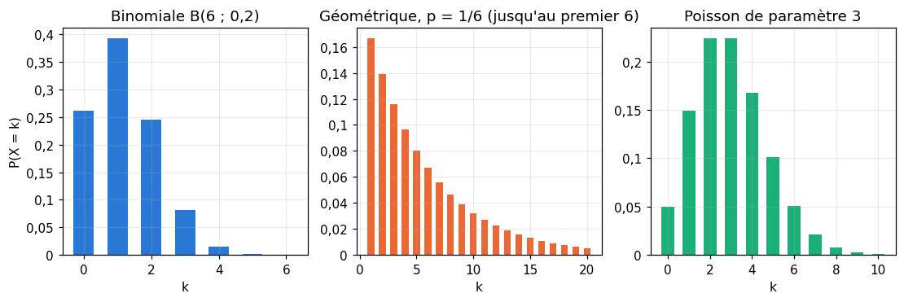
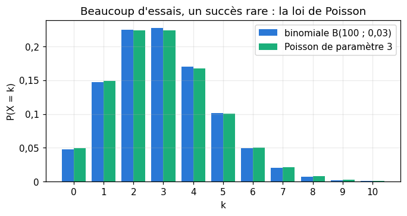
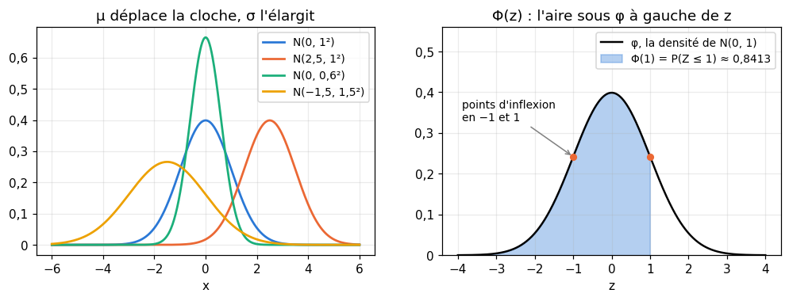
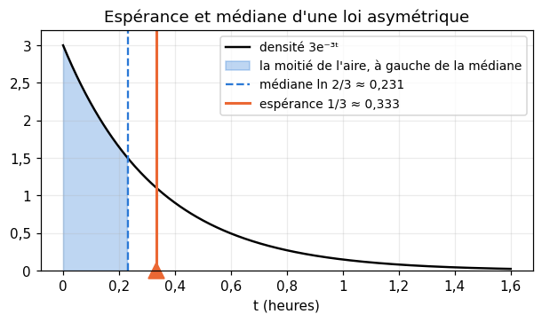
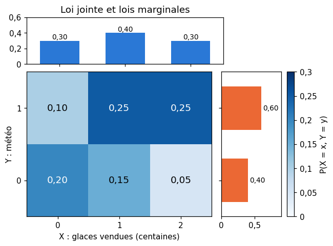
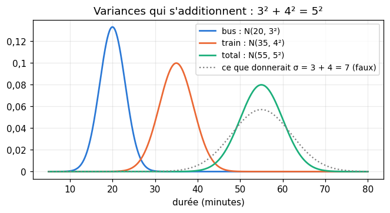
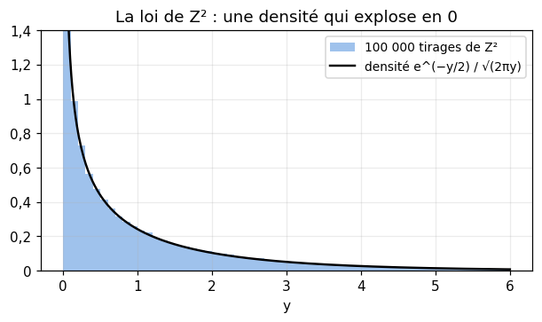
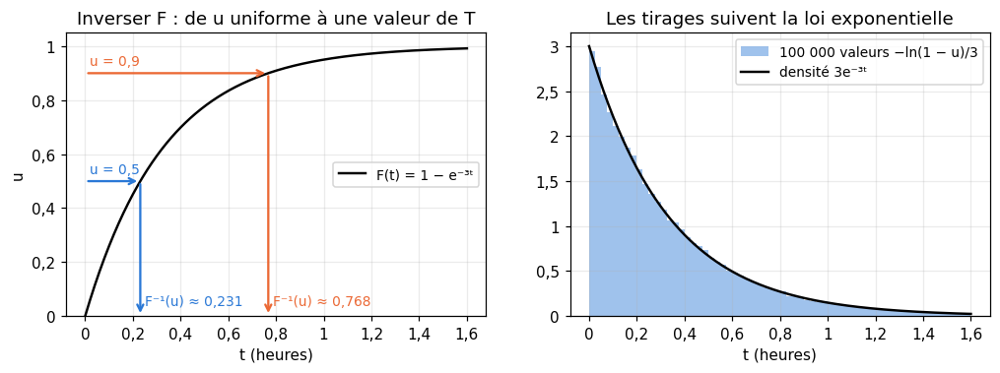

# M02b · Variables aléatoires et lois usuelles — fiche de cours

> Le chapitre 2 de workbookIA tire des nombres au hasard dans des **lois** : uniforme, normale, de Bernoulli, catégorielle. Ce chapitre te donne de quoi les comprendre et calculer avec elles. Tu passes de la variable aléatoire discrète de R8 au cadre général : une variable aléatoire est une fonction, sa loi dit comment elle se répartit. Tu rencontres les huit lois qu'un praticien du machine learning croise tous les jours, tu calcules leur **espérance** et leur **variance**, discrètes avec des sommes, continues avec les intégrales de M02a. Puis tu étudies deux variables à la fois (loi jointe, marginales, indépendance), la variance d'une somme, une première intégrale double, qui démontre enfin l'intégrale de Gauss, et la loi d'une variable transformée, qui permet de **simuler** n'importe quelle loi à partir de nombres uniformes.

| | |
|---|---|
| **Sections** | §1 à §8 |
| **Temps total estimé** | ≈ 13,9 h : lecture et calculs de la fiche ≈ 3 h, exercices ≈ 10 h, flashcards ≈ 50 min (parcours essentiel ≈ 8,7 h) |
| **Prérequis** | R5 (suites géométriques et leurs sommes) ; R6 (exp et ln) ; R7 (limites, dérivées) ; R8 (variable aléatoire discrète, espérance, variance, coefficients binomiaux, indépendance) ; M02a (intégrales, intégration par parties, intégrales impropres, densité, fonction de répartition, quantiles) ; workbookIA 0A (fonctions, arrays NumPy) |
| **Fichiers du chapitre** | `02_exercices.md` (quiz, papier) · `03_notebook.ipynb` · `04_indices.md` · `05_solutions.md` et `05_solutions.ipynb` · `06_mes_reponses.md` · `flashcards.csv` |
| **mymath** | `distributions.py` : `binomial_pmf`, `poisson_pmf`, `normal_pdf`, `normal_cdf`, `inverse_transform_sample` |
| **MML** | §6.1, §6.2, §6.4 et §6.7 (voir le guide de lecture ci-dessous) |

## Comment utiliser ce chapitre

**Ordre conseillé.**
1. `python tools/start_chapter.py M02b` (sur Colab : `00_setup/COLAB.md` §2) : il copie le notebook, ta feuille de réponses et le squelette `mymath/distributions.py`.
2. Section par section : lis **crayon en main**, refais chaque calcul, dessine chaque loi ; puis fais les exercices de la section, quiz 🧠 d'abord.
3. Les exercices ✏️ et 🔗 se font sur papier, dans ta copie de `06_mes_reponses.md`, puis se vérifient dans la **partie 0** du notebook. Les démonstrations ∂ se rédigent dans ta copie et se jugent avec la grille de relecture de `05_solutions.md`.

**Garde les valeurs exactes** ($\frac{1}{3}$, $e^{-3}$, $\Phi(1{,}5)$) jusqu'au bout, et n'arrondis qu'à la fin. Avant chaque calcul, demande-toi **quelle loi** et **quels paramètres** : la moitié des erreurs vient de là.

| Section | Quiz 🧠 | Papier et réflexion | Notebook |
|---|---|---|---|
| §1 Variable aléatoire et loi | Q1 | M02b.15 📖, M02b.17 🗣️ | |
| §2 Lois discrètes | Q2, R3 🔁 | M02b.1 ✏️, M02b.2 ✏️, M02b.3 ✏️, M02b.13 ∂, M02b.14 🔗, M02b.15 📖, M02b.E1 💼 | M02b.18 🔨, M02b.21 📦, M02b.23 🔬 |
| §3 Lois continues | Q2, Q4, R2 🔁 | M02b.4 ✏️, M02b.5 ✏️, M02b.15 📖 | M02b.19 🔨, M02b.21 📦, M02b.25 🐛, M02b.26 🛠️ |
| §4 Espérance et variance | Q3, R1 🔁, R2 🔁 | M02b.2 ✏️, M02b.4 ✏️, M02b.6 ✏️, M02b.16 📖 | |
| §5 Couples de variables | Q5 | M02b.7 ✏️ | M02b.24 🎨 |
| §6 Linéarité, variance d'une somme | Q6 | M02b.8 ✏️, M02b.11 ∂, M02b.16 📖 | M02b.22 🔮, M02b.25 🐛 |
| §7 Intégrale double et intégrale de Gauss | | M02b.9 ✏️, M02b.12 ∂ | |
| §8 Changement de variable et simulation | Q7 | M02b.10 ✏️, M02b.16 📖 | M02b.20 🔨, M02b.27 🏆 |

Parcours essentiel : tout sauf M02b.Q7, M02b.R3, M02b.3, M02b.9, M02b.10, M02b.12, M02b.13, M02b.15, M02b.16, M02b.17, M02b.20, M02b.23, M02b.24, M02b.25, M02b.26 et M02b.27. Le §7 se survole ; lis le §8 en entier quand même : workbookIA 2 tire des valeurs dans une loi discrète par la méthode qu'il décrit.

## Guide de lecture de MML

*Mathematics for Machine Learning* (MML) consacre son chapitre 6 aux probabilités. Ce chapitre en lit quatre sections, dans cet ordre :
- après le **§1** de la fiche : **MML §6.1** en entier (la construction d'un espace probabilisé ; §6.1.1 est une discussion sur ce qu'est une probabilité, à lire sans chercher à tout retenir) ;
- après les **§2 et §3** : **MML §6.2** en entier (la partie discrète, avec sa loi jointe en tableau ; relis la partie continue, déjà vue en M02a). Questions : M02b.15 ;
- après les **§4 à §6** : **MML §6.4**, sauf §6.4.2 (les moyennes et covariances empiriques, pour M02c) et §6.4.6 (pour plus tard). Le livre écrit tout pour des vecteurs : en dimension 1, ce sont les formules de la fiche ;
- après le **§8** : **MML §6.7** (§6.7.1, puis §6.7.2 jusqu'à la formule pour une seule variable ; la version à plusieurs variables, avec un déterminant, attendra la partie II). Questions : M02b.16.

§6.3 (règle de Bayes) est pour M03 et M04, §6.5 (la loi normale en plusieurs dimensions) pour plus tard, §6.6 pour M04.

Vocabulaire anglais de ce chapitre : *random variable*, *sample space*, *event space*, *target space*, *probability mass function* (*pmf*), *probability density function* (*pdf*), *cumulative distribution function* (*cdf*), *expected value*, *variance*, *standard deviation*, *joint distribution*, *marginal distribution*, *independent*, *Bernoulli*, *binomial*, *categorical*, *geometric*, *Poisson*, *uniform*, *exponential*, *normal* (ou *Gaussian*), *change of variables*, *inverse transform sampling*.

## Objectifs d'apprentissage

À la fin du chapitre, tu sais :
- **reconnaître** la loi qui modélise une situation (Bernoulli, binomiale, catégorielle, géométrique, Poisson, uniforme, exponentielle, normale) ;
- **calculer** des probabilités, une espérance et une variance, pour une loi discrète ou continue ;
- **lire** une loi jointe et ses marginales, et **décider** si deux variables sont indépendantes ;
- **utiliser** la linéarité de l'espérance et la variance d'une somme de variables indépendantes ;
- **calculer** une intégrale double simple, et la loi d'une variable transformée ;
- **simuler** une loi par inversion de sa fonction de répartition.

## L'essentiel en 10 lignes

1. Une **variable aléatoire** $X$ est une fonction de l'univers $\Omega$ dans $\mathbb{R}$ ; sa **loi** dit avec quelle probabilité elle tombe dans chaque ensemble. Sa **fonction de répartition** $F(x) = P(X \le x)$ la décrit toujours.
2. Lois discrètes : **Bernoulli** $\mathcal{B}(p)$ (0 ou 1), **binomiale** $\mathcal{B}(n, p)$ : $P(X = k) = \binom{n}{k}p^k(1-p)^{n-k}$, **catégorielle** ($K$ classes), **géométrique** : $P(X = k) = (1-p)^{k-1}p$, **Poisson** $\mathcal{P}(\lambda)$ : $P(X = k) = e^{-\lambda}\frac{\lambda^k}{k!}$.
3. Lois continues : **uniforme** sur $[a ; b]$ (densité $\frac{1}{b-a}$), **exponentielle** (densité $\lambda e^{-\lambda t}$, $t \ge 0$), **normale** $\mathcal{N}(\mu, \sigma^2)$ (densité $\frac{1}{\sigma\sqrt{2\pi}}e^{-\frac{(x-\mu)^2}{2\sigma^2}}$).
4. On **standardise** : si $X \sim \mathcal{N}(\mu, \sigma^2)$, alors $Z = \frac{X - \mu}{\sigma} \sim \mathcal{N}(0, 1)$ et $P(X \le x) = \Phi\big(\frac{x - \mu}{\sigma}\big)$. Attention : le second paramètre est la **variance** $\sigma^2$.
5. **Espérance** : $\mathbb{E}[X] = \sum_x x\,P(X = x)$ ou $\int x\,f(x)\,dx$. **Transfert** : $\mathbb{E}[g(X)] = \sum_x g(x)\,P(X = x)$ ou $\int g(x)\,f(x)\,dx$.
6. **Variance** : $\mathbb{V}(X) = \mathbb{E}\big[(X - \mathbb{E}[X])^2\big] = \mathbb{E}[X^2] - \mathbb{E}[X]^2$, et $\mathbb{V}(aX + b) = a^2\,\mathbb{V}(X)$.
7. Un **couple** $(X, Y)$ a une **loi jointe** ; on obtient chaque **marginale** en sommant (ou en intégrant) l'autre variable. $X$ et $Y$ sont **indépendantes** si la loi jointe est le produit des marginales.
8. $\mathbb{E}[X + Y] = \mathbb{E}[X] + \mathbb{E}[Y]$ toujours ; $\mathbb{V}(X + Y) = \mathbb{V}(X) + \mathbb{V}(Y)$ si $X$ et $Y$ sont indépendantes : les **variances** s'additionnent, pas les écarts-types.
9. Une **intégrale double** sur un rectangle se calcule en intégrant une variable après l'autre ; en coordonnées polaires, $dx\,dy$ devient $r\,dr\,d\theta$, d'où $\int_{-\infty}^{+\infty} e^{-x^2}\,dx = \sqrt{\pi}$.
10. Si $U$ est uniforme sur $[0 ; 1]$, $F^{-1}(U)$ suit la loi de fonction de répartition $F$ : c'est la **simulation par inversion**. Et $\mu + \sigma Z$ suit $\mathcal{N}(\mu, \sigma^2)$ quand $Z \sim \mathcal{N}(0, 1)$.

---

## §1 · Variable aléatoire et loi : l'espace probabilisé (aperçu)

### Trois ingrédients

R8 a décrit une expérience aléatoire par son univers $\Omega$ (l'ensemble des issues), ses événements (des parties de $\Omega$) et une probabilité $P$. Ce triplet $(\Omega, \mathcal{A}, P)$ s'appelle un **espace probabilisé** :
- $\Omega$, l'**univers** (*sample space*), l'ensemble de toutes les issues possibles ;
- $\mathcal{A}$, l'ensemble des **événements** (*event space*), les parties de $\Omega$ auxquelles on donne une probabilité ;
- $P$, la **probabilité**, qui associe à chaque événement un nombre entre 0 et 1, avec $P(\Omega) = 1$, et $P(A \cup B) = P(A) + P(B)$ quand $A$ et $B$ sont incompatibles (plus généralement pour une suite d'événements deux à deux incompatibles).

Quand $\Omega$ est fini, tout sous-ensemble est un événement, et c'est le cadre de R8. Quand $\Omega$ est infini, par exemple $[0 ; 1[$ pour un nombre tiré « au hasard » par `rng.random()`, on ne peut pas toujours donner une probabilité à **toutes** les parties de $\Omega$ ; on se limite aux intervalles et à ce qu'on en construit par réunions, intersections et complémentaires. C'est une subtilité technique, admise ici : dans ce workbook, tous les ensembles que tu rencontreras sont des événements.

### Une variable aléatoire est une fonction

Une **variable aléatoire** (*random variable*) est une fonction $X : \Omega \to \mathbb{R}$ : elle associe un nombre à chaque issue. On note $\{X \le 3\}$ l'événement « $X$ vaut au plus 3 », c'est-à-dire l'ensemble des issues $\omega$ telles que $X(\omega) \le 3$, et $P(X \le 3)$ sa probabilité.

La **loi** (*distribution*) de $X$ est ce que $X$ fait des probabilités : pour chaque ensemble de nombres $B$, la probabilité $P(X \in B)$. On ne regarde plus les issues, seulement les valeurs. Deux variables différentes peuvent avoir la même loi. On lance une pièce équilibrée ; $X$ vaut 1 si elle tombe sur pile, 0 sinon, et $Y = 1 - X$. Les deux valent 0 ou 1 avec la probabilité $\frac{1}{2}$ : **même loi**. Pourtant $X$ et $Y$ ne sont **jamais** égales : quand l'une vaut 1, l'autre vaut 0. Une loi décrit les chances de chaque valeur, pas la valeur prise.

### Discrète ou continue

- $X$ est **discrète** quand elle prend un nombre fini de valeurs, ou une suite de valeurs $x_1, x_2, \ldots$ (comme les entiers naturels). Sa loi est donnée par les probabilités $p(x) = P(X = x)$, la **fonction de masse** (*probability mass function*, *pmf*), positives et de somme 1.
- $X$ est **à densité** (on dit souvent **continue**) quand $P(a \le X \le b) = \int_a^b f(x)\,dx$ pour une densité $f$ (M02a §6). Chaque valeur exacte a alors une probabilité nulle.

Dans les deux cas, la **fonction de répartition** $F(x) = P(X \le x)$ décrit la loi. Elle croît de 0 à 1. Pour une loi discrète, c'est un **escalier**, qui saute de $P(X = x)$ en chaque valeur $x$ ; pour une loi à densité, une courbe **continue**, de dérivée $f$ (M02a §7).

![La fonction de répartition d'un dé (un escalier) et celle de la loi uniforme sur [0 ; 1] (une rampe)](figures/repartition.png)

Exemple : pour le numéro $X$ d'un dé équilibré à 6 faces, $F(x) = 0$ pour $x < 1$, $F(x) = \frac{k}{6}$ pour $k \le x < k + 1$ ($k = 1, \ldots, 5$), et $F(x) = 1$ pour $x \ge 6$. Ainsi $P(X \le 2{,}7) = F(2{,}7) = \frac{2}{6}$, et $P(2 < X \le 5) = F(5) - F(2) = \frac{3}{6}$, comme en M02a.

⚠️ **Erreur classique.** Confondre une variable aléatoire et sa loi : « $X$ et $Y$ ont la même loi, donc $X = Y$ » est faux (la pièce ci-dessus). Autre confusion : appeler « variable » un nombre déjà tiré. Le nombre que donne `rng.random()` est une **réalisation** (un tirage, *sample*) de la variable, pas la variable.

📖 **Dans MML** — §6.1.2 construit l'espace probabilisé, puis appelle **espace d'arrivée** (*target space*) l'ensemble des valeurs d'une variable aléatoire, noté $\mathcal{T}$ : ici $\mathbb{R}$, mais ce peut être un ensemble de classes ou de vecteurs. Le livre insiste, comme la fiche, sur le fait qu'une variable aléatoire est une **fonction**. Lecture et questions : M02b.15.

🔗 **Dans workbookIA** — le chapitre 2 appelle « tirage » chaque nombre produit par un générateur, et « distribution » la loi qu'il suit ; le chapitre 3 manipule des événements et leurs probabilités, le chapitre 4 des lois conditionnelles.

---

## §2 · Lois discrètes : Bernoulli, binomiale, catégorielle, géométrique, Poisson



### Bernoulli : succès ou échec

Une variable de **Bernoulli** de paramètre $p$, notée $\mathcal{B}(p)$, vaut 1 (succès) avec la probabilité $p$, et 0 (échec) avec la probabilité $1 - p$. C'est la loi de toute réponse par oui ou non : un client clique sur une publicité ($p = 0{,}15$, disons), une pièce est défectueuse, une prédiction est juste. Son espérance et sa variance (§4) :

$$\mathbb{E}[X] = 0 \times (1 - p) + 1 \times p = p, \qquad \mathbb{V}(X) = p(1 - p).$$

Pour le clic : $\mathbb{E}[X] = 0{,}15$ et $\mathbb{V}(X) = 0{,}15 \times 0{,}85 = 0{,}1275$. Comme $X^2 = X$ (car $0^2 = 0$ et $1^2 = 1$), $\mathbb{E}[X^2] = p$, d'où $\mathbb{V}(X) = p - p^2$.

### Binomiale : le nombre de succès en $n$ essais

On répète $n$ fois, de façon **indépendante**, la même épreuve de Bernoulli de paramètre $p$, et $X$ compte les succès. $X$ suit la loi **binomiale** $\mathcal{B}(n, p)$ :

$$P(X = k) = \binom{n}{k}\,p^k\,(1 - p)^{n - k}, \qquad k = 0, 1, \ldots, n.$$

Pourquoi ? Une suite de $n$ résultats qui contient $k$ succès et $n - k$ échecs a la probabilité $p^k(1 - p)^{n-k}$ (les essais sont indépendants, les probabilités se multiplient, R8 §5). Et il y a $\binom{n}{k}$ telles suites : autant que de façons de choisir les $k$ rangs des succès parmi $n$ (R8 §3). Les $n + 1$ probabilités ont bien une somme de 1 : par la **formule du binôme** $(a + b)^n = \sum_{k=0}^{n}\binom{n}{k}a^k b^{n-k}$ (admise ici ; elle se démontre par récurrence avec la formule de Pascal de R8), $\sum_k \binom{n}{k}p^k(1-p)^{n-k} = \big(p + (1 - p)\big)^n = 1$.

Exemple : un classifieur se trompe sur une image avec la probabilité 0,2, indépendamment d'une image à l'autre. Sur 6 images, le nombre d'erreurs $X$ suit $\mathcal{B}(6 ; 0{,}2)$ :

| $k$ | 0 | 1 | 2 | 3 | 4 | 5 | 6 |
|---|---|---|---|---|---|---|---|
| $P(X = k)$ | 0,262144 | 0,393216 | 0,24576 | 0,08192 | 0,01536 | 0,001536 | 0,000064 |

Par exemple $P(X = 2) = \binom{6}{2}\,0{,}2^2\,0{,}8^4 = 15 \times 0{,}04 \times 0{,}4096 = 0{,}24576$, et $P(X \ge 2) = 1 - P(X = 0) - P(X = 1) = 1 - 0{,}262144 - 0{,}393216 = 0{,}34464$. L'espérance vaut $np = 1{,}2$ et la variance $np(1 - p) = 0{,}96$ (démontrées au §6).

```python
>>> import math
>>> [round(math.comb(6, k) * 0.2 ** k * 0.8 ** (6 - k), 4) for k in range(3)]   # P(X = 0), P(X = 1), P(X = 2)
[0.2621, 0.3932, 0.2458]
```

### Catégorielle : une classe parmi $K$

Une variable **catégorielle** prend une valeur parmi $K$ classes, numérotées $1, \ldots, K$, avec des probabilités $p_1, \ldots, p_K$ positives et de somme 1. C'est la loi de la sortie d'un classifieur à $K$ classes : après la fonction *softmax* (workbookIA, chapitre 17), un réseau donne par exemple, pour une image, les probabilités $(0{,}1 ;\ 0{,}4 ;\ 0{,}35 ;\ 0{,}15)$ pour les classes chat, chien, oiseau et poisson. La loi de Bernoulli est le cas $K = 2$.

On code souvent la classe $k$ par un vecteur **one-hot** : $K$ composantes, toutes nulles sauf la $k$-ième, qui vaut 1 (oiseau : $(0, 0, 1, 0)$). Chaque composante est alors une variable de Bernoulli, de paramètre $p_k$.

On rencontre aussi des probabilités **proportionnelles à des poids** positifs $w_1, \ldots, w_K$ : $p_k = \frac{w_k}{w_1 + \cdots + w_K}$. Les poids $(2, 8, 7, 3)$, de somme 20, donnent exactement les probabilités ci-dessus. Le §8 explique comment tirer une classe au hasard selon ces probabilités.

### Géométrique : le rang du premier succès

On répète des épreuves de Bernoulli indépendantes de paramètre $p$ (avec $0 < p \le 1$) **jusqu'au premier succès**, et $X$ est le rang de ce succès. $X$ suit la loi **géométrique** de paramètre $p$ :

$$P(X = k) = (1 - p)^{k - 1}\,p, \qquad k = 1, 2, 3, \ldots$$

car $\{X = k\}$ veut dire $k - 1$ échecs puis un succès. $X$ prend une infinité de valeurs ; la somme des probabilités est une série géométrique de raison $q = 1 - p$ (R5) : $\sum_{k \ge 1} q^{k-1}p = p \times \frac{1}{1 - q} = 1$. Plus simple encore : $\{X > k\}$ veut dire « les $k$ premiers essais échouent », donc

$$P(X > k) = (1 - p)^k.$$

Exemple : on lance un dé jusqu'à obtenir un 6 ($p = \frac{1}{6}$). La probabilité qu'il faille plus de 6 lancers vaut $\left(\frac{5}{6}\right)^6 \approx 0{,}335$ : une fois sur trois environ, six lancers ne suffisent pas. En moyenne, il faut $\mathbb{E}[X] = \frac{1}{p} = 6$ lancers (tu le démontreras en M02b.2, avec une série). La loi est **sans mémoire** : $P(X > m + n) = (1 - p)^{m+n} = P(X > m)\,P(X > n)$. Avoir déjà raté $m$ fois ne rapproche pas le succès (M03 l'écrira avec une probabilité conditionnelle).

⚠️ **Erreur classique.** Certains livres (et `scipy.stats.geom`) comptent le rang du succès, comme ici ; d'autres comptent le nombre d'**échecs** avant le succès, $X - 1$, qui commence à 0. Vérifie toujours la convention.

### Poisson : compter des événements rares

Une variable de **Poisson** de paramètre $\lambda > 0$, notée $\mathcal{P}(\lambda)$, prend les valeurs entières $0, 1, 2, \ldots$ avec

$$P(X = k) = e^{-\lambda}\,\frac{\lambda^k}{k!}.$$

Elle modélise le **nombre d'événements** survenus pendant une durée fixée, quand ils arrivent un par un, indépendamment les uns des autres et à un rythme moyen constant : les erreurs d'un serveur en une heure, les clics sur une page en une minute, les fautes de frappe d'une page. Le paramètre $\lambda$ est le nombre **moyen** d'événements : $\mathbb{E}[X] = \lambda$, et aussi $\mathbb{V}(X) = \lambda$ (§4).

La somme des probabilités vaut 1 grâce à une formule admise ici (M05a la démontrera avec les séries de Taylor) :

$$e^{\lambda} = \sum_{k=0}^{+\infty}\frac{\lambda^k}{k!} = 1 + \lambda + \frac{\lambda^2}{2} + \frac{\lambda^3}{6} + \cdots, \qquad \text{donc} \quad \sum_{k \ge 0} e^{-\lambda}\frac{\lambda^k}{k!} = e^{-\lambda}e^{\lambda} = 1.$$

Exemple : un serveur produit en moyenne 3 erreurs par heure, et $N$ est le nombre d'erreurs pendant une heure donnée, $N \sim \mathcal{P}(3)$. Alors $P(N = 0) = e^{-3} \approx 0{,}0498$, et

$$P(N \le 2) = e^{-3}\left(1 + 3 + \frac{3^2}{2}\right) = 8{,}5\,e^{-3} \approx 0{,}4232.$$

```python
>>> round(sum(math.exp(-3) * 3 ** k / math.factorial(k) for k in range(3)), 4)   # P(N ≤ 2)
0.4232
```

**La loi des événements rares.** Une loi de Poisson approche la loi binomiale $\mathcal{B}(n, p)$ quand $n$ est grand et $p$ petit, avec $\lambda = np$ : beaucoup d'essais, chacun rarement réussi. Avec $n = 100$ et $p = 0{,}03$ ($\lambda = 3$) :

| $k$ | 0 | 1 | 2 | 3 | 4 | 5 |
|---|---|---|---|---|---|---|
| $\mathcal{B}(100 ; 0{,}03)$ | 0,04755 | 0,14707 | 0,22515 | 0,22747 | 0,17061 | 0,10131 |
| $\mathcal{P}(3)$ | 0,04979 | 0,14936 | 0,22404 | 0,22404 | 0,16803 | 0,10082 |



C'est un théorème : quand $n \to +\infty$ avec $p = \frac{\lambda}{n}$, $P(X = k)$ tend vers $e^{-\lambda}\frac{\lambda^k}{k!}$ pour chaque $k$ (M02b.13 le démontre). Pratique : la loi de Poisson n'a qu'un paramètre, et elle évite les grands coefficients binomiaux.

💻 **Aujourd'hui en pratique** — `scipy.stats` fournit toutes ces lois, avec les mêmes méthodes : `stats.binom(6, 0.2).pmf(2)`, `stats.poisson(3).cdf(2)`, `stats.geom(1/6).sf(6)` (*survival function*, $P(X > 6)$), et `.rvs(...)` pour tirer des valeurs (M02b.21). Tu écris toi-même `binomial_pmf` et `poisson_pmf` en M02b.18.

🔗 **Dans workbookIA** — la loi de Bernoulli et la loi catégorielle du chapitre 2 (le tirage d'une classe), la sortie *softmax* d'un classifieur (chapitre 17) ; le nombre d'erreurs d'un modèle sur un jeu de test est une binomiale. Hors de workbookIA, la loi de Poisson modélise les comptages : requêtes, clics, pannes.

---

## §3 · Lois continues : uniforme, exponentielle, normale

![Trois lois continues : uniforme sur [0 ; 12], exponentielle de paramètre 3, normale N(505, 5²)](figures/lois_continues.png)

### Uniforme sur $[a ; b]$

$X$ suit la loi **uniforme** sur $[a ; b]$ (avec $a < b$), notée $\mathcal{U}([a ; b])$, si sa densité vaut $\frac{1}{b - a}$ sur $[a ; b]$ et 0 ailleurs. La probabilité d'un intervalle inclus dans $[a ; b]$ est sa longueur divisée par $b - a$, et

$$F(x) = \frac{x - a}{b - a} \quad \text{pour } a \le x \le b.$$

Exemple : un bus passe toutes les 12 minutes, et tu arrives à l'arrêt à un instant « au hasard ». Ton attente $W$ (en minutes) suit $\mathcal{U}([0 ; 12])$ : $P(W > 8) = \frac{12 - 8}{12} = \frac{1}{3}$, et $P(3 \le W \le 5) = \frac{2}{12} = \frac{1}{6}$. `rng.random()` tire dans $\mathcal{U}([0 ; 1[)$ : c'est la loi de départ de toute simulation (§8).

### Exponentielle : une durée d'attente sans mémoire

$T$ suit la loi **exponentielle** de paramètre $\lambda > 0$, notée $\mathcal{E}(\lambda)$, si sa densité vaut $\lambda e^{-\lambda t}$ pour $t \ge 0$ (et 0 pour $t < 0$). M02a l'a déjà rencontrée :

$$F(t) = 1 - e^{-\lambda t}, \qquad P(T > t) = e^{-\lambda t} \quad (t \ge 0).$$

Elle modélise la durée jusqu'au **prochain** événement, quand les événements arrivent au rythme moyen de $\lambda$ par unité de temps : c'est la version continue de la loi géométrique. Le lien avec la loi de Poisson est direct. Reprends le serveur à 3 erreurs par heure, et $T$ le temps (en heures) jusqu'à la prochaine erreur, $T \sim \mathcal{E}(3)$. « Attendre plus d'une heure », c'est « aucune erreur pendant une heure » :

$$P(T > 1) = e^{-3} \approx 0{,}0498 = P(N = 0) \quad \text{pour } N \sim \mathcal{P}(3).$$

La probabilité d'une erreur dans les 10 prochaines minutes ($\frac{1}{6}$ d'heure) vaut $1 - e^{-3/6} = 1 - e^{-0{,}5} \approx 0{,}393$. Et la loi est **sans mémoire**, comme la loi géométrique : $P(T > s + t) = e^{-\lambda(s+t)} = P(T > s)\,P(T > t)$. Un serveur qui vient de passer deux heures sans erreur n'est pas « en retard » d'une erreur.

### Normale : la cloche

$X$ suit la loi **normale** (ou **gaussienne**) $\mathcal{N}(\mu, \sigma^2)$, de paramètres $\mu$ réel et $\sigma > 0$, si sa densité est

$$f(x) = \frac{1}{\sigma\sqrt{2\pi}}\,\exp\left(-\frac{(x - \mu)^2}{2\sigma^2}\right).$$

- $\mu$ est le **centre** de la cloche, son axe de symétrie (et son espérance, §4) ;
- $\sigma$ est sa **largeur** : la courbe a ses points d'inflexion en $\mu - \sigma$ et $\mu + \sigma$, et c'est l'écart-type (§4). Diviser $\sigma$ par 2 rend la cloche deux fois plus étroite et deux fois plus haute (l'aire reste 1) ;
- le facteur $\frac{1}{\sigma\sqrt{2\pi}}$ fait que l'aire totale vaut 1 : c'est l'intégrale de Gauss (M02a §4), démontrée au §7.

⚠️ **Le second paramètre est la variance.** $\mathcal{N}(505, 25)$ et $\mathcal{N}(505, 5^2)$ sont la même loi, d'écart-type 5. Mais NumPy (`rng.normal(loc, scale)`), SciPy (`stats.norm(loc, scale)`) et la fonction `normal_pdf` de `mymath` attendent l'**écart-type** $\sigma$, pas $\sigma^2$.

La loi $\mathcal{N}(0, 1)$ est la **loi normale centrée réduite** (ou standard). On note $\varphi$ sa densité et $\Phi$ sa fonction de répartition :

$$\varphi(z) = \frac{1}{\sqrt{2\pi}}e^{-z^2/2}, \qquad \Phi(z) = P(Z \le z) = \int_{-\infty}^{z}\varphi(t)\,dt.$$



$\Phi$ n'a pas de formule avec les fonctions usuelles ($e^{-t^2/2}$ n'a pas de primitive usuelle, M02a §4). On lit ses valeurs dans une **table**, ou on la calcule avec la fonction d'erreur `erf` de M02a.19 : $\Phi(z) = \frac{1}{2}\left(1 + \operatorname{erf}\frac{z}{\sqrt{2}}\right)$.

| $z$ | 0 | 0,25 | 0,5 | 0,75 | 1 | 1,25 | 1,5 | 1,645 | 1,75 | 1,96 | 2 | 2,33 | 2,5 | 3 |
|---|---|---|---|---|---|---|---|---|---|---|---|---|---|---|
| $\Phi(z)$ | 0,5000 | 0,5987 | 0,6915 | 0,7734 | 0,8413 | 0,8944 | 0,9332 | 0,9500 | 0,9599 | 0,9750 | 0,9772 | 0,9901 | 0,9938 | 0,9987 |

Pour un $z$ négatif, la symétrie de la cloche donne $\Phi(-z) = 1 - \Phi(z)$ : l'aire à gauche de $-z$ est égale à l'aire à droite de $z$.

**Standardiser.** Si $X \sim \mathcal{N}(\mu, \sigma^2)$, alors $Z = \frac{X - \mu}{\sigma}$ suit $\mathcal{N}(0, 1)$ (démontré au §8). Toute probabilité normale se ramène donc à $\Phi$ :

$$P(X \le x) = P\left(Z \le \frac{x - \mu}{\sigma}\right) = \Phi\left(\frac{x - \mu}{\sigma}\right).$$

Le nombre $z = \frac{x - \mu}{\sigma}$ dit à combien d'écarts-types de la moyenne se trouve $x$ (le *z-score*, que M02c appliquera à des données).

Exemple : une machine remplit des paquets de pâtes annoncés à 500 g ; la masse $X$ d'un paquet suit $\mathcal{N}(505, 5^2)$. La part des paquets sous la masse annoncée est

$$P(X < 500) = \Phi\left(\frac{500 - 505}{5}\right) = \Phi(-1) = 1 - 0{,}8413 = 0{,}1587,$$

soit 16 % des paquets : trop. Le fabricant veut que 2,5 % seulement des paquets passent sous 500 g, sans changer $\sigma$. Il cherche $\mu$ tel que $\Phi\big(\frac{500 - \mu}{5}\big) = 0{,}025$, soit $\frac{500 - \mu}{5} = -1{,}96$ (la table : $\Phi(1{,}96) = 0{,}975$), donc $\mu = 500 + 1{,}96 \times 5 = 509{,}8$ g.

```python
>>> Phi = lambda z: (1 + math.erf(z / math.sqrt(2))) / 2
>>> round(Phi(-1), 4), round(Phi(1.96), 4)
(0.1587, 0.975)
```

La table donne aussi les proportions classiques autour de la moyenne : $P(\lvert Z \rvert \le 1) = 2\Phi(1) - 1 \approx 0{,}683$, et de même environ 0,954 à deux écarts-types et 0,997 à trois (la règle « 68-95-99,7 » de workbookIA 2).

**Pourquoi la loi normale est-elle partout ?** Une grandeur qui est la somme de nombreux petits effets indépendants suit à peu près une loi normale, quelle que soit la loi de chaque effet : c'est le **théorème central limite** (M02c).

📖 **Dans MML** — §6.2.2 définit densité et fonction de répartition (relu de M02a), et §6.2.3 compare la loi uniforme discrète et la loi uniforme continue. La loi normale a sa propre section, §6.5, écrite pour des vecteurs : elle viendra plus tard. Lecture et questions : M02b.15.

🔗 **Dans workbookIA** — les lois uniforme et normale du chapitre 2, l'initialisation aléatoire des poids d'un réseau (chapitres 16 et 17 : uniforme ou normale, d'écart-type choisi), le bruit gaussien des modèles génératifs (chapitre 25).

---

## §4 · Espérance et variance ; théorème de transfert

### L'espérance, discrète et continue

R8 a défini l'espérance d'une variable discrète : $\mathbb{E}[X] = \sum_x x\,P(X = x)$. Pour une variable qui prend une infinité de valeurs, la somme est une série, qui doit converger (absolument : $\sum_x \lvert x \rvert\,P(X = x)$ finie). Pour une variable à densité, la somme devient une intégrale :

$$\mathbb{E}[X] = \int_{-\infty}^{+\infty} x\,f(x)\,dx,$$

à condition que $\int \lvert x \rvert f(x)\,dx$ converge. C'est le **centre de gravité** de la densité, la valeur moyenne qu'on obtiendrait sur un très grand nombre de tirages (la loi des grands nombres, R8 et M02c).

- **Uniforme** sur $[a ; b]$ : $\mathbb{E}[X] = \int_a^b \frac{x}{b - a}\,dx = \frac{b^2 - a^2}{2(b - a)} = \frac{a + b}{2}$, le milieu. Attente du bus : 6 minutes.
- **Exponentielle** : par parties (M02a §3), avec $u = t$ et $v' = \lambda e^{-\lambda t}$, donc $v = -e^{-\lambda t}$ :
$$\mathbb{E}[T] = \int_0^{+\infty} t\,\lambda e^{-\lambda t}\,dt = \Big[-t\,e^{-\lambda t}\Big]_0^{+\infty} + \int_0^{+\infty} e^{-\lambda t}\,dt = 0 + \frac{1}{\lambda} = \frac{1}{\lambda}$$
(la limite de $t\,e^{-\lambda t}$ en $+\infty$ vaut 0, R6). Pour le serveur, $\mathbb{E}[T] = \frac{1}{3}$ d'heure : 20 minutes entre deux erreurs, en moyenne, ce qui est cohérent avec 3 erreurs par heure.
- **Normale** : $\mathbb{E}[X] = \mu$, par symétrie de la densité autour de $\mu$ (l'intégrale converge, grâce à la décroissance très rapide de $e^{-x^2}$).
- **Poisson** : le terme $k = 0$ est nul, et $\frac{k}{k!} = \frac{1}{(k-1)!}$, d'où
$$\mathbb{E}[X] = \sum_{k \ge 1} k\,e^{-\lambda}\frac{\lambda^k}{k!} = \lambda\,e^{-\lambda}\sum_{k \ge 1}\frac{\lambda^{k-1}}{(k-1)!} = \lambda\,e^{-\lambda}e^{\lambda} = \lambda.$$



L'espérance n'est pas la médiane (M02a §7) : pour $\mathcal{E}(3)$, la médiane vaut $\frac{\ln 2}{3} \approx 0{,}231$ et l'espérance $\frac{1}{3} \approx 0{,}333$. Les rares longues attentes tirent la moyenne vers la droite.

**Une espérance qui n'existe pas.** La fonction $f(x) = \frac{1}{x^2}$ sur $[1 ; +\infty[$ (et 0 ailleurs) est une densité : $\int_1^{+\infty}\frac{dx}{x^2} = 1$. Mais $\int_1^{+\infty} x \cdot \frac{1}{x^2}\,dx = \int_1^{+\infty}\frac{dx}{x}$ diverge (M02a §4) : cette variable n'a pas d'espérance. La moyenne de ses tirages ne se stabilise jamais, car de temps en temps tombe une valeur gigantesque. Ces lois « à queue lourde » existent (tailles de fichiers, richesses) ; elles rappellent qu'une espérance se vérifie.

### Le théorème de transfert

Pour calculer l'espérance d'une fonction de $X$, par exemple $X^2$ ou $e^X$, inutile de chercher la loi de $g(X)$ : on pondère les valeurs $g(x)$ par la loi de $X$.

> **Théorème de transfert** (admis). Pour toute fonction $g$ (telle que la somme ou l'intégrale converge absolument) :
> $$\mathbb{E}[g(X)] = \sum_x g(x)\,P(X = x) \quad \text{(discrète)}, \qquad \mathbb{E}[g(X)] = \int_{-\infty}^{+\infty} g(x)\,f(x)\,dx \quad \text{(à densité)}.$$

Pour une variable discrète, c'est simplement regrouper les valeurs (R8.12 l'a fait sur les issues). Pour une densité, la démonstration demande le §8 ; on l'admet. Exemple : pour l'attente du bus $W \sim \mathcal{U}([0 ; 12])$,

$$\mathbb{E}[W^2] = \int_0^{12} w^2\,\frac{1}{12}\,dw = \frac{1}{12}\left[\frac{w^3}{3}\right]_0^{12} = \frac{1728}{36} = 48.$$

⚠️ **Erreur classique.** $\mathbb{E}[g(X)] \ne g(\mathbb{E}[X])$ en général : $\mathbb{E}[W^2] = 48$, alors que $\mathbb{E}[W]^2 = 36$. L'égalité est vraie pour une fonction affine : $\mathbb{E}[aX + b] = a\,\mathbb{E}[X] + b$ (la linéarité de la somme ou de l'intégrale).

### Variance et écart-type

Comme en R8, la **variance** mesure la dispersion autour de l'espérance $\mu = \mathbb{E}[X]$, et l'**écart-type** est sa racine :

$$\mathbb{V}(X) = \mathbb{E}\big[(X - \mu)^2\big] = \mathbb{E}[X^2] - \mu^2, \qquad \sigma(X) = \sqrt{\mathbb{V}(X)}.$$

La seconde formule se démontre par linéarité : $\mathbb{E}[(X - \mu)^2] = \mathbb{E}[X^2] - 2\mu\,\mathbb{E}[X] + \mu^2 = \mathbb{E}[X^2] - \mu^2$. Pour le bus : $\mathbb{V}(W) = 48 - 6^2 = 12$, et $\sigma(W) = \sqrt{12} \approx 3{,}46$ minutes. On note aussi $\mathrm{Var}(X)$ (workbookIA, MML).

**Changer d'échelle** : $\mathbb{V}(aX + b) = a^2\,\mathbb{V}(X)$ et $\sigma(aX + b) = \lvert a \rvert\,\sigma(X)$. R8 l'a admis ; c'est maintenant un calcul : $aX + b - \mathbb{E}[aX + b] = a(X - \mu)$, dont le carré vaut $a^2(X - \mu)^2$. Passer des heures aux minutes multiplie l'écart-type par 60 et la variance par 3 600.

**Deux variances continues.**
- **Exponentielle** : deux intégrations par parties donnent $\mathbb{E}[T^2] = \frac{2}{\lambda^2}$, donc $\mathbb{V}(T) = \frac{2}{\lambda^2} - \frac{1}{\lambda^2} = \frac{1}{\lambda^2}$ : l'écart-type est égal à l'espérance.
- **Normale** : pour $Z \sim \mathcal{N}(0, 1)$, $\mathbb{E}[Z] = 0$ et, par parties avec $u = z$ et $v' = z\,\varphi(z)$ (donc $v = -\varphi(z)$, car $\varphi'(z) = -z\,\varphi(z)$) :
$$\mathbb{V}(Z) = \int_{-\infty}^{+\infty} z^2\,\varphi(z)\,dz = \Big[-z\,\varphi(z)\Big]_{-\infty}^{+\infty} + \int_{-\infty}^{+\infty}\varphi(z)\,dz = 0 + 1 = 1.$$
Avec $X = \mu + \sigma Z$ (§8), $\mathbb{V}(X) = \sigma^2$ : le paramètre $\sigma$ est bien l'écart-type.

### Le tableau des lois usuelles

| Loi | Valeurs | $P(X = k)$ ou densité | $\mathbb{E}[X]$ | $\mathbb{V}(X)$ |
|---|---|---|---|---|
| Bernoulli $\mathcal{B}(p)$ | 0, 1 | $P(X = 1) = p$ | $p$ | $p(1 - p)$ |
| binomiale $\mathcal{B}(n, p)$ | $0, \ldots, n$ | $\binom{n}{k}p^k(1-p)^{n-k}$ | $np$ | $np(1 - p)$ |
| géométrique | $1, 2, \ldots$ | $(1 - p)^{k-1}p$ | $\frac{1}{p}$ | $\frac{1 - p}{p^2}$ |
| Poisson $\mathcal{P}(\lambda)$ | $0, 1, \ldots$ | $e^{-\lambda}\frac{\lambda^k}{k!}$ | $\lambda$ | $\lambda$ |
| uniforme $\mathcal{U}([a ; b])$ | $[a ; b]$ | $\frac{1}{b - a}$ | $\frac{a + b}{2}$ | $\frac{(b - a)^2}{12}$ |
| exponentielle $\mathcal{E}(\lambda)$ | $[0 ; +\infty[$ | $\lambda e^{-\lambda t}$ | $\frac{1}{\lambda}$ | $\frac{1}{\lambda^2}$ |
| normale $\mathcal{N}(\mu, \sigma^2)$ | $\mathbb{R}$ | $\frac{1}{\sigma\sqrt{2\pi}}e^{-\frac{(x-\mu)^2}{2\sigma^2}}$ | $\mu$ | $\sigma^2$ |

Les variances de la binomiale, de la loi géométrique et de la loi de Poisson se démontrent avec les outils de la fiche ; on les admet ici, sauf celle de la binomiale (§6). Pour une Poisson, $\mathbb{E}[X(X - 1)] = \lambda^2$ par le même calcul que l'espérance, puis $\mathbb{V}(X) = \mathbb{E}[X(X-1)] + \mathbb{E}[X] - \mathbb{E}[X]^2 = \lambda$.

```python
>>> from scipy.integrate import quad
>>> round(quad(lambda t: t * 3 * math.exp(-3 * t), 0, math.inf)[0], 4)    # E[T] for λ = 3: 1/3
0.3333
```

📖 **Dans MML** — §6.4.1 définit l'espérance directement comme $\mathbb{E}_X[g(x)]$, l'espérance d'une **fonction** de la variable : le théorème de transfert est inclus dans la définition. Il écrit $\mathbb{E}_X$ en indiquant la variable par rapport à laquelle on moyenne, et $\mathbb{V}_X[x]$ pour la variance. §6.4.3 donne trois façons d'écrire la variance, dont les deux de la fiche. Lecture et questions : M02b.16.

🔗 **Dans workbookIA** — l'espérance du chapitre 2 (la moyenne à long terme d'un tirage), la *loss* qu'on minimise, une espérance sur les données, estimée par une moyenne sur un mini-batch (chapitres 18 et 19), la récompense espérée de l'apprentissage par renforcement (chapitre 26).

---

## §5 · Couples de variables : loi jointe, marginales, indépendance

### La loi jointe

Deux variables aléatoires $X$ et $Y$, définies sur le même univers, forment un **couple** $(X, Y)$. Leur **loi jointe** (*joint distribution*) donne, pour des variables discrètes, la probabilité de chaque paire de valeurs : $p(x, y) = P(X = x \text{ et } Y = y)$, notée aussi $P(X = x, Y = y)$. Ces probabilités sont positives, de somme 1, et se rangent dans un tableau.

Exemple : un petit stand de glaces, observé sur les jours d'un été. $X$ est le nombre de glaces vendues dans la journée, en centaines (0, 1 ou 2), et $Y$ vaut 1 s'il fait beau, 0 s'il pleut.

| | $Y = 0$ (pluie) | $Y = 1$ (beau) | loi de $X$ |
|---|---|---|---|
| $X = 0$ | 0,20 | 0,10 | 0,30 |
| $X = 1$ | 0,15 | 0,25 | 0,40 |
| $X = 2$ | 0,05 | 0,25 | 0,30 |
| **loi de $Y$** | 0,40 | 0,60 | 1 |

### Les marginales : sommer l'autre variable

La loi de $X$ seule, sa **loi marginale** (*marginal distribution*), s'obtient en **sommant** la loi jointe sur toutes les valeurs de $Y$ :

$$P(X = x) = \sum_y P(X = x, Y = y),$$

car les événements $\{X = x, Y = y\}$, pour les différentes valeurs $y$, sont incompatibles et leur réunion est $\{X = x\}$. Dans le tableau : la somme de chaque **ligne** pour $X$ (0,30 ; 0,40 ; 0,30), de chaque **colonne** pour $Y$ (0,40 ; 0,60). Elles s'écrivent dans les marges du tableau, d'où leur nom. MML appelle cette opération la **règle de la somme** (*sum rule*).



⚠️ **Erreur classique.** La loi jointe donne les marginales, mais les marginales ne donnent pas la loi jointe : beaucoup de tableaux ont les mêmes sommes de lignes et de colonnes. Il manque l'information sur le **lien** entre les deux variables.

### L'espérance d'une fonction du couple

Le théorème de transfert s'étend aux couples : $\mathbb{E}[g(X, Y)] = \sum_x\sum_y g(x, y)\,P(X = x, Y = y)$. Pour le stand :

$$\mathbb{E}[XY] = 1 \times 1 \times 0{,}25 + 2 \times 1 \times 0{,}25 = 0{,}75$$

(les cases où $x = 0$ ou $y = 0$ donnent $xy = 0$), alors que $\mathbb{E}[X] = 0{,}40 + 2 \times 0{,}30 = 1$ et $\mathbb{E}[Y] = 0{,}60$, donc $\mathbb{E}[X]\,\mathbb{E}[Y] = 0{,}6$.

### L'indépendance

Deux variables discrètes $X$ et $Y$ sont **indépendantes** si, pour **toutes** les valeurs $x$ et $y$,

$$P(X = x, Y = y) = P(X = x)\,P(Y = y),$$

c'est-à-dire si les événements $\{X = x\}$ et $\{Y = y\}$ sont indépendants (R8 §5) pour toutes les paires. La loi jointe est alors le produit des marginales : connaître la valeur de l'une ne change rien aux chances de l'autre.

Pour le stand : $P(X = 0, Y = 0) = 0{,}20$, mais $P(X = 0)\,P(Y = 0) = 0{,}30 \times 0{,}40 = 0{,}12$. Une seule case qui ne colle pas suffit : $X$ et $Y$ sont **dépendantes**, ce qu'on attendait (on vend plus de glaces quand il fait beau). Pour **montrer** l'indépendance, en revanche, il faut vérifier toutes les cases. Exemple : les numéros $X$ et $Y$ de deux dés lancés ensemble, $P(X = x, Y = y) = \frac{1}{36} = \frac{1}{6} \times \frac{1}{6}$ pour les 36 cases : indépendants.

**Une conséquence.** Si $X$ et $Y$ sont indépendantes, $\mathbb{E}[XY] = \mathbb{E}[X]\,\mathbb{E}[Y]$ : en factorisant la double somme, $\sum_x\sum_y xy\,P(X = x)P(Y = y) = \big(\sum_x x\,P(X = x)\big)\big(\sum_y y\,P(Y = y)\big)$. Pour le stand, $0{,}75 \ne 0{,}6$ : une autre preuve de la dépendance. La différence $\mathbb{E}[XY] - \mathbb{E}[X]\,\mathbb{E}[Y]$ s'appelle la **covariance** de $X$ et $Y$, notée $\mathrm{Cov}(X, Y)$ ; M02c l'étudiera. Elle revient au §6.

**Pour des variables quelconques**, l'indépendance se définit par $P(X \le x, Y \le y) = P(X \le x)\,P(Y \le y)$ pour tous $x$ et $y$ ; pour des variables à densité, cela revient à dire que la densité jointe est le produit des densités (§7). Plusieurs variables $X_1, \ldots, X_n$ sont (mutuellement) indépendantes quand la loi jointe des $n$ est le produit des $n$ marginales. Des variables indépendantes et de même loi sont dites **i.i.d.** : c'est l'hypothèse de base sur les exemples d'un dataset (M02c).

📖 **Dans MML** — §6.2.1 présente une loi jointe discrète sous la forme d'un tableau de comptages, et en déduit les marginales en sommant lignes et colonnes ; §6.4.5 définit l'indépendance par $p(\mathbf{x}, \mathbf{y}) = p(\mathbf{x})\,p(\mathbf{y})$ et en tire les conséquences sur les espérances et les variances. Le livre écrit $p(x, y)$ pour $P(X = x, Y = y)$. Lecture : M02b.15 et M02b.16.

🔗 **Dans workbookIA** — le chapitre 2 montre une variable qui dépend d'une autre, et suppose les exemples i.i.d. ; la matrice de confusion du chapitre 3 est une loi jointe (classe prédite, classe réelle), et le chapitre 4 (règle de Bayes) en tire des probabilités conditionnelles.

---

## §6 · Linéarité de l'espérance, variance d'une somme

### L'espérance d'une somme

Pour toutes variables $X$ et $Y$ (définies sur le même univers, et qui ont une espérance) et tous nombres $a$, $b$, $c$ :

$$\mathbb{E}[aX + bY + c] = a\,\mathbb{E}[X] + b\,\mathbb{E}[Y] + c.$$

R8.12 l'a démontré pour un univers fini, **sans** supposer l'indépendance ; on l'admet en général. Cette **linéarité** est l'outil le plus utile du chapitre : elle donne l'espérance d'une somme sans connaître sa loi.

**L'espérance de la binomiale.** $X \sim \mathcal{B}(n, p)$ compte les succès de $n$ essais : $X = X_1 + \cdots + X_n$, où $X_i$ vaut 1 si le $i$-ème essai réussit (une Bernoulli de paramètre $p$). Donc $\mathbb{E}[X] = p + \cdots + p = np$, sans aucun calcul de coefficients binomiaux. On appelle ces $X_i$ des **indicatrices**.

### La variance d'une somme

La variance, elle, n'est pas linéaire. En développant $\big((X - \mathbb{E}[X]) + (Y - \mathbb{E}[Y])\big)^2$ et en prenant l'espérance (M02b.11 le fait en détail) :

$$\mathbb{V}(X + Y) = \mathbb{V}(X) + \mathbb{V}(Y) + 2\,\mathrm{Cov}(X, Y), \qquad \mathrm{Cov}(X, Y) = \mathbb{E}[XY] - \mathbb{E}[X]\,\mathbb{E}[Y].$$

> **Variance d'une somme de variables indépendantes.** Si $X$ et $Y$ sont indépendantes, $\mathrm{Cov}(X, Y) = 0$ (§5) et
> $$\mathbb{V}(X + Y) = \mathbb{V}(X) + \mathbb{V}(Y).$$
> Plus généralement, pour $X_1, \ldots, X_n$ indépendantes, $\mathbb{V}(X_1 + \cdots + X_n) = \mathbb{V}(X_1) + \cdots + \mathbb{V}(X_n)$.

Ce sont les **variances** qui s'additionnent, pas les écarts-types. Exemple : un trajet en bus de durée moyenne 20 minutes et d'écart-type 3, puis en train, de durée moyenne 35 minutes et d'écart-type 4, les deux durées étant indépendantes. La durée totale a pour espérance $20 + 35 = 55$ minutes, pour variance $3^2 + 4^2 = 25$, et pour écart-type $\sqrt{25} = 5$ minutes, **pas** $3 + 4 = 7$. Les retards de l'un compensent souvent les avances de l'autre.



Trois conséquences :
- **Une différence** : $\mathbb{V}(X - Y) = \mathbb{V}(X) + (-1)^2\,\mathbb{V}(Y) = \mathbb{V}(X) + \mathbb{V}(Y)$ pour $X$ et $Y$ indépendantes. Les variances s'additionnent aussi : l'écart entre deux durées indépendantes est plus dispersé que chacune.
- **La variance de la binomiale** : les indicatrices $X_1, \ldots, X_n$ sont indépendantes (les essais le sont), donc $\mathbb{V}(X) = n\,p(1 - p)$.
- **La moyenne de $n$ variables i.i.d.** d'espérance $\mu$ et de variance $\sigma^2$, $\bar{X} = \frac{X_1 + \cdots + X_n}{n}$ : $\mathbb{E}[\bar{X}] = \mu$ et $\mathbb{V}(\bar{X}) = \frac{n\sigma^2}{n^2} = \frac{\sigma^2}{n}$, donc $\sigma(\bar{X}) = \frac{\sigma}{\sqrt{n}}$. Faire la moyenne de 100 mesures divise l'écart-type par 10 : c'est le cœur de M02c.

⚠️ **Erreur classique.** $\mathbb{V}(X + X) = \mathbb{V}(2X) = 4\,\mathbb{V}(X)$, et non $2\,\mathbb{V}(X)$ : une variable n'est pas indépendante d'elle-même. Additionner $n$ copies **indépendantes** multiplie la variance par $n$ ; multiplier **une** variable par $n$ la multiplie par $n^2$.

**Sommes de lois connues** (résultats admis, sauf le premier, que M02b.3 vérifie) : la somme de deux variables de Poisson indépendantes de paramètres $\lambda$ et $\mu$ suit $\mathcal{P}(\lambda + \mu)$ ; la somme de deux binomiales indépendantes $\mathcal{B}(n, p)$ et $\mathcal{B}(m, p)$, de même $p$, suit $\mathcal{B}(n + m, p)$ ; la somme de deux normales indépendantes $\mathcal{N}(\mu_1, \sigma_1^2)$ et $\mathcal{N}(\mu_2, \sigma_2^2)$ suit $\mathcal{N}(\mu_1 + \mu_2, \sigma_1^2 + \sigma_2^2)$. Les deux trajets ci-dessus, s'ils sont normaux, donnent une durée totale de loi $\mathcal{N}(55, 5^2)$.

📖 **Dans MML** — §6.4.4 donne l'espérance et la variance d'une somme et d'une transformation affine, pour des vecteurs aléatoires (la covariance y devient une matrice) ; §6.4.5 en déduit le cas de variables indépendantes. Lecture et questions : M02b.16.

🔗 **Dans workbookIA** — la moyenne de mini-batches, dont la variance baisse comme $\frac{1}{n}$ (chapitres 18 et 19), le bootstrap et les intervalles de confiance du chapitre 2 (M02c), le *bagging* qui moyenne des modèles pour réduire la variance (chapitre 14).

---

## §7 · Intégrale double (premier contact) et intégrale de Gauss

### Intégrer une fonction de deux variables

Une fonction de deux variables $f(x, y)$ se représente par une **surface** au-dessus du plan. Son **intégrale double** sur le rectangle $R = [a ; b] \times [c ; d]$, notée $\iint_R f(x, y)\,dx\,dy$, est le **volume** (algébrique) entre la surface et le plan, au-dessus de $R$ : la limite de sommes de volumes de petits pavés, comme les sommes de Riemann de M02a.

Pour la calculer, on intègre **une variable après l'autre** :

> **Théorème de Fubini** (admis, pour $f$ continue sur le rectangle) :
> $$\iint_{[a ; b] \times [c ; d]} f(x, y)\,dx\,dy = \int_a^b \left(\int_c^d f(x, y)\,dy\right)dx = \int_c^d \left(\int_a^b f(x, y)\,dx\right)dy.$$

Dans l'intégrale intérieure, l'autre variable est une **constante**. Exemple :

$$\int_0^1 \left(\int_0^2 (x + y)\,dy\right)dx = \int_0^1 \left[xy + \frac{y^2}{2}\right]_{y=0}^{y=2}dx = \int_0^1 (2x + 2)\,dx = \big[x^2 + 2x\big]_0^1 = 3.$$

L'autre ordre donne le même résultat : $\int_0^2 \big(\int_0^1 (x + y)\,dx\big)dy = \int_0^2 \big(\frac{1}{2} + y\big)dy = 1 + 2 = 3$.

![Le volume sous la surface z = x + y au-dessus de [0 ; 1] × [0 ; 2], et l'élément d'aire en coordonnées polaires](figures/integrale_double.png)

**Le cas d'un produit.** Si $f(x, y) = g(x)\,h(y)$, l'intégrale double est le **produit** de deux intégrales simples : dans l'intégrale intérieure en $y$, $g(x)$ sort comme une constante. Par exemple $\iint_{[0 ; 2] \times [0 ; 1]} xy\,dx\,dy = \int_0^2 x\,dx \times \int_0^1 y\,dy = 2 \times \frac{1}{2} = 1$. Cela vaut aussi pour des intervalles infinis, quand les intégrales convergent.

### Densité jointe

Deux variables $X$ et $Y$ ont une **densité jointe** $f(x, y)$ si $f \ge 0$, $\iint_{\mathbb{R}^2} f = 1$, et si la probabilité que le point $(X, Y)$ tombe dans une région $D$ est le volume au-dessus de $D$ : $P\big((X, Y) \in D\big) = \iint_D f(x, y)\,dx\,dy$. Tout se transpose du §5, en remplaçant les sommes par des intégrales :
- la **densité marginale** de $X$ : $f_X(x) = \int_{-\infty}^{+\infty} f(x, y)\,dy$ (on intègre l'autre variable) ;
- $X$ et $Y$ sont **indépendantes** si et seulement si $f(x, y) = f_X(x)\,f_Y(y)$.

Exemple : $f(x, y) = x + y$ sur $[0 ; 1]^2$ (et 0 ailleurs) est une densité jointe : elle est positive, et $\int_0^1\int_0^1 (x + y)\,dy\,dx = \int_0^1 \big(x + \frac{1}{2}\big)dx = \frac{1}{2} + \frac{1}{2} = 1$. Sa marginale est $f_X(x) = \int_0^1 (x + y)\,dy = x + \frac{1}{2}$ sur $[0 ; 1]$, et de même $f_Y(y) = y + \frac{1}{2}$. Comme $\big(x + \frac{1}{2}\big)\big(y + \frac{1}{2}\big) \ne x + y$ (en $x = y = 0$ : $\frac{1}{4} \ne 0$), $X$ et $Y$ sont dépendantes. Enfin

$$P\Big(X \le \frac{1}{2},\ Y \le \frac{1}{2}\Big) = \int_0^{1/2}\left(\int_0^{1/2}(x + y)\,dy\right)dx = \int_0^{1/2}\left(\frac{x}{2} + \frac{1}{8}\right)dx = \frac{1}{16} + \frac{1}{16} = \frac{1}{8}.$$

### Les coordonnées polaires

Sur un disque, les rectangles ne sont pas pratiques. On repère un point par sa distance $r \ge 0$ à l'origine et son angle $\theta \in [0 ; 2\pi[$ (R9) : $x = r\cos\theta$, $y = r\sin\theta$, et $x^2 + y^2 = r^2$. Un petit « rectangle polaire », entre les rayons $r$ et $r + dr$ et les angles $\theta$ et $\theta + d\theta$, est presque un rectangle de côtés $dr$ et $r\,d\theta$ (un arc de cercle de rayon $r$ et d'angle $d\theta$ a pour longueur $r\,d\theta$, R9). D'où la règle, admise :

$$dx\,dy \quad \text{devient} \quad r\,dr\,d\theta.$$

Le facteur $r$ est essentiel : loin de l'origine, les rectangles polaires sont plus grands. Exemples, sur le disque $D_R$ de centre $O$ et de rayon $R$ :

$$\iint_{D_R} 1\,dx\,dy = \int_0^{2\pi}\left(\int_0^R r\,dr\right)d\theta = 2\pi \times \frac{R^2}{2} = \pi R^2, \qquad \iint_{D_R}(x^2 + y^2)\,dx\,dy = \int_0^{2\pi}\int_0^R r^2 \cdot r\,dr\,d\theta = \frac{\pi R^4}{2}.$$

La première redonne l'aire du disque : la règle est cohérente.

### L'intégrale de Gauss, enfin démontrée

M02a a admis $I = \int_{-\infty}^{+\infty} e^{-x^2}\,dx = \sqrt{\pi}$. L'idée de la démonstration tient en une ligne : calculer $I^2$ plutôt que $I$. Par le cas d'un produit, $I^2 = \int e^{-x^2}dx \times \int e^{-y^2}dy = \iint_{\mathbb{R}^2} e^{-(x^2 + y^2)}\,dx\,dy$, et cette intégrale double, qui dépend seulement de $x^2 + y^2 = r^2$, se calcule en coordonnées polaires, où le facteur $r$ fait apparaître la dérivée de $-\frac{1}{2}e^{-r^2}$. M02b.12 mène le calcul jusqu'au bout, avec soin (on intègre d'abord sur des carrés et des disques de taille finie, puis on fait tendre la taille vers l'infini). Conséquence (M02a §4) : $\int_{-\infty}^{+\infty} e^{-t^2/2}\,dt = \sqrt{2\pi}$, et la densité normale a bien une aire de 1.

🔗 **Dans workbookIA** — les nuages de points à deux dimensions et leurs densités jointes (chapitre 2, puis les lois normales à plusieurs dimensions du chapitre 25) ; les espérances de la partie II sont souvent des intégrales multiples, approchées par des moyennes de tirages.

---

## §8 · Changement de variable et simulation

### La loi d'une transformation : passer par $F$

Si $X$ a une loi connue et $Y = g(X)$, quelle est la loi de $Y$ ? La méthode sûre est de passer par la **fonction de répartition** : on écrit $F_Y(y) = P(g(X) \le y)$, on résout l'inégalité pour la ramener à une condition sur $X$, puis on dérive pour obtenir la densité.

**Une transformation affine** $Y = aX + b$, avec $a > 0 :$

$$F_Y(y) = P(aX + b \le y) = P\Big(X \le \frac{y - b}{a}\Big) = F_X\Big(\frac{y - b}{a}\Big), \qquad f_Y(y) = \frac{1}{a}\,f_X\Big(\frac{y - b}{a}\Big)$$

(dérivée d'une composée, R7). Pour $a < 0$, l'inégalité change de sens quand on divise par $a$, et l'on trouve $f_Y(y) = \frac{1}{\lvert a \rvert}f_X\big(\frac{y - b}{a}\big)$. Le facteur $\frac{1}{\lvert a \rvert}$ compense l'étirement : étirer une densité d'un facteur $a$ divise sa hauteur par $a$, et l'aire reste 1.

Exemples :
- **Changer d'unité.** $T \sim \mathcal{E}(3)$ en heures ; en minutes, $Y = 60T$ a pour densité $\frac{1}{60} \times 3e^{-3y/60} = 0{,}05\,e^{-0{,}05y}$ : $Y \sim \mathcal{E}(0{,}05)$, d'espérance 20 minutes.
- **Standardiser** (§3). Pour $X \sim \mathcal{N}(\mu, \sigma^2)$ et $Z = \frac{X - \mu}{\sigma}$ (soit $a = \frac{1}{\sigma}$, $b = -\frac{\mu}{\sigma}$), on a $\frac{z - b}{a} = \mu + \sigma z$, donc $f_Z(z) = \sigma \cdot \frac{1}{\sigma\sqrt{2\pi}}e^{-\frac{(\sigma z)^2}{2\sigma^2}} = \varphi(z)$ : $Z \sim \mathcal{N}(0, 1)$.
- **Dans l'autre sens**, $X = \mu + \sigma Z$ suit $\mathcal{N}(\mu, \sigma^2)$ quand $Z \sim \mathcal{N}(0, 1)$. C'est ainsi qu'on tire une normale quelconque à partir d'une normale standard. En deep learning, cette écriture s'appelle l'**astuce de reparamétrisation** : le hasard est dans $Z$, et $\mu$ et $\sigma$ deviennent des paramètres qu'on peut ajuster par gradient (workbookIA, chapitre 25).

**Une transformation qui n'est pas monotone.** Pour $Z \sim \mathcal{N}(0, 1)$ et $Y = Z^2$ : pour $y > 0$, $Z^2 \le y$ équivaut à $-\sqrt{y} \le Z \le \sqrt{y}$, donc

$$F_Y(y) = \Phi(\sqrt{y}) - \Phi(-\sqrt{y}) = 2\Phi(\sqrt{y}) - 1, \qquad f_Y(y) = 2\varphi(\sqrt{y}) \times \frac{1}{2\sqrt{y}} = \frac{e^{-y/2}}{\sqrt{2\pi y}}.$$

C'est la loi du **khi-deux** à un degré de liberté, qui reviendra en statistiques. Sa densité tend vers l'infini en 0 (une densité peut ne pas être bornée), mais son aire vaut 1.



**La formule générale** (admise) : si $g$ est strictement monotone et dérivable, de réciproque $g^{-1}$, alors $Y = g(X)$ a pour densité $f_Y(y) = f_X\big(g^{-1}(y)\big)\,\big\lvert (g^{-1})'(y) \big\rvert$. La méthode par $F$ reste la plus sûre : elle marche aussi pour $Z^2$, qui n'est pas monotone.

### Simuler par inversion

Un ordinateur ne sait tirer que des nombres (pseudo-)uniformes sur $[0 ; 1[$. Comment tirer dans une autre loi ?

> **Simulation par inversion.** Soit $F$ une fonction de répartition continue et strictement croissante (sur l'intervalle où elle est entre 0 et 1), de réciproque $F^{-1}$. Si $U \sim \mathcal{U}([0 ; 1])$, alors $X = F^{-1}(U)$ a pour fonction de répartition $F$.

La démonstration tient en une ligne : comme $F$ est croissante, $F^{-1}(U) \le x$ équivaut à $U \le F(x)$, donc $P(X \le x) = P(U \le F(x)) = F(x)$, la probabilité qu'un nombre uniforme tombe sous $F(x)$. Géométriquement : on tire $u$ sur l'axe vertical, et on lit la valeur $x$ qui lui correspond sur la courbe de $F$. $F^{-1}$ est la **fonction quantile** de M02a §7 : $F^{-1}(u) = q_u$.

Exemple : pour $\mathcal{E}(3)$, $F(t) = 1 - e^{-3t}$, et $u = 1 - e^{-3t}$ donne $t = -\frac{\ln(1 - u)}{3}$. Le nombre uniforme $u = 0{,}5$ donne l'attente $\frac{\ln 2}{3} \approx 0{,}231$ heure (la médiane), et $u = 0{,}9$ donne $\frac{\ln 10}{3} \approx 0{,}768$ heure.



```python
>>> import numpy as np
>>> rng = np.random.default_rng(0)
>>> u = rng.random(100_000)                      # 100 000 uniform numbers in [0, 1[
>>> waits = -np.log(1 - u) / 3                   # inverse CDF of the exponential law, λ = 3
>>> round(float(waits.mean()), 2)                # close to E[T] = 1/3
0.33
```

Réciproquement, si $X$ a une fonction de répartition $F$ continue, $F(X)$ suit la loi uniforme sur $[0 ; 1]$ (MML l'appelle *probability integral transform*). Pour une loi normale, $\Phi^{-1}$ n'a pas de formule : on la calcule numériquement (par dichotomie, M02a), ou l'on utilise une autre méthode (M02b.27).

### Le tirage catégoriel : inverser un escalier

Pour une loi **discrète**, $F$ est un escalier, et l'inversion devient : découper $[0 ; 1[$ en segments **consécutifs** de longueurs $p_1, p_2, \ldots, p_K$, tirer $u$ uniforme, et renvoyer le numéro du segment où tombe $u$. Le segment $k$ a une longueur $p_k$, donc $u$ y tombe avec la probabilité $p_k$. Les bornes des segments sont les **sommes cumulées** $p_1$, $p_1 + p_2$, …, qui valent 1 à la fin.

Pour les probabilités $(0{,}1 ;\ 0{,}4 ;\ 0{,}35 ;\ 0{,}15)$ du §2, les sommes cumulées valent 0,1 ; 0,5 ; 0,85 ; 1 : les segments sont $[0 ; 0{,}1[$ (chat), $[0{,}1 ; 0{,}5[$ (chien), $[0{,}5 ; 0{,}85[$ (oiseau) et $[0{,}85 ; 1[$ (poisson). Le nombre $u = 0{,}72$ tombe dans le troisième : oiseau. Avec des poids $w_k$ au lieu de probabilités, on divise d'abord par leur somme. C'est ce que fait l'initialisation **k-means++** du chapitre 7 de workbookIA : elle choisit chaque nouveau centre au hasard parmi les points, avec une probabilité proportionnelle à un poids (le carré de la distance au centre le plus proche).

La même idée donne la loi géométrique sans boucle (M02b.20) : $X > k$ équivaut à $U$ assez grand, et l'on trouve le rang du premier succès avec un logarithme.

💻 **Aujourd'hui en pratique** — NumPy tire directement dans les lois usuelles : `rng.binomial(n, p, size)`, `rng.poisson(lam, size)`, `rng.exponential(scale=1/lam, size)` (attention : NumPy attend $\frac{1}{\lambda}$, pas $\lambda$), `rng.normal(mu, sigma, size)`, et `rng.choice(K, size, p=probs)` pour une loi catégorielle. Ces fonctions utilisent l'inversion ou des méthodes plus rapides. Tu écris la tienne, `inverse_transform_sample`, en M02b.20, et tu tires des normales avec seulement des uniformes en M02b.27.

📖 **Dans MML** — §6.7.1 calcule la loi d'une transformation par la fonction de répartition (la méthode de la fiche), puis énonce le résultat sur $F(X)$ ; §6.7.2 donne la formule générale du changement de variable, d'abord pour une seule variable (celle de la fiche), puis pour plusieurs, avec un déterminant (partie II). Lecture et questions : M02b.16.

🔗 **Dans workbookIA** — le tirage dans une loi discrète du chapitre 2, l'initialisation k-means++ du chapitre 7, l'astuce de reparamétrisation des autoencodeurs variationnels (chapitre 25), et toutes les simulations à graine fixée du workbook.

---

## Les pièges classiques ⚠️ (récapitulatif)

| Piège | Faux | Juste |
|---|---|---|
| variable et loi | « même loi, donc même variable » | $X$ et $1 - X$ (pièce équilibrée) ont la même loi et ne sont jamais égales |
| binomiale | oublier $\binom{n}{k}$, ou inverser $p$ et $1 - p$ | $\binom{n}{k}p^k(1-p)^{n-k}$ : $k$ succès de probabilité $p$, $n - k$ échecs |
| loi géométrique | $P(X > k) = 1 - (1 - p)^k$ | $P(X > k) = (1 - p)^k$ : les $k$ premiers essais échouent ; vérifie si l'on compte le rang ou les échecs |
| Poisson | prendre $\lambda$ pour une probabilité | $\lambda$ est un nombre **moyen** d'événements, qui peut dépasser 1 |
| loi normale | $\mathcal{N}(\mu, \sigma^2)$ lu comme $\mathcal{N}(\mu, \sigma)$ | le second paramètre est la variance ; NumPy et SciPy attendent $\sigma$ |
| standardiser | $\frac{x - \mu}{\sigma^2}$, ou $\Phi(-z) = -\Phi(z)$ | $z = \frac{x - \mu}{\sigma}$, et $\Phi(-z) = 1 - \Phi(z)$ |
| densité | $P(T = 1) = f(1)$ | $P(T = 1) = 0$ ; $f(1)$ est une probabilité par unité de longueur |
| transfert | $\mathbb{E}[g(X)] = g(\mathbb{E}[X])$ | vrai pour $g$ affine seulement : $\mathbb{E}[X^2] \ne \mathbb{E}[X]^2$ |
| variance affine | $\mathbb{V}(aX + b) = a\,\mathbb{V}(X) + b$ | $a^2\,\mathbb{V}(X)$ : le décalage $b$ ne disperse pas |
| écart-type d'une somme | $\sigma(X + Y) = \sigma(X) + \sigma(Y)$ | si indépendantes : $\sigma(X + Y) = \sqrt{\sigma(X)^2 + \sigma(Y)^2}$ |
| différence | $\mathbb{V}(X - Y) = \mathbb{V}(X) - \mathbb{V}(Y)$ | $\mathbb{V}(X) + \mathbb{V}(Y)$ si indépendantes |
| $2X$ et $X_1 + X_2$ | $\mathbb{V}(2X) = 2\,\mathbb{V}(X)$ | $\mathbb{V}(2X) = 4\,\mathbb{V}(X)$ ; c'est $\mathbb{V}(X_1 + X_2)$, avec $X_1$, $X_2$ indépendantes de même loi, qui vaut $2\,\mathbb{V}(X)$ |
| indépendance | vérifier une seule case de la loi jointe pour conclure à l'indépendance | une case fausse prouve la dépendance ; l'indépendance demande toutes les cases |
| marginales | « les marginales donnent la loi jointe » | seulement si les variables sont indépendantes |
| changement de variable | $f_Y(y) = f_X\big(\frac{y - b}{a}\big)$ | multiplier par $\frac{1}{\lvert a \rvert}$ : l'aire doit rester 1 |
| espérance | toujours finie | $\frac{1}{x^2}$ sur $[1 ; +\infty[$ est une densité sans espérance |

## Et maintenant

**Dans ce dépôt** : M02c passe des lois aux **échantillons** : moyennes de tirages, loi des grands nombres, théorème central limite (pourquoi la cloche est partout), estimateurs, intervalles de confiance, covariance et corrélation. M03 ajoutera les probabilités conditionnelles, et M04 la règle de Bayes. La loi normale à plusieurs dimensions viendra avec l'algèbre linéaire.

**Dans workbookIA** : après M02c, le chapitre 2 tire des valeurs dans les lois uniforme, normale, de Bernoulli et catégorielle, calcule des espérances et suppose des données i.i.d. ; tu sauras d'où viennent ces lois, ce que valent leurs paramètres, et comment un générateur produit leurs tirages.

## Pour aller plus loin

- J. K. Blitzstein et J. Hwang, *Introduction to Probability* (2ᵉ éd., en ligne gratuitement, `annexes/ressources.md`), chapitres 3 à 5, 7 et 8 : variables aléatoires, espérance, lois continues, lois jointes, changements de variable. Le livre de référence pour l'intuition.
- Exo7 (Université de Lille), cours « Probabilités » (variables aléatoires discrètes et à densité), niveau première année d'université (`annexes/ressources.md`).
- 3Blue1Brown, *Why π is in the normal distribution (beyond integral tricks)* (2023, en anglais, sous-titres disponibles) : d'où vient le $\pi$ de la loi normale, avec une image proche de celle du §7.
- `annexes/symboles.md` (lire $X \sim \mathcal{N}(\mu, \sigma^2)$, $\mathbb{E}$, $\mathbb{V}$, $\Phi$, $\iint$ à voix haute), `annexes/formulaire.md` et `annexes/erreurs_frequentes.md`.
