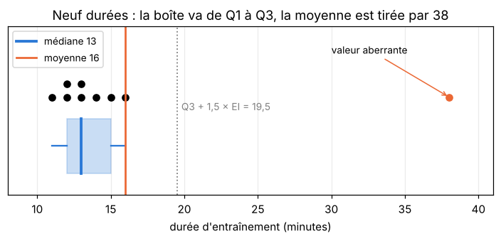
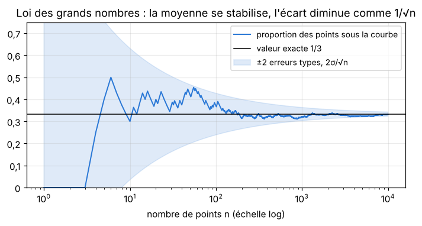
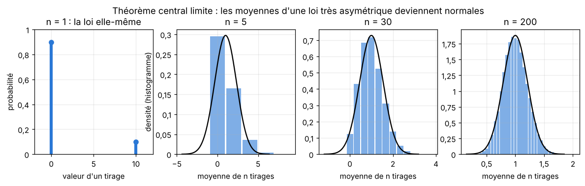
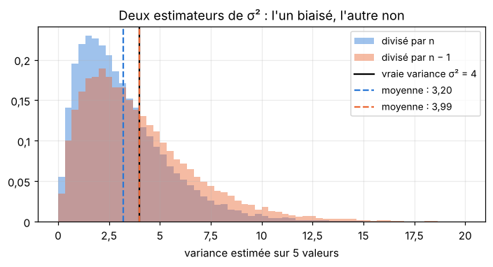
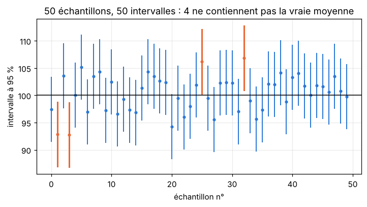
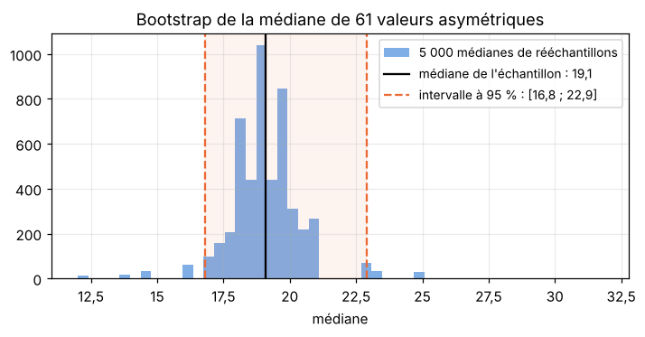
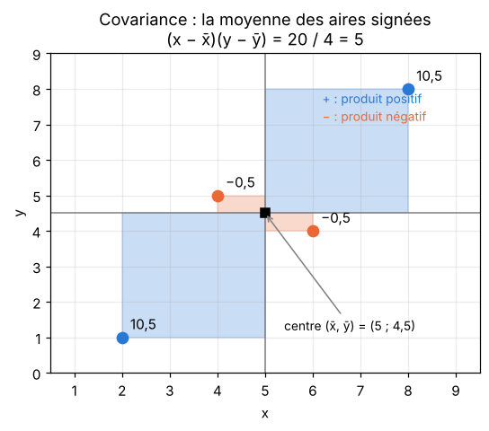
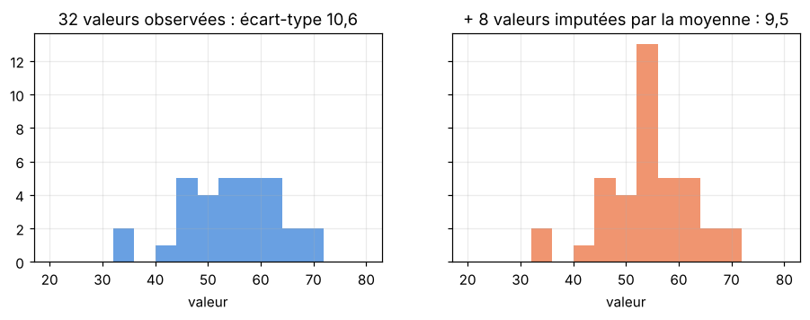
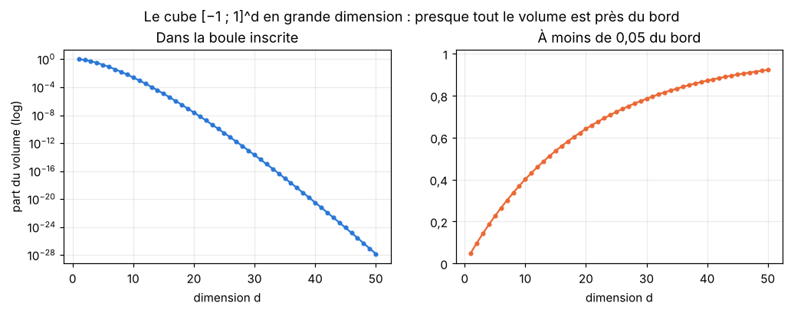

# M02c · Échantillons et estimation — fiche de cours

> M02b décrivait des **lois** : on connaissait $\mu$ et $\sigma$, on calculait des probabilités. Un dataset, lui, ne donne que des **nombres** : quelques centaines de valeurs tirées d'une loi inconnue. Ce chapitre fait le chemin inverse. Il commence par résumer une série (moyenne, médiane, quantiles, variance) et y repérer les valeurs aberrantes. Puis il modélise les données comme un **échantillon i.i.d.**, et démontre ce qui fait marcher toute la statistique : la moyenne de $n$ tirages se rapproche de l'espérance (**loi des grands nombres**), son écart-type diminue comme $\frac{1}{\sqrt{n}}$, et sa loi devient normale (**théorème central limite**). On en tire les **estimateurs**, leur biais et leur erreur quadratique (d'où le fameux $n - 1$), l'**erreur type** et l'**intervalle de confiance** d'une moyenne ou d'une accuracy, et le principe du **bootstrap**. Enfin la **covariance**, la **corrélation** et une première **matrice de covariance**, puis trois pièges des vraies données : l'imputation, le biais d'échantillonnage et la grande dimension.

| | |
|---|---|
| **Sections** | §1 à §9 |
| **Temps total estimé** | ≈ 13,8 h : lecture et calculs de la fiche ≈ 3 h, exercices ≈ 10 h, flashcards ≈ 50 min (parcours essentiel ≈ 9,0 h) |
| **Prérequis** | R1 (racines, puissances) ; R4 (le symbole $\Sigma$) ; R9 (produit scalaire, norme) ; M02a (quantiles) ; M02b (espérance, variance, variance d'une somme, loi normale et fonction $\Phi$, covariance de deux variables) ; workbookIA 0A (arrays NumPy) |
| **Fichiers du chapitre** | `02_exercices.md` (quiz, papier) · `03_notebook.ipynb` · `04_indices.md` · `05_solutions.md` et `05_solutions.ipynb` · `06_mes_reponses.md` · `flashcards.csv` |
| **mymath** | `estimation.py` : `sample_means`, `estimator_bias`, `estimator_mse`, `standard_error`, `confidence_interval_mean` |
| **MML** | §6.4 (§6.4.1, §6.4.2 et §6.4.6 ; voir le guide de lecture ci-dessous) |

## Comment utiliser ce chapitre

**Ordre conseillé.**
1. `python tools/start_chapter.py M02c` (sur Colab : `00_setup/COLAB.md` §2) : il copie le notebook, ta feuille de réponses et le squelette `mymath/estimation.py`.
2. Section par section : lis **crayon en main**, refais chaque calcul ; puis fais les exercices de la section, quiz 🧠 d'abord.
3. Les exercices ✏️ et 🔗 se font sur papier, dans ta copie de `06_mes_reponses.md`, puis se vérifient dans la **partie 0** du notebook. Les démonstrations ∂ se rédigent dans ta copie et se jugent avec la grille de relecture de `05_solutions.md`.

**Distingue toujours deux mondes** : la **loi** (inconnue, avec ses paramètres $\mu$, $\sigma^2$, notés par des lettres grecques) et l'**échantillon** (les nombres que tu as, avec leurs statistiques $\bar{x}$, $s^2$, notées par des lettres latines). Toute la statistique consiste à parler du premier avec le second, en disant de combien on peut se tromper.

| Section | Quiz 🧠 | Papier et réflexion | Notebook |
|---|---|---|---|
| §1 Statistiques descriptives | Q1 | M02c.1 ✏️, M02c.13 🔗, M02c.15 📖 | M02c.21 📦 |
| §2 z-score, valeurs aberrantes | Q2 | M02c.2 ✏️, M02c.14 🔗 | |
| §3 Échantillon i.i.d., avec et sans remise | Q3 | M02c.4 ✏️ | |
| §4 Loi des grands nombres | Q4, R1 🔁 | M02c.5 ✏️ | |
| §5 Théorème central limite | Q4, R2 🔁 | M02c.5 ✏️, M02c.6 ✏️, M02c.12 ∂, M02c.17 🗣️ | M02c.18 🔨, M02c.22 🔮, M02c.25 🎨, M02c.27 🛠️ |
| §6 Estimateurs, biais, erreur quadratique | Q5, R1 🔁 | M02c.7 ✏️, M02c.11 ∂ | M02c.19 🔨 |
| §7 Erreur type, intervalle de confiance, bootstrap | Q6, R3 🔁 | M02c.8 ✏️, M02c.12 ∂, M02c.13 🔗, M02c.E1 💼 | M02c.20 🔨, M02c.21 📦, M02c.23 🔬, M02c.26 🐛, M02c.27 🛠️, M02c.28 🏆 |
| §8 Covariance, corrélation, matrice de covariance | Q7 | M02c.9 ✏️, M02c.10 ✏️, M02c.15 📖 | |
| §9 Imputation, biais d'échantillonnage, grande dimension | | M02c.3 ✏️, M02c.16 ⚖️ | M02c.24 🔬 |

Parcours essentiel : tout sauf M02c.R3, M02c.3, M02c.4, M02c.10, M02c.11, M02c.14, M02c.15, M02c.16, M02c.19, M02c.21, M02c.24, M02c.25, M02c.26, M02c.27 et M02c.28. Lis tout de même la fin du §3 (tirages sans remise) en survol, et le §9 en entier : il est court, et ses pièges reviennent dans tout workbookIA.

## Guide de lecture de MML

*Mathematics for Machine Learning* (MML) a déjà été lu en M02b pour ses §6.1, §6.2, §6.4 et §6.7. Ce chapitre lit les sous-sections de §6.4 laissées de côté :
- après le **§1** de la fiche : relis **MML §6.4.1** (moyenne, médiane, mode, variance d'une **loi**, pour des vecteurs), puis lis **§6.4.2** (*empirical means and covariances* : les mêmes notions calculées sur des **données**, celles des §1 et §8 de la fiche) ;
- après le **§8** : **MML §6.4.6** (*inner products of random variables*) : la covariance vue comme un produit scalaire, et la corrélation comme le cosinus d'un angle, l'idée de la fin du §8. Questions : M02c.15.

La loi des grands nombres, le théorème central limite et les intervalles de confiance ne sont pas développés dans MML, qui suppose ces notions connues : la fiche est ta source pour les §3 à §7. Le §6.4.3 de MML (trois façons d'écrire une variance) est facultatif.

📐 **Notations.** MML note $N$ le nombre d'exemples et $D$ leur dimension, là où le workbook écrit $n$ et $p$ ; il écrit tout pour des **vecteurs** $\mathbf{x}_n \in \mathbb{R}^D$, si bien que sa covariance empirique est directement une matrice (§8). Le livre divise par $N$ (ce que la fiche note $s_n^2$, au §6) et signale en marge la version corrigée en $N - 1$.

Vocabulaire anglais de ce chapitre : *sample*, *population*, *i.i.d.* (*independent and identically distributed*), *with / without replacement*, *mean*, *median*, *mode*, *quantile*, *percentile*, *quartile*, *interquartile range* (*IQR*), *outlier*, *standard score* (*z-score*), *law of large numbers*, *central limit theorem* (*CLT*), *estimator*, *bias*, *mean squared error* (*MSE*), *unbiased*, *standard error*, *confidence interval*, *coverage*, *bootstrap*, *resampling*, *covariance*, *correlation*, *covariance matrix*, *imputation*, *sampling bias*, *survivorship bias*, *curse of dimensionality*.

## Objectifs d'apprentissage

À la fin du chapitre, tu sais :
- **résumer** une série (moyenne, médiane, quantiles, variance, écart interquartile) et **repérer** ses valeurs aberrantes, par le z-score ou par l'écart interquartile ;
- **énoncer** la loi des grands nombres et le théorème central limite, et **calculer** avec eux une probabilité sur une somme ou une moyenne ;
- **calculer** le biais, la variance et l'erreur quadratique d'un estimateur, et **justifier** le $n - 1$ ;
- **calculer** une erreur type et un intervalle de confiance pour une moyenne ou une proportion, et **interpréter** correctement le « 95 % » ;
- **calculer** une covariance, une corrélation et une matrice de covariance, et la variance d'une combinaison de variables ;
- **reconnaître** un biais d'échantillonnage, l'effet d'une imputation et les surprises de la grande dimension.

## L'essentiel en 10 lignes

1. Pour une série $x_1, \ldots, x_n$ : moyenne $\bar{x} = \frac{1}{n}\sum x_i$, **médiane** (la valeur du milieu), **quantiles** (par interpolation entre valeurs triées), variance $\frac{1}{n}\sum(x_i - \bar{x})^2$ ou, avec $n - 1$ au dénominateur, $s^2$. La médiane et les quartiles résistent aux valeurs extrêmes ; la moyenne et la variance, non.
2. **z-score** : $z = \frac{x - \bar{x}}{s}$. Valeurs aberrantes : $\lvert z \rvert > 3$, ou hors de $[Q_1 - 1{,}5\,\text{EI} ;\ Q_3 + 1{,}5\,\text{EI}]$ avec $\text{EI} = Q_3 - Q_1$ (règle de Tukey, plus robuste).
3. Un **échantillon i.i.d.** : $X_1, \ldots, X_n$ indépendantes et de même loi. Tirer **avec remise** dans une population donne un échantillon i.i.d. ; **sans remise**, les tirages sont dépendants et $\mathbb{V}(\bar{X}) = \frac{\sigma^2}{n}\cdot\frac{N - n}{N - 1}$.
4. $\mathbb{E}[\bar{X}_n] = \mu$ et $\mathbb{V}(\bar{X}_n) = \frac{\sigma^2}{n}$. **Bienaymé-Tchebychev** : $P(\lvert X - \mu \rvert \ge \varepsilon) \le \frac{\sigma^2}{\varepsilon^2}$, d'où la **loi des grands nombres** : $\bar{X}_n$ se rapproche de $\mu$ quand $n$ grandit.
5. **Théorème central limite** : pour $n$ grand, $\bar{X}_n$ suit à peu près $\mathcal{N}\big(\mu, \frac{\sigma^2}{n}\big)$, et la somme $S_n$ à peu près $\mathcal{N}(n\mu, n\sigma^2)$, **quelle que soit** la loi des $X_i$ (pourvu qu'elle ait une variance).
6. Un **estimateur** $\hat{\theta}$ est une fonction de l'échantillon. **Biais** $= \mathbb{E}[\hat{\theta}] - \theta$ ; **erreur quadratique** $\mathbb{E}\big[(\hat{\theta} - \theta)^2\big] = \text{biais}^2 + \mathbb{V}(\hat{\theta})$.
7. La variance divisée par $n$ sous-estime $\sigma^2$ en moyenne : $\mathbb{E}[S_n^2] = \frac{n - 1}{n}\sigma^2$. Diviser par $n - 1$ (`ddof=1`) donne un estimateur **sans biais**, $S^2$.
8. **Erreur type** de la moyenne : $\frac{s}{\sqrt{n}}$. **Intervalle de confiance** à 95 % : $\bar{x} \pm 1{,}96\,\frac{s}{\sqrt{n}}$ ; pour une proportion, $\hat{p} \pm 1{,}96\sqrt{\frac{\hat{p}(1 - \hat{p})}{n}}$. « 95 % » décrit la **méthode** : 95 % des échantillons donnent un intervalle qui contient la vraie valeur.
9. **Covariance** empirique $\frac{1}{n}\sum(x_i - \bar{x})(y_i - \bar{y})$ ; **corrélation** $r = \frac{\operatorname{Cov}(x, y)}{s_x s_y} \in [-1 ; 1]$ (relation **linéaire** seulement ; $\rho$ pour deux variables aléatoires). $\mathbb{V}(X + Y) = \mathbb{V}(X) + \mathbb{V}(Y) + 2\operatorname{Cov}(X, Y)$.
10. La **matrice de covariance** $\boldsymbol{\Sigma}$ range les variances sur sa diagonale et les covariances ailleurs ; elle est symétrique, et $\mathbb{V}\big(\sum_i w_iX_i\big) = \sum_i\sum_j w_iw_j\Sigma_{ij} \ge 0$.

---

## §1 · Statistiques descriptives : moyenne, médiane, variance, quantiles

Un exemple tout au long de la section : les durées, en minutes, de neuf entraînements d'un même modèle, relevées dans un journal de calcul :

$$14,\ 11,\ 13,\ 16,\ 12,\ 15,\ 13,\ 38,\ 12.$$

Le huitième a duré 38 minutes : la machine a été partagée avec un autre calcul ce jour-là. Comment résumer ces neuf nombres ?

### Position : moyenne et médiane

La **moyenne** (*mean*) de $x_1, \ldots, x_n$ est $\bar{x} = \frac{1}{n}\sum_{i=1}^{n} x_i$ (R4). Ici la somme vaut 144, donc $\bar{x} = \frac{144}{9} = 16$ minutes.

La **médiane** (*median*) est la valeur du milieu de la série **triée** : la moitié des valeurs sont en dessous, la moitié au-dessus. Triées, les durées sont

$$11,\ 12,\ 12,\ 13,\ 13,\ 14,\ 15,\ 16,\ 38,$$

et la cinquième des neuf vaut 13 : la médiane est 13 minutes. Quand $n$ est pair, on prend la moyenne des deux valeurs du milieu.

Sept entraînements sur neuf ont duré moins que la moyenne de 16 minutes, un seul plus longtemps : la valeur 38 tire la moyenne vers le haut. Sans elle, la moyenne tombe à $\frac{106}{8} = 13{,}25$, et la médiane reste 13. On dit que la médiane est **robuste** : une valeur extrême, même énorme, ne la déplace presque pas. La moyenne, elle, suit la valeur extrême : remplace 38 par 380, et elle passe à 54.

Le **mode** est la valeur la plus fréquente (ici 12 et 13, deux fois chacune) ; il sert surtout pour des catégories.

**Ce que chaque position minimise.** Si l'on cherche **un** nombre $c$ pour résumer la série, la moyenne et la médiane répondent à deux questions différentes :
- la moyenne rend minimale la **somme des carrés** des écarts $\sum_i (x_i - c)^2$ ;
- la médiane rend minimale la **somme des écarts absolus** $\sum_i \lvert x_i - c \rvert$.

Pour les durées : $\sum (x_i - 16)^2 = 564$ et $\sum (x_i - 13)^2 = 645$, mais $\sum \lvert x_i - 13 \rvert = 35$ et $\sum \lvert x_i - 16 \rvert = 44$. La première propriété vient d'une identité qui resservira au §6 :

$$\sum_{i=1}^{n}(x_i - c)^2 = \sum_{i=1}^{n}(x_i - \bar{x})^2 + n(\bar{x} - c)^2 \qquad \text{pour tout nombre } c.$$

<details>
<summary>Démonstration de l'identité</summary>

On écrit $x_i - c = (x_i - \bar{x}) + (\bar{x} - c)$ et on développe le carré :
$$\sum_i (x_i - c)^2 = \sum_i (x_i - \bar{x})^2 + 2(\bar{x} - c)\sum_i (x_i - \bar{x}) + n(\bar{x} - c)^2.$$
Or $\sum_i (x_i - \bar{x}) = \sum_i x_i - n\bar{x} = 0$ : les écarts à la moyenne se compensent exactement. Le terme du milieu disparaît. Comme $n(\bar{x} - c)^2 \ge 0$, la somme est la plus petite pour $c = \bar{x}$. Vérification : $645 = 564 + 9 \times (16 - 13)^2$.
</details>

C'est pourquoi un modèle entraîné avec l'erreur quadratique (la MSE du chapitre 1 de workbookIA) prédit des **moyennes**, et un modèle entraîné avec l'erreur absolue des **médianes**. Une feuille d'un arbre de régression (chapitre 13) prédit la moyenne des exemples qui y tombent, et l'arbre choisit ses coupures pour faire baisser la somme des carrés des écarts à ces moyennes.

### Dispersion : variance et écart-type

La **variance** d'une série est la moyenne des carrés des écarts à la moyenne, et l'**écart-type** sa racine :

$$s_n^2 = \frac{1}{n}\sum_{i=1}^{n}(x_i - \bar{x})^2, \qquad s_n = \sqrt{s_n^2}.$$

Pour les durées, les écarts à 16 sont $-2, -5, -3, 0, -4, -1, -3, 22, -4$ (leur somme est bien nulle), leurs carrés ont pour somme 564, donc $s_n^2 = \frac{564}{9} \approx 62{,}67$ et $s_n \approx 7{,}92$ minutes. Comme pour une loi (M02b), on a la formule de calcul $s_n^2 = \overline{x^2} - \bar{x}^2$ (la moyenne des carrés moins le carré de la moyenne) : $\frac{2868}{9} - 16^2 \approx 318{,}67 - 256 = 62{,}67$.

On divise souvent par $n - 1$ au lieu de $n$ :

$$s^2 = \frac{1}{n - 1}\sum_{i=1}^{n}(x_i - \bar{x})^2 = \frac{564}{8} = 70{,}5, \qquad s \approx 8{,}40.$$

Le §6 explique pourquoi : quand la série est un échantillon et qu'on veut estimer la variance de la loi, $s_n^2$ est en moyenne trop petit. Dans NumPy, `np.var(x)` divise par $n$, et `np.var(x, ddof=1)` par $n - 1$ : `ddof` (*delta degrees of freedom*) est le nombre qu'on retranche à $n$. Une seule valeur (38) fournit $\frac{484}{564} \approx 86\,\%$ de la somme des carrés : la variance est encore moins robuste que la moyenne.

**Transformation affine.** Si $y_i = a x_i + b$, alors $\bar{y} = a\bar{x} + b$ et $s_y = \lvert a \rvert\,s_x$ : décaler les données ne change pas leur dispersion, les multiplier par $a$ multiplie l'écart-type par $\lvert a \rvert$ (et la variance par $a^2$), comme pour une variable aléatoire en M02b.

### Quantiles d'une série

M02a a défini le quantile d'ordre $p$ d'une **loi**. Pour une **série** de $n$ valeurs, il y a plusieurs conventions ; le workbook suit celle de NumPy (`np.percentile` et `np.quantile`, méthode linéaire par défaut) :
1. trier les valeurs : $x_{(0)} \le x_{(1)} \le \cdots \le x_{(n-1)}$ (numérotées à partir de 0, comme en Python) ;
2. calculer la **position** $h = p\,(n - 1)$ ;
3. si $h$ est un entier, le quantile est $x_{(h)}$ ; sinon, on **interpole** entre les deux voisines : avec $k$ la partie entière de $h$, $q_p = x_{(k)} + (h - k)\big(x_{(k+1)} - x_{(k)}\big)$.

Pour les neuf durées triées ($n - 1 = 8$) :
- **premier quartile** $Q_1 = q_{0{,}25}$ : $h = 0{,}25 \times 8 = 2$, donc $Q_1 = x_{(2)} = 12$ ;
- **médiane** $q_{0{,}5}$ : $h = 4$, $x_{(4)} = 13$ (on retrouve la médiane) ;
- **troisième quartile** $Q_3 = q_{0{,}75}$ : $h = 6$, $x_{(6)} = 15$ ;
- **percentile 90** : $h = 0{,}9 \times 8 = 7{,}2$, entre $x_{(7)} = 16$ et $x_{(8)} = 38$ : $16 + 0{,}2 \times (38 - 16) = 20{,}4$.

L'**écart interquartile** (*interquartile range*, *IQR*) $\text{EI} = Q_3 - Q_1 = 3$ minutes mesure la dispersion de la moitié centrale des données, sans être influencé par les extrêmes. La **boîte à moustaches** (*boxplot*) dessine ces nombres : une boîte de $Q_1$ à $Q_3$, coupée par la médiane, et des moustaches jusqu'aux valeurs les plus extrêmes qui ne sont pas aberrantes (§2).

```python
>>> import numpy as np
>>> d = np.array([14, 11, 13, 16, 12, 15, 13, 38, 12])
>>> float(d.mean()), float(np.median(d)), round(float(d.var()), 3), float(d.var(ddof=1))
(16.0, 13.0, 62.667, 70.5)
>>> [round(float(q), 2) for q in np.percentile(d, [25, 50, 75, 90])]
[12.0, 13.0, 15.0, 20.4]
```



### Percentiles d'une mesure : la latence

Pour un temps de réponse (une **latence**), la moyenne est un mauvais résumé : quelques réponses très lentes la tirent vers le haut, alors que la plupart des utilisateurs n'ont rien vu, et une moyenne correcte peut cacher un service pénible pour une minorité. On publie donc des **percentiles** : le p50 (la médiane, l'expérience typique), le p95 et le **p99** (le temps sous lequel tombent 99 % des réponses). « p99 = 180 ms » veut dire : une réponse sur cent prend plus de 180 ms.

Un percentile élevé est **plus incertain** qu'une médiane, car il repose sur peu de valeurs : sur 2 000 mesures, le p99 est déterminé par la vingtaine de plus lentes. Le nombre de mesures qui dépassent le vrai quantile $q_{0{,}99}$ de la loi suit une binomiale $\mathcal{B}(2000 ; 0{,}01)$ (chaque mesure le dépasse avec la probabilité 0,01, indépendamment) : en moyenne 20, avec un écart-type $\sqrt{2000 \times 0{,}01 \times 0{,}99} \approx 4{,}45$. Le p99 empirique peut donc tomber, selon l'échantillon, entre la 11ᵉ et la 29ᵉ valeur la plus lente environ : sur une queue longue, cela fait une grande différence de millisecondes. M02c.13 chiffre cette incertitude.

⚠️ **Erreur classique.** Croire qu'il n'y a qu'une seule façon de calculer un quantile de données : avec peu de valeurs, les conventions (interpolation linéaire, valeur la plus proche, « quartiles de Tukey ») donnent des résultats différents. Dis toujours laquelle tu utilises. Autre piège : prendre la moyenne pour la valeur « typique » d'une série asymétrique ; la médiane l'est davantage.

💻 **Aujourd'hui en pratique** — `np.mean`, `np.median`, `np.var(x, ddof=…)`, `np.std`, `np.percentile(x, [25, 50, 75])` (l'argument `method` choisit la convention) ; pandas résume un tableau d'un coup avec `df.describe()`. Les outils de surveillance des services en ligne calculent les percentiles de latence sur des millions de mesures avec des structures approchées, qui ne gardent pas toutes les valeurs.

📖 **Dans MML** — §6.4.2 définit la moyenne et la covariance **empiriques** (*empirical mean*, *empirical covariance*) d'un dataset de $N$ vecteurs ; en dimension 1, la covariance empirique d'une série avec elle-même est $s_n^2$. Lecture et questions : M02c.15.

🔗 **Dans workbookIA** — le chapitre 2 résume des listes de nombres (moyenne, médiane, mode, variance, percentiles), et le bonus B7 mesure la latence d'un modèle déployé par ses percentiles.

---

## §2 · Standardiser : z-score ; valeurs aberrantes

### Le z-score

Le **z-score** (ou score standard, *standard score*) d'une valeur $x$ dit à combien d'écarts-types de la moyenne elle se trouve :

$$z = \frac{x - \bar{x}}{s}.$$

C'est la standardisation de M02b, appliquée à des données : on remplace $\mu$ et $\sigma$ par $\bar{x}$ et $s$. Pour la durée 38 : avec $s_n \approx 7{,}92$, $z = \frac{38 - 16}{7{,}92} \approx 2{,}78$ ; avec $s \approx 8{,}40$, $z \approx 2{,}62$. Dis toujours quel écart-type tu prends.

**Standardiser une feature.** Remplacer chaque $x_i$ par son z-score $z_i = \frac{x_i - \bar{x}}{s_n}$ donne une série de **moyenne 0 et d'écart-type 1** (par la transformation affine du §1, avec $a = \frac{1}{s_n}$ et $b = -\frac{\bar{x}}{s_n}$). Les durées standardisées valent $-0{,}25$, $-0{,}63$, $-0{,}38$, $0$, $-0{,}51$, $-0{,}13$, $-0{,}38$, $2{,}78$, $-0{,}51$. Le ML standardise ainsi ses features pour qu'elles aient toutes la même échelle : une distance ou une descente de gradient ne doit pas être dominée par la feature mesurée dans la plus petite unité.

⚠️ **Erreur classique.** Standardiser le jeu de test avec **ses propres** moyenne et écart-type. On calcule $\bar{x}$ et $s$ sur le **seul jeu d'entraînement**, puis on applique la **même** transformation au test : sinon, de l'information du test fuit dans le modèle, et un exemple de test isolé ne pourrait même pas être standardisé. M02c.14 le fait à la main.

### Repérer les valeurs aberrantes

Une **valeur aberrante** (*outlier*) est une valeur très éloignée des autres : erreur de mesure, unité mal saisie, ou cas réellement exceptionnel. Deux règles courantes :
- **le z-score** : on signale $\lvert z \rvert > 3$, ce qui est très rare pour des données normales (la probabilité $2\big(1 - \Phi(3)\big)$ se lit dans la table de M02b) ;
- **l'écart interquartile** (règle de **Tukey**) : on signale les valeurs hors de l'intervalle $[Q_1 - 1{,}5\,\text{EI} ;\ Q_3 + 1{,}5\,\text{EI}]$, dont les bornes s'appellent des **barrières** (*fences*).

Pour les durées : $\lvert z \rvert \approx 2{,}78 < 3$, donc le z-score **ne signale pas** 38. La règle de Tukey donne les barrières $12 - 1{,}5 \times 3 = 7{,}5$ et $15 + 1{,}5 \times 3 = 19{,}5$ : 38 est **signalée**.

Pourquoi le z-score échoue-t-il ? Parce que la valeur aberrante **gonfle elle-même** l'écart-type qui sert à la juger : sans 38, les huit autres durées ont un écart-type d'environ 1,56 minute (avec $s_n$), et 38 serait à plus de 15 de ces écarts-types de leur moyenne. C'est l'**effet de masque** (*masking*). Les quartiles, eux, ne bougent presque pas avec une valeur extrême : la règle de Tukey est **robuste**.

Pire : avec peu de valeurs, le z-score ne **peut** pas dépasser 3. On montre (résultat admis) que, pour $n$ valeurs, $\lvert z \rvert \le \sqrt{n - 1}$ avec $s_n$, et $\lvert z \rvert \le \frac{n - 1}{\sqrt{n}}$ avec $s$. Pour $n = 9$ : au plus $\sqrt{8} \approx 2{,}83$ ou $\frac{8}{3} \approx 2{,}67$, quelle que soit la valeur extrême, même 380. La règle $\lvert z \rvert > 3$ est faite pour des séries assez longues, sans grosse valeur aberrante, à peu près normales.

⚠️ **Erreur classique.** Supprimer automatiquement toute valeur signalée. Une règle de détection **propose** des valeurs à examiner ; on supprime une valeur seulement si l'on comprend pourquoi elle est fausse (unité, capteur, saisie). Une fraude, une panne ou un client exceptionnel sont aberrants **et** importants.

🔗 **Dans workbookIA** — le chapitre 2 standardise des données par leurs z-scores ; le chapitre 12 traite les valeurs aberrantes et standardise les features d'un pipeline (le `StandardScaler` de scikit-learn, ajusté sur le seul jeu d'entraînement).

---

## §3 · Échantillon i.i.d., tirages avec et sans remise

### Le modèle : un échantillon

On suppose que les données $x_1, \ldots, x_n$ sont les **réalisations** de variables aléatoires $X_1, \ldots, X_n$ :
- **indépendantes** (M02b §5) : connaître les unes ne dit rien des autres ;
- **de même loi** (*identically distributed*) : la loi de la **population**, d'espérance $\mu$ et de variance $\sigma^2$ inconnues.

On dit que $X_1, \ldots, X_n$ est un **échantillon i.i.d.** (*independent and identically distributed*) de taille $n$. Une **statistique** est une fonction de l'échantillon : $\bar{X}_n = \frac{1}{n}\sum X_i$, la médiane, le maximum… C'est **elle-même une variable aléatoire** : un autre échantillon donnerait une autre valeur. La valeur calculée sur tes données, $\bar{x}$, en est une réalisation. Toute la suite du chapitre étudie la loi de ces statistiques.

Par M02b §6 :

$$\mathbb{E}[\bar{X}_n] = \mu, \qquad \mathbb{V}(\bar{X}_n) = \frac{\sigma^2}{n}, \qquad \sigma(\bar{X}_n) = \frac{\sigma}{\sqrt{n}}.$$

L'hypothèse i.i.d. est celle de presque tout le ML : les exemples d'un dataset sont tirés indépendamment d'une même loi, et le jeu de test vient de la même loi que le jeu d'entraînement. Elle est **fausse** dans des cas fréquents :
- **séries temporelles** : la mesure de demain dépend de celle d'aujourd'hui ;
- **groupes** : plusieurs photos d'un même visage, plusieurs phrases d'un même auteur se ressemblent plus entre elles qu'avec les autres ;
- **dérive** : la loi change avec le temps (les clients de cette année ne sont pas ceux d'il y a trois ans).

### Avec remise

On tire $n$ fois au hasard une valeur parmi les $N$ valeurs d'une **population finie** $a_1, \ldots, a_N$, en **remettant** chaque fois la valeur tirée. Chaque tirage suit la loi uniforme sur les $N$ valeurs, d'espérance $\mu = \frac{1}{N}\sum a_k$ et de variance $\sigma^2 = \frac{1}{N}\sum (a_k - \mu)^2$ (divisée par $N$ : c'est la variance d'une **loi**). Les tirages sont indépendants : l'échantillon est **i.i.d.**, et $\mathbb{V}(\bar{X}) = \frac{\sigma^2}{n}$. Une même valeur peut sortir plusieurs fois.

### Sans remise

Sans remettre, chaque tirage a toujours la même loi (par symétrie, la valeur du $i$-ème tirage est n'importe laquelle des $N$ avec la probabilité $\frac{1}{N}$), mais les tirages sont **dépendants** : si le premier tire une grande valeur, il en reste moins pour le second.

Exemple : la population $\{1, 2, 6, 7\}$ ($N = 4$, $\mu = 4$, $\sigma^2 = \frac{9 + 4 + 4 + 9}{4} = 6{,}5$), et $n = 2$ tirages sans remise. Les 6 paires possibles, équiprobables, donnent pour moyennes 1,5 ; 3,5 ; 4 ; 4 ; 4,5 ; 6,5. Leur moyenne vaut bien $\mu = 4$, et leur variance $\frac{6{,}25 + 0{,}25 + 0 + 0 + 0{,}25 + 6{,}25}{6} = \frac{13}{6} \approx 2{,}17$, **plus petite** que les $\frac{6{,}5}{2} = 3{,}25$ d'un tirage avec remise. Normal : sans remise, les paires extrêmes $(1, 1)$ et $(7, 7)$ sont impossibles.

> **Tirages sans remise.** Pour deux tirages distincts $i \ne j$, $\operatorname{Cov}(X_i, X_j) = -\frac{\sigma^2}{N - 1}$, et
> $$\mathbb{V}(\bar{X}) = \frac{\sigma^2}{n}\cdot\frac{N - n}{N - 1}.$$
> Le facteur $\frac{N - n}{N - 1}$ s'appelle le **facteur de correction de population finie**.

<details>
<summary>Démonstration</summary>

Toutes les paires de tirages distincts jouent le même rôle : notons $c$ leur covariance commune. La variance d'une somme (M02b §6, avec les covariances) donne, pour $n$ tirages :
$$\mathbb{V}(X_1 + \cdots + X_n) = n\sigma^2 + n(n - 1)\,c,$$
car il y a $n$ variances et $n(n - 1)$ couples $(i, j)$ avec $i \ne j$. Appliquons-la à $n = N$ : on tire **toute** la population, et la somme vaut $a_1 + \cdots + a_N$ quel que soit l'ordre. Elle n'est plus aléatoire, sa variance est nulle : $N\sigma^2 + N(N - 1)c = 0$, d'où $c = -\frac{\sigma^2}{N - 1}$. Pour $n$ quelconque, on divise par $n^2$ :
$$\mathbb{V}(\bar{X}) = \frac{1}{n^2}\Big(n\sigma^2 - \frac{n(n - 1)\sigma^2}{N - 1}\Big) = \frac{\sigma^2}{n}\Big(1 - \frac{n - 1}{N - 1}\Big) = \frac{\sigma^2}{n}\cdot\frac{N - n}{N - 1}.$$
Pour l'exemple : $\frac{6{,}5}{2} \times \frac{2}{3} = \frac{13}{6}$.
</details>

Deux cas limites : pour $n = N$, la variance est nulle (on a tout vu) ; quand $N$ est **très grand** devant $n$, le facteur vaut presque 1, et tirer sans remise revient à tirer avec remise. Un sondage de 1 000 personnes dans un pays se calcule comme un échantillon i.i.d.

En ML : un découpage entraînement / test, ou les mini-batches d'une epoch, se font **sans remise** (chaque exemple sert une fois) ; le **bootstrap** (§7) et le *bagging* (chapitre 14) tirent **avec remise**.

⚠️ **Erreur classique.** Croire que « sans remise » change la loi de chaque tirage : non, chaque tirage a toujours la loi uniforme sur la population. C'est la **dépendance** entre tirages qui change, et avec elle la variance de la moyenne.

🔗 **Dans workbookIA** — le chapitre 2 définit les variables i.i.d., et tire avec et sans remise (`rng.choice(…, replace=…)`) ; le chapitre 8 découpe des données dépendantes (groupes, séries temporelles) sans fausser l'évaluation.

---

## §4 · Loi des grands nombres

R8 a observé par simulation que la fréquence d'un événement se stabilise quand on répète l'expérience. Démontrons-le.

### Deux inégalités

> **Inégalité de Markov.** Si $X \ge 0$ a une espérance, alors pour tout $a > 0$ : $P(X \ge a) \le \frac{\mathbb{E}[X]}{a}$.
>
> **Inégalité de Bienaymé-Tchebychev.** Si $X$ a une espérance $\mu$ et une variance $\sigma^2$, alors pour tout $\varepsilon > 0$ :
> $$P\big(\lvert X - \mu \rvert \ge \varepsilon\big) \le \frac{\sigma^2}{\varepsilon^2}.$$

En mots : une variable ne peut pas être souvent loin de sa moyenne si sa variance est petite. Avec $\varepsilon = k\sigma$ : $P(\lvert X - \mu \rvert \ge k\sigma) \le \frac{1}{k^2}$, pour **n'importe quelle** loi. À 2 écarts-types, au plus 25 % ; à 3, au plus 11 %. Pour une loi normale, les vraies valeurs sont 4,6 % et 0,27 % : la borne est valable partout, mais souvent large.

<details>
<summary>Démonstrations</summary>

**Markov** (cas discret ; le cas à densité est identique avec des intégrales) : $\mathbb{E}[X] = \sum_x x\,P(X = x) \ge \sum_{x \ge a} x\,P(X = x) \ge \sum_{x \ge a} a\,P(X = x) = a\,P(X \ge a)$. On a enlevé des termes positifs, puis remplacé $x$ par plus petit que lui.

**Bienaymé-Tchebychev** : on applique Markov à la variable positive $Y = (X - \mu)^2$ et à $a = \varepsilon^2$. L'événement $\lvert X - \mu \rvert \ge \varepsilon$ est le même que $Y \ge \varepsilon^2$, donc $P(\lvert X - \mu \rvert \ge \varepsilon) \le \frac{\mathbb{E}[Y]}{\varepsilon^2} = \frac{\sigma^2}{\varepsilon^2}$.
</details>

### La loi (faible) des grands nombres

Appliquons Bienaymé-Tchebychev à $\bar{X}_n$, d'espérance $\mu$ et de variance $\frac{\sigma^2}{n}$ :

$$P\big(\lvert \bar{X}_n - \mu \rvert \ge \varepsilon\big) \le \frac{\sigma^2}{n\,\varepsilon^2} \xrightarrow[n \to +\infty]{} 0.$$

> **Loi des grands nombres** (*law of large numbers*). Si $X_1, X_2, \ldots$ sont i.i.d. d'espérance $\mu$ et de variance finie, alors pour tout $\varepsilon > 0$, $P\big(\lvert \bar{X}_n - \mu \rvert \ge \varepsilon\big) \to 0$ quand $n \to +\infty$ : la moyenne de l'échantillon se rapproche de l'espérance.

Cas particulier : si $X_i$ vaut 1 quand un événement $A$ se produit et 0 sinon (une Bernoulli de paramètre $P(A)$), $\bar{X}_n$ est la **fréquence** de $A$ sur $n$ essais, et elle tend vers $P(A)$. C'est le résultat que R8 avait observé.

**Exemple : la méthode de Monte-Carlo.** Pour estimer l'aire sous la parabole $y = x^2$ entre 0 et 1 (elle vaut $\frac{1}{3}$, M02a), on tire $n$ points $(u, v)$ uniformes dans le carré $[0 ; 1]^2$ et on compte la proportion de points sous la courbe ($v < u^2$). Chaque point est une Bernoulli de paramètre $p = \frac{1}{3}$, d'écart-type $\sigma = \sqrt{p(1 - p)} = \frac{\sqrt{2}}{3} \approx 0{,}471$. Avec $n = 10\,000$ points, la proportion a pour écart-type $\frac{0{,}471}{100} \approx 0{,}0047$. Bienaymé-Tchebychev garantit :

$$P\big(\lvert \bar{X}_n - \tfrac{1}{3} \rvert \ge 0{,}01\big) \le \frac{2/9}{10\,000 \times 0{,}01^2} \approx 0{,}22.$$

```python
>>> rng = np.random.default_rng(0)
>>> u = rng.random((10_000, 2))                  # 10 000 points in the unit square
>>> float(np.mean(u[:, 1] < u[:, 0] ** 2))       # share of points under y = x²: close to 1/3
0.3403
```

L'écart est de $0{,}3403 - 0{,}3333 = 0{,}007$, soit 1,5 écart-type environ. La figure suit cette proportion au fil des points : les oscillations du début s'amortissent, et l'écart à $\frac{1}{3}$ reste presque toujours dans la bande $\pm 2\frac{\sigma}{\sqrt{n}}$, qui rétrécit comme $\frac{1}{\sqrt{n}}$.



**La vitesse : $\frac{1}{\sqrt{n}}$.** L'écart typique entre $\bar{X}_n$ et $\mu$ est $\frac{\sigma}{\sqrt{n}}$ : pour **diviser l'erreur par 10, il faut 100 fois plus** de tirages. C'est lent, mais cette vitesse ne dépend pas de la dimension du problème : c'est pourquoi Monte-Carlo est la méthode de choix pour les intégrales en grande dimension.

⚠️ **Erreur classique.** Croire que le hasard « compense » : après dix piles, face n'est pas plus probable. La loi des grands nombres ne corrige rien ; elle **dilue** : les dix piles comptent de moins en moins dans une moyenne de plus en plus longue. La somme $S_n - n\mu$, elle, ne tend pas vers 0 : son écart-type $\sigma\sqrt{n}$ **grandit**.

⚠️ **Hypothèse indispensable.** La loi doit avoir une espérance. La densité $\frac{1}{x^2}$ sur $[1 ; +\infty[$ de M02b n'en a pas : les moyennes de ses tirages ne se stabilisent jamais, chaque très grande valeur les fait bondir.

🔗 **Dans workbookIA** — chaque moyenne calculée sur des tirages (le chapitre 2 en fait beaucoup) ; la loss moyenne sur un mini-batch, qui estime la loss sur toutes les données (chapitre 18) ; l'estimation d'une valeur par la moyenne des retours observés en apprentissage par renforcement (chapitres 8 et 26).

---

## §5 · Théorème central limite

La loi des grands nombres dit **où** va $\bar{X}_n$ (vers $\mu$) et à quelle vitesse (en $\frac{\sigma}{\sqrt{n}}$). Le théorème central limite dit **comment** elle se répartit autour : selon une loi normale, quelle que soit la loi de départ.

> **Théorème central limite** (*central limit theorem*, *CLT*). Si $X_1, X_2, \ldots$ sont i.i.d. d'espérance $\mu$ et de variance $\sigma^2 > 0$ finie, alors pour tous $a < b$ :
> $$P\Big(a \le \frac{\bar{X}_n - \mu}{\sigma/\sqrt{n}} \le b\Big) \xrightarrow[n \to +\infty]{} \Phi(b) - \Phi(a).$$
> En pratique, pour $n$ assez grand : $\bar{X}_n$ suit à peu près $\mathcal{N}\big(\mu, \frac{\sigma^2}{n}\big)$, et la somme $S_n = X_1 + \cdots + X_n$ à peu près $\mathcal{N}(n\mu, n\sigma^2)$.

La démonstration demande des outils hors de portée ici (les fonctions caractéristiques) : on l'admet. Remarque que l'espérance et la variance de $\bar{X}_n$ étaient déjà connues (§3) : le théorème ajoute que la **forme** de la loi devient celle d'une cloche. C'est ce qui explique la loi normale partout (M02b §3) : une grandeur qui résulte de **nombreux petits effets indépendants qui s'additionnent** est à peu près normale.

**Exemple.** Un script traite 64 fichiers, indépendamment ; chaque traitement dure en moyenne 50 secondes, avec un écart-type de 40 secondes (la loi des durées est très asymétrique : beaucoup de traitements courts, quelques très longs). La durée totale $S$ a pour espérance $64 \times 50 = 3200$ secondes et pour écart-type $40\sqrt{64} = 320$ secondes (M02b §6). Par le théorème central limite, $S$ suit à peu près $\mathcal{N}(3200, 320^2)$, donc

$$P(S > 3840) \approx 1 - \Phi\Big(\frac{3840 - 3200}{320}\Big) = 1 - \Phi(2) \approx 0{,}0228.$$

Il y a environ 2 % de risque que le script dure plus de 64 minutes. On n'a pas eu besoin de connaître la loi d'un traitement : seulement sa moyenne et son écart-type.



**À partir de quel $n$ ?** Cela dépend de la loi de départ. Pour une loi déjà symétrique (uniforme), $n = 5$ suffit presque ; pour une loi très **asymétrique** comme celle de la figure, les moyennes de 30 tirages restent visiblement penchées. La règle « $n \ge 30$ » souvent citée n'est qu'un ordre de grandeur. Pour une proportion $\hat{p}$ (une moyenne de Bernoulli), on demande souvent $n\hat{p} \ge 10$ et $n(1 - \hat{p}) \ge 10$.

**Pour une proportion.** Si $X_i \sim \mathcal{B}(p)$, alors $\hat{p} = \bar{X}_n$ suit à peu près $\mathcal{N}\big(p, \frac{p(1 - p)}{n}\big)$ ; de même, une binomiale $\mathcal{B}(n, p)$, somme de $n$ Bernoulli, suit à peu près $\mathcal{N}\big(np, np(1 - p)\big)$. C'est la loi de l'accuracy d'un modèle sur un jeu de test (§7).

⚠️ **Erreur classique.** Croire que le théorème central limite rend les **données** normales. Il porte sur la **moyenne** (ou la somme) de beaucoup de tirages, pas sur les tirages eux-mêmes : 10 000 durées de traitement restent asymétriques ; c'est leur moyenne qui a une loi presque normale. Autre piège : oublier le $\sqrt{n}$, et prendre $\frac{\sigma}{n}$ ou $\sigma$ pour l'écart-type de $\bar{X}_n$.

💻 **Aujourd'hui en pratique** — on vérifie le théorème par simulation : tirer beaucoup d'échantillons, calculer leurs moyennes, tracer l'histogramme (ta fonction `sample_means`, M02c.18). `scipy.stats.norm(mu, sigma).cdf(x)` donne les probabilités normales sans table.

🔗 **Dans workbookIA** — les intervalles de confiance et le bootstrap du chapitre 2, l'erreur type d'un score du chapitre 8, et la somme pondérée d'un neurone, qui additionne beaucoup de petites contributions (chapitres 16 à 18, où l'initialisation des poids règle sa variance).

---

## §6 · Estimateurs : biais, variance, erreur quadratique ; le ddof

### Estimer un paramètre

Un **paramètre** $\theta$ est un nombre attaché à la loi (sa moyenne $\mu$, sa variance $\sigma^2$, une borne…). Un **estimateur** (*estimator*) de $\theta$ est une statistique $\hat{\theta} = g(X_1, \ldots, X_n)$ qu'on calcule pour l'approcher. C'est une variable aléatoire ; sa valeur sur tes données est une **estimation**. Trois nombres décrivent sa qualité :

$$\text{biais}(\hat{\theta}) = \mathbb{E}[\hat{\theta}] - \theta, \qquad \mathbb{V}(\hat{\theta}), \qquad \text{EQM}(\hat{\theta}) = \mathbb{E}\big[(\hat{\theta} - \theta)^2\big].$$

- Le **biais** (*bias*) mesure l'erreur **systématique** : en moyenne sur tous les échantillons, de combien on se trompe. Un estimateur de biais nul est **sans biais** (*unbiased*).
- La **variance** mesure l'erreur **aléatoire** : de combien l'estimation varie d'un échantillon à l'autre.
- L'**erreur quadratique moyenne** (EQM, *mean squared error*, *MSE*) mesure l'erreur totale.

> **Décomposition de l'erreur quadratique.**
> $$\text{EQM}(\hat{\theta}) = \text{biais}(\hat{\theta})^2 + \mathbb{V}(\hat{\theta}).$$

<details>
<summary>Démonstration</summary>

Notons $m = \mathbb{E}[\hat{\theta}]$. On écrit $\hat{\theta} - \theta = (\hat{\theta} - m) + (m - \theta)$ et on développe :
$$\mathbb{E}\big[(\hat{\theta} - \theta)^2\big] = \mathbb{E}\big[(\hat{\theta} - m)^2\big] + 2(m - \theta)\,\mathbb{E}[\hat{\theta} - m] + (m - \theta)^2.$$
Le premier terme est $\mathbb{V}(\hat{\theta})$, le dernier le carré du biais ($m - \theta$ est un nombre), et le terme du milieu est nul car $\mathbb{E}[\hat{\theta} - m] = m - m = 0$. C'est la même idée que l'identité du §1 : un écart se coupe en deux morceaux dont le produit croisé s'annule en moyenne.
</details>

Une cible de tir aide à se le représenter : le biais est la distance entre le centre de la cible et le centre du groupe d'impacts, la variance la dispersion du groupe. Un tireur peut être précis mais décalé, ou centré mais dispersé.

**La moyenne.** $\bar{X}_n$ est un estimateur **sans biais** de $\mu$ ($\mathbb{E}[\bar{X}_n] = \mu$), de variance $\frac{\sigma^2}{n}$, donc d'EQM $\frac{\sigma^2}{n}$, qui tend vers 0 : on dit qu'il est **convergent** (*consistent*).

### La variance de l'échantillon et le ddof

Pour estimer $\sigma^2$, l'idée naturelle est la variance de l'échantillon divisée par $n$ :

$$S_n^2 = \frac{1}{n}\sum_{i=1}^{n}(X_i - \bar{X}_n)^2.$$

Elle est **biaisée** : on montre que

$$\mathbb{E}[S_n^2] = \frac{n - 1}{n}\,\sigma^2 < \sigma^2.$$

Pourquoi trop petite ? Les écarts sont mesurés à $\bar{X}_n$, et non à la vraie moyenne $\mu$ qu'on ne connaît pas. Or $\bar{X}_n$ est, par construction, le nombre qui rend $\sum (X_i - c)^2$ **le plus petit possible** (§1) : mesurés depuis $\bar{X}_n$, les écarts sont systématiquement plus petits que mesurés depuis $\mu$. L'identité du §1, avec $c = \mu$, dit de combien ; M02c.11 en tire la démonstration complète.

Pour corriger, on divise par $n - 1$ :

$$S^2 = \frac{1}{n - 1}\sum_{i=1}^{n}(X_i - \bar{X}_n)^2 = \frac{n}{n - 1}\,S_n^2, \qquad \mathbb{E}[S^2] = \sigma^2.$$

$S^2$ est la **variance d'échantillon sans biais** (`ddof=1`). Le nombre $n - 1$ s'appelle le nombre de **degrés de liberté** : les $n$ écarts $X_i - \bar{X}_n$ ont une somme nulle, donc $n - 1$ d'entre eux suffisent à donner le dernier. Pour $n = 5$, $S_n^2$ sous-estime $\sigma^2$ de 20 % en moyenne ; pour $n = 1000$, de 0,1 % : la différence ne compte que pour les petits échantillons.



**Sans biais ne veut pas dire meilleur.** Pour des données normales, on montre (résultat admis) que $\mathbb{V}(S^2) = \frac{2\sigma^4}{n - 1}$, d'où, pour $\sigma^2 = 4$ et $n = 5$ : $\text{EQM}(S^2) = \frac{2 \times 16}{4} = 8$. Pour $S_n^2$, le calcul donne $\text{EQM}(S_n^2) = \frac{(2n - 1)\sigma^4}{n^2} = \frac{9 \times 16}{25} = 5{,}76$ : **l'estimateur biaisé fait une erreur quadratique plus petite**. La figure le montre : la distribution de $S_n^2$ est décalée vers la gauche, mais plus resserrée. Accepter un peu de biais pour beaucoup moins de variance : c'est le **compromis biais-variance**, qui revient partout en ML (overfitting et régularisation, chapitre 9 ; forêts aléatoires, chapitre 14).

**Un autre exemple : estimer une borne.** Des durées suivent la loi uniforme sur $[0 ; \theta]$, avec $\theta$ inconnu ; on a $n = 5$ tirages. Trois estimateurs de $\theta$ :
- $2\bar{X}_n$ (car $\mathbb{E}[X] = \frac{\theta}{2}$) : sans biais, de variance $4 \times \frac{\theta^2}{12n} = \frac{\theta^2}{3n}$ ;
- le **maximum** $M$ des tirages : toujours trop petit, donc biaisé ;
- $\frac{n + 1}{n}M$ : le maximum corrigé.

Pour $\theta = 10$, le calcul (dans le bloc suivant) donne des EQM d'environ 6,67 pour $2\bar{X}_n$, 4,76 pour $M$ et 2,86 pour $\frac{6}{5}M$ : l'estimateur sans biais naturel est le **pire** des trois.

<details>
<summary>Le calcul pour le maximum</summary>

Le maximum est inférieur à $t$ si et seulement si **tous** les tirages le sont ; par indépendance, $P(M \le t) = \big(\frac{t}{\theta}\big)^n$ pour $0 \le t \le \theta$. En dérivant (M02a §7), $M$ a pour densité $\frac{n\,t^{n-1}}{\theta^n}$ sur $[0 ; \theta]$, d'où
$$\mathbb{E}[M] = \int_0^\theta t\,\frac{n\,t^{n-1}}{\theta^n}\,dt = \frac{n}{n + 1}\,\theta, \qquad \mathbb{E}[M^2] = \frac{n}{n + 2}\,\theta^2, \qquad \mathbb{V}(M) = \frac{n\,\theta^2}{(n + 1)^2(n + 2)}.$$
Pour $n = 5$ et $\theta = 10$ : $\mathbb{E}[M] \approx 8{,}33$ (biais $\approx -1{,}67$), $\mathbb{V}(M) \approx 1{,}98$, d'où $\text{EQM}(M) \approx 1{,}67^2 + 1{,}98 \approx 4{,}76$. Le maximum corrigé $\frac{6}{5}M$ est sans biais, de variance $\frac{36}{25} \times 1{,}98 \approx 2{,}86$. Et $2\bar{X}_n$ a pour variance $\frac{100}{15} \approx 6{,}67$.
</details>

### Estimer par simulation

Quand le calcul exact est trop difficile, on **simule** : on tire beaucoup d'échantillons d'une loi connue, on calcule l'estimateur sur chacun, et la loi des grands nombres donne le biais (la moyenne des estimations, moins $\theta$) et l'EQM (la moyenne des carrés des erreurs). C'est ce que font tes fonctions `estimator_bias` et `estimator_mse` (M02c.19). Par exemple, pour le maximum de 4 tirages uniformes sur $[0 ; 1]$ ($\theta = 1$), la simulation retrouve un biais proche de $\frac{4}{5} - 1 = -0{,}2$.

⚠️ **Erreur classique.** Croire que $S = \sqrt{S^2}$ est un estimateur sans biais de $\sigma$ : la racine ne passe pas à l'espérance ($\mathbb{E}[\sqrt{Y}] \ne \sqrt{\mathbb{E}[Y]}$, comme $\mathbb{E}[X^2] \ne \mathbb{E}[X]^2$ en M02b), et $S$ sous-estime légèrement $\sigma$. On l'utilise quand même : le biais est petit, et il disparaît quand $n$ grandit.

🔗 **Dans workbookIA** — le chapitre 2 choisit entre diviser par $N$ ou par $N - 1$ ; le chapitre 9 introduit le compromis biais-variance d'un modèle, dont la décomposition de l'EQM est la version la plus simple.

---

## §7 · Erreur type, intervalle de confiance et bootstrap (principe)

### L'erreur type

L'écart-type d'un estimateur s'appelle son **erreur type** (*standard error*, *SE*) : c'est l'ordre de grandeur de l'erreur qu'on commet en l'utilisant. Pour la moyenne, $\sigma(\bar{X}_n) = \frac{\sigma}{\sqrt{n}}$ ; comme $\sigma$ est inconnu, on l'estime par $s$ (avec `ddof=1`) :

$$\text{SE} = \frac{s}{\sqrt{n}}.$$

Ne confonds pas l'**écart-type des données** $s$ (la dispersion des valeurs, qui ne diminue pas quand on mesure plus) et l'**erreur type de la moyenne** $\frac{s}{\sqrt{n}}$ (l'incertitude sur la moyenne, qui diminue comme $\frac{1}{\sqrt{n}}$).

### L'intervalle de confiance

Par le théorème central limite, $\frac{\bar{X}_n - \mu}{\sigma/\sqrt{n}}$ suit à peu près $\mathcal{N}(0, 1)$, donc $P\big(-1{,}96 \le \frac{\bar{X}_n - \mu}{\sigma/\sqrt{n}} \le 1{,}96\big) \approx 0{,}95$ ($\Phi(1{,}96) \approx 0{,}975$, M02b). En isolant $\mu$ :

$$P\Big(\bar{X}_n - 1{,}96\,\frac{\sigma}{\sqrt{n}} \le \mu \le \bar{X}_n + 1{,}96\,\frac{\sigma}{\sqrt{n}}\Big) \approx 0{,}95.$$

> **Intervalle de confiance à 95 % d'une moyenne** (*confidence interval*), pour $n$ assez grand :
> $$\Big[\bar{x} - 1{,}96\,\frac{s}{\sqrt{n}}\ ;\ \bar{x} + 1{,}96\,\frac{s}{\sqrt{n}}\Big].$$
> Pour un autre niveau, on remplace 1,96 par le quantile $z$ tel que $2\Phi(z) - 1$ soit ce niveau : $z = 1{,}645$ à 90 %, $1{,}96$ à 95 %, $2{,}576$ à 99 %.

**Exemple.** La durée d'une epoch d'entraînement, mesurée $n = 64$ fois : $\bar{x} = 40{,}2$ secondes, $s = 4{,}8$ secondes. L'erreur type vaut $\frac{4{,}8}{\sqrt{64}} = 0{,}6$, la demi-largeur à 95 % $1{,}96 \times 0{,}6 = 1{,}176$, et l'intervalle $[39{,}024 ;\ 41{,}376]$ secondes.

**Comment le lire.** Le « 95 % » porte sur la **méthode**, pas sur cet intervalle-là : si l'on répétait l'expérience sur beaucoup d'échantillons, environ 95 % des intervalles ainsi construits contiendraient la vraie moyenne $\mu$. La figure en montre 50 ; quelques-uns la manquent. Une fois les données obtenues, l'intervalle $[39{,}0 ; 41{,}4]$ contient $\mu$ ou ne la contient pas : $\mu$ est un nombre fixé, pas une variable aléatoire. Dire « $\mu$ a 95 % de chances d'être entre 39,0 et 41,4 » est l'erreur d'interprétation la plus répandue de toute la statistique (une phrase de ce genre a un sens en statistique bayésienne, M04, mais avec un autre calcul). La proportion d'intervalles qui contiennent la vraie valeur s'appelle la **couverture** (*coverage*) de la méthode ; M02c.23 la mesure par simulation.



**Quelle taille d'échantillon ?** La demi-largeur vaut $E = z\,\frac{\sigma}{\sqrt{n}}$ ; pour l'obtenir, il faut $n \ge \big(\frac{z\,\sigma}{E}\big)^2$. Pour la durée d'epoch ($\sigma \approx 4{,}8$), une demi-largeur de 0,5 seconde demande $n \ge \big(\frac{1{,}96 \times 4{,}8}{0{,}5}\big)^2 \approx 354{,}04$, donc 355 mesures. Pour **diviser la largeur par 2, il faut 4 fois plus** de données.

**Petits échantillons.** Avec peu de valeurs, remplacer $\sigma$ par $s$ ajoute de l'incertitude, et le théorème central limite est moins précis. Pour des données à peu près normales, on remplace 1,96 par un quantile de la **loi de Student** (admis ici) : 2,262 pour $n = 10$ à 95 %. Pour des données très asymétriques et peu nombreuses, aucune formule simple n'est sûre ; M02c.28 en fait un défi.

### L'erreur type d'un score

L'**accuracy** d'un modèle sur un jeu de test de $n$ exemples est une proportion $\hat{p}$ : la moyenne de $n$ Bernoulli (1 si l'exemple est bien classé). Son erreur type vaut $\sqrt{\frac{\hat{p}(1 - \hat{p})}{n}}$. Exemple : $\hat{p} = 0{,}92$ sur $n = 500$ exemples donne $\text{SE} = \sqrt{\frac{0{,}92 \times 0{,}08}{500}} \approx 0{,}0121$, et l'intervalle à 95 % $0{,}92 \pm 0{,}0238$, soit environ $[0{,}896 ;\ 0{,}944]$. Deux modèles à 0,92 et 0,93 sur ce jeu de test ne sont **pas** départagés : l'écart est plus petit que l'incertitude de chacun.

```python
>>> import math
>>> se = math.sqrt(0.92 * 0.08 / 500)            # standard error of an accuracy of 0.92 on 500 examples
>>> round(se, 4), round(0.92 - 1.96 * se, 3), round(0.92 + 1.96 * se, 3)
(0.0121, 0.896, 0.944)
```

### Le bootstrap (principe)

Pour la moyenne, on a une formule d'erreur type. Pour une **médiane**, un percentile 99 ou un score plus compliqué, il n'y en a pas de simple. Le **bootstrap** (B. Efron, 1979) contourne le problème par le calcul.

L'idée : la loi de la population est inconnue, mais l'échantillon en donne une approximation, la **loi empirique**, qui met la probabilité $\frac{1}{n}$ sur chacune des $n$ valeurs observées. Tirer un échantillon de cette loi, c'est tirer $n$ valeurs **avec remise** parmi les données : un **rééchantillon** (*resample*). On répète beaucoup de fois (par exemple 5 000), on calcule la statistique sur chaque rééchantillon, et la dispersion de ces valeurs estime la dispersion de la statistique d'un échantillon à l'autre :
- l'écart-type des valeurs bootstrap estime l'**erreur type** ;
- les percentiles 2,5 et 97,5 des valeurs bootstrap donnent un **intervalle de confiance à 95 %** (méthode des percentiles).

Pour la moyenne, le bootstrap retrouve la formule : la variance de la moyenne d'un rééchantillon vaut exactement $\frac{s_n^2}{n}$, puisque c'est un tirage i.i.d. (avec remise, §3) dans une « population » de $n$ valeurs de variance $s_n^2$. La figure applique le principe à la médiane de 61 valeurs asymétriques. Son histogramme est **en escalier** : la médiane d'un rééchantillon est toujours l'une des valeurs observées.



Ses limites : le bootstrap ne crée pas d'information. Il suppose que l'échantillon est i.i.d. et représentatif ; il ne corrige aucun biais d'échantillonnage (§9), et il marche mal pour des statistiques qui dépendent des valeurs extrêmes (le maximum) ou sur de très petits échantillons.

⚠️ **Erreur classique.** Diviser par $n$ au lieu de $\sqrt{n}$ dans l'erreur type ; utiliser la variance $s^2$ à la place de l'écart-type $s$ ; garder 1,96 pour un intervalle à 90 % ou 99 %. M02c.26 te fait chasser ces erreurs dans du code.

💻 **Aujourd'hui en pratique** — `scipy.stats.sem(x)` calcule l'erreur type $\frac{s}{\sqrt{n}}$ (avec `ddof=1` par défaut), `scipy.stats.norm.ppf(0.975)` le quantile 1,96, `scipy.stats.bootstrap` un intervalle bootstrap. Les articles de ML sérieux donnent leurs scores avec un intervalle ou un écart-type sur plusieurs graines.

🔗 **Dans workbookIA** — le chapitre 2 code le bootstrap et ses intervalles de confiance ; le chapitre 8 donne l'erreur type d'un score de test ; le chapitre 14 réutilise les rééchantillons du bootstrap pour construire des forêts aléatoires.

---

## §8 · Covariance, corrélation, matrice de covariance

### La covariance empirique

On mesure deux grandeurs sur les mêmes individus : des couples $(x_1, y_1), \ldots, (x_n, y_n)$. Varient-elles ensemble ? La **covariance empirique** est la moyenne des produits des écarts :

$$\operatorname{Cov}(x, y) = \frac{1}{n}\sum_{i=1}^{n}(x_i - \bar{x})(y_i - \bar{y}) = \overline{xy} - \bar{x}\,\bar{y}.$$

Chaque produit est **positif** quand $x_i$ et $y_i$ sont du même côté de leur moyenne (tous deux au-dessus ou tous deux en dessous), **négatif** sinon. Une covariance positive dit que les deux grandeurs ont tendance à monter ensemble.

Exemple : les quatre points $(2, 1)$, $(4, 5)$, $(6, 4)$, $(8, 8)$. Les moyennes valent $\bar{x} = 5$ et $\bar{y} = 4{,}5$ ; les écarts $(-3 ; -3{,}5)$, $(-1 ; 0{,}5)$, $(1 ; -0{,}5)$, $(3 ; 3{,}5)$ ; les produits $10{,}5$, $-0{,}5$, $-0{,}5$, $10{,}5$, de somme 20. Donc $\operatorname{Cov}(x, y) = \frac{20}{4} = 5$ (ou $\frac{20}{3} \approx 6{,}67$ en divisant par $n - 1$, comme pour la variance).



C'est l'analogue, pour des données, de la covariance de deux variables aléatoires de M02b : $\operatorname{Cov}(X, Y) = \mathbb{E}\big[(X - \mathbb{E}[X])(Y - \mathbb{E}[Y])\big] = \mathbb{E}[XY] - \mathbb{E}[X]\,\mathbb{E}[Y]$.

### Les règles de calcul

Pour des variables aléatoires (et de même pour des données), avec $a, b, c, d$ des nombres :
- $\operatorname{Cov}(X, X) = \mathbb{V}(X)$ et $\operatorname{Cov}(X, Y) = \operatorname{Cov}(Y, X)$ ;
- $\operatorname{Cov}(aX + bY, Z) = a\operatorname{Cov}(X, Z) + b\operatorname{Cov}(Y, Z)$ (la covariance est **linéaire** en chaque variable) ;
- $\operatorname{Cov}(X + c, Y) = \operatorname{Cov}(X, Y)$ : une constante ajoutée disparaît dans les écarts à la moyenne ; d'où $\operatorname{Cov}(aX + b, cY + d) = ac\,\operatorname{Cov}(X, Y)$ ;
- si $X$ et $Y$ sont indépendantes, $\operatorname{Cov}(X, Y) = 0$ (M02b §5). La **réciproque est fausse** : une covariance nulle ne garantit pas l'indépendance ;
- **variance d'une combinaison** :
$$\mathbb{V}(aX + bY) = a^2\,\mathbb{V}(X) + b^2\,\mathbb{V}(Y) + 2ab\,\operatorname{Cov}(X, Y).$$

La dernière vient des précédentes : $\mathbb{V}(aX + bY) = \operatorname{Cov}(aX + bY, aX + bY)$, qu'on développe comme un produit. Exemples : $\mathbb{V}(X + Y) = \mathbb{V}(X) + \mathbb{V}(Y) + 2\operatorname{Cov}(X, Y)$ et $\mathbb{V}(X - Y) = \mathbb{V}(X) + \mathbb{V}(Y) - 2\operatorname{Cov}(X, Y)$. Une covariance positive **augmente** la variance d'une somme et **diminue** celle d'une différence. C'est pourquoi on compare deux modèles sur le **même** jeu de test : leurs erreurs sont positivement corrélées, et la différence de leurs scores varie moins que chaque score.

### La corrélation

La covariance dépend des unités : des durées en secondes au lieu de minutes la multiplient par 60. On la normalise par les écarts-types :

$$r = \frac{\operatorname{Cov}(x, y)}{s_x\,s_y}, \qquad \text{et pour des variables : } \rho(X, Y) = \frac{\operatorname{Cov}(X, Y)}{\sigma(X)\,\sigma(Y)}.$$

C'est la **corrélation** (coefficient de corrélation linéaire de Pearson, *correlation*), où la covariance et les deux écarts-types divisent par le même nombre ($n$, ou $n - 1$). Pour les quatre points, avec les variances divisées par $n$ comme la covariance : $\frac{9 + 1 + 1 + 9}{4} = 5$ pour $x$, $\frac{12{,}25 + 0{,}25 + 0{,}25 + 12{,}25}{4} = 6{,}25$ pour $y$, donc $r = \frac{5}{\sqrt{5 \times 6{,}25}} = \frac{5}{\sqrt{31{,}25}} = \frac{2}{\sqrt{5}} \approx 0{,}894$. Diviser partout par $n - 1$ donne le même $r$ : le facteur se simplifie.

Ses propriétés :
- $-1 \le r \le 1$ ;
- $r = 1$ (ou $-1$) exactement quand les points sont **alignés** sur une droite croissante (ou décroissante) ;
- $r$ ne change pas quand on change d'unité ($x \mapsto ax + b$ avec $a > 0$, de même pour $y$) : résultat admis ici, que workbookIA 2 démontre ;
- $r$ mesure une relation **linéaire** : des points sur une parabole symétrique peuvent avoir $r = 0$ tout en dépendant exactement l'un de l'autre ; et une seule valeur aberrante peut créer ou détruire une corrélation. **Regarde toujours le nuage de points.**

**La corrélation est un cosinus.** Posons $\mathbf{u} = (x_1 - \bar{x}, \ldots, x_n - \bar{x})$ et $\mathbf{v} = (y_1 - \bar{y}, \ldots, y_n - \bar{y})$, les vecteurs des écarts, dans $\mathbb{R}^n$. Alors $n\operatorname{Cov}(x, y) = \mathbf{u} \cdot \mathbf{v}$, $n\,s_x^2 = \lVert \mathbf{u} \rVert^2$, $n\,s_y^2 = \lVert \mathbf{v} \rVert^2$, et

$$r = \frac{\mathbf{u} \cdot \mathbf{v}}{\lVert \mathbf{u} \rVert\,\lVert \mathbf{v} \rVert} = \cos(\mathbf{u}, \mathbf{v}).$$

C'est le cosinus de l'angle entre les deux vecteurs d'écarts (R9 l'a fait dans le plan, M07 le fera dans $\mathbb{R}^n$). D'où $-1 \le r \le 1$, et $\lvert r \rvert = 1$ quand $\mathbf{v}$ est un multiple de $\mathbf{u}$, c'est-à-dire quand les points sont alignés. Pour les quatre points : $\mathbf{u} = (-3, -1, 1, 3)$, $\mathbf{v} = (-3{,}5 ;\ 0{,}5 ;\ -0{,}5 ;\ 3{,}5)$, $\mathbf{u} \cdot \mathbf{v} = 20$, $\lVert \mathbf{u} \rVert = \sqrt{20}$, $\lVert \mathbf{v} \rVert = \sqrt{25} = 5$, et $\frac{20}{5\sqrt{20}} = \frac{2}{\sqrt{5}}$.

⚠️ **Corrélation n'est pas causalité.** Deux grandeurs peuvent être corrélées parce qu'une troisième les fait varier toutes les deux (une **variable de confusion**), par hasard sur un petit échantillon, ou parce que la causalité va dans l'autre sens. Une corrélation suggère une question ; seule une expérience contrôlée (chapitre 8) ou un raisonnement causal permet d'y répondre.

### La matrice de covariance

Avec $p$ variables $X_1, \ldots, X_p$ (les $p$ features d'un dataset), on range toutes les covariances dans un tableau carré $p \times p$, la **matrice de covariance** (*covariance matrix*) $\boldsymbol{\Sigma}$ :

$$\Sigma_{ij} = \operatorname{Cov}(X_i, X_j).$$

Sa diagonale contient les **variances** ($\Sigma_{ii} = \mathbb{V}(X_i)$), et elle est **symétrique** ($\Sigma_{ij} = \Sigma_{ji}$). En divisant chaque case par $\sigma_i\sigma_j$, on obtient la **matrice de corrélation**, qui a des 1 sur la diagonale.

Exemple : trois features d'un dataset, de matrice de covariance

$$\boldsymbol{\Sigma} = \begin{pmatrix} 49 & 30 & 5 \\ 30 & 100 & -8 \\ 5 & -8 & 16 \end{pmatrix}.$$

Les écarts-types sont $\sqrt{49} = 7$, $\sqrt{100} = 10$, $\sqrt{16} = 4$ ; les corrélations $\rho_{12} = \frac{30}{7 \times 10} \approx 0{,}429$, $\rho_{13} = \frac{5}{7 \times 4} \approx 0{,}179$ et $\rho_{23} = \frac{-8}{10 \times 4} = -0{,}2$. Les features 1 et 2 montent ensemble ; les features 2 et 3 varient un peu en sens contraire.

**La variance d'une combinaison.** Pour des nombres $w_1, \ldots, w_p$, en développant comme ci-dessus :

$$\mathbb{V}\Big(\sum_{i=1}^{p} w_iX_i\Big) = \sum_{i=1}^{p}\sum_{j=1}^{p} w_i\,w_j\,\Sigma_{ij}.$$

Avec $\mathbf{w} = (1, 1, 0)$ : $\mathbb{V}(X_1 + X_2) = 49 + 100 + 2 \times 30 = 209$. Avec $\mathbf{w} = (1, 0, -1)$ : $\mathbb{V}(X_1 - X_3) = 49 + 16 - 2 \times 5 = 55$. En partie II, cette double somme s'écrira $\mathbf{w}^\top\boldsymbol{\Sigma}\,\mathbf{w}$, un produit de matrices. Comme une variance est toujours positive ou nulle, **une matrice de covariance vérifie $\sum_i\sum_j w_iw_j\Sigma_{ij} \ge 0$ pour tous les $w_i$** : on dit qu'elle est **semi-définie positive** (M12c). Un tableau symétrique qui contient une « corrélation » de 1,2, ou une variance négative, ne peut pas être une matrice de covariance.

**Sur des données.** Pour un tableau $\mathbf{X}$ de forme $(n, p)$ ($n$ exemples, $p$ features), la matrice de covariance empirique a pour case $(i, j)$ la covariance empirique des colonnes $i$ et $j$. NumPy la calcule avec `np.cov`, et la matrice de corrélation avec `np.corrcoef`.

```python
>>> x, y = np.array([2, 4, 6, 8]), np.array([1, 5, 4, 8])
>>> float(np.mean((x - x.mean()) * (y - y.mean()))), round(float(np.corrcoef(x, y)[0, 1]), 4)
(5.0, 0.8944)
```

**Pour le ML.** La matrice de corrélation sert à la **sélection de features** : deux features corrélées à 0,99 portent presque la même information, et l'on peut en retirer une ; une feature de variance presque nulle ne distingue aucun exemple. Le **MCC** du chapitre 3 (*Matthews correlation coefficient*) est la corrélation $r$ entre les labels vrais et prédits, codés par 0 et 1 (M03). Et la matrice de covariance est l'objet central de l'analyse en composantes principales (PCA, chapitre 12, préparée par M12c et M12d).

📖 **Dans MML** — §6.4.2 définit la covariance empirique d'un dataset de vecteurs (avec $\frac{1}{N}$), directement sous forme de matrice ; §6.4.6 interprète la covariance comme un produit scalaire entre variables aléatoires, la variance comme le carré d'une norme, et la corrélation comme le cosinus d'un angle (le livre dessine deux variables comme deux vecteurs). Questions : M02c.15.

🔗 **Dans workbookIA** — le chapitre 2 calcule covariances, corrélations, et les matrices de covariance et de corrélation d'un tableau de données ; le chapitre 3 utilise le MCC ; le chapitre 12 standardise, sélectionne des features et applique la PCA à une matrice de covariance.

---

## §9 · Données réelles : imputation, biais d'échantillonnage, grande dimension

### Valeurs manquantes : imputer par la moyenne ou la médiane

Un dataset réel a des **trous** : capteur en panne, champ non rempli. Beaucoup d'algorithmes refusent les valeurs manquantes ; on les **impute**, c'est-à-dire qu'on les remplace par une valeur, le plus souvent la moyenne ou la médiane des valeurs observées de la colonne. Que devient la série ?

Supposons $m$ valeurs observées, de moyenne $\bar{x}$ et de variance (divisée par $m$) $s_m^2$, et $n - m$ valeurs manquantes.
- **Par la moyenne** : la moyenne ne change pas (on ajoute des valeurs égales à $\bar{x}$). La somme des carrés des écarts non plus (chaque valeur ajoutée a un écart nul), mais elle est maintenant divisée par $n$ au lieu de $m$ : la variance devient $\frac{m}{n}\,s_m^2$, et l'écart-type est multiplié par $\sqrt{\frac{m}{n}}$. La série paraît **moins dispersée** qu'elle ne l'est.
- **Par la médiane** : la médiane change peu (on ajoute des valeurs au milieu), mais la moyenne bouge si la série est asymétrique, et la variance baisse aussi.

Dans la figure, 8 valeurs sur 40 manquent : l'imputation par la moyenne empile 8 valeurs identiques au centre, et l'écart-type passe de 10,6 à 9,5, soit un facteur $\sqrt{\frac{32}{40}} \approx 0{,}894$.



L'imputation affaiblit aussi les **corrélations** (les valeurs imputées ne suivent pas les autres colonnes) et cache le fait même que la valeur manquait, qui peut être informatif : un revenu non déclaré n'est pas un revenu moyen. On ajoute donc souvent une colonne indicatrice « valeur manquante ». Et la moyenne ou la médiane d'imputation se calculent, comme pour la standardisation, sur le **seul jeu d'entraînement**.

### Le biais d'échantillonnage

Tout ce chapitre suppose que l'échantillon est tiré **au hasard** dans la population qui t'intéresse. Si la façon de collecter les données favorise certains individus, l'échantillon est **biaisé**, et aucune formule ne le corrige :
- un **biais de sélection** : un dataset d'images de chiens collectées sur le web montre surtout des races populaires, photographiées de face, en plein jour ;
- le **biais du survivant** (*survivorship bias*) : on n'observe que ce qui a « survécu » à un filtre. Exemple classique, attribué au statisticien A. Wald (1943) : les avions qui rentraient de mission avaient des impacts surtout sur les ailes et le fuselage ; il fallait blinder… les moteurs, car les avions touchés aux moteurs ne rentraient pas pour être comptés ;
- la **non-réponse** : à un questionnaire volontaire, répondent surtout les très satisfaits et les très mécontents.

Dans le langage du §6 : le biais d'échantillonnage est un **biais** de l'estimateur, pas une variance. Augmenter $n$ réduit l'erreur type (la variance), **pas le biais** : un million d'exemples biaisés donnent une estimation très précise… de la mauvaise quantité, avec un intervalle de confiance étroit et faux.

### La grande dimension : premières surprises

Les données de ML ont souvent des centaines ou des milliers de features : chaque exemple est un point de $\mathbb{R}^p$ avec $p$ grand. Notre intuition, formée dans le plan et l'espace, s'y trompe.

**Presque tout le volume est près du bord.** Dans le cube $[-1 ; 1]^d$, de côté 2, les points à **plus** de 0,05 du bord forment le cube $[-0{,}95 ; 0{,}95]^d$, de côté 1,9. Son volume est une fraction $\big(\frac{1{,}9}{2}\big)^d = 0{,}95^d$ du grand cube. La part du volume **à moins de 0,05 du bord** vaut donc $1 - 0{,}95^d$ : 10 % en dimension 2, 40 % en dimension 10, **99,4 %** en dimension 100. Un point tiré uniformément dans un cube de dimension 100 est presque sûrement collé à une face.

**La boule inscrite devient minuscule.** La boule de rayon 1 centrée en 0 touche les faces du cube. Elle en occupe une fraction $\frac{\pi}{4} \approx 0{,}785$ en dimension 2 (disque d'aire $\pi$ dans un carré d'aire 4), $\frac{4\pi/3}{8} = \frac{\pi}{6} \approx 0{,}524$ en dimension 3, puis environ 0,0025 en dimension 10, par la formule, admise ici, $\frac{\pi^{d/2}}{\Gamma(d/2 + 1)\,2^d}$ : la fonction $\Gamma$ prolonge la factorielle aux demi-entiers ($\Gamma(k + 1) = k!$ pour un entier $k$, $\Gamma(\frac{3}{2}) = \frac{\sqrt{\pi}}{2}$ ; M04 la présentera) et `math.gamma` la calcule. Le centre du cube est « vide » : M02c.24 le vérifie par simulation.



**La loi des grands nombres en grande dimension.** Prenons un vecteur $\mathbf{X} = (X_1, \ldots, X_d)$ de coordonnées i.i.d. de loi $\mathcal{N}(0, 1)$. Sa norme au carré $\lVert \mathbf{X} \rVert^2 = X_1^2 + \cdots + X_d^2$ est une somme de $d$ variables i.i.d., d'espérance $\mathbb{E}[X_i^2] = 1$ et de variance $\mathbb{V}(X_i^2) = 2$ (admis). Donc $\mathbb{E}\big[\lVert \mathbf{X} \rVert^2\big] = d$ et $\sigma\big(\lVert \mathbf{X} \rVert^2\big) = \sqrt{2d}$ : l'écart relatif $\frac{\sqrt{2d}}{d}$ tend vers 0. En dimension 100, $\lVert \mathbf{X} \rVert^2$ vaut $100 \pm 14$ environ, et $\lVert \mathbf{X} \rVert$ tombe 95 fois sur 100 entre 8,6 et 11,4 (d'après la simulation ci-dessous) : les points d'une cloche en dimension 100 ne sont **pas** près du centre, mais sur une fine coquille de rayon $\sqrt{d} = 10$.

```python
>>> rng = np.random.default_rng(0)
>>> norms = np.linalg.norm(rng.standard_normal((10_000, 100)), axis=1)   # 10 000 normal vectors in dimension 100
>>> round(float(norms.mean()), 1), round(float(norms.std()), 1)
(10.0, 0.7)
```

Conséquence : en grande dimension, les distances entre points se ressemblent toutes, ce qui complique les méthodes fondées sur les plus proches voisins. C'est la **malédiction de la dimension**, que M07 étudiera avant le chapitre 7.

⚠️ **Erreur classique.** Imputer, standardiser ou sélectionner des features **avant** de séparer entraînement et test : les statistiques calculées sur le tout contiennent de l'information du test. Toute statistique d'un prétraitement se calcule sur le jeu d'entraînement seul.

🔗 **Dans workbookIA** — le chapitre 2 compare des distances en grande dimension ; le chapitre 8 décrit les biais d'échantillonnage d'une évaluation ; le chapitre 12 impute les valeurs manquantes d'un pipeline (`SimpleImputer`) et traite les valeurs aberrantes.

---

## Les pièges classiques ⚠️ (récapitulatif)

| Piège | Faux | Juste |
|---|---|---|
| position | la moyenne est la valeur typique | sur une série asymétrique ou avec une valeur aberrante, la médiane l'est davantage |
| quantile d'une série | une seule définition | plusieurs conventions ; le workbook interpole à la position $p(n - 1)$ (NumPy) |
| ddof | $s^2$ et $s_n^2$, c'est pareil | $s^2 = \frac{n}{n - 1}s_n^2$ ; `np.var` divise par $n$, `np.var(x, ddof=1)` par $n - 1$ |
| z-score | $\lvert z \rvert < 3$, donc pas de valeur aberrante | la valeur aberrante gonfle $s$ (masque) ; avec 9 valeurs, $\lvert z \rvert$ ne dépasse jamais 2,83 |
| standardiser le test | avec la moyenne et l'écart-type du test | avec ceux du jeu d'entraînement |
| sans remise | chaque tirage change de loi | même loi ; ce sont les tirages qui deviennent dépendants : $\operatorname{Cov} = -\frac{\sigma^2}{N - 1}$ |
| grands nombres | le hasard compense les écarts | il les dilue ; $S_n - n\mu$ ne tend pas vers 0 |
| théorème central limite | les données deviennent normales | c'est la **moyenne** (ou la somme) de beaucoup de tirages qui devient normale |
| écart-type de $\bar{X}_n$ | $\frac{\sigma}{n}$, ou $\sigma$ | $\frac{\sigma}{\sqrt{n}}$ |
| sans biais | sans biais, donc meilleur | l'erreur quadratique compte : $\text{EQM} = \text{biais}^2 + \text{variance}$ |
| écart-type et erreur type | $s$ diminue quand $n$ grandit | $s$ estime la dispersion des données ; c'est $\frac{s}{\sqrt{n}}$ qui diminue |
| intervalle de confiance | « $\mu$ a 95 % de chances d'être dans $[39{,}0 ; 41{,}4]$ » | 95 % des intervalles construits ainsi contiennent $\mu$ |
| niveau | 1,96 pour tous les niveaux | 1,645 à 90 %, 1,96 à 95 %, 2,576 à 99 % |
| précision | deux fois plus de données, deux fois plus précis | la largeur varie en $\frac{1}{\sqrt{n}}$ : il faut 4 fois plus de données |
| corrélation | $r = 0$, donc aucun lien | $r$ ne voit que les relations linéaires ; regarde le nuage |
| causalité | corrélées, donc l'une cause l'autre | une variable de confusion, le hasard, ou le sens inverse |
| variance d'une différence | $\mathbb{V}(X - Y) = \mathbb{V}(X) - \mathbb{V}(Y)$ | $\mathbb{V}(X) + \mathbb{V}(Y) - 2\operatorname{Cov}(X, Y)$ |
| imputation par la moyenne | rien ne change | la moyenne reste, la variance est multipliée par $\frac{m}{n}$ |
| biais d'échantillonnage | plus de données corrige tout | $n$ réduit la variance, pas le biais |

## Et maintenant

**Dans ce dépôt** : M03 passe aux **probabilités conditionnelles** ($P(A \mid B)$, matrice de confusion, tables de contingence), puis M04 à la règle de Bayes et à la vraisemblance, qui donnera une autre façon de construire des estimateurs. La matrice de covariance reviendra en partie II avec l'algèbre linéaire (M12c, M12d), et les tests statistiques avec M08.

**Dans workbookIA** : le chapitre 2 te demande de résumer des données, de les standardiser, de tirer avec et sans remise, de construire un bootstrap et ses intervalles, de calculer covariances, corrélations et matrices de covariance, et de te méfier des espaces de grande dimension. Tu sais maintenant ce que valent ces calculs, pourquoi le $n - 1$, et ce qu'un intervalle de confiance veut dire.

## Pour aller plus loin

- J. K. Blitzstein et J. Hwang, *Introduction to Probability* (2ᵉ éd., en ligne gratuitement, `annexes/ressources.md`), chapitre 10 (inégalités, loi des grands nombres, théorème central limite) et chapitre 7 (covariance et corrélation).
- 3Blue1Brown, *But what is the Central Limit Theorem?* (2023, en anglais, sous-titres disponibles, [3blue1brown.com/lessons/clt](https://www.3blue1brown.com/lessons/clt)) : le théorème vu sur des sommes de dés, avec la même question que le §5 : à partir de quand la cloche apparaît-elle ?
- `annexes/symboles.md` (lire $\bar{x}$, $\hat{\theta}$, $\operatorname{Cov}$, $\boldsymbol{\Sigma}$ à voix haute), `annexes/formulaire.md` et `annexes/erreurs_frequentes.md`.
