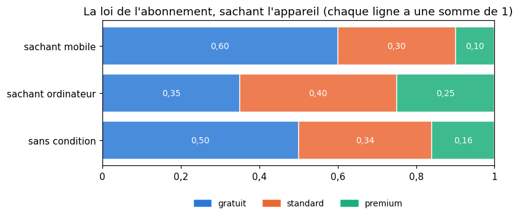
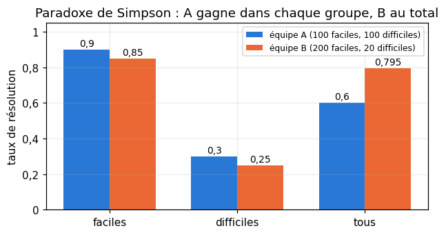
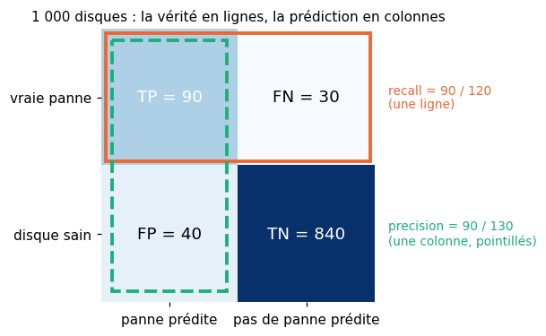
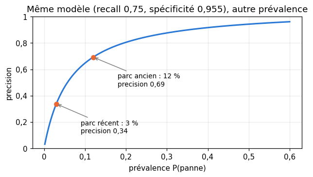
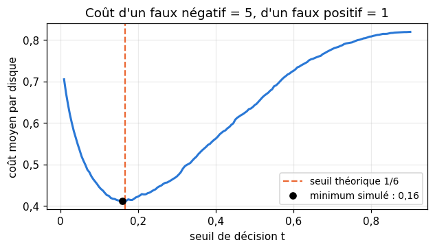
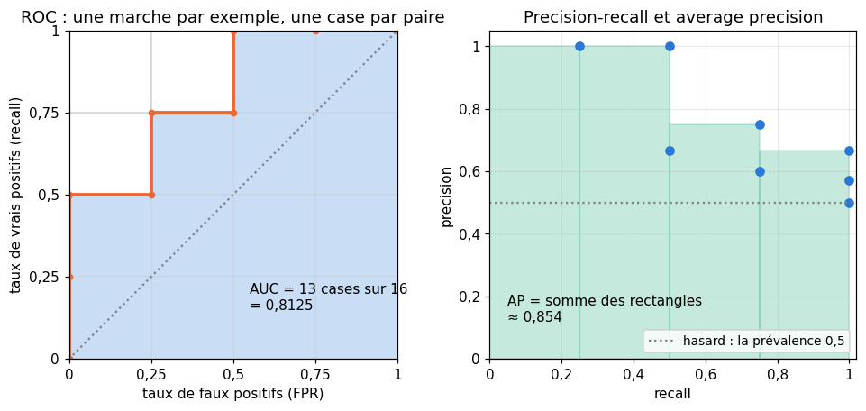
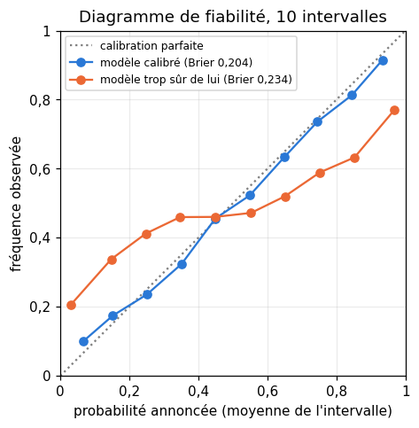
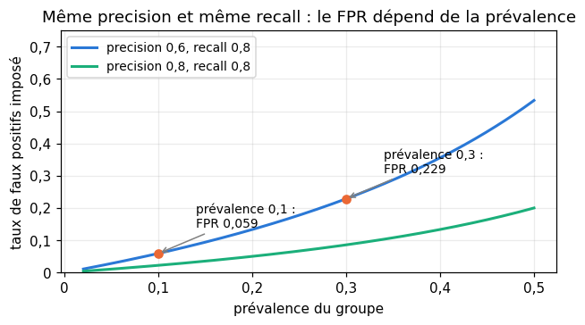

# M03 · Probabilités conditionnelles — fiche de cours

> R8 a présenté le conditionnement en une page, sur un arbre. Ce chapitre en fait un outil. On range les observations de deux variables dans un **tableau de contingence**, on y lit des probabilités **jointes**, **marginales** et **conditionnelles**, on décide de l'**indépendance** par le calcul, et la **formule des probabilités totales** recolle les morceaux (avec un piège célèbre, le paradoxe de Simpson). Puis le même tableau devient la **matrice de confusion** d'un classifieur : accuracy, precision, recall et spécificité ne sont que des probabilités conditionnelles, lues dans une ligne ou dans une colonne. On en tire leurs moyennes (F-beta, macro, micro, balanced accuracy, MCC), l'effet de la **prévalence** et du **seuil de décision**, la **courbe ROC** et son aire, qui compte des paires bien classées, la courbe precision-recall, la **calibration** et un premier regard sur l'équité entre groupes.

| | |
|---|---|
| **Sections** | §1 à §8 |
| **Temps total estimé** | ≈ 12,8 h : lecture et calculs de la fiche ≈ 2 h 30, exercices ≈ 9 h 30, flashcards ≈ 45 min (parcours essentiel ≈ 7,2 h) |
| **Prérequis** | R1 (moyenne harmonique, moyenne pondérée) ; R8 (probabilités, arbres pondérés, indépendance de deux événements) ; M02a (aire, méthode des trapèzes) ; M02b (loi jointe, indépendance de deux variables, loi de Bernoulli) ; M02c (covariance, corrélation) ; workbookIA 0A (arrays NumPy) |
| **Fichiers du chapitre** | `02_exercices.md` (quiz, papier) · `03_notebook.ipynb` · `04_indices.md` · `05_solutions.md` et `05_solutions.ipynb` · `06_mes_reponses.md` · `flashcards.csv` |
| **mymath** | `conditional.py` : `joint_from_counts`, `marginal`, `conditional`, `are_independent`, `auc_by_pairs` |
| **MML** | §6.3, sa première moitié (voir le guide de lecture ci-dessous) |

## Comment utiliser ce chapitre

**Ordre conseillé.**
1. `python tools/start_chapter.py M03` (sur Colab : `00_setup/COLAB.md` §2) : il copie le notebook, ta feuille de réponses et le squelette `mymath/conditional.py`.
2. Section par section : lis **crayon en main**, refais chaque calcul ; puis fais les exercices de la section, quiz 🧠 d'abord.
3. Les exercices ✏️ et 🔗 se font sur papier, dans ta copie de `06_mes_reponses.md`, puis se vérifient dans la **partie 0** du notebook. Les démonstrations ∂ se rédigent dans ta copie et se jugent avec la grille de relecture de `05_solutions.md`.

**Un réflexe pour tout le chapitre** : avant de calculer une probabilité conditionnelle, écris-la avec le mot « sachant » et demande-toi **par quoi tu divises**. Le numérateur est presque toujours une case du tableau ; c'est le dénominateur (le total d'une ligne, d'une colonne, ou de tout le tableau) qui fait la différence.

| Section | Quiz 🧠 | Papier et réflexion | Notebook |
|---|---|---|---|
| §1 Jointe, marginale, tableau de contingence | Q1 | M03.1 ✏️, M03.16 📖 | M03.19 🔨, M03.27 🛠️, M03.28 🏆 |
| §2 Probabilité conditionnelle, indépendance | Q1, Q2, Q3 | M03.1 ✏️, M03.2 ✏️, M03.16 📖, M03.17 ⚖️, M03.18 🗣️, M03.E1 💼 | M03.19 🔨, M03.20 🔨, M03.24 🔬, M03.26 🐛 |
| §3 Probabilités totales | R1 🔁 | M03.3 ✏️, M03.16 📖, M03.17 ⚖️ | M03.26 🐛, M03.28 🏆 |
| §4 La matrice de confusion | Q4 | M03.4 ✏️ | |
| §5 Moyennes de métriques, balanced accuracy, MCC | Q5, R2 🔁 | M03.4 ✏️ (h), M03.5 ✏️, M03.6 ✏️, M03.13 ∂ | |
| §6 Prévalence et seuil de décision | | M03.6 ✏️, M03.7 ✏️, M03.14 🔗 | |
| §7 ROC et AUC, precision-recall | Q6, R3 🔁 | M03.8 ✏️, M03.9 ✏️, M03.10 ✏️, M03.12 ∂ | M03.21 🔨, M03.22 📦, M03.23 🔮, M03.25 🎨 |
| §8 Calibration, score de Brier, taux par groupe | Q7 | M03.11 ✏️, M03.15 🔗 | |

Parcours essentiel : tout sauf M03.Q5, M03.Q7, M03.R3, M03.5, M03.6, M03.10, M03.11, M03.12, M03.13, M03.15, M03.16, M03.17, M03.E1, M03.20, M03.22, M03.24 à M03.28. Lis quand même les §5 et §8 en survol : workbookIA 3 emploie toutes ces mesures.

## Guide de lecture de MML

*Mathematics for Machine Learning* (MML) consacre son §6.3 aux règles de calcul des probabilités. Ce chapitre en lit la **première moitié** :
- après le **§2** de la fiche : **MML §6.3**, jusqu'à la règle du produit comprise (la règle de la somme, *sum rule*, et la règle du produit, *product rule*), écrites pour des lois jointes $p(\mathbf{x}, \mathbf{y})$ quelconques, discrètes ou continues. Questions : M03.16 ;
- la suite du §6.3 (le théorème de Bayes, sa loi *a priori*, sa vraisemblance et sa loi *a posteriori*) est pour M04.

📐 **Notations.** MML écrit $p(x, y)$ pour la loi jointe, $p(y \mid x)$ pour la loi conditionnelle, et appelle la règle de la somme ce que la fiche appelle **marginaliser** : $p(x) = \sum_y p(x, y)$ (une intégrale pour une variable continue). La fiche écrit $P(X = x, Y = y)$ pour une valeur précise et $P(A \cap B)$ ou $P(A, B)$ pour deux événements.

Vocabulaire anglais de ce chapitre : *joint probability*, *marginal probability*, *conditional probability*, *contingency table*, *sum rule*, *product rule*, *law of total probability*, *independent*, *mutually exclusive*, *Simpson's paradox*, *confusion matrix*, *true / false positive / negative*, *precision*, *recall* (*sensitivity*), *specificity*, *accuracy*, *prevalence* (*base rate*), *threshold*, *ROC curve*, *area under the curve* (*AUC*), *precision-recall curve*, *average precision*, *calibration*, *reliability diagram*, *Brier score*, *false positive rate*.

## Objectifs d'apprentissage

À la fin du chapitre, tu sais :
- **lire** dans un tableau de contingence des probabilités jointes, marginales et conditionnelles, et dire par quoi tu divises ;
- **décider** si deux événements ou deux variables sont indépendants, par le calcul ;
- **utiliser** la formule des probabilités totales, et reconnaître un paradoxe de Simpson ;
- **écrire** accuracy, precision, recall et spécificité comme des probabilités conditionnelles, et **calculer** F-beta, moyennes macro, micro et pondérée, balanced accuracy et MCC ;
- **recalculer** une precision quand la prévalence change, et **choisir** un seuil de décision selon le coût des erreurs ;
- **construire** une courbe ROC et une courbe precision-recall, **calculer** l'AUC comme une aire et comme une proportion de paires, l'average precision, un score de Brier, et des taux d'erreur par groupe.

## L'essentiel en 10 lignes

1. Pour deux variables observées ensemble, le **tableau de contingence** range les comptages ; divisé par le total, il donne la **loi jointe** $P(X = x, Y = y)$. Les **marginales** sont les sommes des lignes et des colonnes.
2. **Probabilité conditionnelle** : $P(A \mid B) = \frac{P(A \cap B)}{P(B)}$ quand $P(B) > 0$. Dans un tableau : une case divisée par le total de **sa ligne** ou de **sa colonne**. $P(A \mid B) \ne P(B \mid A)$ en général.
3. **Règle du produit** : $P(A \cap B) = P(A \mid B)\,P(B)$. **Indépendance** : $P(A \cap B) = P(A)\,P(B)$, soit $P(A \mid B) = P(A)$ ; pour deux variables, **chaque** case est le produit de ses deux marginales.
4. **Probabilités totales** : si $B_1, \ldots, B_K$ découpent l'univers, $P(A) = \sum_k P(A \mid B_k)\,P(B_k)$. Un taux global est une moyenne des taux par groupe, **pondérée** par la taille des groupes : d'où le paradoxe de Simpson.
5. La **matrice de confusion** est le tableau de contingence (vérité, prédiction). **Recall** $= P(\hat{Y} = 1 \mid Y = 1)$ et **spécificité** $= P(\hat{Y} = 0 \mid Y = 0)$ se lisent sur une ligne ; **precision** $= P(Y = 1 \mid \hat{Y} = 1)$ sur une colonne ; **accuracy** $= P(\hat{Y} = Y)$.
6. $F_\beta$ est une moyenne harmonique **pondérée** de la precision et du recall ; macro (moyenne simple des classes), pondérée (par les effectifs), micro (on additionne les comptages : l'accuracy en multiclasse). **Balanced accuracy** : la moyenne des recalls. **MCC** : la corrélation entre $Y$ et $\hat{Y}$ codés 0 et 1.
7. Le recall et la spécificité ne dépendent pas de la **prévalence** $\pi = P(Y = 1)$ ; la precision, si : $\frac{r\pi}{r\pi + (1 - s)(1 - \pi)}$. Pour des probabilités calibrées, le seuil qui minimise le coût est $\frac{c_{FP}}{c_{FP} + c_{FN}}$.
8. La **courbe ROC** relie les points (FPR, recall) de tous les seuils ; son aire, l'**AUC**, est la probabilité qu'un positif ait un score plus élevé qu'un négatif (un ex æquo compte pour moitié). Elle ne change pas quand on transforme les scores par une fonction strictement croissante.
9. La courbe **precision-recall** et l'**average precision** $\sum_j (R_j - R_{j-1})P_j$ montrent la qualité des alertes, qui dépend de la prévalence.
10. Un modèle est **calibré** si $P(Y = 1 \mid \text{score} = p) = p$ ; le **score de Brier** $\frac{1}{n}\sum (p_i - y_i)^2$ mesure l'erreur de ses probabilités. Par groupe, des taux d'erreur égaux et des precisions égales sont incompatibles quand les prévalences diffèrent (sauf cas extrêmes, comme un modèle sans aucun faux positif).

---

## §1 · Probabilité jointe, marginale, tableau de contingence

Une application propose trois abonnements, et l'on a relevé, pour 500 utilisateurs, l'appareil qu'ils utilisent le plus et leur abonnement :

| | gratuit | standard | premium | **total** |
|---|---|---|---|---|
| **mobile** | 180 | 90 | 30 | **300** |
| **ordinateur** | 70 | 80 | 50 | **200** |
| **total** | **250** | **170** | **80** | **500** |

C'est un **tableau de contingence** (*contingency table*) : deux variables catégorielles observées sur les mêmes individus, une ligne par valeur de la première ($X$, l'appareil), une colonne par valeur de la seconde ($Y$, l'abonnement), et dans chaque case le nombre d'individus qui ont les deux valeurs. Les totaux, écrits dans les **marges** du tableau, en sont la dernière ligne et la dernière colonne.

On tire un utilisateur au hasard parmi les 500. Trois sortes de probabilités se lisent dans le tableau :
- la **probabilité jointe** (*joint probability*) $P(X = \text{mobile}, Y = \text{premium})$, la probabilité d'avoir **les deux** valeurs à la fois : une case divisée par le total, $\frac{30}{500} = 0{,}06$ ;
- la **probabilité marginale** (*marginal probability*) $P(X = \text{mobile})$ : un total de ligne divisé par le total, $\frac{300}{500} = 0{,}6$ ; de même $P(Y = \text{premium}) = \frac{80}{500} = 0{,}16$ ;
- la **probabilité conditionnelle**, au §2.

En divisant tout le tableau par 500, on obtient la **loi jointe** de $(X, Y)$ (M02b §5) :

| | gratuit | standard | premium | **loi de $X$** |
|---|---|---|---|---|
| **mobile** | 0,36 | 0,18 | 0,06 | **0,6** |
| **ordinateur** | 0,14 | 0,16 | 0,10 | **0,4** |
| **loi de $Y$** | **0,5** | **0,34** | **0,16** | **1** |

Ses cases sont positives ou nulles et ont une somme de 1. Chaque **marginale** est la somme des probabilités jointes de sa ligne ou de sa colonne : $P(X = \text{mobile}) = 0{,}36 + 0{,}18 + 0{,}06 = 0{,}6$. On dit qu'on **marginalise** : pour obtenir la loi de $X$, on « oublie » $Y$ en additionnant sur toutes ses valeurs,

$$P(X = x) = \sum_y P(X = x, Y = y).$$

MML appelle cette formule la **règle de la somme** (*sum rule*).

```python
>>> import numpy as np
>>> counts = np.array([[180, 90, 30], [70, 80, 50]])     # rows: mobile, computer; columns: free, standard, premium
>>> joint = counts / counts.sum()
>>> joint.sum(axis=1), joint.sum(axis=0)                 # the law of X (one value per row), the law of Y (per column)
(array([0.6, 0.4]), array([0.5 , 0.34, 0.16]))
```

`axis=1` additionne le long de chaque ligne (une valeur par ligne : la loi de $X$), `axis=0` le long de chaque colonne (la loi de $Y$). C'est la convention de ta fonction `marginal` (M03.19).

⚠️ **Erreur classique.** Croire que les deux marges suffisent à retrouver le tableau. Avec les marges $(300, 200)$ et $(250, 170, 80)$, beaucoup de tableaux sont possibles ; un seul correspond à des variables **indépendantes** (§2). Une loi jointe contient plus d'information que ses deux marginales.

📖 **Dans MML** — §6.3 part d'une loi jointe $p(\mathbf{x}, \mathbf{y})$ et en déduit les marginales par la règle de la somme ; le livre écrit une somme pour des variables discrètes, une intégrale pour des variables continues. Lecture et questions : M03.16.

🔗 **Dans workbookIA** — le chapitre 3 construit des tableaux de contingence avec `pd.crosstab` et y lit des probabilités jointes, marginales et conditionnelles ; la matrice de confusion (§4) en est un.

---

## §2 · Probabilité conditionnelle et indépendance

### Restreindre l'univers

On apprend que l'utilisateur tiré utilise un mobile. Quelle est maintenant la probabilité qu'il soit premium ? On ne regarde plus que la ligne « mobile » : 30 premium sur 300, soit 0,1. C'est la **probabilité conditionnelle** (*conditional probability*) de « premium » **sachant** « mobile » :

$$P(A \mid B) = \frac{P(A \cap B)}{P(B)} \qquad \text{quand } P(B) > 0.$$

Avec $A$ = « premium » et $B$ = « mobile » : $P(A \mid B) = \frac{0{,}06}{0{,}6} = 0{,}1$, le même nombre que $\frac{30}{300}$. Savoir que $B$ s'est produit fait de $B$ le nouvel univers ; on divise par sa probabilité pour que le total redevienne 1.

**L'ordre compte.** $P(\text{mobile} \mid \text{premium})$ garde le même numérateur, la case commune, mais divise par le total de la **colonne** premium : $\frac{30}{80} = 0{,}375$. Un utilisateur mobile est rarement premium (10 %), mais plus d'un premium sur trois est sur mobile, parce que les utilisateurs mobiles sont nombreux. En général $P(A \mid B) \ne P(B \mid A)$ : les deux nombres n'ont en commun que leur numérateur.

En faisant varier la valeur de $Y$, on obtient toute la **loi conditionnelle** de $Y$ sachant $X = \text{mobile}$ : la ligne mobile divisée par son total, $(0{,}6 ;\ 0{,}3 ;\ 0{,}1)$. Sachant « ordinateur » : $(0{,}35 ;\ 0{,}4 ;\ 0{,}25)$. Chacune a une somme de 1 : c'est une loi.



### La règle du produit

En multipliant la définition par $P(B)$, on obtient la **règle du produit** (*product rule*) :

$$P(A \cap B) = P(A \mid B)\,P(B) = P(B \mid A)\,P(A).$$

C'est la règle des chemins des arbres de R8 : la probabilité d'un chemin est le produit de ses branches, et la seconde branche est une probabilité **sachant** la première. Elle donne une case du tableau à partir d'une marge et d'une conditionnelle : $P(\text{mobile} \cap \text{premium}) = P(\text{premium} \mid \text{mobile})\,P(\text{mobile}) = 0{,}1 \times 0{,}6 = 0{,}06$. Elle s'enchaîne : $P(A \cap B \cap C) = P(A)\,P(B \mid A)\,P(C \mid A \cap B)$, la probabilité d'une phrase mot après mot dans un modèle de langage.

### L'indépendance

Deux événements sont **indépendants** quand savoir que l'un s'est produit ne change pas la probabilité de l'autre (R8 §5) :

$$A \text{ et } B \text{ indépendants} \iff P(A \cap B) = P(A)\,P(B) \iff P(A \mid B) = P(A) \quad (\text{si } P(B) > 0).$$

Ici, $P(\text{premium}) = 0{,}16$ mais $P(\text{premium} \mid \text{mobile}) = 0{,}1$ : être sur mobile **diminue** la probabilité d'être premium. Les deux événements sont dépendants ; on le voit aussi par le produit, $0{,}6 \times 0{,}16 = 0{,}096 \ne 0{,}06$.

Deux **variables** $X$ et $Y$ sont indépendantes si les événements $\{X = x\}$ et $\{Y = y\}$ le sont pour **toutes** les valeurs (M02b §5) : chaque case de la loi jointe est le produit de ses deux marginales, et toutes les lignes ont la même loi conditionnelle. Avec les marges de l'exemple, le tableau des 500 utilisateurs **si** l'appareil et l'abonnement étaient indépendants serait

$$\text{case} = \frac{\text{total de la ligne} \times \text{total de la colonne}}{\text{total}} : \qquad \begin{array}{c|ccc} & \text{gratuit} & \text{standard} & \text{premium} \\ \hline \text{mobile} & 150 & 102 & 48 \\ \text{ordinateur} & 100 & 68 & 32 \end{array}$$

On observe 30 premium sur mobile au lieu des 48 attendus : l'écart mesure la dépendance. (Le test du $\chi^2$, que M08 évoquera, décide si un tel écart peut venir du hasard de l'échantillon.)

**Indépendance deux à deux ou mutuelle.** On lance deux pièces équilibrées ; $A$ = « la première tombe sur pile », $B$ = « la seconde tombe sur pile », $C$ = « les deux pièces tombent du même côté ». Chacun a la probabilité $\frac{1}{2}$, et chaque paire est indépendante : $P(A \cap C) = P(\text{pile, pile}) = \frac{1}{4} = P(A)\,P(C)$, de même pour $B$ et $C$. Pourtant, si l'on connaît $A$ **et** $B$, on connaît $C$ à coup sûr : $P(A \cap B \cap C) = \frac{1}{4} \ne \frac{1}{8}$. Les trois événements sont **indépendants deux à deux**, mais pas **mutuellement** indépendants. Regarder les variables deux par deux ne suffit pas à tout voir.

⚠️ **Erreur classique.** Confondre « indépendants » et « incompatibles » (R8 §5) : deux événements incompatibles de probabilités non nulles sont toujours dépendants, puisque l'un exclut l'autre. Autre piège : conclure à l'indépendance de deux variables sur une seule case ; il faut **toutes** les cases (ou toutes les lignes de même loi conditionnelle).

💻 **Aujourd'hui en pratique** — `pd.crosstab(df["x"], df["y"], normalize="index")` divise chaque ligne par son total (les lois conditionnelles de $Y$ sachant $X$), `normalize="columns"` chaque colonne, `normalize="all"` tout le tableau. Sur des données, les cases ne sont jamais **exactement** des produits : on compare avec une tolérance (ta fonction `are_independent`, M03.20) ou par un test statistique.

📖 **Dans MML** — §6.3 énonce la règle du produit, $p(\mathbf{x}, \mathbf{y}) = p(\mathbf{y} \mid \mathbf{x})\,p(\mathbf{x})$, et souligne qu'elle vaut dans les deux sens ; §6.4.5 (lu en M02b) définit l'indépendance par $p(\mathbf{x}, \mathbf{y}) = p(\mathbf{x})\,p(\mathbf{y})$. Lecture et questions : M03.16.

🔗 **Dans workbookIA** — le chapitre 3 calcule des probabilités conditionnelles dans des tableaux, et le chapitre 4 passera de $P(B \mid A)$ à $P(A \mid B)$ (la règle de Bayes, M04) ; le classifieur bayésien naïf (chapitre 13) suppose les features indépendantes sachant la classe.

---

## §3 · Probabilités totales

### Découper pour calculer

Un site marchand reçoit ses visiteurs de trois sources : la recherche (60 % des visites), la publicité (25 %) et les accès directs (15 %). La part des visites qui finissent par un achat dépend de la source : 2 % pour la recherche, 5 % pour la publicité, 8 % pour les accès directs. Quelle est la probabilité qu'une visite donne un achat ?

Les trois sources $B_1$, $B_2$, $B_3$ forment une **partition** : chaque visite vient d'une et une seule source. On découpe l'événement $A$ = « achat » selon la source, et chaque morceau se calcule par la règle du produit :

$$P(A) = P(A \mid B_1)\,P(B_1) + P(A \mid B_2)\,P(B_2) + P(A \mid B_3)\,P(B_3) = 0{,}02 \times 0{,}6 + 0{,}05 \times 0{,}25 + 0{,}08 \times 0{,}15 = 0{,}0365.$$

> **Formule des probabilités totales** (*law of total probability*). Si les événements $B_1, \ldots, B_K$, de probabilités non nulles, forment une partition de l'univers (deux à deux incompatibles, de réunion l'univers entier), alors pour tout événement $A$ :
> $$P(A) = \sum_{k=1}^{K} P(A \mid B_k)\,P(B_k).$$

C'est la règle 3 des arbres de R8 (on additionne les chemins qui mènent à $A$), et la règle de la somme du §1 écrite avec des conditionnelles : $P(A) = \sum_k P(A \cap B_k)$, puis chaque terme par la règle du produit. workbookIA 3 la démontre (∂ 3.4) ; on l'utilise ici.

**Une moyenne pondérée.** La formule dit que le taux global (3,65 %) est la **moyenne des taux par groupe, pondérée par la taille des groupes**. Il est donc toujours compris entre le plus petit et le plus grand taux (entre 2 % et 8 %), et il dépend autant des **poids** que des taux : si la publicité amenait 50 % des visites (et la recherche 35 %), le taux global passerait à $0{,}02 \times 0{,}35 + 0{,}05 \times 0{,}5 + 0{,}08 \times 0{,}15 = 0{,}044$, sans qu'aucun taux par source n'ait changé.

### Le paradoxe de Simpson

Deux équipes d'un service client résolvent des tickets faciles et des tickets difficiles :

| | faciles | difficiles | **tous** |
|---|---|---|---|
| **équipe A** | 90 résolus sur 100 (90 %) | 30 sur 100 (30 %) | 120 sur 200 (**60 %**) |
| **équipe B** | 170 sur 200 (85 %) | 5 sur 20 (25 %) | 175 sur 220 (**79,5 %**) |

L'équipe A fait mieux sur les tickets faciles **et** sur les tickets difficiles, et pourtant moins bien au total. Il n'y a pas d'erreur de calcul : le taux global de chaque équipe est une moyenne de ses deux taux, pondérée par **sa** répartition des tickets. A reçoit la moitié de tickets difficiles, B moins d'un sur dix. Comparer les taux globaux revient à comparer surtout des tickets faciles pour B à un mélange pour A. C'est le **paradoxe de Simpson** (*Simpson's paradox*) : une tendance présente dans chaque groupe peut s'inverser quand on les réunit, si les groupes ont des tailles différentes selon la catégorie comparée.



Laquelle des deux comparaisons est la bonne ? Ici, la difficulté du ticket influence à la fois l'équipe qui le reçoit et la chance de le résoudre : c'est une **variable de confusion** (M02c §8), et il faut comparer à difficulté égale, groupe par groupe. Le chiffre global répond à une autre question : « quelle part des tickets reçus a été résolue ? ».

⚠️ **Erreur classique.** Additionner des pourcentages, ou en faire la moyenne simple : 90 % et 30 % ne font pas « 60 % en moyenne » par principe, mais seulement parce que l'équipe A a 100 tickets de chaque sorte. Un taux global se calcule avec les effectifs (ou les poids $P(B_k)$).

🔗 **Dans workbookIA** — la precision d'un test selon la prévalence (chapitre 3, et §6 ci-dessous) se calcule par les probabilités totales ; le chapitre 4 s'en sert au dénominateur de la règle de Bayes ; le chapitre 8 compare des modèles sur des sous-groupes de données.

---

## §4 · La matrice de confusion, un tableau de contingence

Un modèle prédit quels disques durs d'un centre de données vont **tomber en panne** dans le mois. On l'évalue sur 1 000 disques d'un parc ancien, dont 120 sont vraiment tombés en panne pendant le mois suivant. Chaque disque a deux valeurs : sa vérité $Y$ (1 = panne, la classe **positive**) et la prédiction $\hat{Y}$ du modèle. Le tableau de contingence de $(Y, \hat{Y})$ s'appelle la **matrice de confusion** (*confusion matrix*) :

| vérité \ prédiction | panne prédite ($\hat{Y} = 1$) | pas de panne prédite ($\hat{Y} = 0$) | **total** |
|---|---|---|---|
| **panne** ($Y = 1$) | TP = 90 | FN = 30 | **120** |
| **pas de panne** ($Y = 0$) | FP = 40 | TN = 840 | **880** |
| **total** | **130** | **870** | **1 000** |

Les quatre cases : **vrais positifs** TP (panne, signalée), **faux négatifs** FN (panne, manquée), **faux positifs** FP (disque sain, signalé à tort), **vrais négatifs** TN. Le second mot dit la prédiction, le premier si elle est juste.

Toutes les mesures usuelles sont des probabilités lues dans ce tableau, pour un disque tiré au hasard :

| Mesure | Probabilité | Lecture | Valeur |
|---|---|---|---|
| **prévalence** | $P(Y = 1)$ | marge des lignes | $\frac{120}{1000} = 0{,}12$ |
| **recall** (sensibilité, taux de vrais positifs) | $P(\hat{Y} = 1 \mid Y = 1)$ | une **ligne** | $\frac{90}{120} = 0{,}75$ |
| **spécificité** (taux de vrais négatifs) | $P(\hat{Y} = 0 \mid Y = 0)$ | une **ligne** | $\frac{840}{880} \approx 0{,}955$ |
| taux de faux positifs (FPR) | $P(\hat{Y} = 1 \mid Y = 0) = 1 - \text{spécificité}$ | une **ligne** | $\frac{40}{880} \approx 0{,}045$ |
| **precision** (valeur prédictive positive) | $P(Y = 1 \mid \hat{Y} = 1)$ | une **colonne** | $\frac{90}{130} \approx 0{,}692$ |
| valeur prédictive négative (NPV) | $P(Y = 0 \mid \hat{Y} = 0)$ | une **colonne** | $\frac{840}{870} \approx 0{,}966$ |
| **accuracy** | $P(\hat{Y} = Y)$ | la diagonale | $\frac{90 + 840}{1000} = 0{,}93$ |



Deux familles se dégagent :
- les **taux** (recall, spécificité, FPR) conditionnent par la **vérité** : ils divisent par le total d'une ligne. Ils décrivent le comportement du modèle face à un disque qui va tomber en panne, ou face à un disque sain ;
- les **valeurs prédictives** (precision, NPV) conditionnent par la **prédiction** : elles divisent par le total d'une colonne. Elles disent ce que vaut une alerte, et c'est ce que veut savoir le technicien qui la reçoit.

Le recall et la precision sont donc deux conditionnelles « à l'envers » l'une de l'autre, comme $P(\text{premium} \mid \text{mobile})$ et $P(\text{mobile} \mid \text{premium})$ au §2 : même numérateur TP, dénominateurs différents.

```python
>>> from sklearn.metrics import confusion_matrix
>>> y_true = [1] * 120 + [0] * 880                       # 120 failing disks, then 880 healthy ones
>>> y_pred = [1] * 90 + [0] * 30 + [1] * 40 + [0] * 840
>>> confusion_matrix(y_true, y_pred)                      # labels sorted: row 0 = healthy, row 1 = failure
array([[840,  40],
       [ 30,  90]])
```

⚠️ **Erreur classique.** Lire la matrice de scikit-learn dans le mauvais sens : elle trie les labels, donc la classe 0 vient d'abord, et TP est en **bas à droite** : `[[TN, FP], [FN, TP]]`. Vérifie toujours ce que sont les lignes et les colonnes avant de diviser.

🔗 **Dans workbookIA** — le chapitre 3 construit les matrices de confusion et toutes ces mesures, avec `mylearn.metrics` puis scikit-learn ; chaque chapitre de classification les réutilise.

---

## §5 · Moyennes de métriques : F-beta, macro, micro, pondérée ; balanced accuracy et MCC

### F-beta : une moyenne harmonique pondérée

Le **F1** résume precision $P$ et recall $R$ par leur **moyenne harmonique** (R1) : $F_1 = \frac{2PR}{P + R}$. Pour le modèle de pannes, $F_1 = \frac{2 \times 0{,}692 \times 0{,}75}{0{,}692 + 0{,}75} = 0{,}72$, ou directement avec les comptages, $\frac{2\,TP}{2\,TP + FP + FN} = \frac{180}{250} = 0{,}72$. La moyenne harmonique reste proche du plus petit des deux nombres : un modèle ne peut pas compenser un recall faible par une precision excellente.

Le **F-beta** donne plus de poids à l'un des deux. Son inverse est la moyenne **pondérée** des inverses :

$$\frac{1}{F_\beta} = \frac{1}{1 + \beta^2}\cdot\frac{1}{P} + \frac{\beta^2}{1 + \beta^2}\cdot\frac{1}{R}, \qquad \text{soit} \qquad F_\beta = \frac{(1 + \beta^2)\,PR}{\beta^2 P + R} = \frac{(1 + \beta^2)\,TP}{(1 + \beta^2)\,TP + \beta^2\,FN + FP}.$$

Le recall reçoit le poids $\frac{\beta^2}{1 + \beta^2}$ : avec $\beta = 2$, 80 % du poids, et chaque faux négatif compte $\beta^2 = 4$ fois plus qu'un faux positif au dénominateur. On choisit $\beta > 1$ quand manquer un positif coûte plus cher qu'une fausse alerte. Pour le modèle de pannes : $F_2 \approx 0{,}738$ et $F_{0{,}5} \approx 0{,}703$. Quand $\beta \to +\infty$, $F_\beta \to R$ ; quand $\beta \to 0$, $F_\beta \to P$.

### Plusieurs classes : macro, micro, pondérée

Un modèle classe des photos de feuilles de vigne en trois classes : **saine**, **mildiou**, **oïdium**. Sa matrice de confusion sur 100 photos (vérité en lignes) :

| vérité \ prédiction | saine | mildiou | oïdium | **effectif** |
|---|---|---|---|---|
| **saine** | 50 | 4 | 6 | 60 |
| **mildiou** | 5 | 22 | 3 | 30 |
| **oïdium** | 2 | 1 | 7 | 10 |

Pour chaque classe, on la prend comme classe positive face aux deux autres (un-contre-tous). La precision de « saine » divise sa case diagonale par sa **colonne** : $\frac{50}{57} \approx 0{,}877$ ; son recall par sa **ligne** : $\frac{50}{60} \approx 0{,}833$. On trouve :

| classe | precision | recall | F1 |
|---|---|---|---|
| saine | $\frac{50}{57} \approx 0{,}877$ | $\frac{50}{60} \approx 0{,}833$ | 0,855 |
| mildiou | $\frac{22}{27} \approx 0{,}815$ | $\frac{22}{30} \approx 0{,}733$ | 0,772 |
| oïdium | $\frac{7}{16} \approx 0{,}438$ | $\frac{7}{10} = 0{,}7$ | 0,538 |

Trois façons de les résumer :
- **macro** : la moyenne simple des classes. F1 macro $= \frac{0{,}855 + 0{,}772 + 0{,}538}{3} \approx 0{,}722$. Chaque classe compte autant, même l'oïdium, rare ;
- **pondérée** (*weighted*) : la moyenne pondérée par les effectifs réels (60, 30, 10). F1 pondéré $\approx 0{,}798$ : les grandes classes pèsent plus, et l'oïdium mal reconnu se voit moins ;
- **micro** : on additionne d'abord les TP, FP et FN de toutes les classes, puis on calcule **une** mesure. Comme chaque photo a une seule vraie classe et une seule prédiction, chaque erreur est à la fois un FP (pour la classe prédite) et un FN (pour la vraie classe) : micro-precision, micro-recall et micro-F1 valent tous l'**accuracy**, $\frac{50 + 22 + 7}{100} = 0{,}79$. M03.13 le démontre.

### Balanced accuracy et MCC

L'accuracy est trompeuse quand une classe est rare : un modèle qui ne signale **rien** aurait ici une accuracy de $\frac{880}{1000} = 0{,}88$. Deux mesures résistent mieux.

La **balanced accuracy** est la moyenne des recalls de chaque classe. En binaire, c'est la moyenne du recall et de la spécificité : $\frac{1}{2}\big(0{,}75 + \frac{21}{22}\big) \approx 0{,}852$. Le modèle qui ne signale rien obtient $\frac{0 + 1}{2} = 0{,}5$, comme le hasard.

Le **MCC** (*Matthews correlation coefficient*) est la **corrélation** (M02c §8) entre la vérité $Y$ et la prédiction $\hat{Y}$, codées par 0 et 1 :

$$\text{MCC} = \frac{TP \cdot TN - FP \cdot FN}{\sqrt{(TP + FP)(TP + FN)(TN + FP)(TN + FN)}} = \frac{90 \times 840 - 40 \times 30}{\sqrt{130 \times 120 \times 880 \times 870}} \approx 0{,}681.$$

<details>
<summary>Pourquoi cette formule est une corrélation</summary>

Pour une variable qui vaut 0 ou 1, la moyenne est la proportion de 1, et la variance (divisée par $n$) vaut $p(1 - p)$ (M02b, Bernoulli). Avec $n = TP + FN + FP + TN$ : $P(Y = 1) = \frac{TP + FN}{n}$, $P(\hat{Y} = 1) = \frac{TP + FP}{n}$, et $P(Y = 1, \hat{Y} = 1) = \frac{TP}{n}$. La covariance $\overline{y\hat{y}} - \bar{y}\,\bar{\hat{y}}$ vaut donc
$$\frac{TP}{n} - \frac{(TP + FN)(TP + FP)}{n^2} = \frac{n \cdot TP - (TP + FN)(TP + FP)}{n^2} = \frac{TP \cdot TN - FP \cdot FN}{n^2},$$
car $n \cdot TP - (TP + FN)(TP + FP) = TP(TP + FN + FP + TN) - TP^2 - TP \cdot FP - FN \cdot TP - FN \cdot FP = TP \cdot TN - FP \cdot FN$. Les variances valent $\frac{(TP + FN)(FP + TN)}{n^2}$ et $\frac{(TP + FP)(FN + TN)}{n^2}$ ; on divise la covariance par la racine de leur produit, et les $n^2$ se simplifient.
</details>

Comme toute corrélation, le MCC est entre $-1$ et 1 : 1 pour une prédiction parfaite, 0 pour une prédiction sans lien avec la vérité (et, par convention, quand une ligne ou une colonne de la matrice est vide, comme pour le modèle qui ne signale rien), $-1$ pour une prédiction toujours inversée. Il utilise les quatre cases, et ne change pas si l'on échange les rôles de « positif » et « négatif », contrairement au F1, qui ignore les TN.

```python
>>> from sklearn.metrics import matthews_corrcoef
>>> round(float(matthews_corrcoef(y_true, y_pred)), 4), round(float(np.corrcoef(y_true, y_pred)[0, 1]), 4)
(0.6808, 0.6808)
```

⚠️ **Erreur classique.** Faire la moyenne de F1 calculés sur des sous-ensembles de tailles différentes comme s'ils pesaient pareil, ou annoncer « le F1 » d'un problème multiclasse sans dire s'il est macro, micro ou pondéré : les trois diffèrent dès que les classes sont déséquilibrées (0,722, 0,79 et 0,798 ici).

🔗 **Dans workbookIA** — le chapitre 3 calcule les moyennes macro, micro et pondérée (`classification_report`), la balanced accuracy et le MCC ; les chapitres 13 à 15 comparent des classifieurs avec elles.

---

## §6 · Prévalence, classes déséquilibrées et seuil de décision

### La precision dépend de la prévalence

Le recall et la spécificité sont des conditionnelles **sachant la vérité** : ils décrivent le modèle, quel que soit le nombre de disques qui tombent en panne. La precision, conditionnelle **sachant la prédiction**, dépend aussi de la **prévalence** $\pi = P(Y = 1)$. Avec $r$ le recall et $s$ la spécificité, la règle du produit et les probabilités totales donnent

$$P(Y = 1, \hat{Y} = 1) = r\pi, \qquad P(\hat{Y} = 1) = r\pi + (1 - s)(1 - \pi), \qquad \text{precision} = \frac{r\pi}{r\pi + (1 - s)(1 - \pi)}.$$

Pour le modèle de pannes ($r = 0{,}75$, $s = \frac{21}{22}$), on retrouve 0,692 avec $\pi = 0{,}12$. On le déploie dans un autre centre, aux disques plus récents, où 3 % seulement tombent en panne dans le mois : sur 1 000 disques, il signale $0{,}75 \times 30 = 22{,}5$ vraies pannes et $\frac{1}{22} \times 970 \approx 44{,}1$ disques sains. La precision tombe à environ 0,338 : **deux alertes sur trois sont fausses**, avec le même modèle. Plus la classe positive est rare, plus les faux positifs, pris dans la grande masse des négatifs, l'emportent.



Conséquence pratique : une precision mesurée sur un jeu de test ne vaut que pour la prévalence de ce jeu de test. Pour une autre population, on **recalcule** avec la formule (M03.7), ou l'on **repondère** les lignes de la matrice de confusion : on multiplie la ligne des positifs par $\frac{\pi_{\text{nouveau}}}{\pi_{\text{ancien}}}$ et celle des négatifs par $\frac{1 - \pi_{\text{nouveau}}}{1 - \pi_{\text{ancien}}}$, ce qui garde le recall et la spécificité, puis on relit la precision.

### Classes déséquilibrées : repondérer à l'entraînement

Un modèle entraîné à minimiser une erreur moyenne sur des données où 88 % des exemples sont négatifs apprend surtout à reconnaître les négatifs. On **repondère** souvent les exemples : chaque exemple de la classe $k$ reçoit le poids $w_k = \frac{n}{K\,n_k}$ ($n$ exemples, $K$ classes, $n_k$ exemples dans la classe $k$ ; l'option `class_weight="balanced"` de scikit-learn). Pour le modèle de pannes : $w_1 = \frac{1000}{2 \times 120} = \frac{25}{6} \approx 4{,}17$ et $w_0 = \frac{1000}{2 \times 880} = \frac{25}{44} \approx 0{,}57$. Les deux classes pèsent alors autant au total ($120 \times \frac{25}{6} = 880 \times \frac{25}{44} = 500$) : tout se passe comme si la prévalence valait $\frac{1}{2}$. Rééchantillonner (dupliquer des positifs, retirer des négatifs) a le même effet. Le prix : les probabilités du modèle sont alors celles d'un monde à 50 % de positifs, et ne sont plus **calibrées** pour la vraie prévalence (§8) ; M04 donnera la formule pour les corriger.

### Le seuil de décision

La plupart des modèles donnent un **score**, souvent une probabilité $p$ que l'exemple soit positif, et l'on déclare positif quand $p \ge t$, pour un **seuil de décision** (*decision threshold*) $t$. Monter le seuil signale moins : la precision monte en général, le recall baisse. Le choix de $t$ dépend du **coût des erreurs**. Si un faux positif coûte $c_{FP}$ et un faux négatif $c_{FN}$, déclarer positif un exemple de probabilité $p$ coûte en moyenne $c_{FP}(1 - p)$ (s'il est négatif), et le déclarer négatif coûte $c_{FN}\,p$. On déclare positif quand c'est moins cher :

$$c_{FP}(1 - p) < c_{FN}\,p \iff p > \frac{c_{FP}}{c_{FP} + c_{FN}}.$$

Pour les disques, si une panne imprévue coûte 5 fois plus que le remplacement inutile d'un disque sain, le seuil vaut $\frac{1}{1 + 5} = \frac{1}{6} \approx 0{,}17$, bien en dessous de 0,5. Ce raisonnement suppose des probabilités **calibrées** (§8) ; sinon, on choisit le seuil sur un jeu de validation, en calculant le coût pour chaque seuil.



⚠️ **Erreur classique.** Juger un modèle sur l'accuracy quand une classe est rare (le modèle « aucune panne » fait 0,88 ici), ou garder le seuil 0,5 par défaut sans regarder le coût des deux erreurs. Et ne jamais régler le seuil sur le jeu de test.

🔗 **Dans workbookIA** — le chapitre 3 montre l'effet de la prévalence sur la precision d'un test et règle un seuil sur un score ; le chapitre 14 utilise `class_weight` et le rééchantillonnage pour des classes déséquilibrées.

---

## §7 · Courbe ROC et AUC, courbe precision-recall et average precision

### La courbe ROC

Chaque seuil donne une matrice de confusion. La **courbe ROC** (*receiver operating characteristic*) les montre toutes : pour chaque seuil $t$, on place le point (taux de faux positifs, recall), c'est-à-dire $\big(P(\hat{Y} = 1 \mid Y = 0),\ P(\hat{Y} = 1 \mid Y = 1)\big)$. Avec un seuil très haut, rien n'est signalé : le point $(0, 0)$. Avec un seuil très bas, tout l'est : $(1, 1)$. Un modèle au hasard suit la diagonale.

Exemple : huit disques, quatre tombés en panne (+) et quatre sains (−), triés par score décroissant :

| score | 0,95 | 0,8 | 0,7 | 0,6 | 0,5 | 0,35 | 0,3 | 0,1 |
|---|---|---|---|---|---|---|---|---|
| classe | + | + | − | + | − | + | − | − |

On abaisse le seuil d'un score à l'autre. Chaque fois qu'un **positif** passe au-dessus du seuil, le recall monte de $\frac{1}{4}$ : un pas **vers le haut**. Chaque fois qu'un **négatif** passe, le taux de faux positifs avance de $\frac{1}{4}$ : un pas **vers la droite**. La courbe est un escalier, une marche par exemple : $(0, 0)$, $(0 ; 0{,}25)$, $(0 ; 0{,}5)$, $(0{,}25 ; 0{,}5)$, $(0{,}25 ; 0{,}75)$, $(0{,}5 ; 0{,}75)$, $(0{,}5 ; 1)$, $(0{,}75 ; 1)$, $(1 ; 1)$.

### L'aire sous la courbe : une proportion de paires

L'**AUC** (*area under the curve*) est l'aire sous la courbe ROC. Par la méthode des trapèzes (M02a §5), les segments verticaux ont une largeur nulle, et il reste trois paliers : $0{,}25 \times 0{,}5 + 0{,}25 \times 0{,}75 + 0{,}5 \times 1 = 0{,}8125$.

Cette aire a une lecture remarquable. Découpons le carré unité en $4 \times 4$ cases : la colonne $j$ correspond au $j$-ième négatif (par score décroissant), la ligne $i$ au $i$-ième positif. La case $(i, j)$ est **sous** l'escalier exactement quand le positif $i$ est passé avant le négatif $j$, c'est-à-dire quand il a un **score plus élevé** : la case représente la **paire** (positif $i$, négatif $j$), et elle est sous la courbe si la paire est bien classée. L'aire compte donc les paires bien classées : ici 13 sur 16, soit 0,8125.



> **L'AUC comme probabilité.** On tire au hasard un positif et un négatif ; l'AUC est la probabilité que le positif ait le score le plus élevé, un ex æquo comptant pour $\frac{1}{2}$ :
> $$\text{AUC} = \frac{\#\{\text{paires bien classées}\} + \frac{1}{2}\,\#\{\text{ex æquo}\}}{n_+ \times n_-}.$$

M03.12 démontre l'égalité de l'aire et de cette proportion ; ta fonction `auc_by_pairs` (M03.21) compte les paires. Un ex æquo entre un positif et un négatif fait monter et avancer la courbe **en même temps** : un segment en diagonale, sous lequel l'aire vaut la moitié de la case.

Trois conséquences :
- l'AUC vaut 0,5 pour des scores au hasard, 1 pour un classement parfait, et une AUC inférieure à 0,5 signale des scores à l'envers (en prenant $1 - \text{score}$, on obtient $1 - \text{AUC}$) ;
- l'AUC ne dépend que de l'**ordre** des scores : une transformation strictement croissante (multiplier par 10, prendre le carré de scores positifs, le logarithme) ne la change pas. Elle mesure le **classement**, pas la qualité des probabilités (§8) ;
- les deux taux de la courbe ROC conditionnent par la vérité : l'AUC ne dépend pas de la prévalence.

### La courbe precision-recall et l'average precision

La courbe **precision-recall** place, pour chaque seuil, le recall en abscisse et la precision en ordonnée. Un modèle au hasard y donne une droite horizontale à la hauteur de la prévalence (sa precision vaut la part de positifs). L'**average precision** (AP) résume l'aire sous cette courbe par une somme en escalier :

$$\text{AP} = \sum_j (R_j - R_{j-1})\,P_j,$$

où $(R_j, P_j)$ est le couple (recall, precision) au $j$-ième seuil, du plus haut au plus bas, et $R_0 = 0$. Seuls les seuils où le recall augmente comptent : chaque gain de recall est multiplié par la precision atteinte à ce moment. Pour les huit disques, le recall augmente aux seuils 0,95 (precision 1), 0,8 (precision 1), 0,6 (precision $\frac{3}{4}$) et 0,35 (precision $\frac{4}{6}$) : $\text{AP} = \frac{1}{4}\big(1 + 1 + \frac{3}{4} + \frac{2}{3}\big) \approx 0{,}854$.

```python
>>> from sklearn.metrics import roc_auc_score, average_precision_score
>>> y = [1, 1, 0, 1, 0, 1, 0, 0]
>>> scores = [0.95, 0.8, 0.7, 0.6, 0.5, 0.35, 0.3, 0.1]
>>> float(roc_auc_score(y, scores)), round(float(average_precision_score(y, scores)), 4)
(0.8125, 0.8542)
```

Contrairement à la courbe ROC, la courbe precision-recall **dépend de la prévalence** (la precision en dépend, §6). Quand les positifs sont rares et que ce qui compte est la qualité des alertes, elle montre ce que la ROC cache : une AUC élevée peut aller avec une majorité de fausses alertes.

⚠️ **Erreur classique.** Calculer l'aire sous la courbe precision-recall par les trapèzes en reliant les points par des segments : la precision ne varie pas linéairement entre deux seuils, et cette interpolation donne une aire fausse, souvent trop optimiste quand les points sont espacés. L'average precision utilise des rectangles, sans interpolation.

🔗 **Dans workbookIA** — le chapitre 3 trace les courbes ROC et precision-recall et calcule l'AUC et l'average precision (`roc_curve`, `roc_auc_score`, `average_precision_score`) ; elles reviennent pour comparer des modèles aux chapitres 13 à 15.

---

## §8 · Calibration, score de Brier, taux par groupe

### Calibration et score de Brier

Un modèle qui annonce des probabilités est **calibré** (*calibrated*) si elles sont honnêtes : parmi les exemples auxquels il donne la probabilité $p$, une proportion $p$ est vraiment positive,

$$P(Y = 1 \mid \text{score} = p) = p.$$

On le vérifie par un **diagramme de fiabilité** (*reliability diagram*) : on regroupe les exemples par intervalles de score (par exemple 10 intervalles de largeur 0,1), et pour chaque intervalle on place la probabilité moyenne annoncée et la fréquence observée des positifs. Un modèle calibré suit la diagonale ; un modèle trop sûr de lui annonce plus de 0,9 là où les trois quarts seulement des cas sont positifs, et moins de 0,1 là où un cas sur cinq l'est.



Le **score de Brier** (*Brier score*) mesure l'erreur quadratique moyenne des probabilités annoncées $p_i$ face aux résultats $y_i$ (0 ou 1) :

$$\text{Brier} = \frac{1}{n}\sum_{i=1}^{n} (p_i - y_i)^2.$$

Exemple : un modèle de **désabonnement** (*churn*) annonce pour cinq clients les probabilités 0,8 ; 0,6 ; 0,3 ; 0,2 ; 0,1 qu'ils partent, et ce sont le premier et le troisième qui partent. Le score vaut $\frac{0{,}2^2 + 0{,}6^2 + 0{,}7^2 + 0{,}2^2 + 0{,}1^2}{5} = \frac{0{,}94}{5} = 0{,}188$. Un modèle qui annoncerait toujours 0,4, la proportion de départs, aurait $0{,}4 \times 0{,}6 = 0{,}24$ (pour une prévision constante égale à la prévalence $\pi$, le score vaut $\pi(1 - \pi)$). Le score de Brier vaut 0 pour des prévisions parfaites et sûres, et pénalise à la fois le mauvais classement et la mauvaise calibration.

Calibration et classement sont deux qualités différentes : la prévision constante 0,4 est parfaitement calibrée (40 % des clients partent) mais ne classe rien (AUC 0,5) ; deux modèles qui rangent les clients dans le même ordre ont la même AUC, et peuvent avoir des Brier différents.

### Taux par groupe : un premier regard sur l'équité

Un modèle est utilisé sur deux groupes de personnes $G_1$ et $G_2$ (deux langues, deux tranches d'âge…). Les mesures du §4 se calculent **par groupe** : ce sont des probabilités conditionnelles sachant aussi le groupe, comme $P(\hat{Y} = 1 \mid Y = 0, G = g)$, le taux de faux positifs du groupe $g$. Trois critères d'équité courants comparent les groupes :
- la **parité des décisions** : le même taux de décisions positives $P(\hat{Y} = 1 \mid G = g)$ ;
- l'**égalité des taux d'erreur** (*equalized odds*) : le même recall et le même taux de faux positifs dans chaque groupe ;
- la **parité des precisions** (*predictive parity*) : la même precision $P(Y = 1 \mid \hat{Y} = 1, G = g)$. Elle ressemble à la calibration dans chaque groupe, mais n'en découle pas : la precision au seuil $t$ est la moyenne des scores (calibrés) supérieurs à $t$, qui dépend de la répartition des scores dans le groupe.

Ces critères ne peuvent pas tous être vrais à la fois quand les prévalences des groupes diffèrent. En écrivant $FP$ à partir de la precision ($\text{PPV} = \frac{TP}{TP + FP}$, donc $FP = TP\,\frac{1 - \text{PPV}}{\text{PPV}}$) et $TP = r\,n_+$ :

$$\text{FPR} = \frac{FP}{n_-} = \frac{\pi}{1 - \pi}\cdot\frac{1 - \text{PPV}}{\text{PPV}}\cdot r.$$

Si deux groupes ont la même precision (0,6) et le même recall (0,8), mais des prévalences de 30 % et 10 %, leurs taux de faux positifs sont forcément différents : environ 0,229 et 0,059. On ne peut égaliser les trois quantités que si les prévalences sont égales, ou dans des cas extrêmes (aucun faux positif dans les deux groupes, comme pour un modèle parfait). C'est le **théorème d'impossibilité** (A. Chouldechova, et J. Kleinberg et ses coauteurs, 2016-2017) : choisir un critère d'équité est un choix, pas un calcul.



⚠️ **Erreur classique.** Croire qu'une AUC élevée garantit des probabilités fiables (elle ne voit que l'ordre), ou qu'un modèle « juste en moyenne » l'est dans chaque groupe : une mesure globale est une moyenne pondérée des mesures par groupe (§3), et peut cacher un groupe mal servi.

💻 **Aujourd'hui en pratique** — `sklearn.metrics.brier_score_loss`, `sklearn.calibration.calibration_curve` (les points du diagramme de fiabilité) et `CalibratedClassifierCV` (recalibrer un modèle). Des bibliothèques comme Fairlearn calculent les mesures par groupe et leurs écarts.

🔗 **Dans workbookIA** — le chapitre 3 trace un diagramme de fiabilité et calcule le score de Brier ; le chapitre 6 mesure les probabilités par la log loss ; le bonus B6 calcule des indicateurs d'équité par groupe et revient sur le théorème d'impossibilité.

---

## Les pièges classiques ⚠️ (récapitulatif)

| Piège | Faux | Juste |
|---|---|---|
| ordre du conditionnement | $P(A \mid B) = P(B \mid A)$ | même numérateur, dénominateurs différents : $P(B)$ ou $P(A)$ |
| dénominateur | une case divisée par le total, pour une conditionnelle | par le total de sa ligne ou de sa colonne, selon la condition |
| marges | « les marges donnent le tableau » | seulement si les variables sont indépendantes |
| indépendance | vérifiée sur une case | toutes les cases (ou toutes les lignes de même loi) |
| incompatibles | « incompatibles, donc indépendants » | incompatibles de probabilités non nulles : toujours dépendants |
| deux à deux | indépendants deux à deux, donc mutuellement | les deux pièces et « même côté » : non |
| taux global | la moyenne simple des taux par groupe | la moyenne pondérée par la taille des groupes (probabilités totales) |
| Simpson | meilleur dans chaque groupe, donc meilleur au total | les poids des groupes peuvent inverser la comparaison |
| matrice de scikit-learn | TP en haut à gauche | labels triés : `[[TN, FP], [FN, TP]]` |
| precision et recall | deux noms de la même chose | recall sachant la vérité (une ligne), precision sachant la prédiction (une colonne) |
| prévalence | la precision mesurée vaut partout | elle dépend de la prévalence ; le recall et la spécificité, non |
| accuracy | 0,88, donc un bon modèle | « rien n'est positif » fait aussi bien quand 88 % sont négatifs |
| moyennes | « le F1 » en multiclasse | macro, micro (l'accuracy) ou pondéré : dire lequel |
| seuil | toujours 0,5 | $\frac{c_{FP}}{c_{FP} + c_{FN}}$ pour des probabilités calibrées |
| AUC | elle mesure la qualité des probabilités | elle ne voit que l'ordre des scores |
| aire precision-recall | des trapèzes | des rectangles : l'average precision |
| calibration | bien classé, donc calibré | deux qualités différentes : AUC et Brier |
| équité | des taux d'erreur et des precisions égaux, toujours possibles | impossible ensemble si les prévalences diffèrent |

## Et maintenant

**Dans ce dépôt** : M04 retourne les probabilités conditionnelles avec la **règle de Bayes** ($P(A \mid B)$ à partir de $P(B \mid A)$, de la prévalence et des probabilités totales), puis introduit la vraisemblance et la loi Beta. La precision du §6 en était déjà un cas.

**Dans workbookIA** : le chapitre 3 te fait construire des tableaux de contingence et des matrices de confusion, calculer toutes ces mesures sur des données, tracer les courbes ROC et precision-recall et un diagramme de fiabilité. Tu sauras que chacune est une probabilité conditionnelle, par quoi elle divise, et ce qu'elle cache.

## Pour aller plus loin

- J. K. Blitzstein et J. Hwang, *Introduction to Probability* (2ᵉ éd., en ligne gratuitement, `annexes/ressources.md`), chapitre 2 (probabilité conditionnelle, probabilités totales, paradoxe de Simpson).
- A. Chouldechova, « Fair prediction with disparate impact: A study of bias in recidivism prediction instruments », prépublication arXiv:1703.00056 (2017), en ligne gratuitement ([arxiv.org/abs/1703.00056](https://arxiv.org/abs/1703.00056)) : l'identité du §8 sur un outil réel d'aide à la décision judiciaire, et ce qu'elle impose (en anglais, niveau avancé).
- `annexes/symboles.md` (lire $P(A \mid B)$, $\hat{Y}$ à voix haute), `annexes/formulaire.md` et `annexes/erreurs_frequentes.md`.
