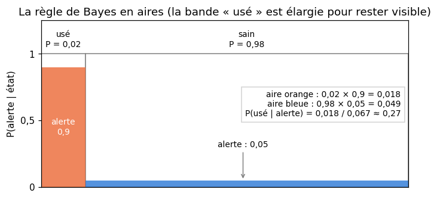
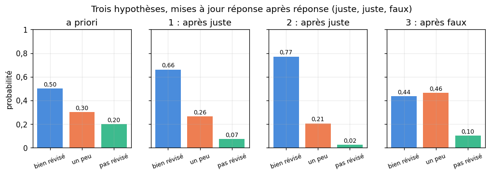
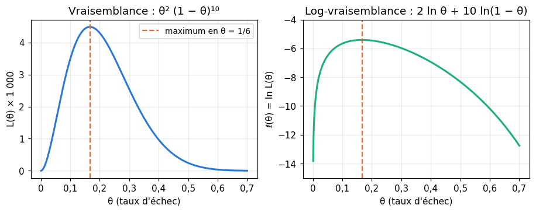
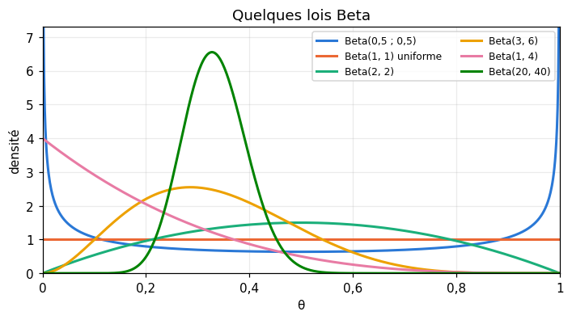
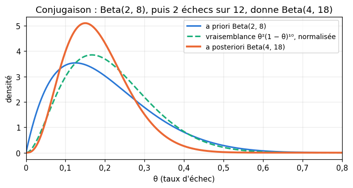
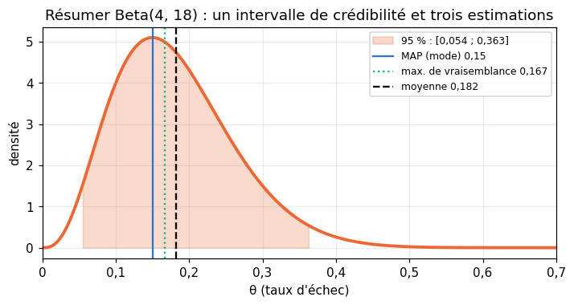
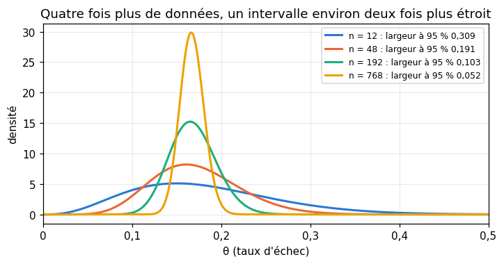
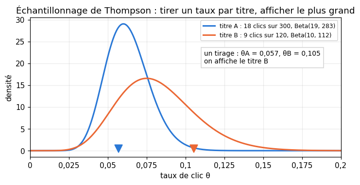

# M04 · Bayes, vraisemblance et loi Beta — fiche de cours

> M03 a appris à lire une probabilité conditionnelle, et a déjà calculé sans le dire une règle de Bayes : la precision d'un modèle quand la prévalence change (M03 §6). Ce chapitre en fait une méthode. On part de ce qu'on croit **avant** les données (l'**a priori**), on mesure à quel point chaque hypothèse explique ce qu'on observe (la **vraisemblance**), et l'on obtient ce qu'on croit **après** (l'**a posteriori**), une fois, puis observation après observation. Quand l'inconnue est une proportion (un taux d'échec, un taux de clic), on la décrit par une densité sur $[0, 1]$, la **loi Beta**, qui a une propriété rare : après des succès et des échecs, l'a posteriori est encore une loi Beta. On en tire trois estimations (le maximum de vraisemblance, le MAP, la moyenne a posteriori), un intervalle de crédibilité et la probabilité des prochains résultats. On finit par les calculs en logarithmes, qui évitent que des produits de probabilités ne deviennent 0 dans l'ordinateur, et par un premier regard sur ce qui sépare les points de vue fréquentiste et bayésien.

| | |
|---|---|
| **Sections** | §1 à §8 |
| **Temps total estimé** | ≈ 12,9 h : lecture et calculs de la fiche ≈ 2 h 30, exercices ≈ 9 h 40, flashcards ≈ 45 min (parcours essentiel ≈ 8,2 h) |
| **Prérequis** | R6 (logarithmes) ; R7 (dériver, chercher un maximum) ; M02a (densité, intégrale, intégration par parties) ; M02b (loi binomiale, espérance, variance) ; M03 (probabilité conditionnelle, règle du produit, probabilités totales) |
| **Fichiers du chapitre** | `02_exercices.md` (quiz, papier) · `03_notebook.ipynb` · `04_indices.md` · `05_solutions.md` et `05_solutions.ipynb` · `06_mes_reponses.md` · `flashcards.csv` |
| **mymath** | `bayes.py` : `beta_pdf`, `beta_moments`, `conjugate_beta_update`, `posterior_predictive`, `map_estimate_beta` |
| **MML** | la fin du §6.3, §6.6 et §8.3 (voir le guide de lecture ci-dessous) |

## Comment utiliser ce chapitre

**Ordre conseillé.**
1. `python tools/start_chapter.py M04` (sur Colab : `00_setup/COLAB.md` §2) : il copie le notebook, ta feuille de réponses et le squelette `mymath/bayes.py`.
2. Section par section : lis **crayon en main**, refais chaque calcul ; puis fais les exercices de la section, quiz 🧠 d'abord.
3. Les exercices ✏️ et 🔗 se font sur papier, dans ta copie de `06_mes_reponses.md`, puis se vérifient dans la **partie 0** du notebook. Les démonstrations ∂ se rédigent dans ta copie et se jugent avec la grille de relecture de `05_solutions.md`.

**Un réflexe pour tout le chapitre** : avant chaque calcul, écris trois colonnes, **hypothèse**, **a priori**, **vraisemblance de ce qu'on a observé**. Leur produit, ligne par ligne, donne l'a posteriori à une constante près ; il ne reste qu'à diviser par la somme. Presque toutes les erreurs viennent d'une colonne oubliée.

| Section | Quiz 🧠 | Papier et réflexion | Notebook |
|---|---|---|---|
| §1 La formule de Bayes | Q1, R1 🔁 | M04.1 ✏️, M04.15 📖 | M04.25 🐛 |
| §2 Hypothèses multiples, mises à jour successives | Q2 | M04.2 ✏️ | |
| §3 Vraisemblance et maximum de vraisemblance | Q3 | M04.3 ✏️, M04.4 ✏️, M04.12 ∂, M04.16 📖 | |
| §4 La loi Beta | Q4, R2 🔁 | M04.5 ✏️, M04.13 ∂ | M04.18 🔨, M04.21 📦, M04.27 🏆 |
| §5 Conjugaison, lissage de Laplace, prédictive | Q5, R3 🔁 | M04.6 ✏️, M04.7 ✏️, M04.11 ∂, M04.14 🔗, M04.15 📖, M04.17 🗣️, M04.E1 💼 | M04.19 🔨, M04.24 🎨, M04.25 🐛 |
| §6 MAP et intervalle de crédibilité | Q5 | M04.8 ✏️, M04.9 ✏️, M04.13 ∂, M04.16 📖 | M04.20 🔨, M04.22 🔮, M04.23 🔬, M04.27 🏆 |
| §7 Log-probabilités, log-sum-exp ; famille exponentielle | Q6 | M04.10 ✏️, M04.15 📖 | M04.21 📦, M04.26 🛠️ |
| §8 Fréquentiste et bayésien ; Thompson | Q7 | M04.14 🔗 | |

Parcours essentiel : tout sauf M04.Q6, M04.Q7, M04.R3, M04.7, M04.9, M04.11, M04.12, M04.13, M04.15, M04.16, M04.20 à M04.23 et M04.25 à M04.27. La famille exponentielle (§7) et l'échantillonnage de Thompson (§8) se lisent en survol.

## Guide de lecture de MML

*Mathematics for Machine Learning* (MML) traite ces notions dans trois blocs :
- après le **§2** de la fiche : la **fin du §6.3**, le théorème de Bayes (tu as lu le début, les règles de la somme et du produit, en M03). Le livre nomme les quatre termes de la formule et explique pourquoi le dénominateur est difficile à calculer en grande dimension. Questions : M04.15 ;
- après le **§3**, puis à nouveau après le **§6** : **MML §8.3**, l'estimation des paramètres, d'abord le maximum de vraisemblance, puis le maximum a posteriori (MAP). Le livre le présente sur un modèle de régression ; garde en tête la proportion de cette fiche. Questions : M04.16 ;
- après le **§5** et le **§7** : **MML §6.6**, la conjugaison (avec l'exemple Beta-binomial), les statistiques suffisantes et la famille exponentielle ; le dernier point est un aperçu ici. Questions : M04.15.

📐 **Notations.** MML écrit $p(\boldsymbol{\theta} \mid \mathbf{x})$ là où la fiche écrit $P(H \mid O)$ pour des hypothèses en nombre fini et $f(\theta \mid \text{données})$ pour une densité ; il appelle **vraisemblance marginale** (*marginal likelihood*) ou **évidence** (*evidence*) le dénominateur, et minimise souvent **moins** le logarithme de la vraisemblance (*negative log-likelihood*) au lieu de maximiser la vraisemblance : c'est le même problème. Le livre note $\mathrm{Beta}(\alpha, \beta)$ ; la fiche note $\mathrm{Beta}(a, b)$, comme `scipy.stats.beta(a, b)`.

Vocabulaire anglais de ce chapitre : *Bayes' theorem*, *prior*, *likelihood*, *evidence* (*marginal likelihood*), *posterior*, *hypothesis*, *sequential updating*, *maximum likelihood estimate* (*MLE*), *log-likelihood*, *Beta distribution*, *Beta function*, *Gamma function*, *conjugate prior*, *pseudo-counts*, *Laplace smoothing*, *posterior predictive distribution*, *maximum a posteriori* (*MAP*), *credible interval*, *underflow*, *log-sum-exp*, *exponential family*, *sufficient statistic*, *frequentist*, *Bayesian*, *Thompson sampling*.

## Objectifs d'apprentissage

À la fin du chapitre, tu sais :
- **appliquer** la formule de Bayes à deux hypothèses ou plus, une fois ou observation après observation, en nommant ses quatre termes ;
- **écrire** une vraisemblance, son logarithme, et **trouver** son maximum en dérivant ;
- **calculer** la densité, la moyenne, la variance et le mode d'une loi Beta, avec la fonction Gamma ;
- **mettre à jour** une loi Beta par conjugaison, et en déduire le MAP, la moyenne a posteriori, un intervalle de crédibilité et la probabilité des prochains résultats ;
- **calculer** avec des log-probabilités et **normaliser** par log-sum-exp ;
- **distinguer** une lecture fréquentiste et une lecture bayésienne d'un même résultat.

## L'essentiel en 10 lignes

1. **Formule de Bayes** : $P(H \mid O) = \frac{P(O \mid H)\,P(H)}{P(O)}$, avec $P(O) = \sum_k P(O \mid H_k)\,P(H_k)$ (probabilités totales). En mots : **a posteriori = vraisemblance × a priori / évidence**.
2. Avec plusieurs hypothèses, l'a posteriori est **proportionnel** au produit vraisemblance × a priori ; on normalise en divisant par la somme. La vraisemblance n'est pas une loi sur les hypothèses : elle n'a pas à sommer à 1.
3. **Mises à jour successives** : l'a posteriori d'une observation sert d'a priori à la suivante, à condition que les observations soient indépendantes **sachant** l'hypothèse ; l'ordre n'a alors pas d'importance.
4. **Vraisemblance** d'un paramètre : $L(\theta) = P(\text{données} \mid \theta)$, une fonction de $\theta$. Le **maximum de vraisemblance** se trouve en annulant la dérivée de $\ell = \ln L$ ; pour $k$ succès sur $n$ essais, $\hat{\theta} = \frac{k}{n}$.
5. **Loi Beta** : densité $\frac{\theta^{a-1}(1-\theta)^{b-1}}{B(a, b)}$ sur $[0, 1]$, avec $B(a, b) = \frac{\Gamma(a)\Gamma(b)}{\Gamma(a+b)}$ et $\Gamma(n) = (n - 1)!$. Moyenne $\frac{a}{a+b}$, variance $\frac{ab}{(a+b)^2(a+b+1)}$, mode $\frac{a-1}{a+b-2}$ si $a, b > 1$.
6. **Conjugaison** : a priori $\mathrm{Beta}(a, b)$, puis $k$ succès et $n - k$ échecs, donne l'a posteriori $\mathrm{Beta}(a + k, b + n - k)$. $a$ et $b$ comptent des **pseudo-observations**.
7. **Lissage de Laplace** : avec l'a priori uniforme $\mathrm{Beta}(1, 1)$, la probabilité que le prochain essai soit un succès vaut $\frac{k + 1}{n + 2}$, jamais 0 ni 1. Pour $m$ essais futurs : $\binom{m}{j}\frac{B(a + j,\ b + m - j)}{B(a, b)}$.
8. **Trois estimations** : maximum de vraisemblance $\frac{k}{n}$, **MAP** (le mode de l'a posteriori), **moyenne a posteriori** ; l'**intervalle de crédibilité** à 95 % laisse 2,5 % de l'a posteriori de chaque côté, et rétrécit comme $\frac{1}{\sqrt{n}}$.
9. **Logarithmes** : un produit de milliers de probabilités devient 0 en `float64` (*underflow*) ; on additionne leurs logarithmes, puis on normalise par **log-sum-exp** : $p_i = e^{\ell_i - m} / \sum_j e^{\ell_j - m}$ avec $m = \max_j \ell_j$.
10. **Fréquentiste** : le paramètre est fixe, l'aléa vient des données (intervalle de confiance). **Bayésien** : on décrit son incertitude sur le paramètre par une loi (intervalle de crédibilité). **Thompson** : tirer un paramètre dans chaque a posteriori, et jouer l'option qui gagne.

---

## §1 · La formule de Bayes : a priori, vraisemblance, évidence, a posteriori

### Retourner une probabilité conditionnelle

Un parc de 1 000 éoliennes est surveillé par un capteur de vibrations sur chaque roulement. Le fabricant du capteur a mesuré sur son banc d'essai :
- quand un roulement est **usé**, le capteur donne une alerte dans 90 % des cas : $P(\text{alerte} \mid \text{usé}) = 0{,}9$ ;
- quand il est **sain**, il donne quand même une alerte dans 5 % des cas (une rafale, un défaut de fixation) : $P(\text{alerte} \mid \text{sain}) = 0{,}05$.

L'historique du parc dit que 2 % des roulements sont usés à un moment donné : $P(\text{usé}) = 0{,}02$. Une alerte arrive. Ce que veut savoir le technicien, c'est $P(\text{usé} \mid \text{alerte})$ : la condition est **retournée** par rapport à ce que mesure le banc d'essai (M03 §2 : ces deux probabilités n'ont pas de raison d'être égales).

Avec des effectifs, sur les 1 000 roulements : 20 sont usés, dont $0{,}9 \times 20 = 18$ donnent une alerte ; 980 sont sains, dont $0{,}05 \times 980 = 49$ donnent une alerte. Sur les 67 alertes, 18 viennent d'un roulement usé : $P(\text{usé} \mid \text{alerte}) = \frac{18}{67} \approx 0{,}27$. Moins d'une alerte sur trois est justifiée, alors que le capteur détecte 90 % des roulements usés.



### La formule et ses quatre termes

Le calcul en effectifs est la **formule de Bayes** (*Bayes' theorem*). Pour une hypothèse $H$ et une observation $O$ de probabilité non nulle :

$$P(H \mid O) = \frac{P(O \mid H)\,P(H)}{P(O)}, \qquad P(O) = P(O \mid H)\,P(H) + P(O \mid \text{non } H)\,P(\text{non } H).$$

Le numérateur est la probabilité de l'intersection, par la règle du produit (M03 §2) ; le dénominateur, la probabilité de l'observation par les probabilités totales (M03 §3). Ici :

$$P(\text{usé} \mid \text{alerte}) = \frac{0{,}9 \times 0{,}02}{0{,}9 \times 0{,}02 + 0{,}05 \times 0{,}98} = \frac{0{,}018}{0{,}067} \approx 0{,}269.$$

Chaque terme a un nom :

| Terme | Nom | Ce qu'il dit | Ici |
|---|---|---|---|
| $P(H)$ | **a priori** (*prior*) | ce qu'on croit avant l'observation | 0,02 |
| $P(O \mid H)$ | **vraisemblance** (*likelihood*) | à quel point $H$ explique l'observation | 0,9 (et 0,05 pour « sain ») |
| $P(O)$ | **évidence** (*evidence*) | la probabilité de l'observation, toutes hypothèses confondues | 0,067 |
| $P(H \mid O)$ | **a posteriori** (*posterior*) | ce qu'on croit après l'observation | 0,269 |

Le mot « évidence » est un faux ami : c'est un nombre, la probabilité de l'observation, pas une chose évidente ni une preuve.

**Ce qui fait bouger l'a posteriori.** Si l'a priori monte (des éoliennes plus anciennes, 10 % de roulements usés), l'a posteriori monte : $\frac{0{,}09}{0{,}09 + 0{,}045} = \frac{2}{3}$. Si les fausses alertes baissent (5 % → 1 %), il monte aussi : $\frac{0{,}018}{0{,}018 + 0{,}0098} \approx 0{,}65$. Avec un a priori très petit, même un bon capteur produit surtout des fausses alertes : c'est l'effet de la prévalence sur la precision (M03 §6), dont la formule était déjà une formule de Bayes.

⚠️ **Erreur classique.** Prendre la vraisemblance pour l'a posteriori (« le capteur détecte 90 % des roulements usés, donc une alerte signifie 90 % de chances d'usure »), ou oublier de diviser par l'évidence. Le contrôle : un a posteriori est une probabilité, et les a posteriori de toutes les hypothèses ont une somme de 1.

📖 **Dans MML** — la fin du §6.3 énonce le théorème de Bayes pour des variables quelconques, $p(\mathbf{x} \mid \mathbf{y}) = \frac{p(\mathbf{y} \mid \mathbf{x})\,p(\mathbf{x})}{p(\mathbf{y})}$, nomme ses termes et remarque que l'évidence est une intégrale souvent impossible à calculer exactement. Lecture et questions : M04.15.

🔗 **Dans workbookIA** — le chapitre 4 met à jour des hypothèses avec cette formule, d'abord avec des effectifs, puis par le calcul, et la programme dans `mylearn` ; le classifieur bayésien naïf (chapitre 13) l'applique à des milliers de features.

---

## §2 · Hypothèses multiples et mises à jour successives

### Le tableau de mise à jour

Avec $K$ hypothèses $H_1, \ldots, H_K$ qui s'excluent et couvrent tous les cas, l'évidence est une somme de $K$ termes, et chaque a posteriori est **proportionnel** au produit de sa vraisemblance et de son a priori :

$$P(H_i \mid O) = \frac{P(O \mid H_i)\,P(H_i)}{\sum_{k=1}^{K} P(O \mid H_k)\,P(H_k)} \propto P(O \mid H_i)\,P(H_i).$$

(Le symbole $\propto$ se lit « est proportionnel à » : égal, à un facteur près qui ne dépend pas de $i$.) Le calcul se range dans un tableau. Un professeur veut savoir si un élève a révisé : **bien** (a priori 0,5), **un peu** (0,3) ou **pas du tout** (0,2). Il estime qu'à une question du quiz, un élève qui a bien révisé répond juste avec la probabilité 0,9, un peu révisé 0,6, pas révisé 0,25 (une chance sur quatre au hasard). L'élève répond **juste** à la première question :

| hypothèse | a priori | vraisemblance de « juste » | produit | a posteriori |
|---|---|---|---|---|
| bien révisé | 0,5 | 0,9 | 0,45 | $\frac{0{,}45}{0{,}68} \approx 0{,}662$ |
| un peu | 0,3 | 0,6 | 0,18 | $\approx 0{,}265$ |
| pas révisé | 0,2 | 0,25 | 0,05 | $\approx 0{,}074$ |
| **somme** | **1** | (1,75 : sans importance) | **0,68 = l'évidence** | **1** |

La colonne des vraisemblances a une somme de 1,75 : c'est normal. Chaque vraisemblance est une probabilité sur les **observations** (juste ou faux), sachant une hypothèse ; ce n'est pas une loi sur les hypothèses. Seules les colonnes « a priori » et « a posteriori » ont une somme de 1.

### Observation après observation

Pour la deuxième question, on recommence avec l'a posteriori comme nouvel a priori. Juste encore : produits $0{,}662 \times 0{,}9$, $0{,}265 \times 0{,}6$, $0{,}074 \times 0{,}25$, puis normalisation : $(0{,}771 ;\ 0{,}206 ;\ 0{,}024)$. À la troisième, l'élève se trompe : les vraisemblances de « faux » sont $0{,}1$, $0{,}4$ et $0{,}75$, et l'on obtient $(0{,}435 ;\ 0{,}464 ;\ 0{,}101)$. Une seule erreur a suffi à faire passer « un peu révisé » devant : un élève qui a bien révisé se trompe rarement.



Cette **mise à jour séquentielle** (*sequential updating*) est juste à une condition : les réponses doivent être **indépendantes sachant l'hypothèse**. Alors la vraisemblance de la suite entière est le produit des vraisemblances, et l'on peut aussi tout faire d'un coup :

$$P(H_i \mid o_1, \ldots, o_n) \propto P(H_i)\prod_{t=1}^{n} P(o_t \mid H_i).$$

Ici : $0{,}5 \times 0{,}9 \times 0{,}9 \times 0{,}1 = 0{,}0405$, $0{,}3 \times 0{,}6 \times 0{,}6 \times 0{,}4 = 0{,}0432$, $0{,}2 \times 0{,}25 \times 0{,}25 \times 0{,}75 = 0{,}009375$ ; divisés par leur somme 0,093075, ils redonnent $(0{,}435 ;\ 0{,}464 ;\ 0{,}101)$. Comme un produit ne dépend pas de l'ordre de ses facteurs, l'ordre des réponses ne change pas le résultat final. Deux conséquences, que workbookIA 4 démontre : une hypothèse d'a priori nul reste nulle quoi qu'on observe, et une hypothèse sous laquelle une observation est impossible tombe à 0 pour toujours. Un a priori ne doit donc donner la probabilité 0 qu'à ce qui est vraiment impossible.

Les réponses sont-elles indépendantes **tout court** ? Non : une réponse juste rend l'hypothèse « bien révisé » plus probable, donc la réponse suivante plus probablement juste ($P(\text{juste}_2 \mid \text{juste}_1) \approx 0{,}77 \ne P(\text{juste}_2) = 0{,}68$). « Indépendantes sachant l'hypothèse » est une condition plus faible, et c'est elle qui sert.

⚠️ **Erreur classique.** Normaliser une seule fois à la fin d'un long produit en flottants (le produit devient 0, §7), ou réutiliser à chaque pas l'a priori **de départ** au lieu de l'a posteriori précédent. Autre piège : croire que la colonne des vraisemblances doit avoir une somme de 1.

🔗 **Dans workbookIA** — le chapitre 4 enchaîne des mises à jour sur plusieurs hypothèses, avec des pièces de monnaie, et étudie l'effet de l'a priori quand les données s'accumulent.

---

## §3 · Vraisemblance et maximum de vraisemblance

### La vraisemblance, une fonction du paramètre

Une imprimante 3D rate certaines impressions. On note $\theta$ son **taux d'échec** inconnu, entre 0 et 1, et l'on suppose les impressions indépendantes. Sur 12 impressions, 2 échouent. Pour une suite donnée de 12 résultats avec 2 échecs, la probabilité de cette suite vaut

$$L(\theta) = \theta^2 (1 - \theta)^{10}.$$

Vue comme une fonction de $\theta$, à données fixées, c'est la **vraisemblance** (*likelihood*) de $\theta$. Elle dit, pour chaque valeur possible du paramètre, à quel point les données observées sont probables. Par exemple $L(0{,}1) \approx 0{,}00349$, $L(\frac{1}{6}) \approx 0{,}00449$ et $L(0{,}3) \approx 0{,}00254$ : les données sont plus probables si le taux vaut $\frac{1}{6}$ que s'il vaut 0,1 ou 0,3. (Pour le nombre d'échecs, sans l'ordre, on multiplierait par $\binom{12}{2} = 66$ : la loi binomiale de M02b. Ce facteur ne dépend pas de $\theta$ et ne change pas le maximum.)

$L$ n'est **pas** une densité en $\theta$ : son intégrale sur $[0, 1]$ vaut $\frac{1}{858}$ ici (§4), pas 1. C'est une probabilité sur les données, lue comme une fonction du paramètre.

### Le maximum, par la dérivée du logarithme

L'**estimation du maximum de vraisemblance** (*maximum likelihood estimate*, MLE) est la valeur de $\theta$ qui rend $L$ maximale. On ne dérive presque jamais $L$ elle-même : on dérive son logarithme, la **log-vraisemblance** $\ell(\theta) = \ln L(\theta)$. Comme $\ln$ est croissante, $L$ et $\ell$ ont leur maximum au même endroit (R6), et le logarithme transforme le produit en somme :

$$\ell(\theta) = 2\ln\theta + 10\ln(1 - \theta), \qquad \ell'(\theta) = \frac{2}{\theta} - \frac{10}{1 - \theta}.$$

$\ell'(\theta) = 0$ donne $2(1 - \theta) = 10\theta$, soit $\hat{\theta} = \frac{2}{12} = \frac{1}{6}$. C'est un maximum : $\ell'$ est positive avant et négative après (R7), ou $\ell''(\theta) = -\frac{2}{\theta^2} - \frac{10}{(1 - \theta)^2} < 0$. Le maximum de vraisemblance est la **fréquence observée** ; M04.12 le démontre pour $k$ succès sur $n$ essais quelconques, cas $k = 0$ et $k = n$ compris.



La méthode est générale. Pour des durées $x_1, \ldots, x_n$ supposées tirées d'une loi exponentielle de paramètre $\lambda$ (M02b), $L(\lambda) = \prod_i \lambda e^{-\lambda x_i} = \lambda^n e^{-\lambda \sum x_i}$, $\ell(\lambda) = n\ln\lambda - \lambda\sum_i x_i$, et $\ell'(\lambda) = 0$ donne $\hat{\lambda} = \frac{n}{\sum_i x_i}$, l'inverse de la durée moyenne (M04.4).

⚠️ **Erreur classique.** Chercher le maximum de $L$ en dérivant un produit de 12 facteurs au lieu de passer au logarithme, ou oublier de vérifier que le point où la dérivée s'annule est bien un maximum. Autre piège : croire que la vraisemblance est la probabilité du paramètre (« $\theta = \frac{1}{6}$ a la probabilité 0,00449 ») : c'est la probabilité des données.

📖 **Dans MML** — §8.3 présente le maximum de vraisemblance comme la minimisation de moins la log-vraisemblance, sur un modèle de régression où le bruit est gaussien ; il montre que la loss des moindres carrés en découle. Lecture et questions : M04.16.

🔗 **Dans workbookIA** — le chapitre 4 compare l'estimation fréquentiste (la proportion observée) à l'estimation bayésienne ; le chapitre 6 et le chapitre 13 entraînent des modèles en minimisant moins la log-vraisemblance (la log-loss).

---

## §4 · La loi Beta

Une proportion inconnue $\theta$ vit dans $[0, 1]$. Pour dire ce qu'on en croit, on lui donne une densité sur $[0, 1]$ (M02a §6). La famille la plus utilisée est la **loi Beta** (*Beta distribution*) : pour deux paramètres $a > 0$ et $b > 0$,

$$f(\theta) = \frac{\theta^{a-1}(1 - \theta)^{b-1}}{B(a, b)} \quad \text{pour } 0 < \theta < 1, \qquad B(a, b) = \int_0^1 t^{a-1}(1 - t)^{b-1}\,dt.$$

Aux bords, la densité vaut 0 si l'exposant est positif ($a > 1$ en 0, $b > 1$ en 1), et tend vers l'infini s'il est négatif ($a < 1$ en 0, $b < 1$ en 1). On note $\Theta$ la proportion vue comme une variable aléatoire et $\theta$ ses valeurs ; quand il n'y a pas d'ambiguïté, on écrit aussi $P(\theta \le 0{,}1)$ ou $P(\theta_B > \theta_A)$.

La **fonction Beta** $B(a, b)$ (*Beta function*) est la constante qui donne à la densité une aire de 1. On la calcule avec la **fonction Gamma** (*Gamma function*), qui prolonge la factorielle aux réels positifs : $\Gamma(x + 1) = x\,\Gamma(x)$, $\Gamma(1) = 1$, donc $\Gamma(n) = (n - 1)!$ pour un entier $n \ge 1$ (et $\Gamma(\frac{1}{2}) = \sqrt{\pi}$, la constante de l'intégrale de Gauss de M02a). On admet que

$$B(a, b) = \frac{\Gamma(a)\,\Gamma(b)}{\Gamma(a + b)}, \qquad \text{soit, pour des entiers,} \qquad B(a, b) = \frac{(a - 1)!\,(b - 1)!}{(a + b - 1)!}.$$

Exemple : $\mathrm{Beta}(3, 6)$ a pour constante $B(3, 6) = \frac{2!\,5!}{8!} = \frac{240}{40\,320} = \frac{1}{168}$, donc pour densité $168\,\theta^2(1 - \theta)^5$. (M04.5 retrouve une telle constante par l'intégration par parties de M02a.)

```python
>>> import math
>>> B_36 = math.exp(math.lgamma(3) + math.lgamma(6) - math.lgamma(9))   # Γ(3) Γ(6) / Γ(9), through the logarithms
>>> round(1 / B_36, 9)
168.0
```

`math.lgamma(x)` calcule $\ln\Gamma(x)$ sans calculer $\Gamma(x)$ lui-même, qui déborde vite : $\Gamma(200) \approx 3{,}9 \times 10^{372}$ dépasse le plus grand `float64`, alors que $\ln\Gamma(200) \approx 857{,}9$ ne pose aucun problème (§7).

### Moyenne, variance, mode

$$\mathbb{E}[\Theta] = \frac{a}{a + b}, \qquad \mathbb{V}(\Theta) = \frac{ab}{(a + b)^2(a + b + 1)}, \qquad \text{mode} = \frac{a - 1}{a + b - 2} \ \ (a > 1,\ b > 1).$$

La moyenne se démontre en une ligne : $\mathbb{E}[\Theta] = \int_0^1 \theta\,\frac{\theta^{a-1}(1-\theta)^{b-1}}{B(a, b)}\,d\theta = \frac{B(a + 1, b)}{B(a, b)} = \frac{\Gamma(a + 1)\,\Gamma(a + b)}{\Gamma(a)\,\Gamma(a + b + 1)} = \frac{a}{a + b}$, par $\Gamma(x + 1) = x\,\Gamma(x)$. La variance se calcule de même avec $\mathbb{E}[\Theta^2] = \frac{B(a + 2, b)}{B(a, b)}$, puis $\mathbb{V} = \mathbb{E}[\Theta^2] - \mathbb{E}[\Theta]^2$ (M02b). Le mode est le maximum de la densité ; M04.13 le trouve en dérivant, cas limites compris. Pour $\mathrm{Beta}(3, 6)$ : moyenne $\frac{1}{3}$, variance $\frac{18}{81 \times 10} = \frac{1}{45}$ (écart-type $\approx 0{,}149$), mode $\frac{2}{7} \approx 0{,}286$.

### Les formes de la loi Beta

- $a = b = 1$ : la loi **uniforme** sur $[0, 1]$, « je n'ai aucune idée » ;
- $a > 1$ et $b > 1$ : une bosse, centrée vers $\frac{a}{a + b}$, d'autant plus étroite que $a + b$ est grand ($\mathrm{Beta}(20, 40)$ est bien plus concentrée que $\mathrm{Beta}(2, 4)$, de même moyenne) ;
- $a \le 1 < b$ : une densité **décroissante**, de mode 0 ; $b \le 1 < a$ : croissante, de mode 1 ;
- $a < 1$ et $b < 1$ : une forme en **U**, avec deux modes, en 0 et en 1.



⚠️ **Erreur classique.** Confondre mode et moyenne : pour $\mathrm{Beta}(3, 6)$, $\frac{2}{7} \ne \frac{1}{3}$. Ou utiliser la formule du mode hors de son domaine : pour $\mathrm{Beta}(1, 4)$, $\frac{a - 1}{a + b - 2} = 0$ est juste par chance, mais pour $\mathrm{Beta}(0{,}5 ;\ 0{,}5)$ elle donne $\frac{-0{,}5}{-1} = 0{,}5$, qui est le **minimum** de la densité.

💻 **Aujourd'hui en pratique** — `scipy.stats.beta(a, b)` donne `pdf`, `cdf`, `ppf` (les quantiles), `mean`, `var` et `interval` ; `scipy.special.beta` et `scipy.special.betaln` calculent $B(a, b)$ et son logarithme. Ta fonction `beta_pdf` (M04.18) les refait avec `math.lgamma`.

🔗 **Dans workbookIA** — le chapitre 4 passe de quelques hypothèses à une grille de 500 valeurs du paramètre, puis à la limite continue : une loi Beta, vérifiée avec `scipy.stats.beta`.

---

## §5 · Conjugaison Beta-binomiale, lissage de Laplace, loi prédictive

### La conjugaison

On reprend l'imprimante. Avant de l'utiliser, un technicien estime que ce modèle rate environ une impression sur cinq, avec l'assurance qu'il aurait après une dizaine d'essais : il choisit l'a priori $\mathrm{Beta}(2, 8)$, de moyenne 0,2. Puis on observe 2 échecs sur 12. Par la formule de Bayes pour une densité, l'a posteriori est proportionnel à la vraisemblance fois l'a priori :

$$f(\theta \mid \text{données}) \propto \underbrace{\theta^{2}(1 - \theta)^{10}}_{\text{vraisemblance}} \times \underbrace{\theta^{2 - 1}(1 - \theta)^{8 - 1}}_{\text{a priori}} = \theta^{4 - 1}(1 - \theta)^{18 - 1}.$$

On reconnaît, à la constante près, la densité de $\mathrm{Beta}(4, 18)$ : la constante est forcément $\frac{1}{B(4, 18)}$, puisque l'aire doit valoir 1. En général :

> **Conjugaison Beta-binomiale.** Si l'a priori est $\mathrm{Beta}(a, b)$ et qu'on observe $k$ succès et $n - k$ échecs indépendants, l'a posteriori est $\mathrm{Beta}(a + k,\ b + n - k)$.

On dit que la loi Beta est **conjuguée** (*conjugate prior*) pour la loi binomiale : l'a priori et l'a posteriori sont de la même famille, et la mise à jour se réduit à **additionner des comptages**. M04.11 la démontre. Mettre à jour en deux fois (2 échecs sur 12, puis 1 sur 8) ou en une seule (3 sur 20) donne le même $\mathrm{Beta}(5, 25)$.



**Des pseudo-observations.** $a$ et $b$ se lisent comme des succès et des échecs « déjà vus » : $\mathrm{Beta}(2, 8)$ vaut 10 impressions imaginaires, dont 2 ratées. La moyenne a posteriori est alors une moyenne pondérée de la moyenne a priori et de la fréquence observée, avec les poids $a + b$ et $n$ :

$$\frac{a + k}{a + b + n} = \frac{a + b}{a + b + n}\cdot\frac{a}{a + b} + \frac{n}{a + b + n}\cdot\frac{k}{n} \qquad \text{ici : } \frac{4}{22} = \frac{10}{22} \times 0{,}2 + \frac{12}{22} \times \frac{1}{6} \approx 0{,}182.$$

Plus on a de données, plus la fréquence observée l'emporte sur l'a priori.

### Le lissage de Laplace

Une imprimante neuve a réussi ses 5 premières impressions. Le maximum de vraisemblance du taux d'échec vaut $\frac{0}{5} = 0$ : il affirme qu'elle ne ratera jamais, ce que personne ne croit. Avec l'a priori uniforme $\mathrm{Beta}(1, 1)$, l'a posteriori est $\mathrm{Beta}(1, 6)$, et la probabilité que la **prochaine** impression rate est sa moyenne, $\frac{1}{7} \approx 0{,}14$. En général, avec $\mathrm{Beta}(1, 1)$ :

$$P(\text{prochain essai réussi} \mid k \text{ succès sur } n) = \frac{k + 1}{n + 2}.$$

C'est le **lissage de Laplace** (*Laplace smoothing*) : on ajoute un succès et un échec imaginaires, et aucune probabilité estimée ne vaut plus 0 ni 1. Avec $K$ catégories au lieu de deux, on ajoute 1 à chaque comptage : $\frac{n_j + 1}{n + K}$. Une variante ajoute $\alpha$ au lieu de 1 à chaque comptage (avec $\alpha = \frac{1}{2}$, l'a priori de Jeffreys).

### La loi prédictive

Pourquoi la probabilité du prochain résultat est-elle la moyenne de l'a posteriori ? Par les probabilités totales (M03 §3), en faisant la moyenne de $P(\text{succès} \mid \theta) = \theta$ sur toutes les valeurs de $\theta$, pondérées par l'a posteriori : $\int_0^1 \theta\,f(\theta \mid \text{données})\,d\theta = \mathbb{E}[\Theta \mid \text{données}]$. Pour $m$ essais futurs, le même raisonnement donne la **loi prédictive a posteriori** (*posterior predictive distribution*) : si $\Theta$ suit $\mathrm{Beta}(a, b)$,

$$P(j \text{ succès sur les } m \text{ prochains essais}) = \binom{m}{j}\,\frac{B(a + j,\ b + m - j)}{B(a, b)},$$

la loi **bêta-binomiale**. Avec l'a posteriori $\mathrm{Beta}(4, 18)$ de l'imprimante ($\theta$ est le taux d'**échec**, et $a = 4$ compte les échecs), la probabilité qu'aucune des 3 prochaines impressions ne rate ($j = 0$ échec sur $m = 3$) vaut $\frac{B(4,\ 18 + 3)}{B(4, 18)} \approx 0{,}563$. En remplaçant $\theta$ par sa moyenne, on trouverait $\big(1 - \frac{4}{22}\big)^3 \approx 0{,}548$ : un autre nombre, parce que ce calcul oublie l'incertitude sur $\theta$. Les deux se rapprochent quand l'a posteriori se resserre.

⚠️ **Erreur classique.** Mettre à jour à l'envers ($\mathrm{Beta}(a + n - k,\ b + k)$, les échecs ajoutés à $a$), ou ajouter $n$ au lieu de $k$. Vérifie toujours ce que compte $a$ : ici les **échecs**, parce que $\theta$ est le taux d'échec. Autre piège : croire que le lissage de Laplace est un « petit nombre ajouté pour éviter de diviser par 0 » sans signification : c'est la moyenne a posteriori sous un a priori uniforme.

🔗 **Dans workbookIA** — le chapitre 4 retrouve la loi Beta comme limite de ses grilles d'hypothèses ; le classifieur bayésien naïf du chapitre 13 utilise le lissage de Laplace pour qu'un mot jamais vu dans une classe ne mette pas sa probabilité à 0.

---

## §6 · MAP et intervalle de crédibilité

### Trois estimations d'un paramètre

Un a posteriori est une loi entière. Pour la résumer par un nombre, on a le choix :
- le **maximum de vraisemblance**, $\frac{k}{n}$, qui ignore l'a priori : $\frac{2}{12} \approx 0{,}167$ ;
- le **maximum a posteriori** (*maximum a posteriori*, MAP), le **mode** de l'a posteriori : $\hat{\theta}_{\text{MAP}} = \arg\max_\theta f(\theta \mid \text{données})$. ($\arg\max_\theta$ désigne la valeur de $\theta$ qui rend la quantité maximale, pas ce maximum.) Pour $\mathrm{Beta}(4, 18)$ : $\frac{4 - 1}{4 + 18 - 2} = \frac{3}{20} = 0{,}15$ ;
- la **moyenne a posteriori**, $\frac{a}{a + b}$ : $\frac{4}{22} \approx 0{,}182$, celle qui minimise l'erreur quadratique moyenne (M02c §6) quand on croit l'a posteriori.

Avec l'a priori uniforme $\mathrm{Beta}(1, 1)$, l'a posteriori est $\mathrm{Beta}(k + 1, n - k + 1)$, dont le mode vaut $\frac{k}{n}$ : **le MAP sous un a priori uniforme est le maximum de vraisemblance**. Un a priori non uniforme tire le MAP vers les valeurs qu'il favorise, d'autant moins que $n$ est grand. Comme le logarithme de l'a posteriori est $\ell(\theta) + \ln f(\theta) + \text{constante}$, chercher le MAP revient à maximiser la log-vraisemblance **plus** un terme qui vient de l'a priori : c'est l'origine des termes de régularisation du ML (la régression ridge de M09b est un MAP).

### L'intervalle de crédibilité

Un **intervalle de crédibilité** (*credible interval*) à 95 % contient le paramètre avec la probabilité 0,95, **sachant les données**, au sens de l'a posteriori. Le plus simple laisse 2,5 % de l'a posteriori de chaque côté (à **queues égales**) : ses bornes sont les quantiles d'ordre 0,025 et 0,975 de l'a posteriori (M02a §6).

```python
>>> from scipy import stats
>>> [round(float(v), 4) for v in stats.beta(4, 18).interval(0.95)]
[0.0545, 0.3634]
```

Pour l'imprimante : $\theta$ est entre 5,5 % et 36,3 % avec la probabilité 0,95. C'est large : 12 impressions disent peu de choses.



À la main, les quantiles d'une loi Beta demandent sa fonction de répartition, qui est simple dans deux cas : $\mathrm{Beta}(1, b)$ a pour fonction de répartition $F(x) = 1 - (1 - x)^b$, et $\mathrm{Beta}(a, 1)$, $F(x) = x^a$. Par exemple, après 0 échec sur 4 essais avec l'a priori uniforme, l'a posteriori $\mathrm{Beta}(1, 5)$ a pour quantile d'ordre 0,975 la solution de $(1 - x)^5 = 0{,}025$, soit $x = 1 - 0{,}025^{1/5} \approx 0{,}522$ (M04.9).

**Il rétrécit comme $\frac{1}{\sqrt{n}}$.** L'écart-type de $\mathrm{Beta}(a + k, b + n - k)$ est proche de $\sqrt{\frac{\hat{\theta}(1 - \hat{\theta})}{n}}$ quand $n$ est grand, comme l'erreur type d'une proportion (M02c §7) : quatre fois plus de données divisent la largeur de l'intervalle par deux environ (M04.23).



⚠️ **Erreur classique.** Prendre le MAP pour la moyenne, ou croire que l'intervalle de crédibilité et l'intervalle de confiance de M02c disent la même chose : le premier porte sur le paramètre, sachant les données qu'on a ; le second sur la méthode, répétée sur d'autres échantillons (§8). Autre piège : calculer le mode d'un a posteriori $\mathrm{Beta}(a, b)$ avec $a \le 1$ par la formule générale.

📖 **Dans MML** — §8.3 définit l'estimation MAP, montre qu'elle ajoute à moins la log-vraisemblance un terme venu de l'a priori, et la relie à la régularisation. Lecture et questions : M04.16.

🔗 **Dans workbookIA** — le chapitre 4 calcule l'hypothèse MAP et un intervalle de crédibilité sur une grille, et les compare à l'intervalle obtenu par bootstrap au chapitre 2.

---

## §7 · Log-probabilités, underflow et log-sum-exp ; la famille exponentielle (aperçu)

### Quand le produit devient 0

La vraisemblance de $n$ observations indépendantes est un produit de $n$ probabilités : il devient vite minuscule. Un `float64` ne représente pas les nombres positifs plus petits qu'environ $5 \times 10^{-324}$ : en dessous, le résultat est arrondi à 0, sans erreur ni avertissement. C'est l'**underflow** (*dépassement par le bas*). Par exemple $0{,}3^{700} \approx 10^{-366}$ :

```python
>>> 0.3 ** 700
0.0
```

Si toutes les hypothèses tombent ainsi à 0, la normalisation calcule $\frac{0}{0}$ et donne `nan`. Le remède : travailler avec les **logarithmes**, qui transforment le produit en somme (R6) : $\ln\big(0{,}3^{700}\big) = 700\ln 0{,}3 \approx -842{,}8$, un nombre tout à fait ordinaire. Pour une hypothèse $H_i$, on calcule $\ell_i = \ln P(H_i) + \sum_t \ln P(o_t \mid H_i)$.

### Revenir aux probabilités : log-sum-exp

Il reste à normaliser : $P(H_i \mid \text{données}) = \frac{e^{\ell_i}}{\sum_j e^{\ell_j}}$. Calculé tel quel, $e^{-820}$ vaut 0 en `float64`, et l'on retombe sur $\frac{0}{0}$. L'astuce **log-sum-exp** : soustraire d'abord le plus grand des $\ell_j$, noté $m$, à tous les $\ell_i$, ce qui ne change pas les probabilités normalisées (workbookIA 4 le démontre) :

$$P(H_i \mid \text{données}) = \frac{e^{\ell_i - m}}{\sum_j e^{\ell_j - m}}, \qquad \ln\sum_j e^{\ell_j} = m + \ln\sum_j e^{\ell_j - m}.$$

La plus grande exponentielle vaut maintenant $e^0 = 1$, et rien ne s'annule. Exemple avec $\ell = (-820 ;\ -822{,}5 ;\ -819)$ : $m = -819$, $\ell - m = (-1 ;\ -3{,}5 ;\ 0)$, d'exponentielles $(0{,}368 ;\ 0{,}030 ;\ 1)$, de somme 1,398 ; d'où les probabilités $(0{,}263 ;\ 0{,}022 ;\ 0{,}715)$ et $\ln\sum_j e^{\ell_j} = -819 + \ln 1{,}398 \approx -818{,}665$.

```python
>>> import numpy as np
>>> from scipy.special import logsumexp
>>> ell = np.array([-820, -822.5, -819])
>>> round(float(logsumexp(ell)), 3)
-818.665
>>> np.round(np.exp(ell - logsumexp(ell)), 4)
array([0.2631, 0.0216, 0.7153])
```

Le même problème touche la fonction Beta : $B(500, 700)$ vaut environ $10^{-355}$, donc 0 en `float64`, alors que $\ln B(500, 700) \approx -817{,}0$ se calcule sans peine avec `math.lgamma` ou `scipy.special.betaln` (M04.21). C'est pourquoi `beta_pdf` calcule $\ln f(\theta)$ et ne prend l'exponentielle qu'à la fin.

### La famille exponentielle (aperçu)

Beaucoup de lois usuelles s'écrivent sous la même forme, dite de la **famille exponentielle** (*exponential family*) :

$$p(x \mid \eta) = h(x)\,\exp\big(\eta\,T(x) - A(\eta)\big),$$

où $\eta$ est le **paramètre naturel**, $T(x)$ une **statistique suffisante** (*sufficient statistic* : ce qu'il faut garder des données pour estimer le paramètre) et $A(\eta)$ la fonction qui normalise. Par exemple, la loi de Bernoulli $\theta^x(1 - \theta)^{1 - x}$ s'écrit $\exp\big(x\ln\frac{\theta}{1 - \theta} + \ln(1 - \theta)\big)$ : $\eta = \ln\frac{\theta}{1 - \theta}$, le **logit** de R6, $T(x) = x$, et $A(\eta) = \ln(1 + e^\eta)$. La loi normale de variance connue et la loi Beta elle-même en font partie (pour la loi Beta, en $\theta$, $T(\theta) = (\ln\theta, \ln(1 - \theta))$). Deux conséquences, admises ici : pour $n$ observations, il suffit de garder $\sum_i T(x_i)$ (pour Bernoulli, le nombre de succès) ; et chaque loi de la famille a un a priori conjugué, que l'on trouve en donnant à l'a priori la même forme en $\eta$ que la vraisemblance. La conjugaison Beta-Bernoulli en est le premier exemple.

⚠️ **Erreur classique.** Prendre l'exponentielle de log-probabilités avant de leur soustraire leur maximum, ou multiplier des vraisemblances puis prendre le logarithme du produit (le produit est déjà 0). Autre piège : $\ln 0 = -\infty$, et $0 \times (-\infty)$ donne `nan` : un terme $k\ln\theta$ avec $k = 0$ et $\theta = 0$ se traite à part.

📖 **Dans MML** — §6.6 présente la conjugaison (avec l'exemple Beta-binomial et un tableau de lois conjuguées), les statistiques suffisantes, puis la famille exponentielle, sous une forme vectorielle $\exp(\langle\boldsymbol{\theta}, \boldsymbol{\phi}(x)\rangle - A(\boldsymbol{\theta}))$. Lecture et questions : M04.15.

🔗 **Dans workbookIA** — le chapitre 4 calcule ses a posteriori sur une grille en log-probabilités et rencontre l'underflow ; M05a revient sur les flottants et sur une implémentation soignée de log-sum-exp ; les modèles de langage additionnent des log-probabilités (chapitre 6).

---

## §8 · Fréquentiste et bayésien ; échantillonnage de Thompson (premier contact)

### Deux façons de lire une probabilité

Les deux points de vue font les mêmes calculs de probabilité ; ils diffèrent sur ce qui est aléatoire.
- **Fréquentiste** : le paramètre $\theta$ est un nombre fixe, inconnu ; seules les données sont aléatoires. Une probabilité est une fréquence à long terme. On estime $\theta$ par un estimateur (le maximum de vraisemblance, par exemple) et l'on mesure sa précision par un **intervalle de confiance** : 95 % des intervalles construits ainsi, sur des échantillons répétés, contiennent $\theta$ (M02c §7).
- **Bayésien** : on décrit son incertitude sur $\theta$ par une loi, l'a priori, que les données transforment en a posteriori. Une probabilité mesure un degré de croyance cohérent. L'**intervalle de crédibilité** dit : sachant ces données et cet a priori, $\theta$ est dedans avec la probabilité 0,95.

Avec beaucoup de données et un a priori peu informatif, les deux donnent presque les mêmes nombres : l'a posteriori se concentre autour du maximum de vraisemblance, et l'intervalle de crédibilité ressemble à $\hat{\theta} \pm 1{,}96\sqrt{\hat{\theta}(1 - \hat{\theta})/n}$. Ils diffèrent avec peu de données (le bayésien n'annonce jamais un taux d'échec de 0 après 5 réussites), quand on dispose d'une information préalable fiable, ou quand on veut une probabilité **sur le paramètre** (« le nouveau modèle a 90 % de chances d'être meilleur »), que seul le point de vue bayésien permet d'écrire. Le prix : il faut choisir l'a priori, et le dire.

### L'échantillonnage de Thompson

Un site doit choisir entre deux titres pour un article. Le titre A a été affiché 300 fois et cliqué 18 fois ; le titre B, 120 fois et cliqué 9 fois. Avec des a priori uniformes, les a posteriori des taux de clic sont $\mathrm{Beta}(19, 283)$ et $\mathrm{Beta}(10, 112)$, de moyennes 0,063 et 0,082. B semble meilleur, mais avec moins de données : est-il raisonnable de n'afficher plus que lui ?

L'**échantillonnage de Thompson** (*Thompson sampling*) répond ainsi : à chaque nouveau visiteur, on **tire** un taux $\theta_A$ dans l'a posteriori de A et un taux $\theta_B$ dans celui de B, on affiche le titre dont le taux tiré est le plus grand, puis on met à jour l'a posteriori de ce titre avec le clic (ou l'absence de clic). Chaque titre est donc affiché avec la probabilité qu'il soit le meilleur, sachant les données : ici $P(\theta_B > \theta_A) \approx 0{,}74$ (une intégrale qu'on estime par simulation, M04.14). Au début, les deux titres sont essayés ; à mesure que les a posteriori se resserrent, le meilleur est choisi presque toujours. C'est un compromis automatique entre **explorer** (essayer ce qu'on connaît mal) et **exploiter** (jouer ce qui semble meilleur).



⚠️ **Erreur classique.** Lire un intervalle de confiance comme un intervalle de crédibilité (M02c §7), ou croire qu'un résultat bayésien est « subjectif donc arbitraire » : l'a priori se justifie, se publie, et l'on vérifie que la conclusion n'en dépend pas trop. Autre piège : afficher toujours l'option de plus grande moyenne a posteriori, qui peut abandonner trop tôt une option prometteuse mal connue.

🔗 **Dans workbookIA** — le chapitre 4 compare les deux écoles ; le chapitre 11 revient sur le compromis exploration-exploitation (bandits, UCB, Thompson), et M11 en donne les maths.

---

## Les pièges classiques ⚠️ (récapitulatif)

| Piège | Faux | Juste |
|---|---|---|
| condition retournée | $P(\text{usé} \mid \text{alerte}) = P(\text{alerte} \mid \text{usé}) = 0{,}9$ | Bayes, avec l'a priori : 0,269 |
| évidence oubliée | a posteriori $= 0{,}9 \times 0{,}02 = 0{,}018$ | diviser par $P(O) = 0{,}067$ |
| vraisemblances | « leur somme doit valoir 1 » | seuls a priori et a posteriori ont une somme de 1 |
| mises à jour | repartir de l'a priori de départ à chaque pas | l'a posteriori devient le nouvel a priori |
| indépendance | « indépendantes sachant l'hypothèse » = indépendantes | non : la condition est plus faible |
| a priori nul | 0 « par simplicité » | un a priori nul reste nul quoi qu'on observe |
| vraisemblance | la probabilité du paramètre | la probabilité des données, fonction du paramètre |
| maximum | dériver le produit | dériver la log-vraisemblance, et vérifier que c'est un maximum |
| loi Beta | mode $=$ moyenne | $\frac{a - 1}{a + b - 2}$ contre $\frac{a}{a + b}$ |
| formule du mode | pour tous $a$, $b$ | seulement si $a > 1$ et $b > 1$ ; sinon un bord, ou pas de mode unique |
| conjugaison | $\mathrm{Beta}(a + n - k,\ b + k)$ | $\mathrm{Beta}(a + k,\ b + n - k)$, $a$ compte les succès |
| Laplace | une astuce sans signification | la moyenne a posteriori sous l'a priori uniforme |
| prédictive | remplacer $\theta$ par sa moyenne pour $m > 1$ essais | la loi bêta-binomiale, qui garde l'incertitude |
| MAP | toujours égal au maximum de vraisemblance | seulement sous l'a priori uniforme |
| intervalles | crédibilité $=$ confiance | l'un porte sur le paramètre, l'autre sur la méthode |
| underflow | multiplier, puis normaliser | additionner les logarithmes, puis log-sum-exp |
| log-sum-exp | $e^{\ell_i}$ directement | soustraire d'abord $m = \max_j \ell_j$ |

## Et maintenant

**Dans ce dépôt** : M05a reprend les flottants, l'underflow et log-sum-exp du côté du calcul numérique, avec les dérivées et les polynômes de Taylor ; la vraisemblance revient en M09b (la régression vue comme un maximum de vraisemblance, la ridge vue comme un MAP) et en M13a (la log-loss).

**Dans workbookIA** : le chapitre 4 te fait mettre à jour des hypothèses avec des effectifs, puis par le calcul, programmer la boucle a posteriori → a priori, passer à une grille de centaines d'hypothèses en log-probabilités, et calculer un MAP et un intervalle de crédibilité. Tu sauras ce que sont chacun de ses termes, et ce que devient sa grille à la limite : une loi Beta.

## Pour aller plus loin

- J. K. Blitzstein et J. Hwang, *Introduction to Probability* (2ᵉ éd., en ligne gratuitement, `annexes/ressources.md`) : chapitre 2 pour la formule de Bayes, et chapitre 8 (*Transformations*), sections *Beta*, *Gamma* et *Beta-Gamma connections*, pour la loi Beta, la fonction Gamma et la conjugaison.
- `annexes/symboles.md` (lire $\propto$, $\arg\max$, $\Gamma$ à voix haute), `annexes/formulaire.md` et `annexes/erreurs_frequentes.md`.
