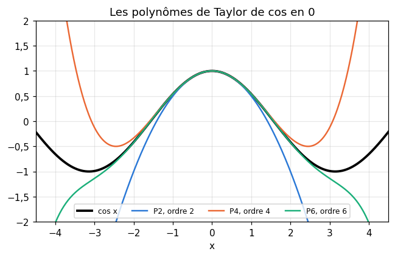
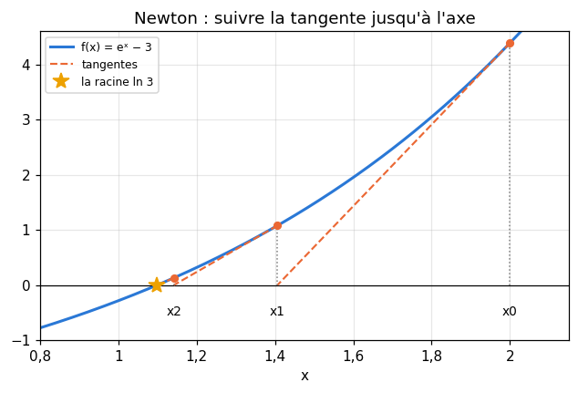
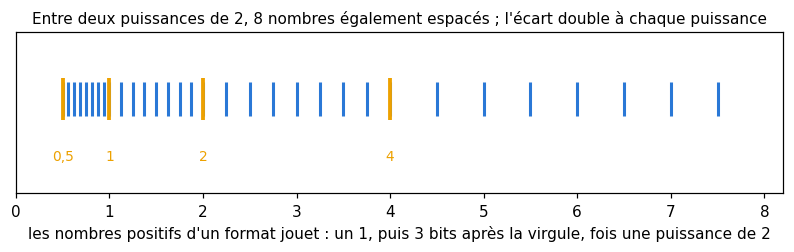
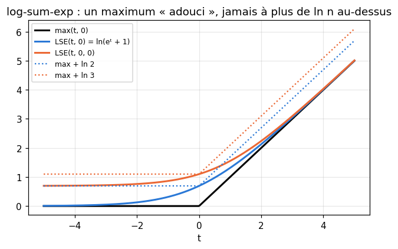

# M05a · Dérivées, Taylor et calcul numérique — fiche de cours

> R7 t'a appris à dériver et à chercher un extremum avec le signe de la dérivée. Ce chapitre va plus loin dans deux directions dont le machine learning a besoin à chaque page. La première regarde **au-delà de la pente** : la dérivée seconde dit si une courbe tourne vers le haut ou vers le bas (la **convexité**, qui garantit qu'un minimum local est le minimum global), et les **polynômes de Taylor** approchent une fonction par un polynôme, avec une erreur qu'on sait borner. Taylor explique ensuite deux méthodes numériques : la **méthode de Newton**, qui résout une équation en suivant des tangentes, et les **différences finies**, qui approchent une dérivée, avec l'erreur qu'elles commettent. La seconde direction regarde **l'ordinateur** : ses nombres sont des **flottants**, en nombre fini, arrondis à chaque opération ; ils débordent (*overflow*) ou s'effacent (*underflow*). On en tire le bon pas d'une différence finie, calculé par une borne, et le **log-sum-exp**, vu en M04, devenu ici un algorithme.

| | |
|---|---|
| **Sections** | §1 à §8 |
| **Temps total estimé** | ≈ 13,5 h : lecture et calculs de la fiche ≈ 3 h, exercices ≈ 9 h 45, flashcards ≈ 50 min (parcours essentiel ≈ 8,9 h) |
| **Prérequis** | R1 (notation scientifique) ; R5 (suites définies par récurrence, limites) ; R6 (exp et ln, croissances comparées) ; R7 (dérivées, variations, tangente, grand O) ; M04 §7 (log-probabilités, log-sum-exp) |
| **Fichiers du chapitre** | `02_exercices.md` (quiz, papier) · `03_notebook.ipynb` · `04_indices.md` · `05_solutions.md` et `05_solutions.ipynb` · `06_mes_reponses.md` · `flashcards.csv` |
| **mymath** | `approx.py` : `taylor_polynomial`, `newton`, `richardson_derivative`, `machine_epsilon`, `logsumexp` |
| **MML** | §5.1 (voir le guide de lecture ci-dessous) |

## Comment utiliser ce chapitre

**Ordre conseillé.**
1. `python tools/start_chapter.py M05a` (sur Colab : `00_setup/COLAB.md` §2) : il copie le notebook, ta feuille de réponses et le squelette `mymath/approx.py`.
2. Section par section : lis **crayon en main**, refais chaque calcul ; puis fais les exercices de la section, quiz 🧠 d'abord.
3. Les exercices ✏️ et 🔗 se font sur papier, dans ta copie de `06_mes_reponses.md`, puis se vérifient dans la **partie 0** du notebook. Les démonstrations ∂ se rédigent dans ta copie et se jugent avec la grille de relecture de `05_solutions.md`.

**Un réflexe pour tout le chapitre** : chaque fois qu'une approximation apparaît (un polynôme de Taylor, une différence finie, un flottant), demande-toi **quelle est son erreur, et comment elle varie** quand on change le pas, l'ordre ou le nombre de chiffres. Presque toute la fiche répond à cette question.

| Section | Quiz 🧠 | Papier et réflexion | Notebook |
|---|---|---|---|
| §1 Dérivée seconde et convexité | Q1, R1 🔁 | M05a.1 ✏️, M05a.3 ✏️, M05a.15 📖, M05a.17 🗣️ | |
| §2 Extrema locaux et globaux | Q2 | M05a.2 ✏️, M05a.3 ✏️ | |
| §3 Polynômes de Taylor et reste | Q3 | M05a.4 ✏️, M05a.5 ✏️, M05a.15 📖 | M05a.18 🔨, M05a.23 📦, M05a.25 🔬, M05a.26 🎨 |
| §4 La méthode de Newton | Q4, R2 🔁 | M05a.6 ✏️, M05a.12 ∂ | M05a.19 🔨, M05a.24 🔮, M05a.29 🏆 |
| §5 Différences finies : l'erreur par Taylor | Q5 | M05a.7 ✏️, M05a.11 ∂ | M05a.20 🔨 |
| §6 Nombres flottants | Q6 | M05a.8 ✏️, M05a.16 🧮 | M05a.21 🔨, M05a.23 📦, M05a.28 🛠️ |
| §7 Le choix du pas h | | M05a.9 ✏️ | |
| §8 Overflow, underflow et log-sum-exp | Q7, R3 🔁 | M05a.10 ✏️, M05a.13 ∂, M05a.14 🔗, M05a.E1 💼 | M05a.22 🔨, M05a.27 🐛 |

Parcours essentiel : tout sauf M05a.Q4, M05a.R3, M05a.3, M05a.5, M05a.8, M05a.11 à M05a.13, M05a.16, M05a.20, M05a.21, M05a.23 à M05a.25 et M05a.27 à M05a.29. Le reste de Taylor (fin du §3), la convergence de Newton (fin du §4) et la représentation binaire des flottants (début du §6) se lisent en survol.

## Guide de lecture de MML

*Mathematics for Machine Learning* (MML) ouvre son chapitre 5, *Vector Calculus*, par le cas d'une seule variable : le **§5.1**, *Differentiation of Univariate Functions*. Lis-le en deux fois :
- après le **§1** de la fiche : le début du §5.1, le quotient différentiel (*difference quotient*) et la dérivée, puis le §5.1.2, les règles de dérivation, qui reprennent R7 ;
- après le **§3** : le §5.1.1, les polynômes et les séries de Taylor, avec les exemples du livre. Questions : M05a.15.

📐 **Notations.** MML note $\frac{df}{dx}$ ou $f'$ la dérivée, $f^{(k)}$ la dérivée $k$-ième, et appelle **polynôme de Taylor de degré $n$** (*Taylor polynomial of degree n*) ce que la fiche appelle polynôme de Taylor d'ordre $n$ : c'est le même objet. Il écrit le point de développement $x_0$ là où la fiche écrit $a$.

Vocabulaire anglais de ce chapitre : *second derivative*, *convex*, *concave*, *inflection point*, *critical point*, *local* et *global extremum*, *Taylor polynomial*, *Taylor series*, *remainder*, *Newton's method* (*Newton-Raphson*), *quadratic convergence*, *finite difference* (*forward*, *central*), *truncation error*, *round-off error*, *Richardson extrapolation*, *floating-point number*, *mantissa* (*significand*), *exponent*, *machine epsilon*, *unit roundoff*, *overflow*, *underflow*, *catastrophic cancellation*, *log-sum-exp*, *numerical stability*.

## Objectifs d'apprentissage

À la fin du chapitre, tu sais :
- **étudier** la convexité d'une fonction avec sa dérivée seconde, et **trouver** ses points d'inflexion ;
- **classer** les extrema locaux et globaux d'une fonction, sur un intervalle fermé ou sur tous les réels ;
- **écrire** un polynôme de Taylor et **borner** son erreur par le reste de Lagrange ;
- **résoudre** une équation par la méthode de Newton, et **dire** quand elle converge vite, lentement ou pas du tout ;
- **calculer** l'erreur d'une différence finie avant ou centrée par Taylor, l'**améliorer** par l'extrapolation de Richardson, et **choisir** un pas en minimisant une borne d'erreur ;
- **expliquer** comment un ordinateur représente un réel, ce qu'est l'epsilon machine, et d'où viennent les erreurs d'arrondi ;
- **calculer** un log-sum-exp et une softmax sans overflow.

## L'essentiel en 10 lignes

1. **Convexité** : $f$ est convexe si chaque corde est au-dessus de la courbe ; pour une fonction deux fois dérivable, c'est $f'' \ge 0$. Un **point d'inflexion** est un point où $f''$ change de signe.
2. **Extrema** : à l'intérieur d'un intervalle, un extremum local annule $f'$ ; si $f'(c) = 0$, $f''(c) > 0$ donne un minimum local, $f''(c) < 0$ un maximum local. Sur $[a, b]$, les extrema globaux sont parmi les points critiques et les **bords**. Pour une fonction **convexe**, un point critique est un **minimum global**.
3. **Taylor** : $P_n(x) = \sum_{k=0}^{n} \frac{f^{(k)}(a)}{k!}(x - a)^k$, le polynôme qui a la même valeur et les mêmes $n$ premières dérivées que $f$ en $a$. Reste de Lagrange : $|f(x) - P_n(x)| \le \frac{M}{(n+1)!}|x - a|^{n+1}$, si $|f^{(n+1)}| \le M$ entre $a$ et $x$.
4. $e^x = \sum_{k \ge 0} \frac{x^k}{k!}$ pour tout $x$ ; $\ln(1 + x) = x - \frac{x^2}{2} + \frac{x^3}{3} - \cdots$ seulement pour $-1 < x \le 1$.
5. **Newton** : $x_{k+1} = x_k - \frac{f(x_k)}{f'(x_k)}$, l'intersection de la tangente avec l'axe. Près d'une racine simple, l'erreur est **élevée au carré** à chaque pas : le nombre de décimales justes double. Elle peut échouer : tangente horizontale, cycle, départ trop loin.
6. **Différences finies** (Taylor) : la différence **avant** $\frac{f(x + h) - f(x)}{h}$ a une erreur $\approx \frac{h}{2}f''(x)$ (ordre 1), la différence **centrée** $\frac{f(x + h) - f(x - h)}{2h}$ une erreur $\approx \frac{h^2}{6}f'''(x)$ (ordre 2). **Richardson** : $\frac{4D(h/2) - D(h)}{3}$ annule le terme en $h^2$.
7. **Flottants** (`float64`) : $\pm 1{,}b_1 b_2 \ldots b_{52} \times 2^e$ en base 2. **Epsilon machine** $\varepsilon = 2^{-52} \approx 2{,}2 \times 10^{-16}$ : l'écart entre 1 et le flottant suivant ; chaque opération arrondit avec une erreur relative d'au plus $\frac{\varepsilon}{2}$ (hors overflow et underflow). `float32` : $\varepsilon = 2^{-23}$ ; `float16` : $2^{-10}$.
8. **Annulation** : soustraire deux nombres presque égaux fait perdre des chiffres ; on réécrit la formule pour l'éviter.
9. **Le pas $h$** : l'erreur d'une différence finie additionne une troncature (qui diminue avec $h$) et un arrondi en $\frac{\delta}{h}$ (qui augmente) ; le meilleur pas minimise leur somme : $h^* = \big(\frac{3\delta}{M_3}\big)^{1/3}$ pour la différence centrée.
10. **log-sum-exp** : $\ln \sum_i e^{v_i} = m + \ln \sum_i e^{v_i - m}$ avec $m = \max_i v_i$, compris entre $m$ et $m + \ln n$. **Softmax** stable : $\frac{e^{v_i - m}}{\sum_j e^{v_j - m}}$ ; log-softmax : $v_i - \text{LSE}(\mathbf{v})$.

---

## §1 · Dérivée seconde et convexité en une variable

### La dérivée de la dérivée

La dérivée $f'$ est une fonction ; sa dérivée, quand elle existe, est la **dérivée seconde** (*second derivative*) $f''$. Elle dit comment varie la **pente** : si $f'' > 0$ sur un intervalle, $f'$ y est croissante, et la courbe tourne vers le haut, comme une cuvette ; si $f'' < 0$, elle tourne vers le bas, comme un dôme. On continue de même : $f'''$, $f^{(4)}$, et en général $f^{(k)}$, la dérivée $k$-ième (en mécanique : position, vitesse, accélération).

Exemple : $f(x) = \sqrt{1 + x^2}$, une version « arrondie » de $|x|$ : loin de 0, elle vaut presque $|x|$, mais elle n'a pas de coin en 0. Par la règle de la chaîne (R7 §7), $f'(x) = \frac{x}{\sqrt{1 + x^2}}$, puis par la règle du quotient (R7 §6) :

$$f''(x) = \frac{\sqrt{1 + x^2} - x \cdot \frac{x}{\sqrt{1 + x^2}}}{1 + x^2} = \frac{(1 + x^2) - x^2}{(1 + x^2)^{3/2}} = \frac{1}{(1 + x^2)^{3/2}} > 0 \quad \text{pour tout } x.$$

La pente de $f$ augmente partout, de $-1$ (loin à gauche) à $+1$ (loin à droite), alors que celle de $|x|$ saute d'un coup de $-1$ à $+1$ en 0 : la courbe de $f$ tourne toujours vers le haut.

### Convexe, concave

Une fonction $f$ est **convexe** (*convex*) sur un intervalle $I$ si, pour deux points $a$ et $b$ de $I$, la **corde** qui joint $(a, f(a))$ et $(b, f(b))$ est au-dessus de la courbe entre eux :

$$f\big(t\,a + (1 - t)\,b\big) \le t\,f(a) + (1 - t)\,f(b) \quad \text{pour tout } t \in [0, 1].$$

Elle est **concave** si $-f$ est convexe (chaque corde est au-dessous). On l'admet ici, un dessin suffit à s'en convaincre : pour une fonction deux fois dérivable,

> **$f$ est convexe sur $I$ si et seulement si $f'' \ge 0$ sur $I$** ; et alors chaque **tangente** est au-dessous de la courbe : $f(x) \ge f(c) + f'(c)(x - c)$.

Ainsi $x^2$, $e^x$, $-\ln x$ et $\sqrt{1 + x^2}$ sont convexes, $\ln x$ et $\sqrt{x}$ concaves sur $]0, +\infty[$, et $x^3$ est concave sur $]-\infty, 0]$ et convexe sur $[0, +\infty[$.

![À gauche : √(1 + x²) est convexe, une corde au-dessus, une tangente au-dessous. À droite : ln(1 + x²) n'est convexe que sur [−1, 1]](figures/convexite.png)

### Points d'inflexion

Un **point d'inflexion** (*inflection point*) est un point où la courbe passe de convexe à concave, ou l'inverse : là où $f''$ **change de signe**. Exemple : $g(x) = \ln(1 + x^2)$. On trouve $g'(x) = \frac{2x}{1 + x^2}$, puis, par la règle du quotient (R7 §6),

$$g''(x) = \frac{2(1 + x^2) - 2x \cdot 2x}{(1 + x^2)^2} = \frac{2(1 - x^2)}{(1 + x^2)^2}.$$

Le dénominateur est positif : $g''$ a le signe de $1 - x^2$. Elle est positive sur $]-1, 1[$, négative ailleurs : $g$ est convexe sur $[-1, 1]$, concave sur $]-\infty, -1]$ et sur $[1, +\infty[$, avec deux points d'inflexion, en $-1$ et en $1$ (figure, à droite).

⚠️ **Erreur classique.** Croire que $f''(c) = 0$ suffit pour un point d'inflexion. $x^4$ a $f''(x) = 12x^2$, nulle en 0, mais positive des deux côtés : pas de changement de signe, $x^4$ est convexe partout, et 0 est son minimum. Il faut **le changement de signe**.

🔗 **Dans workbookIA** — la convexité est la propriété qui rend une loss facile à minimiser : la log-loss de la régression logistique (ch. 13) est convexe, celle d'un réseau de neurones ne l'est pas. La convexité en plusieurs variables revient en M10 (la même définition par les cordes), en M12c et en M19.

## §2 · Extrema locaux et globaux

### Local, global, et ce que dit la dérivée

$f$ a un **maximum local** en $c$ si $f(c) \ge f(x)$ pour tous les $x$ assez proches de $c$, un **maximum global** sur $I$ si $f(c) \ge f(x)$ pour tous les $x$ de $I$ (de même pour un minimum). R7 §8 l'a montré : si $f$ est dérivable et a un extremum local en un point $c$ **intérieur** à l'intervalle, alors $f'(c) = 0$. Les points où $f' = 0$ s'appellent les **points critiques** (*critical points*) ; ce sont les seuls candidats à l'intérieur, mais un point critique n'est pas forcément un extremum ($x^3$ en 0).

**Le test de la dérivée seconde.** Si $f'(c) = 0$ et $f''(c) > 0$, la pente passe du négatif au positif autour de $c$ : **minimum local**. Si $f''(c) < 0$ : **maximum local**. Si $f''(c) = 0$, le test ne conclut pas : $x^4$ (minimum), $-x^4$ (maximum) et $x^3$ (ni l'un ni l'autre) ont tous les trois $f'(0) = f''(0) = 0$. On revient alors au signe de $f'$ de part et d'autre (M05a.3).

### Sur un intervalle fermé : ne pas oublier les bords

Une fonction continue sur un intervalle **fermé** $[a, b]$ y atteint un maximum et un minimum globaux (on l'admet). Pour les trouver :
1. calculer les points critiques **dans** $]a, b[$ ;
2. calculer $f$ en ces points **et aux deux bords** $a$ et $b$ ;
3. la plus grande de ces valeurs est le maximum global, la plus petite le minimum global.

Exemple : $f(x) = x^2 e^{-x}$ sur $[-1, 4]$. On trouve $f'(x) = (2x - x^2)e^{-x} = x(2 - x)e^{-x}$, nulle en 0 et en 2, puis $f''(x) = (x^2 - 4x + 2)e^{-x}$. En 0, $f''(0) = 2 > 0$ : minimum local ; en 2, $f''(2) = -2e^{-2} < 0$ : maximum local. Les valeurs :

| $x$ | $-1$ (bord) | $0$ | $2$ | $4$ (bord) |
|---|---|---|---|---|
| $f(x)$ | $e \approx 2{,}718$ | $0$ | $4e^{-2} \approx 0{,}541$ | $16e^{-4} \approx 0{,}293$ |

Le maximum global est $e$, atteint **au bord** $x = -1$, où $f'$ ne s'annule pas ; le maximum local en 2 n'est pas global. Le minimum global est 0, en $x = 0$.

![x² e⁻ˣ sur [−1 ; 4] : un minimum local et global, un maximum local qui n'est pas global, le maximum global au bord](figures/extrema.png)

Sur tous les réels, on regarde aussi les **limites** : ici $f(x) \to +\infty$ quand $x \to -\infty$, donc $f$ n'a pas de maximum global sur $\mathbb{R}$ ; et $f \ge 0$ partout, donc 0 reste son minimum global.

### La convexité rend le local global

Si $f$ est **convexe** et $f'(c) = 0$, la tangente en $c$ est horizontale, et elle est au-dessous de la courbe (§1) : $f(x) \ge f(c) + 0 \cdot (x - c) = f(c)$ pour tout $x$. **Un point critique d'une fonction convexe est un minimum global** ; si $f$ est **strictement** convexe ($f'' > 0$), ce minimum est unique. C'est pourquoi une descente de gradient sur une loss convexe ne peut pas se perdre dans un « mauvais » minimum local : il n'y en a pas.

⚠️ **Erreur classique.** Chercher le maximum d'une fonction sur $[a, b]$ parmi les seuls points où $f' = 0$ : le maximum global de $x^2e^{-x}$ sur $[-1, 4]$ est au bord. Autre piège : conclure « minimum » d'un point critique sans aucun test.

## §3 · Polynômes de Taylor et reste

### Approcher une fonction par un polynôme

La tangente (R7 §4) approche $f$ près de $a$ par une droite, qui a la même valeur et la même pente que $f$ en $a$. Pour faire mieux, on cherche le polynôme de degré $n$ qui a la même valeur et les **mêmes $n$ premières dérivées** que $f$ en $a$. C'est le **polynôme de Taylor** d'ordre $n$ de $f$ en $a$ (*Taylor polynomial*) :

$$P_n(x) = f(a) + f'(a)(x - a) + \frac{f''(a)}{2}(x - a)^2 + \cdots + \frac{f^{(n)}(a)}{n!}(x - a)^n = \sum_{k=0}^{n} \frac{f^{(k)}(a)}{k!}(x - a)^k.$$

Le $k!$ vient de ce que la dérivée $k$-ième de $(x - a)^k$ vaut $k!$ : c'est lui qui donne à $P_n^{(k)}(a)$ la valeur $f^{(k)}(a)$. $P_1$ est la tangente ; $P_2$ est la parabole qui « épouse » la courbe en $a$, avec la même courbure.

Les développements en 0 à connaître (toutes les dérivées de $e^x$ valent $e^0 = 1$ en 0, celles de $\sin$ et $\cos$ tournent entre $0, 1, 0, -1$) :

| $f(x)$ | $P_n(x)$ en $a = 0$ |
|---|---|
| $e^x$ | $1 + x + \frac{x^2}{2} + \frac{x^3}{6} + \cdots + \frac{x^n}{n!}$ |
| $\cos x$ | $1 - \frac{x^2}{2} + \frac{x^4}{24} - \frac{x^6}{720} + \cdots$ |
| $\sin x$ | $x - \frac{x^3}{6} + \frac{x^5}{120} - \cdots$ |
| $\ln(1 + x)$ | $x - \frac{x^2}{2} + \frac{x^3}{3} - \frac{x^4}{4} + \cdots$ |
| $\frac{1}{1 - x}$ | $1 + x + x^2 + x^3 + \cdots$ (la somme géométrique de R5) |
| $(1 + x)^\alpha$ | $1 + \alpha x + \frac{\alpha(\alpha - 1)}{2}x^2 + \cdots$, par exemple $\sqrt{1 + x} \approx 1 + \frac{x}{2} - \frac{x^2}{8}$ |

Exemple : $\sqrt{1{,}2}$ sans calculatrice. Avec $P_2$ de $\sqrt{1 + x}$ en 0 et $x = 0{,}2$ : $1 + 0{,}1 - \frac{0{,}04}{8} = 1{,}095$, quand $\sqrt{1{,}2} = 1{,}0954451\ldots$ : l'erreur vaut $0{,}00045$.



Sur la figure, en $x = 1{,}5$ : $P_2 = -0{,}125$, $P_4 \approx 0{,}0859$, $P_6 \approx 0{,}0701$, pour $\cos 1{,}5 \approx 0{,}0707$. Près de $a$, quelques termes suffisent ; loin de $a$, il en faut beaucoup plus.

### Le reste : combien se trompe-t-on ?

L'erreur $R_n(x) = f(x) - P_n(x)$ s'appelle le **reste** (*remainder*). On admet sa forme de **Lagrange** : si $f$ est $n + 1$ fois dérivable, il existe un point $\xi$ entre $a$ et $x$ tel que

$$R_n(x) = \frac{f^{(n+1)}(\xi)}{(n+1)!}(x - a)^{n+1}, \qquad \text{donc} \qquad |R_n(x)| \le \frac{M}{(n+1)!}\,|x - a|^{n+1} \quad \text{si } |f^{(n+1)}| \le M \text{ entre } a \text{ et } x.$$

On ne connaît pas $\xi$ ; on borne la dérivée sur tout l'intervalle. Pour $\sqrt{1 + x}$ : $f'''(t) = \frac{3}{8}(1 + t)^{-5/2}$, qui vaut au plus $\frac{3}{8}$ pour $t \ge 0$ ; avec $x = 0{,}2$, $|R_2| \le \frac{3/8}{6} \times 0{,}2^3 = 0{,}0005$. L'erreur vraie, $0{,}00045$, est bien sous la borne. Avec la notation de R7 §9 : $f(x) = P_n(x) + O\big((x - a)^{n+1}\big)$ quand $x \to a$.

### Les séries de Taylor

Quand le reste tend vers 0 quand $n \to +\infty$, la fonction est la somme de sa **série de Taylor** (*Taylor series*). Pour $e^x$ en 0, toutes les dérivées valent $e^\xi \le e^{|x|}$ entre 0 et $x$, donc $|R_n(x)| \le e^{|x|}\frac{|x|^{n+1}}{(n+1)!}$, qui tend vers 0 pour **tout** $x$ (la factorielle l'emporte sur la puissance : dès que $k > 2|x|$, chaque nouveau facteur $\frac{|x|}{k}$ est inférieur à $\frac{1}{2}$) :

$$e^x = \sum_{k=0}^{+\infty} \frac{x^k}{k!} = 1 + x + \frac{x^2}{2} + \frac{x^3}{6} + \cdots \quad \text{pour tout réel } x.$$

C'est la formule admise en M02b pour la loi de Poisson : $\sum_k e^{-\lambda}\frac{\lambda^k}{k!} = e^{-\lambda}e^{\lambda} = 1$. Toutes les séries ne convergent pas partout : celle de $\ln(1 + x)$ ne converge que pour $-1 < x \le 1$ ; au-delà, ajouter des termes **éloigne** du résultat (M05a.25).

⚠️ **Erreur classique.** Oublier les factorielles ($P_2 = f(a) + f'(a)(x - a) + f''(a)(x - a)^2$), ou développer en puissances de $x$ au lieu de $(x - a)$ quand $a \ne 0$. Autre piège : croire qu'un polynôme d'ordre plus élevé est toujours meilleur, même loin de $a$.

## §4 · La méthode de Newton

### Suivre la tangente

On veut résoudre $f(x) = 0$. Près d'un point $x_k$, on remplace $f$ par sa tangente, $f(x_k) + f'(x_k)(x - x_k)$ (son polynôme de Taylor d'ordre 1), et l'on résout l'équation de la tangente, qui est facile :

$$x_{k+1} = x_k - \frac{f(x_k)}{f'(x_k)} \qquad \text{(si } f'(x_k) \ne 0\text{)}.$$

C'est la **méthode de Newton** (*Newton's method*, ou *Newton-Raphson*) : une suite définie par récurrence (R5), qu'on arrête quand deux valeurs successives sont assez proches, $|x_{k+1} - x_k| < \text{tol}$, avec un nombre maximal d'itérations au cas où elle ne converge pas.

Exemple : calculer $\ln 3$ sans touche `ln`, en résolvant $e^x - 3 = 0$. Avec $f'(x) = e^x$, l'itération est $x_{k+1} = x_k - 1 + 3e^{-x_k}$. Depuis $x_0 = 2$ :

| $k$ | 0 | 1 | 2 | 3 | 4 | 5 |
|---|---|---|---|---|---|---|
| $x_k$ | 2 | 1,40601 | 1,14137 | 1,09951 | 1,0986127 | 1,0986122887 |
| erreur $\lvert x_k - \ln 3 \rvert$ | 0,90 | 0,31 | 0,043 | $9{,}0 \times 10^{-4}$ | $4{,}1 \times 10^{-7}$ | $8{,}2 \times 10^{-14}$ |

À partir de $k = 2$, le nombre de décimales justes **double** à chaque pas.



```python
>>> import math
>>> x = 2.0
>>> for _ in range(6):
...     x = x - (math.exp(x) - 3) / math.exp(x)
>>> abs(x - math.log(3)) < 1e-15
True
```

**Racines carrées.** Pour $f(x) = x^2 - c$, l'itération devient $x_{k+1} = x_k - \frac{x_k^2 - c}{2x_k} = \frac{1}{2}\big(x_k + \frac{c}{x_k}\big)$ : la moyenne de $x_k$ et de $\frac{c}{x_k}$, une méthode connue depuis l'Antiquité (méthode de Héron). M05a.6 la fait à la main.

### Pourquoi elle va si vite

Près d'une racine $r$ **simple** ($f'(r) \ne 0$), Taylor à l'ordre 2 donne (M05a.12) :

$$e_{k+1} \approx \frac{f''(r)}{2f'(r)}\,e_k^2, \qquad \text{où } e_k = x_k - r.$$

L'erreur est **élevée au carré** à chaque pas : c'est la **convergence quadratique**. Avec $e^x - 3$, $\frac{f''(r)}{2f'(r)} = \frac{1}{2}$, et en effet $e_4 \approx \frac{1}{2} \times (9{,}0 \times 10^{-4})^2 \approx 4{,}1 \times 10^{-7}$. Comparaison : la dichotomie de R7 §2 divise l'erreur par 2 à chaque pas, environ trois pas par décimale ; Newton double les décimales, mais il lui faut la dérivée, et un point de départ assez proche.

### Quand elle échoue

- **Tangente horizontale** : si $f'(x_k) = 0$, le pas n'est pas défini (pour $x^2 + 1$ en $x_0 = 0$, par exemple) ; si $f'(x_k)$ est seulement petite, le pas envoie très loin.
- **Cycle** : pour $f(x) = x^3 - 2x + 2$ depuis $x_0 = 0$, on trouve $x_1 = 0 - \frac{2}{-2} = 1$, puis $x_2 = 1 - \frac{1}{1} = 0$ : la suite tourne entre 0 et 1, sans jamais approcher la racine (vers $-1{,}77$).
- **Divergence** : depuis un point trop loin, les tangentes peuvent s'éloigner de plus en plus de la racine (M05a.24).
- **Racine multiple** : si $f'(r) = 0$ aussi, la convergence n'est plus que **linéaire** (l'erreur est multipliée par un facteur fixe), comme pour $x^2$ en 0 (M05a.24).

C'est pourquoi une bonne implémentation teste $f'(x_k)$ avant de diviser, et s'arrête après un nombre maximal d'itérations (`newton`, M05a.19).

🔗 **Dans workbookIA** — pour **minimiser** une fonction, on applique Newton à sa dérivée : $x \leftarrow x - \frac{f'(x)}{f''(x)}$. C'est l'idée des méthodes du second ordre (ch. 19), qui utilisent la courbure et pas seulement la pente.

⚠️ **Erreur classique.** Écrire $x - \frac{f'(x)}{f(x)}$ au lieu de $x - \frac{f(x)}{f'(x)}$, ou s'arrêter quand $f(x_k)$ est petit sans regarder si $x_k$ bouge encore. Autre piège : croire que Newton converge depuis n'importe quel point.

## §5 · Différences finies : l'erreur par Taylor

### Trois formules et leurs erreurs

Une **différence finie** (*finite difference*) approche une dérivée avec un pas $h > 0$ fixé, sans limite. Pour savoir combien elle se trompe, on écrit Taylor en $x$ :

$$f(x \pm h) = f(x) \pm h\,f'(x) + \frac{h^2}{2}f''(x) \pm \frac{h^3}{6}f'''(x) + \frac{h^4}{24}f^{(4)}(x) \pm \cdots$$

(le signe du haut pour $x + h$, celui du bas pour $x - h$ : les termes de degré impair en $h$ changent de signe, les autres non).

- **Différence avant** (*forward*) : $\frac{f(x + h) - f(x)}{h} = f'(x) + \frac{h}{2}f''(x) + O(h^2)$. L'erreur est proportionnelle à $h$ : **ordre 1**.
- **Différence centrée** (*central*) : en soustrayant les deux développements, les termes de degré pair ($f(x)$, $f''$, $f^{(4)}$) disparaissent, et $\frac{f(x + h) - f(x - h)}{2h} = f'(x) + \frac{h^2}{6}f'''(x) + O(h^4)$ : **ordre 2**.
- **Différence seconde** : en les additionnant, ce sont les termes de degré impair qui disparaissent, et $\frac{f(x + h) - 2f(x) + f(x - h)}{h^2} = f''(x) + \frac{h^2}{12}f^{(4)}(x) + O(h^4)$ : ordre 2 (M05a.11 le démontre en même temps que la centrée).

Une méthode d'**ordre $p$** a une erreur qui se comporte comme $C h^p$ : diviser $h$ par 2 divise l'erreur par environ $2^p$. Cette erreur, qui vient de la formule elle-même (on a « tronqué » la série de Taylor), s'appelle l'**erreur de troncature** (*truncation error*).

Exemple : $f = \ln$ en $x = 2$, où $f'(2) = \frac{1}{2}$, $f''(2) = -\frac{1}{4}$, $f'''(2) = \frac{2}{8} = \frac{1}{4}$, avec $h = 0{,}1$ :

| formule | valeur | erreur | prévision par Taylor |
|---|---|---|---|
| avant | 0,4879016 | $-0{,}01210$ | $\frac{h}{2}f''(2) = -0{,}0125$ |
| centrée | 0,5004173 | $4{,}17 \times 10^{-4}$ | $\frac{h^2}{6}f'''(2) \approx 4{,}17 \times 10^{-4}$ |

À pas égal, la centrée est ici trente fois plus précise.

### L'extrapolation de Richardson

Si l'on sait que $D(h) = f'(x) + c\,h^2 + O(h^4)$, avec $c$ inconnu, alors $D(\frac{h}{2}) = f'(x) + c\,\frac{h^2}{4} + O(h^4)$, et la combinaison qui fait disparaître $c$ est

$$\frac{4\,D(h/2) - D(h)}{3} = f'(x) + O(h^4).$$

C'est l'**extrapolation de Richardson** (*Richardson extrapolation*) : deux calculs imprécis, combinés, en donnent un bien plus précis. Sur l'exemple : $D(0{,}05) \approx 0{,}5001042$, et $\frac{4 \times 0{,}5001042 - 0{,}5004173}{3} \approx 0{,}4999998$, juste à $2 \times 10^{-7}$ près, au lieu de $4 \times 10^{-4}$. L'idée sert partout où l'on connaît la forme de l'erreur (`richardson_derivative`, M05a.20).

**D'où viennent les ordres des méthodes d'intégration de M02a.** Le même calcul explique les ordres admis en M02a §5. Sur un petit intervalle $[x, x + h]$, Taylor donne $\int_0^h f(x + t)\,dt = h f(x) + \frac{h^2}{2}f'(x) + \frac{h^3}{6}f''(x) + O(h^4)$, alors que le trapèze vaut $\frac{h}{2}\big(f(x) + f(x + h)\big) = h f(x) + \frac{h^2}{2}f'(x) + \frac{h^3}{4}f''(x) + O(h^4)$ : l'écart est $-\frac{h^3}{12}f''(x)$ par intervalle. Avec $n = \frac{b - a}{h}$ intervalles, il reste une erreur de l'ordre de $n \times h^3 = (b - a)h^2$ : la méthode des trapèzes est d'ordre 2.

⚠️ **Erreur classique.** Diviser la différence centrée par $h$ au lieu de $2h$ (les deux points sont à $2h$ l'un de l'autre), ou croire que la différence avant et la centrée ont la même précision « parce que ce sont deux différences ».

## §6 · Nombres flottants : représentation, epsilon machine, arrondis

### Une notation scientifique en base 2

Un `float` de Python (un `float64` de NumPy) est écrit en notation scientifique (R1), mais **en base 2** :

$$x = \pm\,(1{,}b_1 b_2 \ldots b_{52})_2 \times 2^e,$$

avec 52 chiffres binaires $b_i$ après la virgule (la **mantisse**, *significand*), et un **exposant** entier $e$ entre $-1022$ et $1023$, rangé sur 11 bits ; avec le bit de signe, cela fait $1 + 11 + 52 = 64$ bits (le 1 avant la virgule n'est pas rangé : il est toujours là). Trois conséquences :
1. Entre deux puissances de 2 consécutives, il y a exactement $2^{52}$ flottants, **également espacés** ; l'écart double à chaque puissance de 2 (figure, sur un format jouet à 3 bits). Les flottants sont serrés près de 0 et espacés loin de 0 : leur précision est **relative**.
2. L'écart entre 1 et le flottant suivant, $1 + 2^{-52}$, est l'**epsilon machine** (*machine epsilon*) : $\varepsilon = 2^{-52} \approx 2{,}22 \times 10^{-16}$. Un réel est arrondi au flottant le plus proche, avec une erreur relative d'au plus $u = \frac{\varepsilon}{2} = 2^{-53} \approx 1{,}1 \times 10^{-16}$ (l'*unit roundoff*) : environ 16 chiffres significatifs. Cette garantie vaut tant que le nombre reste dans la zone des flottants « normaux », entre $2{,}2 \times 10^{-308}$ et $1{,}8 \times 10^{308}$ en valeur absolue (voir plus bas).
3. Tous les entiers jusqu'à $2^{53}$ sont exacts ; au-delà, l'écart vaut 2 ou plus, et $2^{53} + 1$ n'est pas représentable.



**Pourquoi 0,1 n'est pas exact.** $0{,}375 = \frac{1}{4} + \frac{1}{8} = (0{,}011)_2$ s'écrit avec trois chiffres binaires. Mais 0,1 : en multipliant par 2 et en gardant la partie entière à chaque fois, on obtient $0{,}2 \to 0$, $0{,}4 \to 0$, $0{,}8 \to 0$, $1{,}6 \to 1$, $1{,}2 \to 1$ (on garde 0,2), puis tout recommence : $0{,}1 = (0{,}0\,0011\,0011\,0011\ldots)_2$, un développement infini, comme $\frac{1}{3} = 0{,}333\ldots$ en base 10. Il est arrondi au flottant le plus proche, qui garde 52 chiffres après le premier 1 (et vaut ici un peu plus que 0,1, de $5{,}6 \times 10^{-18}$ environ) : c'est l'arrondi que R0 a rencontré avec `0.1 + 0.2`.

| type | bits de mantisse | $\varepsilon$ | plus grand nombre |
|---|---|---|---|
| `float64` (Python, NumPy par défaut) | 52 | $2^{-52} \approx 2{,}2 \times 10^{-16}$ | $\approx 1{,}8 \times 10^{308}$ |
| `float32` | 23 | $2^{-23} \approx 1{,}2 \times 10^{-7}$ | $\approx 3{,}4 \times 10^{38}$ |
| `float16` | 10 | $2^{-10} \approx 9{,}8 \times 10^{-4}$ | 65 504 |

Au-delà du plus grand nombre, le résultat **déborde** (*overflow*) : NumPy rend `inf`, et `math.exp` lève une `OverflowError`. Sous le plus petit nombre positif « normal », $\approx 2{,}2 \times 10^{-308}$, viennent des nombres de moins en moins précis (les *sous-normaux*), jusqu'à $\approx 4{,}9 \times 10^{-324}$ ; en dessous, le résultat **s'efface** et vaut 0 (*underflow*, M04 §7).

### Les erreurs d'arrondi

Chaque opération (somme, produit, quotient, racine) calcule le résultat exact, puis l'arrondit : $\text{fl}(a \circ b) = (a \circ b)(1 + \delta)$ avec $|\delta| \le u$. Une seule opération est donc très précise. Les ennuis viennent de deux situations.

**L'absorption.** Ajouter un petit nombre à un grand le fait disparaître : à $10^{16}$, l'écart entre deux flottants vaut 2, et $10^{16} + 1$ est arrondi à $10^{16}$. L'ordre des opérations compte alors : l'addition en flottants n'est pas **associative**.

**L'annulation.** Soustraire deux nombres presque égaux garde leurs derniers chiffres, ceux qui portent l'arrondi : l'erreur absolue reste petite, mais l'erreur **relative** du résultat explose. Dans $(10^8 + 0{,}1) - 10^8$, le premier terme est arrondi à $10^{-8}$ près environ ; la soustraction est exacte, mais elle met cette erreur en pleine lumière : on obtient $0{,}099999994\ldots$, juste à 7 chiffres seulement. On parle d'**annulation catastrophique** (*catastrophic cancellation*). Le remède est de **réécrire** la formule : pour $\sqrt{x + 1} - \sqrt{x}$ avec $x$ grand, on multiplie par la quantité conjuguée (R7) : $\frac{1}{\sqrt{x + 1} + \sqrt{x}}$, qui ne soustrait plus rien.

```python
>>> 2.0 ** -52
2.220446049250313e-16
>>> 1.0 + 2.0 ** -53 == 1.0
True
>>> (1e8 + 0.1) - 1e8
0.09999999403953552
>>> (1e16 + 1) + 1, 1e16 + (1 + 1)
(1e+16, 1.0000000000000002e+16)
>>> float(2 ** 53 + 1) == 2 ** 53
True
>>> x = 1e12
>>> math.sqrt(x + 1) - math.sqrt(x), 1 / (math.sqrt(x + 1) + math.sqrt(x))
(5.00003807246685e-07, 4.999999999998749e-07)
```

Avec $x = 10^{12}$, la formule directe n'a que 5 chiffres justes, la formule réécrite les a tous.

💻 **Aujourd'hui en pratique** — les réseaux s'entraînent en `float32`, ou en 16 bits pour aller plus vite : `float16`, dont l'exposant étroit déborde vite (d'où le *loss scaling*), ou `bfloat16`, qui garde l'exposant de `float32` avec seulement 7 bits de mantisse. Avec $\varepsilon \approx 10^{-3}$ ou $10^{-2}$, chaque erreur d'arrondi de ce chapitre devient visible.

⚠️ **Erreur classique.** Comparer deux flottants avec `==` après un calcul (`0.1 * 3 == 0.3` est faux) ; il faut une tolérance, relative ou absolue (M05a.28). Autre piège : croire que $\varepsilon$ est le plus petit flottant positif ; c'est l'écart **après 1**, et il existe des flottants bien plus petits ($10^{-300}$).

## §7 · Le choix du pas h : troncature contre arrondi

### Deux erreurs qui varient en sens contraire

Dans une différence finie, les valeurs $f(x \pm h)$ ne sont jamais exactes : elles sont arrondies, ou mesurées avec du bruit. Supposons chacune juste à $\delta$ près ($\delta \approx u\,|f(x)|$ pour un calcul en flottants, ou la précision d'un capteur). Le numérateur $f(x + h) - f(x - h)$ peut alors être faux de $2\delta$, et, divisé par $2h$, il donne une **erreur d'arrondi** (*round-off error*) d'au plus $\frac{\delta}{h}$, qui **augmente** quand $h$ diminue. Avec la troncature du §5, si $|f'''| \le M_3$ :

$$E(h) \le \underbrace{\frac{M_3}{6}h^2}_{\text{troncature}} + \underbrace{\frac{\delta}{h}}_{\text{arrondi}}.$$

Un $h$ trop grand rend la troncature grande ; un $h$ trop petit rend l'arrondi grand. Le meilleur pas est entre les deux : on minimise la borne en annulant sa dérivée (R7 §8) :

$$E'(h) = \frac{M_3}{3}h - \frac{\delta}{h^2} = 0 \iff h^* = \Big(\frac{3\delta}{M_3}\Big)^{1/3}, \qquad E(h^*) = \frac{3}{2}\Big(\frac{M_3}{3}\Big)^{1/3}\delta^{2/3}.$$

Pour la différence avant, le même calcul avec $E(h) \le \frac{M_2}{2}h + \frac{2\delta}{h}$ donne $h^* = 2\sqrt{\frac{\delta}{M_2}}$ et $E(h^*) = 2\sqrt{M_2\,\delta}$ : l'erreur au meilleur pas est en $\delta^{1/2}$, contre $\delta^{2/3}$ pour la centrée. Comme $\delta$ est petit, $\delta^{2/3}$ est bien plus petit que $\delta^{1/2}$ : même chacune à son meilleur pas, la centrée l'emporte.

**Exemple en `float32`**, la précision habituelle des réseaux : pour $f = \sin$ autour de $x = 1$, $\delta \approx 10^{-7}$ et $M_3 = 1$. La différence centrée a son meilleur pas vers $h^* = (3 \times 10^{-7})^{1/3} \approx 6{,}7 \times 10^{-3}$, avec une erreur d'environ $2{,}2 \times 10^{-5}$ ; la différence avant ($M_2 = 1$) vers $h^* = 2\sqrt{10^{-7}} \approx 6{,}3 \times 10^{-4}$, avec une erreur d'environ $6{,}3 \times 10^{-4}$. En `float32`, une dérivée numérique n'a donc que quatre ou cinq chiffres justes, quel que soit le pas.

Ces bornes sont des majorations, avec des constantes qu'on ne connaît qu'à peu près : elles donnent l'**ordre de grandeur** du bon pas, et la façon dont il varie avec $\delta$, pas sa valeur exacte. En `float64`, workbookIA 5 mesure la vraie courbe d'erreur.

⚠️ **Erreur classique.** Croire que « plus $h$ est petit, plus la dérivée est précise » : vrai tant que l'arrondi est négligeable, faux ensuite. Autre piège : prendre le même pas pour toutes les formules ; le meilleur pas dépend de l'ordre de la méthode et de $\delta$.

## §8 · Overflow, underflow et log-sum-exp

### Quand l'exponentielle déborde

$e^x$ dépasse le plus grand `float64` dès que $x > \ln(1{,}8 \times 10^{308}) \approx 709{,}78$ : `math.exp(710)` lève une `OverflowError`, `np.exp(710)` rend `inf` avec un avertissement. Dans l'autre sens, $e^{-746}$ vaut 0. Or les modèles calculent sans cesse des exponentielles de scores, qui peuvent être grands : la **softmax** transforme des scores $v_1, \ldots, v_n$ en probabilités $\frac{e^{v_i}}{\sum_j e^{v_j}}$, et sa normalisation passe par $\ln \sum_j e^{v_j}$, le **log-sum-exp** (LSE).

### L'astuce : mettre le maximum en facteur

M04 §7 l'a utilisée pour normaliser des log-vraisemblances ; voici pourquoi elle marche. Avec $m = \max_i v_i$ :

$$\text{LSE}(\mathbf{v}) = \ln \sum_i e^{v_i} = \ln\Big(e^m \sum_i e^{v_i - m}\Big) = m + \ln \sum_i e^{v_i - m}.$$

Tous les exposants $v_i - m$ sont négatifs ou nuls, donc aucune exponentielle ne déborde ; le plus grand terme vaut exactement $e^0 = 1$, donc la somme est entre 1 et $n$, et son logarithme ne peut pas valoir $-\infty$. Un terme ne s'efface à 0 que s'il est plus petit qu'environ $5 \times 10^{-324}$ fois le plus grand (et il perd ses derniers chiffres un peu avant, sous $2{,}2 \times 10^{-308}$) : le perdre ne change rien à une somme qui vaut au moins 1. De la même façon :

$$\text{softmax}(\mathbf{v})_i = \frac{e^{v_i - m}}{\sum_j e^{v_j - m}}, \qquad \ln \text{softmax}(\mathbf{v})_i = v_i - \text{LSE}(\mathbf{v}).$$

La softmax ne change pas quand on ajoute la même constante à tous les scores : c'est ce qui autorise à soustraire $m$. Et le **log-softmax** se calcule directement, sans passer par une probabilité qui pourrait valoir 0.

Exemple : $\mathbf{v} = (710, 708, 700)$. Le calcul direct déborde dès $e^{710}$. Avec $m = 710$ : $\text{LSE} = 710 + \ln(1 + e^{-2} + e^{-10}) \approx 710 + 0{,}12697 = 710{,}12697$, et la softmax vaut $\frac{(1 ;\ e^{-2} ;\ e^{-10})}{1{,}13538} \approx (0{,}8808 ;\ 0{,}1192 ;\ 0{,}00004)$.

```python
>>> v = [710.0, 708.0, 700.0]
>>> m = max(v)
>>> round(m + math.log(sum(math.exp(t - m) for t in v)), 5)
710.12697
>>> math.log(1 + 1e-10), math.log1p(1e-10)
(1.000000082690371e-10, 9.999999999500001e-11)
```

La dernière ligne montre un cousin de l'annulation : $1 + 10^{-10}$ est arrondi avant le logarithme, et $\ln$ de ce nombre n'a plus que 7 chiffres justes. `math.log1p(x)` calcule $\ln(1 + x)$ sans former $1 + x$ ; `math.expm1(x)` fait de même pour $e^x - 1$.

### Un maximum « adouci »

Puisque la somme est entre 1 et $n$ :

$$\max_i v_i \le \text{LSE}(\mathbf{v}) \le \max_i v_i + \ln n,$$

avec égalité à droite quand tous les $v_i$ sont égaux (M05a.13). Le log-sum-exp est un **maximum adouci** : proche du maximum quand un score domine, mais dérivable partout. Avec deux scores, $\text{LSE}(t, 0) = \ln(1 + e^t)$ est une version lisse de $\max(t, 0)$ (la fonction d'activation *softplus*). Un score à $-\infty$ (une probabilité nulle, $e^{-\infty} = 0$) n'ajoute rien ; si **tous** valent $-\infty$, le résultat est $-\infty$, et le calcul $v_i - m$ donnerait $-\infty - (-\infty)$, qui n'est pas un nombre : c'est un cas à traiter à part (`logsumexp`, M05a.22).



🔗 **Dans workbookIA** — la softmax et le log-softmax reviennent au ch. 13 (classifieur bayésien naïf en log-probabilités) et au ch. 17 (fonctions d'activation), et la loss des classifieurs se calcule à partir des scores, par un log-softmax (ch. 18). L'astuce de ce paragraphe est celle qu'utilisent les bibliothèques.

⚠️ **Erreur classique.** Soustraire le **minimum** au lieu du maximum (les exponentielles débordent encore), oublier de rajouter $m$ à la fin, ou calculer $\ln(\text{softmax})$ en deux temps quand une probabilité s'est effacée à 0.

## Les pièges classiques ⚠️ (récapitulatif)

| Piège | Ce qu'il faut faire |
|---|---|
| $f''(c) = 0$ pris pour un point d'inflexion | vérifier que $f''$ **change de signe** ($x^4$ en 0 n'en est pas un) |
| Extrema globaux cherchés parmi les seuls points critiques | comparer aussi les valeurs **aux bords** de l'intervalle, et les limites sur $\mathbb{R}$ |
| « $f''(c) = 0$, donc ni minimum ni maximum » | le test ne conclut pas : étudier le signe de $f'$ autour de $c$ |
| Factorielles oubliées dans Taylor, ou puissances de $x$ au lieu de $(x - a)$ | $\frac{f^{(k)}(a)}{k!}(x - a)^k$ |
| Reste de Taylor sans borne de la dérivée sur **tout** l'intervalle | majorer $\lvert f^{(n+1)}\rvert$ entre $a$ et $x$, pas seulement en $a$ |
| Newton écrit $x - f'/f$, ou lancé sans limite d'itérations | $x - \frac{f(x)}{f'(x)}$ ; tester $f'(x) \ne 0$ ; un nombre maximal d'itérations |
| Différence centrée divisée par $h$ | les deux points sont à $2h$ l'un de l'autre |
| Un pas $h$ minuscule « pour être précis » | l'arrondi grandit en $\frac{\delta}{h}$ : choisir $h$ par la borne du §7 |
| `==` entre deux flottants calculés | une tolérance relative ou absolue |
| $\varepsilon$ pris pour le plus petit flottant | c'est l'écart après 1 ; le plus petit `float64` positif est vers $10^{-324}$ |
| Soustraction de deux nombres presque égaux | réécrire la formule (quantité conjuguée, `log1p`, `expm1`) |
| `exp` de grands scores | log-sum-exp : soustraire le **maximum**, puis le rajouter |

## Et maintenant

**Dans ce dépôt** : M05b, juste après, passe aux fonctions de plusieurs variables (dérivées partielles, gradient, points critiques, descente de gradient) ; la convexité et Taylor en plusieurs variables reviennent en M12c et M19, le log-sum-exp et la softmax en M17.

**Dans workbookIA** : le chapitre 5 fait calculer des dérivées sur ordinateur et mesurer comment leur erreur varie avec le pas, puis passe au gradient et à la descente de gradient. Tu sauras d'où viennent les ordres des différences finies (§5), pourquoi un pas trop petit est mauvais (§7), et ce que veut dire « converger » pour une suite qui suit des pentes (§4).

## Pour aller plus loin

- MML §5.1, et ses exercices 5.1 à 5.3 (conseillés) ; pour la convexité en plusieurs variables, MML §7.3 (plus tard, en M19).
- Le tutoriel officiel de Python, chapitre *Floating-Point Arithmetic: Issues and Limitations* (`annexes/ressources.md`) : 0,1 en binaire, `math.fsum`, et pourquoi arrondir avant de comparer n'aide pas.
- `annexes/symboles.md` (lire $f''$, $f^{(k)}$, $\varepsilon$, $\text{LSE}$ à voix haute), `annexes/formulaire.md` et `annexes/erreurs_frequentes.md`.
