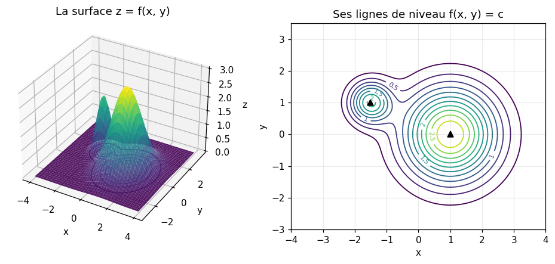
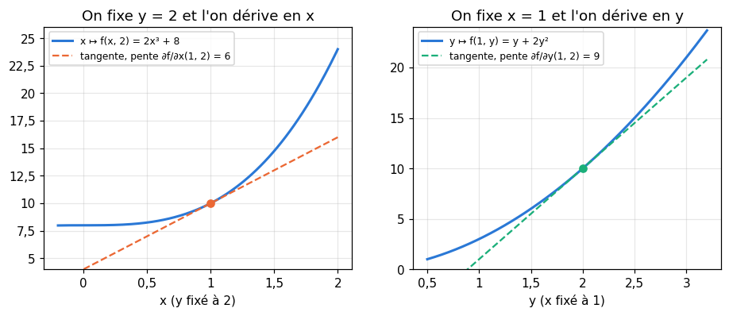
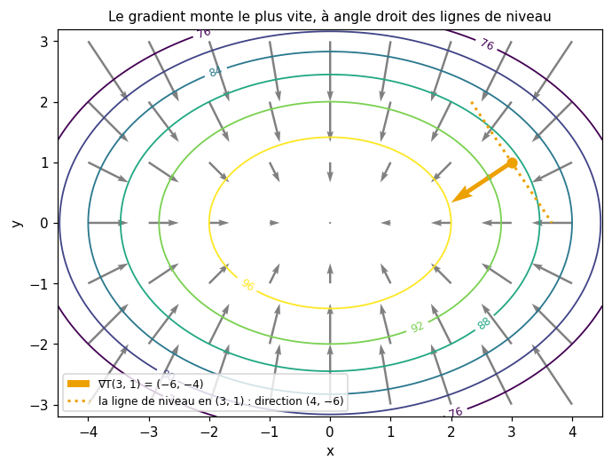
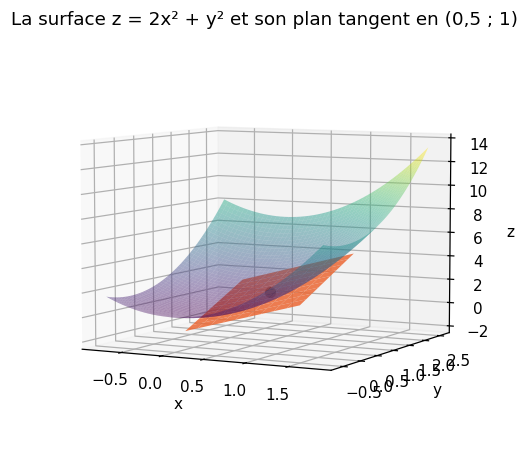
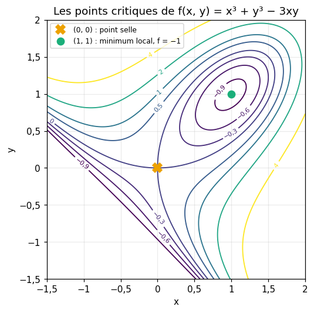
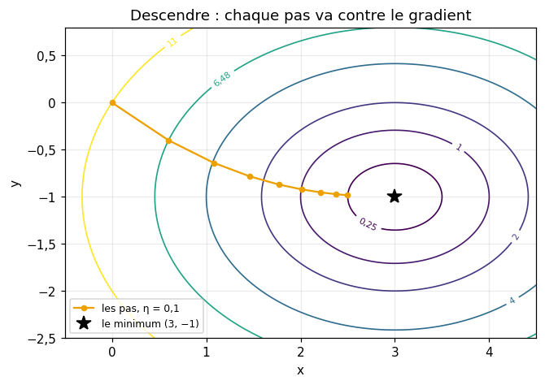

# M05b · Fonctions de plusieurs variables et gradient — fiche de cours

> Jusqu'ici, une fonction avait **une** entrée : une loss dépendait d'un seul poids, une courbe se lisait sur un axe. Un modèle de machine learning a des milliers ou des millions de poids, et sa loss est une fonction de **tous** à la fois. Ce chapitre passe de une à plusieurs variables, en restant presque toujours en dimension 2, où tout se dessine. On représente une fonction de deux variables par une **surface** et par une **carte de lignes de niveau**. On la dérive une variable à la fois : ce sont les **dérivées partielles**, rangées dans un vecteur, le **gradient**. Le gradient dit tout de la pente au premier ordre : la pente dans n'importe quelle direction (la **dérivée directionnelle**), la direction de la **plus grande pente**, et le **plan tangent** qui approche la surface. Les dérivées secondes classent les **points critiques** : minimum, maximum ou point selle. Enfin, la **descente de gradient**, le moteur de l'apprentissage, apparaît comme une conséquence directe : un petit pas contre le gradient fait baisser la fonction.

| | |
|---|---|
| **Sections** | §1 à §8 |
| **Temps total estimé** | ≈ 13,3 h : lecture et calculs de la fiche ≈ 3 h, exercices ≈ 9 h 30, flashcards ≈ 50 min (parcours essentiel ≈ 9,2 h) |
| **Prérequis** | R7 (dérivées, règle de la chaîne, tangente) ; R9 (vecteurs, produit scalaire, norme, angle) ; M05a §1 et §2 (dérivée seconde, convexité, extrema), §3 (Taylor) et §5 (différences finies) |
| **Fichiers du chapitre** | `02_exercices.md` (quiz, papier) · `03_notebook.ipynb` · `04_indices.md` · `05_solutions.md` et `05_solutions.ipynb` · `06_mes_reponses.md` · `flashcards.csv` |
| **mymath** | `multivar.py` : `partial_derivative`, `directional_derivative`, `steepest_ascent_direction`, `tangent_plane` |
| **MML** | §5.2 (voir le guide de lecture ci-dessous) |

## Comment utiliser ce chapitre

**Ordre conseillé.**
1. `python tools/start_chapter.py M05b` (sur Colab : `00_setup/COLAB.md` §2) : il copie le notebook, ta feuille de réponses et le squelette `mymath/multivar.py`.
2. Section par section : lis **crayon en main**, refais chaque calcul ; puis fais les exercices de la section, quiz 🧠 d'abord.
3. Les exercices ✏️, 📈 et 🔗 se font sur papier, dans ta copie de `06_mes_reponses.md`, puis se vérifient dans la **partie 0** du notebook. Les démonstrations ∂ se rédigent dans ta copie et se jugent avec la grille de relecture de `05_solutions.md`.

**Un réflexe pour tout le chapitre** : chaque fois qu'une formule à deux variables te semble obscure, **fige une variable** et regarde ce qui reste, une fonction d'une seule variable, que tu sais étudier depuis R7. Presque toute la fiche se ramène à cela : une tranche, une direction, une courbe tracée sur la surface.

| Section | Quiz 🧠 | Papier et réflexion | Notebook |
|---|---|---|---|
| §1 Surfaces et lignes de niveau | Q1 | M05b.1 ✏️, M05b.16 📈, M05b.17 🗣️ | M05b.24 🎨, M05b.26 🛠️ |
| §2 Dérivées partielles | Q2, R1 🔁 | M05b.2 ✏️, M05b.14 🔗, M05b.15 📖, M05b.16 📈 | M05b.18 🔨, M05b.21 📦, M05b.25 🐛, M05b.27 🏆 |
| §3 Gradient et dérivée directionnelle | Q3, Q4, R2 🔁 | M05b.3 ✏️, M05b.4 ✏️, M05b.11 ∂, M05b.15 📖 | M05b.19 🔨, M05b.25 🐛, M05b.27 🏆 |
| §4 La plus grande pente | Q3 | M05b.5 ✏️, M05b.11 ∂, M05b.12 ∂, M05b.17 🗣️, M05b.E1 💼 | M05b.19 🔨, M05b.22 🔮, M05b.24 🎨 |
| §5 Plan tangent | Q5 | M05b.6 ✏️, M05b.9 ✏️ | M05b.20 🔨, M05b.23 🔬 |
| §6 Dérivées partielles secondes | R3 🔁 | M05b.7 ✏️ | |
| §7 Points critiques | Q6 | M05b.8 ✏️, M05b.10 ✏️, M05b.13 ∂ | M05b.21 📦 |
| §8 Descente et montée de gradient | Q7 | M05b.9 ✏️, M05b.10 ✏️, M05b.14 🔗 | |

Parcours essentiel : tout sauf M05b.Q4, M05b.Q5, M05b.R3, M05b.6, M05b.7, M05b.10 à M05b.13, M05b.16, M05b.20, M05b.23 et M05b.25 à M05b.27. Le plan tangent (§5) et les dérivées secondes (§6) se lisent en survol ; le test du second ordre (§7) se lit en entier.

## Guide de lecture de MML

*Mathematics for Machine Learning* (MML) poursuit son chapitre 5, *Vector Calculus*, par le **§5.2**, *Partial Differentiation and Gradients*. Lis-le en deux fois :
- après le **§2** de la fiche : le début du §5.2, la définition de la dérivée partielle et du gradient, avec ses deux exemples, puis le §5.2.1, les règles de calcul ;
- après le **§3** : le §5.2.2, la règle de la chaîne pour une fonction de plusieurs variables, quand $x$ et $y$ dépendent eux-mêmes d'un paramètre. Questions : M05b.15.

Les sections suivantes du livre (§5.3 et après : gradients de fonctions à valeurs vectorielles, jacobiennes, matrices) viendront avec M17 et M18.

📐 **Notations.** La fiche écrit le gradient comme un **vecteur colonne**, $\nabla f = \big(\frac{\partial f}{\partial x}, \frac{\partial f}{\partial y}\big)$, ce qui permet d'écrire un pas de descente $\mathbf{x} - \eta\,\nabla f(\mathbf{x})$ comme une différence de deux vecteurs du même type. MML, lui, range les dérivées partielles en **ligne** : il écrit $\nabla_{\mathbf{x}} f = \frac{df}{d\mathbf{x}} = \big[\frac{\partial f}{\partial x_1} \cdots \frac{\partial f}{\partial x_n}\big]$, une matrice $1 \times n$, parce que ce choix rend la règle de la chaîne plus simple pour les fonctions à valeurs vectorielles (M17). Les deux écritures contiennent les mêmes nombres ; seule la forme change (M05b.15). On note aussi $f_x$ pour $\frac{\partial f}{\partial x}$, et $\partial_x f$.

Vocabulaire anglais de ce chapitre : *function of several variables*, *surface*, *level curve* (*level set*, *contour line*), *contour plot*, *partial derivative*, *gradient*, *directional derivative*, *unit vector*, *steepest ascent* et *steepest descent*, *tangent plane*, *linear approximation*, *second-order partial derivatives*, *mixed partial derivatives*, *Hessian*, *critical point* (*stationary point*), *saddle point*, *second derivative test*, *gradient descent*, *gradient ascent*, *step size*, *argmin*, *argmax*.

## Objectifs d'apprentissage

À la fin du chapitre, tu sais :
- **lire** une fonction de deux variables sur une surface et sur une carte de lignes de niveau, et **dessiner** quelques lignes de niveau d'une fonction simple ;
- **calculer** des dérivées partielles, un gradient et une dérivée directionnelle ;
- **expliquer** pourquoi le gradient donne la direction de plus grande pente et coupe les lignes de niveau à angle droit ;
- **écrire** le plan tangent en un point et **s'en servir** pour approcher une valeur ;
- **calculer** les dérivées partielles secondes, et **vérifier** qu'elles commutent ;
- **trouver** les points critiques d'une fonction de deux variables et les **classer** par le test du second ordre ;
- **expliquer** le principe de la descente et de la montée de gradient, et **distinguer** $\min f$ de $\arg\min f$.

## L'essentiel en 10 lignes

1. **Fonction de deux variables** : $(x, y) \mapsto f(x, y)$. Surface $z = f(x, y)$ ; **ligne de niveau** : l'ensemble des points où $f(x, y) = c$. Des lignes de niveau serrées signalent une pente forte.
2. **Dérivée partielle** : $\frac{\partial f}{\partial x}$ se calcule en dérivant en $x$, $y$ étant traité comme une constante ; c'est la pente de la tranche $x \mapsto f(x, b)$.
3. **Gradient** : $\nabla f = \big(\frac{\partial f}{\partial x}, \frac{\partial f}{\partial y}\big)$, un vecteur en chaque point.
4. **Dérivée directionnelle** dans la direction d'un vecteur **unitaire** $\mathbf{u}$ : $D_{\mathbf{u}} f = \nabla f \cdot \mathbf{u}$. Un vecteur non unitaire se divise d'abord par sa norme.
5. **Plus grande pente** : $D_{\mathbf{u}} f = \|\nabla f\| \cos\theta$ ; la montée la plus raide suit $\frac{\nabla f}{\|\nabla f\|}$, avec la pente $\|\nabla f\|$ ; la descente la plus raide suit $-\nabla f$ ; le gradient est **orthogonal** aux lignes de niveau.
6. **Plan tangent** en $(a, b)$ : $z = f(a, b) + f_x(a, b)(x - a) + f_y(a, b)(y - b)$ ; près du point, $f(\mathbf{p} + \mathbf{h}) \approx f(\mathbf{p}) + \nabla f(\mathbf{p}) \cdot \mathbf{h}$.
7. **Dérivées secondes** : $f_{xx}$, $f_{yy}$, $f_{xy} = f_{yx}$ (théorème de Schwarz) ; la courbure dans la direction $\mathbf{u}$ vaut $f_{xx}u_1^2 + 2f_{xy}u_1u_2 + f_{yy}u_2^2$.
8. **Point critique** : $\nabla f = \mathbf{0}$. Avec $D = f_{xx}f_{yy} - f_{xy}^2$ : $D > 0$ et $f_{xx} > 0$, minimum local ; $D > 0$ et $f_{xx} < 0$, maximum local ; $D < 0$, point selle ; $D = 0$, on ne peut pas conclure.
9. **Descente de gradient** : $\mathbf{x} \leftarrow \mathbf{x} - \eta\,\nabla f(\mathbf{x})$, car au premier ordre $f(\mathbf{x} - \eta\nabla f) \approx f(\mathbf{x}) - \eta\|\nabla f\|^2$ ; la **montée**, $\mathbf{x} + \eta\,\nabla f$, cherche un maximum.
10. $\min f$ est une **valeur** ; $\arg\min f$ est le **point** où elle est atteinte (de même pour max et argmax).

---

## §1 · Fonctions de deux variables : surfaces et lignes de niveau

### Une entrée à deux nombres

Une **fonction de deux variables** associe un nombre $f(x, y)$ à chaque couple $(x, y)$ d'une partie du plan : l'altitude d'un terrain selon la longitude et la latitude, la température d'une plaque selon la position, ou la loss d'un modèle selon deux de ses poids. On écrit $f : \mathbb{R}^2 \to \mathbb{R}$, ou, avec un vecteur, $f(\mathbf{x})$ avec $\mathbf{x} = (x, y)$. Plus généralement, une fonction de $n$ variables prend $\mathbf{x} = (x_1, \ldots, x_n)$ ; tout ce chapitre s'écrit pour $n$ quelconque, mais on dessine en dimension 2.

Exemple : $f(x, y) = 2x^2 + y^2$. En $(1, 3)$, $f(1, 3) = 2 + 9 = 11$ ; en $(0, 0)$, 0 ; et $f$ ne prend jamais de valeur négative.

### La surface

Le **graphe** de $f$ est la **surface** des points $(x, y, z)$ de l'espace tels que $z = f(x, y)$ : au-dessus de chaque point du plan, on monte à la hauteur $f(x, y)$. Pour $2x^2 + y^2$, c'est un bol, une cuvette dont le fond est en $(0, 0, 0)$.

Une surface se dessine mal sur une feuille : la perspective cache des parties, et les hauteurs se lisent mal. D'où une seconde représentation, celle des cartes de randonnée.

### Les lignes de niveau

La **ligne de niveau** $c$ de $f$ est l'ensemble des points $(x, y)$ du plan où $f(x, y) = c$ : on coupe la surface par le plan horizontal $z = c$, et on dessine la trace sur le sol. Une **carte de lignes de niveau** (*contour plot*) en superpose plusieurs, pour des valeurs régulièrement espacées de $c$.

- Pour $f(x, y) = 2x^2 + y^2$, la ligne de niveau $c > 0$ est l'ellipse $2x^2 + y^2 = c$ : elle coupe l'axe des $x$ en $\pm\sqrt{c/2}$ et l'axe des $y$ en $\pm\sqrt{c}$. Pour $c = 8$ : $x = \pm 2$ et $y = \pm 2\sqrt{2} \approx \pm 2{,}83$. La ligne de niveau 0 est réduite au point $(0, 0)$, et une ligne de niveau négative est **vide**.
- Pour la fonction affine $g(x, y) = 2x + y - 3$, la ligne de niveau $c$ est la droite $y = -2x + (c + 3)$ : des droites parallèles, de pente $-2$, régulièrement espacées.
- Pour $h(x, y) = e^{-(x^2 + y^2)}$, qui ne dépend que de la distance $r = \sqrt{x^2 + y^2}$ à l'origine, les lignes de niveau sont des cercles centrés en $(0, 0)$.



**Lire une carte.** Les sommets et les creux sont entourés de lignes fermées emboîtées ; entre deux sommets, les lignes forment un col (une **selle**, §7). Et surtout : là où les lignes de niveau sont **serrées**, la fonction change vite, la pente est forte ; là où elles sont espacées, elle est douce. Sur la figure, la colline de gauche, plus étroite, a des lignes bien plus serrées que celle de droite : ses flancs sont plus raides. Le §4 dira pourquoi, avec le gradient.

**En machine learning.** La loss d'un modèle à deux poids, $L(w_1, w_2)$, se dessine ainsi : chaque point du plan est un choix des poids, et sa hauteur est l'erreur du modèle. Entraîner le modèle, c'est chercher le point le plus bas de cette carte. Avec des millions de poids, on ne dessine plus rien, mais les mots restent : surface de la loss, lignes de niveau, pente, creux, selle.

⚠️ **Erreur classique.** Confondre la ligne de niveau avec la courbe d'une fonction d'une variable. La ligne de niveau $2x^2 + y^2 = 8$ n'est pas le graphe de quelque chose : c'est un ensemble de points du plan, où $f$ vaut 8. Pour la dessiner, on cherche quelques points (les intersections avec les axes, par exemple), ou on exprime $y$ en fonction de $x$ quand c'est possible.

## §2 · Dérivées partielles

### Figer une variable

Fixons $y = b$. La fonction $x \mapsto f(x, b)$ est une fonction d'une seule variable : c'est la **tranche** de la surface par le plan vertical $y = b$. Sa dérivée en $x = a$ est la **dérivée partielle de $f$ par rapport à $x$** au point $(a, b)$ :

$$\frac{\partial f}{\partial x}(a, b) = \lim_{t \to 0} \frac{f(a + t, b) - f(a, b)}{t}.$$

De même, $\frac{\partial f}{\partial y}(a, b)$ est la dérivée de $y \mapsto f(a, y)$ en $b$. On note aussi $f_x$ et $f_y$, ou $\partial_x f$ et $\partial_y f$ ; le $\partial$, un « d rond », rappelle que les autres variables sont fixées.

**En pratique** : pour dériver par rapport à $x$, on traite $y$ **comme une constante**, et on applique les règles de R7.

Exemple : $f(x, y) = x^3 y + 2y^2$.
- En $x$ ($y$ constant) : $x^3 y$ a pour dérivée $3x^2 y$, et $2y^2$, une constante, a pour dérivée 0 : $\frac{\partial f}{\partial x} = 3x^2 y$.
- En $y$ ($x$ constant) : $x^3 y$ a pour dérivée $x^3$, et $2y^2$ a pour dérivée $4y$ : $\frac{\partial f}{\partial y} = x^3 + 4y$.
- Au point $(1, 2)$ : $f_x(1, 2) = 6$ et $f_y(1, 2) = 1 + 8 = 9$.



Avec une composée, la règle de la chaîne s'applique comme d'habitude. Pour $g(x, y) = e^{xy^2}$ : $\frac{\partial g}{\partial x} = y^2 e^{xy^2}$ (la dérivée de $xy^2$ en $x$ est $y^2$) et $\frac{\partial g}{\partial y} = 2xy\,e^{xy^2}$. Et en trois variables, pour la distance à l'origine $r(x, y, z) = \sqrt{x^2 + y^2 + z^2}$ : $\frac{\partial r}{\partial x} = \frac{2x}{2\sqrt{x^2 + y^2 + z^2}} = \frac{x}{r}$, et de même $\frac{y}{r}$ et $\frac{z}{r}$.

### Sur ordinateur

Une dérivée partielle se calcule comme une dérivée ordinaire, par une **différence centrée** (M05a §5), en ne bougeant **qu'une** coordonnée :

$$\frac{\partial f}{\partial x_i}(\mathbf{p}) \approx \frac{f(\mathbf{p} + h\,\mathbf{e}_i) - f(\mathbf{p} - h\,\mathbf{e}_i)}{2h},$$

où $\mathbf{e}_i$ est le $i$-ième vecteur de la base, qui vaut 1 à la place $i$ et 0 ailleurs. L'erreur est en $h^2$, comme en M05a. C'est la fonction `partial_derivative` de `mymath` (M05b.18).

```python
>>> import numpy as np
>>> f = lambda p: p[0] ** 3 * p[1] + 2 * p[1] ** 2
>>> point, h = np.array([1.0, 2.0]), 1e-5
>>> e_x = np.array([1.0, 0.0])
>>> round(float((f(point + h * e_x) - f(point - h * e_x)) / (2 * h)), 6)
6.0
```

⚠️ **Erreur classique.** Oublier qu'une variable « fixée » reste présente dans le résultat : $\frac{\partial}{\partial x}(x^3 y) = 3x^2 y$, pas $3x^2$. Et, sur ordinateur, déplacer la mauvaise coordonnée (calculer $f(x + h, y)$ quand on veut $\frac{\partial f}{\partial y}$).

## §3 · Gradient et dérivée directionnelle

### Le gradient

Le **gradient** de $f$ au point $\mathbf{p}$ est le vecteur de ses dérivées partielles :

$$\nabla f(\mathbf{p}) = \Big(\frac{\partial f}{\partial x}(\mathbf{p}),\ \frac{\partial f}{\partial y}(\mathbf{p})\Big), \qquad \text{et en } n \text{ variables, } \nabla f = \Big(\frac{\partial f}{\partial x_1}, \ldots, \frac{\partial f}{\partial x_n}\Big).$$

Le symbole $\nabla$ se lit « nabla ». Le gradient est un **champ de vecteurs** : en chaque point du plan, une flèche. Pour $f(x, y) = x^3 y + 2y^2$ en $(1, 2)$ : $\nabla f(1, 2) = (6, 9)$, de norme $\|\nabla f(1, 2)\| = \sqrt{36 + 81} = \sqrt{117} \approx 10{,}82$ (R9).

### La pente dans une direction

Les dérivées partielles donnent la pente quand on se déplace parallèlement à un axe. Pour une direction quelconque, donnée par un **vecteur unitaire** $\mathbf{u} = (u_1, u_2)$ (de norme 1), on regarde la fonction d'une variable $t \mapsto f(\mathbf{p} + t\,\mathbf{u})$ : ce que l'on voit en marchant en ligne droite depuis $\mathbf{p}$, dans la direction $\mathbf{u}$. Sa dérivée en $t = 0$ est la **dérivée directionnelle** :

$$D_{\mathbf{u}} f(\mathbf{p}) = \lim_{t \to 0} \frac{f(\mathbf{p} + t\,\mathbf{u}) - f(\mathbf{p})}{t}.$$

Pour une fonction assez régulière (dont les dérivées partielles sont continues, ce qui est le cas de toutes celles de ce chapitre), elle se calcule avec le gradient :

$$\boxed{D_{\mathbf{u}} f(\mathbf{p}) = \nabla f(\mathbf{p}) \cdot \mathbf{u} = \frac{\partial f}{\partial x}(\mathbf{p})\,u_1 + \frac{\partial f}{\partial y}(\mathbf{p})\,u_2.}$$

**D'où vient cette formule.** Elle découle de la **règle de la chaîne** pour une fonction de plusieurs variables, que l'on admet (MML §5.2.2) : si $x(t)$ et $y(t)$ sont dérivables, alors

$$\frac{d}{dt} f\big(x(t), y(t)\big) = \frac{\partial f}{\partial x}\,x'(t) + \frac{\partial f}{\partial y}\,y'(t).$$

Chaque variable contribue par sa dérivée partielle, multipliée par la vitesse à laquelle elle change. Avec $x(t) = a + t u_1$ et $y(t) = b + t u_2$, on a $x' = u_1$ et $y' = u_2$, d'où la formule (M05b.11 la rédige).

Exemples, avec $\nabla f(1, 2) = (6, 9)$ :
- $\mathbf{u} = (1, 0)$ : $D_{\mathbf{u}} f = 6$, la dérivée partielle en $x$ ; $\mathbf{u} = (0, 1)$ : 9 ;
- $\mathbf{u} = (0{,}6 ;\ 0{,}8)$, qui est bien unitaire ($0{,}36 + 0{,}64 = 1$) : $6 \times 0{,}6 + 9 \times 0{,}8 = 10{,}8$ ;
- la direction du vecteur $(1, -1)$, qui n'est **pas** unitaire : on le divise d'abord par sa norme $\sqrt{2}$, et $D_{\mathbf{u}} f = \frac{6 - 9}{\sqrt{2}} \approx -2{,}12$. La fonction descend dans cette direction.

**Sur ordinateur**, il y a deux façons : calculer le gradient (une différence centrée par variable) puis le produit scalaire avec $\mathbf{u}$, ou faire **une seule** différence centrée le long de $\mathbf{u}$, $\frac{f(\mathbf{p} + h\mathbf{u}) - f(\mathbf{p} - h\mathbf{u})}{2h}$. La seconde ne coûte que deux évaluations de $f$, quel que soit le nombre de variables (`directional_derivative`, M05b.19).

⚠️ **Erreur classique.** Calculer $\nabla f \cdot \mathbf{v}$ avec un vecteur $\mathbf{v}$ qui n'est pas unitaire. Le résultat est multiplié par $\|\mathbf{v}\|$ : avec $\mathbf{v} = (3, 4)$ au lieu de $(0{,}6 ;\ 0{,}8)$, on trouverait 54 au lieu de 10,8. Une **direction** se donne par un vecteur unitaire.

## §4 · La plus grande pente ; le gradient et les lignes de niveau

### La direction de plus grande pente

Avec la formule du produit scalaire (R9), si $\theta$ est l'angle entre $\mathbf{u}$ et $\nabla f(\mathbf{p})$ (et $\|\mathbf{u}\| = 1$) :

$$D_{\mathbf{u}} f(\mathbf{p}) = \|\nabla f(\mathbf{p})\|\,\|\mathbf{u}\|\cos\theta = \|\nabla f(\mathbf{p})\|\cos\theta.$$

Comme $\cos\theta$ varie entre $-1$ et 1 :
- la pente est **maximale** pour $\theta = 0$, c'est-à-dire pour $\mathbf{u} = \frac{\nabla f(\mathbf{p})}{\|\nabla f(\mathbf{p})\|}$ : **le gradient pointe dans la direction de plus grande montée**, et cette pente maximale vaut $\|\nabla f(\mathbf{p})\|$ ;
- elle est **minimale**, égale à $-\|\nabla f(\mathbf{p})\|$, pour $\theta = \pi$ : la **plus grande descente** suit $-\nabla f(\mathbf{p})$ ;
- elle est **nulle** pour $\theta = \frac{\pi}{2}$ : dans les deux directions orthogonales au gradient, la fonction ne change pas au premier ordre.

Le gradient a donc une **direction** (celle de la montée la plus raide) et une **longueur** (la pente dans cette direction). Si $\nabla f(\mathbf{p}) = \mathbf{0}$, toutes les pentes sont nulles : $\mathbf{p}$ est un point critique (§7), et il n'y a pas de direction de plus grande pente (`steepest_ascent_direction` lève alors une erreur).

Exemple : un dôme, $T(x, y) = 100 - x^2 - 2y^2$ (une altitude en mètres, par exemple). En $(3, 1)$ : $\nabla T = (-2x, -4y) = (-6, -4)$, de norme $\sqrt{52} \approx 7{,}21$. La montée la plus raide suit $\frac{(-6, -4)}{\sqrt{52}} \approx (-0{,}832 ;\ -0{,}555)$, du côté du sommet $(0, 0)$ (sans le viser exactement), avec une pente d'environ 7,21 m par unité de longueur ; la descente la plus raide suit l'opposé ; et dans la direction $\frac{(4, -6)}{\sqrt{52}}$, orthogonale au gradient, la pente est nulle.

### Le gradient est orthogonal aux lignes de niveau

Ce dernier point a une conséquence géométrique : **en chaque point, le gradient est perpendiculaire à la ligne de niveau qui passe par ce point**. L'idée : si l'on suit la ligne de niveau, $f$ reste constante, donc la pente dans la direction de la ligne est nulle, et cette direction est orthogonale au gradient. Plus précisément, si $\boldsymbol{\gamma}(t) = (x(t), y(t))$ parcourt la ligne de niveau $c$, alors $f(\boldsymbol{\gamma}(t)) = c$ pour tout $t$, et la règle de la chaîne donne $\nabla f(\boldsymbol{\gamma}(t)) \cdot \boldsymbol{\gamma}'(t) = 0$ : le gradient est orthogonal au vecteur vitesse $\boldsymbol{\gamma}'(t)$, tangent à la ligne (M05b.12).



**Lignes serrées, gradient long.** Entre deux lignes de niveau voisines, $c$ et $c + \Delta c$, il faut monter de $\Delta c$ ; dans la direction du gradient, on monte de $\|\nabla f\|$ par unité de longueur. L'écart entre les deux lignes vaut donc environ $\frac{\Delta c}{\|\nabla f\|}$ : plus le gradient est long, plus les lignes sont serrées. Sur le dôme, entre les lignes 88 et 92 près de $(3, 1)$, l'écart vaut environ $\frac{4}{7{,}21} \approx 0{,}55$.

🔗 **Dans workbookIA** — le chapitre 5 calcule le gradient d'une loss sur ordinateur, le dessine sur des cartes de lignes de niveau et s'en sert pour descendre. Tu y retrouveras les trois faits de ce paragraphe : le gradient monte, il est orthogonal aux lignes de niveau, et sa longueur mesure la pente.

⚠️ **Erreur classique.** Croire que le gradient pointe vers le sommet le plus proche, ou le long des lignes de niveau. Il pointe vers la montée la plus **raide sur le moment**, à angle droit des lignes ; sur une carte allongée, comme celle du dôme, il ne vise pas le sommet (la flèche de $(3, 1)$ passe à côté de l'origine).

## §5 · Plan tangent et approximation linéaire

### Le plan qui touche la surface

En une variable, la tangente approche la courbe près d'un point (R7). En deux variables, c'est un plan : le **plan tangent** à la surface $z = f(x, y)$ au point $(a, b, f(a, b))$ est le plan qui passe par ce point et qui a les mêmes pentes que la surface dans les deux directions des axes :

$$\boxed{z = f(a, b) + \frac{\partial f}{\partial x}(a, b)\,(x - a) + \frac{\partial f}{\partial y}(a, b)\,(y - b).}$$

Coupé par le plan $y = b$, il donne la tangente de la tranche $x \mapsto f(x, b)$ ; coupé par $x = a$, celle de l'autre tranche. Développé, il s'écrit $z = A\,x + B\,y + C$, avec $A = f_x(a, b)$, $B = f_y(a, b)$ et $C = f(a, b) - A\,a - B\,b$ (`tangent_plane`, M05b.20).



### L'approximation linéaire

Près de $\mathbf{p} = (a, b)$, la surface et son plan tangent sont proches : pour un petit déplacement $\mathbf{h} = (\Delta x, \Delta y)$,

$$f(a + \Delta x,\ b + \Delta y) \approx f(a, b) + f_x(a, b)\,\Delta x + f_y(a, b)\,\Delta y = f(\mathbf{p}) + \nabla f(\mathbf{p}) \cdot \mathbf{h}.$$

C'est le polynôme de Taylor d'ordre 1 (M05a §3) en deux variables. L'erreur commise est d'ordre 2 : elle se comporte comme $\|\mathbf{h}\|^2$, et diviser le déplacement par 2 la divise à peu près par 4 (M05b.23).

Exemple : $f(x, y) = \sqrt{x^2 + y^2}$, la distance à l'origine, en $(3, 4)$ : $f(3, 4) = 5$, $f_x = \frac{x}{\sqrt{x^2 + y^2}} = 0{,}6$ et $f_y = 0{,}8$. Le plan tangent est $z = 5 + 0{,}6\,(x - 3) + 0{,}8\,(y - 4)$, soit $z = 0{,}6\,x + 0{,}8\,y$. Pour approcher $f(3{,}1 ;\ 3{,}9)$ : $5 + 0{,}6 \times 0{,}1 + 0{,}8 \times (-0{,}1) = 4{,}98$, alors que la valeur exacte est $\sqrt{24{,}82} \approx 4{,}98197$ : une erreur d'environ $2 \times 10^{-3}$, pour un déplacement de norme $0{,}14$.

**Quand il n'y a pas de plan tangent.** Une fonction peut avoir des dérivées partielles sans avoir de plan tangent : il faut que la surface soit « lisse » au point. Ce même $\sqrt{x^2 + y^2}$ est un cône dont la pointe est en $(0, 0)$ : aucun plan ne l'y touche, comme $|x|$ n'a pas de tangente en 0. Les fonctions de ce chapitre sont lisses partout où on les dérive.

⚠️ **Erreur classique.** Oublier les décalages : écrire $z = f(a, b) + f_x(a, b)\,x + f_y(a, b)\,y$, sans les $(x - a)$ et $(y - b)$. Ce plan ne passe pas par le point de contact (sauf si $a = b = 0$).

## §6 · Dérivées partielles secondes

### Quatre dérivées secondes

Les dérivées partielles $f_x$ et $f_y$ sont elles-mêmes des fonctions de deux variables, que l'on peut dériver à nouveau, par rapport à $x$ ou à $y$ :

$$f_{xx} = \frac{\partial^2 f}{\partial x^2}, \quad f_{yy} = \frac{\partial^2 f}{\partial y^2}, \quad f_{xy} = \frac{\partial}{\partial y}\Big(\frac{\partial f}{\partial x}\Big), \quad f_{yx} = \frac{\partial}{\partial x}\Big(\frac{\partial f}{\partial y}\Big).$$

Les deux dernières sont les **dérivées croisées**. Elles sont égales dès que les dérivées secondes sont continues : c'est le **théorème de Schwarz** (admis), vrai pour toutes les fonctions de ce chapitre. On les note alors toutes deux $f_{xy}$.

Exemple : $f(x, y) = x^3 y + 2y^2$, avec $f_x = 3x^2 y$ et $f_y = x^3 + 4y$ :
- $f_{xx} = 6xy$ ; $f_{yy} = 4$ ;
- $f_{xy} = \frac{\partial}{\partial y}(3x^2 y) = 3x^2$ et $f_{yx} = \frac{\partial}{\partial x}(x^3 + 4y) = 3x^2$ : elles sont bien égales ;
- en $(1, 2)$ : $f_{xx} = 12$, $f_{yy} = 4$, $f_{xy} = 3$.

### La courbure dans une direction

Comme pour la pente, on regarde la tranche $g(t) = f(\mathbf{p} + t\,\mathbf{u})$ dans la direction du vecteur unitaire $\mathbf{u}$. En dérivant deux fois avec la règle de la chaîne, on trouve

$$g''(0) = f_{xx}\,u_1^2 + 2\,f_{xy}\,u_1 u_2 + f_{yy}\,u_2^2,$$

les dérivées secondes étant prises en $\mathbf{p}$. C'est la **courbure** de la surface dans la direction $\mathbf{u}$, au sens de ce chapitre (la dérivée seconde de la tranche ; la courbure géométrique d'une courbe est une notion voisine, mais différente) : positive, la tranche tourne vers le haut (M05a §1) ; négative, vers le bas. Dans l'exemple, en $(1, 2)$ : dans la direction $(1, 0)$, $g''(0) = 12$ ; dans la direction $(0, 1)$, 4 ; dans la direction $\frac{(1, -1)}{\sqrt{2}}$, $\frac{12 - 2 \times 3 + 4}{2} = 5$. La courbure dépend de la direction.

On range les dérivées secondes dans la **matrice hessienne** $H = \begin{pmatrix} f_{xx} & f_{xy} \\ f_{xy} & f_{yy} \end{pmatrix}$, symétrique grâce à Schwarz ; la courbure dans la direction $\mathbf{u}$ s'écrit alors $\mathbf{u}^\top H\,\mathbf{u}$. Les matrices et ce produit viendront en M09a, puis la hessienne elle-même en M19 ; ici, on garde la formule développée.

⚠️ **Erreur classique.** Oublier le facteur 2 du terme croisé dans la courbure, ou prendre $f_{xy}$ pour le produit $f_x \times f_y$ : c'est la dérivée de $f_x$ par rapport à $y$.

## §7 · Points critiques : minimum, maximum, selle

### Les candidats

Un **point critique** (ou point stationnaire) est un point où le gradient s'annule : $\nabla f(\mathbf{p}) = \mathbf{0}$, c'est-à-dire $f_x(\mathbf{p}) = 0$ **et** $f_y(\mathbf{p}) = 0$. Comme en une variable (M05a §2), un extremum local à l'intérieur du domaine est forcément un point critique : en un minimum, la pente est nulle dans toutes les directions. Mais la réciproque est fausse, et en deux variables il apparaît un nouveau cas.

### Trois natures

Près d'un point critique $\mathbf{p}$, le terme d'ordre 1 de Taylor s'annule, et c'est le terme d'ordre 2 qui décide :

$$f(\mathbf{p} + \mathbf{h}) \approx f(\mathbf{p}) + \tfrac{1}{2}\big(f_{xx}\,\Delta x^2 + 2\,f_{xy}\,\Delta x\,\Delta y + f_{yy}\,\Delta y^2\big).$$

Si la parenthèse est positive dans toutes les directions, $f$ monte autour de $\mathbf{p}$ : c'est un **minimum local**. Si elle est négative partout, un **maximum local**. Si elle est positive dans certaines directions et négative dans d'autres, $f$ monte d'un côté et descend de l'autre : c'est un **point selle** (*saddle point*), comme un col de montagne ou une selle de cheval. Plus généralement, on appelle point selle tout point critique près duquel $f$ prend, aussi près de $\mathbf{p}$ qu'on le veut, des valeurs plus grandes **et** des valeurs plus petites que $f(\mathbf{p})$ : ni minimum, ni maximum local. M05b.13 montre que le signe de la parenthèse se lit sur un seul nombre, $D = f_{xx}\,f_{yy} - f_{xy}^2$ (le déterminant de la hessienne).

> **Test du second ordre.** En un point critique $\mathbf{p}$, avec $D = f_{xx}(\mathbf{p})\,f_{yy}(\mathbf{p}) - f_{xy}(\mathbf{p})^2$ :
> - $D > 0$ et $f_{xx}(\mathbf{p}) > 0$ : **minimum local** ;
> - $D > 0$ et $f_{xx}(\mathbf{p}) < 0$ : **maximum local** ;
> - $D < 0$ : **point selle** ;
> - $D = 0$ : le test **ne conclut pas**.

Exemple : $f(x, y) = x^3 + y^3 - 3xy$.
- Le gradient : $f_x = 3x^2 - 3y$ et $f_y = 3y^2 - 3x$. Il s'annule si $y = x^2$ et $x = y^2$, donc $x = x^4$, soit $x = 0$ ou $x = 1$ : deux points critiques, $(0, 0)$ et $(1, 1)$.
- Les dérivées secondes : $f_{xx} = 6x$, $f_{yy} = 6y$, $f_{xy} = -3$.
- En $(0, 0)$ : $D = 0 \times 0 - 9 = -9 < 0$, un **point selle**. On le vérifie : le long de la droite $y = -x$, $f = 3x^2$ monte ; le long de $y = x$, $f = 2x^3 - 3x^2$ descend près de 0.
- En $(1, 1)$ : $D = 36 - 9 = 27 > 0$ et $f_{xx} = 6 > 0$, un **minimum local**, où $f(1, 1) = -1$. Il n'est pas global : le long de l'axe des $x$, $f(x, 0) = x^3$ tend vers $-\infty$.



**Quand $D = 0$.** Le test ne dit rien, et il faut regarder la fonction elle-même : $x^4 + y^2$ et $x^3 + y^2$ ont toutes deux $D = 0$ en $(0, 0)$, la première y a un minimum, la seconde ni minimum ni maximum (le long de l'axe des $x$, $x^3$ change de signe).

**Extrema globaux sur une partie bornée.** Comme en M05a §2, sur un domaine fermé et borné (un rectangle, un segment, un disque), les extrema globaux sont parmi les points critiques intérieurs **et** les points du bord. Sur un segment, on paramètre le segment et l'on se ramène à une variable (M05b.10).

🔗 **Dans workbookIA** — le chapitre 5 parle des points selles et de leur rôle dans l'optimisation des réseaux, et classe un point critique sur ordinateur, sans matrice. Le test de ce paragraphe en donne la raison, en dimension 2 ; la version en dimension $n$ (les valeurs propres de la hessienne) viendra en M12c et M19.

⚠️ **Erreur classique.** Conclure « minimum » dès que $f_{xx} > 0$ et $f_{yy} > 0$ : il faut aussi que le terme croisé ne l'emporte pas, c'est-à-dire $D > 0$. Avec $f_{xx} = f_{yy} = 1$ et $f_{xy} = 2$, $D = 1 - 4 < 0$ : c'est une selle. Et le test ne s'applique qu'en un point **critique**.

## §8 · Descente et montée de gradient (principe) ; argmin et argmax

### min et argmin

Pour une fonction $f$, $\min f$ est la plus petite **valeur** qu'elle prend, et $\arg\min f$ le **point** (ou l'ensemble des points) où elle l'atteint ; de même pour $\max$ et $\arg\max$. Pour $f(x, y) = (x - 3)^2 + 2\,(y + 1)^2$ : $\min f = 0$ et $\arg\min f = (3, -1)$ ; pour le dôme $T$ : $\max T = 100$ et $\arg\max T = (0, 0)$. En machine learning, on cherche surtout l'argmin : les **poids** qui minimisent la loss, plus que la valeur de la loss elle-même.

### Descendre la plus grande pente

Résoudre $\nabla f = \mathbf{0}$ à la main n'est possible que pour des fonctions simples. Pour une loss à des millions de poids, on procède autrement : on part d'un point et l'on fait de petits pas vers le bas. La direction la plus naturelle est celle de la plus grande descente, $-\nabla f$ (§4). C'est la **descente de gradient** :

$$\mathbf{x}_{k+1} = \mathbf{x}_k - \eta\,\nabla f(\mathbf{x}_k),$$

où $\eta > 0$ est la **taille du pas** (le *learning rate* en machine learning).

**Pourquoi la fonction baisse.** Avec l'approximation linéaire du §5 et le déplacement $\mathbf{h} = -\eta\,\nabla f(\mathbf{x})$ :

$$f\big(\mathbf{x} - \eta\,\nabla f(\mathbf{x})\big) \approx f(\mathbf{x}) + \nabla f(\mathbf{x}) \cdot \big(-\eta\,\nabla f(\mathbf{x})\big) = f(\mathbf{x}) - \eta\,\|\nabla f(\mathbf{x})\|^2.$$

Tant que le gradient n'est pas nul, $\eta\,\|\nabla f\|^2 > 0$ : **pour un pas assez petit**, la fonction diminue. L'approximation n'est valable que pour un petit déplacement : un pas trop grand peut sauter par-dessus le creux. Le choix de $\eta$ est l'objet de workbookIA 5, puis de M19.

Exemple : $f(x, y) = (x - 3)^2 + 2\,(y + 1)^2$, de gradient $\nabla f = \big(2(x - 3),\ 4(y + 1)\big)$, depuis $(0, 0)$ avec $\eta = 0{,}1$.
- En $(0, 0)$ : $f = 9 + 2 = 11$ et $\nabla f = (-6, 4)$. Le pas mène à $(0, 0) - 0{,}1 \times (-6, 4) = (0{,}6 ;\ -0{,}4)$, où $f = 2{,}4^2 + 2 \times 0{,}6^2 = 6{,}48$. Le premier ordre prévoyait $11 - 0{,}1 \times 52 = 5{,}8$ : la fonction a bien baissé, un peu moins que prévu.
- En $(0{,}6 ;\ -0{,}4)$ : $\nabla f = (-4{,}8 ;\ 2{,}4)$, et le pas mène à $(1{,}08 ;\ -0{,}64)$, où $f \approx 3{,}95$.



**La montée de gradient** cherche un maximum en faisant le pas dans l'autre sens, $\mathbf{x}_{k+1} = \mathbf{x}_k + \eta\,\nabla f(\mathbf{x}_k)$ ; maximiser $f$ revient à minimiser $-f$. On s'en sert pour maximiser une vraisemblance (M04) ou une récompense (workbookIA, apprentissage par renforcement).

**Où s'arrête-t-on ?** Un pas ne bouge presque plus quand le gradient est presque nul, c'est-à-dire près d'un point critique. Rien ne garantit que ce soit un minimum global : la descente peut s'arrêter dans un creux local, ou ralentir près d'une selle. Pour une fonction **convexe** (M05a §1, en plusieurs variables en M19), tout point critique est un minimum global, et la descente, bien réglée, y mène.

🔗 **Dans workbookIA** — entraîner un modèle, du chapitre 1 au dernier, c'est faire ces pas sur la loss, le gradient étant calculé par la rétropropagation ; le chapitre 5 programme la descente et la montée, et étudie l'effet de la taille du pas.

💻 **Aujourd'hui en pratique** — personne ne calcule à la main le gradient d'un réseau, ni par différences finies (deux évaluations de la loss par poids, beaucoup trop cher) : les bibliothèques le calculent par **différentiation automatique** (PyTorch, JAX), qui applique la règle de la chaîne aux opérations enregistrées. Les dérivées partielles par différence centrée de ce chapitre servent à vérifier ces calculs sur de petits exemples.

⚠️ **Erreur classique.** Se tromper de signe : $\mathbf{x} + \eta\,\nabla f$ monte, il ne descend pas. Et confondre $\min f$ (une valeur) avec $\arg\min f$ (un point).

## Les pièges classiques ⚠️ (récapitulatif)

| Piège | Ce qu'il faut faire |
|---|---|
| La variable « fixée » oubliée dans une dérivée partielle | $\frac{\partial}{\partial x}(x^3 y) = 3x^2 y$ : $y$ reste en facteur |
| Une direction donnée par un vecteur non unitaire | diviser par la norme avant le produit scalaire avec le gradient |
| Le gradient pris pour la direction du sommet, ou d'une ligne de niveau | il suit la montée la plus raide, à angle droit des lignes de niveau |
| Le plan tangent sans les décalages $(x - a)$ et $(y - b)$ | $z = f(a, b) + f_x\,(x - a) + f_y\,(y - b)$ |
| Le facteur 2 du terme croisé oublié dans la courbure | $f_{xx}u_1^2 + 2f_{xy}u_1u_2 + f_{yy}u_2^2$ |
| « $f_{xx} > 0$ et $f_{yy} > 0$, donc minimum » | calculer $D = f_{xx}f_{yy} - f_{xy}^2$ ; $D < 0$ est une selle |
| Le test du second ordre appliqué quand $D = 0$, ou hors d'un point critique | $D = 0$ : regarder la fonction ; le test suppose $\nabla f = \mathbf{0}$ |
| Les bords oubliés pour un extremum global sur un domaine borné | comparer les points critiques intérieurs **et** le bord |
| Le signe du pas de descente | descendre : $\mathbf{x} - \eta\,\nabla f$ ; monter : $\mathbf{x} + \eta\,\nabla f$ |
| $\min f$ et $\arg\min f$ confondus | une valeur, un point |

## Et maintenant

**Dans ce dépôt** : M06 aborde la théorie de l'information (entropie, cross-entropy, divergence KL) ; M07 passe à la géométrie de $\mathbb{R}^n$, où vivent les gradients en grande dimension ; les jacobiennes viennent en M17, la règle de la chaîne vectorielle et la différentiation automatique en M18, la hessienne, la convexité en plusieurs variables et la convergence des méthodes d'optimisation en M19.

**Dans workbookIA** : le chapitre 5 passe des dérivées aux gradients, aux cartes de lignes de niveau, aux points selles et à la descente de gradient. Tu sauras ce que calcule un gradient numérique (une dérivée partielle par variable, §2), pourquoi la descente suit $-\nabla f$ (§4 et §8), et comment reconnaître un minimum, un maximum ou une selle (§7).

## Pour aller plus loin

- MML §5.2, et les exercices du chapitre 5 du livre qui demandent des dérivées partielles (conseillés) ; plus tard, §5.3 et §5.4 (gradients de fonctions vectorielles, M17 et M18).
- `annexes/symboles.md` (lire $\frac{\partial f}{\partial x}$, $\nabla f$, $D_{\mathbf{u}} f$, $\arg\min$ à voix haute), `annexes/formulaire.md` et `annexes/erreurs_frequentes.md`.
