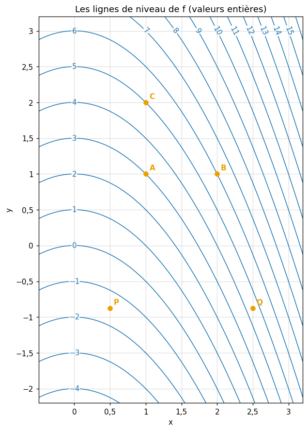

# M05b · Fonctions de plusieurs variables et gradient — exercices papier et quiz

> Écris tes réponses dans **ta copie** `mon_travail/m05b_gradient/06_mes_reponses.md` (créée par `python tools/start_chapter.py M05b`), jamais dans ce fichier : il est mis à jour par Claude.
> Les réponses des exercices ✏️, 📈 et 🔗 se vérifient dans la **partie 0** du notebook (`wbm.check`) ; les quiz, les rappels et les exercices ∂, 📖, 🗣️ et 💼 se corrigent avec `05_solutions.md`. Indices : `04_indices.md`.

**Sommaire** : [🧠 Quiz](#quiz) · [🔁 Rappels](#rappels) · [✏️ Papier-crayon](#papier) · [∂ Démonstrations](#demonstrations) · [🔗 📖 📈 🗣️ Pont, lecture, graphique et explication](#reflexion) · [💼 Entretien](#entretien) · [Exercices du notebook](#notebook)

Légende : ★ application directe · ★★ standard · ★★★ approfondi · ★★★★ défi · ⏱️ durée indicative · parcours C = complet, E = essentiel.

**Calculatrice** (ou Python) permise pour les valeurs approchées. Garde les valeurs exactes ($\sqrt{7}$, $e$, les fractions) jusqu'au bout, et n'arrondis qu'à la fin. Un **gradient** et un **point** s'écrivent comme une liste de deux nombres, `[x, y]`.

## 🧠 Quiz

Sans la fiche, en 4 minutes chacun. Réponds vite, puis vérifie dans `05_solutions.md`.

### M05b.Q1 — Lire des lignes de niveau 🧠 ★ ⏱️ 4 min
*Fiche §1 · parcours C, E*

1. Deux lignes de niveau de valeurs différentes peuvent-elles se croiser ? Pourquoi ?
2. Sur une carte, que signifient des lignes de niveau très serrées ?
3. Décris les lignes de niveau de $f(x, y) = x + y$.
4. Décris la ligne de niveau 9 de $f(x, y) = x^2 + y^2$.
5. Vrai ou faux : une ligne de niveau peut être vide.
6. Des lignes fermées emboîtées, dont les valeurs croissent vers l'intérieur : qu'entourent-elles ?

### M05b.Q2 — Dérivées partielles : vrai ou faux 🧠 ★ ⏱️ 4 min
*Fiche §2 · parcours C, E*

1. $\frac{\partial}{\partial x}\big(x^2 y^3\big) = 2x y^3$.
2. $\frac{\partial}{\partial y}\big(x^2 y^3\big) = 3x^2 y^2$.
3. $\frac{\partial}{\partial x}\big(y^2 + \sin y\big) = 0$.
4. $\frac{\partial f}{\partial x}(a, b)$ est la pente de la tranche $x \mapsto f(x, b)$ en $a$.
5. Si $\frac{\partial f}{\partial x} = 0$ en tout point, alors $f$ est constante.
6. $\frac{\partial}{\partial x}\big(e^{xy}\big) = e^{xy}$.

### M05b.Q3 — Où pointe le gradient ? 🧠 ★ ⏱️ 4 min
*Fiche §3 et §4 · parcours C, E*

1. Dans quelle direction pointe $\nabla f(\mathbf{p})$ ?
2. Quel angle fait-il avec la ligne de niveau qui passe par $\mathbf{p}$ ?
3. Que vaut la pente de $f$ dans la direction du gradient ?
4. Pour $f(x, y) = 5 - x^2 - y^2$, calcule $\nabla f(1, 0)$. Vers quel point pointe-t-il ?
5. Vrai ou faux : au sommet d'une colline lisse, le gradient est nul.
6. On remplace $f$ par $2f$ : que deviennent la direction et la norme du gradient ?

### M05b.Q4 — La dérivée directionnelle 🧠 ★ ⏱️ 4 min
*Fiche §3 · parcours C*

1. Écris la dérivée directionnelle $D_{\mathbf{u}} f$ avec le gradient. Quelle condition doit vérifier $\mathbf{u}$ ?
2. $\nabla f(\mathbf{p}) = (3, -1)$ et $\mathbf{u} = (0, 1)$ : $D_{\mathbf{u}} f(\mathbf{p})$ ?
3. $\nabla f(\mathbf{p}) = (2, 2)$, dans la direction du vecteur $(1, 1)$ : la pente ?
4. Vrai ou faux : $D_{-\mathbf{u}} f = -D_{\mathbf{u}} f$.
5. $\nabla f(\mathbf{p}) = (5, 12)$ : la plus grande valeur de $D_{\mathbf{u}} f(\mathbf{p})$, pour $\mathbf{u}$ unitaire ?
6. Avec ce même gradient, donne les vecteurs unitaires $\mathbf{u}$ pour lesquels $D_{\mathbf{u}} f(\mathbf{p}) = 0$.

### M05b.Q5 — Le plan tangent 🧠 ★ ⏱️ 4 min
*Fiche §5 · parcours C*

1. Écris l'équation du plan tangent à $z = f(x, y)$ au point $(a, b)$.
2. Pour $f(x, y) = x^2 + y$, écris le plan tangent en $(1, 1)$, sous la forme $z = Ax + By + C$.
3. Avec ce plan, approche $f(1{,}1 ;\ 0{,}9)$. Que vaut la valeur exacte ?
4. Vrai ou faux : le plan tangent d'une fonction affine est la surface elle-même.
5. Vrai ou faux : le cône $z = \sqrt{x^2 + y^2}$ a un plan tangent en $(0, 0)$.
6. En un point critique, comment est le plan tangent ?

### M05b.Q6 — Minimum, maximum ou selle ? 🧠 ★ ⏱️ 4 min
*Fiche §7 · parcours C, E*

En un point critique, on connaît les dérivées secondes. Donne la nature du point (ou dis que le test ne conclut pas).
1. $f_{xx} = 2$, $f_{yy} = 3$, $f_{xy} = 1$.
2. $f_{xx} = -4$, $f_{yy} = -1$, $f_{xy} = 1$.
3. $f_{xx} = 1$, $f_{yy} = 1$, $f_{xy} = 3$.
4. $f_{xx} = 2$, $f_{yy} = 8$, $f_{xy} = 4$.
5. Vrai ou faux : en un point selle, le gradient est nul.
6. Vrai ou faux : pour $x^2 + y^4$, qui a un minimum en $(0, 0)$, le test donne $D > 0$.

### M05b.Q7 — Descendre ou monter 🧠 ★ ⏱️ 4 min
*Fiche §8 · parcours C, E*

1. Écris un pas de descente de gradient.
2. Pour maximiser une vraisemblance, quel pas fait-on ?
3. $f(x, y) = x^2 + 4y^2$, depuis $(1, 1)$ avec $\eta = 0{,}1$ : le point après un pas de descente ?
4. Avec un $\eta$ fixé, pourquoi les pas de descente raccourcissent-ils à l'approche d'un minimum ?
5. Au premier ordre, de combien $f$ baisse-t-elle après un pas de descente de taille $\eta$ ?
6. Pour $f(x, y) = (x + 2)^2 + 3(y - 1)^2$ : $\arg\min f$ et $\min f$ ?

## 🔁 Rappels

### M05b.R1 — Dériver une composée (R7) 🔁 ★ ⏱️ 5 min
*Fiche §2 · parcours C, E*

Dérive :
1. $(3x^2 + 1)^5$ ;
2. $e^{3x^2 - x}$ ;
3. $\ln(1 + x^2)$ ;
4. $\sqrt{4 - x}$ ;
5. $\sin(2x + 1)$.

### M05b.R2 — Produit scalaire et norme (R9) 🔁 ★ ⏱️ 5 min
*Fiche §3 · parcours C, E*

1. $(2, -1) \cdot (3, 4)$ ?
2. $\|(2, -1)\|$ ?
3. Le vecteur unitaire de même direction et de même sens que $(8, 15)$ ?
4. L'angle entre $(1, 0)$ et $(1, 1)$, en degrés ?
5. Un vecteur non nul orthogonal à $(2, 5)$ ?

### M05b.R3 — Dérivée seconde et convexité (M05a) 🔁 ★ ⏱️ 5 min
*Fiche §6 · parcours C*

1. Sur quel intervalle $x^3 - 6x$ est-elle convexe ?
2. $f'(c) = 0$ et $f''(c) > 0$ : que peut-on dire de $c$ ?
3. $e^{2x}$ est-elle convexe ? Justifie avec sa dérivée seconde.
4. Pour $\cos x + \frac{x^2}{2}$ en 0 : que valent $f'(0)$ et $f''(0)$ ? Que dit alors le test de la dérivée seconde ?
5. Que représente géométriquement le signe de $f''$ ?

## ✏️ Papier-crayon

Fais-les **à la main** (calculatrice permise pour les valeurs approchées), en écrivant ta démarche dans ta copie de `06_mes_reponses.md`. Reporte ensuite **la valeur** trouvée dans la **partie 0 du notebook**, sous la forme demandée :
- un nombre entier, ou un nombre avec un point décimal, comme `-1.25`, arrondi comme le demande la question ;
- une fraction irréductible entre guillemets, comme `"7/9"` ; une expression en $x$ et $y$ entre guillemets, comme `"3*x**2*y - y"`, avec `exp(u)` pour $e^u$ et `sqrt(u)` pour $\sqrt{u}$ ;
- une liste entre crochets, comme `[-1.5, 2.5]` (un gradient, un point, un vecteur) ; vrai ou faux par `True` ou `False` ; une lettre entre guillemets, comme `"B"`.

### Ex M05b.1 — Les lignes de niveau de trois fonctions ✏️ ★ ⏱️ 20 min
**Objectif :** reconnaître et décrire les lignes de niveau d'une fonction affine, d'un bol et d'une fonction en $y - x^2$.
**Prérequis :** fiche §1 · **Parcours :** C, E

Soit $f_1(x, y) = 3x - y + 2$, $f_2(x, y) = x^2 + 9y^2$ et $f_3(x, y) = y - x^2$.

| | Question | Réponse attendue |
|---|---|---|
| a | l'ordonnée du point d'abscisse 2 de la ligne de niveau $f_1 = 5$ | un entier |
| b | la pente $m$ des lignes de niveau de $f_1$, écrites $y = m\,x + p$ | un entier |
| c | où la ligne de niveau $f_2 = 36$ coupe-t-elle l'axe des $x$ ? Donne l'abscisse positive | un entier |
| d | et l'axe des $y$ ? Donne l'ordonnée positive | un entier |
| e | la valeur $c$ de la ligne de niveau de $f_2$ qui passe par $(2, 1)$ | un entier |
| f | la ligne de niveau $f_3 = -2$ est une parabole : l'ordonnée de son point le plus bas | un entier |
| g | la ligne de niveau $f_3 = 0$ passe-t-elle par $(-2, 4)$ ? | `True` ou `False` |
| h | la ligne de niveau $f_2 = -1$ contient-elle au moins un point ? | `True` ou `False` |

Dans ta copie : dessine trois lignes de niveau de chaque fonction (pour $f_2$ : 9, 36 et 81 ; pour $f_1$ et $f_3$ : trois valeurs de ton choix), avec leur valeur. Où les lignes de $f_2$ sont-elles les plus serrées, dans la direction de $x$ ou dans celle de $y$ ?

### Ex M05b.2 — Dérivées partielles ✏️ ★ ⏱️ 20 min
**Objectif :** calculer des dérivées partielles, y compris avec la règle de la chaîne et en trois variables.
**Prérequis :** fiche §2 ; R7 · **Parcours :** C, E

Soit $f(x, y) = 4x^3 y - y^2 + 7x$, $g(x, y) = e^{2x - y}$ et $h(x, y, z) = x\,y^2 z^3$.

| | Question | Réponse attendue |
|---|---|---|
| a | $\frac{\partial f}{\partial x}$ | une expression en $x$ et $y$ |
| b | $\frac{\partial f}{\partial y}$ | une expression en $x$ et $y$ |
| c | $\frac{\partial f}{\partial x}(1, -2)$ | un entier |
| d | $\frac{\partial f}{\partial y}(1, -2)$ | un entier |
| e | $\frac{\partial g}{\partial x}(0{,}5 ;\ 1)$ | un entier |
| f | $\frac{\partial g}{\partial y}(0{,}5 ;\ 1)$ | un entier |
| g | $\frac{\partial h}{\partial z}(2, 1, -1)$ | un entier |
| h | $\frac{\partial h}{\partial y}(2, 1, -1)$ | un entier |

Dans ta copie : écris la tranche $x \mapsto f(x, -2)$ et dérive-la en $x = 1$ : retrouves-tu c) ? Pourquoi $\frac{\partial g}{\partial x}$ et $\frac{\partial g}{\partial y}$ ont-elles le même facteur exponentiel ?

### Ex M05b.3 — Le gradient en un point et sa norme ✏️ ★ ⏱️ 15 min
**Objectif :** calculer un gradient, sa norme, son vecteur unitaire, et trouver où il s'annule.
**Prérequis :** fiche §3 ; R9 · **Parcours :** C, E

Soit $f(x, y) = x^2 y - 3y + 1$ et le point $P = (2, 3)$.

| | Question | Réponse attendue |
|---|---|---|
| a | $\nabla f(P)$ | une liste de 2 entiers |
| b | $\|\nabla f(P)\|$ | un nombre (4 décimales) |
| c | $\nabla f(0, 5)$ | une liste de 2 entiers |
| d | les abscisses des points où $\nabla f = \mathbf{0}$, dans l'ordre croissant | une liste (3 décimales) |
| e | le vecteur unitaire de même direction et de même sens que $\nabla f(P)$ | une liste (4 décimales) |
| f | $\|\nabla f(1, 1)\|$ | un nombre (4 décimales) |

Dans ta copie : écris le système $\frac{\partial f}{\partial x} = 0$, $\frac{\partial f}{\partial y} = 0$ et résous-le. Que vaut $f$ aux points trouvés en d) ?

### Ex M05b.4 — La dérivée directionnelle dans plusieurs directions ✏️ ★★ ⏱️ 20 min
**Objectif :** calculer des dérivées directionnelles, avec des vecteurs unitaires ou non, et l'angle avec le gradient.
**Prérequis :** fiche §3 ; R9 · **Parcours :** C, E

Soit $f(x, y) = 3x^2 - 2xy + y^2$ et le point $P = (2, 1)$.

| | Question | Réponse attendue |
|---|---|---|
| a | la dérivée directionnelle de $f$ en $P$ dans la direction de $(1, 0)$ | un entier |
| b | dans la direction de $(0, -1)$ | un entier |
| c | dans la direction du vecteur $(7, 24)$ | un nombre (2 décimales) |
| d | dans la direction du vecteur $(1, 1)$ | un nombre (4 décimales) |
| e | dans la direction qui va de $P$ vers le point $Q = (-3, 13)$ | un nombre (1 décimale) |
| f | la plus grande dérivée directionnelle de $f$ en $P$ | un nombre (3 décimales) |
| g | l'angle entre $\nabla f(P)$ et le vecteur $(1, 1)$, en degrés | un nombre (2 décimales) |

Dans ta copie : vérifie d) par la formule $\|\nabla f\|\cos\theta$, avec l'angle de g). Dans quelles directions la pente est-elle nulle ? Dessine-les, avec le gradient.

### Ex M05b.5 — Monter le plus vite : la direction et la valeur de la plus grande pente ✏️ ★★ ⏱️ 15 min
**Objectif :** situer la direction de plus grande montée par son angle, la comparer à une autre direction, et écrire la tangente à une ligne de niveau.
**Prérequis :** fiche §4 ; R9 (angles) · **Parcours :** C, E

La température d'une plaque vaut $T(x, y) = 50 - x^2 - 3y^2 + xy$ (en °C, avec $x$ et $y$ en cm). Son point le plus chaud est l'origine $O$, où $T = 50$. On se place au point $P = (3, 1)$.

| | Question | Réponse attendue |
|---|---|---|
| a | $\nabla T(P)$ | une liste de 2 entiers |
| b | le taux d'augmentation de $T$ le plus rapide en $P$, en °C par cm | un nombre (3 décimales) |
| c | l'angle de la direction où $T$ augmente le plus vite, mesuré depuis l'axe des $x$ dans le sens inverse des aiguilles d'une montre, en degrés entre 0 et 360 | un nombre (2 décimales) |
| d | le taux de variation de $T$ en $P$ dans la direction de $O$ (la dérivée directionnelle), en °C par cm | un nombre (3 décimales) |
| e | l'angle entre la direction de d) et celle de plus grande montée, en degrés | un nombre (2 décimales) |
| f | la pente $m$ de la tangente en $P$ à l'isotherme de $T$ (sa ligne de niveau) qui passe par $P$, écrite $y = m\,x + p$ | une fraction irréductible |

Dans ta copie : sur un croquis, place $P$, $O$, la flèche du gradient et la tangente de f). Pourquoi aller droit vers le point le plus chaud n'est-il pas la montée la plus rapide ? Vérifie d) par la formule $\|\nabla T\|\cos\theta$, avec l'angle de e).

### Ex M05b.6 — Le plan tangent et l'approximation d'une valeur ✏️ ★★ ⏱️ 20 min
**Objectif :** écrire un plan tangent, s'en servir pour approcher une valeur, et mesurer l'erreur.
**Prérequis :** fiche §5 · **Parcours :** C

Soit $f(x, y) = x^2\sqrt{y}$ et le point $(3, 4)$.

| | Question | Réponse attendue |
|---|---|---|
| a | $f(3, 4)$ | un entier |
| b | $\frac{\partial f}{\partial x}(3, 4)$ | un entier |
| c | $\frac{\partial f}{\partial y}(3, 4)$ | un nombre (2 décimales) |
| d | le plan tangent en $(3, 4)$ s'écrit $z = Ax + By + C$ : la valeur de $C$ | un entier |
| e | l'approximation de $f(3{,}1 ;\ 3{,}9)$ par le plan tangent | un nombre (3 décimales) |
| f | la valeur exacte de $f(3{,}1 ;\ 3{,}9)$ | un nombre (4 décimales) |
| g | l'erreur de l'approximation, valeur exacte moins approximation | un nombre (4 décimales) |

Dans ta copie : écris le plan tangent sous la forme $z = f(3, 4) + \ldots$, puis développé. Si l'on se déplaçait de $(0{,}2 ;\ -0{,}2)$ au lieu de $(0{,}1 ;\ -0{,}1)$, par combien l'erreur serait-elle multipliée, à peu près ? Pourquoi ?

### Ex M05b.7 — Dérivées secondes croisées : le théorème de Schwarz vérifié ✏️ ★★ ⏱️ 15 min
**Objectif :** calculer les quatre dérivées secondes, vérifier que les dérivées croisées sont égales, et calculer une courbure dans une direction.
**Prérequis :** fiche §6 · **Parcours :** C

Soit $f(x, y) = x^3 y^2 - e^{xy}$.

| | Question | Réponse attendue |
|---|---|---|
| a | $f_{xy}$, la dérivée de $f_x$ par rapport à $y$ | une expression en $x$ et $y$ |
| b | $f_{yy}$ | une expression en $x$ et $y$ |
| c | $f_{xx}(1 ;\ 0{,}5)$ | un nombre (4 décimales) |
| d | $f_{xy}(1 ;\ 0{,}5)$ | un nombre (4 décimales) |
| e | $f_{yy}(1 ;\ 0{,}5)$ | un nombre (4 décimales) |
| f | la courbure de $f$ en $(1 ;\ 0{,}5)$ dans la direction du vecteur $(1, 1)$ | un nombre (3 décimales) |
| g | la courbure dans la direction du vecteur $(1, -1)$ | un nombre (3 décimales) |

Dans ta copie : calcule aussi $f_{yx}$ en dérivant $f_y$ par rapport à $x$, et compare-la à a). Pourquoi les deux courbures f) et g) sont-elles différentes ?

### Ex M05b.8 — Les points critiques et leur nature (test du second ordre) ✏️ ★★ ⏱️ 25 min
**Objectif :** trouver les points critiques d'une fonction de deux variables et les classer par le test du second ordre.
**Prérequis :** fiche §7 · **Parcours :** C, E

Soit $f(x, y) = x^3 - 12x + y^2 - 4y$ et $g(x, y) = x^3 + 3xy^2 - 15x - 12y$. Pour la nature d'un point, réponds par une lettre : `"A"` minimum local, `"B"` maximum local, `"C"` point selle, `"D"` le test ne conclut pas.

| | Question | Réponse attendue |
|---|---|---|
| a | $D = f_{xx}f_{yy} - f_{xy}^2$ au point $(-2, 2)$ | un entier |
| b | la nature du point critique $(2, 2)$ de $f$ | une lettre |
| c | la nature du point critique $(-2, 2)$ de $f$ | une lettre |
| d | $f(2, 2)$ | un entier |
| e | le nombre de points critiques de $g$ | un entier |
| f | le nombre de points selles de $g$ | un entier |
| g | la valeur du maximum local de $g$ | un entier |
| h | pour $(x + y)^2$ au point critique $(0, 0)$ : la réponse du test | une lettre |

Dans ta copie : pour $g$, écris le système $\nabla g = \mathbf{0}$ (il se ramène à $x^2 + y^2 = 5$ et $xy = 2$) et ses solutions, puis un tableau : point, $g_{xx}$, $g_{yy}$, $g_{xy}$, $D$, nature. Pour h), quelle est la vraie nature de $(0, 0)$, et comment le vois-tu ?

### Ex M05b.9 — Pourquoi un petit pas contre le gradient fait baisser f : le calcul au premier ordre ✏️ ★★ ⏱️ 20 min
**Objectif :** faire un pas de descente et un pas de montée de gradient, et comparer la variation de $f$ à sa prévision au premier ordre.
**Prérequis :** fiche §5 et §8 · **Parcours :** C, E

Soit $f(x, y) = x^2 y + y^2$ et le point $P = (1, 1)$, où $f(P) = 2$.

| | Question | Réponse attendue |
|---|---|---|
| a | $\nabla f(P)$ | une liste de 2 entiers |
| b | le point $P - \eta\,\nabla f(P)$, avec $\eta = 0{,}05$ | une liste (2 décimales) |
| c | la valeur de $f$ en ce point | un nombre (3 décimales) |
| d | la prévision au premier ordre de cette valeur, $f(P) - \eta\,\|\nabla f(P)\|^2$ | un nombre (2 décimales) |
| e | la baisse réelle de $f$, $f(P)$ moins c) | un nombre (3 décimales) |
| f | la valeur de $f$ après un pas de **montée** $P + \eta\,\nabla f(P)$, avec le même $\eta$ | un nombre (3 décimales) |
| g | la taille de pas $\eta$ pour laquelle le premier ordre prévoit une baisse de 0,1 exactement | une fraction irréductible |

Dans ta copie : la baisse réelle e) est-elle plus grande ou plus petite que la prévision ? Et la hausse de f), comparée à $\eta\,\|\nabla f(P)\|^2$ ? Écris le développement $f(P + \mathbf{h}) \approx f(P) + \nabla f(P) \cdot \mathbf{h}$ pour $\mathbf{h} = -\eta\,\nabla f(P)$.

### Ex M05b.10 — argmin et argmax sur un segment ✏️ ★★ ⏱️ 20 min
**Objectif :** trouver le minimum et le maximum d'une fonction de deux variables sur un segment, en se ramenant à une variable, et comparer au minimum sur tout le plan.
**Prérequis :** fiche §7 et §8 ; M05a §2 · **Parcours :** C

Soit $f(x, y) = x^2 + y^2 - 2x$ et le segment qui va de $A = (0, 2)$ à $B = (4, 0)$, paramétré par $(x, y) = (4t,\ 2 - 2t)$ pour $t \in [0, 1]$.

| | Question | Réponse attendue |
|---|---|---|
| a | la valeur de $t$ qui minimise $g(t) = f(4t,\ 2 - 2t)$ sur $[0, 1]$ | un nombre (1 décimale) |
| b | $\arg\min$ de $f$ sur le segment | une liste (1 décimale) |
| c | $\min$ de $f$ sur le segment | un nombre (1 décimale) |
| d | $\arg\max$ de $f$ sur le segment | une liste de 2 entiers |
| e | $\max$ de $f$ sur le segment | un entier |
| f | $\arg\min$ de $f$ sur tout le plan | une liste de 2 entiers |
| g | $\min$ de $f$ sur tout le plan | un entier |
| h | le produit scalaire de $\nabla f$, pris au point de b), avec le vecteur $(4, -2)$ qui dirige le segment | un entier |

Dans ta copie : écris $g(t)$ développé et dresse son tableau de variations sur $[0, 1]$. Que signifie h) géométriquement ? Dessine les lignes de niveau de $f$ (des cercles : de quel centre ?) et le segment.

## ∂ Démonstrations

Une démonstration se rédige en phrases : ce qu'on suppose, chaque étape et sa justification, ce qu'on conclut (R4 §8). La solution donne une **grille de relecture** pour juger la tienne.

### Ex M05b.11 — La dérivée directionnelle vaut ∇f · u, et la plus grande pente ∂ ★★ ⏱️ 25 min
**Objectif :** démontrer la formule de la dérivée directionnelle avec la règle de la chaîne, puis en déduire la direction de plus grande pente.
**Prérequis :** fiche §3 et §4 ; R9 · **Parcours :** C

Soit $f$ une fonction de deux variables dont les dérivées partielles sont continues, un point $\mathbf{p} = (a, b)$ et un vecteur unitaire $\mathbf{u} = (u_1, u_2)$. On admet la règle de la chaîne de la fiche (§3) : $\frac{d}{dt} f(x(t), y(t)) = \frac{\partial f}{\partial x}\,x'(t) + \frac{\partial f}{\partial y}\,y'(t)$.
1. On pose $g(t) = f(a + t u_1,\ b + t u_2)$. Explique pourquoi $D_{\mathbf{u}} f(\mathbf{p}) = g'(0)$.
2. Montre que $g'(0) = \nabla f(\mathbf{p}) \cdot \mathbf{u}$.
3. Montre que $-\|\nabla f(\mathbf{p})\| \le D_{\mathbf{u}} f(\mathbf{p}) \le \|\nabla f(\mathbf{p})\|$ pour tout vecteur unitaire $\mathbf{u}$.
4. On suppose $\nabla f(\mathbf{p}) \ne \mathbf{0}$. Montre que la borne de droite est atteinte pour $\mathbf{u} = \frac{\nabla f(\mathbf{p})}{\|\nabla f(\mathbf{p})\|}$, et pour ce seul vecteur unitaire.
5. Montre que, si $\nabla f(\mathbf{p}) \ne \mathbf{0}$, il y a exactement deux vecteurs unitaires $\mathbf{u}$ pour lesquels $D_{\mathbf{u}} f(\mathbf{p}) = 0$, et donne-les en fonction des composantes du gradient.
6. Vérifie la formule de 2 sur $f(x, y) = x\,e^{y}$ en $(1, 0)$, avec $\mathbf{u} = (0{,}28 ;\ 0{,}96)$ : calcule $g(t)$ explicitement et dérive-la.

### Ex M05b.12 — Le gradient est orthogonal aux lignes de niveau ∂ ★★ ⏱️ 20 min
**Objectif :** démontrer que le gradient est perpendiculaire aux lignes de niveau, en déduire l'équation d'une tangente à une ligne de niveau, et relier l'écart des lignes à la norme du gradient.
**Prérequis :** fiche §4 ; Ex M05b.11 · **Parcours :** C

Soit $f$ comme en M05b.11, et $\boldsymbol{\gamma}(t) = (x(t), y(t))$ une courbe dérivable tracée sur la ligne de niveau $c$ : $f(\boldsymbol{\gamma}(t)) = c$ pour tout $t$, et $\boldsymbol{\gamma}'(t) \ne \mathbf{0}$.
1. Montre que $\nabla f(\boldsymbol{\gamma}(t)) \cdot \boldsymbol{\gamma}'(t) = 0$ pour tout $t$. Conclus.
2. Vérifie-le sur $f(x, y) = \frac{x^2}{4} + y^2$, la ligne de niveau 2 et $\boldsymbol{\gamma}(t) = (2\sqrt{2}\cos t,\ \sqrt{2}\sin t)$.
3. On admet que, près de $(a, b)$, la ligne de niveau qui passe par $(a, b)$ est une courbe $\boldsymbol{\gamma}$ comme en 1, avec $\boldsymbol{\gamma}(t_0) = (a, b)$. Montre que sa tangente en $(a, b)$ a pour équation $f_x(a, b)\,(x - a) + f_y(a, b)\,(y - b) = 0$, si $\nabla f(a, b) \ne \mathbf{0}$.
4. Applique-le à la ligne de niveau de $k(x, y) = x^2 y + y^3$ qui passe par $(1, 1)$ : écris sa tangente sous la forme $y = mx + p$.
5. Deux lignes de niveau voisines, $c$ et $c + \Delta c$, avec $\Delta c$ petit. En partant de $\mathbf{p}$ dans la direction du gradient, montre avec l'approximation linéaire que la distance à parcourir pour passer de l'une à l'autre vaut environ $\frac{\Delta c}{\|\nabla f(\mathbf{p})\|}$. Pourquoi est-ce la plus courte, parmi toutes les directions ?

### Ex M05b.13 — Le test du second ordre pour ax² + bxy + cy² ∂ ★★★ ⏱️ 30 min
**Objectif :** démontrer le test du second ordre sur une forme quadratique, en complétant le carré, puis voir pourquoi il ne conclut pas quand $D = 0$.
**Prérequis :** fiche §6 et §7 ; R2 (forme canonique) · **Parcours :** C

Soit $q(x, y) = a x^2 + b\,xy + c y^2$, avec $a$, $b$, $c$ réels.
1. Montre que $(0, 0)$ est un point critique de $q$, et que $q_{xx}\,q_{yy} - q_{xy}^2 = 4ac - b^2$.
2. On suppose $a \ne 0$. Montre que $4a\,q(x, y) = (2ax + by)^2 + (4ac - b^2)\,y^2$.
3. En déduire : si $4ac - b^2 > 0$ et $a > 0$, alors $q(x, y) > 0$ pour tout $(x, y) \ne (0, 0)$ ($q$ a un minimum strict en $(0, 0)$) ; et si $4ac - b^2 > 0$ et $a < 0$, un maximum strict.
4. On suppose $4ac - b^2 < 0$ et $a \ne 0$. Trouve un point où $q$ a le signe de $a$, et un point où $q$ a le signe opposé. Conclus.
5. Traite le cas $a = 0$ et $b \ne 0$ : montre que $(0, 0)$ est un point selle.
6. Pour une fonction $f$ quelconque, près d'un point critique $\mathbf{p}$, la fiche (§7) donne $f(\mathbf{p} + \mathbf{h}) \approx f(\mathbf{p}) + \frac{1}{2}\big(f_{xx}\Delta x^2 + 2f_{xy}\,\Delta x\,\Delta y + f_{yy}\Delta y^2\big)$. Avec quels $a$, $b$, $c$ ce terme est-il $\frac{1}{2}q$ ? Retrouve ainsi le test de la fiche.
7. Montre que $x^2 + y^4$ et $x^2 - y^4$ ont toutes deux $D = 0$ en $(0, 0)$, la première un minimum et la seconde un point selle. Pourquoi le test ne peut-il pas conclure quand $D = 0$ ?

## 🔗 📖 📈 🗣️ Pont, lecture, graphique et explication

### Ex M05b.14 — La loss d'un neurone à deux poids sur deux exemples : son gradient 🔗 ★★ ⏱️ 20 min
**Objectif :** écrire la loss d'un petit modèle comme une fonction de ses poids, calculer son gradient, faire un pas de descente, et trouver où le gradient s'annule.
**Prérequis :** fiche §2 et §8 · **Parcours :** C, E

Un neurone linéaire prédit $\hat{y} = w_1 x_1 + w_2 x_2$ (sans biais). On l'entraîne sur deux exemples : $\mathbf{x}^{(1)} = (1, 2)$ avec la cible $y^{(1)} = 1$, et $\mathbf{x}^{(2)} = (3, -1)$ avec la cible $y^{(2)} = 2$. Sa loss est l'erreur quadratique moyenne :

$$L(w_1, w_2) = \frac{1}{2}\Big[\big(\hat{y}^{(1)} - y^{(1)}\big)^2 + \big(\hat{y}^{(2)} - y^{(2)}\big)^2\Big].$$

| | Question | Réponse attendue |
|---|---|---|
| a | $L(0{,}5 ;\ 0{,}5)$ | un nombre (3 décimales) |
| b | $\frac{\partial L}{\partial w_1}(0{,}5 ;\ 0{,}5)$ | un nombre (1 décimale) |
| c | $\frac{\partial L}{\partial w_2}(0{,}5 ;\ 0{,}5)$ | un nombre (1 décimale) |
| d | les poids après un pas de descente de gradient avec $\eta = 0{,}1$ | une liste (2 décimales) |
| e | la loss avec ces nouveaux poids | un nombre (4 décimales) |
| f | les poids $(w_1, w_2)$ où le gradient de $L$ s'annule | une liste (4 décimales) |

Dans ta copie : écris $\frac{\partial L}{\partial w_1}$ en général, sous la forme $\sum_i (\hat{y}^{(i)} - y^{(i)})\,x_1^{(i)}$ : que pèse chaque exemple dans le gradient ? Que vaut $L$ aux poids de f), et pourquoi ? Que deviendrait la loss si l'on avait trois exemples qu'aucun choix de deux poids ne peut prédire tous exactement ?

### Ex M05b.15 — MML §5.2 : dérivées partielles et gradient, la convention en ligne (lecture guidée) 📖 ★★ ⏱️ 30 min
**Objectif :** lire en anglais la définition des dérivées partielles et du gradient, la convention du gradient en ligne, et la règle de la chaîne, puis refaire les exemples du livre avec d'autres fonctions.
**Prérequis :** fiche §2 et §3 · **Parcours :** C, E

Lis MML §5.2 (le début, puis §5.2.1 et §5.2.2). Réponds dans ta copie, **avec tes mots** (ne recopie pas le livre).
1. Comment le livre définit-il une dérivée partielle et le gradient ? Quelle est la **forme** du gradient d'une fonction $f : \mathbb{R}^n \to \mathbb{R}$ dans le livre (ligne ou colonne, combien de lignes et de colonnes) ?
2. Le livre calcule les dérivées partielles du carré d'une somme par la règle de la chaîne. Refais-le avec $f(x, y) = (x - 3y^2)^2$.
3. Le livre calcule le gradient d'un polynôme de deux variables. Refais-le avec $f(x_1, x_2) = x_1^3 x_2 - x_1 x_2^2$, et donne le gradient en $(1, 2)$, dans la convention du livre.
4. Le livre énonce les règles du produit, de la somme et de la chaîne pour les dérivées partielles. Vérifie la règle du produit sur $(x^2 + y)(x - y)$, en calculant $\frac{\partial}{\partial x}$ de deux façons.
5. Le livre applique la règle de la chaîne quand $x_1$ et $x_2$ dépendent d'un paramètre $t$. Refais-le avec $f(x_1, x_2) = x_1^2 - x_2$, $x_1 = e^t$ et $x_2 = t^2$ : calcule $\frac{df}{dt}$ par la règle, puis en remplaçant d'abord, et compare.
6. Pourquoi le livre préfère-t-il le gradient en ligne ? Comment s'écrit alors un pas de descente de gradient, $\mathbf{x} - \eta\,(\ldots)$, avec un vecteur $\mathbf{x}$ en colonne ?
7. Note trois mots ou tournures en anglais de cette section qui étaient nouveaux pour toi, avec leur traduction.

### Ex M05b.16 — Lire une carte de lignes de niveau : estimer une dérivée partielle 📈 ★ ⏱️ 15 min
**Objectif :** lire des valeurs sur une carte de lignes de niveau, en déduire des taux de variation dans la direction des axes, et comparer des pentes.
**Prérequis :** fiche §1 et §2 · **Parcours :** C

La carte représente une fonction $f$ par ses lignes de niveau de valeurs entières (la valeur de chaque ligne est écrite à gauche ou en haut). Cinq points sont marqués. Toutes les valeurs demandées se lisent exactement sur la carte.

| | Question | Réponse attendue |
|---|---|---|
| a | $f(A)$ | un entier |
| b | $f(B)$ | un entier |
| c | le taux d'accroissement de $f$ entre $A$ et $B$, $\frac{f(B) - f(A)}{x_B - x_A}$, une estimation de $\frac{\partial f}{\partial x}$ au milieu de $[AB]$ | un entier |
| d | $f(C)$ | un entier |
| e | le taux d'accroissement de $f$ entre $A$ et $C$, une estimation de $\frac{\partial f}{\partial y}$ au milieu de $[AC]$ | un entier |
| f | combien de lignes de niveau le segment $[PQ]$ traverse-t-il ? | un entier |

Dans ta copie : le long de $[PQ]$, où les lignes sont-elles les plus serrées, et que dit cet écart de $\frac{\partial f}{\partial x}$ ? Sur la carte, la dérivée partielle par rapport à $y$ semble-t-elle la même partout ? Et celle par rapport à $x$ ? Propose une formule pour $f$ qui a ces lignes de niveau, et vérifie-la sur deux points.

### Ex M05b.17 — Expliquer ce que disent des lignes de niveau serrées 🗣️ ★ ⏱️ 10 min
**Objectif :** expliquer, sans formule, le lien entre l'écart des lignes de niveau, la pente et le gradient.
**Prérequis :** fiche §1 et §4 · **Parcours :** C, E

Un ami randonneur te montre une carte topographique : « Ici, les courbes sont collées les unes aux autres ; là, elles sont très espacées. Et ton gradient, il serait où sur la carte ? »

Réponds-lui **en huit lignes au plus**, sans formule. Ta réponse doit dire ce que signifie l'écart entre deux courbes, où pointe le gradient par rapport aux courbes, ce que vaut sa longueur là où les courbes sont serrées, et comment tracer sur la carte un sentier qui ne monte ni ne descend.

## 💼 Entretien

### M05b.E1 — Pourquoi le gradient est-il la direction de plus grande pente ? 💼 ★ ⏱️ 10 min
*Fiche §4 · parcours C, E*

« On dit que le gradient indique la direction de plus grande pente. Pourquoi ? Et pourquoi la descente de gradient va-t-elle dans le sens opposé ? »

Prépare une réponse orale de **60 secondes**, que tu dirais à voix haute en entretien. Elle doit écrire la pente dans une direction comme un produit scalaire, en déduire le maximum avec le cosinus, dire ce qui se passe à angle droit, et relier le tout à la descente. Compare ensuite avec la réponse modèle de `05_solutions.md`.

## Exercices du notebook

Les exercices suivants se font dans `03_notebook.ipynb` (ta copie : `mon_travail/m05b_gradient/03_notebook.ipynb`). La partie 0 du notebook vérifie tes réponses aux exercices ✏️, 📈 et 🔗 ci-dessus.

| ID | Titre | Type | ★ | ⏱️ | Parcours |
|---|---|---|---|---|---|
| M05b.18 | Une dérivée partielle par différence centrée · `partial_derivative` | 🔨 | ★ | 20 | C, E |
| M05b.19 | Dérivée directionnelle et direction de plus grande pente · `directional_derivative, steepest_ascent_direction` | 🔨 | ★★ | 20 | C, E |
| M05b.20 | Le plan tangent · `tangent_plane` | 🔨 | ★ | 15 | C |
| M05b.21 | SymPy : dérivées partielles, gradient, points critiques | 📦 | ★ | 20 | C, E |
| M05b.22 | Prédire : la dérivée directionnelle le long d'une ligne de niveau | 🔮 | ★ | 10 | C, E |
| M05b.23 | L'erreur du plan tangent quand on s'éloigne du point | 🔬 | ★★ | 20 | C |
| M05b.24 | Lignes de niveau et flèches du gradient sur la même figure | 🎨 | ★ | 20 | C, E |
| M05b.25 | Chasse à l'erreur : la mauvaise variable dérivée, une direction non unitaire | 🐛 | ★ | 15 | C |
| M05b.26 | Vectoriser : une fonction de deux variables sur une grille (`np.meshgrid`) | 🛠️ | ★ | 15 | C |
| M05b.27 | Défi : retrouver une fonction du second degré à partir de son gradient | 🏆 | ★★★ | 25 | C |

Indices : `04_indices.md` (section « Notebook ») ; solutions commentées : `05_solutions.md` et `05_solutions.ipynb`.
