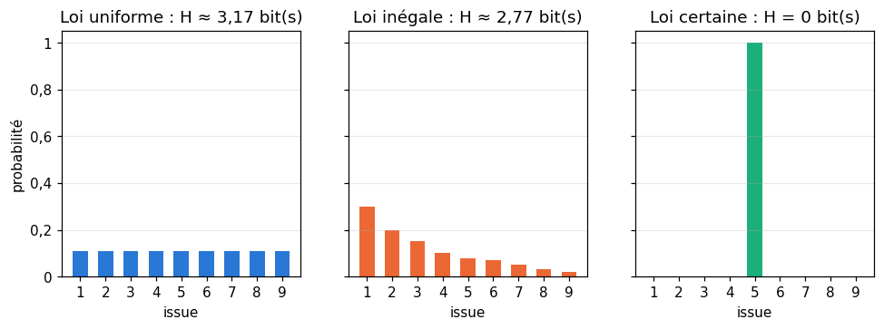
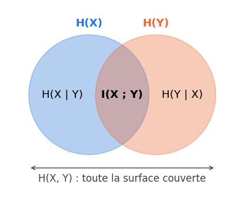
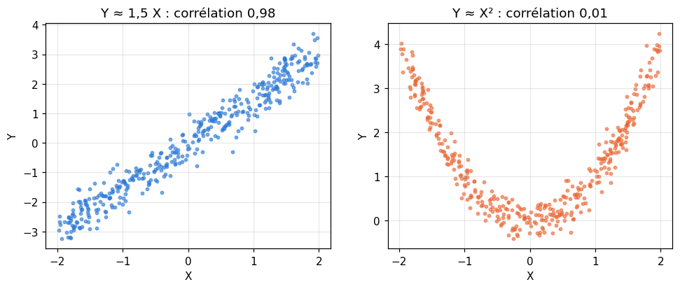

# M06 · Théorie de l'information — fiche de cours

> Combien d'information apporte un événement ? Combien de bits faut-il, en moyenne, pour décrire le résultat d'une expérience ? Que nous apprend une variable sur une autre ? Ces questions d'ingénieur des télécommunications, posées par Claude Shannon en 1948, ont des réponses chiffrées, et ces nombres sont partout en machine learning : la **cross-entropy** est la loss des classifieurs, la **divergence KL** mesure l'écart entre deux lois, l'**information mutuelle** choisit des features, la **perplexité** juge les modèles de langage. Ce chapitre construit ces outils à partir d'une seule idée : un événement de probabilité $p$ apporte $-\log_2 p$ bits. Il calcule l'**entropie** d'une loi, puis les entropies **conjointe** et **conditionnelle** de deux variables et leur **information mutuelle**, à partir d'un tableau de loi jointe comme en M03. Il définit la cross-entropy et la divergence KL, et montre avec l'**inégalité de Jensen** pourquoi la KL n'est jamais négative. Il finit par les **codes** : quelles longueurs de mots de code sont possibles (l'**inégalité de Kraft**), et pourquoi l'entropie est la limite de toute compression.

| | |
|---|---|
| **Sections** | §1 à §8 |
| **Temps total estimé** | ≈ 11,4 h : lecture et calculs de la fiche ≈ 2 h 30, exercices ≈ 8 h 15, flashcards ≈ 40 min (parcours essentiel ≈ 6,5 h) |
| **Prérequis** | R6 (logarithmes, $\log_2$, bits) ; M02b (loi d'une variable discrète, espérance) ; M03 (loi jointe, lois marginales et conditionnelles, indépendance) ; M05a §1 (convexité) |
| **Fichiers du chapitre** | `02_exercices.md` (quiz, papier) · `03_notebook.ipynb` · `04_indices.md` · `05_solutions.md` et `05_solutions.ipynb` · `06_mes_reponses.md` · `flashcards.csv` |
| **mymath** | `info.py` : `joint_entropy`, `conditional_entropy`, `mutual_information`, `kraft_sum`, `is_prefix_code`, `jensen_gap` |
| **MML** | — (le livre ne traite pas la théorie de l'information) ; lecture conseillée : MacKay, ci-dessous |

## Comment utiliser ce chapitre

**Ordre conseillé.**
1. `python tools/start_chapter.py M06` (sur Colab : `00_setup/COLAB.md` §2) : il copie le notebook, ta feuille de réponses et le squelette `mymath/info.py`.
2. Section par section : lis **crayon en main**, refais chaque calcul (une calculatrice qui a la touche $\ln$ suffit, puisque $\log_2 x = \frac{\ln x}{\ln 2}$) ; puis fais les exercices de la section, quiz 🧠 d'abord.
3. Les exercices ✏️ et 🔗 se font sur papier, dans ta copie de `06_mes_reponses.md`, puis se vérifient dans la **partie 0** du notebook. Les démonstrations ∂ se rédigent dans ta copie et se jugent avec la grille de relecture de `05_solutions.md`.

**Un réflexe pour tout le chapitre** : chaque quantité est une **moyenne de logarithmes de probabilités**. L'entropie est la moyenne de $-\log_2 p$ ; la cross-entropy, celle de $-\log_2 q$ quand les données suivent $p$ ; l'information mutuelle, celle de $\log_2 \frac{p(x, y)}{p(x)\,p(y)}$. Devant une formule, demande-toi : de quoi prend-on le logarithme, et selon quelle loi fait-on la moyenne ?

| Section | Quiz 🧠 | Papier et réflexion | Notebook |
|---|---|---|---|
| §1 Information de Shannon | Q1, R1 🔁 | M06.1 ✏️ | M06.26 🏆 |
| §2 Entropie | Q2 | M06.1 ✏️, M06.2 ✏️, M06.14 🧮 | M06.22 🔬, M06.25 🛠️, M06.26 🏆 |
| §3 Entropies conjointe et conditionnelle | Q3, R2 🔁 | M06.3 ✏️, M06.4 ✏️ | M06.16 🔨, M06.23 🎨, M06.25 🛠️ |
| §4 Information mutuelle | Q4 | M06.5 ✏️, M06.10 ∂, M06.15 🗣️, M06.E1 💼 | M06.17 🔨, M06.20 📦, M06.21 🔮, M06.23 🎨 |
| §5 Cross-entropy et divergence KL | Q5 | M06.6 ✏️, M06.12 🔗 | M06.24 🐛 |
| §6 Jensen, positivité de la KL, Jensen-Shannon | Q6, R3 🔁 | M06.7 ✏️, M06.11 ∂ | M06.19 🔨 |
| §7 Codes et inégalité de Kraft | Q7 | M06.8 ✏️, M06.9 ✏️ | M06.18 🔨 |
| §8 Perplexité, choisir des features | | M06.12 🔗, M06.13 🔗 | |

Parcours essentiel : tout sauf M06.Q4, M06.Q6, M06.R3, M06.2, M06.4, M06.7, M06.9 à M06.11, M06.13, M06.14, M06.E1, M06.18 à M06.20 et M06.22 à M06.26. L'inégalité de Jensen (§6) et la fin du §7 (longueur moyenne et entropie) se lisent en survol ; la divergence de Jensen-Shannon et les démonstrations sont hors parcours.

## Lecture conseillée : MacKay (facultatif)

MML ne traite pas la théorie de l'information : cette fiche est le cours. Pour aller plus loin, le livre de référence, libre, est celui de David J. C. MacKay, *Information Theory, Inference, and Learning Algorithms* (Cambridge University Press, 2003), dont l'auteur met le PDF en ligne pour la lecture à l'écran (adresse et conditions dans `annexes/ressources.md`). Il est plus mathématique que cette fiche, et entièrement en anglais. Ce qui correspond à ce chapitre :
- le **chapitre 2** (*Probability, Entropy, and Inference*) : la définition de l'entropie et des quantités voisines, puis les inégalités de Gibbs et de Jensen, après les §2 et §6 de la fiche ;
- le **chapitre 8** (*Dependent Random Variables*) : entropies conjointe et conditionnelle, information mutuelle, après les §3 et §4 ;
- le **chapitre 5** (*Symbol Codes*) : codes préfixes, inégalité de Kraft, code de Huffman, après le §7 ;
- le **chapitre 1**, une introduction à la transmission dans un canal bruité, se lit comme une mise en appétit.

Ces lectures ne sont nécessaires à aucun exercice.

Vocabulaire anglais de ce chapitre : *information content* (*self-information*, *surprisal*), *bit*, *nat*, *entropy*, *joint entropy*, *conditional entropy*, *chain rule*, *mutual information*, *cross-entropy*, *Kullback-Leibler divergence* (*relative entropy*), *Gibbs' inequality*, *Jensen's inequality*, *Jensen-Shannon divergence*, *fixed-length code*, *variable-length code*, *prefix code* (*prefix-free code*, *instantaneous code*), *Kraft inequality*, *expected length*, *source coding theorem*, *log loss*, *perplexity*, *feature selection*.

## Objectifs d'apprentissage

À la fin du chapitre, tu sais :
- **calculer** l'information d'un événement et l'entropie d'une loi, en bits et en nats, et **dire** quand l'entropie est nulle ou maximale ;
- **calculer** les entropies conjointe et conditionnelle et l'information mutuelle de deux variables à partir d'un tableau de loi jointe, et **utiliser** la règle de la chaîne ;
- **calculer** une cross-entropy et une divergence KL, et les **lire** comme des bits par symbole et des bits perdus ;
- **énoncer** l'inégalité de Jensen, et **démontrer** avec elle que la divergence KL est positive ;
- **décider** si des longueurs de mots de code sont possibles (inégalité de Kraft), et **comparer** la longueur moyenne d'un code à l'entropie ;
- **relier** la log loss d'un classifieur et la perplexité d'un modèle à la cross-entropy, et **classer** des features par leur information mutuelle avec la cible.

## L'essentiel en 10 lignes

1. Un événement de probabilité $p$ apporte $I = -\log_2 p$ **bits** d'information (ou $-\ln p$ **nats**) : 0 s'il est certain, d'autant plus qu'il est rare, et les informations d'événements **indépendants** s'additionnent.
2. L'**entropie** $H(X) = -\sum_x p(x) \log_2 p(x)$ est l'information **moyenne** : $0 \le H(X) \le \log_2 n$ pour $n$ issues ; 0 si l'issue est certaine, $\log_2 n$ pour la loi uniforme. Convention : $0 \log 0 = 0$.
3. **Entropie conjointe** : $H(X, Y) = -\sum_{x, y} p(x, y) \log_2 p(x, y)$. **Conditionnelle** : $H(Y \mid X) = \sum_x p(x)\, H(Y \mid X = x)$, l'incertitude qui reste sur $Y$ quand on connaît $X$.
4. **Règle de la chaîne** : $H(X, Y) = H(X) + H(Y \mid X) = H(Y) + H(X \mid Y)$.
5. **Information mutuelle** : $I(X ; Y) = H(Y) - H(Y \mid X) = H(X) + H(Y) - H(X, Y)$ ; symétrique, positive, nulle si et seulement si $X$ et $Y$ sont indépendantes.
6. **Cross-entropy** : $H(p, q) = -\sum_x p(x) \log_2 q(x)$, le coût moyen de données tirées de $p$ codées pour $q$ ; **divergence KL** : $\mathrm{KL}(p \,\|\, q) = \sum_x p(x) \log_2 \frac{p(x)}{q(x)} = H(p, q) - H(p)$, les bits perdus. Elle n'est pas symétrique.
7. **Jensen** : pour $f$ convexe, $f(\mathbb{E}[X]) \le \mathbb{E}[f(X)]$ (l'inverse pour $f$ concave). Avec $\log$ concave, il donne $\mathrm{KL}(p \,\|\, q) \ge 0$, nulle seulement si $p = q$ ; d'où $H(p, q) \ge H(p)$ et $I(X ; Y) \ge 0$.
8. **Jensen-Shannon** : $\mathrm{JS}(p, q) = \frac{1}{2}\mathrm{KL}(p \,\|\, m) + \frac{1}{2}\mathrm{KL}(q \,\|\, m)$ avec $m = \frac{p + q}{2}$ : symétrique, toujours finie, nulle seulement si $p = q$.
9. **Codes** : un code **préfixe** se lit sans séparateur ; des longueurs $\ell_i$ sont possibles pour un code préfixe binaire si et seulement si $\sum_i 2^{-\ell_i} \le 1$ (**Kraft**). La longueur moyenne $\bar{L} = \sum_i p_i \ell_i$ vérifie $\bar{L} \ge H$, et l'on peut atteindre $\bar{L} < H + 1$.
10. **Log loss** = cross-entropy moyenne avec des cibles *one-hot* ; **perplexité** $= 2^{\text{cross-entropy en bits}}$, le nombre d'options entre lesquelles le modèle hésite, en moyenne ; on classe des features par leur information mutuelle avec la cible.

---

## §1 · Information de Shannon : bits et nats

### Mesurer la surprise

Shannon laisse de côté le **sens** d'un message : ce qui compte, pour mesurer l'information qu'il apporte, c'est sa **probabilité**. Apprendre qu'un événement presque certain s'est produit n'apprend presque rien ; apprendre qu'un événement rare s'est produit apprend beaucoup. On veut donc une mesure $I(p)$ de l'information d'un événement de probabilité $p$ qui :
- vaut 0 pour un événement certain ($p = 1$) ;
- **augmente** quand $p$ diminue ;
- **s'additionne** pour deux événements indépendants : si $A$ et $B$ sont indépendants, $P(A \cap B) = P(A)\,P(B)$ (M03), et l'on veut $I(P(A)\,P(B)) = I(P(A)) + I(P(B))$.

La troisième condition demande une fonction qui change un produit en somme : un logarithme (R6). Le signe « moins » la rend positive, puisque $\log p \le 0$ pour $p \le 1$. L'**information** (*information content*, ou *surprisal*, la « surprise ») d'un événement de probabilité $p$ est

$$\boxed{I = -\log_2 p = \log_2 \frac{1}{p} \quad \text{bits.}}$$

Par exemple, $-\log_2 \frac{1}{64} = \log_2 64 = 6$ bits, puisque $2^6 = 64$. Si l'on répète deux fois, de façon indépendante, une expérience où cet événement a la probabilité $\frac{1}{64}$, le voir sortir les deux fois a la probabilité $\frac{1}{4096}$, et apporte $\log_2 4096 = 12 = 6 + 6$ bits. Plus généralement, passer de $p$ à $\frac{p}{2}$ ajoute $\log_2 2 = 1$ bit. Un événement de probabilité $0{,}3$ apporte $-\log_2 0{,}3 = \frac{-\ln 0{,}3}{\ln 2} \approx \frac{1{,}204}{0{,}693} \approx 1{,}737$ bit : l'information n'a aucune raison d'être un nombre entier.

**Deux sens du mot « bit ».** En théorie de l'information, 1 bit est la quantité apportée par un événement de probabilité $\frac{1}{2}$, comme la réponse à une question dont les deux réponses sont également probables. En informatique, un bit est une case mémoire qui contient 0 ou 1. Les deux ne coïncident que si cette case est imprévisible : une case qui vaut presque toujours 0 transporte bien moins d'un bit d'information.

Attention à la lettre $I$ : elle désigne ici l'information d'un événement, et au §4 l'information mutuelle $I(X ; Y)$ de deux variables ; le contexte (un nombre $p$, ou deux variables séparées par un point-virgule) les distingue.

### Bits et nats

Avec le logarithme népérien, on mesure l'information en **nats** : $I = -\ln p$. C'est l'unité des calculs (les dérivées de $\ln$ sont plus simples) et des bibliothèques de machine learning. On passe d'une unité à l'autre par un facteur constant, puisque $\log_2 x = \frac{\ln x}{\ln 2}$ :

$$1 \text{ nat} = \frac{1}{\ln 2} \approx 1{,}443 \text{ bit}, \qquad 1 \text{ bit} = \ln 2 \approx 0{,}693 \text{ nat}.$$

L'événement de probabilité $0{,}3$ apporte $-\ln 0{,}3 \approx 1{,}204$ nat, soit $1{,}204 \times 1{,}443 \approx 1{,}737$ bit. Plus généralement, $-\log_b p$ mesure l'information dans la base $b$ ; tout ce chapitre vaut dans n'importe quelle base $b > 1$, à un facteur constant près.

🔗 **Dans workbookIA** — le chapitre 4 a déjà manipulé des **log-probabilités** (M04 : la log-vraisemblance) : une log-probabilité est une information au signe près. Et la loss d'un classifieur, au chapitre 6 puis à partir du chapitre 18, est l'information, en nats, de la bonne réponse selon le modèle (§5).

⚠️ **Erreur classique.** Oublier le signe moins : $\log_2 0{,}2 \approx -2{,}32$, mais l'information vaut $+2{,}32$ bits. Et mélanger les bases : une information en nats n'est pas une information en bits ; on convertit en multipliant ou en divisant par $\ln 2$.

## §2 · Entropie

### L'information moyenne

Soit $X$ une variable aléatoire discrète, qui prend les valeurs $x_1, \ldots, x_n$ avec les probabilités $p_1, \ldots, p_n$ (M02b). Avant l'expérience, on ne sait pas quelle issue sortira ; on peut calculer l'information **moyenne** qu'elle apportera, c'est-à-dire l'**espérance** de $-\log_2 p(X)$ (M02b). C'est l'**entropie** (de Shannon) de $X$, ou de sa loi :

$$\boxed{H(X) = -\sum_{i=1}^{n} p_i \log_2 p_i \quad \text{bits,}}$$

avec la convention $0 \log_2 0 = 0$ : les issues de probabilité nulle ne comptent pas dans la somme. C'est le prolongement naturel : en posant $t = \frac{1}{p}$, on a $p \log_2 p = -\frac{\log_2 t}{t}$, qui tend vers 0 quand $t$ tend vers $+\infty$ (croissances comparées, R6), c'est-à-dire quand $p$ tend vers 0.

Exemple : une loi à trois issues $(0{,}62 ;\ 0{,}3 ;\ 0{,}08)$.

$$H = 0{,}62 \log_2 \tfrac{1}{0{,}62} + 0{,}3 \log_2 \tfrac{1}{0{,}3} + 0{,}08 \log_2 \tfrac{1}{0{,}08} \approx 0{,}62 \times 0{,}690 + 0{,}3 \times 1{,}737 + 0{,}08 \times 3{,}644 \approx 1{,}240 \text{ bit.}$$

En nats, $H \approx 1{,}2402 \times 0{,}6931 \approx 0{,}860$ nat. L'issue la plus rare apporte le plus d'information (3,64 bits), mais elle sort rarement : dans la moyenne, chaque information est pondérée par la probabilité de son issue.

L'entropie ne dépend que des **probabilités**, pas des valeurs : $X$ et $10X$, ou $X$ et $X + 3$, ont la même entropie, et renommer les issues ne la change pas.

### Ses valeurs extrêmes

Pour une loi sur $n$ issues :

$$0 \le H(X) \le \log_2 n.$$

- $H(X) = 0$ si et seulement si une issue est **certaine** : chaque terme $-p_i \log_2 p_i$ est positif ou nul, et il est nul seulement pour $p_i = 0$ ou $p_i = 1$.
- $H(X) = \log_2 n$ si et seulement si la loi est **uniforme** : chacune des $n$ issues apporte alors $\log_2 n$ bits. On admet ici que c'est le maximum (la démonstration est un exercice du chapitre 6 de workbookIA).

L'entropie mesure donc l'**incertitude** avant l'expérience : nulle quand on sait déjà, maximale quand toutes les issues se valent. Une source très prévisible a une entropie faible.

**Une lecture par les questions.** L'entropie se lit aussi comme le nombre moyen de questions oui/non qu'il faut poser pour trouver l'issue, avec la meilleure stratégie : une question bien choisie coupe les chances en deux et rapporte 1 bit. Ce nombre moyen est toujours au moins $H(X)$, et il en est proche (le §7 le précise avec les codes ; M06.26 en fait un défi).

⚠️ **Erreur classique.** Laisser l'ordinateur calculer $0 \times \log 0$ : NumPy calcule $\log 0 = -\infty$, puis $0 \times (-\infty)$, qui n'est pas un nombre (`nan`), et toute la somme devient `nan`. On écarte d'abord les probabilités nulles, ou l'on utilise une fonction qui applique la convention (M06.25).

## §3 · Entropies conjointe et conditionnelle

### L'entropie d'un couple

Deux variables $X$ et $Y$ ont une **loi jointe** $p(x, y) = P(X = x, Y = y)$, que l'on range dans un tableau comme en M03 : les lignes pour les valeurs de $X$, les colonnes pour celles de $Y$. Le couple $(X, Y)$ est une variable aléatoire comme une autre, dont les issues sont les cases du tableau : son entropie est l'**entropie conjointe**

$$H(X, Y) = -\sum_{x, y} p(x, y) \log_2 p(x, y).$$

Exemple : 200 élèves, selon qu'ils ont révisé ($X$) et qu'ils ont réussi l'examen ($Y$).

| | réussit | échoue | total |
|---|---|---|---|
| a révisé | 110 | 20 | 130 |
| n'a pas révisé | 25 | 45 | 70 |
| total | 135 | 65 | 200 |

En divisant par 200, la loi jointe est $\begin{pmatrix} 0{,}55 & 0{,}10 \\ 0{,}125 & 0{,}225 \end{pmatrix}$, de lois marginales $p_X = (0{,}65 ;\ 0{,}35)$ et $p_Y = (0{,}675 ;\ 0{,}325)$. On trouve $H(X, Y) \approx 1{,}666$ bit, $H(X) \approx 0{,}934$ bit et $H(Y) \approx 0{,}910$ bit.

### L'incertitude qui reste

Si l'on sait que $X = x$, la loi de $Y$ devient la loi conditionnelle $p(y \mid x) = \frac{p(x, y)}{p(x)}$ (M03), la ligne $x$ du tableau divisée par sa somme. Son entropie $H(Y \mid X = x)$ est l'incertitude qui reste sur $Y$ dans ce cas. Dans l'exemple :
- chez ceux qui ont révisé, $p(y \mid x) = \big(\frac{110}{130}, \frac{20}{130}\big) \approx (0{,}846 ;\ 0{,}154)$, d'entropie $\approx 0{,}619$ bit ;
- chez les autres, $\big(\frac{25}{70}, \frac{45}{70}\big) \approx (0{,}357 ;\ 0{,}643)$, d'entropie $\approx 0{,}940$ bit.

L'**entropie conditionnelle** $H(Y \mid X)$ est la moyenne de ces incertitudes, pondérée par les probabilités des valeurs de $X$ :

$$\boxed{H(Y \mid X) = \sum_x p(x)\, H(Y \mid X = x) = -\sum_{x, y} p(x, y) \log_2 p(y \mid x).}$$

Dans l'exemple : $H(Y \mid X) \approx 0{,}65 \times 0{,}6194 + 0{,}35 \times 0{,}9403 \approx 0{,}732$ bit. Connaître la révision fait passer l'incertitude sur la réussite de 0,910 à 0,732 bit, en moyenne.

⚠️ $H(Y \mid X)$ et $H(X \mid Y)$ sont deux nombres différents : la variable écrite à droite de la barre est celle que l'on **connaît**. Ici, $H(X \mid Y) \approx 0{,}756$ bit.

Deux cas extrêmes :
- $H(Y \mid X) = 0$ si et seulement si $Y$ est une **fonction** de $X$ : chaque ligne du tableau n'a qu'une case non nulle, et connaître $X$ donne $Y$ ;
- $H(Y \mid X) = H(Y)$ si $X$ et $Y$ sont **indépendantes** : chaque ligne, divisée par sa somme, est la loi de $Y$.

En moyenne, savoir quelque chose ne rend jamais moins sûr : $H(Y \mid X) \le H(Y)$ (§6). Mais attention, c'est vrai **en moyenne** : pour une valeur particulière $x$, $H(Y \mid X = x)$ peut dépasser $H(Y)$, si cette valeur est rare.

### La règle de la chaîne

Puisque $p(x, y) = p(x)\, p(y \mid x)$, on a $\log_2 p(x, y) = \log_2 p(x) + \log_2 p(y \mid x)$. En prenant la moyenne de l'opposé selon la loi jointe :

$$\boxed{H(X, Y) = H(X) + H(Y \mid X) = H(Y) + H(X \mid Y).}$$

Décrire le couple coûte autant que décrire $X$, puis $Y$ sachant $X$ ; ou $Y$, puis $X$ sachant $Y$. Dans l'exemple : $0{,}934 + 0{,}732 \approx 1{,}666$ et $0{,}910 + 0{,}756 \approx 1{,}666$. En pratique, c'est souvent la façon la plus rapide de calculer une entropie conditionnelle : $H(Y \mid X) = H(X, Y) - H(X)$ (`conditional_entropy`, M06.16).

## §4 · Information mutuelle

### Ce que $X$ apprend sur $Y$

L'**information mutuelle** de $X$ et $Y$ est la baisse d'incertitude sur $Y$ quand on apprend $X$ :

$$\boxed{I(X ; Y) = H(Y) - H(Y \mid X).}$$

Avec la règle de la chaîne, on obtient trois autres écritures (M06.10) :

$$I(X ; Y) = H(X) - H(X \mid Y) = H(X) + H(Y) - H(X, Y) = \sum_{x, y} p(x, y) \log_2 \frac{p(x, y)}{p(x)\,p(y)}.$$

La deuxième (la somme des deux entropies moins l'entropie conjointe) montre qu'elle est **symétrique** : $X$ apprend autant sur $Y$ que $Y$ sur $X$. La dernière se lit comme une moyenne, selon la loi jointe, du logarithme du rapport entre la loi jointe et ce qu'elle serait si les variables étaient indépendantes. Dans l'exemple des élèves : $I(X ; Y) \approx 0{,}910 - 0{,}732 \approx 0{,}178$ bit. Dans la somme, la case (a révisé, réussit) contribue positivement : $\frac{0{,}55}{0{,}65 \times 0{,}675} \approx 1{,}25 > 1$, cette combinaison est plus fréquente que sous l'indépendance ; les cases plus rares que sous l'indépendance contribuent négativement, mais le total est toujours positif ou nul.

Ses propriétés :
- $I(X ; Y) \ge 0$, avec égalité si et seulement si $X$ et $Y$ sont **indépendantes** (§6, M06.10) ;
- $I(X ; X) = H(X)$ : une variable apprend tout sur elle-même ;
- $I(X ; Y) \le \min\big(H(X), H(Y)\big)$, puisque les entropies conditionnelles sont positives ou nulles.

Le diagramme résume toutes ces relations : $H(X) = H(X \mid Y) + I(X ; Y)$, $H(Y) = I(X ; Y) + H(Y \mid X)$, et $H(X, Y)$ est la surface entière, $H(X \mid Y) + I(X ; Y) + H(Y \mid X)$. C'est une aide-mémoire, pas une figure exacte (M06.23 le dessine avec des longueurs).

### Information mutuelle et corrélation

La corrélation (M02c) ne mesure qu'un lien **linéaire** : elle peut être nulle alors que $Y$ dépend fortement de $X$. L'information mutuelle détecte toute dépendance, linéaire ou non, puisqu'elle n'est nulle que pour des variables indépendantes. En contrepartie, elle n'a pas de signe (elle ne dit pas si $Y$ croît avec $X$), et, pour des variables continues, elle demande d'estimer une loi jointe, ce qui est délicat (on découpe souvent les valeurs en intervalles).

💻 **Aujourd'hui en pratique** — scikit-learn calcule l'information mutuelle de deux variables catégorielles à partir de leurs observations (`sklearn.metrics.mutual_info_score`, en **nats**, M06.20), et l'estime entre des features continues et une cible (`mutual_info_classif`, `mutual_info_regression`) pour choisir des features (§8).

## §5 · Cross-entropy et divergence KL

### Coder avec la mauvaise loi

Le §7 le montrera : on peut donner à chaque issue $x$ un mot de code d'environ $-\log_2 q(x)$ bits, où $q$ est la loi que l'on **croit** être celle des données. Si les données suivent en réalité la loi $p$, la longueur moyenne d'un mot est la **cross-entropy** (*entropie croisée*) de $p$ et $q$ :

$$\boxed{H(p, q) = -\sum_x p(x) \log_2 q(x) \quad \text{bits par symbole.}}$$

Avec $q = p$, on retrouve $H(p)$. Avec une autre loi, on paie plus (§6). Le surcoût, en bits par symbole, est la **divergence de Kullback-Leibler** (*Kullback-Leibler divergence*, ou *entropie relative*) :

$$\boxed{\mathrm{KL}(p \,\|\, q) = H(p, q) - H(p) = \sum_x p(x) \log_2 \frac{p(x)}{q(x)},}$$

les sommes ne portant que sur les issues où $p(x) > 0$.

Exemple : des données suivent $p = (0{,}6 ;\ 0{,}25 ;\ 0{,}15)$, et l'on utilise un code fait pour $q = (0{,}25 ;\ 0{,}25 ;\ 0{,}5)$, dont les mots ont 2, 2 et 1 bits. Alors $H(p) \approx 1{,}353$ bit, $H(p, q) = 0{,}6 \times 2 + 0{,}25 \times 2 + 0{,}15 \times 1 = 1{,}85$ bit, et $\mathrm{KL}(p \,\|\, q) \approx 0{,}497$ bit perdu par symbole : sur un million de symboles, environ 497 000 bits de trop.

Deux propriétés à retenir :
- **l'infini** : si $q(x) = 0$ pour une issue que $p$ produit, alors $H(p, q) = \mathrm{KL}(p \,\|\, q) = +\infty$ : la longueur $-\log_2 0$ n'est pas finie, aucun mot n'est réservé à cette issue ; et pour un modèle, $-\log 0 = +\infty$ est la surprise d'un événement qu'il déclarait impossible ;
- **l'asymétrie** : en général $\mathrm{KL}(p \,\|\, q) \ne \mathrm{KL}(q \,\|\, p)$. Le cas extrême le montre : si $q$ donne une probabilité positive à une issue que $p$ ne produit jamais, $\mathrm{KL}(q \,\|\, p)$ est infinie alors que $\mathrm{KL}(p \,\|\, q)$ peut être finie. D'où son nom de *divergence* : elle mesure un écart, mais n'a pas les propriétés d'une distance.

On écrit toujours la loi des **données** en premier : $H(\text{données}, \text{modèle})$ et $\mathrm{KL}(\text{données} \,\|\, \text{modèle})$.

**L'information mutuelle est une KL.** La dernière écriture du §4 est exactement $I(X ; Y) = \mathrm{KL}\big(p(x, y) \,\|\, p(x)\,p(y)\big)$ : l'écart entre la loi jointe et la loi qu'auraient des variables indépendantes de mêmes marges.

### La log loss d'un classifieur

Un classifieur prédit, pour un exemple, une loi $q$ sur les classes. La « vraie » loi $p$ met toute sa masse sur la bonne classe $y$ (un vecteur *one-hot*). La cross-entropy se réduit alors à un seul terme :

$$H(p, q) = -\log q(y),$$

l'information, selon le modèle, de la bonne réponse. Un modèle qui donnait $0{,}6$ à la bonne classe paie $-\log_2 0{,}6 \approx 0{,}737$ bit, soit $-\ln 0{,}6 \approx 0{,}511$ nat. La **log loss** d'un classifieur sur $n$ exemples est la moyenne de ces termes, en nats dans les bibliothèques :

$$\text{log loss} = -\frac{1}{n} \sum_{k=1}^{n} \ln q_k(y_k).$$

Elle est faible quand le modèle donne de fortes probabilités aux bonnes réponses, et devient énorme quand il se trompe avec assurance (M06.12).

**Le cas de deux classes.** Un classifieur binaire ne donne souvent qu'un nombre, $\hat{p}$, la probabilité de la classe 1 ; la classe 0 reçoit $1 - \hat{p}$. Le terme de l'exemple $k$, de vraie classe $y_k \in \{0, 1\}$, s'écrit alors d'un coup $-\big[y_k \ln \hat{p}_k + (1 - y_k) \ln (1 - \hat{p}_k)\big]$ : seul l'un des deux termes est non nul, celui de la vraie classe. C'est la *binary cross-entropy*.

🔗 **Dans workbookIA** — le chapitre 6 programme l'entropie, la cross-entropy et la KL, et les applique à des textes ; la cross-entropy devient la loss des réseaux aux chapitres 18 et 20, et la KL revient avec les autoencodeurs variationnels (chapitre 25).

⚠️ **Erreur classique.** Inverser les arguments : $\mathrm{KL}(q \,\|\, p)$ au lieu de $\mathrm{KL}(p \,\|\, q)$ ne donne pas le même nombre, et peut même être infini quand l'autre est fini.

## §6 · Inégalité de Jensen, positivité de la KL, Jensen-Shannon

### L'inégalité de Jensen

Une fonction **convexe** a ses cordes au-dessus de sa courbe (M05a §1) : pour deux points et un poids $t \in [0, 1]$, $f(t\,a + (1 - t)\,b) \le t\,f(a) + (1 - t)\,f(b)$. En termes de probabilités, si $X$ vaut $a$ avec la probabilité $t$ et $b$ avec la probabilité $1 - t$, cela s'écrit $f(\mathbb{E}[X]) \le \mathbb{E}[f(X)]$. L'**inégalité de Jensen** l'étend à toute variable discrète (par récurrence sur le nombre de valeurs) :

> **Inégalité de Jensen.** Si $f$ est convexe et $X$ une variable discrète, $f(\mathbb{E}[X]) \le \mathbb{E}[f(X)]$, c'est-à-dire $f\big(\sum_i p_i x_i\big) \le \sum_i p_i\, f(x_i)$. Si $f$ est concave, l'inégalité change de sens. Si $f$ est **strictement** convexe (ou concave), il y a égalité seulement quand $X$ est constante (sur les valeurs de probabilité non nulle).

On appelle **écart de Jensen** la différence $\mathbb{E}[f(X)] - f(\mathbb{E}[X])$ (`jensen_gap`, M06.19) : positive ou nulle pour $f$ convexe, négative ou nulle pour $f$ concave.

Exemples (la figure) :
- $X$ vaut 1 ou 9, avec la probabilité $\frac{1}{2}$ chacun, et $f(x) = \sqrt{x}$, concave : $\mathbb{E}[\sqrt{X}] = \frac{1 + 3}{2} = 2$, alors que $\sqrt{\mathbb{E}[X]} = \sqrt{5} \approx 2{,}236$. La moyenne des racines est plus petite que la racine de la moyenne.
- $X$ vaut $-1$ ou 3, avec la probabilité $\frac{1}{2}$ chacun, et $f(x) = x^2$, convexe : $\mathbb{E}[X^2] = 5 \ge (\mathbb{E}[X])^2 = 1$. Pour $f(x) = x^2$, l'écart de Jensen est la **variance** (M02b), et Jensen redit qu'une variance est positive.

![L'inégalité de Jensen : pour une fonction concave, le milieu de la corde est au-dessous de la courbe (E[f(X)] ≤ f(E[X])) ; pour une fonction convexe, au-dessus](figures/jensen.png)

### La divergence KL est positive

Le logarithme est strictement **concave** ($(\ln x)'' = -\frac{1}{x^2} < 0$). Appliquée à $\log_2$ et à la variable qui vaut $\frac{q(x)}{p(x)}$ avec la probabilité $p(x)$, l'inégalité de Jensen donne la propriété centrale du chapitre :

> **Inégalité de Gibbs.** $\mathrm{KL}(p \,\|\, q) \ge 0$, avec égalité si et seulement si $p = q$.

La démonstration tient en trois lignes : elle fait l'objet de M06.11. Ses conséquences :
- $H(p, q) \ge H(p)$ : aucun code ne bat, en moyenne, le code fait pour la vraie loi ;
- $I(X ; Y) \ge 0$, puisque c'est une KL (§5), avec égalité si et seulement si la loi jointe est le produit des marges, c'est-à-dire si $X$ et $Y$ sont indépendantes ;
- donc $H(Y \mid X) = H(Y) - I(X ; Y) \le H(Y)$ : en moyenne, savoir ne rend pas moins sûr.

### Jensen-Shannon : une divergence symétrique et toujours finie

La KL n'est pas symétrique, et elle est infinie dès qu'une loi s'annule là où l'autre ne s'annule pas. On corrige les deux défauts en mesurant l'écart de chaque loi à leur moyenne $m = \frac{p + q}{2}$, puis en faisant la moyenne des deux écarts :

$$\mathrm{JS}(p, q) = \tfrac{1}{2}\,\mathrm{KL}(p \,\|\, m) + \tfrac{1}{2}\,\mathrm{KL}(q \,\|\, m).$$

La **divergence de Jensen-Shannon** est symétrique par construction, toujours **finie** (là où $p$ ou $q$ est positive, $m$ l'est aussi), positive ou nulle, et nulle seulement si $p = q$ (Gibbs). Avec les lois $p$ et $q$ du §5 : $m = (0{,}425 ;\ 0{,}25 ;\ 0{,}325)$ et $\mathrm{JS}(p, q) \approx 0{,}125$ bit.

🔗 **Dans workbookIA** — la divergence de Jensen-Shannon est ce que minimise, en théorie, le générateur d'un GAN (chapitre 27).

## §7 · Codes : longueur fixe ou variable, inégalité de Kraft

### Codes de longueur fixe

Pour décrire une issue parmi $N$ avec des mots binaires qui ont tous la même longueur $k$, il faut $2^k \ge N$, soit

$$k = \lceil \log_2 N \rceil \quad \text{chiffres binaires par issue,}$$

où $\lceil \cdot \rceil$ arrondit à l'entier supérieur. Pour 20 issues : $\log_2 20 \approx 4{,}32$, donc 5 chiffres ($2^4 = 16 < 20 \le 32 = 2^5$). Un tel code ignore les probabilités : il ne fait pas mieux quand certaines issues sont beaucoup plus fréquentes.

### Codes de longueur variable, codes préfixes

Un code de **longueur variable** donne des mots courts aux issues fréquentes et des mots longs aux issues rares. Il faut alors pouvoir découper une suite de bits en mots sans séparateur. C'est garanti si le code est **préfixe** (*prefix code*) : aucun mot n'est le début d'un autre. On lit les bits un à un ; au premier moment où ceux que l'on a lus forment un mot du code, ce mot est forcément celui qui a été envoyé, puisqu'aucun autre mot ne commence ainsi ; puis on repart du bit suivant.
- $\{00, 01, 10, 110, 111\}$ est préfixe : la suite `1100100111` se lit `110 | 01 | 00 | 111`, sans hésitation.
- $\{1, 00, 001\}$ ne l'est pas : `00` est le début de `001`, et après avoir lu `00`, on ne sait pas encore si le mot est fini.

On range les mots d'un code binaire dans un **arbre** : chaque bit choisit une branche (0 d'un côté, 1 de l'autre), et un mot est un chemin qui part de la racine. Le code est préfixe exactement quand aucun mot n'est sur le chemin d'un autre, c'est-à-dire quand tous les mots sont des **feuilles**.

![L'arbre du code préfixe {00, 01, 10, 110, 111} : chaque mot est une feuille ; un mot de longueur ℓ « possède » la part 2^(−ℓ) de l'intervalle [0, 1], et ces parts ne se chevauchent pas](figures/arbre_code.png)

### L'inégalité de Kraft

Quelles longueurs $\ell_1, \ldots, \ell_n$ peut-on donner aux mots d'un code préfixe binaire ? Pense aux suites infinies de bits : un mot de longueur 1 commence la moitié d'entre elles, un mot de longueur 2 le quart, et un mot de longueur $\ell$ la fraction $2^{-\ell}$ (la figure, en bas). Dans un code préfixe, deux mots ne commencent jamais les mêmes suites : ces fractions ne se chevauchent pas, et leur total ne dépasse pas 1.

> **Inégalité de Kraft.** Un code préfixe binaire dont les mots ont les longueurs $\ell_1, \ldots, \ell_n$ vérifie $\sum_{i=1}^{n} 2^{-\ell_i} \le 1$. Réciproquement, si des longueurs vérifient cette inégalité, il existe un code préfixe qui a ces longueurs. Avec un alphabet de $D$ symboles au lieu de 2, la somme devient $\sum_i D^{-\ell_i}$.

La réciproque se démontre en plaçant les mots dans l'ordre des longueurs croissantes, chacun dans la première part libre de l'intervalle. Exemples :
- les longueurs $(2, 2, 2, 3, 3)$ du code de la figure : $3 \times \frac{1}{4} + 2 \times \frac{1}{8} = 1$ ; un code dont la somme vaut exactement 1 est dit **complet** : on ne peut plus lui ajouter de mot ;
- des longueurs $(1, 2, 2, 2)$ : $\frac{1}{2} + \frac{3}{4} = 1{,}25 > 1$ : **aucun** code préfixe n'a ces longueurs.

L'inégalité de Kraft dit quelles longueurs sont **possibles** ; elle ne dit pas qu'un code donné est préfixe. Pour un code donné, on vérifie directement qu'aucun mot n'en commence un autre (`is_prefix_code`, M06.18). Elle vaut même, c'est le théorème de McMillan, pour tout code qui se décode sans ambiguïté, préfixe ou non.

### Longueur moyenne et entropie

Si l'issue $i$ a la probabilité $p_i$ et un mot de longueur $\ell_i$, la **longueur moyenne** du code est $\bar{L} = \sum_i p_i\, \ell_i$, en bits par issue. Deux résultats encadrent ce que l'on peut atteindre :
- **la borne inférieure** : tout code préfixe vérifie $\bar{L} \ge H$. C'est une conséquence de Kraft et de Gibbs (§6) : on l'admet ici (MacKay, chapitre 5) ;
- **on peut s'en approcher à moins d'un bit** : les longueurs de Shannon $\ell_i = \lceil -\log_2 p_i \rceil$ vérifient Kraft, puisque $2^{-\ell_i} \le 2^{\log_2 p_i} = p_i$ et que la somme des $p_i$ vaut 1 ; et comme $\ell_i < -\log_2 p_i + 1$, leur longueur moyenne vérifie $\bar{L} < H + 1$.

Exemple : $p = (0{,}4 ;\ 0{,}3 ;\ 0{,}2 ;\ 0{,}1)$, d'entropie $H \approx 1{,}846$ bit. Les longueurs de Shannon valent $(2, 2, 3, 4)$, de somme de Kraft $\frac{1}{4} + \frac{1}{4} + \frac{1}{8} + \frac{1}{16} = 0{,}6875$ et de longueur moyenne $\bar{L} = 0{,}8 + 0{,}6 + 0{,}6 + 0{,}4 = 2{,}4$ bits. Le code est possible, mais il laisse de la place inutilisée : les longueurs $(1, 2, 3, 3)$, de somme de Kraft $\frac{1}{2} + \frac{1}{4} + \frac{2}{8} = 1$, donnent $\bar{L} = 0{,}4 + 0{,}6 + 0{,}6 + 0{,}3 = 1{,}9$ bit, plus près de l'entropie. Le meilleur code préfixe pour une loi donnée s'obtient par l'algorithme de **Huffman** : on réunit les deux issues les moins probables en une seule, on recommence jusqu'à n'avoir plus qu'une issue, puis on redescend en ajoutant un 0 ou un 1 à chaque réunion (on admet que le code obtenu est optimal) ; le chapitre 6 de workbookIA le construit et le programme.

**Coder par blocs.** La borne $\bar{L} < H + 1$ coûte jusqu'à un bit par symbole, beaucoup quand $H$ est petite. On code alors les symboles par blocs de $k$ : pour des symboles indépendants, un bloc a l'entropie $k\,H$ (§3), et un bon code pour les blocs a une longueur moyenne inférieure à $k\,H + 1$, soit moins de $H + \frac{1}{k}$ bit par symbole. En allongeant les blocs, on s'approche de l'entropie autant qu'on veut : c'est le théorème du codage de source de Shannon.

⚠️ **Erreur classique.** Écrire « 12 issues demandent 3,58 chiffres binaires » : $\log_2 12 \approx 3{,}58$ est une information ; un code de longueur fixe a un nombre entier de chiffres, $\lceil \log_2 12 \rceil = 4$.

## §8 · Perplexité, et choisir des features par l'information mutuelle

### La perplexité

Un modèle de langage donne, à chaque position d'un texte, une probabilité au token qui s'y trouve vraiment. Sa cross-entropy sur un texte de $T$ tokens est la moyenne des informations de ces tokens selon le modèle, $-\frac{1}{T}\sum_t \log_2 q_t$. Sa **perplexité** en est l'exponentielle :

$$\text{perplexité} = 2^{\text{cross-entropy en bits}} = e^{\text{cross-entropy en nats}}.$$

Elle ne dépend pas de la base. Pour un modèle qui répartirait toujours sa probabilité également sur $k$ tokens, dont le bon, chaque information vaut $\log_2 k$, et la perplexité vaut $k$ : la perplexité se lit comme le nombre d'options entre lesquelles le modèle hésite, en moyenne ; elle vaut 1 pour un modèle qui ne se trompe jamais. Exemple : sur quatre tokens, un modèle a donné les probabilités $\frac{1}{2}$, $\frac{1}{4}$, $\frac{1}{8}$ et $\frac{1}{4}$ aux tokens observés. Leurs informations valent 1, 2, 3 et 2 bits, de moyenne 2 bits : la perplexité vaut $2^2 = 4$, comme un modèle qui hésiterait à chaque fois entre quatre tokens équiprobables.

### Choisir des features par l'information mutuelle

Pour prédire une cible $Y$, toutes les features ne se valent pas. Une méthode simple les **classe** par leur information mutuelle avec la cible, calculée sur les données : une feature $F$ pour laquelle $I(F ; Y)$ est grande réduit beaucoup l'incertitude sur $Y$ ; une feature indépendante de $Y$ a une information mutuelle nulle. Exemple : sur 100 clients, une feature binaire $F$ et l'achat $Y$ se répartissent ainsi.

| | achète | n'achète pas |
|---|---|---|
| $F$ = oui | 30 | 10 |
| $F$ = non | 10 | 50 |

Ici $p_F = (0{,}4 ;\ 0{,}6)$, $p_Y = (0{,}4 ;\ 0{,}6)$ et $I(F ; Y) \approx 0{,}256$ bit : connaître $F$ fait passer l'incertitude sur l'achat de 0,971 à environ 0,715 bit.

Trois précautions :
- une feature qui a **beaucoup de valeurs** paraît plus informative qu'elle ne l'est : à la limite, un identifiant unique de chaque client a une information mutuelle maximale avec la cible sur les données, et ne prédit rien pour un nouveau client ;
- le classement regarde les features **une par une** : deux features presque identiques auront toutes deux un bon score, sans que la seconde apporte quoi que ce soit de plus ;
- sur peu de données, les probabilités estimées, donc les informations mutuelles, sont bruitées, et légèrement surestimées (M06.22 étudie l'effet voisin sur une entropie).

🔗 **Dans workbookIA** — la sélection de features par l'information mutuelle revient au chapitre 12 (`SelectKBest`), et le chapitre 13 choisit les questions d'un arbre de décision par le **gain d'information**, une information mutuelle.

## Les pièges classiques ⚠️ (récapitulatif)

| Piège | Exemple | Ce qu'il faut faire |
|---|---|---|
| le signe moins oublié | « $\log_2 0{,}2 \approx -2{,}32$ bits » | l'information est $-\log_2 p$, jamais négative |
| un calcul en nats donné pour des bits | « $-\ln 0{,}5 \approx 0{,}69$ bit » | bits avec $\log_2$ (ici 1 bit), nats avec $\ln$ ; 1 nat ≈ 1,443 bit |
| une probabilité nulle dans le calcul de l'entropie | `-(p * np.log2(p)).sum()` pour `p = [0.7, 0.3, 0.0]` donne `nan` | écarter les $p = 0$, ou `scipy.special.xlogy` : $0 \log 0 = 0$ |
| $H(Y \mid X)$ et $H(X \mid Y)$ confondues | la ligne du tableau divisée par la somme de sa colonne | la variable à droite de la barre est celle que l'on connaît |
| « savoir $X = x$ diminue toujours l'incertitude sur $Y$ » | une valeur rare de $X$ peut la faire monter | seule la moyenne baisse : $H(Y \mid X) \le H(Y)$ |
| les deux lois de la KL échangées | la KL du modèle aux données | la loi des données en premier : $\mathrm{KL}(\text{données} \,\|\, \text{modèle})$ |
| un modèle qui donne 0 à une issue observée | sa cross-entropy sur ces données | elle est infinie : un modèle ne donne jamais exactement 0 à ce qui peut arriver |
| Jensen dans le mauvais sens | « $\mathbb{E}[\ln X] \ge \ln \mathbb{E}[X]$ » | convexe : $f(\mathbb{E}[X]) \le \mathbb{E}[f(X)]$ ; concave, comme $\ln$ : l'inverse |
| « Kraft est vérifiée, donc ce code est préfixe » | $\{0, 01, 11\}$, de somme 1 | Kraft dit quelles longueurs sont possibles ; un code donné se vérifie mot à mot |
| une longueur de code non entière | « 12 issues : 3,58 chiffres binaires » | un code de longueur fixe a $\lceil \log_2 N \rceil$ chiffres |
| une feature à beaucoup de valeurs jugée excellente | un identifiant de client | l'information mutuelle sur les données la surestime ; vérifier sur d'autres données |

## Et maintenant

**Dans ce dépôt** : CP1, l'examen blanc de la partie I, fait le bilan de M02a à M06. Les notions de ce chapitre reviennent ensuite : la KL avec t-SNE (M12d), la cross-entropy et la log loss avec la vraisemblance et la régression logistique (M13a).

**Dans workbookIA** : le chapitre 6 visite la théorie de l'information sous l'angle des codes et des textes. Tu y retrouveras l'information d'un événement, l'entropie, la cross-entropy, la KL et la perplexité (§1, §2, §5, §8), et tu y programmeras ce que ce chapitre a seulement énoncé, comme le code de Huffman (§7). Les entropies conditionnelles et l'information mutuelle (§3, §4) éclairent ce qu'il dit du contexte d'un texte.

## Pour aller plus loin

- D. J. C. MacKay, *Information Theory, Inference, and Learning Algorithms* (chapitres 1, 2, 5 et 8, voir la lecture conseillée).
- C. E. Shannon, « A Mathematical Theory of Communication », *Bell System Technical Journal*, 1948 : l'article fondateur, que le chapitre 6 de workbookIA fait lire.
- `annexes/symboles.md` (lire $H(X \mid Y)$, $I(X ; Y)$, $\mathrm{KL}(p \,\|\, q)$ à voix haute), `annexes/formulaire.md` et `annexes/erreurs_frequentes.md`.
