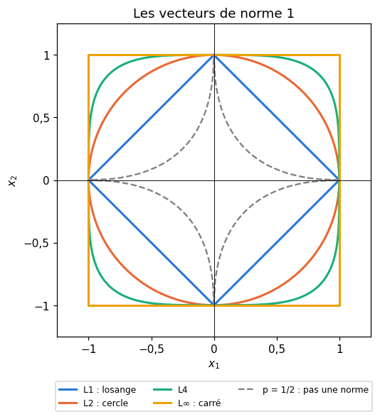
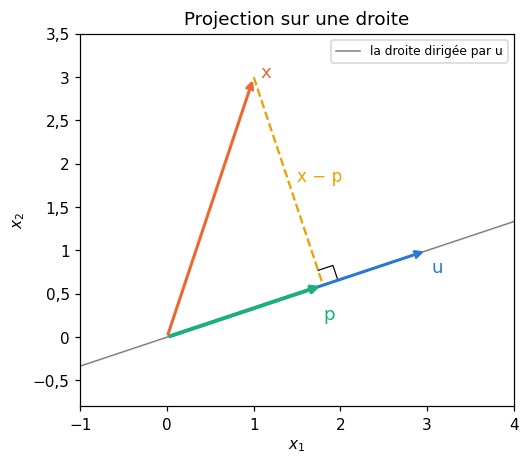
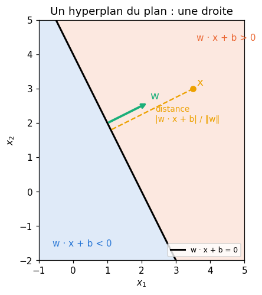
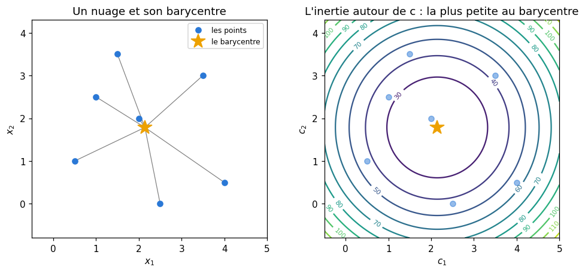
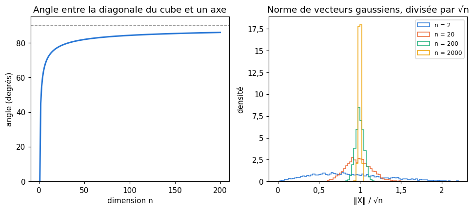

# M07 · Vecteurs et géométrie de ℝⁿ — fiche de cours

> En R9, les vecteurs avaient deux coordonnées et se dessinaient. En machine learning, un exemple décrit par $p$ mesures est un vecteur de $\mathbb{R}^p$, et $p$ vaut souvent 10, 100 ou 1 000. Ce chapitre garde les outils de R9 et les fait passer en dimension quelconque : le **produit scalaire**, les **normes** et les **distances** (L1, L2, L∞), l'**angle** et la **similarité cosinus**, la **projection** sur une droite. Une inégalité tient tout cela ensemble, celle de **Cauchy-Schwarz** : c'est elle qui permet de parler d'angle là où l'on ne peut plus rien dessiner. Viennent ensuite les **hyperplans**, qui coupent l'espace en deux et servent de frontières de décision, puis le **barycentre**, le point le plus proche en moyenne d'un nuage, sur lequel repose k-means. Le chapitre finit par les surprises de la **grande dimension** : en dimension 1 000, deux directions tirées au hasard sont presque perpendiculaires, et toutes les distances se ressemblent.

| | |
|---|---|
| **Sections** | §1 à §7 |
| **Temps total estimé** | ≈ 15,3 h : lecture et calculs de la fiche ≈ 3 h, exercices ≈ 11 h 30, flashcards ≈ 50 min (parcours essentiel ≈ 9,9 h) |
| **Prérequis** | R9 (vecteurs du plan, norme, produit scalaire, angle, droites) ; R4 (Σ, raisonnements) ; R3 (discriminant) ; M02b (espérance, variance, lois uniforme et normale) ; M02c (moyenne et variance empiriques) ; M05b (gradient, point critique) |
| **Fichiers du chapitre** | `02_exercices.md` (quiz, papier) · `03_notebook.ipynb` · `04_indices.md` · `05_solutions.md` et `05_solutions.ipynb` · `06_mes_reponses.md` · `flashcards.csv` |
| **mymath** | `vectors.py` : `norm_p`, `cosine_similarity`, `project_onto_line`, `centroid`, `sum_sq_distances_to`, `side_of_hyperplane`, `distance_to_hyperplane` |
| **MML** | §3.1, §3.2.1, §3.3 et §3.4 (voir le guide de lecture ci-dessous) |

## Comment utiliser ce chapitre

**Ordre conseillé.**
1. `python tools/start_chapter.py M07` (sur Colab : `00_setup/COLAB.md` §2) : il copie le notebook, ta feuille de réponses et le squelette `mymath/vectors.py`.
2. Section par section : lis **crayon en main**, refais chaque calcul ; puis fais les exercices de la section, quiz 🧠 d'abord.
3. Les exercices ✏️ et 🔗 se font sur papier, dans ta copie de `06_mes_reponses.md`, puis se vérifient dans la **partie 0** du notebook. Les démonstrations ∂ se rédigent dans ta copie et se jugent avec la grille de relecture de `05_solutions.md`.

**Un réflexe pour tout le chapitre** : quand une formule en dimension $n$ t'échappe, écris-la en dimension 2 avec des nombres, comme en R9, puis vérifie qu'elle ne se sert jamais du fait qu'il n'y a que deux coordonnées. Presque tout ce qui suit est une somme sur les coordonnées, $\sum_{i=1}^{n}$, qui marche pour n'importe quel $n$.

| Section | Quiz 🧠 | Papier et réflexion | Notebook |
|---|---|---|---|
| §1 Vecteurs de ℝⁿ | Q1 | M07.1 ✏️, M07.22 🧮 | M07.34 🛠️ |
| §2 Produit scalaire | Q2, R1 🔁 | M07.2 ✏️, M07.7 ✏️, M07.20 📖, M07.E1 💼 | |
| §3 Normes et distances | Q3 | M07.3 ✏️, M07.15 ∂, M07.19 🔗, M07.20 📖 | M07.24 🔨, M07.28 📦, M07.31 🔬, M07.32 🎨, M07.33 🐛, M07.34 🛠️, M07.35 🏆 |
| §4 Angle, cosinus, Cauchy-Schwarz, projection | Q4 | M07.4 ✏️, M07.5 ✏️, M07.14 ∂, M07.15 ∂, M07.21 📖, M07.23 🗣️ | M07.24 🔨, M07.25 🔨, M07.33 🐛 |
| §5 Hyperplans et demi-espaces | Q5 | M07.6 ✏️, M07.7 ✏️, M07.17 ∂, M07.E1 💼 | M07.27 🔨 |
| §6 Barycentres, inertie, silhouette, k-means | Q6, R2 🔁, R3 🔁 | M07.8 ✏️ à M07.11 ✏️, M07.16 ∂, M07.18 ∂ | M07.26 🔨, M07.31 🔬, M07.35 🏆 |
| §7 La grande dimension | Q7 | M07.12 ✏️, M07.13 ✏️ | M07.29 🔮, M07.30 🔬 |

Parcours essentiel : tout sauf M07.Q6, M07.R3, M07.9 à M07.11, M07.13, M07.15, M07.18, M07.20 à M07.22, M07.E1, M07.28 et M07.30 à M07.35. La silhouette et k-means++ (fin du §6) se lisent en survol ; les démonstrations de l'inégalité triangulaire et de la baisse de l'inertie sont hors parcours.

## Guide de lecture de MML

*Mathematics for Machine Learning* (MML) consacre son chapitre 3, *Analytic Geometry*, à la géométrie des vecteurs. Ce chapitre en lit le début, en trois fois :
- après le **§3** de la fiche : le **§3.1**, *Norms* (la définition d'une norme et deux exemples, la norme de Manhattan et la norme euclidienne), puis le **§3.2.1**, *Dot Product*. Questions : M07.20 ;
- tu peux **survoler** le §3.2.2, *General Inner Products*, et le §3.2.3, *Symmetric, Positive Definite Matrices* : ils généralisent le produit scalaire à l'aide de matrices, que tu verras en M09a et en M12 ;
- après le **§4** de la fiche : le **§3.3**, *Lengths and Distances*, puis le **§3.4**, *Angles and Orthogonality* (la fin du §3.4, sur les matrices orthogonales, reviendra en M12). Questions : M07.21.

Le livre définit d'abord un produit scalaire général, puis il en déduit la longueur, la distance et l'angle. La fiche fait le chemin inverse, en partant du produit scalaire usuel ; c'est le même édifice, vu depuis le cas que tu connais.

📐 **Notations.** La fiche écrit le produit scalaire $\mathbf{u} \cdot \mathbf{v}$, comme R9 et workbookIA. MML l'écrit $\mathbf{x}^\top \mathbf{y}$ (un vecteur ligne fois un vecteur colonne, M09a) quand il s'agit du produit usuel, et $\langle \mathbf{x}, \mathbf{y} \rangle$ pour un produit scalaire quelconque. La norme euclidienne est $\lVert \mathbf{x} \rVert$ ou $\lVert \mathbf{x} \rVert_2$, la norme L1 $\lVert \mathbf{x} \rVert_1$ ; MML note $d(\mathbf{x}, \mathbf{y})$ la distance, comme la fiche. Le livre écrit les vecteurs en colonne, $\mathbf{x} \in \mathbb{R}^D$ ; la fiche les écrit en ligne entre parenthèses, $(2, -1, 0, 3)$, pour gagner de la place, et note $n$ la dimension (MML : $D$).

Vocabulaire anglais de ce chapitre : *vector*, *real-valued vector*, *component*, *linear combination*, *standard basis* (*canonical basis*), *one-hot vector*, *dot product* (*scalar product*), *inner product*, *norm*, *Euclidean norm*, *Manhattan norm*, *maximum norm*, *unit ball*, *unit vector*, *normalize*, *distance*, *metric*, *triangle inequality*, *Cauchy-Schwarz inequality*, *angle*, *cosine similarity*, *orthogonal*, *orthonormal*, *orthogonal projection*, *hyperplane*, *half-space*, *normal vector*, *decision boundary*, *centroid*, *barycenter*, *weighted mean*, *inertia* (*within-cluster sum of squares*), *silhouette*, *curse of dimensionality*.

## Objectifs d'apprentissage

À la fin du chapitre, tu sais :
- **calculer** avec des vecteurs de $\mathbb{R}^n$ : combinaisons linéaires, produit scalaire, vecteurs one-hot ;
- **calculer** les normes L1, L2 et L∞ et les distances associées, et **démontrer** l'inégalité triangulaire ;
- **démontrer** l'inégalité de Cauchy-Schwarz, et **calculer** un angle, une similarité cosinus et une projection sur une droite ;
- **décrire** un hyperplan par son vecteur normal, **dire** de quel côté est un point et **calculer** sa distance à l'hyperplan ;
- **démontrer** que le barycentre minimise la somme des carrés des distances, et **calculer** une inertie, une silhouette et les probabilités de k-means++ ;
- **mesurer**, à la main et par simulation, ce qui change quand la dimension grandit.

## L'essentiel en 10 lignes

1. Un **vecteur de $\mathbb{R}^n$** est une liste de $n$ nombres ; on additionne et on multiplie par un nombre **coordonnée par coordonnée**. Un exemple décrit par $p$ features est un vecteur de $\mathbb{R}^p$ ; un **one-hot** est un vecteur de la base canonique $\mathbf{e}_k$.
2. **Produit scalaire** : $\mathbf{u} \cdot \mathbf{v} = \sum_i u_i v_i$, un nombre ; symétrique, linéaire, $\mathbf{u} \cdot \mathbf{u} = \lVert \mathbf{u} \rVert^2$. Un neurone calcule $z = \mathbf{w} \cdot \mathbf{x} + b$.
3. **Normes** : $\lVert \mathbf{x} \rVert_1 = \sum |x_i|$, $\lVert \mathbf{x} \rVert_2 = \sqrt{\sum x_i^2}$, $\lVert \mathbf{x} \rVert_\infty = \max |x_i|$ ; $\lVert \mathbf{x} \rVert_\infty \le \lVert \mathbf{x} \rVert_2 \le \lVert \mathbf{x} \rVert_1$. **Distance** : $d(\mathbf{x}, \mathbf{y}) = \lVert \mathbf{x} - \mathbf{y} \rVert$.
4. **Cauchy-Schwarz** : $|\mathbf{u} \cdot \mathbf{v}| \le \lVert \mathbf{u} \rVert\,\lVert \mathbf{v} \rVert$, avec égalité si et seulement si les vecteurs sont colinéaires. Elle donne l'**inégalité triangulaire** $\lVert \mathbf{u} + \mathbf{v} \rVert \le \lVert \mathbf{u} \rVert + \lVert \mathbf{v} \rVert$.
5. **Angle** et **similarité cosinus** : $\cos\theta = \frac{\mathbf{u} \cdot \mathbf{v}}{\lVert \mathbf{u} \rVert\,\lVert \mathbf{v} \rVert} \in [-1, 1]$ ; orthogonaux si $\mathbf{u} \cdot \mathbf{v} = 0$. Le cosinus ignore les longueurs.
6. **Projection** sur la droite dirigée par $\mathbf{u}$ : $\frac{\mathbf{x} \cdot \mathbf{u}}{\mathbf{u} \cdot \mathbf{u}}\,\mathbf{u}$ ; le reste est orthogonal à $\mathbf{u}$.
7. **Hyperplan** : $\mathbf{w} \cdot \mathbf{x} + b = 0$, de vecteur normal $\mathbf{w}$ ; le signe de $\mathbf{w} \cdot \mathbf{x} + b$ dit de quel côté est $\mathbf{x}$, et la distance vaut $\frac{|\mathbf{w} \cdot \mathbf{x} + b|}{\lVert \mathbf{w} \rVert}$.
8. **Barycentre** : $\bar{\mathbf{x}} = \frac{1}{n}\sum \mathbf{x}_i$ minimise $\sum \lVert \mathbf{x}_i - \mathbf{c} \rVert^2$, et $\sum \lVert \mathbf{x}_i - \mathbf{c} \rVert^2 = \sum \lVert \mathbf{x}_i - \bar{\mathbf{x}} \rVert^2 + n\,\lVert \bar{\mathbf{x}} - \mathbf{c} \rVert^2$ (König-Huygens).
9. **k-means** alterne une affectation au centre le plus proche et une mise à jour au barycentre ; aucune des deux étapes n'augmente l'**inertie**. La **silhouette** $s = \frac{b - a}{\max(a, b)}$ juge un découpage ; **k-means++** tire chaque nouveau centre avec une probabilité proportionnelle à $D^2$.
10. **Grande dimension** : la diagonale du cube unité mesure $\sqrt{n}$ et fait avec chaque axe un angle qui tend vers 90° ; deux vecteurs aléatoires sont presque orthogonaux ; un vecteur gaussien a une norme proche de $\sqrt{n}$, à peu près la même pour tous les tirages.

---

## §1 · Vecteurs de ℝⁿ : un exemple est un vecteur

### Des listes de nombres

Un **vecteur de $\mathbb{R}^n$** (*vector*) est une liste ordonnée de $n$ nombres réels, ses **coordonnées** (ou composantes, *components*) : $\mathbf{u} = (u_1, u_2, \ldots, u_n)$. $\mathbb{R}^2$ est le plan de R9, $\mathbb{R}^3$ l'espace ; au-delà, on ne dessine plus, mais on calcule de la même façon. L'ordre compte : $(1, 2) \ne (2, 1)$.

En machine learning, chaque **exemple** d'un dataset est un vecteur. Un appartement décrit par sa surface, son nombre de pièces, son étage et l'année de sa construction est un vecteur de $\mathbb{R}^4$ ; une image de $28 \times 28$ pixels en niveaux de gris, un vecteur de $\mathbb{R}^{784}$. Le dataset entier, avec ses $n$ lignes et ses $p$ colonnes, est un tableau de $n$ vecteurs de $\mathbb{R}^p$ (M09a en fera une matrice).

### Opérer coordonnée par coordonnée

On **additionne** deux vecteurs de même dimension, et on **multiplie** un vecteur par un nombre (un **scalaire**), coordonnée par coordonnée. Avec $\mathbf{u} = (2, -1, 0, 3)$ et $\mathbf{v} = (1, 4, -2, 0)$ :

$$\mathbf{u} + \mathbf{v} = (3, 3, -2, 3), \qquad 3\mathbf{u} - 2\mathbf{v} = (6 - 2,\ -3 - 8,\ 0 + 4,\ 9 - 0) = (4, -11, 4, 9).$$

Une expression comme $3\mathbf{u} - 2\mathbf{v}$ est une **combinaison linéaire** (*linear combination*) de $\mathbf{u}$ et $\mathbf{v}$. Additionner un vecteur de $\mathbb{R}^3$ et un vecteur de $\mathbb{R}^4$ n'a pas de sens. Le **vecteur nul** $\mathbf{0} = (0, \ldots, 0)$ ne change rien quand on l'ajoute. Les règles de calcul sont celles des nombres, appliquées à chaque coordonnée : $\mathbf{u} + \mathbf{v} = \mathbf{v} + \mathbf{u}$, $k(\mathbf{u} + \mathbf{v}) = k\mathbf{u} + k\mathbf{v}$, etc.

### La base canonique et les vecteurs one-hot

Les $n$ vecteurs $\mathbf{e}_1 = (1, 0, \ldots, 0)$, $\mathbf{e}_2 = (0, 1, 0, \ldots, 0)$, …, $\mathbf{e}_n = (0, \ldots, 0, 1)$ forment la **base canonique** (*standard basis*) de $\mathbb{R}^n$ : $\mathbf{e}_k$ vaut 1 à la place $k$ et 0 ailleurs. Tout vecteur en est une combinaison linéaire, dont les coefficients sont ses coordonnées : $(2, -1, 0, 3) = 2\mathbf{e}_1 - \mathbf{e}_2 + 0\,\mathbf{e}_3 + 3\mathbf{e}_4$.

Un **vecteur one-hot** (*one-hot vector*) est un vecteur de la base canonique utilisé pour coder une **catégorie**. Pour les trois couleurs {rouge, vert, bleu}, dans cet ordre : rouge $= (1, 0, 0)$, vert $= (0, 1, 0)$, bleu $= (0, 0, 1)$. Trois remarques :
- la somme des one-hot de plusieurs exemples **compte** les catégories : deux rouges et un bleu donnent $(2, 0, 1)$ ; divisée par le nombre d'exemples, elle donne leurs proportions, $\big(\frac{2}{3}, 0, \frac{1}{3}\big)$ ;
- un vecteur de probabilités, comme la sortie d'un classifieur à trois classes $(0{,}7 ;\ 0{,}2 ;\ 0{,}1)$, est une combinaison des one-hot, de coefficients positifs de somme 1 ; le one-hot du vrai label en est le cas extrême, une probabilité 1 sur une seule classe (c'est lui que compare la cross-entropy de M06) ;
- coder les couleurs par 1, 2, 3 ferait croire que le vert est « entre » le rouge et le bleu, et que le bleu vaut trois fois le rouge : le one-hot ne met aucun ordre ni aucune distance privilégiée entre les catégories (§3 : deux one-hot différents sont tous à la même distance $\sqrt{2}$).

### Sur ordinateur

NumPy fait exactement ces opérations sur des tableaux à une dimension :

```python
>>> import numpy as np
>>> u, v = np.array([2, -1, 0, 3]), np.array([1, 4, -2, 0])
>>> 3 * u - 2 * v
array([  4, -11,   4,   9])
>>> np.eye(3)[1]          # the one-hot vector of the second category
array([0., 1., 0.])
```

⚠️ **Erreur classique.** Avec des **listes** Python, `[2, -1] + [1, 4]` colle les listes (`[2, -1, 1, 4]`) et `3 * [2, -1]` les répète : il faut des tableaux NumPy pour calculer avec des vecteurs.

## §2 · Produit scalaire

### Définition

Le **produit scalaire** (*dot product*) de deux vecteurs de $\mathbb{R}^n$ est le **nombre**

$$\mathbf{u} \cdot \mathbf{v} = \sum_{i=1}^{n} u_i\,v_i = u_1 v_1 + u_2 v_2 + \cdots + u_n v_n.$$

C'est la formule de R9, avec $n$ termes au lieu de deux. Avec $\mathbf{u} = (2, -1, 0, 3)$ et $\mathbf{v} = (1, 4, -2, 0)$ : $\mathbf{u} \cdot \mathbf{v} = 2 - 4 + 0 + 0 = -2$.

Ses règles se vérifient coordonnée par coordonnée :
- **symétrie** : $\mathbf{u} \cdot \mathbf{v} = \mathbf{v} \cdot \mathbf{u}$ ;
- **linéarité** : $(k\mathbf{u}) \cdot \mathbf{v} = k\,(\mathbf{u} \cdot \mathbf{v})$ et $(\mathbf{u} + \mathbf{w}) \cdot \mathbf{v} = \mathbf{u} \cdot \mathbf{v} + \mathbf{w} \cdot \mathbf{v}$ ;
- **positivité** : $\mathbf{u} \cdot \mathbf{u} = \sum u_i^2 \ge 0$, et $\mathbf{u} \cdot \mathbf{u} = 0$ seulement si $\mathbf{u} = \mathbf{0}$ (une somme de carrés n'est nulle que si chaque carré l'est).

On définit la **norme** (euclidienne) par $\lVert \mathbf{u} \rVert = \sqrt{\mathbf{u} \cdot \mathbf{u}}$ : $\lVert \mathbf{u} \rVert^2 = 4 + 1 + 0 + 9 = 14$ et $\lVert \mathbf{v} \rVert^2 = 1 + 16 + 4 + 0 = 21$. Le §3 en présente d'autres.

Avec un vecteur de la base canonique, le produit scalaire **lit une coordonnée** : $\mathbf{e}_k \cdot \mathbf{x} = x_k$. C'est ce que fait un one-hot multiplié par un vecteur de poids : il en extrait le poids de sa catégorie (M09a en fera la base des *embeddings*).

### Développer une norme au carré

La linéarité permet de développer comme une identité remarquable :

$$\lVert \mathbf{u} + \mathbf{v} \rVert^2 = (\mathbf{u} + \mathbf{v}) \cdot (\mathbf{u} + \mathbf{v}) = \lVert \mathbf{u} \rVert^2 + 2\,\mathbf{u} \cdot \mathbf{v} + \lVert \mathbf{v} \rVert^2.$$

Vérification : $\mathbf{u} + \mathbf{v} = (3, 3, -2, 3)$ a pour norme au carré $9 + 9 + 4 + 9 = 31$, et $14 + 2 \times (-2) + 21 = 31$. Avec $-\mathbf{v}$ à la place de $\mathbf{v}$, on retrouve la version avec un moins, déjà vue dans workbookIA 0B. En additionnant les deux versions, les doubles produits s'annulent, ce qui donne l'**identité du parallélogramme**, et en les soustrayant, on isole le produit scalaire :

$$\lVert \mathbf{u} + \mathbf{v} \rVert^2 + \lVert \mathbf{u} - \mathbf{v} \rVert^2 = 2\lVert \mathbf{u} \rVert^2 + 2\lVert \mathbf{v} \rVert^2, \qquad \mathbf{u} \cdot \mathbf{v} = \frac{\lVert \mathbf{u} + \mathbf{v} \rVert^2 - \lVert \mathbf{u} - \mathbf{v} \rVert^2}{4}.$$

La première dit que, dans un parallélogramme, la somme des carrés des deux diagonales égale la somme des carrés des quatre côtés ; la seconde, que le produit scalaire se déduit des seules longueurs.

### Orthogonalité

Deux vecteurs sont **orthogonaux** (*orthogonal*) quand $\mathbf{u} \cdot \mathbf{v} = 0$. En dimension 2 ou 3, c'est la perpendicularité de R9 ; en dimension quelconque, c'est une **définition**. Elle garde la propriété clé, le **théorème de Pythagore** : si $\mathbf{u} \cdot \mathbf{v} = 0$, le développement ci-dessus donne $\lVert \mathbf{u} + \mathbf{v} \rVert^2 = \lVert \mathbf{u} \rVert^2 + \lVert \mathbf{v} \rVert^2$. Les vecteurs de la base canonique sont orthogonaux deux à deux ($\mathbf{e}_j \cdot \mathbf{e}_k = 0$ pour $j \ne k$), et chacun a pour norme 1 : on dit qu'ils forment une base **orthonormée** (*orthonormal*).

### Le neurone : un produit scalaire plus un biais

Un neurone artificiel reçoit un vecteur d'entrées $\mathbf{x} \in \mathbb{R}^p$, le multiplie par un vecteur de **poids** $\mathbf{w}$ et ajoute un **biais** $b$ :

$$z = \mathbf{w} \cdot \mathbf{x} + b = w_1 x_1 + \cdots + w_p x_p + b.$$

Avec $\mathbf{w} = (0{,}5 ;\ -1 ;\ 2)$, $b = -0{,}5$ et $\mathbf{x} = (2 ;\ 1 ;\ 0{,}5)$ : $z = 1 - 1 + 1 - 0{,}5 = 0{,}5$. Chaque poids dit combien une entrée compte, et dans quel sens : augmenter $x_3$ de 1 augmente $z$ de $w_3 = 2$. Une règle de décision « classe 1 si $z > 0$ » sépare l'espace des entrées en deux régions, de part et d'autre de l'ensemble où $z = 0$ : c'est un hyperplan (§5).

```python
>>> u @ v, np.dot(u, v)                   # u and v of §1
(np.int64(-2), np.int64(-2))
>>> w, b, x = np.array([0.5, -1, 2]), -0.5, np.array([2, 1, 0.5])
>>> float(w @ x + b)
0.5
```

🔗 **Dans workbookIA** — le chapitre 7 calcule des distances avec des produits scalaires, et le chapitre 10 fait d'un neurone une somme pondérée $\mathbf{w} \cdot \mathbf{x} + b$ suivie d'une fonction d'activation.

⚠️ **Erreur classique.** Croire que le produit scalaire est un vecteur, ou « simplifier » par un vecteur : $\mathbf{u} \cdot \mathbf{v} = \mathbf{u} \cdot \mathbf{w}$ dit seulement que $\mathbf{v} - \mathbf{w}$ est orthogonal à $\mathbf{u}$, pas que $\mathbf{v} = \mathbf{w}$. Et ne pas confondre avec le produit **coordonnée par coordonnée** (`u * v` en NumPy, le produit de Hadamard de M09a), qui est un vecteur.

## §3 · Normes et distances : L1, L2, L∞

### Trois façons de mesurer une longueur

Pour $\mathbf{x} \in \mathbb{R}^n$ :

$$\lVert \mathbf{x} \rVert_2 = \sqrt{\sum_{i=1}^{n} x_i^2}, \qquad \lVert \mathbf{x} \rVert_1 = \sum_{i=1}^{n} |x_i|, \qquad \lVert \mathbf{x} \rVert_\infty = \max_{1 \le i \le n} |x_i|.$$

- La **norme L2**, ou **euclidienne** (*Euclidean norm*), est la longueur « à vol d'oiseau » : le théorème de Pythagore, appliqué une coordonnée après l'autre.
- La **norme L1**, ou de **Manhattan** (*Manhattan norm*), est la longueur d'un trajet qui ne suit que les axes, comme un taxi dans des rues en damier.
- La **norme L∞**, ou **norme du maximum** (*maximum norm*), est le plus grand écart sur une seule coordonnée.

Pour $\mathbf{x} = (2, -6, 3)$ : $\lVert \mathbf{x} \rVert_2 = \sqrt{4 + 36 + 9} = \sqrt{49} = 7$, $\lVert \mathbf{x} \rVert_1 = 2 + 6 + 3 = 11$ et $\lVert \mathbf{x} \rVert_\infty = 6$.

Plus généralement, pour un réel $p \ge 1$, la **norme $L^p$** est $\lVert \mathbf{x} \rVert_p = \big(\sum_i |x_i|^p\big)^{1/p}$. On retrouve L1 pour $p = 1$, L2 pour $p = 2$, et L∞ quand $p$ tend vers l'infini : la plus grande coordonnée finit par écraser toutes les autres. Sans indice, $\lVert \mathbf{x} \rVert$ désigne toujours la norme L2.

### Ce qu'est une norme

Une **norme** est une fonction qui associe à chaque vecteur un nombre et vérifie trois propriétés, pour tous vecteurs $\mathbf{x}$, $\mathbf{y}$ et tout réel $\lambda$ :
1. **positivité** : $\lVert \mathbf{x} \rVert \ge 0$, et $\lVert \mathbf{x} \rVert = 0$ seulement si $\mathbf{x} = \mathbf{0}$ ;
2. **homogénéité** : $\lVert \lambda\mathbf{x} \rVert = |\lambda|\,\lVert \mathbf{x} \rVert$ (doubler un vecteur double sa longueur, le retourner ne la change pas) ;
3. **inégalité triangulaire** : $\lVert \mathbf{x} + \mathbf{y} \rVert \le \lVert \mathbf{x} \rVert + \lVert \mathbf{y} \rVert$.

Les trois normes ci-dessus les vérifient ; pour L1 et L∞, l'inégalité triangulaire vient de celle des nombres, $|a + b| \le |a| + |b|$, coordonnée par coordonnée ; pour L2, elle demande l'inégalité de Cauchy-Schwarz du §4 (M07.15 rédige les trois). Pour $p < 1$, la formule $\big(\sum |x_i|^p\big)^{1/p}$ n'est **pas** une norme : avec $p = \frac{1}{2}$, $\mathbf{e}_1$ et $\mathbf{e}_2$ ont chacun la « longueur » 1, mais $\mathbf{e}_1 + \mathbf{e}_2$ a la « longueur » $(1 + 1)^2 = 4 > 1 + 1$.

### Boules unités

La **boule unité** (*unit ball*) d'une norme est l'ensemble des vecteurs de norme au plus 1. Dans le plan, celle de L2 est le disque, celle de L1 un losange (les points où $|x| + |y| \le 1$), celle de L∞ un carré ; les normes $L^p$ intermédiaires passent continûment de l'un à l'autre. La forme des boules explique une inégalité qu'on lit sur la figure : le carré contient le disque, qui contient le losange.



Pour tout $\mathbf{x} \in \mathbb{R}^n$ :

$$\lVert \mathbf{x} \rVert_\infty \le \lVert \mathbf{x} \rVert_2 \le \lVert \mathbf{x} \rVert_1 \le \sqrt{n}\,\lVert \mathbf{x} \rVert_2 \le n\,\lVert \mathbf{x} \rVert_\infty.$$

Pour $(2, -6, 3)$ : $6 \le 7 \le 11 \le 7\sqrt{3} \approx 12{,}12 \le 18$. Les deux premières viennent de ce qu'un carré est plus petit qu'une somme de carrés positifs ; la troisième, de Cauchy-Schwarz (M07.14) ; la dernière, de ce que chaque $|x_i|$ est au plus le maximum.

### Distances

Chaque norme donne une **distance** (*distance*) entre deux points : $d(\mathbf{x}, \mathbf{y}) = \lVert \mathbf{x} - \mathbf{y} \rVert$. Avec $\mathbf{a} = (1, 0, 2)$ et $\mathbf{b} = (3, -1, 4)$, $\mathbf{b} - \mathbf{a} = (2, -1, 2)$ : la distance euclidienne vaut $\sqrt{4 + 1 + 4} = 3$, la distance L1 vaut 5 et la distance L∞ vaut 2. Une distance est symétrique, $d(\mathbf{x}, \mathbf{y}) = d(\mathbf{y}, \mathbf{x})$, nulle seulement entre un point et lui-même, et vérifie l'inégalité triangulaire $d(\mathbf{x}, \mathbf{z}) \le d(\mathbf{x}, \mathbf{y}) + d(\mathbf{y}, \mathbf{z})$ : un détour par $\mathbf{y}$ ne raccourcit jamais le chemin. Deux one-hot différents sont à la distance euclidienne $\sqrt{1 + 1} = \sqrt{2}$, quelles que soient les catégories.

Un vecteur non nul divisé par sa norme L2 devient **unitaire** (*unit vector*) : $\frac{\mathbf{x}}{\lVert \mathbf{x} \rVert} = \big(\frac{2}{7}, -\frac{6}{7}, \frac{3}{7}\big)$ garde la direction de $\mathbf{x}$, avec une longueur 1. On dit qu'on le **normalise**.

**En machine learning.** Les méthodes du plus proche voisin et k-means comparent des distances, en général euclidiennes ; les pénalités L1 et L2 sur les poids (M09b) limitent leur taille, L1 en mettant certains poids à zéro. Le choix de la norme change parfois la réponse : un point peut être le plus proche pour L1 et pas pour L∞ (M07.3).

```python
>>> x = np.array([2, -6, 3])
>>> float(np.sqrt(np.sum(x ** 2))), float(np.sum(np.abs(x))), float(np.max(np.abs(x)))
(7.0, 11.0, 6.0)
>>> float(np.linalg.norm(x, ord=1))      # NumPy computes the same norms
11.0
```

⚠️ **Erreur classique.** Comparer des distances entre des features d'unités très différentes. Si une colonne est en kilogrammes et une autre en grammes, la seconde écrase la première dans toute distance : on **standardise** d'abord chaque colonne (on lui retire sa moyenne et on la divise par son écart-type, M02c), comme le montre M07.19.

## §4 · Angle, similarité cosinus, Cauchy-Schwarz et projection

### L'inégalité de Cauchy-Schwarz

> **Inégalité de Cauchy-Schwarz** (*Cauchy-Schwarz inequality*). Pour tous vecteurs $\mathbf{u}$ et $\mathbf{v}$ de $\mathbb{R}^n$,
> $$|\mathbf{u} \cdot \mathbf{v}| \le \lVert \mathbf{u} \rVert\,\lVert \mathbf{v} \rVert,$$
> avec égalité si et seulement si l'un est un multiple de l'autre (ils sont **colinéaires**).

En R9, elle venait de $|\cos\theta| \le 1$, avec un angle qu'on pouvait dessiner. En dimension $n$, on ne dessine plus : il faut la démontrer autrement, et c'est elle qui permettra ensuite de **définir** l'angle. L'idée de la preuve : la fonction $t \mapsto \lVert \mathbf{u} + t\mathbf{v} \rVert^2$ est un polynôme du second degré en $t$ (développe-le avec le §2), qui n'est jamais négatif, puisque c'est un carré de norme. Un trinôme toujours positif ou nul a un discriminant négatif ou nul (R3), et ce discriminant s'écrit $4(\mathbf{u} \cdot \mathbf{v})^2 - 4\lVert \mathbf{u} \rVert^2\lVert \mathbf{v} \rVert^2$. M07.14 rédige la démonstration et le cas d'égalité.

Exemple : $\mathbf{a} = (1, 1, 0, 1)$ et $\mathbf{b} = (1, 0, 1, 1)$. $\mathbf{a} \cdot \mathbf{b} = 1 + 0 + 0 + 1 = 2$ et $\lVert \mathbf{a} \rVert\,\lVert \mathbf{b} \rVert = \sqrt{3}\sqrt{3} = 3$ : on a bien $2 \le 3$.

Une conséquence utile : avec $\mathbf{v} = (1, 1, \ldots, 1)$, Cauchy-Schwarz donne $\big(\sum_i x_i\big)^2 \le n \sum_i x_i^2$ ; autrement dit, le carré de la moyenne ne dépasse pas la moyenne des carrés, $\bar{x}^2 \le \overline{x^2}$, ce qui redit qu'une variance $\overline{x^2} - \bar{x}^2$ n'est jamais négative (M02c).

### Angle et similarité cosinus

Puisque $-1 \le \frac{\mathbf{u} \cdot \mathbf{v}}{\lVert \mathbf{u} \rVert\,\lVert \mathbf{v} \rVert} \le 1$ pour deux vecteurs non nuls, ce nombre est le cosinus d'un unique angle $\theta \in [0, \pi]$. C'est la définition de l'**angle** entre deux vecteurs de $\mathbb{R}^n$ :

$$\cos\theta = \frac{\mathbf{u} \cdot \mathbf{v}}{\lVert \mathbf{u} \rVert\,\lVert \mathbf{v} \rVert}, \qquad \theta = \arccos\frac{\mathbf{u} \cdot \mathbf{v}}{\lVert \mathbf{u} \rVert\,\lVert \mathbf{v} \rVert}.$$

En dimension 2 ou 3, elle donne l'angle de R9. Pour $\mathbf{a}$ et $\mathbf{b}$ ci-dessus : $\cos\theta = \frac{2}{3}$ et $\theta \approx 48{,}19°$.

Le nombre $\cos\theta$ s'appelle la **similarité cosinus** (*cosine similarity*). Il vaut 1 pour deux vecteurs de même direction et de même sens, 0 pour deux vecteurs orthogonaux, $-1$ pour deux sens opposés. Surtout, il **ignore les longueurs** : multiplier $\mathbf{u}$ par un nombre positif ne le change pas (et par un nombre négatif change son signe). C'est pourquoi on compare souvent des textes, des profils d'utilisateurs ou des *embeddings* par leur cosinus : un long texte et un texte court sur le même sujet ont des vecteurs de comptages de mots presque alignés, mais très éloignés au sens de la distance euclidienne (M07.4).

Deux vecteurs non nuls de coordonnées toutes positives ou nulles ont un produit scalaire positif ou nul : leur cosinus est entre 0 et 1, leur angle au plus 90°. Des comptages ou des proportions ne peuvent donc jamais être « opposés ».

### Projeter sur une droite

La droite qui passe par l'origine et dirigée par un vecteur non nul $\mathbf{u}$ est l'ensemble des multiples $t\mathbf{u}$. La **projection orthogonale** (*orthogonal projection*) de $\mathbf{x}$ sur cette droite est le multiple $\mathbf{p} = t\mathbf{u}$ tel que le reste $\mathbf{x} - \mathbf{p}$ soit orthogonal à $\mathbf{u}$. La condition $(\mathbf{x} - t\mathbf{u}) \cdot \mathbf{u} = 0$ donne $t = \frac{\mathbf{x} \cdot \mathbf{u}}{\mathbf{u} \cdot \mathbf{u}}$, d'où

$$\mathbf{p} = \frac{\mathbf{x} \cdot \mathbf{u}}{\mathbf{u} \cdot \mathbf{u}}\,\mathbf{u}.$$

C'est la formule de R9, valable en toute dimension. Exemple : $\mathbf{x} = (3, 1, 2)$ et $\mathbf{u} = (1, 1, 0)$. $\mathbf{x} \cdot \mathbf{u} = 4$ et $\mathbf{u} \cdot \mathbf{u} = 2$, donc $\mathbf{p} = 2\mathbf{u} = (2, 2, 0)$. Le reste $\mathbf{x} - \mathbf{p} = (1, -1, 2)$ vérifie $(1, -1, 2) \cdot (1, 1, 0) = 0$.

Trois propriétés :
- **Pythagore** : $\mathbf{x} = \mathbf{p} + (\mathbf{x} - \mathbf{p})$ avec deux termes orthogonaux, donc $\lVert \mathbf{x} \rVert^2 = \lVert \mathbf{p} \rVert^2 + \lVert \mathbf{x} - \mathbf{p} \rVert^2$ ; ici $14 = 8 + 6$ ;
- **le point le plus proche** : $\mathbf{p}$ est le point de la droite le plus proche de $\mathbf{x}$, car pour tout autre point $t\mathbf{u}$, $\lVert \mathbf{x} - t\mathbf{u} \rVert^2 = \lVert \mathbf{x} - \mathbf{p} \rVert^2 + \lVert \mathbf{p} - t\mathbf{u} \rVert^2$ (Pythagore encore) ;
- **seule compte la direction** : remplacer $\mathbf{u}$ par $3\mathbf{u}$ ou $-\mathbf{u}$ ne change pas $\mathbf{p}$ (les facteurs se simplifient). Avec un vecteur **unitaire** $\mathbf{u}$, la formule se simplifie en $\mathbf{p} = (\mathbf{x} \cdot \mathbf{u})\,\mathbf{u}$, et le nombre $\mathbf{x} \cdot \mathbf{u}$ est la **composante** de $\mathbf{x}$ le long de $\mathbf{u}$ (une longueur avec un signe).



**En machine learning.** Une projection garde la partie d'un vecteur qui va « dans une direction » et jette le reste. L'ACP (workbookIA 12, M12d) projette les données sur les directions où elles varient le plus ; la régression linéaire (M09b) projette le vecteur des cibles sur l'ensemble des prédictions possibles.

⚠️ **Erreur classique.** Diviser par $\lVert \mathbf{u} \rVert$ au lieu de $\lVert \mathbf{u} \rVert^2$ dans la projection. La formule $\frac{\mathbf{x} \cdot \mathbf{u}}{\lVert \mathbf{u} \rVert}$ donne la composante (un nombre) ; le vecteur projeté demande $\frac{\mathbf{x} \cdot \mathbf{u}}{\lVert \mathbf{u} \rVert^2}\,\mathbf{u}$, ou la composante fois le vecteur **unitaire**.

## §5 · Hyperplans et demi-espaces

### Une équation, une frontière

Dans le plan, une droite a une équation $ax + by + c = 0$, et $(a ; b)$ est un vecteur normal (R9). La même écriture marche en dimension $n$ : pour un vecteur non nul $\mathbf{w} \in \mathbb{R}^n$ et un nombre $b$, l'ensemble

$$H = \{\mathbf{x} \in \mathbb{R}^n : \mathbf{w} \cdot \mathbf{x} + b = 0\}$$

est un **hyperplan** (*hyperplane*) : une droite dans le plan, un plan dans l'espace, et, en dimension $n$, un « plan » de dimension $n - 1$, qui ne laisse qu'un degré de liberté de moins que l'espace. Le vecteur $\mathbf{w}$ est **normal** à $H$ (*normal vector*) : il est orthogonal à tout vecteur qui joint deux points de $H$, car si $\mathbf{w} \cdot \mathbf{x} + b = 0$ et $\mathbf{w} \cdot \mathbf{y} + b = 0$, la différence donne $\mathbf{w} \cdot (\mathbf{x} - \mathbf{y}) = 0$.

Exemple dans $\mathbb{R}^3$ : le plan $x + 2y + 2z - 6 = 0$, de vecteur normal $\mathbf{w} = (1, 2, 2)$, avec $b = -6$. Il contient $(2, 1, 1)$, car $2 + 2 + 2 - 6 = 0$.

Multiplier $\mathbf{w}$ et $b$ par un même nombre non nul ne change pas l'hyperplan : $2x + 4y + 4z - 12 = 0$ décrit le même plan. Une écriture fréquente choisit $\lVert \mathbf{w} \rVert = 1$.

### Deux demi-espaces

Un hyperplan coupe l'espace en deux **demi-espaces** (*half-spaces*) : celui où $\mathbf{w} \cdot \mathbf{x} + b > 0$, du côté vers lequel pointe $\mathbf{w}$, et celui où $\mathbf{w} \cdot \mathbf{x} + b < 0$. Le **signe** de $\mathbf{w} \cdot \mathbf{x} + b$ dit donc de quel côté est un point. Pour le plan ci-dessus, l'origine donne $-6 < 0$ et le point $(4, 2, 1)$ donne $4 + 4 + 2 - 6 = 4 > 0$ : ils sont de part et d'autre. Changer $(\mathbf{w}, b)$ en $(-\mathbf{w}, -b)$ garde l'hyperplan mais **échange** les deux côtés.

### La distance à un hyperplan

> **Distance d'un point à un hyperplan.** La distance de $\mathbf{x}$ à l'hyperplan $\mathbf{w} \cdot \mathbf{x} + b = 0$ vaut
> $$d(\mathbf{x}, H) = \frac{|\mathbf{w} \cdot \mathbf{x} + b|}{\lVert \mathbf{w} \rVert},$$
> et le point de $H$ le plus proche de $\mathbf{x}$ est $\mathbf{x} - \frac{\mathbf{w} \cdot \mathbf{x} + b}{\lVert \mathbf{w} \rVert^2}\,\mathbf{w}$.

L'idée : pour aller de $\mathbf{x}$ à l'hyperplan par le plus court chemin, on se déplace le long de la normale $\mathbf{w}$, et le coefficient se trouve en écrivant que le point d'arrivée vérifie l'équation de $H$ (M07.17 le démontre, et montre que tout autre point de $H$ est plus loin). Sans la valeur absolue, $\frac{\mathbf{w} \cdot \mathbf{x} + b}{\lVert \mathbf{w} \rVert}$ est la **distance signée** : positive du côté de $\mathbf{w}$, négative de l'autre.

Pour le plan $x + 2y + 2z - 6 = 0$, $\lVert \mathbf{w} \rVert = \sqrt{1 + 4 + 4} = 3$. Le point $(4, 2, 1)$ est à la distance $\frac{4}{3}$, et son point le plus proche sur le plan est $(4, 2, 1) - \frac{4}{9}(1, 2, 2) = \big(\frac{32}{9}, \frac{10}{9}, \frac{1}{9}\big)$. L'origine est à la distance signée $\frac{-6}{3} = -2$ : en général, l'hyperplan passe à la distance $\frac{|b|}{\lVert \mathbf{w} \rVert}$ de l'origine.

La formule ne change pas quand on multiplie $\mathbf{w}$ et $b$ par un même nombre positif : le numérateur et le dénominateur sont multipliés par lui. Le score $\mathbf{w} \cdot \mathbf{x} + b$, lui, change : ce n'est une distance qu'une fois divisé par $\lVert \mathbf{w} \rVert$.



### Frontières de décision linéaires

Un classifieur binaire **linéaire** prédit la classe 1 quand $\mathbf{w} \cdot \mathbf{x} + b > 0$ et la classe 0 sinon : sa **frontière de décision** (*decision boundary*) est l'hyperplan $\mathbf{w} \cdot \mathbf{x} + b = 0$, et ses deux **régions de décision** sont les deux demi-espaces. Le vecteur $\mathbf{w}$ montre la direction dans laquelle le score monte le plus vite (c'est son gradient, M05b), et $\frac{|\mathbf{w} \cdot \mathbf{x} + b|}{\lVert \mathbf{w} \rVert}$ mesure à quel point un point est loin de la frontière : un point tout près d'elle est classé de justesse. Le neurone du §2 est un tel classifieur. Certains classifieurs non linéaires ont pourtant des frontières faites de morceaux d'hyperplans : c'est le cas du classifieur du centroïde le plus proche (§6), dont workbookIA 7 démontre la forme des frontières.

🔗 **Dans workbookIA** — le chapitre 7 parle de régions et de frontières de décision, en deux dimensions puis en dimension quelconque ; le chapitre 10 fait de la frontière d'un neurone un hyperplan, et M10 étudie quand deux nuages de points peuvent être séparés par un hyperplan.

⚠️ **Erreur classique.** Prendre le score $\mathbf{w} \cdot \mathbf{x} + b$ pour une distance. Il faut le diviser par $\lVert \mathbf{w} \rVert$ ; sinon, doubler $\mathbf{w}$ et $b$, qui ne change rien à la frontière, doublerait toutes les « distances ».

## §6 · Barycentres : la moyenne, l'inertie, la silhouette et k-means

### Le barycentre d'un nuage de points

Le **barycentre** (ou **centroïde**, *centroid*) de $m$ points $\mathbf{x}_1, \ldots, \mathbf{x}_m$ de $\mathbb{R}^n$ est leur moyenne, coordonnée par coordonnée :

$$\bar{\mathbf{x}} = \frac{1}{m}\sum_{i=1}^{m} \mathbf{x}_i.$$

Pour les quatre points $(1, 2)$, $(3, 0)$, $(4, 4)$ et $(0, 2)$ du plan : $\bar{\mathbf{x}} = \big(\frac{1 + 3 + 4 + 0}{4}, \frac{2 + 0 + 4 + 2}{4}\big) = (2, 2)$. Avec des **poids** positifs $\omega_i$, de somme non nulle, le **barycentre pondéré** est $\frac{\sum \omega_i \mathbf{x}_i}{\sum \omega_i}$ : un point de poids double compte comme deux points confondus. Le barycentre n'est en général aucun des points du nuage.

### La moyenne minimise la somme des carrés des distances

L'**inertie** (*inertia*) du nuage autour d'un point $\mathbf{c}$ est la somme des carrés des distances, $\sum_i \lVert \mathbf{x}_i - \mathbf{c} \rVert^2$. Autour du barycentre $(2, 2)$ de l'exemple, elle vaut $1 + 5 + 8 + 4 = 18$ ; autour de l'origine, $5 + 9 + 32 + 4 = 50$.

> **Formule de König-Huygens.** Pour tout point $\mathbf{c}$,
> $$\sum_{i=1}^{m} \lVert \mathbf{x}_i - \mathbf{c} \rVert^2 = \sum_{i=1}^{m} \lVert \mathbf{x}_i - \bar{\mathbf{x}} \rVert^2 + m\,\lVert \bar{\mathbf{x}} - \mathbf{c} \rVert^2.$$
> L'inertie est donc la plus petite en $\mathbf{c} = \bar{\mathbf{x}}$, et seulement là.

Vérification : $18 + 4 \times \lVert (2, 2) \rVert^2 = 18 + 4 \times 8 = 50$. L'idée de la preuve : on écrit $\mathbf{x}_i - \mathbf{c} = (\mathbf{x}_i - \bar{\mathbf{x}}) + (\bar{\mathbf{x}} - \mathbf{c})$, on développe le carré de la norme (§2), et les doubles produits disparaissent, parce que $\sum_i (\mathbf{x}_i - \bar{\mathbf{x}}) = \mathbf{0}$ (M07.16 rédige la démonstration, et la refait avec le gradient de M05b). En dimension 1, c'est le résultat de workbookIA 0B : la moyenne minimise la somme des carrés des écarts. Avec des poids, le minimum est atteint au barycentre pondéré.

L'inertie autour du barycentre, divisée par $m$, est la somme des variances des coordonnées (M02c, avec $\mathrm{ddof} = 0$) : elle mesure l'**étalement** du nuage.



### Classer par le centroïde le plus proche

Avec des exemples étiquetés en plusieurs classes, le **classifieur du centroïde le plus proche** calcule le centroïde de chaque classe, puis attribue à un point nouveau la classe du centroïde le plus proche (en comparant les carrés des distances, ce qui évite les racines). Ses régions de décision sont faites de morceaux d'hyperplans ; workbookIA 7 le démontre et le programme.

### k-means : le principe

Sans labels, **k-means** cherche $k$ groupes, ou **clusters**, chacun représenté par un **centre** $\boldsymbol{\mu}_j$. Il part de $k$ centres et répète deux étapes :
1. **affectation** : chaque point rejoint le centre le plus proche ;
2. **mise à jour** : chaque centre est remplacé par le barycentre de son cluster.

Exemple d'affectation, avec les centres $(0, 1)$ et $(4, 2)$ : le point $(1, 0)$ est à la distance au carré $1 + 1 = 2$ du premier et $9 + 4 = 13$ du second, il rejoint le premier ; le point $(5, 1)$ est à 25 et 2, il rejoint le second.

La qualité d'un découpage se mesure par son **inertie** : la somme, sur tous les points, des carrés des distances à leur centre, $J = \sum_i \lVert \mathbf{x}_i - \boldsymbol{\mu}_{c_i} \rVert^2$, où $c_i$ est le cluster du point $i$. **Aucune des deux étapes ne peut augmenter $J$** : l'affectation choisit pour chaque point le centre qui rend son terme le plus petit, et la mise à jour place chaque centre au point qui minimise la somme des carrés des distances de son cluster, le barycentre, par König-Huygens. L'inertie ne fait donc que baisser ou stagner, et l'algorithme s'arrête quand les affectations ne changent plus (M07.18 le démontre). Mais il s'arrête sur un **minimum local** : depuis de mauvais centres de départ, il peut rester bloqué sur un découpage médiocre.

### Juger un découpage : la silhouette

Sans labels, comment savoir si un découpage est bon ? Le **coefficient de silhouette** (*silhouette coefficient*) du point $i$, dont le cluster $C$ compte $|C|$ points, se calcule avec deux moyennes de distances :

$$a(i) = \frac{1}{|C| - 1}\sum_{j \in C,\ j \ne i} d(i, j), \qquad b(i) = \min_{C' \ne C}\ \frac{1}{|C'|}\sum_{j \in C'} d(i, j).$$

La première ne compte pas le point lui-même ; la seconde retient, parmi les autres clusters, celui dont les points sont en moyenne les plus proches de $i$. Puis

$$s(i) = \frac{b(i) - a(i)}{\max\big(a(i), b(i)\big)} \in [-1, 1].$$

Le signe de $s(i)$ est celui de $b(i) - a(i)$ : positif quand $i$ est en moyenne plus près des points de son cluster que de ceux du cluster voisin, négatif dans le cas contraire. Quand $b(i) \ge a(i)$, $s(i) = 1 - \frac{a(i)}{b(i)}$, qui approche 1 quand $a(i)$ est petit devant $b(i)$. Un cluster d'un seul point n'a pas de $a(i)$ : on pose alors $s(i) = 0$. Exemple : les clusters $\{(0, 0), (0, 2)\}$ et $\{(3, 0), (4, 1)\}$. Pour $(0, 0)$ : $a = 2$, $b = \frac{3 + \sqrt{17}}{2} \approx 3{,}562$, d'où $s \approx \frac{1{,}562}{3{,}562} \approx 0{,}438$. La moyenne des $s(i)$ sur tous les points résume le découpage en un seul nombre.

### Bien partir : k-means++

Pour éviter les mauvais départs, **k-means++** choisit les centres initiaux un par un : le premier au hasard parmi les points, uniformément ; chaque suivant parmi les points, avec une probabilité **proportionnelle à $D(\mathbf{x})^2$**, le carré de la distance de $\mathbf{x}$ au centre déjà choisi le plus proche :

$$P(\mathbf{x} \text{ est choisi}) = \frac{D(\mathbf{x})^2}{\sum_{\mathbf{x}'} D(\mathbf{x}')^2}.$$

Exemple : les points $(0, 0)$, $(1, 1)$, $(3, 0)$ et $(4, 2)$, premier centre $(0, 0)$. Les $D^2$ valent 0, 2, 9 et 20, de somme 31 : le point $(4, 2)$ sera choisi avec la probabilité $\frac{20}{31} \approx 0{,}65$, le point $(1, 1)$, tout proche du premier centre, avec $\frac{2}{31} \approx 0{,}06$ seulement.

🔗 **Dans workbookIA** — le chapitre 7 programme le centroïde le plus proche, k-means, k-means++ et la silhouette, choisit $k$ avec le coude de l'inertie et la silhouette, et montre quand k-means échoue.

⚠️ **Erreur classique.** Oublier que k-means, la silhouette et le centroïde le plus proche comparent des distances euclidiennes : leurs résultats dépendent de l'unité de chaque feature (§3, M07.19), et une feature mesurée en grands nombres décide presque seule.

## §7 · La grande dimension

Au-delà de trois dimensions, l'intuition du plan et de l'espace trompe. Quelques calculs simples suffisent à le voir.

### La diagonale du cube

La diagonale du cube unité $[0, 1]^n$ va de $\mathbf{0}$ à $\mathbf{1} = (1, \ldots, 1)$ : sa longueur vaut $\lVert \mathbf{1} \rVert = \sqrt{n}$. Elle grandit sans limite, alors que chaque arête reste de longueur 1. L'angle $\theta_n$ entre la diagonale et un axe vérifie

$$\cos\theta_n = \frac{\mathbf{1} \cdot \mathbf{e}_1}{\lVert \mathbf{1} \rVert\,\lVert \mathbf{e}_1 \rVert} = \frac{1}{\sqrt{n}} :$$

45° en dimension 2, 54,7° en dimension 3, 84,3° en dimension 100, et la limite est 90°. En grande dimension, la diagonale est presque **perpendiculaire** à tous les axes à la fois.

### Deux directions au hasard sont presque orthogonales

Tirons deux vecteurs $\mathbf{X}$ et $\mathbf{Y}$ de $\mathbb{R}^n$ dont les coordonnées sont des variables indépendantes de loi $\mathcal{N}(0, 1)$. Leur produit scalaire $\sum_i X_i Y_i$ est une somme de $n$ termes indépendants, d'espérance 0 et de variance 1 (M02b) : il est de l'ordre de $\sqrt{n}$, alors que chaque norme est de l'ordre de $\sqrt{n}$ aussi (ci-dessous). Leur cosinus est donc de l'ordre de $\frac{\sqrt{n}}{\sqrt{n}\,\sqrt{n}} = \frac{1}{\sqrt{n}}$ : une simulation donne un écart-type d'environ 0,58 en dimension 3, 0,18 en dimension 30, et 0,018 en dimension 3 000. En grande dimension, deux directions prises au hasard font presque toujours un angle proche de 90°. On peut ainsi loger dans $\mathbb{R}^{1000}$ des milliers de directions presque orthogonales deux à deux, beaucoup plus que les 1 000 vecteurs de la base canonique.

### La norme d'un vecteur gaussien

Pour $\mathbf{X}$ comme ci-dessus, $\mathbb{E}\big[\lVert \mathbf{X} \rVert^2\big] = \sum_i \mathbb{E}[X_i^2] = n$ : la norme est de l'ordre de $\sqrt{n}$. Mieux : $\lVert \mathbf{X} \rVert^2$ est une somme de $n$ termes indépendants, donc sa variance est proportionnelle à $n$ (M07.13 la calcule) : son écart-type n'est que de l'ordre de $\sqrt{n}$, très petit devant sa moyenne $n$ quand $n$ est grand. La norme se **concentre** : en dimension 1 000, elle a un écart-type d'environ 0,71, et 99 % des tirages ont une norme entre 29,8 et 33,5, autour de $\sqrt{1000} \approx 31{,}6$.



🔗 **Dans workbookIA** — le chapitre 7 mesure la densité des échantillons, les bizarreries de la grande dimension et la concentration des distances ; les *embeddings* des chapitres bonus vivent dans des espaces de centaines de dimensions, où l'on compare des cosinus.

⚠️ **Erreur classique.** Raisonner en dimension 100 comme dans le plan. Un exemple : dans le plan, la plupart des couples de directions ne sont pas perpendiculaires ; en dimension 1 000, presque tous le sont, à quelques degrés près. Calcule, ou simule, plutôt que de dessiner.

## Les pièges classiques ⚠️ (récapitulatif)

| Piège | Ce qu'il faut faire |
|---|---|
| `+` et `*` sur des listes Python | des tableaux NumPy : `np.array(...)` |
| Le produit scalaire pris pour un vecteur, ou « simplifié » | c'est un nombre ; $\mathbf{u} \cdot \mathbf{v} = \mathbf{u} \cdot \mathbf{w}$ n'entraîne pas $\mathbf{v} = \mathbf{w}$ |
| $\lVert \mathbf{u} + \mathbf{v} \rVert = \lVert \mathbf{u} \rVert + \lVert \mathbf{v} \rVert$ | seulement pour deux vecteurs de même direction et de même sens ; en général, développer $\lVert \mathbf{u} + \mathbf{v} \rVert^2$ |
| Une formule $L^p$ avec $p < 1$ prise pour une norme | elle viole l'inégalité triangulaire |
| Des distances entre features d'unités différentes | standardiser chaque colonne d'abord |
| La projection divisée par $\lVert \mathbf{u} \rVert$ | $\frac{\mathbf{x} \cdot \mathbf{u}}{\lVert \mathbf{u} \rVert^2}\,\mathbf{u}$, ou la composante fois le vecteur unitaire |
| Le score $\mathbf{w} \cdot \mathbf{x} + b$ pris pour une distance | le diviser par $\lVert \mathbf{w} \rVert$ |
| $(\mathbf{w}, b)$ et $(-\mathbf{w}, -b)$ jugés identiques en tout | même hyperplan, côtés échangés |
| L'inertie calculée avec les distances, sans les carrés | la somme des **carrés** des distances : c'est elle que minimise le barycentre |
| L'intuition du plan en dimension 100 | calculer ou simuler |

## Et maintenant

**Dans ce dépôt** : M08 passe aux tests statistiques ; M09a range les vecteurs en matrices, où le produit scalaire devient un produit matriciel ; M09b projette sur un sous-espace pour les moindres carrés ; M10 étudie les ensembles convexes et la séparation par un hyperplan ; M12 généralise le produit scalaire, les bases orthonormées et les projections.

**Dans workbookIA** : le chapitre 7 passe à la classification. Tu y reconnaîtras les frontières de décision (des hyperplans, §5), les distances qui décident du centroïde le plus proche (§3 et §6), l'algorithme de k-means, dont tu sais pourquoi il ne peut que faire baisser l'inertie, k-means++ et la silhouette (§6), et les surprises de la grande dimension (§7).

## Pour aller plus loin

- MML §3.1 à §3.4, et les exercices du chapitre 3 du livre qui portent sur les normes, les distances et les angles avec le produit scalaire usuel (conseillés) ; plus tard, §3.2.2 et §3.2.3 (produits scalaires généraux, M12), §3.5 à §3.8 (bases orthonormées et projections, M12b).
- `annexes/symboles.md` (lire $\lVert \mathbf{x} \rVert_1$, $\mathbf{u} \cdot \mathbf{v}$, $\mathbf{u} \perp \mathbf{v}$, $\mathbb{R}^n$ à voix haute), `annexes/formulaire.md` et `annexes/erreurs_frequentes.md`.
