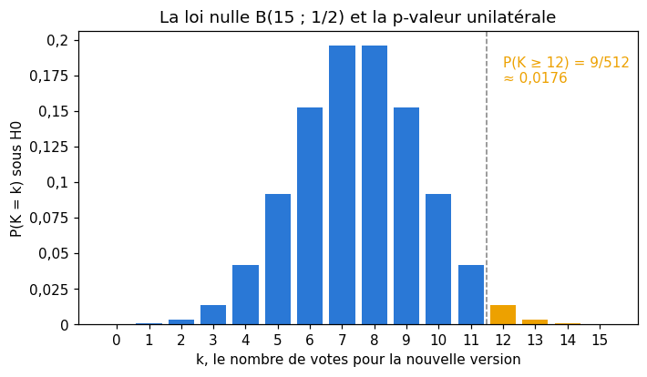
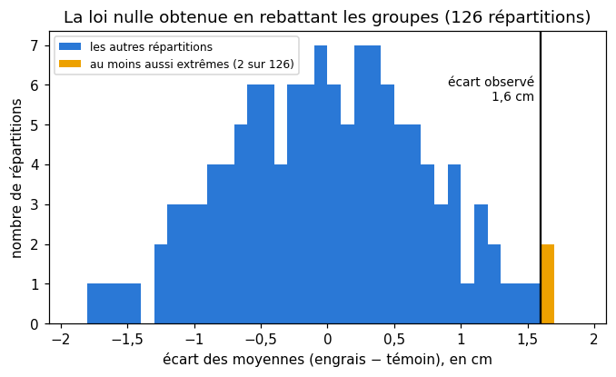
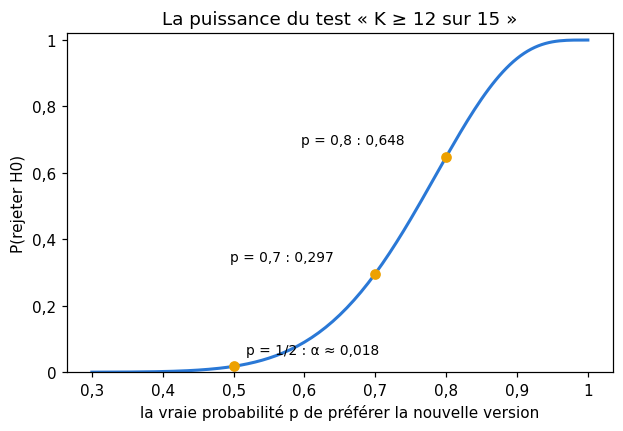
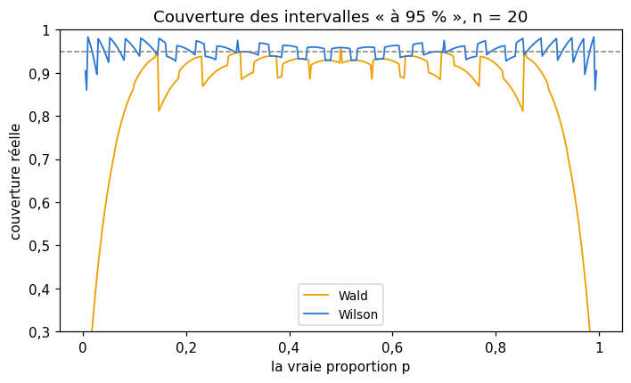
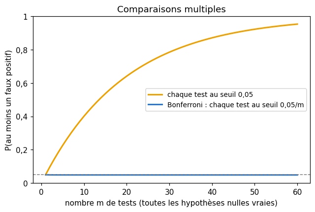

# M08 · Tests statistiques — fiche de cours

> En M02c, tu as estimé une moyenne et chiffré son incertitude. Une autre question revient sans cesse en machine learning : un écart observé est-il **réel**, ou le hasard suffit-il à l'expliquer ? Le nouveau réglage est plus rapide sur dix fichiers sur douze, le modèle B fait un point de mieux que le modèle A, une feature semble liée à la cible : est-ce une découverte, ou une coïncidence ? Un **test statistique** répond par un raisonnement précis : supposer que rien ne se passe (l'**hypothèse nulle**), calculer ce que le hasard produirait alors, et regarder si l'observation est surprenante. Ce chapitre construit ce raisonnement, la **p-valeur** qui le résume, deux tests exacts (le test **binomial** et le test **par permutation**), les deux façons de se tromper et la **puissance**, les **intervalles** d'une proportion et d'une différence appariée, le piège des **comparaisons multiples**, et, pour finir, le choix entre plusieurs modèles (**AIC**, **BIC**, **facteur de Bayes**).

| | |
|---|---|
| **Sections** | §1 à §7 |
| **Temps total estimé** | ≈ 12,1 h : lecture et calculs de la fiche ≈ 2 h 30, exercices ≈ 8 h 50, flashcards ≈ 45 min (parcours essentiel ≈ 7,6 h) |
| **Prérequis** | R8 (dénombrement, coefficients binomiaux) ; M02b (loi binomiale, loi normale, $\Phi$ et ses quantiles) ; M02c (erreur type, intervalle de confiance, bootstrap, loi de Student en aperçu) ; M04 (vraisemblance, formule de Bayes, évidence) ; R6 (logarithmes) ; R3 (second degré) |
| **Fichiers du chapitre** | `02_exercices.md` (quiz, papier) · `03_notebook.ipynb` · `04_indices.md` · `05_solutions.md` et `05_solutions.ipynb` · `06_mes_reponses.md` · `flashcards.csv` |
| **mymath** | `testing.py` : `binomial_test`, `permutation_test`, `proportion_ci`, `paired_difference_ci`, `bonferroni`, `aic_bic` |
| **MML** | §8.6 (voir le guide de lecture ci-dessous) |

## Comment utiliser ce chapitre

**Ordre conseillé.**
1. `python tools/start_chapter.py M08` (sur Colab : `00_setup/COLAB.md` §2) : il copie le notebook, ta feuille de réponses et le squelette `mymath/testing.py`.
2. Section par section : lis **crayon en main**, refais chaque calcul ; puis fais les exercices de la section, quiz 🧠 d'abord.
3. Les exercices ✏️ et 🔗 se font sur papier, dans ta copie de `06_mes_reponses.md`, puis se vérifient dans la **partie 0** du notebook. Les démonstrations ∂ se rédigent dans ta copie et se jugent avec la grille de relecture de `05_solutions.md`.

**Un réflexe pour tout le chapitre** : avant tout calcul, écris en une phrase l'hypothèse nulle, puis ce que serait un résultat « au moins aussi extrême » que celui observé. La moitié des erreurs sur les tests viennent d'une hypothèse mal posée ou d'un sens mal choisi, pas du calcul.

| Section | Quiz 🧠 | Papier et réflexion | Notebook |
|---|---|---|---|
| §1 Le raisonnement d'un test | Q1 | M08.1 ✏️, M08.10 ∂, M08.15 🗣️, M08.E1 💼 | M08.21 🔮, M08.23 🎨, M08.25 🛠️ |
| §2 Le test binomial | Q2, R1 🔁 | M08.1 ✏️ | M08.16 🔨, M08.20 📦 |
| §3 Le test par permutation | Q3 | M08.2 ✏️, M08.13 🔗 | M08.17 🔨, M08.20 📦, M08.23 🎨, M08.24 🐛 |
| §4 Erreurs, puissance, taille d'échantillon | Q4 | M08.3 ✏️, M08.4 ✏️, M08.10 ∂, M08.E1 💼 | M08.21 🔮, M08.22 🔬 |
| §5 Intervalles | R2 🔁 | M08.5 ✏️, M08.6 ✏️, M08.12 ∂ | M08.18 🔨, M08.20 📦 |
| §6 Comparaisons multiples | Q5 | M08.7 ✏️, M08.11 ∂ | M08.19 🔨, M08.24 🐛, M08.26 🏆 |
| §7 Choisir un modèle | Q6, R3 🔁 | M08.8 ✏️, M08.9 ✏️, M08.14 📖 | M08.19 🔨 |

Parcours essentiel : tout sauf M08.Q2, M08.Q6, M08.R3, M08.4, M08.9, M08.10, M08.12 à M08.14, M08.E1, M08.19, M08.20 et M08.22 à M08.26. Le calcul de taille d'échantillon (fin du §4), la démonstration de l'intervalle de Wilson et le facteur de Bayes (§7) se lisent en survol.

## Guide de lecture de MML

*Mathematics for Machine Learning* (MML) ne traite pas les tests statistiques : les §1 à §6 de la fiche sont le cours, et la ressource libre de référence est *OpenIntro Statistics* (chapitres sur l'inférence, `annexes/ressources.md`). Le livre revient en revanche au **choix d'un modèle** à la fin de son chapitre 8, *When Models Meet Data* :
- après le **§7** de la fiche : le **§8.6**, *Model Selection*, en entier. Il présente la validation croisée imbriquée (§8.6.1), le choix bayésien d'un modèle (§8.6.2) et le facteur de Bayes (§8.6.3). Questions : M08.14 ;
- tu peux **survoler** les passages qui supposent des lois continues sur des paramètres (des intégrales sur $\boldsymbol{\theta}$) : la fiche en fait un cas simple, à un paramètre, au §7.

Le livre raisonne d'abord en bayésien : il compare des modèles par la probabilité qu'ils donnaient aux données. La fiche part des critères qui pénalisent le nombre de paramètres, puis arrive au facteur de Bayes ; c'est la même question, posée dans deux langages.

📐 **Notations.** La fiche écrit $\ln L$ la log-vraisemblance maximale d'un modèle (M04), $k$ son nombre de paramètres et $n$ le nombre d'observations, comme `aic_bic`. MML écrit $N$ pour le nombre d'observations, $M$ ou $M_i$ pour un modèle, $p(\mathcal{D} \mid M_i)$ pour l'évidence (la vraisemblance marginale), et il range ses critères à l'échelle de la log-vraisemblance (le plus grand est le meilleur), alors que la fiche, comme la plupart des logiciels, les multiplie par $-2$ (le plus petit est le meilleur) : les classements sont les mêmes.

Vocabulaire anglais de ce chapitre : *hypothesis test*, *null hypothesis*, *alternative hypothesis*, *test statistic*, *null distribution*, *p-value*, *significance level*, *statistically significant*, *one-sided*, *two-sided*, *exact test*, *binomial test*, *permutation test*, *exchangeable*, *type I error*, *type II error*, *false positive*, *false negative*, *power*, *sample size*, *effect size*, *confidence interval*, *coverage*, *Wald interval*, *Wilson score interval*, *paired data*, *Student's t-distribution*, *degrees of freedom*, *multiple comparisons*, *family-wise error rate*, *Bonferroni correction*, *union bound*, *model selection*, *information criterion*, *Occam's razor*, *nested cross-validation*, *model evidence*, *marginal likelihood*, *Bayes factor*, *prior odds*, *posterior odds*.

## Objectifs d'apprentissage

À la fin du chapitre, tu sais :
- **poser** une hypothèse nulle et une alternative, **choisir** une statistique et **interpréter** une p-valeur sans contresens ;
- **calculer** à la main la p-valeur exacte d'un test binomial et d'un petit test par permutation ;
- **calculer** les erreurs de type I et II et la puissance d'un test, et **dimensionner** un échantillon ;
- **calculer** un intervalle de Wald et de Wilson pour une proportion, et un intervalle de Student pour des mesures appariées ;
- **corriger** des comparaisons multiples par Bonferroni, et **démontrer** sa garantie ;
- **comparer** des modèles par l'AIC, le BIC et un facteur de Bayes.

## L'essentiel en 10 lignes

1. Un **test** part d'une **hypothèse nulle** $H_0$ (« pas d'effet ») et d'une **alternative** $H_1$, choisit une **statistique** $T$ et calcule sa loi **si $H_0$ est vraie** (la loi nulle).
2. La **p-valeur** est la probabilité, sous $H_0$, d'observer une statistique **au moins aussi extrême** que celle observée. Petite, elle rend $H_0$ peu crédible ; elle n'est **pas** la probabilité que $H_0$ soit vraie.
3. **Test binomial** : $k$ succès sur $n$ essais, $K \sim \mathcal{B}(n, p_0)$ sous $H_0$ ; p-valeur unilatérale $P(K \ge k)$, bilatérale = somme des issues au plus aussi probables que celle observée.
4. **Test par permutation** : sous $H_0$ (« même loi »), les deux groupes sont interchangeables ; on rebat la répartition des valeurs et l'on compte les répartitions au moins aussi extrêmes ; p-valeur $\frac{C + 1}{B + 1}$ avec $B$ permutations tirées au hasard.
5. **Type I** : rejeter $H_0$ à tort (probabilité $\alpha$, le seuil). **Type II** : ne pas la rejeter alors qu'elle est fausse (probabilité $\beta$). **Puissance** $= 1 - \beta$ ; elle grandit avec l'effet et avec $n$.
6. Taille d'échantillon (moyenne, $\sigma$ connu, test unilatéral) : $n \ge \big(\frac{(z_{1-\alpha} + z_{1-\beta})\,\sigma}{\delta}\big)^2$.
7. **Wald** : $\hat{p} \pm z\sqrt{\hat{p}(1 - \hat{p})/n}$, faux quand il y a peu de succès ; **Wilson** l'améliore en inversant un test. **Mesures appariées** : on travaille sur les différences, $\bar{d} \pm t\,\frac{s_d}{\sqrt{n}}$ (Student).
8. Avec $m$ tests au seuil $\alpha$, la probabilité d'au moins un faux positif peut atteindre $1 - (1 - \alpha)^m$ ; **Bonferroni** teste chacun au seuil $\frac{\alpha}{m}$ et garantit $\le \alpha$, sans hypothèse d'indépendance.
9. **AIC** $= 2k - 2\ln L$, **BIC** $= k \ln n - 2\ln L$ : le plus petit gagne ; le BIC pénalise plus les paramètres dès $n \ge 8$. Le **facteur de Bayes** est le rapport des évidences de deux modèles.
10. Une validation croisée est une **estimation bruitée** : comparer deux modèles demande les mêmes folds, plusieurs graines, et un test apparié.

---

## §1 · Le raisonnement d'un test : hypothèses, statistique, p-valeur

### Un exemple

Une équipe propose une nouvelle formulation des messages d'erreur d'un logiciel. Quinze testeurs lisent les deux versions et disent laquelle ils préfèrent : **12 sur 15** choisissent la nouvelle. Est-ce la preuve qu'elle est meilleure, ou le hasard pourrait-il produire ce score ? Si les testeurs n'avaient en réalité **aucune préférence**, chacun choisirait à pile ou face, et l'on attendrait 7 ou 8 votes pour la nouvelle version, pas 12. Mais 12 n'est pas impossible à pile ou face. Tout est là : **à quel point** 12 serait-il surprenant si personne ne préférait rien ?

### Les quatre ingrédients

1. L'**hypothèse nulle** $H_0$ (*null hypothesis*) dit qu'il ne se passe rien : ici, « chaque testeur choisit la nouvelle version avec la probabilité $p = \frac{1}{2}$ ». Elle doit être assez précise pour qu'on puisse **calculer** sous elle.
2. L'**hypothèse alternative** $H_1$ (*alternative hypothesis*) dit ce qu'on cherche : « $p > \frac{1}{2}$ » (la nouvelle version est préférée) ou « $p \ne \frac{1}{2}$ » (une préférence, dans un sens ou dans l'autre).
3. La **statistique de test** $T$ (*test statistic*) résume les données en un nombre qui mesure l'écart à $H_0$ : ici, le nombre $K$ de votes pour la nouvelle version.
4. La **loi nulle** (*null distribution*) est la loi de $T$ si $H_0$ est vraie : ici, $K \sim \mathcal{B}(15, \frac{1}{2})$ (M02b), puisque les 15 testeurs votent indépendamment, à pile ou face.

### La p-valeur

> **p-valeur** (*p-value*) : la probabilité, **calculée sous $H_0$**, d'obtenir une statistique **au moins aussi extrême** que celle observée, dans le sens que prévoit $H_1$.

Pour $H_1 : p > \frac{1}{2}$, « au moins aussi extrême » veut dire « au moins 12 votes » :

$$P(K \ge 12) = \frac{\binom{15}{12} + \binom{15}{13} + \binom{15}{14} + \binom{15}{15}}{2^{15}} = \frac{455 + 105 + 15 + 1}{32\,768} = \frac{576}{32\,768} = \frac{9}{512} \approx 0{,}0176.$$

Si les testeurs n'avaient aucune préférence, un score de 12 ou plus n'arriverait qu'environ **une fois sur 57**. Deux lectures sont alors possibles : ou bien un événement rare s'est produit, ou bien $H_0$ est fausse. Le test ne tranche pas avec certitude ; il dit **combien** l'observation serait surprenante sous $H_0$.

### Décider : le seuil $\alpha$

Pour décider, on fixe **avant** de regarder les données un **seuil** (*significance level*) $\alpha$, souvent 0,05 : si la p-valeur est au plus $\alpha$, on **rejette** $H_0$, et l'on dit que le résultat est **statistiquement significatif** au seuil $\alpha$ ; sinon, on **ne rejette pas** $H_0$. Ici, $0{,}0176 \le 0{,}05$ : on rejette l'absence de préférence au seuil de 5 %, mais pas au seuil de 1 %.

« Ne pas rejeter » n'est pas « accepter » : une p-valeur de 0,3 dit que les données sont compatibles avec $H_0$, pas que $H_0$ est vraie. Avec trois testeurs, aucune préférence, même massive, ne serait significative : on n'aurait simplement pas assez de données pour conclure (§4).

### Ce qu'une p-valeur n'est pas

C'est la notion la plus mal comprise de toute la statistique. Une p-valeur de 0,0176 :
- n'est **pas** la probabilité que $H_0$ soit vraie : elle se calcule **en supposant** $H_0$ vraie, elle ne peut donc pas en mesurer la probabilité (une telle probabilité demande un a priori, M04, et un autre calcul : §7) ;
- n'est **pas** la probabilité que le résultat soit dû au hasard, pour la même raison ;
- ne mesure **pas** la taille de l'effet : avec 15 000 testeurs, une préférence de 51 % contre 49 % donnerait une p-valeur minuscule pour un effet sans intérêt. Un résultat peut être **statistiquement** significatif sans être **pratiquement** important ;
- n'est **pas** une propriété du phénomène seul : elle dépend du nombre de données, de la statistique choisie et du sens de l'alternative.

Elle est seulement ceci : un nombre entre 0 et 1, d'autant plus petit que les données seraient surprenantes si $H_0$ était vraie. Une propriété la rend utile : si $H_0$ est vraie et que la statistique est continue, la p-valeur suit la **loi uniforme** sur $[0, 1]$ (M08.10 le démontre). Rejeter quand $p \le \alpha$ se trompe alors exactement avec la probabilité $\alpha$.

⚠️ **Erreur classique.** Choisir $H_1$ ou le seuil **après** avoir vu les données (« le résultat va dans ce sens, je fais donc un test unilatéral dans ce sens »). La p-valeur suppose un protocole fixé à l'avance ; le changer après coup la rend trop optimiste.

## §2 · Un test exact : le test binomial

### Unilatéral ou bilatéral

Le **test binomial** (*binomial test*) s'applique dès qu'on compte des succès dans $n$ essais indépendants, de même probabilité $p$, et qu'on teste $H_0 : p = p_0$. Sous $H_0$, $K \sim \mathcal{B}(n, p_0)$, et l'on sait calculer $P(K = j) = \binom{n}{j} p_0^j (1 - p_0)^{n - j}$ pour chaque $j$. Avec $k$ succès observés :
- **unilatéral à droite** ($H_1 : p > p_0$) : $P(K \ge k)$ ;
- **unilatéral à gauche** ($H_1 : p < p_0$) : $P(K \le k)$ ;
- **bilatéral** (*two-sided*, $H_1 : p \ne p_0$) : la somme des $P(K = j)$ sur toutes les issues $j$ **au plus aussi probables** que l'issue observée, $P(K = j) \le P(K = k)$.

La définition bilatérale dit « au moins aussi extrême » par « au moins aussi improbable ». Pour les testeurs, la loi $\mathcal{B}(15, \frac{1}{2})$ est symétrique : les issues au plus aussi probables que 12 sont 0, 1, 2, 3 et 12 à 15, et la p-valeur bilatérale vaut $2 \times \frac{9}{512} = \frac{9}{256} \approx 0{,}0352$. Une loi symétrique donne toujours le double de la p-valeur unilatérale ; une loi dissymétrique, non.

**Exemple dissymétrique.** Une machine produit 10 % de pièces défectueuses quand elle est bien réglée. Sur 20 pièces, on en trouve 5 défectueuses : $H_0 : p = 0{,}1$, $K \sim \mathcal{B}(20 ;\ 0{,}1)$, $P(K = 5) \approx 0{,}0319$. À droite, $P(K \ge 5) \approx 0{,}0432$. À gauche de la moyenne 2, aucune issue n'est aussi improbable que 5 ($P(K = 0) \approx 0{,}1216$) : la p-valeur bilatérale vaut aussi 0,0432. Doubler la p-valeur unilatérale aurait donné 0,0863, trop pessimiste.

⚠️ **Erreur classique.** Doubler la p-valeur unilatérale d'une loi dissymétrique. C'est juste pour $p_0 = \frac{1}{2}$ (et pour la loi normale), pas en général.

### Quand $n$ est grand : l'approximation normale

Pour $n$ grand, $K$ suit à peu près $\mathcal{N}\big(np_0,\ np_0(1 - p_0)\big)$ (théorème central limite, M02c), et l'on peut standardiser :

$$z = \frac{k - np_0}{\sqrt{np_0(1 - p_0)}}, \qquad \text{p-valeur unilatérale} \approx 1 - \Phi(z).$$

Avec 12 votes sur 15 : $z = \frac{12 - 7{,}5}{\sqrt{3{,}75}} \approx 2{,}32$, d'où $1 - \Phi(2{,}32) \approx 0{,}010$, assez loin de la valeur exacte 0,0176 : à $n = 15$, l'approximation est grossière. Le test exact ne coûte qu'une somme de $n + 1$ termes : sur ordinateur, on le préfère toujours.

💻 **Aujourd'hui en pratique** — `scipy.stats.binomtest(k, n, p, alternative=...)` calcule la p-valeur exacte, avec la même définition bilatérale (à une tolérance relative de $10^{-7}$ près, pour les arrondis), et `.proportion_ci()` un intervalle (§5). Ta fonction `binomial_test` (M08.16) refait ce calcul.

## §3 · Le test par permutation

### L'idée : sous $H_0$, les groupes sont interchangeables

Deux groupes de mesures : 5 plants qui ont reçu un engrais, de hauteurs 14,2 ; 15,1 ; 13,8 ; 16,0 ; 15,4 cm, et 4 plants témoins, de hauteurs 13,1 ; 12,6 ; 14,0 ; 13,5 cm. La statistique naturelle est l'écart des moyennes,

$$t = \bar{x}_{\text{engrais}} - \bar{x}_{\text{témoin}} = 14{,}9 - 13{,}3 = 1{,}6 \text{ cm}.$$

L'hypothèse nulle est cette fois : « l'engrais ne change rien, les 9 hauteurs viennent de la même loi ». Si elle est vraie, le groupe d'un plant, « engrais » ou « témoin », ne dit rien de sa hauteur : n'importe quelle répartition des 9 valeurs en un groupe de 5 et un groupe de 4 était **aussi probable** que celle qu'on observe (les valeurs sont **échangeables**, *exchangeable*). On obtient la loi nulle de $t$ sans aucune hypothèse de loi normale : on **rebat** la répartition des valeurs entre les deux groupes.

### Le test exact

Il y a $\binom{9}{5} = 126$ façons de choisir les 5 plants « engrais » parmi 9. Pour chacune, on calcule l'écart des moyennes : ces 126 valeurs, équiprobables sous $H_0$, forment la loi nulle exacte. On compte celles qui sont au moins aussi extrêmes que l'observée : 2 répartitions ont un écart d'au moins 1,6 cm (l'observée, et une autre), d'où la p-valeur unilatérale $\frac{2}{126} = \frac{1}{63} \approx 0{,}016$ ; en valeur absolue, 4 répartitions, d'où la p-valeur bilatérale $\frac{4}{126} \approx 0{,}032$.

Avec de petits groupes, la plus petite p-valeur possible est $\frac{1}{\binom{n}{n_1}}$ : avec 3 et 3 valeurs, $\binom{6}{3} = 20$ répartitions seulement, et aucun test bilatéral ne peut descendre sous $\frac{2}{20} = 0{,}1$. M08.2 le vérifie à la main.

### Le test par tirage au hasard

Dès que les groupes grandissent, le nombre de répartitions explose ($\binom{40}{20} \approx 1{,}4 \times 10^{11}$). On en tire alors $B$ **au hasard** (par exemple $B = 9\,999$), on compte le nombre $C$ de tirages au moins aussi extrêmes que l'observation, et l'on prend

$$p = \frac{C + 1}{B + 1}.$$

Le « +1 » compte la répartition observée parmi les répartitions possibles : il garantit $p \ge \frac{1}{B + 1}$, jamais 0, et il rend le test exactement valide (sous $H_0$, $P(p \le \alpha) \le \alpha$). Annoncer une p-valeur nulle serait faux : on a seulement montré qu'elle est petite devant $\frac{1}{B}$. Ta fonction `permutation_test` (M08.17) applique cette règle, avec un générateur aléatoire graine en main, pour que le résultat soit reproductible.

**Le sens.** Unilatéral : on compte les $t_{\text{perm}} \ge t$ (ou $\le t$) ; bilatéral : les $|t_{\text{perm}}| \ge |t|$.

**Ce que le test suppose.** L'échangeabilité sous $H_0$ : des unités indépendantes, réparties au hasard entre les groupes. Il ne suppose ni loi normale, ni grands échantillons ; c'est pourquoi il est si utile en machine learning, où les scores n'ont pas de loi connue.

**Mesures appariées.** Quand chaque unité est mesurée **deux fois** (un même serveur avant et après une mise à jour), on ne mélange pas les unités : on échange, dans chaque paire, les deux mesures (ce qui change le signe de leur différence). WorkbookIA 8 se sert de cette version pour comparer deux modèles sur les mêmes exemples.

### L'importance d'une feature par permutation

La même idée sert à mesurer l'importance d'une feature dans un modèle **déjà entraîné** : on **mélange** la colonne de cette feature dans un jeu de validation, ce qui casse son lien avec la cible sans changer sa loi, et l'on regarde de combien le score baisse. Une feature dont le mélange ne change rien n'est pas utilisée ; une feature dont le mélange fait chuter le score compte beaucoup. M08.13 le fait à la main sur un petit tableau ; workbookIA s'en servira avec les forêts aléatoires (ch. 14).

🔗 **Dans workbookIA** — le chapitre 8 compare deux modèles notés sur le même jeu de test par un test par permutation sur leurs désaccords, et complète la p-valeur par un bootstrap apparié.

## §4 · Erreurs de type I et II, puissance, taille d'échantillon

### Deux façons de se tromper

| | $H_0$ vraie | $H_0$ fausse |
|---|---|---|
| **on rejette $H_0$** | erreur de **type I** (*type I error*), un **faux positif** ; probabilité $\alpha$ | bonne décision ; probabilité $1 - \beta$, la **puissance** |
| **on ne rejette pas** | bonne décision ; probabilité $1 - \alpha$ | erreur de **type II** (*type II error*), un **faux négatif** ; probabilité $\beta$ |

Le seuil $\alpha$ contrôle le risque de type I : c'est la probabilité de rejeter $H_0$ quand elle est vraie. La **puissance** (*power*) est la probabilité de rejeter $H_0$ quand elle est fausse, c'est-à-dire de **détecter** un effet qui existe. Elle dépend de l'effet réel : il faut dire « la puissance contre telle alternative ».

**Exemple.** Reprenons les 15 testeurs, avec la règle « rejeter $H_0 : p = \frac{1}{2}$ si $K \ge 12$ ». Son risque de type I vaut $P(K \ge 12 \mid p = \frac{1}{2}) = \frac{9}{512} \approx 0{,}018$. Si en réalité 80 % des gens préfèrent la nouvelle version, la puissance vaut $P(K \ge 12 \mid p = 0{,}8) \approx 0{,}648$, et $\beta \approx 0{,}352$ : un tiers des fois, l'étude passerait à côté d'une préférence pourtant forte. Contre $p = 0{,}7$, la puissance tombe à 0,297.

### Le compromis

Abaisser $\alpha$ (rejeter seulement si $K \ge 13$) diminue les faux positifs, mais augmente les faux négatifs : à $n$ fixé, on ne peut pas diminuer les deux à la fois. Pour gagner sur les deux tableaux, il faut **plus de données**. Avec une loi discrète comme la binomiale, on ne choisit d'ailleurs pas $\alpha$ librement : les seuils possibles sont $P(K \ge 11)$, $P(K \ge 12)$… et l'on prend le plus grand qui reste sous le niveau voulu (M08.3).

### La taille d'échantillon

Pour une moyenne : on mesure $n$ valeurs d'écart-type $\sigma$ connu, et l'on veut détecter une **baisse** $\delta$ de la moyenne avec un test unilatéral au seuil $\alpha$ et une puissance $1 - \beta$. La moyenne $\bar{X}$ a l'écart-type $\frac{\sigma}{\sqrt{n}}$. On rejette quand $\bar{X}$ descend sous $\mu_0 - z_{1-\alpha}\frac{\sigma}{\sqrt{n}}$, où $z_q$ est le quantile d'ordre $q$ de $\mathcal{N}(0, 1)$ (M02b : $z_{0{,}95} \approx 1{,}645$, $z_{0{,}975} \approx 1{,}960$, $z_{0{,}80} \approx 0{,}842$). Si la vraie moyenne est $\mu_0 - \delta$, la puissance vaut

$$1 - \beta = \Phi\Big(\frac{\delta\sqrt{n}}{\sigma} - z_{1-\alpha}\Big),$$

et elle atteint $1 - \beta$ dès que

$$n \ge \Big(\frac{(z_{1-\alpha} + z_{1-\beta})\,\sigma}{\delta}\Big)^2.$$

**Exemple.** $\sigma = 10$, $\delta = 3$, $\alpha = 0{,}05$, puissance 80 % : $n \ge \big(\frac{(1{,}645 + 0{,}842) \times 10}{3}\big)^2 \approx 68{,}7$, donc **69** mesures. Pour un test bilatéral, $z_{1-\alpha}$ devient $z_{1-\alpha/2}$. Deux leçons : la taille croît comme $\frac{1}{\delta^2}$ (un effet deux fois plus petit demande quatre fois plus de données) ; et une étude trop petite a peu de chances de trouver ce qu'elle cherche, même si l'effet existe.

⚠️ **Erreur classique.** Conclure « pas d'effet » d'un test non significatif sur un petit échantillon. Avec une puissance de 30 %, ne pas rejeter est le résultat le plus probable, même si l'effet existe. Avant une expérience, on calcule la puissance ; après, on regarde un intervalle (§5).

## §5 · Intervalles : une proportion, une différence appariée

### Le lien entre tests et intervalles

Un intervalle de confiance à 95 % (M02c) est l'ensemble des valeurs du paramètre que le test bilatéral correspondant **ne rejetterait pas** au seuil de 5 %. Les deux outils disent la même chose, mais l'intervalle en dit plus : il donne l'ordre de grandeur de l'effet, pas seulement « significatif ou non ». Un intervalle qui contient 0 (pour une différence) correspond à un test non significatif.

### Une proportion : Wald, et ses défauts

L'intervalle de M02c, appelé **intervalle de Wald** (*Wald interval*), est

$$\hat{p} \pm z\sqrt{\frac{\hat{p}(1 - \hat{p})}{n}}, \qquad \hat{p} = \frac{k}{n},$$

avec $z = 1{,}96$ à 95 %. Il repose sur l'approximation normale de $\hat{p}$, qui devient mauvaise quand $\hat{p}$ est proche de 0 ou de 1, ou quand $n$ est petit. **Exemple** : 2 erreurs sur $n = 25$ prédictions, $\hat{p} = 0{,}08$ : $0{,}08 \pm 1{,}96 \times 0{,}0543$, soit $[-0{,}026 ;\ 0{,}186]$. La borne basse est négative, absurde pour une proportion ; on la ramène à 0, mais le défaut est plus profond : avec 0 erreur, l'intervalle se réduit à $[0, 0]$, comme si l'on était sûr que le taux d'erreur est nul. Et sa **couverture** réelle (la proportion d'intervalles qui contiennent la vraie valeur) tombe souvent bien au-dessous de 95 %.

### L'intervalle de Wilson

L'**intervalle de Wilson** (*Wilson score interval*, E. B. Wilson, 1927) part du test plutôt que de l'estimation : il garde toutes les valeurs $p_0$ que le test « $|\hat{p} - p_0| \le z\sqrt{p_0(1 - p_0)/n}$ » accepte, avec l'erreur type **calculée sous $p_0$**, pas sous $\hat{p}$. Résoudre cette inéquation du second degré en $p_0$ (M08.12) donne

$$\frac{\hat{p} + \frac{z^2}{2n} \pm z\sqrt{\frac{\hat{p}(1 - \hat{p})}{n} + \frac{z^2}{4n^2}}}{1 + \frac{z^2}{n}}.$$

Son centre est tiré vers $\frac{1}{2}$, ses bornes restent dans $[0, 1]$, et il ne se réduit jamais à un point. **Exemple** (2 erreurs sur 25) : $\frac{z^2}{n} \approx 0{,}154$, le centre vaut $\frac{0{,}08 + 0{,}077}{1{,}154} \approx 0{,}136$, et l'intervalle $[0{,}022 ;\ 0{,}250]$. Sa couverture est proche de 95 % même pour de petits $n$.

**L'intervalle d'une accuracy.** Une accuracy mesurée sur $n$ exemples de test est une proportion de succès : son intervalle se calcule exactement comme ci-dessus. Pour un modèle qui fait très peu d'erreurs, Wilson est le bon réflexe.

### Une différence appariée : l'intervalle de Student

Quand chaque unité est mesurée **deux fois** (avant et après, avec et sans), les deux mesures d'une même unité se ressemblent : une grande part de leur variabilité vient de l'unité elle-même. On travaille alors sur les **différences** $d_i = a_i - b_i$ : la variabilité commune disparaît.

**Exemple.** L'autonomie de 5 téléphones est mesurée avant et après une mise à jour du micrologiciel ; les gains, en heures, sont $d = (0{,}6 ;\ 1{,}1 ;\ 0{,}2 ;\ 0{,}9 ;\ 0{,}7)$. Leur moyenne vaut $\bar{d} = 0{,}7$, leur écart-type (avec $\mathrm{ddof} = 1$, M02c) $s_d \approx 0{,}339$, et l'erreur type $\frac{s_d}{\sqrt{5}} \approx 0{,}152$.

Avec si peu de valeurs, remplacer $\sigma$ par $s_d$ rend la loi normale trop optimiste (M02c) : on utilise la **loi de Student** (*Student's t-distribution*) à $n - 1$ **degrés de liberté** (*degrees of freedom*), plus étalée. Si les différences suivent à peu près une loi normale,

$$\bar{d} \pm t_{n-1}\,\frac{s_d}{\sqrt{n}}$$

est un intervalle de confiance pour la différence moyenne, où $t_{n-1}$ est le quantile d'ordre $\frac{1 + \text{niveau}}{2}$ de la loi de Student. Ici, $t_4 \approx 2{,}776$ à 95 %, et l'intervalle vaut $0{,}7 \pm 0{,}421$, soit $[0{,}279 ;\ 1{,}121]$ heure : il ne contient pas 0, la mise à jour allonge l'autonomie.

Quelques quantiles de la loi de Student (pour un intervalle bilatéral à 95 %, ordre 0,975) :

| degrés de liberté | 1 | 2 | 3 | 4 | 5 | 6 | 7 | 8 | 9 | 10 | 15 | 20 | 30 | $\infty$ |
|---|---|---|---|---|---|---|---|---|---|---|---|---|---|---|
| $t$ | 12,706 | 4,303 | 3,182 | 2,776 | 2,571 | 2,447 | 2,365 | 2,306 | 2,262 | 2,228 | 2,131 | 2,086 | 2,042 | 1,960 |

Plus il y a de degrés de liberté, plus le quantile se rapproche de 1,96. Dans le notebook, `scipy.stats.t.ppf(0.975, n - 1)` le donne pour n'importe quel $n$.

⚠️ **Erreur classique.** Traiter des mesures appariées comme deux groupes indépendants : on garde dans l'erreur type la variabilité entre unités, qui n'a rien à voir avec l'effet, et l'intervalle devient beaucoup trop large (M08.6 le chiffre).

## §6 · Comparaisons multiples : Bonferroni

### Le problème

Un test au seuil de 5 % se trompe une fois sur 20 quand $H_0$ est vraie. Si l'on fait **beaucoup** de tests, certains seront significatifs par hasard. Avec $m$ tests indépendants dont toutes les hypothèses nulles sont vraies, la probabilité d'au moins un faux positif vaut

$$1 - (1 - \alpha)^m.$$

Pour $m = 10$ et $\alpha = 0{,}05$ : $1 - 0{,}95^{10} \approx 0{,}40$. Tester dix features sans lien avec la cible donne quatre fois sur dix au moins une « découverte ». C'est le mécanisme de bien des résultats qui ne se reproduisent pas.

### La correction de Bonferroni

La probabilité d'au moins une erreur parmi une **famille** de tests s'appelle le **risque d'erreur de la famille** (*family-wise error rate*, FWER). La **correction de Bonferroni** teste chacune des $m$ hypothèses au seuil $\frac{\alpha}{m}$. Elle garantit un FWER d'au plus $\alpha$, **quelle que soit la dépendance entre les tests**, grâce à l'**inégalité de Boole** (*union bound*) :

$$P(A_1 \cup \cdots \cup A_m) \le P(A_1) + \cdots + P(A_m).$$

Si $A_i$ est l'événement « le test $i$ rejette à tort », chaque $P(A_i)$ est au plus $\frac{\alpha}{m}$, et la somme au plus $\alpha$ (M08.11 le démontre). Avec $m = 10$, chaque test au seuil 0,005 : la probabilité d'au moins un faux positif, pour des tests indépendants, devient $1 - 0{,}995^{10} \approx 0{,}049$.

On présente souvent la correction sous forme de **p-valeurs ajustées** $\min(1, m\,p_i)$, à comparer directement à $\alpha$ : c'est ce que rend `bonferroni` (M08.19).

**Le prix.** Bonferroni est prudente : en abaissant le seuil, elle diminue la puissance de chaque test. D'autres corrections (Holm, ou le contrôle de la proportion de fausses découvertes de Benjamini et Hochberg) perdent moins de puissance ; elles sont hors programme ici.

⚠️ **Erreur classique.** Diviser la p-valeur par $m$ au lieu de la multiplier (ou multiplier le seuil au lieu de le diviser) : la correction rend alors les tests plus laxistes au lieu de plus stricts.

💼 **En entreprise** — « On a testé 40 variantes de la page d'accueil, et l'une fait 6 % de clics en plus, significatif ! » Avec 40 tests au seuil de 5 %, on attend deux faux positifs. Avant d'y croire, on corrige, ou l'on **confirme** le résultat sur de nouvelles données.

## §7 · Choisir un modèle : AIC, BIC, facteur de Bayes, validation croisée

### Le dilemme

Un modèle avec plus de paramètres colle toujours mieux à ses données d'entraînement : sa vraisemblance maximale ne peut que monter. Mais il risque de coller au bruit et de moins bien prédire. Pour comparer des modèles de tailles différentes, il faut **pénaliser** la complexité : c'est le **rasoir d'Occam** (*Occam's razor*) en version chiffrée.

### AIC et BIC

Pour un modèle à $k$ paramètres ajustés par maximum de vraisemblance (M04) sur $n$ observations, de log-vraisemblance maximale $\ln L$ :

$$\mathrm{AIC} = 2k - 2\ln L, \qquad \mathrm{BIC} = k\ln n - 2\ln L.$$

On préfère le modèle de **plus petit** critère. Les deux ont le même terme d'ajustement, $-2\ln L$ ; ils diffèrent par la pénalité : 2 par paramètre pour l'**AIC** (critère d'Akaike), $\ln n$ pour le **BIC** (critère bayésien). Dès que $\ln n > 2$, c'est-à-dire $n \ge 8$, le BIC pénalise davantage et préfère des modèles plus simples.

**Exemple.** Sur $n = 100$ observations, un modèle à 2 paramètres atteint $\ln L = -230{,}4$, un modèle à 4 paramètres $\ln L = -226{,}9$. AIC : $4 + 460{,}8 = 464{,}8$ contre $8 + 453{,}8 = 461{,}8$, le second gagne. BIC : $2\ln 100 + 460{,}8 \approx 470{,}0$ contre $4\ln 100 + 453{,}8 \approx 472{,}2$, le premier gagne. Les deux critères ne sont pas toujours d'accord : le gain de 3,5 en log-vraisemblance paie les deux paramètres de plus pour l'AIC, pas pour le BIC. Leurs objectifs diffèrent : l'AIC vise la meilleure prédiction, le BIC le « vrai » modèle quand $n$ est grand.

⚠️ **Erreur classique.** Comparer des AIC calculés sur des données différentes, ou avec des logarithmes de bases différentes : seules les différences d'AIC sur les mêmes données ont un sens.

### Le facteur de Bayes

La voie bayésienne (M04) compare deux modèles $M_1$ et $M_2$ par la probabilité que chacun donnait aux données, leur **évidence** (*evidence*, ou *marginal likelihood*, la vraisemblance marginale) $p(\mathcal{D} \mid M_i)$. Leur rapport est le **facteur de Bayes** (*Bayes factor*) :

$$\mathrm{BF}_{12} = \frac{p(\mathcal{D} \mid M_1)}{p(\mathcal{D} \mid M_2)}, \qquad \frac{P(M_1 \mid \mathcal{D})}{P(M_2 \mid \mathcal{D})} = \mathrm{BF}_{12} \times \frac{P(M_1)}{P(M_2)}.$$

En mots : **cote a posteriori = facteur de Bayes × cote a priori** (*posterior odds*, *prior odds*), la formule de Bayes de M04 écrite pour deux hypothèses. Un facteur de 1 ne départage rien ; on parle souvent d'une preuve « substantielle » au-delà de 3, « forte » au-delà de 10 (une échelle indicative, due à H. Jeffreys).

Quand un modèle a un paramètre libre, son évidence est la **moyenne** de la vraisemblance sous l'a priori : un modèle souple répartit sa probabilité sur beaucoup de données possibles, et en donne moins à chacune. **Exemple** : une pièce donne 7 faces en 10 lancers. Le modèle $M_0$ dit « pièce équilibrée » : $p(\mathcal{D} \mid M_0) = \binom{10}{7}\frac{1}{2^{10}} = \frac{120}{1024} \approx 0{,}117$. Le modèle $M_1$ dit « la probabilité de face est inconnue, uniforme sur $[0, 1]$ » : en moyennant $\binom{10}{7}p^7(1 - p)^3$ sur $p$ (une intégrale de la loi Beta, M04), on trouve $\frac{1}{11} \approx 0{,}091$, la même chose pour chacun des 11 résultats possibles. Le facteur de Bayes vaut $\mathrm{BF}_{01} \approx 1{,}29$ : les données favorisent légèrement la pièce équilibrée, alors que $M_1$ contient la valeur $p = 0{,}7$ qui les explique le mieux. Le facteur de Bayes pénalise tout seul la souplesse inutile. Le BIC en est d'ailleurs une approximation pour $n$ grand : $-\frac{1}{2}\mathrm{BIC} \approx \ln p(\mathcal{D} \mid M)$.

📖 **Dans MML** — le §8.6.2 présente ce choix bayésien de modèle comme une inférence à un niveau de plus (une loi sur les modèles, puis sur leurs paramètres), et le §8.6.3 le facteur de Bayes, avec le même lien entre cotes a priori et a posteriori. Le livre insiste sur une difficulté pratique : l'intégrale de l'évidence n'a en général pas de formule, d'où des approximations.

### La validation croisée, une estimation bruitée

En machine learning, on compare le plus souvent des modèles par leur score sur des données qu'ils n'ont pas vues : un jeu de validation, ou une **validation croisée** à $k$ folds (chaque fold sert une fois de validation). Statistiquement, ce score est une **estimation** de la performance future : il a une variabilité, qui vient des exemples tirés et des hasards de l'entraînement (l'initialisation, l'ordre des exemples, la **graine**). Trois conséquences :
- un écart de score entre deux modèles se juge face à cette variabilité, avec les outils de ce chapitre : les **mêmes** exemples ou les mêmes folds pour les deux modèles, et un test **apparié** ;
- quand l'entraînement dépend du hasard, on répète l'évaluation sur **plusieurs graines** et l'on donne la moyenne et l'écart-type des scores (ou un intervalle), plutôt qu'un seul nombre ;
- choisir un réglage parmi beaucoup en regardant leurs scores de validation est une **comparaison multiple** : le meilleur score est flatteur. Pour estimer honnêtement toute la procédure (« choisir, puis entraîner »), on la place dans une boucle extérieure de validation : c'est la **validation croisée imbriquée** (*nested cross-validation*) du §8.6.1 de MML.

🔗 **Dans workbookIA** — le chapitre 8 met tout cela en pratique : jeux d'entraînement, de validation et de test, validation croisée à $k$ folds, incertitude d'un score, comparaison honnête de deux modèles. Ce chapitre t'a donné la p-valeur, les tests et les intervalles qu'il utilise.

---

## Les pièges classiques ⚠️ (récapitulatif)

| Piège | Ce qu'il faut faire |
|---|---|
| Lire la p-valeur comme $P(H_0 \text{ vraie})$ | c'est $P(\text{données au moins aussi extrêmes} \mid H_0)$ |
| « Non significatif, donc pas d'effet » | regarder la puissance et l'intervalle : on n'a peut-être pas assez de données |
| Choisir l'alternative ou le seuil après avoir vu les données | fixer le protocole avant |
| Doubler une p-valeur unilatérale pour une loi dissymétrique | sommer les issues au plus aussi probables que l'observée |
| Annoncer une p-valeur nulle après $B$ permutations | $\frac{C + 1}{B + 1}$, jamais 0 |
| L'intervalle de Wald avec très peu de succès | l'intervalle de Wilson |
| Deux groupes indépendants pour des mesures appariées | travailler sur les différences |
| Beaucoup de tests, chacun au seuil de 5 % | corriger (Bonferroni : seuil $\frac{\alpha}{m}$, p-valeurs $\times m$) |
| Comparer des AIC calculés sur des données différentes | seulement des différences, sur les mêmes données |
| Un seul score de validation, une seule graine | plusieurs graines, les mêmes folds, un test apparié |

## Et maintenant

**Dans ce dépôt** : M09a range les données en matrices et résout des systèmes linéaires ; M09b ajuste une régression par les moindres carrés et y retrouve la vraisemblance et l'AIC ; M11 donnera des inégalités de concentration, qui bornent l'écart entre une moyenne et son espérance sans hypothèse de loi.

**Dans workbookIA** : le chapitre 8 passe à l'entraînement et au test des modèles. Tu y reconnaîtras l'erreur type d'un score et son intervalle (§5), la validation croisée comme estimation bruitée (§7), le test par permutation et la p-valeur pour comparer deux modèles (§1 et §3), et le danger de choisir parmi beaucoup de réglages (§6).

## Pour aller plus loin

- MML §8.6, et MML §8.3 (les estimateurs et leur incertitude) si tu veux le contexte du chapitre 8 du livre.
- *OpenIntro Statistics* : les chapitres sur les fondements de l'inférence (tests, p-valeurs, erreurs, puissance) et sur l'inférence pour des proportions et des données appariées (`annexes/ressources.md`).
- `annexes/symboles.md` (lire $H_0$, $\alpha$, $\beta$, $z_{1-\alpha}$, $\mathrm{BF}_{12}$ à voix haute), `annexes/formulaire.md` et `annexes/erreurs_frequentes.md`.
