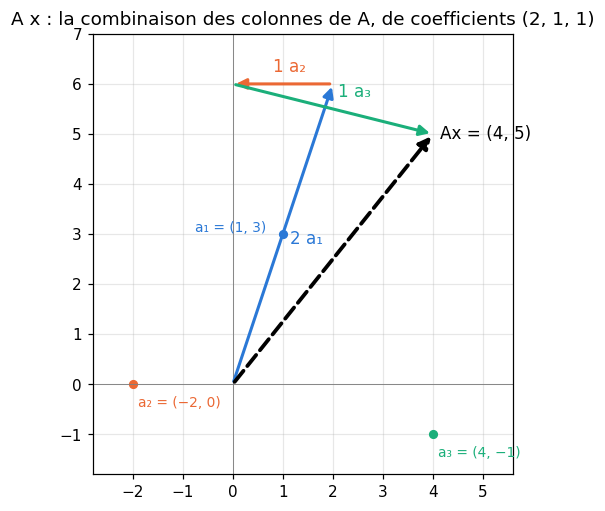
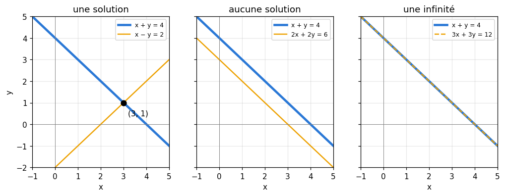
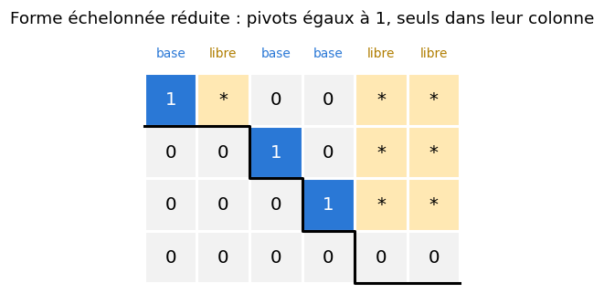

# M09a · Matrices et systèmes linéaires — fiche de cours

> En M07, un exemple était un vecteur. Un dataset entier, les poids d'une couche de réseau ou un système d'équations sont des **matrices** : des tableaux de nombres sur lesquels on calcule ligne par ligne, colonne par colonne, ou d'un seul geste. Ce chapitre apprend à lire une matrice et sa **forme**, à calculer le **produit matrice-vecteur** sous ses deux lectures, le **produit matriciel** et son coût, le **produit de Hadamard**, la **transposée** et la matrice $\mathbf{X}^\top\mathbf{X}$, puis à résoudre un **système linéaire** par le **pivot de Gauss**, à calculer une **inverse** et un premier **rang**. Au passage, une couche de réseau s'écrit $\mathbf{Z} = \mathbf{X}\mathbf{W} + \mathbf{b}$, et un embedding n'est qu'un produit par un vecteur one-hot.

| | |
|---|---|
| **Sections** | §1 à §8 |
| **Temps total estimé** | ≈ 16,7 h : lecture et calculs de la fiche ≈ 3 h 30, exercices ≈ 12 h 20, flashcards ≈ 50 min (parcours essentiel ≈ 10,6 h) |
| **Prérequis** | R2 (systèmes de deux équations, calcul littéral) ; R4 (le symbole $\sum$) ; M07 (vecteurs de $\mathbb{R}^n$, produit scalaire, one-hot, score $\mathbf{w} \cdot \mathbf{x} + b$) ; M02c (moyenne et écart-type d'une colonne) |
| **Fichiers du chapitre** | `02_exercices.md` (quiz, papier) · `03_notebook.ipynb` · `04_indices.md` · `05_solutions.md` et `05_solutions.ipynb` · `06_mes_reponses.md` · `flashcards.csv` |
| **mymath** | `matrices.py` : `matmul`, `transpose`, `rref`, `rank`, `solve`, `inverse` |
| **MML** | §2.1, §2.2, §2.3 (voir le guide de lecture ci-dessous) |

## Comment utiliser ce chapitre

**Ordre conseillé.**
1. `python tools/start_chapter.py M09a` (sur Colab : `00_setup/COLAB.md` §2) : il copie le notebook, ta feuille de réponses et le squelette `mymath/matrices.py`.
2. Section par section : lis **crayon en main**, refais chaque calcul ; puis fais les exercices de la section, quiz 🧠 d'abord.
3. Les exercices ✏️ et 🔗 se font sur papier, dans ta copie de `06_mes_reponses.md`, puis se vérifient dans la **partie 0** du notebook. Les démonstrations ∂ se rédigent dans ta copie et se jugent avec la grille de relecture de `05_solutions.md`.

**Un réflexe pour tout le chapitre** : avant tout calcul, écris la **forme** de chaque matrice, $(n, p)$, et celle du résultat attendu. Une forme fausse se voit en une seconde ; un calcul faux sur une forme fausse coûte une heure.

| Section | Quiz 🧠 | Papier et réflexion | Notebook |
|---|---|---|---|
| §1 Un tableau de données est une matrice | Q1, R3 🔁 | M09a.1 ✏️, M09a.20 🔗, M09a.21 📖 | M09a.30 🔮 |
| §2 Le produit matrice-vecteur | Q2, R2 🔁 | M09a.2 ✏️ | M09a.33 🎨 |
| §3 Le produit matriciel, Hadamard, $\mathbf{Z} = \mathbf{X}\mathbf{W} + \mathbf{b}$ | Q1, Q3, Q4 | M09a.3 à M09a.6 ✏️, M09a.19 🔗, M09a.20 🔗, M09a.23 🧮, M09a.E1 💼 | M09a.25 🔨, M09a.29 📦, M09a.30 🔮, M09a.31 🔬, M09a.34 🐛 |
| §4 La transposée et $\mathbf{X}^\top\mathbf{X}$ | Q5 | M09a.7 ✏️, M09a.15 ∂ | M09a.25 🔨, M09a.35 🛠️ |
| §5 Systèmes linéaires | Q6, R1 🔁 | M09a.8, M09a.9, M09a.14 ✏️, M09a.17 ∂ | M09a.27 🔨 |
| §6 Le pivot de Gauss | Q7 | M09a.8 à M09a.10 ✏️, M09a.22 📖 | M09a.26, M09a.27 🔨, M09a.32 🔬, M09a.34 🐛, M09a.36 🏆 |
| §7 L'inverse | Q8 | M09a.11, M09a.12 ✏️, M09a.16, M09a.18 ∂, M09a.24 🗣️ | M09a.28 🔨, M09a.29 📦 |
| §8 Le rang | Q8 | M09a.13 ✏️, M09a.18 ∂, M09a.22 📖 | M09a.26 🔨, M09a.29 📦 |

Parcours essentiel : tout sauf M09a.Q4, M09a.R3, M09a.4, M09a.6, M09a.10, M09a.12, M09a.14, M09a.16, M09a.18, M09a.20 à M09a.23, M09a.E1, M09a.28 et M09a.31 à M09a.36. Le coût des parenthèses (fin du §3), l'inverse $3 \times 3$ par Gauss-Jordan (§7) et le lien entre rang et solutions (fin du §8) se lisent en survol.

## Guide de lecture de MML

*Mathematics for Machine Learning* (MML) ouvre son chapitre 2, *Linear Algebra*, exactement sur les notions de ce chapitre :
- après le **§3** de la fiche (ou avant le §5) : le **§2.1**, *Systems of Linear Equations* (pourquoi des systèmes, et leur lecture géométrique), puis le **§2.2**, *Matrices* (addition, produit, inverse, transposée, multiplication par un nombre, écriture compacte $\mathbf{A}\mathbf{x} = \mathbf{b}$). Questions : M09a.21 ;
- après le **§6** de la fiche : le **§2.3**, *Solving Systems of Linear Equations* (solution particulière et solution générale, opérations élémentaires, forme échelonnée, une astuce pour lire les solutions, les algorithmes). Questions : M09a.22.

Le livre définit le rang plus loin (§2.6.2), avec les espaces vectoriels (M12a) : le §8 de la fiche n'en est qu'un premier contact, par le nombre de pivots.

📐 **Notations.** Comme MML, la fiche écrit $\mathbf{A} \in \mathbb{R}^{m \times n}$ une matrice de $m$ lignes et $n$ colonnes, $a_{ij}$ l'élément de la ligne $i$ et de la colonne $j$ (indices à partir de 1 ; en Python, à partir de 0 : $a_{23}$ s'écrit `A[1, 2]`), $\mathbf{I}_n$ l'identité, $\mathbf{A}^\top$ la transposée, $\mathbf{A}^{-1}$ l'inverse. MML range les vecteurs en **colonnes** et écrit $\mathbf{y} = \mathbf{A}\mathbf{x}$ ; le code de machine learning range les exemples en **lignes** et écrit $\mathbf{Z} = \mathbf{X}\mathbf{W} + \mathbf{b}$ (§3). La fiche emploie les deux, et dit chaque fois laquelle.

Vocabulaire anglais de ce chapitre : *matrix*, *entry*, *row*, *column*, *shape*, *square matrix*, *diagonal matrix*, *identity matrix*, *zero matrix*, *matrix-vector product*, *matrix product (matrix multiplication)*, *linear combination of the columns*, *Hadamard product (element-wise product)*, *broadcasting*, *transpose*, *symmetric matrix*, *Gram matrix*, *system of linear equations*, *augmented matrix*, *coefficient matrix*, *particular solution*, *general solution*, *elementary row operations*, *Gaussian elimination*, *pivot*, *partial pivoting*, *row echelon form*, *reduced row echelon form*, *back substitution*, *basic variable*, *free variable*, *inverse*, *invertible (regular, nonsingular)*, *singular*, *Gauss-Jordan elimination*, *rank*, *full rank*, *rank deficient*.

## Objectifs d'apprentissage

À la fin du chapitre, tu sais :
- **lire** un tableau de données comme une matrice, et **prévoir** la forme de chaque produit ;
- **calculer** des produits matrice-vecteur et matriciels à la main, sous leurs deux lectures, et en **compter** le coût ;
- **écrire** une couche $\mathbf{Z} = \mathbf{X}\mathbf{W} + \mathbf{b}$ et un embedding comme des produits matriciels ;
- **appliquer** les règles de la transposée, et **démontrer** $(\mathbf{A}\mathbf{B})^\top = \mathbf{B}^\top\mathbf{A}^\top$ ;
- **résoudre** un système par le pivot de Gauss, et **décrire** toutes ses solutions ;
- **calculer** une inverse et un rang, et **relier** le rang au nombre de solutions.

## L'essentiel en 10 lignes

1. Une **matrice** $\mathbf{A} \in \mathbb{R}^{m \times n}$ a $m$ lignes et $n$ colonnes ; un **dataset** est une matrice $(n_{\text{exemples}}, n_{\text{features}})$ : une ligne par exemple, une colonne par feature.
2. **Produit matrice-vecteur** : $(\mathbf{A}\mathbf{x})_i = \sum_j a_{ij}x_j$, le produit scalaire de la ligne $i$ avec $\mathbf{x}$ ; c'est aussi la **combinaison des colonnes** de $\mathbf{A}$ de coefficients $x_1, \ldots, x_n$.
3. **Produit matriciel** : $(n, p) \times (p, m) \to (n, m)$, $(\mathbf{A}\mathbf{B})_{ij} = \sum_k a_{ik}b_{kj}$ ; il coûte $n\,p\,m$ multiplications ; il est **associatif**, mais **pas commutatif**.
4. **Hadamard** $\mathbf{A} \odot \mathbf{B}$ : élément par élément, même forme (`*` en NumPy) ; le produit matriciel est `@`.
5. Une couche dense : $\mathbf{Z} = \mathbf{X}\mathbf{W} + \mathbf{b}$, $\mathbf{X}$ de forme (batch, $n_{\text{in}}$), $\mathbf{W}$ de forme ($n_{\text{in}}$, $n_{\text{out}}$), une colonne de $\mathbf{W}$ par neurone. Un embedding : $\mathbf{e}_k^\top\mathbf{E}$ = la ligne $k$ de $\mathbf{E}$.
6. **Transposée** : $(\mathbf{A}^\top)_{ij} = a_{ji}$ ; $(\mathbf{A}\mathbf{B})^\top = \mathbf{B}^\top\mathbf{A}^\top$ ; $\mathbf{X}^\top\mathbf{X}$ est carrée, symétrique, et contient les produits scalaires des colonnes de $\mathbf{X}$.
7. Un **système linéaire** $\mathbf{A}\mathbf{x} = \mathbf{b}$ a **zéro, une ou une infinité** de solutions, jamais exactement deux.
8. **Pivot de Gauss** : échanger deux lignes, multiplier une ligne par un nombre non nul, ajouter un multiple d'une ligne à une autre ne changent pas les solutions ; on arrive à une forme **échelonnée**, puis à la forme **échelonnée réduite**, unique, où se lisent toutes les solutions.
9. **Inverse** : $\mathbf{A}\mathbf{A}^{-1} = \mathbf{A}^{-1}\mathbf{A} = \mathbf{I}$, pour une matrice carrée de rang plein ; elle se calcule par Gauss-Jordan sur $[\mathbf{A} \mid \mathbf{I}]$ ; pour résoudre un système, on ne l'utilise pas : on fait Gauss.
10. **Rang** = nombre de pivots ; une colonne qui combine les autres le fait baisser ; une matrice carrée est inversible si et seulement si son rang est égal à sa taille.

---

## §1 · Matrices : un tableau de données est une matrice

### Lignes, colonnes, forme

Une **matrice** $\mathbf{A} \in \mathbb{R}^{m \times n}$ est un tableau de $m \times n$ nombres rangés en $m$ **lignes** et $n$ **colonnes** ; sa **forme** (*shape*) est $(m, n)$, dans cet ordre : d'abord les lignes. L'élément $a_{ij}$ est au croisement de la ligne $i$ et de la colonne $j$. Une matrice est **carrée** si $m = n$. Chaque ligne est un vecteur de $\mathbb{R}^n$, chaque colonne un vecteur de $\mathbb{R}^m$.

Un **dataset** est une matrice : une **ligne par exemple** et une **colonne par feature**. Quatre séances d'une application de sport, avec la durée (min), la distance (km) et le dénivelé (m) :

$$\mathbf{X} = \begin{pmatrix} 30 & 6 & 50 \\ 50 & 9 & 120 \\ 20 & 3 & 20 \\ 60 & 10 & 130 \end{pmatrix} \qquad \text{forme } (4, 3), \quad x_{23} = 120.$$

La ligne 2, $(50, 9, 120)$, décrit la deuxième séance ; la colonne 3, $(50, 120, 20, 130)$, décrit le dénivelé de toutes les séances.

### Trois façons d'opérer sur un tableau

- **Par colonne** (*featurewise*) : la moyenne de chaque colonne, $\bar{\mathbf{x}} = (40, 7, 80)$, est le vecteur des moyennes des features ; on la soustrait à chaque ligne pour **centrer** le tableau. On divise ensuite chaque colonne par son écart-type pour **réduire** (M02c) : c'est la **standardisation**.
- **Par ligne** (*samplewise*) : la norme de chaque exemple (M07), ou la normalisation de chaque ligne.
- **Élément par élément** (*elementwise*) : appliquer $\ln$, ou une fonction d'activation, à chaque nombre.

Centré, le tableau devient

$$\mathbf{X} - \bar{\mathbf{x}} = \begin{pmatrix} -10 & -1 & -30 \\ 10 & 2 & 40 \\ -20 & -4 & -60 \\ 20 & 3 & 50 \end{pmatrix} :$$

on retire le **même** vecteur $\bar{\mathbf{x}}$ à chaque ligne. NumPy le fait d'un geste, par **broadcasting** (le vecteur de forme `(3,)` est répété sur les 4 lignes) :

```python
>>> import numpy as np
>>> X = np.array([[30, 6, 50], [50, 9, 120], [20, 3, 20], [60, 10, 130]])
>>> X.shape, X[1, 2], X.mean(axis=0)          # axis=0: down the rows, one value per column
((4, 3), np.int64(120), array([40.,  7., 80.]))
>>> X - X.mean(axis=0)                        # broadcasting: the means are subtracted from every row
```

### Matrices particulières

La matrice **nulle** $\mathbf{0}$ ; une matrice **diagonale** n'a de nombres non nuls que sur sa diagonale ($a_{ij} = 0$ pour $i \ne j$) ; la matrice **identité** $\mathbf{I}_n$ est la matrice diagonale carrée de taille $n$ qui a des 1 sur la diagonale. On additionne deux matrices de même forme élément par élément, et l'on multiplie une matrice par un nombre en multipliant chaque élément.

⚠️ **Erreur classique.** Confondre `axis=0` et `axis=1` : `axis=0` parcourt les **lignes** et rend une valeur par **colonne** (les moyennes des features) ; `axis=1` rend une valeur par **ligne** (une par exemple). Écris la forme attendue du résultat avant de lancer le calcul.

## §2 · Le produit matrice-vecteur : deux lectures

### Par les lignes : des produits scalaires

Le produit d'une matrice $\mathbf{A}$ de forme $(m, n)$ par un vecteur $\mathbf{x}$ de $\mathbb{R}^n$ est le vecteur $\mathbf{A}\mathbf{x}$ de $\mathbb{R}^m$ défini par

$$(\mathbf{A}\mathbf{x})_i = \sum_{j=1}^{n} a_{ij}\,x_j = (\text{ligne } i \text{ de } \mathbf{A}) \cdot \mathbf{x}.$$

Il n'existe que si $\mathbf{A}$ a **autant de colonnes** que $\mathbf{x}$ a de coordonnées. Exemple :

$$\begin{pmatrix} 1 & -2 & 4 \\ 3 & 0 & -1 \end{pmatrix}\begin{pmatrix} 2 \\ 1 \\ 1 \end{pmatrix} = \begin{pmatrix} 2 - 2 + 4 \\ 6 + 0 - 1 \end{pmatrix} = \begin{pmatrix} 4 \\ 5 \end{pmatrix}.$$

Il coûte $m \times n$ multiplications : $n$ par ligne.

### Par les colonnes : une combinaison linéaire

Le même produit se lit autrement : $\mathbf{A}\mathbf{x}$ est la **combinaison des colonnes** de $\mathbf{A}$, avec les coefficients $x_1, \ldots, x_n$,

$$\mathbf{A}\mathbf{x} = x_1\,\mathbf{a}_1 + x_2\,\mathbf{a}_2 + \cdots + x_n\,\mathbf{a}_n \qquad (\mathbf{a}_j \text{ la colonne } j).$$

Ici, $2\begin{pmatrix} 1 \\ 3 \end{pmatrix} + 1\begin{pmatrix} -2 \\ 0 \end{pmatrix} + 1\begin{pmatrix} 4 \\ -1 \end{pmatrix} = \begin{pmatrix} 4 \\ 5 \end{pmatrix}$. Les deux lectures donnent toujours le même résultat : ce sont les mêmes $m \times n$ produits $a_{ij}x_j$, additionnés dans un autre ordre. La seconde est la plus utile pour comprendre : **résoudre $\mathbf{A}\mathbf{x} = \mathbf{b}$, c'est chercher comment fabriquer $\mathbf{b}$ avec les colonnes de $\mathbf{A}$** (§5).



### En machine learning : prédire tout un dataset d'un coup

Un modèle linéaire prédit $\hat{y}_i = \mathbf{w} \cdot \mathbf{x}_i + b$ pour chaque exemple (M07). Avec $\mathbf{X}$ de forme $(n, p)$ et $\mathbf{w}$ de $\mathbb{R}^p$, les $n$ prédictions forment le vecteur

$$\hat{\mathbf{y}} = \mathbf{X}\mathbf{w} + b\,\mathbf{1}, \qquad \text{de forme } (n,) :$$

un produit scalaire par ligne, plus le même biais partout. Une matrice **diagonale** agit plus simplement encore : $\mathbf{D}\mathbf{x}$ multiplie chaque coordonnée de $\mathbf{x}$ par le nombre correspondant de la diagonale, et $\mathbf{I}\mathbf{x} = \mathbf{x}$.

🔗 **Dans workbookIA** — le chapitre 9 écrit les prédictions d'une régression comme $\mathbf{X}\mathbf{w}$, et le chapitre 10 applique un neurone à tout un batch de cette façon.

## §3 · Le produit matriciel, le produit de Hadamard et $\mathbf{Z} = \mathbf{X}\mathbf{W} + \mathbf{b}$

### La règle des formes et la définition

Le produit de $\mathbf{A}$, de forme $(n, p)$, par $\mathbf{B}$, de forme $(p, m)$, est la matrice $\mathbf{A}\mathbf{B}$ de forme $(n, m)$ :

$$(\mathbf{A}\mathbf{B})_{ij} = \sum_{k=1}^{p} a_{ik}\,b_{kj} = (\text{ligne } i \text{ de } \mathbf{A}) \cdot (\text{colonne } j \text{ de } \mathbf{B}).$$

**Règle des formes** : $(n, p) \times (p, m) \to (n, m)$. Les deux dimensions **intérieures** doivent être égales ; il reste les deux extérieures. Exemple, $(2, 2) \times (2, 3) \to (2, 3)$ :

$$\begin{pmatrix} 3 & -1 \\ 1 & 2 \end{pmatrix}\begin{pmatrix} 1 & 0 & 2 \\ -1 & 4 & 1 \end{pmatrix} = \begin{pmatrix} 3 + 1 & 0 - 4 & 6 - 1 \\ 1 - 2 & 0 + 8 & 2 + 2 \end{pmatrix} = \begin{pmatrix} 4 & -4 & 5 \\ -1 & 8 & 4 \end{pmatrix},$$

et le produit dans l'autre ordre, $(2, 3) \times (2, 2)$, n'existe pas.

**Trois autres lectures**, toutes utiles :
- la **colonne $j$** de $\mathbf{A}\mathbf{B}$ est $\mathbf{A}$ fois la colonne $j$ de $\mathbf{B}$ (un produit matrice-vecteur par colonne) ;
- la **ligne $i$** de $\mathbf{A}\mathbf{B}$ est la ligne $i$ de $\mathbf{A}$ fois $\mathbf{B}$ : une combinaison des **lignes** de $\mathbf{B}$ ;
- $\mathbf{A}\mathbf{B}$ est une somme de $p$ matrices de forme $(n, m)$ : $\sum_k (\text{colonne } k \text{ de } \mathbf{A})(\text{ligne } k \text{ de } \mathbf{B})$.

### Les règles de calcul

- **Pas commutatif** : en général $\mathbf{A}\mathbf{B} \ne \mathbf{B}\mathbf{A}$, même quand les deux existent. Avec $\mathbf{C} = \begin{pmatrix} 1 & 3 \\ 0 & 2 \end{pmatrix}$ et $\mathbf{D} = \begin{pmatrix} 2 & 0 \\ 1 & 1 \end{pmatrix}$ : $\mathbf{C}\mathbf{D} = \begin{pmatrix} 5 & 3 \\ 2 & 2 \end{pmatrix}$ mais $\mathbf{D}\mathbf{C} = \begin{pmatrix} 2 & 6 \\ 1 & 5 \end{pmatrix}$.
- **Associatif** : $(\mathbf{A}\mathbf{B})\mathbf{C} = \mathbf{A}(\mathbf{B}\mathbf{C})$ ; **distributif** : $\mathbf{A}(\mathbf{B} + \mathbf{C}) = \mathbf{A}\mathbf{B} + \mathbf{A}\mathbf{C}$ ; $(\lambda\mathbf{A})\mathbf{B} = \lambda(\mathbf{A}\mathbf{B})$.
- **Identité** : $\mathbf{I}_n\mathbf{A} = \mathbf{A}\mathbf{I}_p = \mathbf{A}$ pour $\mathbf{A}$ de forme $(n, p)$ : l'identité doit avoir la bonne taille de chaque côté.
- On **ne simplifie pas** : $\mathbf{A}\mathbf{B} = \mathbf{A}\mathbf{C}$ n'entraîne pas $\mathbf{B} = \mathbf{C}$, et $\mathbf{A}\mathbf{B} = \mathbf{0}$ n'entraîne pas $\mathbf{A} = \mathbf{0}$ ou $\mathbf{B} = \mathbf{0}$ (sauf si $\mathbf{A}$ est inversible, §7).

### Le coût d'un produit, et l'ordre des parenthèses

Chacun des $n \times m$ éléments de $\mathbf{A}\mathbf{B}$ demande $p$ multiplications : **un produit $(n, p) \times (p, m)$ coûte $n\,p\,m$ multiplications** (et presque autant d'additions). Pour deux matrices carrées de taille $n$, c'est $n^3$ : doubler $n$ multiplie le temps par 8.

L'associativité laisse le choix des parenthèses, et le coût en dépend énormément. Avec $\mathbf{A}$ de forme $(10, 1000)$, $\mathbf{B}$ de forme $(1000, 20)$ et $\mathbf{C}$ de forme $(20, 500)$ :
- $(\mathbf{A}\mathbf{B})\mathbf{C}$ : $10 \times 1000 \times 20 + 10 \times 20 \times 500 = 300\,000$ multiplications ;
- $\mathbf{A}(\mathbf{B}\mathbf{C})$ : $1000 \times 20 \times 500 + 10 \times 1000 \times 500 = 15\,000\,000$, cinquante fois plus, pour le même résultat.

La règle : faire d'abord le produit qui donne la plus **petite** matrice intermédiaire.

### Le produit de Hadamard

Le **produit de Hadamard** (*element-wise product*) de deux matrices de **même forme** se fait élément par élément : $(\mathbf{A} \odot \mathbf{B})_{ij} = a_{ij}\,b_{ij}$. Par exemple $\begin{pmatrix} 2 & -1 \\ 0 & 3 \end{pmatrix} \odot \begin{pmatrix} 4 & 5 \\ -2 & 1 \end{pmatrix} = \begin{pmatrix} 8 & -5 \\ 0 & 3 \end{pmatrix}$. Il est commutatif, et sert à appliquer un masque, à pondérer des erreurs exemple par exemple, ou dans les calculs de gradients (M16). En NumPy :

```python
>>> A, B = np.array([[2, -1], [0, 3]]), np.array([[4, 5], [-2, 1]])
>>> A * B                                     # Hadamard: element by element
array([[ 8, -5],
       [ 0,  3]])
>>> A @ B                                     # the matrix product
array([[10,  9],
       [-6,  3]])
```

⚠️ **Erreur classique.** Écrire `A * B` pour un produit matriciel. Avec deux matrices carrées de même taille, NumPy ne proteste pas et rend un tableau de la bonne forme, mais faux ; avec des formes différentes, le **broadcasting** peut même fabriquer un résultat de forme inattendue (M09a.30). Le produit matriciel est `@`.

### Une couche dense : $\mathbf{Z} = \mathbf{X}\mathbf{W} + \mathbf{b}$

Un neurone calcule $z = \mathbf{w} \cdot \mathbf{x} + b$ (M07). Une **couche** de $n_{\text{out}}$ neurones qui reçoit $n_{\text{in}}$ entrées a un vecteur de poids par neurone : rangés en **colonnes**, ils forment la matrice $\mathbf{W}$ de forme $(n_{\text{in}}, n_{\text{out}})$, et les biais forment $\mathbf{b}$ de $\mathbb{R}^{n_{\text{out}}}$. Pour un **batch** de $n$ exemples rangés en lignes dans $\mathbf{X}$, de forme $(n, n_{\text{in}})$,

$$\mathbf{Z} = \mathbf{X}\mathbf{W} + \mathbf{b} \qquad (n, n_{\text{in}}) \times (n_{\text{in}}, n_{\text{out}}) \to (n, n_{\text{out}}),$$

où $\mathbf{b}$ est ajouté à **chaque ligne** (broadcasting) : $z_{ij} = \mathbf{x}_i \cdot \mathbf{w}_j + b_j$ est la sortie du neurone $j$ pour l'exemple $i$. Exemple, trois exemples, deux entrées, deux neurones :

$$\begin{pmatrix} 1 & 2 \\ 0 & -1 \\ 2 & 1 \end{pmatrix}\begin{pmatrix} 1 & -1 \\ 2 & 0 \end{pmatrix} + \begin{pmatrix} 0{,}5 & -1 \end{pmatrix} = \begin{pmatrix} 5 & -1 \\ -2 & 0 \\ 4 & -2 \end{pmatrix} + \begin{pmatrix} 0{,}5 & -1 \end{pmatrix} = \begin{pmatrix} 5{,}5 & -2 \\ -1{,}5 & -1 \\ 4{,}5 & -3 \end{pmatrix}.$$

Une couche est donc **un seul produit matriciel** pour tout le batch : c'est ce que les GPU savent faire très vite (des milliers de multiplications indépendantes à la fois). Un réseau à deux couches enchaîne deux produits, avec une fonction d'activation appliquée élément par élément entre les deux (M09a.19).

📐 **Convention des poids.** La fiche, comme `mylearn` (workbookIA), range $\mathbf{W}$ en forme $(n_{\text{in}}, n_{\text{out}})$ et calcule $\mathbf{X}\mathbf{W}$. PyTorch range les poids de `nn.Linear` en forme $(n_{\text{out}}, n_{\text{in}})$ et calcule $\mathbf{X}\mathbf{W}^\top + \mathbf{b}$ ; les manuels de maths, qui rangent un exemple en colonne, écrivent $\mathbf{W}\mathbf{x} + \mathbf{b}$. Les trois décrivent la même couche : vérifie toujours les formes.

### Un embedding est un produit par un vecteur one-hot

Une catégorie parmi $V$ se code par un vecteur one-hot $\mathbf{e}_k$ (M07). Une **table d'embedding** $\mathbf{E}$, de forme $(V, d)$, range un vecteur de $\mathbb{R}^d$ par catégorie. Le produit de la ligne one-hot $\mathbf{e}_k^\top$, de forme $(1, V)$, par $\mathbf{E}$ **sélectionne la ligne $k$** de $\mathbf{E}$ : tous les termes de la somme sont nuls sauf un. Pour $V = 4$ couleurs et $d = 2$,

$$\begin{pmatrix} 0 & 0 & 1 & 0 \end{pmatrix}\begin{pmatrix} 0{,}2 & -1 \\ 1{,}5 & 0{,}3 \\ -0{,}7 & 0{,}8 \\ 0 & 2{,}1 \end{pmatrix} = \begin{pmatrix} -0{,}7 & 0{,}8 \end{pmatrix}.$$

En pratique, on ne fait pas le produit (il coûterait $V \times d$ multiplications, presque toutes par 0) : on lit directement la ligne, `E[k]`. Mais l'écriture en produit dit que l'embedding est une couche dense sans biais, appliquée à des entrées one-hot.

🔗 **Dans workbookIA** — le chapitre 10 écrit un neurone appliqué à tout un batch, puis rassemble les poids nommés d'un petit réseau dans des matrices ; les chapitres de la partie IV enchaînent les couches $\mathbf{Z} = \mathbf{X}\mathbf{W} + \mathbf{b}$.

## §4 · La transposée et la matrice $\mathbf{X}^\top\mathbf{X}$

### Définition et règles

La **transposée** $\mathbf{A}^\top$ de $\mathbf{A}$, de forme $(m, n)$, est la matrice de forme $(n, m)$ obtenue en échangeant les lignes et les colonnes : $(\mathbf{A}^\top)_{ij} = a_{ji}$. La ligne $i$ de $\mathbf{A}$ devient la colonne $i$ de $\mathbf{A}^\top$. Ses règles :

$$(\mathbf{A}^\top)^\top = \mathbf{A}, \qquad (\mathbf{A} + \mathbf{B})^\top = \mathbf{A}^\top + \mathbf{B}^\top, \qquad (\lambda\mathbf{A})^\top = \lambda\mathbf{A}^\top, \qquad (\mathbf{A}\mathbf{B})^\top = \mathbf{B}^\top\mathbf{A}^\top.$$

La dernière **inverse l'ordre** (M09a.15 la démontre). Les formes le disent déjà : si $\mathbf{A}$ est $(n, p)$ et $\mathbf{B}$ est $(p, m)$, $(\mathbf{A}\mathbf{B})^\top$ est $(m, n)$, et seul $\mathbf{B}^\top\mathbf{A}^\top$, $(m, p) \times (p, n)$, a cette forme. Avec les matrices de l'exemple du §3, $\big(\mathbf{A}\mathbf{B}\big)^\top = \begin{pmatrix} 3 & -2 \\ -4 & 12 \\ 3 & 5 \end{pmatrix} = \mathbf{B}^\top\mathbf{A}^\top$.

**Vecteurs lignes et colonnes.** En écrivant un vecteur comme une colonne, de forme $(n, 1)$, le produit scalaire devient un produit matriciel : $\mathbf{u} \cdot \mathbf{v} = \mathbf{u}^\top\mathbf{v}$, de forme $(1, n) \times (n, 1) \to (1, 1)$ (c'est la notation de MML). Dans l'autre ordre, $\mathbf{u}\mathbf{v}^\top$ est une matrice $(n, n)$, le **produit extérieur**.

Une matrice carrée est **symétrique** si $\mathbf{A}^\top = \mathbf{A}$ : $a_{ij} = a_{ji}$ pour tous $i, j$.

### La matrice $\mathbf{X}^\top\mathbf{X}$

Pour un dataset $\mathbf{X}$ de forme $(n, p)$, la matrice $\mathbf{X}^\top\mathbf{X}$ a la forme $(p, p)$ : une ligne et une colonne par **feature**. Son élément $(j, k)$ est

$$(\mathbf{X}^\top\mathbf{X})_{jk} = \sum_{i=1}^{n} x_{ij}\,x_{ik} = (\text{colonne } j) \cdot (\text{colonne } k) :$$

le **produit scalaire de deux colonnes**. Elle est symétrique ($(\mathbf{X}^\top\mathbf{X})^\top = \mathbf{X}^\top(\mathbf{X}^\top)^\top = \mathbf{X}^\top\mathbf{X}$), et sa diagonale contient les sommes des carrés de chaque colonne. Exemple :

$$\mathbf{X} = \begin{pmatrix} 1 & 2 \\ 3 & -1 \\ 0 & 4 \end{pmatrix}, \qquad \mathbf{X}^\top\mathbf{X} = \begin{pmatrix} 1 + 9 + 0 & 2 - 3 + 0 \\ 2 - 3 + 0 & 4 + 1 + 16 \end{pmatrix} = \begin{pmatrix} 10 & -1 \\ -1 & 21 \end{pmatrix}.$$

Pour des colonnes **centrées**, $\frac{1}{n}\mathbf{X}^\top\mathbf{X}$ est la matrice des covariances des features (M12) : sa diagonale contient leurs variances. Et $\mathbf{X}\mathbf{X}^\top$, de forme $(n, n)$, contient les produits scalaires des **exemples** deux à deux. Cette matrice $\mathbf{X}^\top\mathbf{X}$ est au cœur de la régression linéaire par les moindres carrés (M09b).

⚠️ **Erreur classique.** Écrire $(\mathbf{A}\mathbf{B})^\top = \mathbf{A}^\top\mathbf{B}^\top$ : les formes ne collent même pas, sauf pour des matrices carrées, où le résultat est faux en général.

## §5 · Systèmes linéaires : zéro, une ou une infinité de solutions

### Écrire un système comme $\mathbf{A}\mathbf{x} = \mathbf{b}$

Un **système linéaire** de $m$ équations à $n$ inconnues $x_1, \ldots, x_n$ s'écrit $\mathbf{A}\mathbf{x} = \mathbf{b}$, avec $\mathbf{A}$ de forme $(m, n)$ la **matrice des coefficients**, $\mathbf{x}$ le vecteur des inconnues et $\mathbf{b}$ le second membre. La ligne $i$ de $\mathbf{A}\mathbf{x} = \mathbf{b}$ est l'équation $i$ ; par la lecture en colonnes (§2), résoudre le système, c'est chercher **les coefficients qui fabriquent $\mathbf{b}$ avec les colonnes de $\mathbf{A}$**. On range souvent $\mathbf{A}$ et $\mathbf{b}$ côte à côte dans la **matrice augmentée** $[\mathbf{A} \mid \mathbf{b}]$, de forme $(m, n + 1)$.

### Trois cas, et seulement trois

Avec deux inconnues, chaque équation est une droite du plan (R2), et les solutions sont les points communs :
- $x + y = 4$ et $x - y = 2$ : les droites se coupent en un point, **une solution**, $(3, 1)$ ;
- $x + y = 4$ et $2x + 2y = 6$ : les droites sont parallèles, **aucune solution** (la seconde dit $x + y = 3$) ;
- $x + y = 4$ et $3x + 3y = 12$ : c'est deux fois la même droite, **une infinité de solutions**, $(4 - t, t)$ pour tout réel $t$.



Il en va de même en toute dimension : **un système linéaire a zéro, une ou une infinité de solutions**. Jamais deux : si $\mathbf{x}$ et $\mathbf{y}$ sont deux solutions distinctes, tous les points $\mathbf{x} + t(\mathbf{y} - \mathbf{x})$ en sont aussi (M09a.17). Quand il y en a une infinité, on les décrit par une **solution générale** : une solution particulière, plus des combinaisons de vecteurs qui résolvent le système **homogène** $\mathbf{A}\mathbf{x} = \mathbf{0}$, avec des **paramètres** libres. Le système homogène a toujours au moins la solution $\mathbf{0}$.

Un système qui a **plus d'équations que d'inconnues** (beaucoup d'exemples, peu de paramètres : le cas de la régression) n'a en général **aucune** solution exacte ; on cherche alors la meilleure approximation, au sens des moindres carrés (M09b). Un système qui a **moins d'équations que d'inconnues** n'a jamais une solution unique : il en a une infinité, ou aucune.

## §6 · Le pivot de Gauss et la forme échelonnée réduite

### Les opérations qui ne changent pas les solutions

Trois **opérations élémentaires** sur les lignes de la matrice augmentée ne changent pas l'ensemble des solutions :
1. **échanger** deux lignes ;
2. **multiplier** une ligne par un nombre **non nul** ;
3. **ajouter** à une ligne un multiple d'**une autre** ligne.

Chacune se défait par une opération du même type (échanger à nouveau, multiplier par l'inverse, retrancher le même multiple) : toute solution de l'ancien système est solution du nouveau, et réciproquement. Multiplier une ligne par 0, en revanche, efface une équation.

### Descendre l'escalier, puis remonter

Le **pivot de Gauss** (*Gaussian elimination*) fait apparaître des zéros sous la diagonale, colonne par colonne : dans la colonne courante, on choisit une ligne dont l'élément est non nul, le **pivot**, et l'on retranche des multiples de cette ligne aux lignes du dessous pour annuler leurs éléments. On arrive à une **forme échelonnée** (*row echelon form*) : chaque ligne commence par plus de zéros que la précédente, en escalier ; on résout alors de bas en haut (**remontée**, *back substitution*). Exemple :

$$\left\{\begin{array}{rcl} x + 2y + z &=& 3 \\ 2x - y + 3z &=& 14 \\ 3x + y - z &=& 2 \end{array}\right. \qquad \left(\begin{array}{ccc|c} 1 & 2 & 1 & 3 \\ 2 & -1 & 3 & 14 \\ 3 & 1 & -1 & 2 \end{array}\right).$$

$L_2 \leftarrow L_2 - 2L_1$ et $L_3 \leftarrow L_3 - 3L_1$ donnent $(0, -5, 1 \mid 8)$ et $(0, -5, -4 \mid -7)$ ; puis $L_3 \leftarrow L_3 - L_2$ donne $(0, 0, -5 \mid -15)$. La dernière ligne dit $-5z = -15$, donc $z = 3$ ; la deuxième, $-5y + 3 = 8$, donc $y = -1$ ; la première, $x - 2 + 3 = 3$, donc $x = 2$. Vérifie toujours dans les équations de départ : $2 - 2 + 3 = 3$, $4 + 1 + 9 = 14$, $6 - 1 - 3 = 2$.

### La forme échelonnée réduite

En continuant, on divise chaque ligne par son pivot (les pivots valent 1), puis on annule aussi les éléments **au-dessus** de chaque pivot (**Gauss-Jordan**). On obtient la **forme échelonnée réduite** (*reduced row echelon form*) : chaque pivot vaut 1 et c'est le seul nombre non nul de sa colonne. Pour l'exemple, $\left(\begin{array}{ccc|c} 1 & 0 & 0 & 2 \\ 0 & 1 & 0 & -1 \\ 0 & 0 & 1 & 3 \end{array}\right)$ : la solution se lit directement. Contrairement aux formes échelonnées, qui dépendent des choix de pivots, **la forme échelonnée réduite est unique** : c'est pourquoi `mymath` la calcule (`rref`), et pourquoi elle se teste contre SymPy.

**Lire toutes les solutions.** Les colonnes qui portent un pivot correspondent aux **variables de base** ; les autres aux **variables libres**, qui deviennent des paramètres. Exemple : $x + 2y + z = 4$ et $2x + 4y + 3z = 11$ ont pour forme réduite $\left(\begin{array}{ccc|c} 1 & 2 & 0 & 1 \\ 0 & 0 & 1 & 3 \end{array}\right)$ ; les pivots sont dans les colonnes de $x$ et de $z$, $y$ est libre : $y = t$, $x = 1 - 2t$, $z = 3$, pour tout réel $t$. Et une ligne de la forme $(0 \;\; 0 \;\; \cdots \;\; 0 \mid c)$ avec $c \ne 0$ dit $0 = c$ : **aucune solution**. En résumé, sur la forme réduite de $[\mathbf{A} \mid \mathbf{b}]$ :
- une ligne $(0 \cdots 0 \mid c \ne 0)$ : aucune solution ;
- sinon, un pivot dans chaque colonne de $\mathbf{A}$ : une solution unique ;
- sinon : une infinité de solutions, avec un paramètre par variable libre.



### Le pivot partiel

À la main, on choisit des pivots commodes. Un ordinateur calcule avec des arrondis (R1), et un pivot **minuscule** les amplifie : diviser par $10^{-17}$ multiplie les erreurs par $10^{17}$. D'où le **pivot partiel** (*partial pivoting*) : dans chaque colonne, on prend pour pivot la ligne dont l'élément a la **plus grande valeur absolue**, quitte à échanger deux lignes. C'est ce que font `rref` et `solve` dans `mymath`, et ce que montre M09a.32. Le pivot de Gauss coûte environ $\frac{2}{3}n^3$ opérations pour un système $n \times n$.

⚠️ **Erreur classique.** Faire une opération qui n'est pas élémentaire : remplacer **deux** lignes à la fois en se servant de chacune pour l'autre ($L_1 \leftarrow L_1 - L_2$ et $L_2 \leftarrow L_2 - L_1$ en même temps), ou multiplier une ligne par 0. On peut perdre des équations, et gagner de fausses solutions.

## §7 · L'inverse d'une matrice

### Définition

Une matrice carrée $\mathbf{A}$ de taille $n$ est **inversible** s'il existe une matrice $\mathbf{A}^{-1}$ telle que

$$\mathbf{A}\mathbf{A}^{-1} = \mathbf{A}^{-1}\mathbf{A} = \mathbf{I}_n.$$

Cette inverse est **unique** (M09a.16). Une matrice qui n'a pas d'inverse est dite **singulière**. Si $\mathbf{A}$ est inversible, le système $\mathbf{A}\mathbf{x} = \mathbf{b}$ a une solution unique pour **tout** $\mathbf{b}$ : $\mathbf{x} = \mathbf{A}^{-1}\mathbf{b}$. Une matrice diagonale est inversible si aucun nombre de sa diagonale n'est nul, et son inverse est la matrice diagonale des inverses.

**Règles** : $(\mathbf{A}^{-1})^{-1} = \mathbf{A}$, $(\lambda\mathbf{A})^{-1} = \frac{1}{\lambda}\mathbf{A}^{-1}$ pour $\lambda \ne 0$, $(\mathbf{A}^\top)^{-1} = (\mathbf{A}^{-1})^\top$, et, comme pour la transposée, l'ordre s'inverse : $(\mathbf{A}\mathbf{B})^{-1} = \mathbf{B}^{-1}\mathbf{A}^{-1}$ (M09a.16).

### Le cas $2 \times 2$

$$\begin{pmatrix} a & b \\ c & d \end{pmatrix}^{-1} = \frac{1}{ad - bc}\begin{pmatrix} d & -b \\ -c & a \end{pmatrix}, \qquad \text{à condition que } ad - bc \ne 0.$$

Le nombre $ad - bc$ est le **déterminant** (M12c) ; s'il est nul, la matrice est singulière (ses deux colonnes sont proportionnelles). Exemple : $\begin{pmatrix} 4 & 3 \\ 2 & 2 \end{pmatrix}$ a pour déterminant $8 - 6 = 2$, et pour inverse $\frac{1}{2}\begin{pmatrix} 2 & -3 \\ -2 & 4 \end{pmatrix} = \begin{pmatrix} 1 & -1{,}5 \\ -1 & 2 \end{pmatrix}$. Vérification : $\begin{pmatrix} 4 & 3 \\ 2 & 2 \end{pmatrix}\begin{pmatrix} 1 & -1{,}5 \\ -1 & 2 \end{pmatrix} = \begin{pmatrix} 4 - 3 & -6 + 6 \\ 2 - 2 & -3 + 4 \end{pmatrix} = \mathbf{I}_2$.

### Gauss-Jordan sur $[\mathbf{A} \mid \mathbf{I}]$

En taille quelconque, on met côte à côte $\mathbf{A}$ et $\mathbf{I}_n$, et l'on réduit $[\mathbf{A} \mid \mathbf{I}_n]$ par Gauss-Jordan. Si la partie gauche devient $\mathbf{I}_n$, la partie droite est $\mathbf{A}^{-1}$ : on a résolu d'un coup les $n$ systèmes $\mathbf{A}\mathbf{x} = \mathbf{e}_j$, dont les solutions sont les colonnes de $\mathbf{A}^{-1}$. Sinon, une ligne de zéros apparaît à gauche, et $\mathbf{A}$ est singulière. Exemple :

$$\left(\begin{array}{ccc|ccc} 1 & 0 & 2 & 1 & 0 & 0 \\ 0 & 1 & 0 & 0 & 1 & 0 \\ 1 & 0 & 3 & 0 & 0 & 1 \end{array}\right) \xrightarrow{L_3 \leftarrow L_3 - L_1} \left(\begin{array}{ccc|ccc} 1 & 0 & 2 & 1 & 0 & 0 \\ 0 & 1 & 0 & 0 & 1 & 0 \\ 0 & 0 & 1 & -1 & 0 & 1 \end{array}\right) \xrightarrow{L_1 \leftarrow L_1 - 2L_3} \left(\begin{array}{ccc|ccc} 1 & 0 & 0 & 3 & 0 & -2 \\ 0 & 1 & 0 & 0 & 1 & 0 \\ 0 & 0 & 1 & -1 & 0 & 1 \end{array}\right).$$

### Pourquoi on ne calcule pas l'inverse pour résoudre un système

$\mathbf{x} = \mathbf{A}^{-1}\mathbf{b}$ est une formule, pas une méthode. Calculer $\mathbf{A}^{-1}$ coûte environ trois fois plus que résoudre le système par Gauss (on résout $n$ systèmes au lieu d'un), et accumule davantage d'arrondis. En pratique, on écrit `np.linalg.solve(A, b)`, jamais `np.linalg.inv(A) @ b` ; l'inverse sert à raisonner et à écrire des formules (M09a.24).

⚠️ **Erreur classique.** Parler de l'inverse d'une matrice non carrée, ou « diviser » par une matrice. $\mathbf{A}\mathbf{X} = \mathbf{B}$ donne $\mathbf{X} = \mathbf{A}^{-1}\mathbf{B}$ (en multipliant **à gauche**), et non $\mathbf{B}\mathbf{A}^{-1}$ : le produit n'est pas commutatif.

## §8 · Le rang : premier contact

### Le nombre de pivots

Le **rang** d'une matrice $\mathbf{A}$, noté $\operatorname{rg}(\mathbf{A})$ (*rank*), est le nombre de pivots de sa forme échelonnée réduite. Il est au plus égal au nombre de lignes et au nombre de colonnes : $\operatorname{rg}(\mathbf{A}) \le \min(m, n)$. On dit que $\mathbf{A}$ est **de rang plein** quand il y a égalité.

Le rang compte les colonnes vraiment **indépendantes** : une colonne qui est une combinaison des autres n'ajoute pas de pivot. Exemple : dans

$$\mathbf{M} = \begin{pmatrix} 1 & 2 & 3 \\ 0 & 1 & 1 \\ 2 & 1 & 3 \end{pmatrix},$$

la troisième colonne est la somme des deux premières ; la forme réduite est $\begin{pmatrix} 1 & 0 & 1 \\ 0 & 1 & 1 \\ 0 & 0 & 0 \end{pmatrix}$, avec deux pivots : $\operatorname{rg}(\mathbf{M}) = 2$. La dernière colonne de la forme réduite, $(1, 1, 0)$, donne même la recette : colonne 3 = 1 × colonne 1 + 1 × colonne 2. Le rang est aussi le nombre de lignes indépendantes (MML §2.6.2, M12a).

### Rang, inverse et solutions

Pour une matrice **carrée** de taille $n$, les affirmations suivantes sont équivalentes : $\mathbf{A}$ est inversible ; $\operatorname{rg}(\mathbf{A}) = n$ ; la forme réduite de $\mathbf{A}$ est $\mathbf{I}_n$ ; $\mathbf{A}\mathbf{x} = \mathbf{b}$ a une solution unique pour tout $\mathbf{b}$ ; aucune colonne n'est combinaison des autres (M09a.18 démontre un sens). Pour un système quelconque à $n$ inconnues, la forme réduite du §6 se lit avec le rang :
- si $\operatorname{rg}([\mathbf{A} \mid \mathbf{b}]) > \operatorname{rg}(\mathbf{A})$ (un pivot dans la colonne de $\mathbf{b}$), aucune solution ;
- sinon, une solution unique si $\operatorname{rg}(\mathbf{A}) = n$, et une infinité si $\operatorname{rg}(\mathbf{A}) < n$, avec $n - \operatorname{rg}(\mathbf{A})$ paramètres libres.

### En machine learning : des features redondantes

Si une feature d'un dataset est une combinaison des autres (la même mesure en deux unités, une somme de colonnes, ou des colonnes one-hot de **toutes** les catégories à côté d'une colonne de 1 pour le biais), $\mathbf{X}$ n'est pas de rang plein, et la matrice $\mathbf{X}^\top\mathbf{X}$ du §4 est **singulière**. Par exemple, avec une colonne de 1 et le one-hot de deux catégories,

$$\mathbf{X} = \begin{pmatrix} 1 & 1 & 0 \\ 1 & 0 & 1 \\ 1 & 1 & 0 \\ 1 & 0 & 1 \end{pmatrix}, \qquad \mathbf{X}^\top\mathbf{X} = \begin{pmatrix} 4 & 2 & 2 \\ 2 & 2 & 0 \\ 2 & 0 & 2 \end{pmatrix}, \qquad \operatorname{rg}(\mathbf{X}^\top\mathbf{X}) = 2 :$$

la première colonne est la somme des deux autres. Les systèmes construits avec $\mathbf{X}^\top\mathbf{X}$ n'ont alors pas de solution unique ; M09b et workbookIA 9 y reviennent avec la régularisation.

🔗 **Dans workbookIA** — le chapitre 9 ajuste des modèles linéaires en résolvant des systèmes construits avec $\mathbf{X}^\top\mathbf{X}$, par `np.linalg.solve` plutôt que par une inverse ; ce chapitre t'en a donné le vocabulaire (forme, transposée, système, inverse, rang).

---

## Les pièges classiques ⚠️ (récapitulatif)

| Piège | Ce qu'il faut faire |
|---|---|
| Multiplier sans regarder les formes | écrire $(n, p) \times (p, m) \to (n, m)$ avant de calculer |
| `A * B` pour un produit matriciel | `A @ B` ; `*` est le produit de Hadamard (élément par élément) |
| `axis=0` et `axis=1` confondus | `axis=0` : une valeur par colonne ; `axis=1` : une valeur par ligne |
| $\mathbf{A}\mathbf{B} = \mathbf{B}\mathbf{A}$, ou simplifier $\mathbf{A}\mathbf{B} = \mathbf{A}\mathbf{C}$ | le produit n'est pas commutatif, et on ne simplifie que par une matrice inversible |
| $(\mathbf{A}\mathbf{B})^\top = \mathbf{A}^\top\mathbf{B}^\top$, ou $(\mathbf{A}\mathbf{B})^{-1} = \mathbf{A}^{-1}\mathbf{B}^{-1}$ | l'ordre s'inverse : $\mathbf{B}^\top\mathbf{A}^\top$, $\mathbf{B}^{-1}\mathbf{A}^{-1}$ |
| Les poids d'une couche dans le mauvais sens | $\mathbf{W}$ de forme $(n_{\text{in}}, n_{\text{out}})$ pour $\mathbf{X}\mathbf{W}$ ; PyTorch range $(n_{\text{out}}, n_{\text{in}})$ et calcule $\mathbf{X}\mathbf{W}^\top$ |
| Une opération sur les lignes qui n'est pas élémentaire | une seule ligne modifiée à la fois, avec une **autre** ligne ; jamais multiplier par 0 |
| Un pivot minuscule | le pivot partiel : la plus grande valeur absolue de la colonne |
| Croire qu'un système peut avoir exactement deux solutions | zéro, une ou une infinité |
| `np.linalg.inv(A) @ b` pour résoudre | `np.linalg.solve(A, b)` |
| Inverser une matrice dont une colonne combine les autres | elle est singulière : vérifier le rang |

## Et maintenant

**Dans ce dépôt** : M09b utilise les produits, la transposée et $\mathbf{X}^\top\mathbf{X}$ pour la régression linéaire par les moindres carrés ; M10 étudie la convexité et le perceptron ; M12a reprend le rang avec les espaces vectoriels, les bases et les applications linéaires ; M12c définit le déterminant en toute taille.

**Dans workbookIA** : le chapitre 9 passe à l'overfitting et à la régularisation, avec des régressions écrites en produits matriciels ; le chapitre 10 construit des neurones et rassemble leurs poids dans des matrices. Tu y reconnaîtras les formes (§1 et §3), les prédictions $\mathbf{X}\mathbf{w}$ (§2), la couche $\mathbf{Z} = \mathbf{X}\mathbf{W} + \mathbf{b}$ et la convention des poids (§3), la transposée et $\mathbf{X}^\top\mathbf{X}$ (§4), et la résolution d'un système par `np.linalg.solve` (§6 et §7).

## Pour aller plus loin

- MML §2.1 à §2.3, et les exercices du chapitre 2 du livre qui portent sur les produits de matrices, l'inverse et la résolution de systèmes (conseillés) ; plus tard, §2.4 à §2.8 (espaces vectoriels, indépendance, rang, applications linéaires : M12a).
- 3Blue1Brown, *Essence of linear algebra* : une matrice vue comme une transformation du plan, le produit comme la composition de deux transformations, l'inverse comme la transformation qui défait (en anglais, sous-titres disponibles) ; c'est l'idée de M09a.33.
- `annexes/symboles.md` (lire $\mathbf{A}^\top$, $\mathbf{A}^{-1}$, $\mathbf{I}_n$, $\odot$ et $\operatorname{rg}$ à voix haute), `annexes/formulaire.md` et `annexes/erreurs_frequentes.md`.
