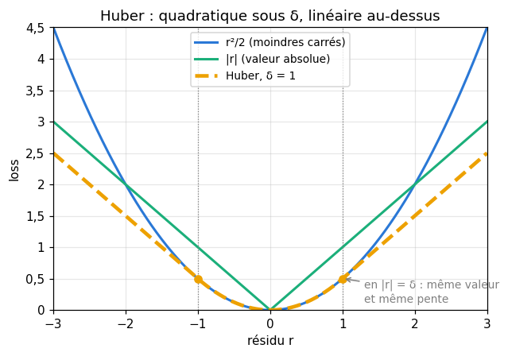
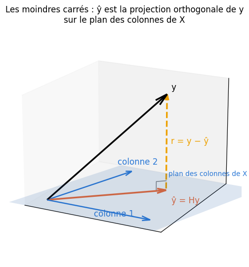
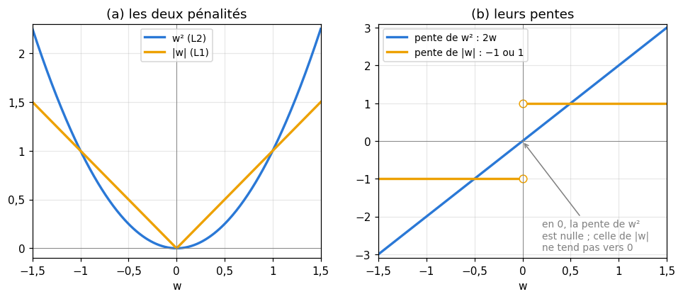

# M09b · Moindres carrés et régularisation — fiche de cours

> En M09a, tu as appris à écrire des prédictions $\mathbf{X}\mathbf{w}$ et à résoudre un système $\mathbf{A}\mathbf{x} = \mathbf{b}$. Mais un dataset réel n'a presque jamais de solution exacte : les points ne sont pas alignés. Ce chapitre dit **quels poids choisir** quand aucun ne convient parfaitement : ceux qui rendent la somme des carrés des résidus la plus petite. Il mesure l'erreur d'une régression (**MSE**, **RMSE**, **MAE**, **Huber**, **R²**), calcule les **gradients** de quelques fonctions de vecteurs, en tire les **équations normales**, les lit comme une **projection** avec la **matrice chapeau**, compte les colonnes des **features polynomiales**, puis ajoute une pénalité : **ridge** (L2), qui est aussi un **MAP**, et le principe du **lasso** (L1). Il montre enfin que les moindres carrés sont le **maximum de vraisemblance** d'un bruit gaussien, et décompose une erreur en **biais²**, **variance** et **bruit**.

| | |
|---|---|
| **Sections** | §1 à §8 |
| **Temps total estimé** | ≈ 17 h : lecture et calculs de la fiche ≈ 3 h 30, exercices ≈ 12 h 40, flashcards ≈ 50 min (parcours essentiel ≈ 9,9 h) |
| **Prérequis** | M09a (matrices, transposée, inverse, pivot de Gauss, rang) ; M07 (normes, produit scalaire, projection sur une droite) ; M05b (gradient, point critique) ; M04 (vraisemblance, MAP) ; M02b (loi normale) ; M02c (biais et variance d'un estimateur) ; R8 (combinaisons) |
| **Fichiers du chapitre** | `02_exercices.md` (quiz, papier) · `03_notebook.ipynb` · `04_indices.md` · `05_solutions.md` et `05_solutions.ipynb` · `06_mes_reponses.md` · `flashcards.csv` |
| **mymath** | `linreg.py` : `normal_equations`, `solve_least_squares`, `hat_matrix`, `residual_decomposition`, `count_monomials`, `huber_loss` |
| **MML** | §5.5, §8.1, §8.2, §9.1, §9.2 (voir le guide de lecture ci-dessous) |

## Comment utiliser ce chapitre

**Ordre conseillé.**
1. `python tools/start_chapter.py M09b` (sur Colab : `00_setup/COLAB.md` §2) : il copie le notebook, ta feuille de réponses et le squelette `mymath/linreg.py`.
2. Section par section : lis **crayon en main**, refais chaque calcul ; puis fais les exercices de la section, quiz 🧠 d'abord.
3. Les exercices ✏️ et 🔗 se font sur papier, dans ta copie de `06_mes_reponses.md`, puis se vérifient dans la **partie 0** du notebook. Les démonstrations ∂ se rédigent dans ta copie et se jugent avec la grille de relecture de `05_solutions.md`.

**Un exemple pour tout le chapitre.** Quatre points, $x = -2, -1, 1, 2$ et $y = 1, 3, 4, 4$. Chaque section le reprend : tu verras la même droite apparaître comme un minimum, une projection, un maximum de vraisemblance, puis se tasser sous une pénalité.

| Section | Quiz 🧠 | Papier et réflexion | Notebook |
|---|---|---|---|
| §1 Modèle linéaire, risque empirique, losses | Q1 | M09b.1, M09b.2 ✏️, M09b.22 📖 | M09b.27, M09b.28 🔨, M09b.30 🔮, M09b.34 🐛 |
| §2 Les gradients de $\mathbf{a}^\top\mathbf{w}$, $\mathbf{w}^\top\mathbf{A}\mathbf{w}$, $\lVert \mathbf{y} - \mathbf{X}\mathbf{w} \rVert^2$ | Q2, R3 🔁 | M09b.3 ✏️, M09b.13, M09b.14 ∂, M09b.20 🔗, M09b.22 📖 | M09b.33 🎨, M09b.34 🐛, M09b.35 🛠️ |
| §3 Équations normales, projection, matrice chapeau | Q3, R1 🔁 | M09b.2, M09b.4 à M09b.6 ✏️, M09b.14, M09b.15 ∂, M09b.23 📖, M09b.25 🗣️, M09b.E1 💼 | M09b.26, M09b.27 🔨, M09b.29 📦, M09b.33 🎨, M09b.34 🐛, M09b.36 🏆 |
| §4 Features polynomiales | Q4 | M09b.7 ✏️, M09b.19 ∂, M09b.24 🧮 | M09b.28 🔨, M09b.30 🔮, M09b.32 🔬, M09b.36 🏆 |
| §5 Ridge, et ridge vue comme un MAP | Q5, R2 🔁 | M09b.8, M09b.9 ✏️, M09b.16 ∂, M09b.21 🔗, M09b.23 📖, M09b.E1, M09b.E2 💼 | M09b.26 🔨 |
| §6 Le lasso | Q6 | M09b.10 ✏️ | |
| §7 La régression comme maximum de vraisemblance | Q7, R2 🔁 | M09b.9, M09b.11 ✏️, M09b.17 ∂, M09b.23 📖, M09b.E2 💼 | |
| §8 Biais, variance et double descente | Q8 | M09b.12 ✏️, M09b.18 ∂ | M09b.31 🔬 |

Parcours essentiel : tout sauf M09b.Q6, M09b.2, M09b.6, M09b.9 à M09b.12, M09b.15, M09b.18, M09b.19, M09b.21 à M09b.24, M09b.E1, M09b.E2, M09b.28 et M09b.31 à M09b.36. Le §6 (lasso), le comptage général du §4 et la double descente (fin du §8) se lisent en survol.

## Guide de lecture de MML

*Mathematics for Machine Learning* (MML) traite la régression dans trois chapitres, et ce chapitre-ci en lit des morceaux :
- avant le **§1** de la fiche : le **§8.1**, *Data, Models, and Learning* (données en vecteurs, un modèle comme une fonction, ce qu'« apprendre » veut dire), puis le **§8.2**, *Empirical Risk Minimization* (la famille de fonctions, la loss, le risque empirique, la régularisation, la validation croisée). Questions : M09b.22 ;
- après le **§2** : le **§5.5**, *Useful Identities for Computing Gradients* (une liste d'identités ; seules celles du §2 de la fiche servent ici, les autres reviennent en M18). Questions : M09b.22 ;
- après le **§7** : le **§9.1**, *Problem Formulation*, puis le **§9.2**, *Parameter Estimation* (maximum de vraisemblance, features non linéaires, overfitting, MAP et moindres carrés régularisés). Questions : M09b.23. Le §9.3 (régression bayésienne) se lit en M25a, le §9.4 (projection orthogonale) en M12b.

📐 **Notations.** La fiche écrit $n$ exemples, $p$ features, $\mathbf{X}$ de forme $(n, p)$ et des poids $\mathbf{w}$, comme workbookIA ; MML écrit $N$ exemples, des paramètres $\boldsymbol{\theta}$, et souvent $\boldsymbol{\Phi}$ pour la matrice des features (*feature matrix*, ou *design matrix*). MML écrit le gradient d'une fonction de $\mathbf{w}$ comme un vecteur **ligne** ; la fiche lui donne la forme de $\mathbf{w}$ (une colonne), comme NumPy : les deux contiennent les mêmes nombres.

Vocabulaire anglais de ce chapitre : *linear regression*, *least squares*, *residual*, *empirical risk*, *loss function*, *mean squared error (MSE)*, *root mean squared error (RMSE)*, *mean absolute error (MAE)*, *Huber loss*, *coefficient of determination ($R^2$)*, *total, explained and residual sum of squares*, *gradient*, *quadratic form*, *normal equations*, *design matrix*, *intercept*, *orthogonal projection*, *hat matrix*, *idempotent*, *polynomial features*, *monomial*, *ridge regression*, *weight decay*, *lasso*, *sparse*, *soft thresholding*, *maximum likelihood estimation (MLE)*, *maximum a posteriori (MAP)*, *prior*, *bias*, *variance*, *bias-variance trade-off*, *overfitting*, *underfitting*, *double descent*.

## Objectifs d'apprentissage

À la fin du chapitre, tu sais :
- **calculer** les losses d'une régression (MSE, RMSE, MAE, Huber) et un $R^2$, et **décomposer** la variation totale ;
- **calculer** les gradients de $\mathbf{a}^\top\mathbf{w}$, de $\mathbf{w}^\top\mathbf{A}\mathbf{w}$ et de $\lVert \mathbf{y} - \mathbf{X}\mathbf{w} \rVert^2$, et en **déduire** les équations normales en dimension $p$ ;
- **interpréter** les moindres carrés comme une projection, avec la matrice chapeau ;
- **compter** les colonnes des features polynomiales ;
- **résoudre** un problème ridge, **démontrer** qu'il a toujours une solution, et le **relier** à un prior gaussien ;
- **démontrer** qu'un bruit gaussien mène aux moindres carrés, et **décomposer** une erreur en biais², variance et bruit.

## L'essentiel en 10 lignes

1. Régression linéaire : $\hat{\mathbf{y}} = \mathbf{X}\mathbf{w}$ ; on choisit $\mathbf{w}$ qui minimise le **risque empirique**, la moyenne d'une loss sur les exemples. Résidus $\mathbf{r} = \mathbf{y} - \mathbf{X}\mathbf{w}$.
2. **MSE** $= \frac{1}{n}\lVert \mathbf{r} \rVert^2$, **RMSE** $= \sqrt{\mathrm{MSE}}$, **MAE** $= \frac{1}{n}\sum |r_i|$, **Huber** : quadratique sous $\delta$, linéaire au-dessus ; $R^2 = 1 - \frac{\mathrm{SCR}}{\mathrm{SCT}}$.
3. Gradients : $\nabla_{\mathbf{w}}(\mathbf{a}^\top\mathbf{w}) = \mathbf{a}$, $\nabla_{\mathbf{w}}(\mathbf{w}^\top\mathbf{A}\mathbf{w}) = (\mathbf{A} + \mathbf{A}^\top)\mathbf{w}$ ($2\mathbf{A}\mathbf{w}$ si $\mathbf{A}$ est symétrique), $\nabla_{\mathbf{w}}\lVert \mathbf{y} - \mathbf{X}\mathbf{w} \rVert^2 = -2\mathbf{X}^\top(\mathbf{y} - \mathbf{X}\mathbf{w})$.
4. **Équations normales** : $\mathbf{X}^\top\mathbf{X}\,\mathbf{w} = \mathbf{X}^\top\mathbf{y}$ ; solution unique quand $\mathbf{X}$ est de rang $p$.
5. Le résidu est **orthogonal** aux colonnes de $\mathbf{X}$ : $\hat{\mathbf{y}} = \mathbf{H}\mathbf{y}$ est la **projection** de $\mathbf{y}$, avec $\mathbf{H} = \mathbf{X}(\mathbf{X}^\top\mathbf{X})^{-1}\mathbf{X}^\top$, symétrique, $\mathbf{H}^2 = \mathbf{H}$, de trace $p$. Avec une colonne de 1 : résidus de moyenne nulle et $\mathrm{SCT} = \mathrm{SCE} + \mathrm{SCR}$.
6. **Features polynomiales** : le modèle reste linéaire **en $\mathbf{w}$** ; $p$ variables et le degré $d$ donnent $\binom{p + d}{d}$ monômes, constante comprise.
7. **Ridge** : minimiser $\lVert \mathbf{y} - \mathbf{X}\mathbf{w} \rVert^2 + \lambda\lVert \mathbf{w} \rVert^2$ donne $(\mathbf{X}^\top\mathbf{X} + \lambda\mathbf{I})\mathbf{w} = \mathbf{X}^\top\mathbf{y}$, toujours soluble pour $\lambda > 0$ ; c'est le **MAP** d'un prior gaussien, avec $\lambda = \sigma^2/\tau^2$.
8. **Lasso** : la pénalité $\lambda\lVert \mathbf{w} \rVert_1$ annule exactement des poids (une solution **parcimonieuse**) ; pas de formule close.
9. Bruit gaussien $\Rightarrow$ le maximum de vraisemblance est la solution des moindres carrés, et $\hat{\sigma}^2 = \frac{\mathrm{SCR}}{n}$.
10. Erreur attendue = **biais²** + **variance** + **bruit** : un modèle trop simple a du biais (underfitting), un modèle trop souple de la variance (overfitting) ; au-delà de l'interpolation, l'erreur peut redescendre (**double descente**).

---

## §1 · Le problème : modèle linéaire, risque empirique et losses

### Le modèle et les résidus

On dispose de $n$ exemples, rangés en lignes dans $\mathbf{X}$ de forme $(n, p)$, et de $n$ cibles numériques $\mathbf{y}$. Un **modèle linéaire** prédit

$$\hat{\mathbf{y}} = \mathbf{X}\mathbf{w}, \qquad \hat{y}_i = \mathbf{x}_i \cdot \mathbf{w},$$

avec un poids par colonne. Pour une **ordonnée à l'origine** (*intercept*), on ajoute à $\mathbf{X}$ une colonne de 1 : son poids $w_0$ est ajouté à chaque prédiction, comme le biais d'un neurone. Le **résidu** de l'exemple $i$ est $r_i = y_i - \hat{y}_i$ : positif si le modèle prédit trop bas.

Avec l'exemple du chapitre et la droite $\hat{y} = 3 + 0{,}7x$ (on verra au §3 qu'elle est la meilleure) :

| $x$ | $-2$ | $-1$ | $1$ | $2$ |
|---|---|---|---|---|
| $y$ | 1 | 3 | 4 | 4 |
| $\hat{y} = 3 + 0{,}7x$ | 1,6 | 2,3 | 3,7 | 4,4 |
| $r = y - \hat{y}$ | $-0{,}6$ | $0{,}7$ | $0{,}3$ | $-0{,}4$ |

Ici $\mathbf{X} = \begin{pmatrix} 1 & -2 \\ 1 & -1 \\ 1 & 1 \\ 1 & 2 \end{pmatrix}$ (la colonne de 1, puis $x$) et $\mathbf{w} = (3 ;\ 0{,}7)$.

### Le risque empirique

Une **loss** $\ell(y, \hat{y})$ mesure l'erreur sur un exemple. Le **risque empirique** est sa moyenne sur le dataset,

$$R_{\text{emp}}(\mathbf{w}) = \frac{1}{n}\sum_{i=1}^{n} \ell\big(y_i, \hat{y}_i\big),$$

et **apprendre**, c'est choisir $\mathbf{w}$ qui le rend le plus petit possible : c'est la **minimisation du risque empirique** (MML §8.2). On espère que des poids bons sur les données d'entraînement le seront aussi sur des données nouvelles : c'est tout le sujet de l'overfitting (§8 et workbookIA 9).

### MSE, RMSE, MAE et loss de Huber

Les trois mesures d'erreur les plus courantes d'une régression :

$$\mathrm{MSE} = \frac{1}{n}\sum_{i=1}^{n} r_i^2, \qquad \mathrm{RMSE} = \sqrt{\mathrm{MSE}}, \qquad \mathrm{MAE} = \frac{1}{n}\sum_{i=1}^{n} |r_i|.$$

Sur l'exemple : $\sum r_i^2 = 0{,}36 + 0{,}49 + 0{,}09 + 0{,}16 = 1{,}1$, donc $\mathrm{MSE} = 0{,}275$, $\mathrm{RMSE} \approx 0{,}524$, et $\mathrm{MAE} = \frac{0{,}6 + 0{,}7 + 0{,}3 + 0{,}4}{4} = 0{,}5$. La MSE s'exprime dans l'unité de $y$ **au carré** ; la RMSE et la MAE, dans l'unité de $y$.

La MSE élève chaque résidu au carré : un résidu dix fois plus grand pèse **cent** fois plus. Un seul point aberrant peut donc tirer toute la droite vers lui. La MAE le pèse seulement dix fois plus, mais $|r|$ n'est pas dérivable en 0. La **loss de Huber** combine les deux, avec un seuil $\delta > 0$ :

$$\ell_\delta(r) = \begin{cases} \frac{1}{2}r^2 & \text{si } |r| \le \delta, \\ \delta\big(|r| - \frac{1}{2}\delta\big) & \text{si } |r| > \delta. \end{cases}$$

Les deux morceaux se raccordent en $|r| = \delta$ (même valeur $\frac{\delta^2}{2}$, même pente $\delta$) : la loss est dérivable partout, quadratique pour les petits résidus, linéaire pour les grands. Avec $\delta = 0{,}5$, sur l'exemple : $0{,}6 > 0{,}5$ donne $0{,}5 \times (0{,}6 - 0{,}25) = 0{,}175$ ; $0{,}7$ donne $0{,}225$ ; $0{,}3$ donne $\frac{0{,}09}{2} = 0{,}045$ ; $0{,}4$ donne $0{,}08$ : moyenne $0{,}13125$.

### Le coefficient de détermination $R^2$

On compare l'erreur du modèle à celle du modèle le plus bête, qui prédit toujours la moyenne $\bar{y}$. Trois **sommes de carrés** (*sums of squares*) :

$$\mathrm{SCT} = \sum_i (y_i - \bar{y})^2 \ \text{(totale)}, \qquad \mathrm{SCE} = \sum_i (\hat{y}_i - \bar{y})^2 \ \text{(expliquée)}, \qquad \mathrm{SCR} = \sum_i (y_i - \hat{y}_i)^2 \ \text{(résiduelle)}.$$

Le **coefficient de détermination** est $R^2 = 1 - \frac{\mathrm{SCR}}{\mathrm{SCT}}$, la part de la variation des cibles que le modèle fait disparaître : $R^2 = 1$ quand tous les résidus sont nuls, $R^2 = 0$ quand $\mathrm{SCR} = \mathrm{SCT}$. Pour les moindres carrés avec une colonne de 1, sur les données d'entraînement, il est toujours entre 0 et 1 (la constante $\bar{y}$ fait partie des modèles possibles, donc $\mathrm{SCR} \le \mathrm{SCT}$) ; sur de nouvelles données, ou pour un autre modèle, rien n'empêche $\mathrm{SCR} > \mathrm{SCT}$, et $R^2$ devient négatif. Sur l'exemple, $\bar{y} = 3$ : $\mathrm{SCT} = 4 + 0 + 1 + 1 = 6$, $\mathrm{SCR} = 1{,}1$, donc $R^2 = 1 - \frac{1{,}1}{6} \approx 0{,}817$. Et $\mathrm{SCE} = 1{,}96 + 0{,}49 + 0{,}49 + 1{,}96 = 4{,}9$ : on a exactement $\mathrm{SCT} = \mathrm{SCE} + \mathrm{SCR}$, ce que le §3 explique. En anglais, SCT, SCE et SCR s'écrivent SST, SSE et SSR (*total*, *explained*, *residual*), comme dans `residual_decomposition`.

⚠️ **Erreur classique.** Calculer un $R^2$ « sans centrer » : $1 - \frac{\sum r_i^2}{\sum y_i^2}$ compare le modèle à la prédiction 0, pas à la moyenne, et donne un nombre bien trop proche de 1. La décomposition $\mathrm{SCT} = \mathrm{SCE} + \mathrm{SCR}$ n'est vraie que pour les moindres carrés **avec une colonne de 1** ; sans elle, ou pour un autre modèle, $1 - \frac{\mathrm{SCR}}{\mathrm{SCT}}$ et $\frac{\mathrm{SCE}}{\mathrm{SCT}}$ diffèrent.

## §2 · Calcul matriciel minimal : les gradients de $\mathbf{a}^\top\mathbf{w}$, $\mathbf{w}^\top\mathbf{A}\mathbf{w}$ et $\lVert \mathbf{y} - \mathbf{X}\mathbf{w} \rVert^2$

### Le gradient d'une fonction de $\mathbf{w}$

Pour une fonction $f : \mathbb{R}^p \to \mathbb{R}$, le **gradient** $\nabla_{\mathbf{w}} f$ est le vecteur de ses dérivées partielles (M05b) : $\big(\frac{\partial f}{\partial w_1}, \ldots, \frac{\partial f}{\partial w_p}\big)$. On pourrait toujours le calculer coordonnée par coordonnée ; trois identités évitent ce travail.

### Trois identités

**1. Une fonction linéaire.** Pour $\mathbf{a} \in \mathbb{R}^p$ fixé, $f(\mathbf{w}) = \mathbf{a}^\top\mathbf{w} = \sum_j a_j w_j$, et $\frac{\partial f}{\partial w_k} = a_k$ : 

$$\nabla_{\mathbf{w}}(\mathbf{a}^\top\mathbf{w}) = \mathbf{a}.$$

C'est l'analogue de $(ax)' = a$.

**2. Une forme quadratique.** Pour $\mathbf{A}$ de forme $(p, p)$, $f(\mathbf{w}) = \mathbf{w}^\top\mathbf{A}\mathbf{w} = \sum_i\sum_j a_{ij}w_iw_j$. Chaque terme où $w_k$ apparaît donne, en dérivant, $\sum_j a_{kj}w_j$ (quand $i = k$) et $\sum_i a_{ik}w_i$ (quand $j = k$) :

$$\nabla_{\mathbf{w}}(\mathbf{w}^\top\mathbf{A}\mathbf{w}) = (\mathbf{A} + \mathbf{A}^\top)\,\mathbf{w}, \qquad \text{soit } 2\mathbf{A}\mathbf{w} \text{ si } \mathbf{A} \text{ est symétrique.}$$

C'est l'analogue de $(ax^2)' = 2ax$ (M09b.13 le démontre). Exemple : $\mathbf{A} = \begin{pmatrix} 2 & 1 \\ 0 & 3 \end{pmatrix}$, $f(\mathbf{w}) = 2w_1^2 + w_1w_2 + 3w_2^2$. En $\mathbf{w} = (1, 2)$, les dérivées partielles valent $4w_1 + w_2 = 6$ et $w_1 + 6w_2 = 13$, et la formule donne bien $(\mathbf{A} + \mathbf{A}^\top)\mathbf{w} = \begin{pmatrix} 4 & 1 \\ 1 & 6 \end{pmatrix}\begin{pmatrix} 1 \\ 2 \end{pmatrix} = \begin{pmatrix} 6 \\ 13 \end{pmatrix}$. Seule la partie symétrique de $\mathbf{A}$ compte : $\mathbf{w}^\top\mathbf{A}\mathbf{w}$ ne change pas si l'on remplace $\mathbf{A}$ par $\frac{1}{2}(\mathbf{A} + \mathbf{A}^\top)$.

**3. La somme des carrés des résidus.** En développant avec les règles de la transposée (M09a §4),

$$\lVert \mathbf{y} - \mathbf{X}\mathbf{w} \rVert^2 = (\mathbf{y} - \mathbf{X}\mathbf{w})^\top(\mathbf{y} - \mathbf{X}\mathbf{w}) = \mathbf{y}^\top\mathbf{y} - 2\,(\mathbf{X}^\top\mathbf{y})^\top\mathbf{w} + \mathbf{w}^\top(\mathbf{X}^\top\mathbf{X})\mathbf{w},$$

où l'on a utilisé $\mathbf{w}^\top\mathbf{X}^\top\mathbf{y} = \mathbf{y}^\top\mathbf{X}\mathbf{w}$ (un nombre est égal à sa transposée). Le premier terme ne dépend pas de $\mathbf{w}$, le deuxième est linéaire (identité 1, avec $\mathbf{a} = -2\mathbf{X}^\top\mathbf{y}$), le troisième est quadratique avec $\mathbf{X}^\top\mathbf{X}$ symétrique (identité 2) :

$$\nabla_{\mathbf{w}}\lVert \mathbf{y} - \mathbf{X}\mathbf{w} \rVert^2 = -2\mathbf{X}^\top\mathbf{y} + 2\mathbf{X}^\top\mathbf{X}\mathbf{w} = -2\,\mathbf{X}^\top(\mathbf{y} - \mathbf{X}\mathbf{w}).$$

Retiens-le sous cette forme : **moins deux fois $\mathbf{X}^\top$ fois les résidus**. Pour la MSE, on divise par $n$ : $\nabla\mathrm{MSE} = -\frac{2}{n}\mathbf{X}^\top\mathbf{r}$. C'est le gradient qu'utilise une descente de gradient sur un modèle linéaire (M09b.20). Une vérification des formes : $\mathbf{X}^\top$ est $(p, n)$, $\mathbf{r}$ est de dimension $n$, le gradient est bien de dimension $p$, comme $\mathbf{w}$.

🔗 **Dans workbookIA** — chaque descente de gradient du livre, du chapitre 9 au chapitre 19, calcule un gradient de cette forme ; M18 généralisera ces identités à la règle de la chaîne.

## §3 · Les équations normales, la projection et la matrice chapeau

### Le minimum annule le gradient

La fonction $L(\mathbf{w}) = \lVert \mathbf{y} - \mathbf{X}\mathbf{w} \rVert^2$ est un « bol » (une fonction convexe, M10 et M19) : son minimum est le point où le gradient s'annule. Le §2 donne :

$$-2\,\mathbf{X}^\top(\mathbf{y} - \mathbf{X}\mathbf{w}) = \mathbf{0} \iff \boxed{\mathbf{X}^\top\mathbf{X}\,\mathbf{w} = \mathbf{X}^\top\mathbf{y}}$$

Ce sont les **équations normales** (*normal equations*) : un système carré $p \times p$, quel que soit le nombre d'exemples. Sur l'exemple : $\mathbf{X}^\top\mathbf{X} = \begin{pmatrix} 4 & 0 \\ 0 & 10 \end{pmatrix}$ (le nombre de points, $\sum x_i$ et $\sum x_i^2$) et $\mathbf{X}^\top\mathbf{y} = \begin{pmatrix} 12 \\ 7 \end{pmatrix}$ ($\sum y_i$ et $\sum x_iy_i$), d'où $\mathbf{w} = (3 ;\ 0{,}7)$ : la droite du §1. Ici $\mathbf{X}^\top\mathbf{X}$ est diagonale parce que les $x$ sont de somme nulle ; c'est l'intérêt de **centrer** une feature.

**Quand la solution est-elle unique ?** Quand $\mathbf{X}^\top\mathbf{X}$ est inversible, c'est-à-dire quand les colonnes de $\mathbf{X}$ sont indépendantes ($\mathbf{X}$ de rang $p$, M09a §8 et M09b.16). Si une colonne combine les autres (une feature en double, une colonne de 1 avec un one-hot complet, plus de features que d'exemples), il y a une infinité de solutions, qui donnent toutes les mêmes prédictions $\hat{\mathbf{y}}$.

💻 **Aujourd'hui en pratique.** On ne calcule pas $(\mathbf{X}^\top\mathbf{X})^{-1}$ (M09a §7). `np.linalg.solve` résout les équations normales ; `np.linalg.lstsq(X, y)` fait mieux encore, sans former $\mathbf{X}^\top\mathbf{X}$ : former ce produit rend le calcul plus sensible aux arrondis quand des colonnes sont presque dépendantes (M09b.32, et M12d pour le **conditionnement**).

### Le résidu est orthogonal aux colonnes

Les équations normales s'écrivent aussi $\mathbf{X}^\top\mathbf{r} = \mathbf{0}$ : le vecteur des résidus est **orthogonal à chaque colonne** de $\mathbf{X}$. Sur l'exemple, $\mathbf{r} = (-0{,}6 ;\ 0{,}7 ;\ 0{,}3 ;\ -0{,}4)$ : sa somme est nulle (orthogonal à la colonne de 1) et $(-2)(-0{,}6) + (-1)(0{,}7) + (1)(0{,}3) + (2)(-0{,}4) = 0$ (orthogonal à la colonne $x$).

**Conséquence 1 : avec une colonne de 1, les résidus sont de moyenne nulle**, donc $\bar{\hat{y}} = \bar{y}$ : la moyenne des prédictions est celle des cibles (M09b.5).

**Conséquence 2 : $\mathrm{SCT} = \mathrm{SCE} + \mathrm{SCR}$.** On écrit $\mathbf{y} - \bar{y}\mathbf{1} = (\hat{\mathbf{y}} - \bar{y}\mathbf{1}) + \mathbf{r}$. Le vecteur $\hat{\mathbf{y}} - \bar{y}\mathbf{1} = \mathbf{X}\mathbf{w} - \bar{y}\mathbf{1}$ est une combinaison des colonnes de $\mathbf{X}$ (la colonne de 1 en fait partie), donc orthogonal à $\mathbf{r}$ ; par Pythagore (M07), les carrés des normes s'additionnent.

### La projection de $\mathbf{y}$

Géométriquement, les prédictions possibles $\mathbf{X}\mathbf{w}$ forment un **sous-espace** de $\mathbb{R}^n$ (l'ensemble des combinaisons des colonnes ; un plan quand il y a deux colonnes). Le vecteur $\mathbf{y}$ n'y est pas ; les moindres carrés cherchent le point de ce plan le plus proche de $\mathbf{y}$, et le trouvent au pied de la perpendiculaire : $\hat{\mathbf{y}}$ est la **projection orthogonale** de $\mathbf{y}$ sur le plan, et $\mathbf{r}$ est perpendiculaire au plan.

C'est la généralisation de la projection sur une droite de M07 : avec une seule colonne $\mathbf{v}$, $\hat{\mathbf{y}} = \frac{\mathbf{v}^\top\mathbf{y}}{\mathbf{v}^\top\mathbf{v}}\mathbf{v}$.

### La matrice chapeau

Quand $\mathbf{X}^\top\mathbf{X}$ est inversible, $\hat{\mathbf{y}} = \mathbf{X}\mathbf{w} = \mathbf{X}(\mathbf{X}^\top\mathbf{X})^{-1}\mathbf{X}^\top\mathbf{y}$ : on écrit

$$\hat{\mathbf{y}} = \mathbf{H}\mathbf{y}, \qquad \mathbf{H} = \mathbf{X}(\mathbf{X}^\top\mathbf{X})^{-1}\mathbf{X}^\top,$$

la **matrice chapeau** (*hat matrix* : elle « met un chapeau » sur $\mathbf{y}$). Elle est de forme $(n, n)$, et ses propriétés sont celles d'une projection (M09b.15) :
- elle est **symétrique** : $\mathbf{H}^\top = \mathbf{H}$ ;
- elle est **idempotente** : $\mathbf{H}\mathbf{H} = \mathbf{H}$ (projeter deux fois ne change rien) ;
- sa **trace** (la somme de sa diagonale) vaut $p$, le nombre de colonnes : c'est le nombre de « degrés de liberté » du modèle ;
- $\mathbf{I} - \mathbf{H}$ donne les résidus : $\mathbf{r} = (\mathbf{I} - \mathbf{H})\mathbf{y}$.

Exemple avec une seule colonne $\mathbf{v} = (1, 2, 2)$ : $\mathbf{H} = \frac{\mathbf{v}\mathbf{v}^\top}{\mathbf{v}^\top\mathbf{v}} = \frac{1}{9}\begin{pmatrix} 1 & 2 & 2 \\ 2 & 4 & 4 \\ 2 & 4 & 4 \end{pmatrix}$, de trace $\frac{1 + 4 + 4}{9} = 1$. Le nombre $h_{ii}$ de la diagonale, le **levier** (*leverage*) de l'exemple $i$, dit combien $y_i$ pèse sur sa propre prédiction : un point isolé, loin des autres en $x$, a un grand levier.

## §4 · Features polynomiales : compter les monômes

### Un modèle linéaire en $\mathbf{w}$

Rien n'oblige les colonnes de $\mathbf{X}$ à être les features brutes. Avec les colonnes $1, x, x^2, x^3$, le modèle

$$\hat{y} = w_0 + w_1x + w_2x^2 + w_3x^3$$

est un polynôme en $x$, mais il reste **linéaire en $\mathbf{w}$** : chaque prédiction est une combinaison des colonnes, et tout ce qui précède s'applique sans changement. « Linéaire » dans « régression linéaire » veut dire linéaire **en les poids**. En revanche, $\hat{y} = w_0 + e^{w_1x}$ n'est pas linéaire en $w_1$ : pas d'équations normales.

### Combien de colonnes ?

Avec $p$ variables $x_1, \ldots, x_p$, les **features polynomiales** de degré $d$ sont tous les **monômes** $x_1^{k_1}x_2^{k_2}\cdots x_p^{k_p}$ de degré total $k_1 + \cdots + k_p \le d$, produits croisés compris (les **interactions**, comme $x_1x_3$). Par exemple, les monômes de degré exactement 2 en trois variables sont les six $x_1^2, x_2^2, x_3^2, x_1x_2, x_1x_3, x_2x_3$.

Compter les monômes de degré exactement $k$, c'est compter les façons de répartir $k$ « unités de degré » entre $p$ variables : des **combinaisons avec répétition**. Écris $k$ étoiles et $p - 1$ barres de séparation ; chaque monôme correspond à une façon de placer les barres parmi les $k + p - 1$ positions : $\binom{k + p - 1}{k}$ monômes. En sommant de $k = 0$ à $d$ (M09b.19 le démontre),

$$\#\{\text{monômes de degré} \le d \text{ en } p \text{ variables}\} = \binom{p + d}{d}, \quad \text{constante comprise.}$$

Pour $p = 3$ et $d = 3$ : 1 constante, 3 monômes de degré 1, 6 de degré 2, 10 de degré 3, soit $20 = \binom{6}{3}$ ; 19 colonnes sans la constante. Le nombre grandit vite, comme $\frac{p^d}{d!}$ quand $p$ est grand devant $d$ : la matrice $\mathbf{X}^\top\mathbf{X}$ a un nombre de cases égal au **carré** du nombre de colonnes (M09b.24). Et dès qu'il y a plus de colonnes que d'exemples, $\mathbf{X}^\top\mathbf{X}$ est singulière.

### Des colonnes presque dépendantes

Les puissances successives d'une même variable se ressemblent de plus en plus. Avec trois exemples $x = 1, 2, 3$, mesure l'angle entre deux colonnes voisines par leur cosinus (M07) : $x$ et $x^2$ font un angle d'environ 13,6° ; $x^2$ et $x^3$, 8,3° ; $x^3$ et $x^4$, 5,5° ; $x^4$ et $x^5$, 3,7°. Les colonnes pointent presque dans la même direction : elles sont **presque dépendantes**. Elles restent indépendantes, $\mathbf{X}$ est de rang plein et la solution est unique en théorie ; mais $\mathbf{X}^\top\mathbf{X}$ est presque singulière, et une petite erreur d'arrondi sur les données change beaucoup les poids. M09b.32 mesure cette sensibilité ; M12d lui donne un nom, le **conditionnement**. workbookIA 9 en tire les parades pratiques.

## §5 · La régression ridge, et ridge vue comme un MAP

### Pénaliser les grands poids

Quand les colonnes sont presque dépendantes, ou nombreuses, les moindres carrés donnent des poids énormes, de signes opposés, qui s'ajustent au bruit. La **régression ridge** (*ridge regression*) ajoute une pénalité sur la taille des poids :

$$L_\lambda(\mathbf{w}) = \lVert \mathbf{y} - \mathbf{X}\mathbf{w} \rVert^2 + \lambda\,\lVert \mathbf{w} \rVert^2, \qquad \lambda \ge 0.$$

Le gradient de $\lambda\lVert \mathbf{w} \rVert^2 = \lambda\,\mathbf{w}^\top\mathbf{I}\mathbf{w}$ est $2\lambda\mathbf{w}$ (identité 2 du §2) ; annuler le gradient total donne

$$\boxed{(\mathbf{X}^\top\mathbf{X} + \lambda\mathbf{I})\,\mathbf{w} = \mathbf{X}^\top\mathbf{y}}$$

On ajoute $\lambda$ sur la diagonale de $\mathbf{X}^\top\mathbf{X}$. Pour $\lambda > 0$, cette matrice est **toujours inversible**, même avec des colonnes redondantes ou plus de colonnes que de lignes : pour $\mathbf{v} \ne \mathbf{0}$, $\mathbf{v}^\top(\mathbf{X}^\top\mathbf{X} + \lambda\mathbf{I})\mathbf{v} = \lVert \mathbf{X}\mathbf{v} \rVert^2 + \lambda\lVert \mathbf{v} \rVert^2 > 0$, donc $(\mathbf{X}^\top\mathbf{X} + \lambda\mathbf{I})\mathbf{v} \ne \mathbf{0}$ (M09b.16 rédige l'argument). Quand $\lambda$ grandit, les poids **rétrécissent** vers 0 (*shrinkage*) ; quand $\lambda \to 0$, on retrouve les moindres carrés.

Sur l'exemple, en pénalisant les deux poids avec $\lambda = 4$ : $\begin{pmatrix} 8 & 0 \\ 0 & 14 \end{pmatrix}\mathbf{w} = \begin{pmatrix} 12 \\ 7 \end{pmatrix}$, d'où $\mathbf{w} = (1{,}5 ;\ 0{,}5)$. La pente est passée de 0,7 à 0,5 ; mais l'ordonnée à l'origine a rétréci elle aussi, de 3 à 1,5, et la droite ne passe plus par le point moyen $(0, 3)$ : ses prédictions sont toutes trop basses. Le poids de la colonne de 1 ne mesure pas la complexité du modèle ; le pénaliser n'a pas de sens. La parade : **centrer** $\mathbf{X}$ (sans sa colonne de 1) et $\mathbf{y}$, résoudre ridge sur les données centrées, puis rendre l'ordonnée à l'origine (workbookIA 9 donne la recette complète). `solve_least_squares` de `mymath`, lui, pénalise **tous** les poids : c'est à toi de centrer avant.

⚠️ **Erreur classique.** Appliquer ridge à des colonnes d'unités différentes. La pénalité $\lambda\sum_j w_j^2$ dépend de l'unité de chaque feature : exprimer une distance en kilomètres plutôt qu'en mètres divise ses valeurs par 1 000, multiplie son poids par 1 000, et sa pénalité par un million. Ridge rétrécit alors cette feature bien plus que les autres, pour une simple question d'unité. On standardise les colonnes d'abord (M09b.21).

### Weight decay

Dans une descente de gradient de pas $\eta$ sur $L_\lambda$, le terme de pénalité ajoute $2\lambda\mathbf{w}$ au gradient :

$$\mathbf{w} \leftarrow \mathbf{w} - \eta\big(\nabla L(\mathbf{w}) + 2\lambda\mathbf{w}\big) = (1 - 2\eta\lambda)\,\mathbf{w} - \eta\,\nabla L(\mathbf{w}).$$

À chaque pas, les poids sont d'abord multipliés par $1 - 2\eta\lambda$, un nombre un peu plus petit que 1 : ils « décroissent » (*weight decay*), sauf si les données les retiennent. C'est la forme sous laquelle la pénalité L2 apparaît dans les réseaux de neurones (workbookIA 19 et 20).

### Ridge est un MAP

Supposons un bruit gaussien, $y_i = \mathbf{x}_i \cdot \mathbf{w} + \varepsilon_i$ avec $\varepsilon_i \sim \mathcal{N}(0, \sigma^2)$ indépendants (§7), et mettons sur les poids un **prior** gaussien centré, chaque $w_j \sim \mathcal{N}(0, \tau^2)$ indépendamment (M04) : on croit, avant les données, que les poids sont petits. Par la règle de Bayes, le log du posterior vaut, à une constante près,

$$\log p(\mathbf{w} \mid \mathbf{X}, \mathbf{y}) = -\frac{1}{2\sigma^2}\lVert \mathbf{y} - \mathbf{X}\mathbf{w} \rVert^2 - \frac{1}{2\tau^2}\lVert \mathbf{w} \rVert^2 + \text{constante}.$$

Maximiser ce log (le **MAP**, M04), c'est minimiser $\lVert \mathbf{y} - \mathbf{X}\mathbf{w} \rVert^2 + \frac{\sigma^2}{\tau^2}\lVert \mathbf{w} \rVert^2$, après multiplication par $-2\sigma^2$ : **ridge, avec $\lambda = \frac{\sigma^2}{\tau^2}$**. Un prior étroit ($\tau$ petit : on croit fort que les poids sont petits) ou un bruit fort ($\sigma$ grand : on se méfie des données) donnent une pénalité forte. Par exemple, $\sigma = 1$ et $\tau = 0{,}5$ donnent $\lambda = 4$, la pénalité de l'exemple ci-dessus : ses poids $(1{,}5 ;\ 0{,}5)$ sont le MAP de ce prior.

## §6 · Le lasso : le principe de la parcimonie

Le **lasso** remplace la pénalité L2 par la norme L1 (M07) :

$$\lVert \mathbf{y} - \mathbf{X}\mathbf{w} \rVert^2 + \lambda\,\lVert \mathbf{w} \rVert_1, \qquad \lVert \mathbf{w} \rVert_1 = \sum_j |w_j|.$$

La différence paraît mince ; elle change la forme des solutions : pour $\lambda$ assez grand, beaucoup de poids deviennent **exactement nuls**. Le modèle est **parcimonieux** (*sparse*) : il n'utilise que quelques features, et fait en même temps la régression et une sélection de features.

**Pourquoi des zéros exacts ? Une question de pente.** Pars d'un poids $w_j = 0$, les autres étant fixés, et demande-toi s'il vaut la peine de le pousser à une petite valeur $\varepsilon > 0$. La somme des carrés baisse d'environ $g\,\varepsilon$, où $g$ est la pente avec laquelle elle descend dans cette direction (M05a : une fonction dérivable est presque une droite de près). La pénalité, elle, monte de :
- $\lambda\varepsilon^2$ avec L2 : un coût **négligeable** devant $g\,\varepsilon$ quand $\varepsilon$ est petit. Pousser un peu est toujours rentable dès que $g \ne 0$ : un poids ridge n'est presque jamais exactement nul ;
- $\lambda\varepsilon$ avec L1 : un coût **du même ordre** que le gain. Pousser n'est rentable que si $g > \lambda$ ; sinon, le poids reste à 0.

Toute la différence tient à la pente des deux pénalités en 0 : celle de $w^2$ y vaut 0, celle de $|w|$ vaut $\pm 1$ de chaque côté, aussi près de 0 que l'on soit. workbookIA 9 en donne l'image géométrique, avec les boules des deux normes (M09b.10 te les fait tracer).

**Pas de formule close.** $|w|$ n'est pas dérivable en 0, et annuler un gradient ne suffit plus. En dimension 1, la solution s'écrit avec le **seuillage doux** (*soft thresholding*) $S(z, \gamma) = \operatorname{signe}(z)\max(|z| - \gamma, 0)$, où $z$ est le poids qu'on aurait sans pénalité et $\gamma$ un seuil qui dépend de $\lambda$ : $z$ est rapproché de 0 de $\gamma$, et mis à 0 s'il en était plus près que $\gamma$. Par exemple $S(2{,}5 ;\ 1) = 1{,}5$ et $S(-0{,}7 ;\ 1) = 0$. En dimension $p$, on applique ce seuillage à un poids à la fois, les autres étant fixés, jusqu'à ce que plus rien ne bouge (la *descente de coordonnées*). workbookIA 9 dérive le seuillage et programme cette descente : on ne le fait pas ici.

⚠️ **Erreur classique.** Minimiser le lasso par une descente de gradient ordinaire, en prenant pour « dérivée » de $|w|$ son signe : chaque pas déplace le poids d'au moins $\eta\lambda$, et un poids qui devrait être nul saute d'un côté à l'autre de 0 sans jamais s'y poser. On obtient des poids petits, pas des zéros exacts.

## §7 · La régression comme maximum de vraisemblance

### Le modèle probabiliste

Pourquoi les **carrés** des résidus, plutôt que leurs valeurs absolues ou leurs puissances quatrièmes ? Une réponse vient des probabilités. Supposons que chaque cible soit la prédiction d'un modèle linéaire plus un bruit gaussien :

$$y_i = \mathbf{x}_i \cdot \mathbf{w} + \varepsilon_i, \qquad \varepsilon_i \sim \mathcal{N}(0, \sigma^2), \text{ indépendants.}$$

Alors $y_i \sim \mathcal{N}(\mathbf{x}_i \cdot \mathbf{w}, \sigma^2)$, de densité $\frac{1}{\sqrt{2\pi\sigma^2}}\exp\big(-\frac{(y_i - \mathbf{x}_i \cdot \mathbf{w})^2}{2\sigma^2}\big)$ (M02b). La **vraisemblance** des données est le produit de ces densités (M04), et sa **log-vraisemblance** la somme de leurs logs :

$$\log L(\mathbf{w}, \sigma^2) = -\frac{n}{2}\log(2\pi\sigma^2) - \frac{1}{2\sigma^2}\sum_{i=1}^{n}(y_i - \mathbf{x}_i \cdot \mathbf{w})^2.$$

### Le maximum de vraisemblance

À $\sigma^2$ fixé, seul le second terme dépend de $\mathbf{w}$, avec un signe moins : **maximiser la vraisemblance, c'est minimiser la somme des carrés des résidus**. L'estimateur du maximum de vraisemblance de $\mathbf{w}$ est la solution des moindres carrés (M09b.17 rédige l'argument). Et en dérivant par rapport à $\sigma^2$, on trouve l'estimateur du bruit

$$\hat{\sigma}^2 = \frac{\mathrm{SCR}}{n} = \mathrm{MSE},$$

la MSE d'entraînement. Sur l'exemple, $\hat{\sigma}^2 = \frac{1{,}1}{4} = 0{,}275$. Cet estimateur est **biaisé** vers le bas (les poids ont été choisis pour rendre les résidus petits) : l'estimateur sans biais divise par $n - p$ au lieu de $n$, ici $\frac{1{,}1}{2} = 0{,}55$, comme la division par $n - 1$ de M02c, qui est le cas $p = 1$.

**Une autre loi, une autre loss.** Avec un bruit de Laplace, de densité proportionnelle à $e^{-|\varepsilon|/b}$, le même raisonnement mène à la somme des **valeurs absolues** des résidus, donc à la MAE : un bruit à queues plus lourdes, qui produit plus souvent de grands écarts, appelle une loss moins sensible aux grands résidus. Le choix d'une loss est un choix de modèle du bruit.

## §8 · Biais, variance et double descente

### Biais et variance d'un estimateur

Un estimateur $\hat{\theta}$, calculé sur un échantillon aléatoire, est lui-même aléatoire (M02c). Son **erreur quadratique moyenne** se décompose :

$$\mathbb{E}\big[(\hat{\theta} - \theta)^2\big] = \underbrace{\big(\mathbb{E}[\hat{\theta}] - \theta\big)^2}_{\text{biais}^2} + \underbrace{\mathbb{V}(\hat{\theta})}_{\text{variance}}.$$

Il suffit d'écrire $\hat{\theta} - \theta = (\hat{\theta} - \mathbb{E}[\hat{\theta}]) + (\mathbb{E}[\hat{\theta}] - \theta)$ et de développer le carré : le double produit a une espérance nulle, car $\mathbb{E}\big[\hat{\theta} - \mathbb{E}[\hat{\theta}]\big] = 0$.

Un estimateur sans biais n'est donc pas forcément le meilleur : accepter un peu de biais peut faire baisser beaucoup la variance. Exemple : pour estimer la moyenne $\mu$ d'une loi de variance $\sigma^2$ avec $n$ observations, on peut prendre $c\,\bar{x}$ au lieu de $\bar{x}$, avec $0 < c < 1$ (un estimateur **rétréci**, comme les poids de ridge). Son biais vaut $(c - 1)\mu$ et sa variance $\frac{c^2\sigma^2}{n}$. Avec $\mu = 1$, $\sigma^2 = 4$ et $n = 4$ : $\bar{x}$ a une erreur de $0 + 1 = 1$, et $c = 0{,}8$ donne $0{,}04 + 0{,}64 = 0{,}68$, mieux. M09b.12 et M09b.31 cherchent le meilleur $c$.

### La décomposition d'une erreur de prédiction

Pour un modèle, l'« estimation » est toute une fonction $\hat{f}_D$, apprise sur un dataset $D$ aléatoire. On suppose $y = f(x) + \varepsilon$, avec un bruit de moyenne nulle et de variance $\sigma^2$, indépendant de $D$. En un point $x$, avec le modèle moyen $\bar{f}(x) = \mathbb{E}_D[\hat{f}_D(x)]$, l'erreur sur une nouvelle mesure se décompose (M09b.18) :

$$\mathbb{E}\big[(y - \hat{f}_D(x))^2\big] = \underbrace{\big(\bar{f}(x) - f(x)\big)^2}_{\text{biais}^2} + \underbrace{\mathbb{E}_D\big[(\hat{f}_D(x) - \bar{f}(x))^2\big]}_{\text{variance}} + \underbrace{\sigma^2}_{\text{bruit}}.$$

Les trois termes sont positifs ou nuls, et chacun a sa cause :
- $\sigma^2$ ne dépend pas du modèle : c'est la part de $y$ que $x$ ne détermine pas ;
- le **biais²** est grand quand la famille de modèles ne contient rien de proche de $f$ : même en moyenne sur les datasets, le modèle reste loin. C'est l'**underfitting** ;
- la **variance** est grande quand le modèle dépend beaucoup du dataset tiré, bruit compris : c'est l'**overfitting**.

Ridge en est l'exemple type : quand $\lambda$ grandit, les poids rétrécissent vers 0 (le biais² monte) et bougent moins d'un dataset à l'autre (la variance baisse). L'estimateur $c\,\bar{x}$ ci-dessus en est la version à un seul nombre.

### La double descente (aperçu)

Ajoute des colonnes à $\mathbf{X}$ une à une, à $n$ exemples fixés. Tant que $p < n$, les équations normales ont une solution unique. Quand $p$ s'approche de $n$, la matrice carrée (ou presque) $\mathbf{X}$ a de plus en plus de chances d'avoir des colonnes presque dépendantes : $\mathbf{X}^\top\mathbf{X}$ est presque singulière, les poids deviennent énormes et changent du tout au tout d'un dataset à l'autre. La variance explose : l'erreur de test a un **pic** près de $p = n$. Au-delà ($p > n$), $\mathbf{X}\mathbf{w} = \mathbf{y}$ a une infinité de solutions (M09a §8), qui passent toutes par les points d'entraînement ; si l'on choisit celle de **plus petite norme**, une contrainte de taille sur les poids, comme celle de ridge, revient, et l'erreur de test peut **redescendre** : c'est la **double descente** (*double descent*). La décomposition reste exacte ; c'est le nombre de colonnes qui mesure mal la souplesse réelle du modèle. M12d construit cette solution de plus petite norme (la **pseudo-inverse**) ; workbookIA 9 trace la courbe.

---

## Les pièges classiques ⚠️ (récapitulatif)

| Piège | Ce qu'il faut faire |
|---|---|
| Un $R^2$ « sans centrer » ($1 - \frac{\sum r_i^2}{\sum y_i^2}$) | comparer à la moyenne : $1 - \frac{\mathrm{SCR}}{\mathrm{SCT}}$, avec $\mathrm{SCT} = \sum (y_i - \bar{y})^2$ |
| Comparer une MSE et une MAE | la MSE est dans l'unité de $y$ au carré ; comparer RMSE et MAE |
| $\nabla(\mathbf{w}^\top\mathbf{A}\mathbf{w}) = 2\mathbf{A}\mathbf{w}$ pour $\mathbf{A}$ non symétrique | $(\mathbf{A} + \mathbf{A}^\top)\mathbf{w}$ |
| Un gradient de mauvais signe, $+2\mathbf{X}^\top(\mathbf{y} - \mathbf{X}\mathbf{w})$ | $-2\mathbf{X}^\top(\mathbf{y} - \mathbf{X}\mathbf{w})$ : la descente fait $\mathbf{w} \leftarrow \mathbf{w} + 2\eta\mathbf{X}^\top\mathbf{r}$ |
| $\mathbf{X}\mathbf{X}^\top$ au lieu de $\mathbf{X}^\top\mathbf{X}$ | $\mathbf{X}^\top\mathbf{X}$ est $(p, p)$, une case par paire de **features** |
| Calculer $(\mathbf{X}^\top\mathbf{X})^{-1}$ | `np.linalg.solve`, ou `np.linalg.lstsq` sans former $\mathbf{X}^\top\mathbf{X}$ |
| Oublier la colonne de 1 | sans elle, la droite passe par l'origine et $\mathrm{SCT} \ne \mathrm{SCE} + \mathrm{SCR}$ |
| Croire qu'un modèle polynomial n'est pas linéaire | il l'est en $\mathbf{w}$ : mêmes équations normales |
| Des puissances non standardisées | standardiser les colonnes avant la régression et la pénalité |
| Pénaliser l'ordonnée à l'origine sans le vouloir | centrer, puis appliquer ridge sans colonne de 1 |
| Attendre des zéros exacts d'une descente de gradient sur le lasso | le seuillage doux, un poids à la fois (workbookIA 9) |
| $\hat{\sigma}^2 = \frac{\mathrm{SCR}}{n}$ comme estimateur sans biais | il sous-estime : $\frac{\mathrm{SCR}}{n - p}$ est sans biais |

## Et maintenant

**Dans ce dépôt** : M10 étudie les ensembles convexes et la séparabilité ; M12b reprend la projection orthogonale sur un sous-espace et la factorisation QR ; M12d définit la pseudo-inverse et le conditionnement ; M19 étudie la convergence d'une descente de gradient sur une loss quadratique comme celle-ci ; M25a la régression bayésienne complète.

**Dans workbookIA** : le chapitre 9 parle d'overfitting et d'underfitting, de régularisation et de biais-variance, sur des courbes et des datasets réels. Tu y reconnaîtras les mesures d'erreur (§1), les équations normales et leur résolution (§3), les features polynomiales (§4), ridge et son lien avec un prior gaussien (§5), le principe du lasso (§6), la décomposition biais² + variance + bruit (§8) et la solution de plus petite norme (§8) ; ses démonstrations en dimension 1 et ses fonctions `mylearn` sont à faire là-bas.

## Pour aller plus loin

- MML §8.1, §8.2, §9.1 et §9.2, et les exercices du chapitre 5 du livre qui portent sur les gradients de produits de matrices et de vecteurs (conseillés) ; plus tard, §9.3 et §9.4 (M25a, M12b).
- `annexes/symboles.md` (lire $\nabla_{\mathbf{w}}$, $\hat{\mathbf{y}}$, $\mathbf{H}$, $\lVert \cdot \rVert_1$ à voix haute), `annexes/formulaire.md` et `annexes/erreurs_frequentes.md`.
