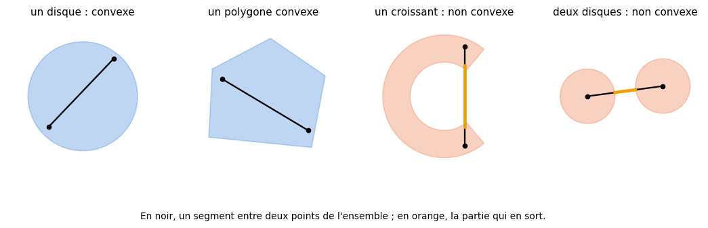
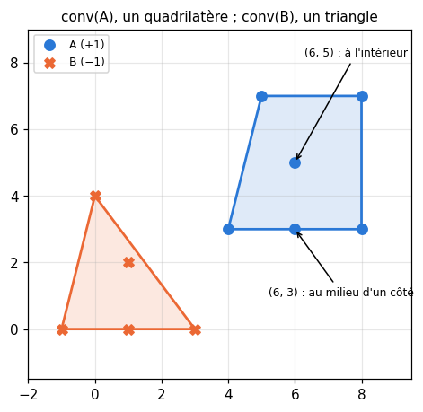
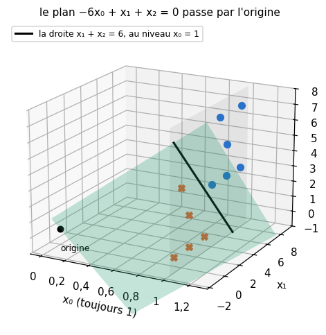
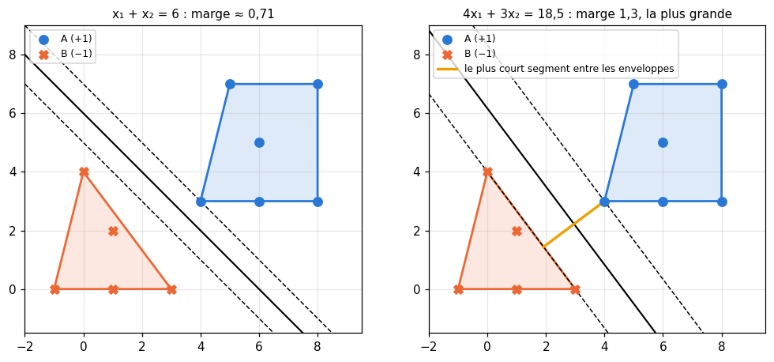
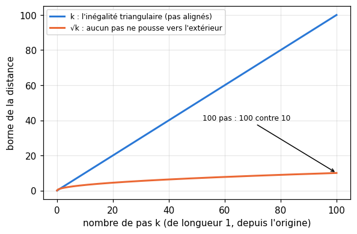
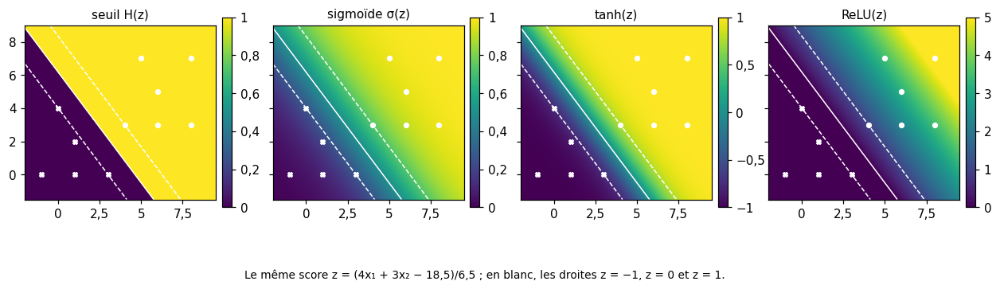

# M10 · Séparabilité linéaire et convexité — fiche de cours

> En M07, tu as vu qu'un hyperplan $\mathbf{w} \cdot \mathbf{x} + b = 0$ coupe l'espace en deux demi-espaces, et qu'on mesure la distance d'un point à cet hyperplan. Ce chapitre pose la question inverse : **deux nuages de points étant donnés, existe-t-il un hyperplan qui les sépare ?** La réponse passe par les **ensembles convexes** et l'**enveloppe convexe** d'un nuage, l'« élastique » tendu autour de ses points. Tu y verras comment décider la séparabilité, à la main et par un programme linéaire, comment réécrire un hyperplan affine comme un hyperplan qui passe par l'origine (l'**astuce du biais**), ce qu'est la **marge** d'un séparateur et quelle est la plus grande possible. Deux outils complètent la boîte : des **récurrences sur une norme**, qui comparent une croissance linéaire à une croissance en $\sqrt{k}$, et les **fonctions d'activation**, des fonctions d'une variable qu'on applique à un score linéaire.

| | |
|---|---|
| **Sections** | §1 à §5 |
| **Temps total estimé** | ≈ 8,1 h : lecture et calculs de la fiche ≈ 1 h 50, exercices ≈ 5 h 45, 16 flashcards ≈ 30 min (parcours essentiel ≈ 5,7 h) |
| **Prérequis** | M07 (produit scalaire, hyperplans, distance à un hyperplan, Cauchy-Schwarz) ; M09a (matrices, systèmes linéaires) ; M05a (fonctions convexes d'une variable) ; R4 (récurrence) ; R6 (sigmoïde, tanh) ; R3 (fonctions, composition) |
| **Fichiers du chapitre** | `02_exercices.md` (quiz, papier) · `03_notebook.ipynb` · `04_indices.md` · `05_solutions.md` et `05_solutions.ipynb` · `06_mes_reponses.md` · `flashcards.csv` |
| **mymath** | `convex.py` : `convex_hull_2d`, `is_linearly_separable`, `margin_of_separator` |
| **MML** | §12.1 (voir le guide de lecture ci-dessous) |

## Comment utiliser ce chapitre

**Ordre conseillé.**
1. `python tools/start_chapter.py M10` (sur Colab : `00_setup/COLAB.md` §2) : il copie le notebook, ta feuille de réponses et le squelette `mymath/convex.py`.
2. Section par section : lis **crayon en main**, refais chaque calcul et chaque dessin ; puis fais les exercices de la section, quiz 🧠 d'abord.
3. Les exercices ✏️ et 🔗 se font sur papier, dans ta copie de `06_mes_reponses.md`, puis se vérifient dans la **partie 0** du notebook. Les démonstrations ∂ se rédigent dans ta copie et se jugent avec la grille de relecture de `05_solutions.md`.

**Un exemple pour tout le chapitre.** Deux nuages du plan. Le nuage $A$, de label $+1$ : $(4, 3)$, $(8, 3)$, $(8, 7)$, $(5, 7)$, $(6, 3)$ et $(6, 5)$. Le nuage $B$, de label $-1$ : $(-1, 0)$, $(3, 0)$, $(0, 4)$, $(1, 2)$ et $(1, 0)$. Le §2 tend un élastique autour de chacun, le §3 les sépare par une droite, puis par la meilleure droite possible.

| Section | Quiz 🧠 et rappels 🔁 | Papier et réflexion | Notebook |
|---|---|---|---|
| §1 Ensembles convexes | Q1 | M10.1 ✏️, M10.6 ∂, M10.11 🗣️ | |
| §2 L'enveloppe convexe | Q2 | M10.2 ✏️, M10.7 ∂, M10.11 🗣️ | M10.12 🔨, M10.15 🎨, M10.16 🐛, M10.17 🛠️ |
| §3 Séparer deux nuages | Q3, Q4, R1 | M10.3, M10.4 ✏️, M10.7, M10.8 ∂, M10.10 📖, M10.E1 💼 | M10.13 🔨, M10.14 🔮, M10.15 🎨, M10.16 🐛, M10.18 🏆 |
| §4 Récurrences sur une norme | R2 | M10.5 ✏️ | |
| §5 Activations | R3 | M10.9 🔗 | |

Parcours essentiel : tout sauf M10.Q4, M10.R3, M10.4, M10.5, M10.8, M10.10, M10.E1 et M10.15 à M10.18. L'astuce du biais et la plus grande marge (fin du §3), le §4 et le §5 se lisent en survol.

## Guide de lecture de MML

*Mathematics for Machine Learning* (MML) consacre son dernier chapitre aux machines à vecteurs de support (*support vector machines*, SVM), des classifieurs qui cherchent l'hyperplan de plus grande marge. Ce chapitre-ci n'en lit que l'entrée :
- après le **§3** de la fiche : l'introduction du chapitre 12, puis le **§12.1**, *Separating Hyperplanes* (la fonction affine qui classe, l'hyperplan où elle s'annule, pourquoi $\mathbf{w}$ lui est orthogonal, la condition que doivent vérifier les exemples d'entraînement). Questions : M10.10.

La suite du chapitre 12 (la marge et le SVM « primal », puis la dualité, où les enveloppes convexes reviennent) se lit en M13b, quand les multiplicateurs de Lagrange seront là.

📐 **Notations.** MML écrit le produit scalaire $\langle \mathbf{w}, \mathbf{x} \rangle$ là où la fiche écrit $\mathbf{w} \cdot \mathbf{x}$, et note $\mathbf{x}_n$ et $y_n$ les exemples et leurs labels ($N$ exemples en dimension $D$) ; la fiche écrit $\mathbf{x}_i$, $y_i$, $n$ et $d$. Les labels valent $+1$ et $-1$ dans les deux. La fiche demande une séparation **stricte** (aucun point sur l'hyperplan, §3) : regarde, en lisant, si l'inégalité que MML impose aux exemples d'entraînement est large ou stricte (M10.10).

Vocabulaire anglais de ce chapitre : *convex set*, *line segment*, *convex combination*, *half-space*, *intersection*, *convex hull*, *vertex*, *counterclockwise*, *cross product*, *orientation test*, *monotone chain*, *linearly separable*, *separating hyperplane*, *feasibility*, *linear program*, *bias trick*, *augmented vector*, *general position*, *geometric margin*, *functional margin*, *maximum margin*, *support vector*, *norm*, *recurrence*, *Cauchy-Schwarz inequality*, *activation function*, *step function*, *sigmoid*, *hyperbolic tangent*, *rectified linear unit (ReLU)*, *level set*.

## Objectifs d'apprentissage

À la fin du chapitre, tu sais :
- **reconnaître** un ensemble convexe, et **démontrer** qu'un demi-espace et une intersection de convexes le sont ;
- **construire** l'enveloppe convexe d'un nuage du plan, à la main et en code (chaîne monotone d'Andrew) ;
- **démontrer** que deux nuages séparables ont des enveloppes convexes disjointes, et **décider** la séparabilité par un programme linéaire ;
- **calculer** la marge géométrique d'un séparateur, la meilleure marge possible, et **passer** d'un hyperplan affine à un hyperplan par l'origine (astuce du biais) ;
- **borner** une suite de normes pas à pas, et **comparer** une croissance linéaire à une croissance en $\sqrt{k}$ ;
- **appliquer** une fonction d'activation à un score linéaire, et **décrire** ses lignes de niveau.

## L'essentiel en 10 lignes

1. $C$ est **convexe** si, avec deux points, il contient tout le segment qui les joint : $(1 - t)\mathbf{a} + t\mathbf{b} \in C$ pour $t \in [0, 1]$.
2. Un demi-espace $\{\mathbf{x} : \mathbf{w} \cdot \mathbf{x} + b \ge 0\}$ est convexe ; une intersection de convexes aussi ; une union, en général non.
3. L'**enveloppe convexe** d'un nuage est le plus petit convexe qui le contient : l'ensemble des **combinaisons convexes** $\sum t_i \mathbf{x}_i$, $t_i \ge 0$, $\sum t_i = 1$. Dans le plan, un polygone dont les sommets sont des points du nuage.
4. Le **produit vectoriel** du plan $(\mathbf{a} - \mathbf{o}) \times (\mathbf{b} - \mathbf{o})$ dit si l'on tourne à gauche ($> 0$), à droite ($< 0$) ou tout droit ($= 0$) ; la **chaîne monotone d'Andrew** en tire l'enveloppe après un tri.
5. Deux nuages sont **linéairement séparables** s'il existe $(\mathbf{w}, b)$ avec $y_i(\mathbf{w} \cdot \mathbf{x}_i + b) > 0$ pour tout $i$ ; on peut alors exiger $\ge 1$, ce qui se teste par un **programme linéaire**.
6. Séparables $\iff$ enveloppes convexes **disjointes** (pour des nuages finis). Un point commun aux deux enveloppes prouve qu'aucun hyperplan ne sépare.
7. **Astuce du biais** : $\tilde{\mathbf{x}} = (1, \mathbf{x})$, $\tilde{\mathbf{w}} = (b, \mathbf{w})$, $\mathbf{w} \cdot \mathbf{x} + b = \tilde{\mathbf{w}} \cdot \tilde{\mathbf{x}}$ : un hyperplan affine de $\mathbb{R}^d$ devient un hyperplan par l'origine de $\mathbb{R}^{d+1}$.
8. **Marge géométrique** d'un séparateur : $\min_i \frac{y_i(\mathbf{w} \cdot \mathbf{x}_i + b)}{\lVert \mathbf{w} \rVert}$, la distance signée du point le plus mal placé. La plus grande possible vaut la **moitié de la distance** entre les deux enveloppes convexes.
9. Si $\lVert \mathbf{v}_{k+1} \rVert^2 \le \lVert \mathbf{v}_k \rVert^2 + c$, alors $\lVert \mathbf{v}_k \rVert^2 \le \lVert \mathbf{v}_0 \rVert^2 + kc$ : quand aucun pas ne pousse vers l'extérieur, la norme croît au plus comme $\sqrt{k}$, alors que l'inégalité triangulaire ne garantit qu'une croissance linéaire.
10. Une **activation** est une fonction d'une variable appliquée au score $z = \mathbf{w} \cdot \mathbf{x} + b$ : ses lignes de niveau sont des hyperplans parallèles à la frontière.

## §1 · Ensembles convexes

### La définition

Le **segment** qui joint deux points $\mathbf{a}$ et $\mathbf{b}$ de $\mathbb{R}^n$ est l'ensemble des points

$$(1 - t)\,\mathbf{a} + t\,\mathbf{b} = \mathbf{a} + t\,(\mathbf{b} - \mathbf{a}), \qquad t \in [0, 1] :$$

on part de $\mathbf{a}$ ($t = 0$) et l'on avance vers $\mathbf{b}$ ($t = 1$) ; $t = \frac{1}{2}$ donne le milieu. Avec $\mathbf{a} = (2, 1)$ et $\mathbf{b} = (6, 3)$, $t = \frac{1}{4}$ donne $(2, 1) + \frac{1}{4}(4, 2) = (3 ;\ 1{,}5)$.

> **Ensemble convexe.** Un ensemble $C \subset \mathbb{R}^n$ est **convexe** (*convex set*) si, pour tous points $\mathbf{a}, \mathbf{b}$ de $C$ et tout $t \in [0, 1]$, le point $(1 - t)\mathbf{a} + t\mathbf{b}$ est encore dans $C$ : il contient le segment qui joint deux quelconques de ses points.

Sont convexes : un disque, une boule de n'importe quelle norme (M07), un triangle plein, un rectangle, une droite, un segment, un demi-plan, le plan entier, un point seul (et l'ensemble vide). Ne le sont pas : un croissant de lune, un anneau, la réunion de deux disques séparés, la « boule » de $p = \frac{1}{2}$ de M07, aux côtés creusés. Pour montrer qu'un ensemble **n'est pas** convexe, un seul contre-exemple suffit : deux de ses points dont le segment sort de l'ensemble. Pour l'anneau $1 \le x^2 + y^2 \le 4$, les points $(-1{,}5 ;\ 0)$ et $(1{,}5 ;\ 0)$ en font partie, mais pas le milieu $(0, 0)$ de leur segment.

### Demi-espaces et intersections

Un **demi-espace** fermé (*half-space*) est l'ensemble $\{\mathbf{x} : \mathbf{w} \cdot \mathbf{x} + b \ge 0\}$, d'un côté d'un hyperplan, l'hyperplan compris (M07 §5). Il est convexe : si $\mathbf{w} \cdot \mathbf{a} + b \ge 0$ et $\mathbf{w} \cdot \mathbf{b} + b \ge 0$, la valeur du score en $(1 - t)\mathbf{a} + t\mathbf{b}$ est un mélange de ces deux nombres positifs, donc positive (M10.6 le rédige). Le demi-espace ouvert ($> 0$) l'est aussi.

> **Intersection.** Si $C_1, C_2, \ldots, C_m$ sont convexes, leur intersection $C_1 \cap C_2 \cap \cdots \cap C_m$ est convexe.

En effet, si $\mathbf{a}$ et $\mathbf{b}$ sont dans l'intersection, ils sont dans chaque $C_j$, donc le segment aussi, donc il est dans l'intersection. Conséquence : un **polygone convexe** est une intersection de demi-plans, un par côté. Le triangle de sommets $(0, 0)$, $(4, 0)$ et $(0, 2)$ est l'ensemble des points qui vérifient à la fois $x \ge 0$, $y \ge 0$ et $x + 2y \le 4$. La **réunion**, elle, ne garde pas la convexité : deux disques séparés sont convexes, leur réunion ne l'est pas.

⚠️ **Erreur classique.** Croire qu'une réunion de convexes est convexe. Le contre-exemple le plus simple : deux points distincts, chacun convexe, dont la réunion ne contient pas le milieu.

### Combinaisons convexes

Une **combinaison convexe** (*convex combination*) des points $\mathbf{x}_1, \ldots, \mathbf{x}_m$ est un point $t_1\mathbf{x}_1 + \cdots + t_m\mathbf{x}_m$ avec des poids $t_i \ge 0$ de somme 1. Avec deux points, c'est le segment ; le barycentre de M07 en est une (tous les poids valent $\frac{1}{m}$). Avec les poids $(\frac{1}{2}, \frac{1}{4}, \frac{1}{4})$, les points $(0, 0)$, $(4, 0)$ et $(0, 2)$ donnent $(1 ;\ 0{,}5)$, à l'intérieur du triangle.

Un convexe contient **toutes** les combinaisons convexes de ses points, pas seulement les segments. Par récurrence sur $m$ (R4) : pour $m = 2$, c'est la définition ; ensuite, si $t_m < 1$, on écrit
$$\sum_{i=1}^{m} t_i\mathbf{x}_i = (1 - t_m)\,\underbrace{\sum_{i=1}^{m-1} \frac{t_i}{1 - t_m}\,\mathbf{x}_i}_{\text{dans } C \text{ par hypothèse}} + t_m\,\mathbf{x}_m,$$
un point du segment entre un point de $C$ et $\mathbf{x}_m$ (les poids $\frac{t_i}{1 - t_m}$ sont positifs, de somme 1) ; si $t_m = 1$, le point est $\mathbf{x}_m$ lui-même.

### Ensembles convexes et fonctions convexes

En M05a, une fonction $f$ était convexe quand ses cordes passent au-dessus de sa courbe. Les deux notions se rejoignent : $f$ est convexe si et seulement si la région **au-dessus** de sa courbe, $\{(x, y) : y \ge f(x)\}$ (son *épigraphe*), est un ensemble convexe. Et pour une fonction convexe, chaque ensemble $\{\mathbf{x} : f(\mathbf{x}) \le c\}$ est convexe : la boule $\lVert \mathbf{x} \rVert \le r$ en est un cas, la norme étant convexe. C'est par les fonctions convexes de plusieurs variables que la convexité reviendra en M12c et M19, pour les losses.

⚠️ **Erreur classique.** Dire qu'une fonction convexe a une courbe « convexe ». La courbe d'une fonction est une ligne, qui n'est presque jamais un ensemble convexe (la parabole $y = x^2$ ne contient pas le segment entre deux de ses points) ; c'est la région au-dessus d'elle qui l'est.

## §2 · L'enveloppe convexe

### Définition

> **Enveloppe convexe.** L'**enveloppe convexe** (*convex hull*) d'un ensemble $S$ de points, notée $\operatorname{conv}(S)$, est l'ensemble de toutes les combinaisons convexes de points de $S$. C'est le **plus petit convexe** qui contient $S$ : elle est convexe, contient $S$, et tout convexe qui contient $S$ la contient.

Elle contient $S$ (une combinaison avec un seul poids égal à 1), et tout convexe qui contient $S$ contient ces combinaisons (§1). Qu'elle soit elle-même convexe se vérifie en mélangeant deux combinaisons : $(1 - t)\sum a_i\mathbf{x}_i + t\sum b_i\mathbf{x}_i = \sum\big((1 - t)a_i + t b_i\big)\mathbf{x}_i$, et ces poids sont positifs, de somme 1.

Pour un nuage fini du plan, l'enveloppe convexe est un **polygone convexe** dont les **sommets** (*vertices*) sont certains points du nuage : plante un clou en chaque point et lâche un élastique tendu autour de tous ; il prend la forme de l'enveloppe. Un point du nuage n'est pas un sommet quand il est à l'intérieur du polygone, ou au milieu d'un de ses côtés : il est alors combinaison convexe des autres points.

Sur l'exemple, $\operatorname{conv}(A)$ est le quadrilatère de sommets $(4, 3)$, $(8, 3)$, $(8, 7)$ et $(5, 7)$ : le point $(6, 3)$ est au milieu du côté qui va de $(4, 3)$ à $(8, 3)$, et $(6, 5)$ est à l'intérieur. $\operatorname{conv}(B)$ est le triangle de sommets $(-1, 0)$, $(3, 0)$ et $(0, 4)$, avec $(1, 0)$ sur un côté et $(1, 2)$ à l'intérieur.

### Tourner à gauche : le produit vectoriel du plan

Pour deux vecteurs du plan $\mathbf{u} = (u_1, u_2)$ et $\mathbf{v} = (v_1, v_2)$, le **produit vectoriel** (*cross product*) est le nombre
$$\mathbf{u} \times \mathbf{v} = u_1 v_2 - u_2 v_1,$$
le déterminant de la matrice de colonnes $\mathbf{u}$ et $\mathbf{v}$ (M09a). Il est positif quand $\mathbf{v}$ est à gauche de $\mathbf{u}$ (on passe de la direction de $\mathbf{u}$ à celle de $\mathbf{v}$ en tournant de moins d'un demi-tour dans le sens inverse des aiguilles d'une montre, le **sens direct**), négatif quand il est à droite, nul quand les deux vecteurs sont alignés. Sa valeur absolue est l'aire du parallélogramme construit sur $\mathbf{u}$ et $\mathbf{v}$.

Pour trois points $\mathbf{o}$, $\mathbf{a}$, $\mathbf{b}$, le signe de $(\mathbf{a} - \mathbf{o}) \times (\mathbf{b} - \mathbf{o})$ dit si le chemin $\mathbf{o} \to \mathbf{a} \to \mathbf{b}$ tourne à gauche ($> 0$), à droite ($< 0$), ou va tout droit ($= 0$) : c'est le **test d'orientation** (*orientation test*), la seule opération dont a besoin l'algorithme qui suit. Exemple : $\mathbf{o} = (4, 3)$, $\mathbf{a} = (8, 3)$, $\mathbf{b} = (8, 7)$ donnent $(4, 0) \times (4, 4) = 4 \times 4 - 0 \times 4 = 16 > 0$ : à gauche. Avec $\mathbf{b} = (6, 3)$ à la place, $(4, 0) \times (2, 0) = 0$ : les trois points sont alignés.

Le même test dit si un point $\mathbf{p}$ est **dans** un polygone convexe dont les sommets sont rangés dans le sens direct : il faut et il suffit que $\mathbf{p}$ soit à gauche de chaque côté, ou dessus ($(\mathbf{s}_{j+1} - \mathbf{s}_j) \times (\mathbf{p} - \mathbf{s}_j) \ge 0$ pour chaque côté $\mathbf{s}_j \to \mathbf{s}_{j+1}$). Le polygone est l'intersection de ces demi-plans (§1).

### La chaîne monotone d'Andrew

Pour construire l'enveloppe d'un nuage de $n$ points, la **chaîne monotone** (*monotone chain*, A. M. Andrew, 1979) procède ainsi :
1. **trier** les points distincts par $x$ croissant, puis par $y$ croissant à $x$ égal ;
2. construire la **chaîne du bas** de gauche à droite : on ajoute les points un à un ; avant d'ajouter $\mathbf{p}$, tant que les deux derniers points de la chaîne et $\mathbf{p}$ **ne tournent pas strictement à gauche** (produit vectoriel $\le 0$), on retire le dernier point de la chaîne ;
3. construire la **chaîne du haut** de la même façon, en parcourant les points de droite à gauche ;
4. mettre les deux chaînes bout à bout, sans répéter leurs extrémités communes (le point le plus à gauche et le plus à droite).

On obtient les sommets dans le sens direct, en partant du plus petit point dans l'ordre du tri. Retirer aussi les points qui vont « tout droit » (produit nul) écarte ceux qui sont au milieu d'un côté. Chaque point entre au plus une fois dans chaque chaîne et en sort au plus une fois : après le tri, tout se fait en un nombre d'opérations proportionnel à $n$, et c'est le tri qui coûte le plus.

Sur le nuage $A$, trié : $(4, 3)$, $(5, 7)$, $(6, 3)$, $(6, 5)$, $(8, 3)$, $(8, 7)$.

| Point ajouté | Test sur les trois derniers | Chaîne du bas après |
|---|---|---|
| $(4, 3)$, $(5, 7)$ | | $(4, 3)$, $(5, 7)$ |
| $(6, 3)$ | $(1, 4) \times (2, 0) = -8 \le 0$ : retirer $(5, 7)$ | $(4, 3)$, $(6, 3)$ |
| $(6, 5)$ | $(2, 0) \times (2, 2) = 4 > 0$ : garder | $(4, 3)$, $(6, 3)$, $(6, 5)$ |
| $(8, 3)$ | $(0, 2) \times (2, 0) = -4$ : retirer $(6, 5)$ ; puis $(2, 0) \times (4, 0) = 0$ : retirer $(6, 3)$ | $(4, 3)$, $(8, 3)$ |
| $(8, 7)$ | $(4, 0) \times (4, 4) = 16 > 0$ : garder | $(4, 3)$, $(8, 3)$, $(8, 7)$ |

La chaîne du haut, de droite à gauche, finit en $(8, 7)$, $(5, 7)$, $(4, 3)$ ($(8, 3)$, $(6, 5)$ et $(6, 3)$ y entrent puis en sortent). Bout à bout : $(4, 3)$, $(8, 3)$, $(8, 7)$, $(5, 7)$. Le point $(6, 3)$ est sorti sur un produit **nul** : avec un test $< 0$ au lieu de $\le 0$, il serait resté, comme un faux sommet au milieu d'un côté.

💻 **Aujourd'hui en pratique.** `scipy.spatial.ConvexHull` calcule l'enveloppe en dimension quelconque (avec la bibliothèque Qhull) ; en dimension 2, ses sommets (`hull.vertices`) sont rangés dans le sens direct. Ta fonction `convex_hull_2d` (M10.12) se compare à elle dans les tests.

## §3 · Séparer deux nuages : séparabilité linéaire, astuce du biais, marge

### Séparable par un hyperplan

On donne $n$ points $\mathbf{x}_i$ de $\mathbb{R}^d$ et leurs labels $y_i \in \{-1, +1\}$.

> **Séparabilité linéaire.** Les deux classes sont **linéairement séparables** (*linearly separable*) s'il existe $\mathbf{w} \in \mathbb{R}^d$ et $b \in \mathbb{R}$ tels que $\mathbf{w} \cdot \mathbf{x}_i + b > 0$ pour chaque point de label $+1$ et $\mathbf{w} \cdot \mathbf{x}_i + b < 0$ pour chaque point de label $-1$, c'est-à-dire
> $$y_i\,(\mathbf{w} \cdot \mathbf{x}_i + b) > 0 \quad \text{pour tout } i.$$
> L'hyperplan $\mathbf{w} \cdot \mathbf{x} + b = 0$ est alors un **hyperplan séparateur** (*separating hyperplane*).

Le produit $y_i(\mathbf{w} \cdot \mathbf{x}_i + b)$ est positif exactement quand le point est du côté de son label : une seule inégalité au lieu de deux. Sur l'exemple, la droite $x_1 + x_2 - 6 = 0$ sépare $A$ et $B$ : les scores $x_1 + x_2 - 6$ valent $1, 5, 9, 6, 3, 5$ sur $A$ et $-7, -3, -2, -3, -5$ sur $B$.

**Une marge de 1, sans perte de généralité.** Si $(\mathbf{w}, b)$ sépare, le plus petit des $n$ nombres $y_i(\mathbf{w} \cdot \mathbf{x}_i + b)$ est un nombre $m > 0$ (il y en a un nombre fini). En divisant $\mathbf{w}$ et $b$ par $m$, on garde le même hyperplan et l'on obtient $y_i(\mathbf{w} \cdot \mathbf{x}_i + b) \ge 1$ pour tout $i$. Donc : les classes sont séparables **si et seulement si** le système d'inégalités
$$y_i\,(\mathbf{w} \cdot \mathbf{x}_i + b) \ge 1, \qquad i = 1, \ldots, n,$$
a une solution $(\mathbf{w}, b)$. Ces inégalités sont **linéaires** en les inconnues $(\mathbf{w}, b)$ : décider si elles ont une solution est un problème de **programmation linéaire** (*linear program*), dit de **faisabilité** (*feasibility*), que `scipy.optimize.linprog` résout (M10.13). Le « $\ge 1$ » compte : avec « $\ge 0$ », le choix $\mathbf{w} = \mathbf{0}$, $b = 0$ marcherait toujours, et le test ne dirait rien.

### Le critère des enveloppes convexes

> **Théorème.** Si deux nuages finis $A$ et $B$ sont séparés par un hyperplan, leurs enveloppes convexes sont **disjointes**. Réciproquement, si $\operatorname{conv}(A)$ et $\operatorname{conv}(B)$ sont disjointes, un hyperplan sépare $A$ et $B$.

Le sens direct tient en une idée, que M10.7 rédige : la fonction $s(\mathbf{x}) = \mathbf{w} \cdot \mathbf{x} + b$ est **affine**, donc la valeur de $s$ en une combinaison convexe est la même combinaison des valeurs. Positive en chaque point de $A$, elle l'est sur tout $\operatorname{conv}(A)$ ; négative sur $B$, elle l'est sur tout $\operatorname{conv}(B)$. Aucun point ne peut être les deux. La réciproque est le **théorème de l'hyperplan séparateur** (*separating hyperplane theorem*) ; on l'admet ici, la fin de cette section en donne l'idée.

L'usage pratique est le sens direct, lu à l'envers : pour **prouver** que deux nuages ne sont pas séparables, il suffit d'exhiber un point qui est à la fois dans les deux enveloppes. Ajoute à $B$ le point $(7, 5)$ : c'est le milieu de $(6, 3)$ et $(8, 7)$, deux points de $A$, donc un point de $\operatorname{conv}(A)$ ; il est aussi dans $\operatorname{conv}(B)$, puisqu'il appartient à $B$. Aucune droite ne sépare plus les deux nuages, et cette seule ligne de calcul le prouve, sans essayer aucune droite. En dimension 1, les labels $+1$, $-1$, $+1$ aux abscisses $2$, $5$, $9$ ne sont pas séparables pour la même raison : $5$ est entre $2$ et $9$.

⚠️ **Erreur classique.** Conclure qu'aucune droite ne sépare parce que celles qu'on a dessinées échouent. Il en reste une infinité à examiner ; ce qui tranche, c'est un **témoin** : un point dont on écrit explicitement qu'il est dans les deux enveloppes.

### L'astuce du biais

Ajoutons à chaque point une coordonnée constante égale à 1, en tête : $\tilde{\mathbf{x}} = (1, x_1, \ldots, x_d) \in \mathbb{R}^{d+1}$, et rangeons le biais en tête des poids : $\tilde{\mathbf{w}} = (b, w_1, \ldots, w_d)$. Alors
$$\tilde{\mathbf{w}} \cdot \tilde{\mathbf{x}} = b \times 1 + w_1x_1 + \cdots + w_dx_d = \mathbf{w} \cdot \mathbf{x} + b.$$
C'est l'**astuce du biais** (*bias trick*) : le décalage $b$ disparaît de la formule, au prix d'une dimension de plus (la colonne de 1 des moindres carrés, en M09b, faisait déjà ce calcul). Géométriquement, les points relevés $\tilde{\mathbf{x}}$ vivent tous dans le plan « première coordonnée $= 1$ » de $\mathbb{R}^{d+1}$, et l'équation $\tilde{\mathbf{w}} \cdot \tilde{\mathbf{x}} = 0$ décrit un hyperplan de $\mathbb{R}^{d+1}$ qui **passe par l'origine**. L'hyperplan affine de $\mathbb{R}^d$ est la trace de cet hyperplan sur le plan des points relevés. Séparer les $\mathbf{x}_i$ par un hyperplan quelconque, ou séparer les $\tilde{\mathbf{x}}_i$ par un hyperplan qui passe par l'origine, c'est donc le même problème. Pour le séparateur $x_1 + x_2 - 6 = 0$ de l'exemple, $\tilde{\mathbf{w}} = (-6, 1, 1)$, et le point $(4, 3)$ devient $(1, 4, 3)$, de score $-6 + 4 + 3 = 1$.

Une conséquence : **$d + 1$ points de $\mathbb{R}^d$ en position générale** (*general position* : dans le plan, trois points non alignés) sont séparables **quels que soient leurs labels**. Relevés, ils forment $d + 1$ vecteurs indépendants de $\mathbb{R}^{d+1}$ ; la matrice carrée $\tilde{\mathbf{X}}$ dont ils sont les lignes est inversible (M09a), et le système $\tilde{\mathbf{X}}\tilde{\mathbf{w}} = \mathbf{y}$ a une solution, qui donne à chaque point un score égal à son label. Pour $(-1, 2)$, $(3, 1)$ et $(1, 4)$, de labels $+1$, $-1$, $+1$, le système
$$b - w_1 + 2w_2 = 1, \qquad b + 3w_1 + w_2 = -1, \qquad b + w_1 + 4w_2 = 1$$
donne $b = -0{,}2$, $w_1 = -0{,}4$, $w_2 = 0{,}4$. Avec un point de plus, ce n'est plus toujours possible, et M10.14 mesure à quelle vitesse la séparabilité devient rare quand $n$ grandit.

### La marge d'un séparateur

Une droite qui frôle un point le sépare de justesse ; une droite qui passe loin de tous les points laisse de la place à l'erreur (un point un peu déplacé, une mesure un peu bruitée). La distance signée d'un point à l'hyperplan (M07 §5) mesure cette place.

> **Marge géométrique.** La **marge géométrique** (*geometric margin*) du séparateur $(\mathbf{w}, b)$ sur les points labellisés est
> $$\gamma(\mathbf{w}, b) = \min_i \frac{y_i\,(\mathbf{w} \cdot \mathbf{x}_i + b)}{\lVert \mathbf{w} \rVert} :$$
> la distance signée du point le plus mal placé, positive si et seulement si $(\mathbf{w}, b)$ sépare les deux classes.

Le numérateur seul, $y_i(\mathbf{w} \cdot \mathbf{x}_i + b)$, s'appelle la **marge fonctionnelle** (*functional margin*) du point $i$ : elle double quand on double $\mathbf{w}$ et $b$, alors que la marge géométrique ne bouge pas (M10.8). Pour $x_1 + x_2 - 6 = 0$, le point le plus proche est $(4, 3)$, de score 1, et $\lVert (1, 1) \rVert = \sqrt{2}$ : $\gamma = \frac{1}{\sqrt{2}} \approx 0{,}707$.

**Le meilleur décalage, à $\mathbf{w}$ fixé.** Gardons $\mathbf{w} = (1, 1)$ et faisons varier $b$. Sur $A$, $\mathbf{w} \cdot \mathbf{x}$ vaut au moins 7 ; sur $B$, au plus 4. La droite sépare quand $\mathbf{w} \cdot \mathbf{x} + b$ est positif sur $A$ et négatif sur $B$, c'est-à-dire pour $7 + b > 0$ et $4 + b < 0$ : $b \in\ ]-7, -4[$. Le meilleur $b$ est au milieu, $b = -5{,}5$, qui place la droite à égale distance des deux nuages : la marge devient $\frac{1{,}5}{\sqrt{2}} \approx 1{,}061$.

### La plus grande marge possible

Peut-on faire mieux en changeant aussi la direction $\mathbf{w}$ ? La réponse est géométrique.

> **Théorème (plus grande marge).** Si $\operatorname{conv}(A)$ et $\operatorname{conv}(B)$ sont disjointes, la plus grande marge géométrique possible vaut la **moitié de la distance** entre les deux enveloppes,
> $$\gamma^\star = \frac{1}{2}\,\min\{\lVert \mathbf{p} - \mathbf{q} \rVert : \mathbf{p} \in \operatorname{conv}(A),\ \mathbf{q} \in \operatorname{conv}(B)\},$$
> et elle est atteinte par la **médiatrice** du segment $[\mathbf{p}, \mathbf{q}]$ qui réalise ce minimum : l'hyperplan perpendiculaire à $\mathbf{p} - \mathbf{q}$ qui passe par son milieu.

Pourquoi (démonstration)

*Aucun séparateur ne fait mieux.* Prenons un séparateur $(\mathbf{w}, b)$ de marge $\gamma > 0$, avec $\lVert \mathbf{w} \rVert = 1$ (on peut diviser par $\lVert \mathbf{w} \rVert$). Les scores valent au moins $\gamma$ sur $A$, au plus $-\gamma$ sur $B$ ; comme au critère des enveloppes, ils le restent sur $\operatorname{conv}(A)$ et $\operatorname{conv}(B)$. Pour $\mathbf{p} \in \operatorname{conv}(A)$ et $\mathbf{q} \in \operatorname{conv}(B)$, Cauchy-Schwarz donne
$$2\gamma \le (\mathbf{w} \cdot \mathbf{p} + b) - (\mathbf{w} \cdot \mathbf{q} + b) = \mathbf{w} \cdot (\mathbf{p} - \mathbf{q}) \le \lVert \mathbf{w} \rVert\,\lVert \mathbf{p} - \mathbf{q} \rVert = \lVert \mathbf{p} - \mathbf{q} \rVert.$$

*La médiatrice atteint la borne.* Soit $(\mathbf{p}, \mathbf{q})$ un couple qui réalise la distance minimale $\delta = \lVert \mathbf{p} - \mathbf{q} \rVert$ (il en existe un : on l'admet), $\mathbf{u} = \mathbf{p} - \mathbf{q}$ et $\mathbf{m} = \frac{\mathbf{p} + \mathbf{q}}{2}$. Pour $\mathbf{a} \in \operatorname{conv}(A)$, le segment de $\mathbf{p}$ vers $\mathbf{a}$ reste dans $\operatorname{conv}(A)$, et la fonction $f(t) = \lVert \mathbf{p} + t(\mathbf{a} - \mathbf{p}) - \mathbf{q} \rVert^2$ est minimale en $t = 0$ sur $[0, 1]$ ; sa dérivée en 0, $2\,\mathbf{u} \cdot (\mathbf{a} - \mathbf{p})$, est donc $\ge 0$ (sinon $f$ descendrait en partant de 0). D'où le score de $\mathbf{a}$ par rapport à la médiatrice :
$$\mathbf{u} \cdot (\mathbf{a} - \mathbf{m}) = \mathbf{u} \cdot (\mathbf{a} - \mathbf{p}) + \mathbf{u} \cdot (\mathbf{p} - \mathbf{m}) \ge 0 + \frac{\delta^2}{2},$$
soit une distance au moins $\frac{\delta}{2}$. Le même calcul vaut pour $B$, de l'autre côté. La médiatrice a donc une marge d'au moins $\frac{\delta}{2}$, et la première partie interdit de faire mieux. Ce raisonnement prouve au passage la réciproque du théorème de l'hyperplan séparateur, une fois admise l'existence du couple le plus proche.

Sur l'exemple, le point de $\operatorname{conv}(A)$ le plus proche de $\operatorname{conv}(B)$ est le sommet $\mathbf{p} = (4, 3)$ ; le plus proche de lui dans $\operatorname{conv}(B)$ est son projeté sur le côté qui joint $(3, 0)$ à $(0, 4)$, la droite $4x_1 + 3x_2 = 12$ : $\mathbf{q} = (4, 3) - \frac{13}{25}(4, 3) = (1{,}92 ;\ 1{,}44)$, à la distance $\frac{16 + 9 - 12}{5} = 2{,}6$. La plus grande marge vaut $\gamma^\star = 1{,}3$, atteinte par la médiatrice, de normale $(4, 3)$, qui passe par le milieu $(2{,}96 ;\ 2{,}22)$ : $4x_1 + 3x_2 - 18{,}5 = 0$. Les points les plus proches, à la distance $1{,}3$ exactement, sont $(4, 3)$ d'un côté, $(3, 0)$ et $(0, 4)$ de l'autre : ils touchent les bords de la bande (on les appellera **vecteurs de support**, *support vectors*, en M13b).

**La forme canonique.** Divisons $(\mathbf{w}, b) = ((4, 3), -18{,}5)$ par $6{,}5$, la plus petite marge fonctionnelle : les points les plus proches ont alors un score exactement égal à $\pm 1$, et $\lVert \mathbf{w} \rVert = \frac{5}{6{,}5} = \frac{1}{1{,}3}$. En général, quand le plus petit $y_i(\mathbf{w} \cdot \mathbf{x}_i + b)$ vaut 1, la marge vaut $\frac{1}{\lVert \mathbf{w} \rVert}$ : chercher la plus grande marge revient à chercher le **plus petit** $\lVert \mathbf{w} \rVert$ sous les contraintes $y_i(\mathbf{w} \cdot \mathbf{x}_i + b) \ge 1$. C'est le problème du SVM à marge dure, que M13b résout avec les multiplicateurs de Lagrange.

🔗 **Dans workbookIA** — le chapitre 10 étudie le neurone, dont la décision dépend du signe d'un score affine : le critère des enveloppes et l'astuce du biais y servent tels quels.

## §4 · Récurrences sur une norme : croissance linéaire contre croissance en √k

Ce paragraphe donne deux outils pour suivre une **suite de vecteurs** construite pas à pas, $\mathbf{v}_{k+1} = \mathbf{v}_k + \mathbf{d}_k$ : un robot qui avance, des paramètres qu'un algorithme corrige, une somme de vecteurs aléatoires. Jusqu'où peut-elle s'éloigner de son point de départ ?

### Une borne qui s'accumule

> **Lemme (sommation).** Si une suite de nombres vérifie $a_{k+1} \le a_k + c_k$ pour tout $k$, alors $a_k \le a_0 + c_0 + c_1 + \cdots + c_{k-1}$ pour tout $k \ge 0$. Avec des $c_k$ tous égaux à $c$ : $a_k \le a_0 + kc$.

Par récurrence (R4) : vrai pour $k = 0$ (la somme est vide) ; si $a_k \le a_0 + c_0 + \cdots + c_{k-1}$, alors $a_{k+1} \le a_k + c_k \le a_0 + c_0 + \cdots + c_k$. Une inégalité « pas à pas » devient ainsi une inégalité « en tout ».

### Deux bornes pour la norme

**La borne de l'inégalité triangulaire, toujours vraie.** Développons (M07) :
$$\lVert \mathbf{v} + \mathbf{d} \rVert^2 = \lVert \mathbf{v} \rVert^2 + 2\,\mathbf{v} \cdot \mathbf{d} + \lVert \mathbf{d} \rVert^2 \le \lVert \mathbf{v} \rVert^2 + 2\,\lVert \mathbf{v} \rVert\,\lVert \mathbf{d} \rVert + \lVert \mathbf{d} \rVert^2 = \big(\lVert \mathbf{v} \rVert + \lVert \mathbf{d} \rVert\big)^2,$$
par Cauchy-Schwarz : c'est l'**inégalité triangulaire** $\lVert \mathbf{v} + \mathbf{d} \rVert \le \lVert \mathbf{v} \rVert + \lVert \mathbf{d} \rVert$. Avec des pas de longueur au plus $L$, le lemme appliqué aux normes donne $\lVert \mathbf{v}_k \rVert \le \lVert \mathbf{v}_0 \rVert + kL$ : une croissance **linéaire**, atteinte quand tous les pas vont dans la direction de la position.

**La borne pas à pas sur le carré, quand les pas ne poussent pas vers l'extérieur.** Dans le développement, le terme du milieu dépend de l'angle entre le pas et la position :
- pas **perpendiculaire** ($\mathbf{v} \cdot \mathbf{d} = 0$) : $\lVert \mathbf{v} + \mathbf{d} \rVert^2 = \lVert \mathbf{v} \rVert^2 + \lVert \mathbf{d} \rVert^2$, c'est Pythagore ;
- angle **obtus** ($\mathbf{v} \cdot \mathbf{d} < 0$) : le carré de la norme augmente de moins que $\lVert \mathbf{d} \rVert^2$ ;
- angle **aigu** ($\mathbf{v} \cdot \mathbf{d} > 0$) : il augmente de plus, jusqu'à $2\lVert \mathbf{v} \rVert\,\lVert \mathbf{d} \rVert + \lVert \mathbf{d} \rVert^2$ quand le pas va droit devant.

Si chaque pas fait un angle droit ou obtus avec la position courante ($\mathbf{v}_k \cdot \mathbf{d}_k \le 0$), on a donc $\lVert \mathbf{v}_{k+1} \rVert^2 \le \lVert \mathbf{v}_k \rVert^2 + \lVert \mathbf{d}_k \rVert^2$, et le lemme, appliqué aux **carrés** avec $c_k = \lVert \mathbf{d}_k \rVert^2$, donne
$$\lVert \mathbf{v}_k \rVert^2 \le \lVert \mathbf{v}_0 \rVert^2 + \lVert \mathbf{d}_0 \rVert^2 + \cdots + \lVert \mathbf{d}_{k-1} \rVert^2, \qquad \text{et, si } \lVert \mathbf{d}_j \rVert \le L, \qquad \lVert \mathbf{v}_k \rVert \le \sqrt{\lVert \mathbf{v}_0 \rVert^2 + kL^2}.$$

Exemple : $\mathbf{v}_0 = (2, 0)$, puis $\mathbf{d}_0 = (0, 1)$, perpendiculaire à $\mathbf{v}_0$ : $\mathbf{v}_1 = (2, 1)$ et $\lVert \mathbf{v}_1 \rVert^2 = 5 = 4 + 1$, la borne est atteinte. Puis $\mathbf{d}_1 = (-0{,}6 ;\ 0{,}8)$, de longueur 1, avec $\mathbf{v}_1 \cdot \mathbf{d}_1 = -1{,}2 + 0{,}8 = -0{,}4 \le 0$ : $\mathbf{v}_2 = (1{,}4 ;\ 1{,}8)$ et $\lVert \mathbf{v}_2 \rVert^2 = 1{,}96 + 3{,}24 = 5{,}2$, sous la borne $4 + 2 = 6$ (exactement $5 - 0{,}8 + 1$).

### Linéaire contre √k

Partons de l'origine, avec cent pas de longueur 1. L'inégalité triangulaire autorise une distance de 100 ; si aucun pas ne pousse vers l'extérieur, la borne pas à pas n'autorise que $\sqrt{100} = 10$. La différence vient du terme croisé : un pas qui va droit devant ajoute $2\lVert \mathbf{v} \rVert L + L^2$ au carré de la norme, un supplément qui grandit avec la distance déjà parcourue ; un pas à angle droit ou obtus n'ajoute jamais plus que $L^2$. Une somme de pas à angle droit (une spirale) réalise la borne : la norme croît exactement comme $\sqrt{k}$, alors que des pas alignés la font croître comme $k$.

⚠️ **Erreur classique.** Confondre les deux bornes. $\lVert \mathbf{v}_k \rVert \le \lVert \mathbf{v}_0 \rVert + kL$ vaut toujours ; $\lVert \mathbf{v}_k \rVert \le \sqrt{\lVert \mathbf{v}_0 \rVert^2 + kL^2}$ demande que chaque pas fasse un angle droit ou obtus avec la position. Des pas tous dans la direction de $\mathbf{v}_k$ dépassent la seconde dès le premier pas.

🔗 **Dans workbookIA** — le chapitre 10 se sert du carré d'une norme suivi pas à pas dans une démonstration, à faire là-bas.

## §5 · Activations : des fonctions d'une variable appliquées à un score

Un classifieur linéaire calcule un **score** $z = \mathbf{w} \cdot \mathbf{x} + b$, puis le passe dans une fonction d'**une** variable, l'**activation** (*activation function*) $f$ : la sortie est $f(\mathbf{w} \cdot \mathbf{x} + b)$, une composée (R3). Les plus courantes :
- le **seuil** (*step function*) : $H(z) = 1$ si $z > 0$, $0$ sinon (la convention en 0 varie d'un auteur à l'autre) ;
- la **sigmoïde** $\sigma(z) = \frac{1}{1 + e^{-z}}$, entre 0 et 1, avec $\sigma(0) = \frac{1}{2}$ (R6) ;
- la **tangente hyperbolique** $\tanh(z)$, entre $-1$ et 1, avec $\tanh(z) = 2\sigma(2z) - 1$ (R6) ;
- **ReLU** (*rectified linear unit*) : $\operatorname{ReLU}(z) = \max(0, z)$.

**La sortie ne dépend de $\mathbf{x}$ qu'à travers le score.** Deux points de même score ont la même sortie, quelle que soit l'activation. Les **lignes de niveau** de $\mathbf{x} \mapsto f(\mathbf{w} \cdot \mathbf{x} + b)$ (*level sets*, M05b) sont donc des hyperplans $\mathbf{w} \cdot \mathbf{x} + b = c$, tous **parallèles** à la frontière $\mathbf{w} \cdot \mathbf{x} + b = 0$, à la distance signée $\frac{c}{\lVert \mathbf{w} \rVert}$ d'elle. Seule la façon dont la sortie varie d'une ligne à l'autre change : en une marche pour le seuil, doucement pour la sigmoïde et tanh, en rampe pour ReLU.

**Une activation croissante garde la frontière.** Si $f$ est strictement croissante, l'ensemble $\{\mathbf{x} : f(\mathbf{w} \cdot \mathbf{x} + b) > f(0)\}$ est le demi-espace $\{\mathbf{w} \cdot \mathbf{x} + b > 0\}$ : décider « $\sigma(z) > \frac{1}{2}$ » ou « $\tanh(z) > 0$ », c'est décider « $z > 0$ ». C'est vrai aussi pour le seuil et ReLU, qui valent 0 pour tout $z \le 0$ et sont positifs au-delà. Plus généralement, pour une activation croissante, la région où la sortie dépasse un niveau donné est un demi-espace (ou, pour certains niveaux, tout l'espace ou rien) : un convexe (§1). Un seul neurone ne peut donc pas répondre « oui » sur une région qui n'est pas convexe.

Sur l'exemple, le séparateur de plus grande marge sous forme canonique, $z = \frac{4x_1 + 3x_2 - 18{,}5}{6{,}5}$, donne $z = \frac{14{,}5}{6{,}5} \approx 2{,}23$ en $(6, 3)$ : $H = 1$, $\sigma \approx 0{,}903$, $\tanh \approx 0{,}977$, $\operatorname{ReLU} \approx 2{,}23$ ; en $(1, 0)$, $z \approx -2{,}23$ : $0$, $0{,}097$, $-0{,}977$ et $0$. En $(4, 3)$, $z = 1$ : la ligne de niveau de la sortie qui passe par ce point est la droite $z = 1$, parallèle à la frontière, à la distance $\frac{1}{\lVert \mathbf{w} \rVert} = 1{,}3$ d'elle : le bord de la marge, quelle que soit l'activation.

⚠️ **Erreur classique.** Croire que changer d'activation change la frontière de décision. Pour une activation croissante et le seuil correspondant ($\frac{1}{2}$ pour la sigmoïde, 0 pour tanh), la frontière reste l'hyperplan $\mathbf{w} \cdot \mathbf{x} + b = 0$ ; seule la sortie autour d'elle change.

🔗 **Dans workbookIA** — le chapitre 10 remplace le seuil du premier neurone par une activation quelconque ; le chapitre 17 étudie les activations et leurs dérivées (M17 ici).

## Les pièges classiques ⚠️ (récapitulatif)

| Piège | Ce qu'il faut faire |
|---|---|
| Une réunion de convexes « convexe » | seule l'intersection garde la convexité : chercher deux points dont le segment sort |
| La courbe d'une fonction convexe vue comme un ensemble convexe | c'est la région au-dessus de la courbe (l'épigraphe) qui est convexe |
| Garder un point au milieu d'un côté comme sommet | retirer le dernier point quand le produit vectoriel est $\le 0$, pas seulement $< 0$ |
| Un produit vectoriel de signe inversé, $u_2v_1 - u_1v_2$ | $\mathbf{u} \times \mathbf{v} = u_1v_2 - u_2v_1$ : positif quand on tourne à gauche |
| Conclure à la non-séparabilité sur des dessins | écrire un témoin : un point dont on montre qu'il est dans les deux enveloppes |
| Tester la séparabilité avec $y_i(\mathbf{w} \cdot \mathbf{x}_i + b) \ge 0$ | exiger $\ge 1$ : avec $\ge 0$, $\mathbf{w} = \mathbf{0}$ et $b = 0$ conviennent toujours |
| Oublier le biais | sans terme constant, on ne cherche que parmi les hyperplans qui passent par l'origine : ajouter la coordonnée 1 |
| Prendre la marge fonctionnelle pour une distance | diviser par $\lVert \mathbf{w} \rVert$ : la marge géométrique ne change pas quand on multiplie $(\mathbf{w}, b)$ par un réel positif |
| Confondre la borne triangulaire et la borne pas à pas | $\lVert \mathbf{v}_0 \rVert + kL$ toujours ; $\sqrt{\lVert \mathbf{v}_0 \rVert^2 + kL^2}$ seulement si aucun pas ne pousse vers l'extérieur |
| Croire qu'une activation change la frontière | une activation croissante garde l'hyperplan ; elle change la sortie autour de lui |

## Et maintenant

**Dans ce dépôt** : M11 passe à la logique, à l'induction et aux inégalités de concentration ; M13b reprend la plus grande marge comme un problème d'optimisation sous contraintes (le SVM, primal et dual, où les enveloppes convexes reviennent) ; M12c et M19 étudient les fonctions convexes de plusieurs variables, M17 les dérivées des activations.

**Dans workbookIA** : le chapitre 10 présente le neurone, du neurone biologique au perceptron et au neurone moderne. Tu y reconnaîtras le score affine et sa frontière (M07 et §3), le critère de séparabilité et son usage pour montrer ce qu'un seul neurone ne peut pas faire (§2 et §3), l'astuce du biais (§3), le carré d'une norme suivi pas à pas (§4) et les activations du §5 ; ses démonstrations, ses calculs de neurones et ses fonctions `mylearn` sont à faire là-bas.

## Pour aller plus loin

- MML : l'introduction du chapitre 12 et le §12.1 ; plus tard, le reste du chapitre 12 (M13b), où la dualité retrouve la plus grande marge comme la distance entre deux enveloppes convexes.
- `annexes/symboles.md` (lire $\operatorname{conv}$, $\times$, $\gamma$, $\tilde{\mathbf{x}}$ à voix haute), `annexes/formulaire.md` et `annexes/erreurs_frequentes.md`.
