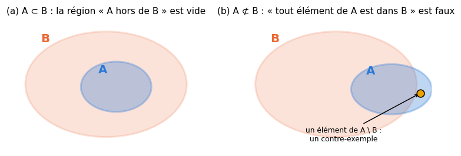
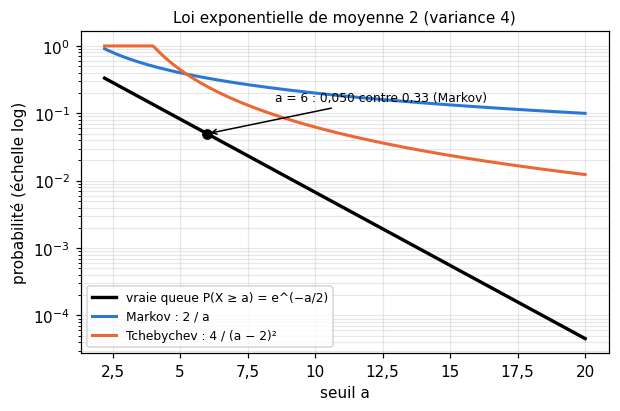
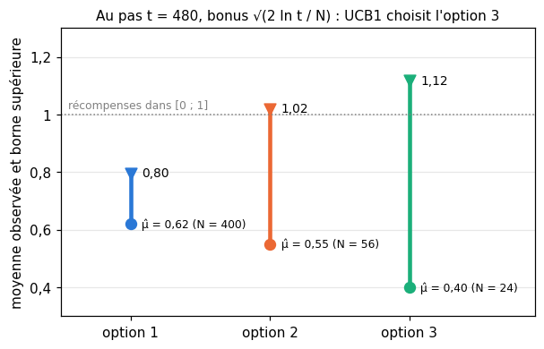
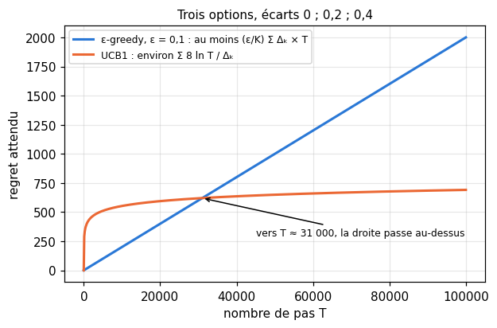

# M11 · Logique, induction et inégalités de concentration — fiche de cours

> Un modèle de ML conclut sans cesse : « cette pièce est défectueuse », « ce modèle est meilleur que l'autre ». Ce chapitre donne deux sortes d'outils pour juger ces conclusions. D'abord la **logique** : quand une conclusion découle-t-elle **nécessairement** de ce qu'on sait (une déduction valide), et quand n'est-elle que **probable** (une induction, qui généralise à partir d'exemples, avec ses pièges) ? Ensuite les **inégalités de concentration** : Markov, Tchebychev et Hoeffding disent **combien de chances** une moyenne calculée sur $n$ exemples a d'être loin de la vraie moyenne, sans connaître la loi des données. Elles fixent la taille d'un jeu de test, donnent un **rayon de confiance**, et expliquent d'où vient le bonus des stratégies qui doivent **explorer ou exploiter** (bornes supérieures de confiance, ε-greedy, échantillonnage de Thompson).

| | |
|---|---|
| **Sections** | §1 à §7 |
| **Temps total estimé** | ≈ 11,5 h : lecture et calculs de la fiche ≈ 2 h 30, exercices ≈ 8 h 20, 22 flashcards ≈ 45 min (parcours essentiel ≈ 7,2 h) |
| **Prérequis** | R4 (propositions, quantificateurs, implication, ensembles, raisonnements) ; R5 (suites) ; R6 (exp et ln) ; M02b (espérance, variance, lois exponentielle et binomiale) ; M02c (moyenne empirique, loi des grands nombres, théorème central limite, intervalle de confiance) ; M03 (probabilités totales, taux de base) ; M04 (formule de Bayes, loi Beta a posteriori) |
| **Fichiers du chapitre** | `02_exercices.md` (quiz, papier) · `03_notebook.ipynb` · `04_indices.md` · `05_solutions.md` et `05_solutions.ipynb` · `06_mes_reponses.md` · `flashcards.csv` |
| **mymath** | `concentration.py` : `markov_bound`, `chebyshev_bound`, `hoeffding_bound`, `hoeffding_radius`, `empirical_tail` |
| **MML** | — (MML ne traite ni la logique ni les inégalités de concentration : la fiche est le cours) |

## Comment utiliser ce chapitre

**Ordre conseillé.**
1. `python tools/start_chapter.py M11` (sur Colab : `00_setup/COLAB.md` §2) : il copie le notebook, ta feuille de réponses et le squelette `mymath/concentration.py`.
2. Section par section : lis **crayon en main**, refais chaque calcul ; puis fais les exercices de la section, quiz 🧠 d'abord.
3. Les exercices ✏️ et 🔗 se font sur papier, dans ta copie de `06_mes_reponses.md`, puis se vérifient dans la **partie 0** du notebook. Les démonstrations ∂ se rédigent dans ta copie et se jugent avec la grille de relecture de `05_solutions.md`.

Le chapitre a deux moitiés. Les §1 à §3 parlent de raisonnement : la logique propositionnelle de R4 appliquée à des arguments, les ensembles, puis l'induction. Les §4 à §7 chiffrent ce qu'une induction statistique peut garantir : trois inégalités, de la plus grossière à la plus fine, puis leur usage quand il faut choisir entre plusieurs options au fil des observations.

| Section | Quiz 🧠 et rappels 🔁 | Papier et réflexion | Notebook |
|---|---|---|---|
| §1 Raisonner juste | Q1, Q2, R1 | M11.1, M11.2 ✏️ | |
| §2 Ensembles et contre-exemples | Q3 | M11.3 ✏️ | |
| §3 L'induction et ses pièges | Q4 | M11.4 ✏️, M11.15 ⚖️ | |
| §4 L'inégalité de Markov | Q5, R2 | M11.5, M11.8 ✏️, M11.11 ∂ | M11.17, M11.19 🔨, M11.20 📦, M11.24 🎨, M11.25 🐛, M11.26 🛠️ |
| §5 Tchebychev et la loi des grands nombres | Q5, R2 | M11.6, M11.8 ✏️, M11.12 ∂ | M11.17 🔨, M11.20 📦, M11.21 🔮, M11.24 🎨 |
| §6 Hoeffding et le rayon de confiance | Q6 | M11.7, M11.8, M11.9 ✏️, M11.14 🔗, M11.E1 💼 | M11.18 🔨, M11.21 🔮, M11.22 🔬, M11.24 🎨, M11.25 🐛, M11.27 🏆 |
| §7 Explorer ou exploiter | Q7, R3 | M11.9, M11.10 ✏️, M11.13 ∂, M11.16 🗣️ | M11.23 🔬 |

Parcours essentiel : tout sauf M11.Q3, M11.Q7, M11.R3, M11.3, M11.8 à M11.10, M11.13, M11.15, M11.E1, M11.19, M11.20 et M11.22 à M11.27. Le §2 et le §7 se lisent en survol.

## Lecture conseillée (facultatif)

MML ne traite ni la logique ni les inégalités de concentration : cette fiche est le cours. Trois lectures en anglais, pour aller plus loin (références et conditions d'accès dans `annexes/ressources.md`) :
- R. Hammack, *Book of Proof*, chapitre 2 (*Logic*) et chapitre 1 (*Sets*), après les §1 et §2 : tables de vérité, quantificateurs, et la façon d'écrire une négation ;
- J. K. Blitzstein et J. Hwang, *Introduction to Probability*, chapitre 10 (*Inequalities and limit theorems*), §10.1 et §10.2, après les §4 et §5 ;
- T. Lattimore et C. Szepesvári, *Bandit Algorithms* (Cambridge University Press, 2020), chapitre 5 (*Concentration of Measure*) et chapitre 7 (*The Upper Confidence Bound Algorithm*), après les §6 et §7 : plus mathématique, pour qui veut les démonstrations complètes.

Ces lectures ne sont nécessaires à aucun exercice.

Vocabulaire anglais de ce chapitre : *argument*, *premise*, *conclusion*, *valid*, *sound*, *truth table*, *tautology*, *modus ponens*, *modus tollens*, *affirming the consequent*, *denying the antecedent*, *counterexample*, *subset*, *Venn diagram*, *induction*, *base rate*, *selection bias*, *survivorship bias*, *confounder*, *Markov's inequality*, *Chebyshev's inequality*, *(weak) law of large numbers*, *Hoeffding's inequality*, *concentration inequality*, *tail probability*, *confidence radius*, *union bound*, *explore–exploit trade-off*, *arm*, *regret*, *gap*, *upper confidence bound (UCB)*, *optimism in the face of uncertainty*, *ε-greedy*, *Thompson sampling*, *posterior*.

## Objectifs d'apprentissage

À la fin du chapitre, tu sais :
- **écrire** la réciproque, la contraposée et la négation d'un énoncé, et **décider** par une table de vérité si un argument est valide ;
- **traduire** des phrases en inclusions d'ensembles et **construire** un contre-exemple ;
- **repérer** les pièges d'une induction (petit échantillon, taux de base, échantillon biaisé, corrélation) et en **chiffrer** certains ;
- **démontrer** et **appliquer** les inégalités de Markov et de Tchebychev, et en **déduire** la loi faible des grands nombres ;
- **appliquer** l'inégalité de Hoeffding : borne, rayon de confiance, taille d'échantillon, et ce qu'elle suppose ;
- **expliquer** d'où vient le bonus d'une borne supérieure de confiance, et **calculer** le regret attendu d'ε-greedy.

## L'essentiel en 10 lignes

1. Un **argument** est **valide** si, dans toute ligne de sa table de vérité où les prémisses sont vraies, la conclusion l'est aussi ; **solide** s'il est valide et que ses prémisses sont vraies. Une seule ligne « prémisses vraies, conclusion fausse » prouve qu'il n'est pas valide.
2. *Modus ponens* ($P \Rightarrow Q$, $P$, donc $Q$) et *modus tollens* ($P \Rightarrow Q$, non $Q$, donc non $P$) sont valides ; affirmer le conséquent et nier l'antécédent ne le sont pas.
3. « Tout élément de $A$ a la propriété $B$ » s'écrit $A \subset B$ ; sa négation : il existe un élément de $A \setminus B$, un **contre-exemple**. La contraposée est l'inclusion des complémentaires, $\bar{B} \subset \bar{A}$.
4. Une **induction** généralise à partir d'exemples : sa conclusion est probable, jamais certaine. Ses pièges : trop peu d'exemples, le **taux de base** oublié, un échantillon **biaisé** (que la taille ne corrige pas), une corrélation prise pour une cause.
5. **Markov** : si $X \ge 0$ et $a > 0$, $P(X \ge a) \le \frac{\mathbb{E}[X]}{a}$. Elle n'utilise que la moyenne ; elle est atteinte par une loi à deux valeurs, 0 et $a$.
6. **Tchebychev** : $P(\lvert X - \mu \rvert \ge t) \le \frac{\sigma^2}{t^2}$ ; pour une moyenne de $n$ variables indépendantes, $\frac{\sigma^2}{n t^2}$, d'où la **loi faible des grands nombres**. Une variable dans $[a, b]$ a une variance au plus $\frac{(b - a)^2}{4}$.
7. **Hoeffding** : pour $n$ variables indépendantes à valeurs dans $[a, b]$, $P(\lvert \bar{X} - \mu \rvert \ge t) \le 2\exp\big(-\frac{2nt^2}{(b - a)^2}\big)$ : une décroissance **exponentielle** en $n$, sans connaître la loi.
8. **Rayon de confiance** : avec une probabilité au moins $1 - \delta$, $\lvert \bar{X} - \mu \rvert < (b - a)\sqrt{\frac{\ln(2/\delta)}{2n}}$ ; il faut 4 fois plus d'exemples pour un rayon 2 fois plus petit. Pour $K$ quantités regardées ensemble, on remplace $\delta$ par $\frac{\delta}{K}$.
9. **Regret** : $R_T = \sum_k \Delta_k\,\mathbb{E}[N_k(T)]$, l'écart $\Delta_k$ de chaque option à la meilleure fois le nombre attendu de fois qu'on la choisit. Avec ε fixé, ε-greedy a un regret au moins linéaire en $T$.
10. **UCB** choisit l'option dont la **borne supérieure** de confiance (Hoeffding, avec un risque qui décroît avec $t$) est la plus haute : c'est l'**optimisme face à l'incertitude**. **Thompson** tire une valeur dans chaque loi a posteriori et choisit la plus grande.

---

## §1 · Raisonner juste : implication, contraposée, négation, validité

### Ce que R4 a posé

Une implication $P \Rightarrow Q$ n'est fausse que dans un cas : $P$ vraie et $Q$ fausse. Sa **contraposée** non $Q \Rightarrow$ non $P$ a toujours la même valeur de vérité ; sa **réciproque** $Q \Rightarrow P$ est une autre phrase ; sa **négation** est « $P$ et non $Q$ ». Pour une phrase quantifiée, « pour tout $x$, $P(x) \Rightarrow Q(x)$ » se nie en « il existe $x$ tel que $P(x)$ et non $Q(x)$ ». Ce paragraphe fait un pas de plus : juger un **raisonnement** entier.

### Argument, validité, solidité

Un **argument** (*argument*) est une suite de **prémisses** (*premises*) suivie d'une **conclusion**. Exemple :

> Si $n$ est divisible par 6, alors $n$ est pair. 15 n'est pas pair. Donc 15 n'est pas divisible par 6.

Avec $P$ : « 15 est divisible par 6 » et $Q$ : « 15 est pair », sa **forme** est : $P \Rightarrow Q$ ; non $Q$ ; donc non $P$.

> **Validité.** Un argument est **valide** (*valid*) si sa conclusion est vraie dans **toutes** les situations où ses prémisses sont toutes vraies. Il est **solide** (*sound*) s'il est valide **et** que ses prémisses sont vraies : sa conclusion est alors vraie.

La validité ne dépend que de la **forme**, pas du sujet : on la teste par une **table de vérité** (*truth table*), une ligne par façon de donner une valeur aux propositions élémentaires ($2^m$ lignes pour $m$ propositions). L'argument est valide si aucune ligne ne rend les prémisses vraies et la conclusion fausse ; une telle ligne, s'il y en a une, est un **contre-exemple** de forme.

Pour l'argument ci-dessus (les lignes dans l'ordre VV, VF, FV, FF, celui de R4) :

| ligne | $P$ | $Q$ | prémisse 1 : $P \Rightarrow Q$ | prémisse 2 : non $Q$ | conclusion : non $P$ |
|---|---|---|---|---|---|
| 1 | V | V | V | F | F |
| 2 | V | F | F | V | F |
| 3 | F | V | V | F | V |
| 4 | F | F | **V** | **V** | **V** |

Seule la ligne 4 rend les deux prémisses vraies, et la conclusion y est vraie : l'argument est valide. Cette forme s'appelle *modus tollens* (« le mode qui nie »).

**Quatre formes à reconnaître.**

| Forme | Schéma | Valide ? |
|---|---|---|
| *modus ponens* | $P \Rightarrow Q$ ; $P$ ; donc $Q$ | oui |
| *modus tollens* | $P \Rightarrow Q$ ; non $Q$ ; donc non $P$ | oui |
| **affirmer le conséquent** | $P \Rightarrow Q$ ; $Q$ ; donc $P$ | **non** : la ligne 3 ($P$ faux, $Q$ vrai) |
| **nier l'antécédent** | $P \Rightarrow Q$ ; non $P$ ; donc non $Q$ | **non** : la ligne 3 encore |

Les deux formes non valides sont des **sophismes formels** : elles en ont l'air, mais leur forme ne garantit rien. Sur un exemple : « si la batterie est vide, l'ordinateur ne démarre pas ; il ne démarre pas ; donc la batterie est vide » affirme le conséquent. La ligne 3 de la table dit exactement ce qui peut arriver : la batterie est pleine et l'ordinateur ne démarre pas pour une autre raison (un écran débranché, une mise à jour bloquée).

Les implications s'enchaînent aussi : « $P \Rightarrow Q$ ; $Q \Rightarrow R$ ; donc $P \Rightarrow R$ » est valide (huit lignes à vérifier, M11.1).

⚠️ **Erreur classique.** Confondre validité et vérité. Un argument valide peut avoir une conclusion fausse, si une prémisse est fausse : « si $f$ est continue en 0, alors $f$ est dérivable en 0 ; $x \mapsto \lvert x \rvert$ est continue en 0 ; donc elle est dérivable en 0 » est un *modus ponens* parfait, dont la première prémisse est fausse ($\lvert x \rvert$ fait un coin en 0, R7). Et un argument non valide peut avoir une conclusion vraie, par chance : sa forme ne la garantit pas, voilà tout.

**Un cas limite.** Si les prémisses ne peuvent jamais être vraies ensemble (« $P$ ; non $P$ ; donc $Q$ »), aucune ligne ne les rend toutes vraies, et l'argument est valide **quelle que soit** la conclusion. Des prémisses contradictoires prouvent n'importe quoi : c'est une raison de plus de vérifier ses prémisses, pas seulement sa forme.

### Négation et contre-exemple

Pour réfuter « pour tout $x$ de $E$, $P(x)$ », il suffit d'**un** $x$ de $E$ qui ne vérifie pas $P$ ; pour prouver « il existe $x$ tel que $P(x)$ », il suffit d'**un** témoin. À l'inverse, prouver une phrase en « pour tout » sur un ensemble infini demande un raisonnement, et non une liste d'exemples (le §3 dira pourquoi). Avec plusieurs quantificateurs, on nie de gauche à droite, et l'ordre compte (R4) : « pour chaque dataset, il existe un modèle qui y atteint au moins 0,9 » n'est pas « il existe un modèle qui atteint au moins 0,9 sur chaque dataset » (M11.2).

🔗 **Dans workbookIA** — le chapitre 11 distingue la déduction et l'induction, et étudie d'autres familles de raisonnements (les syllogismes, qui relient des catégories) et leurs sophismes ; ses exercices sont à faire là-bas. La table de vérité de ce paragraphe est l'outil qui tranche, pour toute forme écrite avec « si… alors », « et », « ou » et « non ».

## §2 · Ensembles, diagrammes de Venn et contre-exemples

### Une phrase, une inclusion

Une phrase qui parle des éléments d'un ensemble $E$ se traduit en relation entre des parties de $E$. Notons $A = \{x \in E : x \text{ a la propriété } A\}$, et de même pour $B$ :

| Phrase | En ensembles | Ce qui la réfute |
|---|---|---|
| tout élément qui a la propriété $A$ a la propriété $B$ | $A \subset B$ | un élément de $A \setminus B$ |
| aucun élément de $A$ n'a la propriété $B$ | $A \cap B = \varnothing$ | un élément de $A \cap B$ |
| au moins un élément de $A$ a la propriété $B$ | $A \cap B \ne \varnothing$ | (un témoin la **prouve**) |
| au moins un élément de $A$ n'a pas la propriété $B$ | $A \setminus B \ne \varnothing$, soit $A \not\subset B$ | (un témoin la prouve) |

La dernière ligne est la **négation** de la première : nier une inclusion, c'est exhiber un contre-exemple. Et la logique du §1 se lit en ensembles : l'implication « si $x \in A$, alors $x \in B$ » **est** l'inclusion $A \subset B$ ; sa contraposée est l'inclusion des complémentaires, $\bar{B} \subset \bar{A}$ (ce qui n'est pas dans $B$ n'est pas dans $A$) ; sa réciproque est l'autre inclusion, $B \subset A$.

**Exemple.** $E = \{1, \ldots, 24\}$, $A$ les multiples de 4, $B$ les nombres pairs, $C$ les multiples de 3.
- « Tout multiple de 4 est pair » : $A = \{4, 8, 12, 16, 20, 24\} \subset B$, vrai.
- La réciproque, « tout nombre pair est multiple de 4 » : $B \subset A$, fausse ; $2 \in B \setminus A$ est un contre-exemple, et il y en a 6 ($|B \setminus A| = 12 - 6$).
- « Tout multiple de 3 est impair » : faux, $6 \in C \setminus \bar{B}$.
- $A \cap C = \{12, 24\}$ : « au moins un multiple de 4 est multiple de 3 » est vrai, avec deux témoins.
- Contraposée de la première phrase : $\bar{B}$ (les 12 impairs) est inclus dans $\bar{A}$ (les 18 non-multiples de 4).

**Le diagramme de Venn** dessine chaque ensemble comme une région du plan ; avec deux ensembles, quatre régions (dans $A$ et $B$, dans $A$ seulement, dans $B$ seulement, ni l'un ni l'autre). Une inclusion dit qu'une région est **vide** ; une phrase en « au moins un » dit qu'une région **contient** un élément. Le dessin aide à voir quelles régions une hypothèse vide, et où chercher un contre-exemple. Il ne prouve rien à lui seul : une preuve d'inclusion prend un élément quelconque de $A$ et montre qu'il est dans $B$.

**Compter.** Le cardinal d'une réunion se compte sans double compte (R4) : $\lvert A \cup C \rvert = \lvert A \rvert + \lvert C \rvert - \lvert A \cap C \rvert = 6 + 8 - 2 = 12$. C'est aussi ce qui fait les probabilités : avec un élément tiré au hasard dans $E$, $P(A \cup C) = \frac{12}{24}$.

⚠️ **Erreur classique.** Croire que « au moins un élément de $A$ est dans $B$ » et « au moins un élément de $B$ est dans $D$ » donnent « au moins un élément de $A$ est dans $D$ ». Les deux témoins peuvent être différents : avec $D = \{10, 22\}$, on a $4 \in A \cap B$ et $10 \in B \cap D$, et pourtant $A \cap D = \varnothing$. Seule une inclusion se transmet : $A \subset B$ et $B \subset D$ donnent $A \subset D$.

## §3 · L'induction et ses pièges

### Déduction et induction

Une **déduction** valide transporte la vérité des prémisses à la conclusion : elle ne peut pas se tromper si ses prémisses sont vraies. Une **induction** (*induction*) généralise à partir d'exemples : « tous les cas observés ont la propriété, donc tous les cas l'ont », ou « 30 % des cas observés l'ont, donc environ 30 % de tous les cas l'ont ». Sa conclusion est seulement **probable**. Apprendre un modèle à partir de données est une induction ; le §4 commence à chiffrer ce qu'elle peut garantir.

⚠️ **Attention au mot.** Le « raisonnement par récurrence » de R4 s'appelle *mathematical induction* en anglais, mais c'est une **déduction** : l'hérédité est démontrée pour **tout** $n$, pas observée sur quelques-uns.

### Piège 1 : des exemples qui ne prouvent rien

Le polynôme $n^2 + n + 41$ donne un nombre premier pour $n = 0, 1, 2, \ldots, 39$ : quarante exemples sur quarante. Pourtant $40^2 + 40 + 41 = 1\,681 = 41^2$ n'est pas premier. Aucune liste d'exemples ne démontre une phrase en « pour tout » sur un ensemble infini ; **un** contre-exemple la réfute. C'est l'asymétrie du §2 : prouver une inclusion demande un argument, la réfuter demande un témoin.

Quand l'induction porte sur une fréquence, le nombre d'exemples compte. Un événement de probabilité $p$ n'arrive jamais en $n$ essais indépendants avec la probabilité $(1 - p)^n$. Si l'on n'a vu **aucune** panne en $n$ essais, les valeurs de $p$ pour lesquelles ce résultat avait moins de 5 % de chances d'arriver sont celles où $(1 - p)^n < 0{,}05$, soit, comme $\ln(1 - p) \approx -p$ pour $p$ petit, $p > \frac{-\ln 0{,}05}{n} \approx \frac{3}{n}$. C'est la **règle de trois** : zéro panne en 150 essais permet seulement de dire, à 95 %, que $p$ est inférieur à environ $\frac{3}{150} = 2\,\%$, et non qu'il est nul.

### Piège 2 : oublier le taux de base

Un logiciel de détection de plagiat repère 95 % des copies plagiées et signale à tort 3 % des copies honnêtes ; 2 % des copies sont plagiées. Une enseignante conclut de ses premiers cas : « le logiciel est fiable à 95 %, donc une copie signalée est plagiée à 95 % ». C'est confondre $P(\text{signalée} \mid \text{plagiée})$ et $P(\text{plagiée} \mid \text{signalée})$. Bayes (M03) :

$$P(\text{plagiée} \mid \text{signalée}) = \frac{0{,}02 \times 0{,}95}{0{,}02 \times 0{,}95 + 0{,}98 \times 0{,}03} = \frac{0{,}019}{0{,}019 + 0{,}0294} \approx 0{,}39.$$

Sur 1 000 copies, 19 plagiats signalés et 29,4 copies honnêtes signalées : la majorité des signalements sont faux, parce que les copies honnêtes sont 49 fois plus nombreuses. Le **taux de base** (*base rate*), 2 %, pèse autant que la qualité du détecteur.

### Piège 3 : un échantillon biaisé

Une plateforme de cours en ligne veut connaître la note moyenne (sur 10) de ses inscrits à l'examen final, à partir des notes que les inscrits saisissent eux-mêmes sur leur profil. La moitié des inscrits ont 4, l'autre moitié 8 : la vraie moyenne vaut 6. Mais 10 % des premiers saisissent leur note, contre 40 % des seconds. Parmi les notes saisies, la part des 8 est $\frac{0{,}5 \times 0{,}4}{0{,}5 \times 0{,}1 + 0{,}5 \times 0{,}4} = 0{,}8$, et la moyenne des notes saisies tend vers $0{,}2 \times 4 + 0{,}8 \times 8 = 7{,}2$. Avec 10 000 notes saisies, l'estimation est très **précise** et pourtant fausse : la taille de l'échantillon réduit la part du hasard, jamais le **biais de sélection** (*selection bias*). Les inégalités des §4 à §6 supposent toutes des tirages **indépendants** dans la loi qu'on veut connaître ; elles ne disent rien d'un échantillon mal tiré.

Une variante fréquente est le **biais du survivant** (*survivorship bias*) : n'observer que ce qui a passé un filtre (les entreprises encore ouvertes, les modèles qui ont été mis en production) et en conclure que le filtre n'existe pas.

### Piège 4 : une corrélation prise pour une cause

Deux quantités qui varient ensemble peuvent dépendre toutes deux d'une troisième, un **facteur de confusion** (*confounder*) ; la causalité peut aller dans l'autre sens ; ou la corrélation peut venir du hasard, parmi beaucoup de paires regardées. Une expérience où l'on **tire au sort** qui reçoit le traitement coupe le lien avec les facteurs de confusion : c'est pourquoi elle est la référence pour conclure à une cause.

💼 **En entreprise.** « Les clients qui utilisent la nouvelle fonction résilient moins » : sans tirage au sort, cela peut vouloir dire que les clients déjà engagés essaient les nouvelles fonctions. Avant de conclure, demande comment le groupe a été formé (M11.15).

🔗 **Dans workbookIA** — le chapitre 11 donne le vocabulaire inductif du ML (généraliser, prédire, échantillon représentatif) et les noms des sophismes inductifs ; ses exercices sont à faire là-bas. Ici, les pièges sont chiffrés, et les §4 à §6 bornent ce qui reste quand l'échantillon est bien tiré.

## §4 · L'inégalité de Markov

### L'énoncé, et une preuve en une ligne

M02c a énoncé et démontré cette inégalité pour en tirer la loi des grands nombres. Reprenons-la pour elle-même.

> **Inégalité de Markov** (*Markov's inequality*). Si $X \ge 0$ a une espérance, alors pour tout $a > 0$ :
> $$P(X \ge a) \le \frac{\mathbb{E}[X]}{a}.$$

**Preuve par une indicatrice.** Notons $\mathbf{1}_{X \ge a}$ la variable qui vaut 1 si $X \ge a$ et 0 sinon (son espérance est $P(X \ge a)$). Pour toute valeur de $X$ : si $X \ge a$, $a\,\mathbf{1}_{X \ge a} = a \le X$ ; si $X < a$, $a\,\mathbf{1}_{X \ge a} = 0 \le X$, car $X \ge 0$. Donc $a\,\mathbf{1}_{X \ge a} \le X$ partout, et l'espérance, qui respecte l'ordre, donne $a\,P(X \ge a) \le \mathbb{E}[X]$.

**Exemple.** Un serveur reçoit $N$ requêtes par seconde, $N \ge 0$, avec $\mathbb{E}[N] = 40$. Sans rien savoir d'autre : $P(N \ge 200) \le \frac{40}{200} = 0{,}2$. Autre écriture : une variable positive dépasse $k$ fois sa moyenne avec une probabilité au plus $\frac{1}{k}$.

### Ce que la borne vaut

**Elle ne s'améliore pas sans autre information.** La variable $X$ qui vaut $a$ avec la probabilité $p$ et 0 sinon a pour espérance $pa$, et $P(X \ge a) = p = \frac{\mathbb{E}[X]}{a}$ : la borne est atteinte. Connaissant seulement $\mathbb{E}[X]$, on ne peut donc pas dire mieux.

**Elle est souvent très large.** Pour une loi exponentielle de moyenne 2, $P(X \ge 6) = e^{-6/2} = e^{-3} \approx 0{,}050$, alors que Markov donne $\frac{2}{6} \approx 0{,}33$, près de sept fois plus. La vraie queue d'une exponentielle décroît comme $e^{-a/\mu}$ ; la borne seulement comme $\frac{1}{a}$.

**Elle exige $X \ge 0$.** Une variable qui vaut $+10$ ou $-10$ avec la probabilité $\frac{1}{2}$ a une espérance nulle, et pourtant $P(X \ge 5) = \frac{1}{2}$ : appliquée sans précaution, « Markov » donnerait 0.

**Elle s'applique à toute fonction positive de $X$.** Si $\varphi$ est croissante et $\varphi(a) > 0$, l'événement $X \ge a$ est inclus dans $\varphi(X) \ge \varphi(a)$, d'où, pour une $\varphi$ positive :
$$P(X \ge a) \le \frac{\mathbb{E}[\varphi(X)]}{\varphi(a)}.$$
Avec $\varphi(x) = x^2$ (pour $X \ge 0$) on obtient une borne en $\frac{\mathbb{E}[X^2]}{a^2}$, avec $\varphi(x) = e^{\lambda x}$ une borne exponentielle : c'est la porte d'entrée de Tchebychev (§5) et de Hoeffding (§6). Plus on connaît de moments de $X$, meilleure est la borne.

### La queue empirique

Avec un échantillon $x_1, \ldots, x_n$, la proportion des valeurs au moins égales à $a$, $\frac{1}{n}\#\{i : x_i \ge a\}$, est la **queue empirique** (*empirical tail*), une estimation de $P(X \ge a)$ (`empirical_tail` dans `mymath`). Elle vérifie elle-même Markov : la loi qui donne le poids $\frac{1}{n}$ à chaque $x_i$ est une loi comme une autre, d'espérance $\bar{x}$. Pour des valeurs positives, la queue empirique ne dépasse donc jamais $\frac{\bar{x}}{a}$ (M11.5 g, M11.19).

⚠️ **Erreur classique.** Appliquer Markov à une variable qui peut être négative (un bénéfice, un écart à la moyenne, un score centré). Il faut d'abord se ramener à une variable positive : $\lvert X \rvert$, $(X - \mu)^2$, ou $X - m$ si $X \ge m$.

## §5 · L'inégalité de Tchebychev et la loi des grands nombres

### Tchebychev, de nouveau

> **Inégalité de Bienaymé-Tchebychev** (*Chebyshev's inequality*). Si $X$ a une espérance $\mu$ et une variance $\sigma^2$, alors pour tout $t > 0$ :
> $$P\big(\lvert X - \mu \rvert \ge t\big) \le \frac{\sigma^2}{t^2}.$$

C'est Markov appliquée à $(X - \mu)^2 \ge 0$ et au seuil $t^2$ (M02c, M11.12). Avec $t = k\sigma$ : au plus $\frac{1}{k^2}$ de chances d'être à $k$ écarts-types ou plus, pour **toute** loi. **Exemple.** Les requêtes du §4 ont aussi une variance de 100 (écart-type 10) : $P(N \ge 200) \le P(\lvert N - 40 \rvert \ge 160) \le \frac{100}{160^2} \approx 0{,}0039$, cinquante fois mieux que Markov, parce qu'on connaît un moment de plus.

**Elle est atteinte.** La variable qui vaut $\mu - t$ et $\mu + t$ avec la probabilité $\frac{p}{2}$ chacune, et $\mu$ sinon, a pour variance $p\,t^2$ et vérifie $P(\lvert X - \mu \rvert \ge t) = p = \frac{\sigma^2}{t^2}$.

### La moyenne de $n$ variables

Si $X_1, \ldots, X_n$ sont indépendantes (il suffit qu'elles soient deux à deux non corrélées), de même espérance $\mu$ et de même variance $\sigma^2$, la moyenne $\bar{X} = \frac{1}{n}\sum X_i$ a pour espérance $\mu$ et pour variance $\frac{\sigma^2}{n}$ (M02b). Tchebychev donne :

$$P\big(\lvert \bar{X} - \mu \rvert \ge t\big) \le \frac{\sigma^2}{n t^2} \xrightarrow[n \to +\infty]{} 0.$$

C'est la **loi faible des grands nombres** (*weak law of large numbers*) : pour tout $t > 0$, la probabilité que la moyenne soit à $t$ ou plus de $\mu$ tend vers 0. La borne dit aussi **combien** d'exemples suffisent : pour garantir $P(\lvert \bar{X} - \mu \rvert \ge t) \le \delta$, il suffit que
$$n \ge \frac{\sigma^2}{\delta\, t^2}.$$

### Borner une variance inconnue

Souvent $\sigma^2$ est inconnue, mais les valeurs sont bornées. Si $X$ prend ses valeurs dans $[a, b]$, alors
$$\mathbb{V}(X) \le \frac{(b - a)^2}{4},$$
avec égalité pour la loi qui met la moitié de sa masse en $a$ et l'autre en $b$. Preuve courte : la variance est la plus petite valeur de $\mathbb{E}[(X - c)^2]$ quand $c$ varie (elle est atteinte en $c = \mu$, M02b), donc $\mathbb{V}(X) \le \mathbb{E}\big[(X - \frac{a + b}{2})^2\big] \le \big(\frac{b - a}{2}\big)^2$, puisque $X$ est à au plus $\frac{b - a}{2}$ du milieu. Pour une variable qui vaut 0 ou 1 (une proportion), on retrouve $p(1 - p) \le \frac{1}{4}$.

**Exemple.** On veut une proportion inconnue $p$ à $\pm 0{,}04$, avec un risque d'au plus 5 %. Tchebychev, avec $\sigma^2 \le \frac{1}{4}$ : $n \ge \frac{0{,}25}{0{,}05 \times 0{,}04^2} = 3\,125$. L'approximation normale (M02c) disait $n \approx \big(\frac{1{,}96 \times 0{,}5}{0{,}04}\big)^2 \approx 601$ : Tchebychev demande cinq fois plus, prix d'une garantie valable pour toute loi et tout $n$, là où le TCL n'est qu'une approximation.

⚠️ **Erreur classique.** Diviser par $t$ au lieu de $t^2$, ou par $n$ au lieu de $n t^2$. Un contrôle rapide : diviser $t$ par 2 doit multiplier la taille d'échantillon par 4.

## §6 · L'inégalité de Hoeffding et le rayon de confiance

### L'énoncé

Tchebychev décroît comme $\frac{1}{n}$. Quand les variables sont **bornées**, on peut faire beaucoup mieux.

> **Inégalité de Hoeffding** (*Hoeffding's inequality*, 1963). Soient $X_1, \ldots, X_n$ des variables **indépendantes**, chacune à valeurs dans $[a, b]$, et $\bar{X}$ leur moyenne, d'espérance $\mu$. Pour tout $t > 0$ :
> $$P\big(\bar{X} - \mu \ge t\big) \le \exp\Big(-\frac{2nt^2}{(b - a)^2}\Big), \qquad P\big(\lvert \bar{X} - \mu \rvert \ge t\big) \le 2\exp\Big(-\frac{2nt^2}{(b - a)^2}\Big).$$

Les variables n'ont pas besoin d'avoir la même loi ; il faut seulement qu'elles soient indépendantes et toutes dans le même intervalle. La borne bilatérale additionne les deux côtés (« $\bar{X} - \mu \ge t$ » et « $\mu - \bar{X} \ge t$ »), d'où le facteur 2. Elle ne dépend que de $\frac{t}{b - a}$ : un écart de 1,5 pour des variables dans $[-3, 3]$ vaut un écart de 0,25 pour des variables dans $[0, 1]$.

**Exemple.** Une proportion ($[a, b] = [0, 1]$), $n = 500$, $t = 0{,}05$ : $2e^{-2 \times 500 \times 0{,}0025} = 2e^{-2{,}5} \approx 0{,}164$. Tchebychev, avec $\sigma^2 \le \frac{1}{4}$, donnait $\frac{0{,}25}{500 \times 0{,}0025} = 0{,}2$. À $n = 2\,000$, Hoeffding donne $2e^{-10} \approx 9 \times 10^{-5}$, Tchebychev $0{,}05$ : l'exponentielle finit toujours par l'emporter.

D'où vient l'exponentielle (idée de la preuve)

On applique Markov (§4) à $\varphi(x) = e^{\lambda x}$, pour un $\lambda > 0$ à choisir : avec $S = \sum (X_i - \mathbb{E}[X_i])$,
$$P(\bar{X} - \mu \ge t) = P\big(e^{\lambda S} \ge e^{\lambda n t}\big) \le e^{-\lambda n t}\,\mathbb{E}\big[e^{\lambda S}\big] = e^{-\lambda n t} \prod_{i=1}^{n} \mathbb{E}\big[e^{\lambda (X_i - \mathbb{E}[X_i])}\big],$$
la dernière égalité grâce à l'indépendance (l'espérance d'un produit de variables indépendantes est le produit des espérances). Un lemme de Hoeffding, que l'on admet, borne chaque facteur : pour une variable centrée à valeurs dans un intervalle de longueur $b - a$, $\mathbb{E}[e^{\lambda Y}] \le e^{\lambda^2 (b - a)^2 / 8}$. D'où
$$P(\bar{X} - \mu \ge t) \le \exp\Big(-\lambda n t + \frac{n \lambda^2 (b - a)^2}{8}\Big).$$
L'exposant est un polynôme du second degré en $\lambda$, minimal en $\lambda = \frac{4t}{(b - a)^2}$, où il vaut $-\frac{2nt^2}{(b - a)^2}$. Cette méthode (Markov sur une exponentielle, puis le meilleur $\lambda$) s'appelle la **méthode de Chernoff**.

### Le rayon de confiance, et la taille d'échantillon

Fixons le risque $\delta$ et cherchons l'écart $r$ pour lequel la borne bilatérale vaut $\delta$ : $2e^{-2nr^2/(b - a)^2} = \delta$ donne
$$r = (b - a)\sqrt{\frac{\ln(2/\delta)}{2n}}.$$

> **Rayon de confiance de Hoeffding.** Avec une probabilité au moins $1 - \delta$, $\lvert \bar{X} - \mu \rvert < r$ : l'intervalle $]\bar{X} - r, \bar{X} + r[$ contient $\mu$. C'est un intervalle de confiance valable pour **toute** loi à valeurs dans $[a, b]$ et pour **tout** $n$, sans approximation.

**Exemple.** $n = 500$ et $\delta = 0{,}05$, pour une proportion : $r = \sqrt{\frac{\ln 40}{1\,000}} \approx 0{,}061$. Pour le rayon unilatéral (seulement $\bar{X} - \mu$), on remplace $\ln(2/\delta)$ par $\ln(1/\delta)$.

Dans l'autre sens, pour obtenir un rayon $t$ avec un risque $\delta$, il suffit que
$$n \ge \frac{(b - a)^2 \ln(2/\delta)}{2t^2}.$$
Pour la proportion du §5 ($t = 0{,}04$, $\delta = 0{,}05$) : $n \ge \frac{\ln 40}{2 \times 0{,}0016} \approx 1\,152{,}8$, donc 1 153, contre 3 125 avec Tchebychev. Trois propriétés à retenir :
- le rayon décroît comme $\frac{1}{\sqrt{n}}$ : **quatre fois plus** d'exemples pour un rayon **deux fois** plus petit ;
- le risque n'entre que par un **logarithme** : diviser $\delta$ par 10 coûte peu ($\ln 400 \approx 6{,}0$ au lieu de $\ln 40 \approx 3{,}7$) ;
- la largeur $b - a$ compte au carré dans $n$.

![Le rayon à 95 % d'une moyenne de n variables dans [0, 1], en fonction de n : Tchebychev, Hoeffding et l'approximation normale, en échelles logarithmiques ; les trois décroissent comme 1/√n, Hoeffding est au-dessus du TCL mais bien sous Tchebychev](figures/rayons.png)

### Plusieurs quantités à la fois : la borne de l'union

Si l'on calcule $K$ moyennes (l'accuracy de $K$ modèles, la moyenne de $K$ options) et qu'on veut que **toutes** soient à moins de $r$ de leur espérance, chacune peut échouer avec la probabilité $\delta$, et l'une d'elles avec une probabilité au plus $K\delta$ : c'est la **borne de l'union** (*union bound*), $P(A_1 \cup \cdots \cup A_K) \le \sum P(A_k)$, déjà rencontrée avec Bonferroni (M08). Pour garder un risque global $\delta$, on calcule chaque rayon avec $\frac{\delta}{K}$, ce qui ne coûte qu'un $\ln K$ de plus sous la racine.

C'est indispensable dès qu'on **choisit** après avoir regardé : l'accuracy du meilleur de 20 modèles sur un même jeu de test n'a pas le rayon d'une accuracy calculée sur un modèle fixé d'avance (M11.14).

### Ce que Hoeffding suppose

- **Des variables bornées**, dans un intervalle connu **à l'avance** (une accuracy, une proportion, une loss tronquée) ; pas un revenu par client sans plafond, ni une loss qui peut exploser.
- **L'indépendance** : pas des mesures successives d'une même série temporelle, ni des exemples dupliqués entre l'entraînement et le test.
- **Une quantité fixée avant de regarder les données**, sinon la borne de l'union.

Elle ne suppose ni loi normale, ni $n$ grand, ni variance connue : c'est sa force. Sa faiblesse : elle ignore la variance, et quand celle-ci est très petite (une proportion proche de 0), Tchebychev peut faire mieux (M11.21).

💻 **Aujourd'hui en pratique** — Pour rapporter l'incertitude d'une accuracy, on utilise plutôt un intervalle de Wilson ou le bootstrap (M08, M02c), plus étroits. Hoeffding sert quand on veut une **garantie** sans hypothèse sur la loi, et c'est la brique de base de la théorie de l'apprentissage : les bornes de généralisation et les bornes de confiance du §7 en sont faites.

🔗 **Dans workbookIA** — la taille d'un jeu de test et la fiabilité d'une accuracy reviennent à chaque évaluation de modèle (chapitre 8 et suivants) ; le bonus des bornes supérieures de confiance du chapitre 11 vient de ce paragraphe (§7).

## §7 · Explorer ou exploiter : bornes supérieures de confiance, ε-greedy, regret, Thompson

### Le problème, et ce qu'on mesure

On dispose de $K$ options, qu'on appelle des **bras** (*arms*), comme les leviers d'une rangée de machines à sous : c'est le problème du **bandit manchot** (*multi-armed bandit*). L'option $k$ donne, chaque fois qu'on la choisit, une récompense aléatoire dans $[0, 1]$, de moyenne $\mu_k$ inconnue. À chaque pas $t = 1, 2, \ldots, T$, on choisit une option $A_t$ et l'on observe sa récompense ; on veut accumuler le plus possible. Choisir l'option qui a le mieux réussi jusqu'ici rapporte tout de suite ; essayer une option peu connue renseigne pour la suite. Ce compromis entre **exploitation** et **exploration** n'a pas de solution parfaite, mais il se mesure, et ce paragraphe en donne les outils mathématiques ; les stratégies elles-mêmes se programment dans workbookIA.

Notons $\mu^\star = \max_k \mu_k$ et $\Delta_k = \mu^\star - \mu_k \ge 0$ l'**écart** (*gap*) de l'option $k$ à la meilleure. Le **regret** (*regret*) après $T$ pas est ce qu'on a gagné en moins, en moyenne, que si l'on avait choisi la meilleure option à chaque pas :
$$R_T = \sum_{t=1}^{T} \mathbb{E}\big[\mu^\star - \mu_{A_t}\big] = \sum_{k=1}^{K} \Delta_k\,\mathbb{E}[N_k(T)],$$
où $N_k(T)$ est le nombre de fois que l'option $k$ a été choisie en $T$ pas. La seconde écriture (M11.13) regroupe les pas par option : chaque choix de l'option $k$ coûte $\Delta_k$. Une bonne stratégie choisit **rarement** les options de grand écart. Chaque terme étant positif, $R_T$ grandit avec $T$ ; s'il ne croît que comme $\ln T$, la proportion de pas mal employés, $\frac{R_T}{T}$, tend vers 0.

### ε-greedy : la loi de l'option choisie

La stratégie **ε-greedy** lance d'abord une pièce truquée : avec la probabilité $\varepsilon$, elle tire une option au hasard, uniformément ; sinon, elle prend l'option de meilleure moyenne observée, le choix « glouton ». Si le glouton désigne l'option $g$, les deux cas s'additionnent :
$$P(A_t = k) = (1 - \varepsilon)\,\mathbf{1}_{k = g} + \frac{\varepsilon}{K}.$$
Chaque option, même la pire, est donc choisie avec une probabilité au moins $\frac{\varepsilon}{K}$, à chaque pas. Le regret d'un pas vaut au moins $\frac{\varepsilon}{K}\sum_k \Delta_k$, et sur $T$ pas il croît **au moins linéairement** (M11.13). Faire décroître l'exploration, par exemple $\varepsilon_t = \frac{1}{t}$, change l'ordre de grandeur : la part du regret due à l'exploration devient $\frac{1}{K}\sum_k \Delta_k \sum_{t=1}^{T} \frac{1}{t}$, et cette **somme harmonique** (*harmonic series*) ne croît que comme $\ln T$ : comparée à l'aire sous la courbe de $\frac{1}{x}$ (M02a), elle reste entre $\ln T$ et $1 + \ln T$ (M11.13 le démontre, M11.10 s'en sert).

### UCB : une borne supérieure de confiance par option

Après $N$ choix de l'option $k$, de moyenne observée $\hat{\mu}_k$, la borne **unilatérale** de Hoeffding (§6, avec $\ln(1/\delta)$) dit qu'avec une probabilité au moins $1 - \delta$ :
$$\mu_k < \hat{\mu}_k + \sqrt{\frac{\ln(1/\delta)}{2N}}.$$
La stratégie **UCB** (*upper confidence bound*) choisit l'option dont cette **borne supérieure** est la plus grande. C'est l'**optimisme face à l'incertitude** (*optimism in the face of uncertainty*) : on agit comme si chaque option valait le plus qu'elle peut plausiblement valoir. Le **bonus** $\sqrt{\ln(1/\delta)/(2N)}$ est la demi-largeur d'un intervalle de confiance : avec peu de données, l'intervalle est large et sa borne haute peut dépasser toutes les autres, ce qui fait essayer l'option ; avec beaucoup de données, la borne rejoint la moyenne observée, et une option mauvaise passe sous la meilleure pour de bon.

Le risque $\delta$ doit **décroître** avec le temps : sur un horizon long, on regarde des milliers de bornes, et la borne de l'union demande que leurs risques aient une somme petite. Avec $\delta_t = t^{-4}$, $\ln(1/\delta_t) = 4\ln t$ et le bonus devient
$$\sqrt{\frac{2\ln t}{N}},$$
celui de la stratégie **UCB1** (Auer, Cesa-Bianchi et Fischer, 2002). Sur la figure, au pas $t = 480$ ($\ln 480 \approx 6{,}17$), l'option choisie 24 fois a un bonus $\sqrt{12{,}35/24} \approx 0{,}72$, celle choisie 400 fois $\sqrt{12{,}35/400} \approx 0{,}18$ (la situation est construite pour l'exemple : UCB1 lui-même aurait choisi l'option 3 bien plus tôt). Combien de fois choisit-on une option d'écart $\Delta$ ? Tant que son bonus dépasse $\frac{\Delta}{2}$, sa borne peut dépasser $\mu^\star$ ; or $\sqrt{2\ln t / N} < \frac{\Delta}{2}$ dès que $N > \frac{8\ln t}{\Delta^2}$. Le nombre de choix d'une mauvaise option croît donc comme $\ln T$, et le regret aussi (M11.9).

### L'échantillonnage de Thompson

Pour des récompenses 0 ou 1, la moyenne $\theta_k$ de l'option $k$ a, après $s$ succès et $f$ échecs et avec un a priori uniforme, la loi a posteriori $\mathrm{Beta}(1 + s, 1 + f)$ (M04). L'**échantillonnage de Thompson** (*Thompson sampling*, 1933) tire au hasard une moyenne plausible pour chaque option, selon sa loi a posteriori, et prend l'option dont le tirage est le plus haut. Résultat : une option est choisie exactement aussi souvent qu'elle a de chances, a posteriori, d'être la meilleure. Pour deux options, cette probabilité est $P(\theta_2 > \theta_1)$, avec deux variables Beta indépendantes.

**Exemple.** Une option sans aucune donnée, $\theta_1 \sim \mathrm{Beta}(1, 1)$, la loi uniforme, et une autre après un succès, $\theta_2 \sim \mathrm{Beta}(2, 1)$, de densité $2x$ sur $[0, 1]$. Comme $P(\theta_1 < x) = x$, $P(\theta_1 < \theta_2) = \mathbb{E}[\theta_2] = \int_0^1 x \cdot 2x\,dx = \frac{2}{3}$. Thompson choisit la seconde deux fois sur trois, la première une fois sur trois : l'option inconnue garde sa chance. Pour des paramètres plus grands, on calcule cette probabilité par une intégrale ou par simulation (M11.23).

La borne d'UCB1 porte une grosse constante (le 8 de $\frac{8 \ln T}{\Delta^2}$, qui vient de la marge de sécurité de Hoeffding) : sur la figure, la droite d'ε-greedy ne passe au-dessus qu'après environ 31 000 pas. Mais une croissance en $\ln T$ finit **toujours** sous une droite.

⚠️ **Erreur classique.** Croire qu'un bonus constant suffit, ou qu'on peut cesser d'explorer dès qu'une option semble meilleure. Une option écartée trop tôt sur une malchance ne sera jamais réessayée : c'est le risque d'une exploration qui s'arrête (le glouton pur), comme d'une exploration qui ne s'arrête jamais (ε fixé). UCB et Thompson règlent ce compromis par l'incertitude elle-même.

🔗 **Dans workbookIA** — le chapitre 11 programme un agent qui joue ces stratégies (ε-greedy, UCB, Thompson), compare leurs regrets et en tire des leçons ; ses fonctions `mylearn` et ses expériences sont à faire là-bas. Tu y reconnaîtras le bonus d'UCB (§6 et §7), la loi Beta de Thompson (M04) et le regret.

## Les pièges classiques ⚠️ (récapitulatif)

| Piège | Ce qu'il faut faire |
|---|---|
| Juger un argument sur la vérité de sa conclusion | la validité tient à la forme : chercher une ligne « prémisses vraies, conclusion fausse » |
| Affirmer le conséquent ($P \Rightarrow Q$, $Q$, donc $P$) | $Q$ peut avoir une autre cause : la ligne « $P$ faux, $Q$ vrai » |
| Prouver une phrase en « pour tout » par des exemples | un raisonnement pour tout élément ; un seul contre-exemple suffit à la réfuter |
| Enchaîner deux phrases en « au moins un » | seules les inclusions se transmettent ($A \subset B \subset C$) |
| Lire $P(\text{signal} \mid \text{cas})$ comme $P(\text{cas} \mid \text{signal})$ | Bayes, avec le taux de base |
| Croire qu'un très grand échantillon efface un biais de sélection | la moyenne converge vers celle des individus observés : changer la façon de tirer l'échantillon |
| Markov sur une variable qui peut être négative | se ramener à $\lvert X \rvert$, $(X - \mu)^2$ ou $X - m$ |
| Tchebychev avec $t$ au lieu de $t^2$ | diviser $t$ par 2 multiplie $n$ par 4 |
| Hoeffding sans bornes connues, ou sans indépendance | vérifier $[a, b]$ fixé d'avance et des tirages indépendants |
| Un rayon sans racine carrée, ou sans le facteur 2 du bilatéral | $r = (b - a)\sqrt{\ln(2/\delta) / (2n)}$ |
| Le rayon du meilleur de $K$ modèles calculé comme pour un seul | la borne de l'union : $\frac{\delta}{K}$ |
| Calculer le regret avec les récompenses obtenues | chaque choix de $k$ coûte $\Delta_k \ge 0$ en espérance, quel que soit le tirage |

## Et maintenant

**Dans ce dépôt** : CP2 fait le bilan de la partie II ; M13a reprend la vraisemblance, M14 la loi binomiale du vote majoritaire, et M26 l'espérance conditionnelle et la récurrence de Bellman, où la moyenne des retours observés estime une valeur.

**Dans workbookIA** : le chapitre 11 parle d'apprentissage et de raisonnement : la décomposition d'un algorithme d'apprentissage, la déduction et ses syllogismes, l'induction et ses sophismes, le conditionnement opérant, puis un agent qui apprend par essais et récompenses. Tu y reconnaîtras la validité et la table de vérité (§1), les contre-exemples (§2), les pièges de l'induction (§3) et les outils des §6 et §7 ; ses démonstrations, ses agents et ses fonctions `mylearn` sont à faire là-bas.

## Pour aller plus loin

- Les lectures conseillées ci-dessus, et `annexes/ressources.md`.
- Au-delà de Hoeffding : les inégalités de Bernstein, qui utilisent aussi la variance (elles font mieux que Hoeffding quand la variance est petite), et la borne de Chernoff relative pour une somme de variables de Bernoulli (Lattimore et Szepesvári, chapitre 5).
- `annexes/symboles.md` (lire $\mathbf{1}_{X \ge a}$, $\Delta_k$, $N_k(T)$, $R_T$ à voix haute), `annexes/formulaire.md` et `annexes/erreurs_frequentes.md`.
