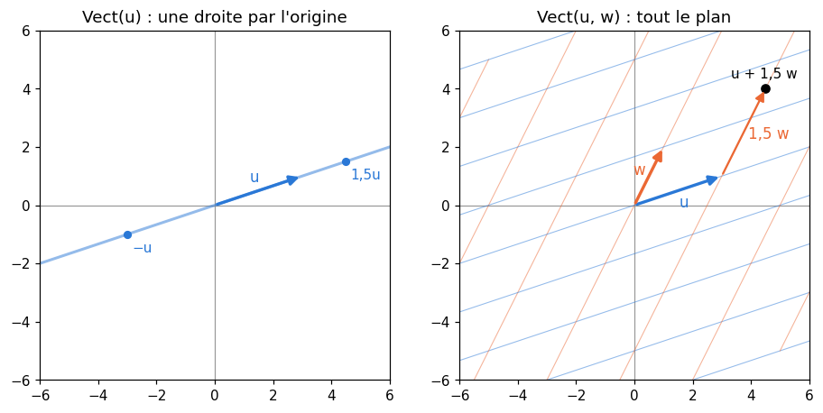
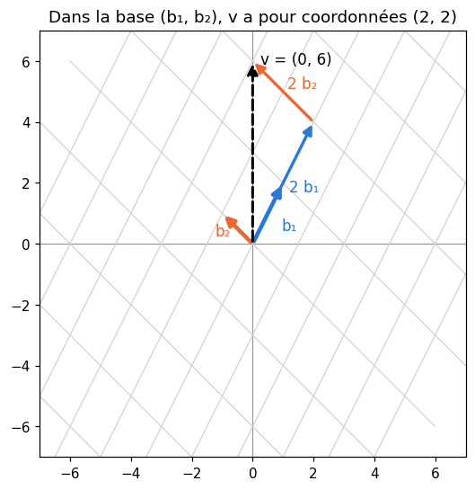
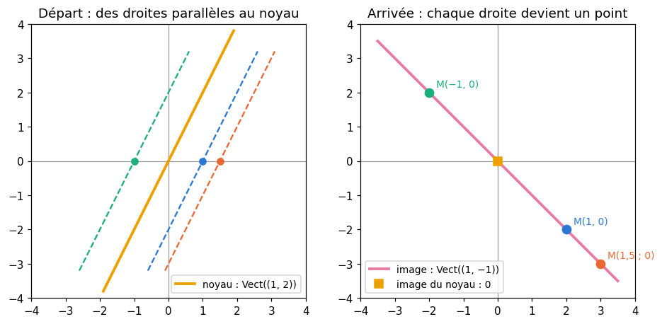
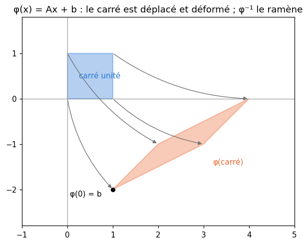

# M12a · Espaces vectoriels et applications linéaires — fiche de cours

> En M07, un exemple était un vecteur de $\mathbb{R}^n$ ; en M09a, un tableau de données était une matrice et le rang comptait des pivots. Ce chapitre donne le cadre qui relie tout cela : les **espaces vectoriels** et leurs **sous-espaces**, les **combinaisons linéaires**, l'**indépendance**, les **bases**, la **dimension** et les **coordonnées** ; puis le **rang** vu comme une dimension, les **applications linéaires** et leur **matrice**, le **noyau**, l'**image** et le **théorème du rang**, le **changement de base**, et enfin les **applications affines** et leur **réciproque**. Au passage, une feature redondante se lit dans un noyau, un tableau centré perd un rang, et une transformation qui écrase une direction ne peut pas être défaite.

| | |
|---|---|
| **Sections** | §1 à §8 |
| **Temps total estimé** | ≈ 16,6 h : lecture et calculs de la fiche ≈ 3 h 30, exercices ≈ 12 h 15, flashcards ≈ 50 min (parcours essentiel ≈ 10,8 h) |
| **Prérequis** | M09a (pivot de Gauss, forme échelonnée réduite, rang par les pivots, inverse) ; M07 (vecteurs de $\mathbb{R}^n$, combinaisons linéaires, produit scalaire, hyperplans, barycentres) ; R4 (raisonnements, ensembles) ; R7 (dérivée d'un polynôme) ; M02c (centrer une colonne) |
| **Fichiers du chapitre** | `02_exercices.md` (quiz, papier) · `03_notebook.ipynb` · `04_indices.md` · `05_solutions.md` et `05_solutions.ipynb` · `06_mes_reponses.md` · `flashcards.csv` |
| **mymath** | `linmaps.py` : `is_independent`, `column_space_basis`, `null_space_basis`, `coordinates`, `change_of_basis` |
| **MML** | §2.4, §2.5, §2.6, §2.7, §2.8 (voir le guide de lecture ci-dessous) |

## Comment utiliser ce chapitre

**Ordre conseillé.**
1. `python tools/start_chapter.py M12a` (sur Colab : `00_setup/COLAB.md` §2) : il copie le notebook, ta feuille de réponses et le squelette `mymath/linmaps.py`.
2. Section par section : lis **crayon en main**, refais chaque calcul ; puis fais les exercices de la section, quiz 🧠 d'abord.
3. Les exercices ✏️ et 🔗 se font sur papier, dans ta copie de `06_mes_reponses.md`, puis se vérifient dans la **partie 0** du notebook. Les démonstrations ∂ se rédigent dans ta copie et se jugent avec la grille de relecture de `05_solutions.md`.

**Un réflexe pour tout le chapitre** : avant tout calcul, dis **où vit** chaque objet. Un vecteur de $\mathbb{R}^3$ et un vecteur de $\mathbb{R}^4$ ne s'additionnent pas ; pour une matrice $\mathbf{A}$ de forme $(m, n)$, le noyau vit dans $\mathbb{R}^n$ (celui des entrées) et l'image dans $\mathbb{R}^m$ (celui des sorties). Presque toutes les erreurs de ce chapitre sont des objets rangés dans le mauvais espace.

| Section | Quiz 🧠 | Papier et réflexion | Notebook |
|---|---|---|---|
| §1 Espaces vectoriels et sous-espaces | Q1 | M12a.1 ✏️, M12a.14 ∂, M12a.22 📖 | — |
| §2 Combinaisons linéaires, familles génératrices et indépendance | Q2, Q3, R1 🔁, R3 🔁 | M12a.2, M12a.3 ✏️, M12a.22 📖 | M12a.26 🔨, M12a.33 🐛 |
| §3 Bases, dimension et coordonnées | Q4 | M12a.4, M12a.5, M12a.13 ✏️, M12a.15 ∂, M12a.23 📖, M12a.25 🗣️ | M12a.26, M12a.28 🔨 |
| §4 Le rang, et le rang d'un produit | Q5 | M12a.6 ✏️, M12a.18 ∂, M12a.20 🔗, M12a.25 🗣️, M12a.E1 💼 | M12a.26 🔨, M12a.29 📦, M12a.30 🔮, M12a.31 🔬 |
| §5 Applications linéaires et leur matrice | Q6, R2 🔁 | M12a.7, M12a.8, M12a.13 ✏️, M12a.24 🧮 | M12a.32 🎨 |
| §6 Noyau, image et théorème du rang | Q7 | M12a.9, M12a.10, M12a.13 ✏️, M12a.16, M12a.17 ∂, M12a.20, M12a.21 🔗, M12a.E1, M12a.E2 💼 | M12a.27 🔨, M12a.29 📦, M12a.32 🎨, M12a.33 🐛, M12a.34 🛠️, M12a.35 🏆 |
| §7 Changer de base | Q8 | M12a.11 ✏️ | M12a.28 🔨, M12a.33 🐛 |
| §8 Applications affines et transformation inverse | Q6 | M12a.12 ✏️, M12a.19 ∂, M12a.21 🔗, M12a.24 🧮 | — |

Parcours essentiel : tout sauf M12a.Q8, M12a.R3, M12a.8, M12a.13, M12a.15, M12a.17, M12a.18, M12a.19, M12a.21 à M12a.24, M12a.E1, M12a.E2, M12a.28, M12a.31 et M12a.33 à M12a.35. La justification de $\operatorname{rg}(\mathbf{A}) = \operatorname{rg}(\mathbf{A}^\top)$ et le rang d'un produit (§4), la démonstration du théorème du rang (§6) et le changement de base entre deux espaces différents (fin du §7) se lisent en survol.

## Guide de lecture de MML

*Mathematics for Machine Learning* (MML) consacre la seconde moitié de son chapitre 2, *Linear Algebra*, exactement aux notions de ce chapitre :
- après le **§2** de la fiche : le **§2.4**, *Vector Spaces* (le §2.4.1 sur les groupes se survole : il prépare la définition d'un espace vectoriel ; lis les §2.4.2 et §2.4.3, espaces et sous-espaces), puis le **§2.5**, *Linear Independence*. Questions : M12a.22 ;
- après le **§4** : le **§2.6**, *Basis and Rank* (familles génératrices, bases, dimension, rang) ;
- après le **§8** : le **§2.7**, *Linear Mappings* (matrice d'une application, changement de base, noyau et image), et le **§2.8**, *Affine Spaces*. Questions sur les §2.6 à §2.8 : M12a.23.

Le livre est plus abstrait que la fiche : il travaille dans un espace vectoriel quelconque, avec des bases quelconques, là où la fiche reste le plus souvent dans $\mathbb{R}^n$. Ses exemples se refont à la main ; ses exercices de fin de chapitre sur l'indépendance, le rang, le noyau et le changement de base sont conseillés.

📐 **Notations.** La fiche écrit $\operatorname{Vect}(\mathbf{v}_1, \ldots, \mathbf{v}_k)$ l'ensemble des combinaisons linéaires (MML : $\operatorname{span}[\mathbf{v}_1, \ldots, \mathbf{v}_k]$), $\dim V$ la dimension, $\operatorname{rg}(\mathbf{A})$ le rang (MML : $\operatorname{rk}(\mathbf{A})$), $\ker f$ le noyau et $\operatorname{Im} f$ l'image d'une application linéaire $f$ (MML : $\ker(\Phi)$, $\operatorname{Im}(\Phi)$, pour une application notée $\Phi : V \to W$), $\mathbb{R}_d[x]$ les polynômes de degré au plus $d$. Comme MML (et comme `linmaps.py`), une **famille de vecteurs** se range dans les **colonnes** d'une matrice : $[\mathbf{v}_1 \ \cdots \ \mathbf{v}_k]$.

Vocabulaire anglais de ce chapitre : *vector space*, *vector subspace*, *closure*, *neutral element*, *linear combination*, *span*, *generating set*, *spanning set*, *linearly independent*, *linearly dependent*, *basis*, *minimal generating set*, *maximal linearly independent set*, *dimension*, *coordinates*, *coordinate vector*, *ordered basis*, *rank*, *full rank*, *rank deficient*, *column space*, *row space*, *linear mapping*, *vector space homomorphism*, *injective*, *surjective*, *bijective*, *isomorphism*, *transformation matrix*, *kernel*, *null space*, *image*, *range*, *rank-nullity theorem*, *basis change*, *similar matrices*, *equivalent matrices*, *affine subspace*, *affine mapping*, *translation vector*, *support point*, *inverse mapping*.

## Objectifs d'apprentissage

À la fin du chapitre, tu sais :
- **reconnaître** un sous-espace vectoriel, et le **décrire** par une famille génératrice ou par des équations ;
- **décider** si une famille est libre, en **extraire** une base, et **calculer** des coordonnées dans une base ;
- **calculer** le rang d'une matrice, et **majorer** celui d'un produit ;
- **écrire** la matrice d'une application linéaire, et **composer** des applications en multipliant leurs matrices ;
- **calculer** un noyau et une image, **appliquer** le théorème du rang, et **décrire** toutes les solutions de $\mathbf{A}\mathbf{x} = \mathbf{b}$ ;
- **changer** de base, et **inverser** une application affine.

## L'essentiel en 10 lignes

1. Un **espace vectoriel** est un ensemble où l'on additionne des vecteurs et où on les multiplie par des nombres, avec les règles de calcul habituelles : $\mathbb{R}^n$, les polynômes, les matrices d'une forme donnée. Un **sous-espace** contient $\mathbf{0}$ et est stable par combinaison linéaire.
2. $\operatorname{Vect}(\mathbf{v}_1, \ldots, \mathbf{v}_k)$ est l'ensemble des combinaisons $\lambda_1\mathbf{v}_1 + \cdots + \lambda_k\mathbf{v}_k$ : le plus petit sous-espace qui contient ces vecteurs. Savoir si $\mathbf{b}$ y est, c'est résoudre le système $[\mathbf{v}_1 \cdots \mathbf{v}_k]\,\boldsymbol{\lambda} = \mathbf{b}$.
3. Une famille est **libre** si la seule combinaison nulle est celle dont tous les coefficients sont nuls ; sinon, l'un des vecteurs combine les autres. Test : chaque colonne de $[\mathbf{v}_1 \cdots \mathbf{v}_k]$ porte un pivot.
4. Une **base** est une famille libre et génératrice ; tout vecteur s'y écrit d'une seule façon, et ses coefficients sont ses **coordonnées**. Toutes les bases ont le même nombre de vecteurs : la **dimension**.
5. Le **rang** de $\mathbf{A}$ est la dimension de l'espace engendré par ses colonnes, égale à celle de l'espace engendré par ses lignes : $\operatorname{rg}(\mathbf{A}) = \operatorname{rg}(\mathbf{A}^\top) \le \min(m, n)$ ; $\operatorname{rg}(\mathbf{A}\mathbf{B}) \le \min(\operatorname{rg}\mathbf{A}, \operatorname{rg}\mathbf{B})$.
6. Une application **linéaire** respecte sommes et multiples : $f(\lambda\mathbf{x} + \mu\mathbf{y}) = \lambda f(\mathbf{x}) + \mu f(\mathbf{y})$. De $\mathbb{R}^n$ dans $\mathbb{R}^m$, c'est $\mathbf{x} \mapsto \mathbf{A}\mathbf{x}$, et la colonne $j$ de $\mathbf{A}$ est $f(\mathbf{e}_j)$ ; composer, c'est multiplier les matrices.
7. Le **noyau** $\ker\mathbf{A} = \{\mathbf{x} : \mathbf{A}\mathbf{x} = \mathbf{0}\}$ vit dans $\mathbb{R}^n$, l'**image** $\operatorname{Im}\mathbf{A}$ (l'espace des colonnes) dans $\mathbb{R}^m$. **Théorème du rang** : $\dim\ker\mathbf{A} + \operatorname{rg}\mathbf{A} = n$, le nombre de colonnes.
8. Les solutions de $\mathbf{A}\mathbf{x} = \mathbf{b}$, s'il y en a, sont $\mathbf{x}_p + \ker\mathbf{A}$ : une solution particulière plus le noyau. $\mathbf{A}$ est injective si et seulement si $\ker\mathbf{A} = \{\mathbf{0}\}$.
9. **Changer de base** : si les colonnes de $\mathbf{S}$ sont la nouvelle base, $\mathbf{x} = \mathbf{S}\mathbf{x}'$, et l'application $\mathbf{x} \mapsto \mathbf{A}\mathbf{x}$ a pour matrice $\mathbf{S}^{-1}\mathbf{A}\mathbf{S}$ dans la nouvelle base ($\mathbf{T}^{-1}\mathbf{A}\mathbf{S}$ entre deux espaces).
10. Une application **affine** est $\varphi(\mathbf{x}) = \mathbf{A}\mathbf{x} + \mathbf{b}$ ; elle est bijective si et seulement si $\mathbf{A}$ est inversible, et alors $\varphi^{-1}(\mathbf{y}) = \mathbf{A}^{-1}(\mathbf{y} - \mathbf{b})$ est encore affine.

---

## §1 · Espaces vectoriels et sous-espaces

### Ce qu'on demande à un ensemble de vecteurs

Dans $\mathbb{R}^n$ (M07), on additionne deux vecteurs et on multiplie un vecteur par un nombre, coordonnée par coordonnée. Bien d'autres objets se calculent de la même façon : les polynômes ($(1 + 2x) + 3(x - x^2) = 1 + 5x - 3x^2$), les matrices d'une même forme (M09a), les fonctions de $\mathbb{R}$ dans $\mathbb{R}$. Un **espace vectoriel** (*vector space*) sur $\mathbb{R}$ est un ensemble $V$ muni d'une addition et d'une multiplication par un réel, dont les résultats restent dans $V$, et qui respectent huit règles : l'addition est associative et commutative ; il existe un **vecteur nul** $\mathbf{0}$ avec $\mathbf{x} + \mathbf{0} = \mathbf{x}$ ; chaque $\mathbf{x}$ a un opposé $-\mathbf{x}$ ; enfin $\lambda(\mathbf{x} + \mathbf{y}) = \lambda\mathbf{x} + \lambda\mathbf{y}$, $(\lambda + \mu)\mathbf{x} = \lambda\mathbf{x} + \mu\mathbf{x}$, $\lambda(\mu\mathbf{x}) = (\lambda\mu)\mathbf{x}$ et $1\,\mathbf{x} = \mathbf{x}$. Ce sont exactement les règles que tu appliques sans y penser dans $\mathbb{R}^n$ : la définition dit seulement qu'on peut calculer de la même façon ailleurs. Les éléments de $V$ s'appellent des **vecteurs**, même quand ce sont des polynômes ou des matrices.

Exemples : $\mathbb{R}^n$ ; $\mathbb{R}_d[x]$, les polynômes de degré **au plus** $d$ (avec « au plus », la somme de deux d'entre eux y reste) ; $\mathbb{R}^{m \times n}$, les matrices de forme $(m, n)$ ; l'ensemble des suites réelles.

### Sous-espaces

Un **sous-espace vectoriel** (*vector subspace*) de $V$ est une partie $U \subseteq V$ qui est elle-même un espace vectoriel pour les mêmes opérations. Il suffit de vérifier trois choses :
1. $\mathbf{0} \in U$ ;
2. si $\mathbf{x}, \mathbf{y} \in U$, alors $\mathbf{x} + \mathbf{y} \in U$ (stable par addition) ;
3. si $\mathbf{x} \in U$ et $\lambda \in \mathbb{R}$, alors $\lambda\mathbf{x} \in U$ (stable par multiplication).

Les règles de calcul sont héritées de $V$. Les points 2 et 3 se vérifient d'un coup : $\lambda\mathbf{x} + \mu\mathbf{y} \in U$ pour tous $\mathbf{x}, \mathbf{y} \in U$ et tous réels $\lambda, \mu$.

**Exemples dans $\mathbb{R}^3$.** Le plan $P = \{(x, y, z) : x - 3y + 2z = 0\}$ est un sous-espace : $(0, 0, 0)$ vérifie l'équation, et si $\mathbf{u}$ et $\mathbf{v}$ la vérifient, $\lambda\mathbf{u} + \mu\mathbf{v}$ aussi, car le membre de gauche est linéaire en $(x, y, z)$. De même, toute droite **par l'origine**, $\{t\,\mathbf{d} : t \in \mathbb{R}\}$, et plus généralement l'ensemble des solutions d'un système **homogène** $\mathbf{A}\mathbf{x} = \mathbf{0}$ (§6). Les deux sous-espaces extrêmes sont $\{\mathbf{0}\}$ et $\mathbb{R}^3$ lui-même. En revanche :
- le plan $x - 3y + 2z = 5$ ne contient pas $\mathbf{0}$ : ce n'est **pas** un sous-espace (c'est un sous-espace **affine**, §8) ;
- l'octant $\{x \ge 0,\ y \ge 0,\ z \ge 0\}$ est stable par addition, mais $(-1) \cdot (1, 0, 0)$ en sort ;
- la boule $\lVert \mathbf{x} \rVert \le 1$ n'est stable ni par addition ni par multiplication ;
- la réunion de deux droites distinctes par l'origine est stable par multiplication, mais pas par addition (M12a.14).

**Dans les polynômes.** Les polynômes de $\mathbb{R}_3[x]$ qui s'annulent en $-1$ forment un sous-espace : si $P(-1) = Q(-1) = 0$, alors $(\lambda P + \mu Q)(-1) = 0$. Ceux qui valent 4 en $-1$, non : le polynôme nul n'y est pas.

### En machine learning

Les prédictions $\mathbf{X}\mathbf{w}$ d'un modèle linéaire, quand $\mathbf{w}$ parcourt $\mathbb{R}^p$, forment un sous-espace de $\mathbb{R}^n$ (M09b §3) : l'espace engendré par les colonnes de $\mathbf{X}$ (§4). Les poids $\mathbf{w}$ qui ne changent **aucune** prédiction, $\mathbf{X}\mathbf{w} = \mathbf{0}$, en forment un autre, de $\mathbb{R}^p$ : le noyau de $\mathbf{X}$ (§6).

⚠️ **Erreur classique.** Oublier le premier test. Un ensemble défini par une équation dont le second membre n'est pas nul (« $= 5$ », « $P(-1) = 4$ ») ne contient pas $\mathbf{0}$ : ce n'est jamais un sous-espace, aussi « plat » soit-il. Et pour montrer qu'une partie **n'est pas** un sous-espace, un seul contre-exemple suffit (R4) : deux vecteurs précis dont la somme sort, ou un vecteur précis et un nombre.

## §2 · Combinaisons linéaires, familles génératrices et indépendance

### Combinaisons linéaires et sous-espace engendré

Une **combinaison linéaire** (*linear combination*) de $\mathbf{v}_1, \ldots, \mathbf{v}_k$ est un vecteur $\lambda_1\mathbf{v}_1 + \cdots + \lambda_k\mathbf{v}_k$ (M07). L'ensemble de toutes ces combinaisons s'appelle le **sous-espace engendré** (*span*) :

$$\operatorname{Vect}(\mathbf{v}_1, \ldots, \mathbf{v}_k) = \{\lambda_1\mathbf{v}_1 + \cdots + \lambda_k\mathbf{v}_k : \lambda_1, \ldots, \lambda_k \in \mathbb{R}\}.$$

C'est un sous-espace (une combinaison de combinaisons est une combinaison), et le plus petit qui contient $\mathbf{v}_1, \ldots, \mathbf{v}_k$. On dit que la famille $(\mathbf{v}_1, \ldots, \mathbf{v}_k)$ est **génératrice** (*generating set*, *spanning set*) de $V$ quand $\operatorname{Vect}(\mathbf{v}_1, \ldots, \mathbf{v}_k) = V$ : tout vecteur de $V$ en est une combinaison. Dans le plan, un vecteur non nul engendre une droite par l'origine ; deux vecteurs non colinéaires engendrent tout le plan.



**Être une combinaison, c'est résoudre un système.** Par la lecture en colonnes du produit (M09a §2), $\lambda_1\mathbf{v}_1 + \cdots + \lambda_k\mathbf{v}_k = \mathbf{V}\boldsymbol{\lambda}$, avec $\mathbf{V} = [\mathbf{v}_1 \ \cdots \ \mathbf{v}_k]$. Donc $\mathbf{b} \in \operatorname{Vect}(\mathbf{v}_1, \ldots, \mathbf{v}_k)$ si et seulement si le système $\mathbf{V}\boldsymbol{\lambda} = \mathbf{b}$ a une solution. Exemple, avec $\mathbf{p} = (2, 1, 0)$ et $\mathbf{q} = (1, 3, -1)$ : $\mathbf{b} = (4, -3, 2)$ est-il une combinaison de $\mathbf{p}$ et $\mathbf{q}$ ? La troisième coordonnée donne $-\mu = 2$, donc $\mu = -2$ ; la première, $2\lambda + \mu = 4$, donc $\lambda = 3$ ; la deuxième se **vérifie** : $\lambda + 3\mu = 3 - 6 = -3$. Oui : $\mathbf{b} = 3\mathbf{p} - 2\mathbf{q}$. Pour $(1, 0, 1)$, la même méthode donne $\mu = -1$ et $\lambda = 1$, mais la deuxième coordonnée vaudrait $1 - 3 = -2 \ne 0$ : trois équations pour deux inconnues, et la dernière contredit les autres. Ce vecteur n'est pas dans le plan $\operatorname{Vect}(\mathbf{p}, \mathbf{q})$.

### Indépendance linéaire

Une famille $(\mathbf{v}_1, \ldots, \mathbf{v}_k)$ est **libre**, ou **linéairement indépendante** (*linearly independent*), si

$$\lambda_1\mathbf{v}_1 + \cdots + \lambda_k\mathbf{v}_k = \mathbf{0} \quad \Longrightarrow \quad \lambda_1 = \cdots = \lambda_k = 0 :$$

la seule façon d'obtenir $\mathbf{0}$ est la combinaison triviale. Sinon, elle est **liée** (*linearly dependent*) : il existe des coefficients non tous nuls qui donnent $\mathbf{0}$, et, en isolant un vecteur de coefficient non nul, l'un des vecteurs est une **combinaison des autres**. Une famille liée contient donc un vecteur redondant : on peut le retirer sans changer l'espace engendré.

**Le test par le pivot de Gauss.** $\mathbf{V}\boldsymbol{\lambda} = \mathbf{0}$ n'a que la solution nulle si et seulement s'il n'y a pas de variable libre, c'est-à-dire si **chaque colonne de $\mathbf{V}$ porte un pivot** : $\operatorname{rg}(\mathbf{V}) = k$. Exemple, $\mathbf{u}_1 = (1, 0, 1)$, $\mathbf{u}_2 = (2, 1, 0)$, $\mathbf{u}_3 = (0, 1, -2)$ :

$$\begin{pmatrix} 1 & 2 & 0 \\ 0 & 1 & 1 \\ 1 & 0 & -2 \end{pmatrix} \longrightarrow \begin{pmatrix} 1 & 0 & -2 \\ 0 & 1 & 1 \\ 0 & 0 & 0 \end{pmatrix}.$$

La troisième colonne n'a pas de pivot : la famille est liée. La forme réduite donne même la relation (comme en M09a §8) : sa troisième colonne, $(-2, 1)$, dit $\mathbf{u}_3 = -2\mathbf{u}_1 + \mathbf{u}_2$ ; vérifie-le.

**Quatre réflexes.**
- Une famille qui contient $\mathbf{0}$ est liée ($1 \cdot \mathbf{0} = \mathbf{0}$).
- Deux vecteurs sont liés si et seulement s'ils sont colinéaires.
- Plus de $n$ vecteurs de $\mathbb{R}^n$ sont toujours liés : la matrice a plus de colonnes que de lignes, donc au moins une colonne sans pivot.
- Une sous-famille d'une famille libre est libre ; une famille qui contient une famille liée est liée.

⚠️ **Erreur classique.** Conclure « libre » parce qu'aucun vecteur n'est le multiple d'un autre. Trois vecteurs de $\mathbb{R}^3$ deux à deux non colinéaires peuvent être liés : $\mathbf{u}_1$, $\mathbf{u}_2$, $\mathbf{u}_3$ ci-dessus le sont, car $\mathbf{u}_3$ combine **les deux** autres. Le test est le rang, pas les paires.

## §3 · Bases, dimension et coordonnées

### Bases

Une **base** (*basis*) de $V$ est une famille **libre et génératrice**. Génératrice : tout vecteur s'écrit comme combinaison ; libre : d'une **seule** façon (M12a.15). Les coefficients de cette écriture unique sont les **coordonnées** (*coordinates*) du vecteur dans la base, dans l'ordre de la base. Exemples :
- la **base canonique** $(\mathbf{e}_1, \ldots, \mathbf{e}_n)$ de $\mathbb{R}^n$ (M07) : les coordonnées de $\mathbf{x}$ y sont ses composantes ;
- $(1, x, x^2, \ldots, x^d)$ est une base de $\mathbb{R}_d[x]$ : $P = a_0 + a_1x + \cdots + a_dx^d$ a pour coordonnées $(a_0, a_1, \ldots, a_d)$ ;
- les $mn$ matrices qui ont un seul 1 et des 0 ailleurs forment une base de $\mathbb{R}^{m \times n}$.

Une base est à la fois une famille génératrice **minimale** (retirer un vecteur la fait cesser d'engendrer) et une famille libre **maximale** (ajouter un vecteur la rend liée).

### Dimension

**Théorème** (admis ; MML §2.6.1). Toutes les bases d'un même espace ont le même nombre de vecteurs. Ce nombre est la **dimension** (*dimension*) de l'espace, notée $\dim V$. Ainsi $\dim\mathbb{R}^n = n$, $\dim\mathbb{R}_d[x] = d + 1$ (attention au $+1$ du terme constant), $\dim\mathbb{R}^{m \times n} = mn$, $\dim\{\mathbf{0}\} = 0$ (la famille vide est une base). Une droite par l'origine est de dimension 1, un plan par l'origine de dimension 2.

Dans un espace de dimension $n$ :
- une famille libre a **au plus** $n$ vecteurs, une famille génératrice **au moins** $n$ ;
- $n$ vecteurs libres forment une base (inutile de vérifier qu'ils engendrent), et $n$ vecteurs générateurs aussi ;
- un sous-espace $U$ vérifie $\dim U \le n$, avec égalité si et seulement si $U$ est l'espace entier.

### Extraire une base, compléter une famille libre

**Extraire.** D'une famille génératrice de $U$, on garde les colonnes qui portent un pivot : elles sont libres, et chaque autre colonne en est une combinaison (la forme réduite dit laquelle). Elles forment une base de $U$, et leur nombre est $\dim U$. Pour $\mathbf{u}_1, \mathbf{u}_2, \mathbf{u}_3$ du §2, les pivots sont dans les colonnes 1 et 2 : $(\mathbf{u}_1, \mathbf{u}_2)$ est une base de $\operatorname{Vect}(\mathbf{u}_1, \mathbf{u}_2, \mathbf{u}_3)$, qui est un plan. C'est ce que fait `column_space_basis`.

**Compléter.** Pour compléter une famille libre $(\mathbf{v}_1, \ldots, \mathbf{v}_k)$ de $\mathbb{R}^n$ en une base, on écrit la matrice $[\mathbf{v}_1 \ \cdots \ \mathbf{v}_k \ \mathbf{e}_1 \ \cdots \ \mathbf{e}_n]$ et l'on garde ses colonnes à pivot : les $k$ premières en portent toutes (la famille est libre), puis on obtient les vecteurs de la base canonique qui manquent, de gauche à droite. Pour $(\mathbf{u}_1, \mathbf{u}_2)$ : $\mathbf{e}_1$ n'est pas dans le plan engendré, et $(\mathbf{u}_1, \mathbf{u}_2, \mathbf{e}_1)$ est une base de $\mathbb{R}^3$.

### Coordonnées dans une base

Si les colonnes de $\mathbf{B} = [\mathbf{b}_1 \ \cdots \ \mathbf{b}_n]$ forment une base de $\mathbb{R}^n$, les coordonnées $\mathbf{c}$ de $\mathbf{v}$ sont la solution de

$$\mathbf{B}\mathbf{c} = \mathbf{v}, \qquad \text{c'est-à-dire} \qquad \mathbf{v} = c_1\mathbf{b}_1 + \cdots + c_n\mathbf{b}_n,$$

et $\mathbf{c} = \mathbf{B}^{-1}\mathbf{v}$ : $\mathbf{B}$ est carrée et inversible, puisque ses colonnes sont libres (M09a §8). Exemple : dans la base $\mathbf{b}_1 = (1, 2)$, $\mathbf{b}_2 = (-1, 1)$ du plan, $\mathbf{v} = (0, 6)$ vérifie $c_1 - c_2 = 0$ et $2c_1 + c_2 = 6$, d'où $c_1 = c_2 = 2$ : $\mathbf{v} = 2\mathbf{b}_1 + 2\mathbf{b}_2$. Le **même** point a pour coordonnées $(0, 6)$ dans la base canonique et $(2, 2)$ dans la base $(\mathbf{b}_1, \mathbf{b}_2)$.



Si la base est celle d'un **sous-espace** $U$ de $\mathbb{R}^m$ ($\mathbf{B}$ de forme $(m, k)$ avec $k < m$), le système $\mathbf{B}\mathbf{c} = \mathbf{v}$ a plus d'équations que d'inconnues : il a une solution unique si $\mathbf{v} \in U$, aucune sinon. On le résout par Gauss sur $[\mathbf{B} \mid \mathbf{v}]$, ou par $\mathbf{B}^\top\mathbf{B}\,\mathbf{c} = \mathbf{B}^\top\mathbf{v}$ (une matrice carrée $k \times k$, inversible car les colonnes de $\mathbf{B}$ sont libres, §6), en vérifiant ensuite que $\mathbf{B}\mathbf{c}$ redonne bien $\mathbf{v}$ : c'est ce que fait `coordinates`.

```python
>>> import numpy as np
>>> B = np.array([[1, -1], [2, 1]])            # the basis b1 = (1, 2), b2 = (-1, 1), in the columns
>>> np.linalg.solve(B, [0, 6])                 # the coordinates of v = (0, 6)
array([2., 2.])
```

⚠️ **Erreur classique.** Ranger la base en **lignes** au lieu de colonnes, ou résoudre $\mathbf{v} = \mathbf{B}^\top\mathbf{c}$ : on obtient d'autres nombres, qui ne sont pas des coordonnées. Vérifie toujours en recalculant $c_1\mathbf{b}_1 + \cdots + c_n\mathbf{b}_n$. Et l'ordre de la base compte : $(\mathbf{b}_2, \mathbf{b}_1)$ est une autre base, où les coordonnées sont permutées.

## §4 · Le rang, et le rang d'un produit

### Le rang est une dimension

L'**espace des colonnes** (*column space*) d'une matrice $\mathbf{A}$ de forme $(m, n)$ est $\operatorname{Vect}(\mathbf{a}_1, \ldots, \mathbf{a}_n) \subseteq \mathbb{R}^m$, l'ensemble des $\mathbf{A}\mathbf{x}$ ; son **espace des lignes** (*row space*) est le sous-espace de $\mathbb{R}^n$ engendré par ses lignes. Le **rang** de $\mathbf{A}$ est la dimension de son espace des colonnes : le nombre maximal de colonnes libres. Les colonnes à pivot en forment une base (§3), donc c'est bien le nombre de pivots de M09a §8.

**Théorème.** L'espace des lignes a la **même dimension** que l'espace des colonnes : $\operatorname{rg}(\mathbf{A}) = \operatorname{rg}(\mathbf{A}^\top)$. *Pourquoi* : une opération élémentaire sur les lignes remplace des lignes par des combinaisons de lignes, et se défait (M09a §6) ; elle ne change donc pas l'espace des lignes. La forme réduite a le même espace des lignes que $\mathbf{A}$, et ses lignes non nulles, une par pivot, sont libres (chacune a un 1 là où les autres ont un 0). La dimension de l'espace des lignes est donc aussi le nombre de pivots. En particulier, $\operatorname{rg}(\mathbf{A}) \le \min(m, n)$, et l'on dit que $\mathbf{A}$ est **de rang plein** (*full rank*) en cas d'égalité ; sinon, elle est de rang déficient (*rank deficient*).

Exemple :

$$\mathbf{A} = \begin{pmatrix} 1 & 2 & 1 & 0 \\ 2 & 4 & 0 & 2 \\ 0 & 0 & 1 & -1 \end{pmatrix} \longrightarrow \begin{pmatrix} 1 & 2 & 0 & 1 \\ 0 & 0 & 1 & -1 \\ 0 & 0 & 0 & 0 \end{pmatrix}, \qquad \operatorname{rg}(\mathbf{A}) = 2.$$

Côté colonnes : $\mathbf{a}_2 = 2\mathbf{a}_1$ et $\mathbf{a}_4 = \mathbf{a}_1 - \mathbf{a}_3$ (lis-le dans les colonnes 2 et 4 de la forme réduite). Côté lignes : la ligne 2 vaut deux fois la ligne 1 moins deux fois la ligne 3. Deux colonnes libres, deux lignes libres.

### Le rang d'un produit

Chaque colonne de $\mathbf{A}\mathbf{B}$ est $\mathbf{A}$ fois une colonne de $\mathbf{B}$, donc une combinaison des colonnes de $\mathbf{A}$ : l'espace des colonnes de $\mathbf{A}\mathbf{B}$ est **inclus** dans celui de $\mathbf{A}$. De même, chaque ligne de $\mathbf{A}\mathbf{B}$ est une combinaison des lignes de $\mathbf{B}$. D'où

$$\operatorname{rg}(\mathbf{A}\mathbf{B}) \le \min\big(\operatorname{rg}(\mathbf{A}),\ \operatorname{rg}(\mathbf{B})\big)$$

(M12a.18 le démontre proprement). Un produit ne peut pas créer de directions : il peut seulement en perdre. Trois conséquences :
- multiplier par une matrice **inversible**, à gauche ou à droite, ne change pas le rang (appliquer l'inégalité dans les deux sens, avec l'inverse) ; à droite, il ne change même pas l'espace des colonnes : $\operatorname{Im}(\mathbf{A}\mathbf{S}) \subseteq \operatorname{Im}\mathbf{A}$, et $\mathbf{A} = (\mathbf{A}\mathbf{S})\mathbf{S}^{-1}$ donne l'inclusion inverse ;
- $\mathbf{u}\mathbf{v}^\top$, avec $\mathbf{u}$ et $\mathbf{v}$ non nuls, est de rang 1 : toutes ses colonnes sont des multiples de $\mathbf{u}$ ; une somme de $k$ matrices de rang 1 est de rang au plus $k$ ;
- $\mathbf{W} = \mathbf{B}\mathbf{C}$, avec $\mathbf{B}$ de forme $(d, r)$ et $\mathbf{C}$ de forme $(r, d)$, est de rang au plus $r$, même si $\mathbf{W}$ a $d^2$ coefficients : c'est l'idée des matrices de **petit rang** (*low-rank*), qui stockent $2dr$ nombres au lieu de $d^2$ (M12d y reviendra avec la SVD).

Enfin, $\operatorname{rg}(\mathbf{A}^\top\mathbf{A}) = \operatorname{rg}(\mathbf{A})$ : c'est plus fort que l'inégalité, et le §6 le démontre.

### Un tableau centré perd un rang

Un tableau $\mathbf{X}$ de $n$ exemples (lignes) et $p$ features, une fois **centré** (M02c, M09a §1), a des colonnes de somme nulle : $\mathbf{1}^\top\mathbf{X}_c = \mathbf{0}$, avec $\mathbf{1} = (1, \ldots, 1)$. Autrement dit, la somme de ses $n$ lignes est le vecteur nul : ses lignes sont **liées**, et $\operatorname{rg}(\mathbf{X}_c) \le n - 1$. Avec deux exemples seulement, le tableau centré a deux lignes opposées, et son rang est au plus 1, quel que soit le nombre de features. M12a.6 le vérifie sur un tableau, et workbookIA 12 s'en sert pour compter les directions d'un nuage de points.

### Le rang numérique

Sur des nombres à virgule flottante, « nul » devient « plus petit qu'une tolérance » : une colonne égale à la somme de deux autres **à $10^{-13}$ près** est redondante pour un mathématicien qui sait qu'elle a été construite ainsi, mais pas pour le pivot de Gauss, qui voit un pivot de $10^{-13}$. `linmaps.py` traite comme nul tout nombre inférieur à `tol` en valeur absolue (par défaut $10^{-10}$), comme `rref` de M09a ; `np.linalg.matrix_rank` utilise une autre méthode (la SVD, M12d) et une tolérance **relative** à la taille des nombres de la matrice. Le rang d'une matrice de données mesurées dépend donc d'un choix : à quelle précision considère-t-on qu'une relation est exacte ? M12a.31 explore ce choix.

⚠️ **Erreur classique.** Croire que le rang d'un produit est le minimum des rangs. Ce n'est qu'une **borne** : $\operatorname{rg}(\mathbf{A}\mathbf{B})$ peut être plus petit, par exemple si les colonnes de $\mathbf{B}$ tombent dans le noyau de $\mathbf{A}$ (§6), et $\mathbf{A}\mathbf{B}$ peut même être nulle avec $\mathbf{A} \ne \mathbf{0}$ et $\mathbf{B} \ne \mathbf{0}$.

## §5 · Applications linéaires et leur matrice

### Définition

Une application $f : V \to W$ entre deux espaces vectoriels est **linéaire** (*linear mapping*) si, pour tous $\mathbf{x}, \mathbf{y} \in V$ et tous réels $\lambda, \mu$,

$$f(\lambda\mathbf{x} + \mu\mathbf{y}) = \lambda f(\mathbf{x}) + \mu f(\mathbf{y}).$$

Conséquences immédiates : $f(\mathbf{0}) = \mathbf{0}$ (prendre $\lambda = \mu = 0$), et $f$ transforme toute combinaison linéaire en la même combinaison des images. Une application linéaire est donc entièrement déterminée par les images des vecteurs d'une base : si $\mathbf{x} = x_1\mathbf{e}_1 + \cdots + x_n\mathbf{e}_n$, alors $f(\mathbf{x}) = x_1 f(\mathbf{e}_1) + \cdots + x_n f(\mathbf{e}_n)$.

Exemples : $\mathbf{x} \mapsto \mathbf{A}\mathbf{x}$ pour toute matrice $\mathbf{A}$ ; dans le plan, une rotation de centre l'origine, une symétrie par rapport à une droite par l'origine, une projection sur une telle droite, une dilatation $(x, y) \mapsto (2x, y)$ ; la dérivation $P \mapsto P'$ sur les polynômes ; la transposition $\mathbf{M} \mapsto \mathbf{M}^\top$ sur les matrices. Contre-exemples : une translation $\mathbf{x} \mapsto \mathbf{x} + \mathbf{b}$ avec $\mathbf{b} \ne \mathbf{0}$ (elle n'envoie pas $\mathbf{0}$ sur $\mathbf{0}$ ; elle est **affine**, §8), $\mathbf{x} \mapsto \lVert \mathbf{x} \rVert$, $x \mapsto x^2$ ($(2 \times 1)^2 = 4 \ne 2 \times 1^2$), et les fonctions d'activation des réseaux, comme la ReLU appliquée coordonnée par coordonnée.

### La matrice d'une application linéaire

**De $\mathbb{R}^n$ dans $\mathbb{R}^m$**, toute application linéaire s'écrit $f(\mathbf{x}) = \mathbf{A}\mathbf{x}$ pour une seule matrice $\mathbf{A}$ de forme $(m, n)$ : sa **colonne $j$ est $f(\mathbf{e}_j)$**. C'est la lecture en colonnes de M09a §2, à l'envers : $\mathbf{A}\mathbf{x} = x_1\mathbf{a}_1 + \cdots + x_n\mathbf{a}_n$. Exemple, $f(x, y) = (x + y,\ x - y,\ 2x)$ de $\mathbb{R}^2$ dans $\mathbb{R}^3$ : $f(\mathbf{e}_1) = (1, 1, 2)$ et $f(\mathbf{e}_2) = (1, -1, 0)$, donc

$$\mathbf{A} = \begin{pmatrix} 1 & 1 \\ 1 & -1 \\ 2 & 0 \end{pmatrix}, \qquad \text{de forme } (3, 2) : \ m = 3 \text{ lignes pour l'arrivée, } n = 2 \text{ colonnes pour le départ.}$$

Dans le plan : la rotation d'un quart de tour, qui envoie $\mathbf{e}_1$ sur $(0, 1)$ et $\mathbf{e}_2$ sur $(-1, 0)$, a pour matrice $\mathbf{R} = \begin{pmatrix} 0 & -1 \\ 1 & 0 \end{pmatrix}$ ; la projection sur l'axe des abscisses, $\mathbf{P} = \begin{pmatrix} 1 & 0 \\ 0 & 0 \end{pmatrix}$.

**Dans d'autres bases** (MML §2.7.1, *transformation matrix*). Si $(\mathbf{b}_1, \ldots, \mathbf{b}_n)$ est une base de $V$ et $(\mathbf{c}_1, \ldots, \mathbf{c}_m)$ une base de $W$, la matrice de $f$ dans ces bases a pour colonne $j$ les **coordonnées** de $f(\mathbf{b}_j)$ dans la base $(\mathbf{c}_i)$. Exemple, sur $\mathbb{R}_2[x]$ muni de la base $(1, x, x^2)$, l'application $T(P)(x) = P(x + 1)$ (décaler d'une unité) : $T(1) = 1$, $T(x) = 1 + x$, $T(x^2) = 1 + 2x + x^2$, donc

$$\mathbf{M}_T = \begin{pmatrix} 1 & 1 & 1 \\ 0 & 1 & 2 \\ 0 & 0 & 1 \end{pmatrix}.$$

Pour $P = 3 - x + 2x^2$, de coordonnées $(3, -1, 2)$ : $\mathbf{M}_T(3, -1, 2) = (4, 3, 2)$, et en effet $P(x + 1) = 3 - (x + 1) + 2(x + 1)^2 = 4 + 3x + 2x^2$. Une fois une base choisie, calculer sur des polynômes revient à calculer sur des vecteurs de $\mathbb{R}^3$.

### Composer, c'est multiplier

Si $f(\mathbf{x}) = \mathbf{A}\mathbf{x}$ et $g(\mathbf{y}) = \mathbf{B}\mathbf{y}$, alors $(g \circ f)(\mathbf{x}) = g(f(\mathbf{x})) = \mathbf{B}(\mathbf{A}\mathbf{x}) = (\mathbf{B}\mathbf{A})\mathbf{x}$ : la matrice de « $f$, **puis** $g$ » est $\mathbf{B}\mathbf{A}$, la dernière appliquée **à gauche**. C'est la raison d'être de la définition du produit matriciel, et de son associativité. Avec $\mathbf{R}$ et $\mathbf{P}$ ci-dessus :

$$\underbrace{\mathbf{R}\mathbf{P} = \begin{pmatrix} 0 & 0 \\ 1 & 0 \end{pmatrix}}_{\text{projeter, puis tourner}} \qquad \ne \qquad \underbrace{\mathbf{P}\mathbf{R} = \begin{pmatrix} 0 & -1 \\ 0 & 0 \end{pmatrix}}_{\text{tourner, puis projeter}} .$$

La première envoie tout le plan sur l'axe des ordonnées, la seconde sur l'axe des abscisses : l'ordre compte, et c'est la non-commutativité du produit (M09a §3). Une application linéaire bijective a pour réciproque l'application de matrice $\mathbf{A}^{-1}$ ; défaire « $f$ puis $g$ », c'est défaire $g$ puis $f$ : $(\mathbf{B}\mathbf{A})^{-1} = \mathbf{A}^{-1}\mathbf{B}^{-1}$.

### En machine learning

Une couche dense **sans biais ni activation**, $\mathbf{x} \mapsto \mathbf{x}\mathbf{W}$ dans la convention des lignes (M09a §3), est linéaire ; avec son biais, elle est affine (§8). Chaque produit par une matrice de poids est une application linéaire, et le nombre de paramètres d'une application linéaire de $\mathbb{R}^n$ dans $\mathbb{R}^m$ est $mn$, celui de sa matrice (M12a.24). workbookIA 17 étudie ce que devient une suite de couches quand on retire les activations.

⚠️ **Erreur classique.** Écrire $\mathbf{A}\mathbf{B}$ pour « $f$ puis $g$ » : la composée $g \circ f$ se lit de droite à gauche, et sa matrice aussi, $\mathbf{B}\mathbf{A}$. Et ranger $f(\mathbf{e}_j)$ dans la **ligne** $j$ au lieu de la colonne $j$ : on obtient la transposée, qui n'a en général même pas la bonne forme.

## §6 · Noyau, image et théorème du rang

### Deux sous-espaces attachés à une application

Pour une application linéaire $f : V \to W$ :
- le **noyau** (*kernel*, *null space*) $\ker f = \{\mathbf{x} \in V : f(\mathbf{x}) = \mathbf{0}\}$ est un sous-espace de l'espace de **départ** $V$ (M12a.16) ;
- l'**image** (*image*, *range*) $\operatorname{Im} f = \{f(\mathbf{x}) : \mathbf{x} \in V\}$ est un sous-espace de l'espace d'**arrivée** $W$.

Pour $f(\mathbf{x}) = \mathbf{A}\mathbf{x}$, avec $\mathbf{A}$ de forme $(m, n)$ : $\ker\mathbf{A} \subseteq \mathbb{R}^n$ est l'ensemble des solutions du système homogène $\mathbf{A}\mathbf{x} = \mathbf{0}$, et $\operatorname{Im}\mathbf{A} \subseteq \mathbb{R}^m$ est l'espace des colonnes, de dimension $\operatorname{rg}(\mathbf{A})$.

### Les calculer par le pivot de Gauss

On réduit $\mathbf{A}$. **L'image** : les colonnes de $\mathbf{A}$ (pas celles de la forme réduite !) qui portent un pivot en forment une base (`column_space_basis`). **Le noyau** : chaque variable libre donne un vecteur de base. Pour la colonne libre $j$, on pose $x_j = 1$, les autres variables libres à 0, et l'on lit les variables de base dans la forme réduite $\mathbf{R}$ : pour le pivot de la ligne $i$, situé dans la colonne $p$, $x_p = -R_{ij}$ (`null_space_basis` ; c'est aussi la base que rend SymPy). Avec la matrice $\mathbf{A}$ du §4, les colonnes 2 et 4 sont libres :
- $x_2 = 1$, $x_4 = 0$ : $x_1 = -2$, $x_3 = 0$, d'où $\mathbf{k}_1 = (-2, 1, 0, 0)$ ;
- $x_2 = 0$, $x_4 = 1$ : $x_1 = -1$, $x_3 = 1$, d'où $\mathbf{k}_2 = (-1, 0, 1, 1)$.

Vérifie : $\mathbf{A}\mathbf{k}_1 = -2\mathbf{a}_1 + \mathbf{a}_2 = \mathbf{0}$ et $\mathbf{A}\mathbf{k}_2 = -\mathbf{a}_1 + \mathbf{a}_3 + \mathbf{a}_4 = \mathbf{0}$ : chaque vecteur du noyau **est** une relation entre les colonnes. L'image est le plan de $\mathbb{R}^3$ engendré par $\mathbf{a}_1 = (1, 2, 0)$ et $\mathbf{a}_3 = (1, 0, 1)$ ; un vecteur orthogonal à ces deux, $(2, -1, -2)$, en donne une équation : $\operatorname{Im}\mathbf{A} = \{\mathbf{y} : 2y_1 - y_2 - 2y_3 = 0\}$ (M07 §5).

```python
>>> import sympy
>>> A = sympy.Matrix([[1, 2, 1, 0], [2, 4, 0, 2], [0, 0, 1, -1]])
>>> A.rank(), [list(k) for k in A.nullspace()], [list(c) for c in A.columnspace()]
(2, [[-2, 1, 0, 0], [-1, 0, 1, 1]], [[1, 2, 0], [1, 0, 1]])
```

### Le théorème du rang

$$\dim\ker\mathbf{A} + \operatorname{rg}(\mathbf{A}) = n \qquad (\text{le nombre de colonnes, la dimension du départ}).$$

*Pourquoi* : chaque colonne de la forme réduite est soit une colonne à pivot (il y en a $\operatorname{rg}\mathbf{A}$), soit une colonne libre, qui donne un vecteur de base du noyau (M12a.17 démontre que ces vecteurs forment bien une base). Ici, $2 + 2 = 4$. Pour une application linéaire $f : V \to W$ : $\dim\ker f + \dim\operatorname{Im} f = \dim V$ (MML, *rank-nullity theorem*). Une application ne peut « envoyer » que les dimensions qu'elle n'écrase pas.



### Injective, surjective, bijective

$f$ est **injective** (*injective* : deux vecteurs distincts ont des images distinctes) si et seulement si $\ker f = \{\mathbf{0}\}$ (M12a.16) : si $f(\mathbf{x}) = f(\mathbf{y})$, alors $f(\mathbf{x} - \mathbf{y}) = \mathbf{0}$. Elle est **surjective** (*surjective* : tout vecteur de $W$ est atteint) si et seulement si $\operatorname{Im} f = W$, c'est-à-dire $\operatorname{rg} = \dim W$. Pour $\mathbf{A}$ de forme $(m, n)$ : injective si et seulement si $\operatorname{rg}\mathbf{A} = n$ (colonnes libres), surjective si et seulement si $\operatorname{rg}\mathbf{A} = m$. Par le théorème du rang, une matrice **carrée** est injective si et seulement si elle est surjective, si et seulement si elle est inversible (M09a §8). Une matrice plus large que haute ($n > m$) n'est jamais injective : son noyau a une dimension au moins $n - m$.

### Toutes les solutions de $\mathbf{A}\mathbf{x} = \mathbf{b}$

Si $\mathbf{x}_p$ est **une** solution (une solution **particulière**), les solutions sont exactement les vecteurs $\mathbf{x}_p + \mathbf{h}$ avec $\mathbf{h} \in \ker\mathbf{A}$ (M09a.17) :

$$\{\mathbf{x} : \mathbf{A}\mathbf{x} = \mathbf{b}\} = \mathbf{x}_p + \ker\mathbf{A}.$$

Le système a une solution si et seulement si $\mathbf{b} \in \operatorname{Im}\mathbf{A}$. Avec la matrice $\mathbf{A}$ du §4 et $\mathbf{b} = (1, 2, 0) = \mathbf{a}_1$ (qui vérifie $2 - 2 - 0 = 0$), $\mathbf{x}_p = \mathbf{e}_1$ convient, et toutes les solutions sont $(1, 0, 0, 0) + s\,(-2, 1, 0, 0) + t\,(-1, 0, 1, 1)$, $s, t \in \mathbb{R}$ : un plan de $\mathbb{R}^4$ qui ne passe pas par l'origine. Le nombre de paramètres libres est $\dim\ker\mathbf{A} = n - \operatorname{rg}\mathbf{A}$, comme l'annonçait M09a §8.

### En machine learning : des poids qui ne servent à rien

Si $\mathbf{X}\mathbf{d} = \mathbf{0}$ avec $\mathbf{d} \ne \mathbf{0}$, une feature est une combinaison des autres, et les poids $\mathbf{w}$ et $\mathbf{w} + t\,\mathbf{d}$ donnent **exactement les mêmes prédictions** pour tout $t$ : les poids d'un modèle linéaire ne sont plus uniques, et le vecteur $\mathbf{d}$ du noyau dit quelles features sont en cause (ses coordonnées non nulles). C'est le cas d'un tableau qui code une équipe de travail (matin, après-midi, nuit) par trois colonnes indicatrices (un 1 dans la colonne de l'équipe, des 0 ailleurs), à côté d'une colonne de 1 pour le biais : sur chaque ligne, les trois indicatrices ont pour somme 1, et $\mathbf{d} = (1, -1, -1, -1)$ est dans le noyau (M09a §8 l'a vu avec deux catégories). Le lien avec $\mathbf{X}^\top\mathbf{X}$ :

$$\ker(\mathbf{X}^\top\mathbf{X}) = \ker\mathbf{X}, \qquad \text{donc} \qquad \operatorname{rg}(\mathbf{X}^\top\mathbf{X}) = \operatorname{rg}(\mathbf{X}).$$

Si $\mathbf{X}\mathbf{w} = \mathbf{0}$, alors $\mathbf{X}^\top\mathbf{X}\mathbf{w} = \mathbf{0}$. Réciproquement, si $\mathbf{X}^\top\mathbf{X}\mathbf{w} = \mathbf{0}$, alors $\mathbf{w}^\top\mathbf{X}^\top\mathbf{X}\mathbf{w} = \lVert \mathbf{X}\mathbf{w} \rVert^2 = 0$, donc $\mathbf{X}\mathbf{w} = \mathbf{0}$. Les deux noyaux sont égaux ; par le théorème du rang (les deux matrices ont $p$ colonnes), les rangs aussi. Conséquence : $\mathbf{X}^\top\mathbf{X}$ est inversible **si et seulement si** les colonnes de $\mathbf{X}$ sont libres. M12a.20 le voit sur un tableau ; la régularisation de workbookIA 9 (ridge) est une façon de s'en sortir quand elles ne le sont pas.

⚠️ **Erreur classique.** Chercher le noyau dans le mauvais espace : pour $\mathbf{A}$ de forme $(3, 5)$, un vecteur du noyau a **5** coordonnées, une colonne de l'image en a **3**. Et prendre les colonnes de la **forme réduite** comme base de l'image : les opérations sur les lignes changent l'espace des colonnes (elles gardent seulement les relations entre colonnes). Les pivots disent **quelles** colonnes de $\mathbf{A}$ garder.

## §7 · Changer de base

### Les coordonnées changent, le vecteur reste

Soit $\mathbf{S} = [\mathbf{s}_1 \ \cdots \ \mathbf{s}_n]$ une matrice inversible : ses colonnes forment une nouvelle base de $\mathbb{R}^n$. Un vecteur de coordonnées $\mathbf{x}'$ dans cette base est $\mathbf{x} = x'_1\mathbf{s}_1 + \cdots + x'_n\mathbf{s}_n$ :

$$\mathbf{x} = \mathbf{S}\mathbf{x}' \qquad \text{et} \qquad \mathbf{x}' = \mathbf{S}^{-1}\mathbf{x} \quad (\text{le §3}).$$

$\mathbf{S}$ fait passer des **nouvelles** coordonnées aux **anciennes** (canoniques) : c'est le sens qui s'écrit sans inverse, et le plus facile à retenir.

### La matrice d'une application dans une nouvelle base

Soit $f(\mathbf{x}) = \mathbf{A}\mathbf{x}$ de $\mathbb{R}^n$ dans lui-même. Pour calculer l'image en nouvelles coordonnées : on revient aux anciennes ($\mathbf{S}\mathbf{x}'$), on applique $\mathbf{A}$, on repasse aux nouvelles ($\mathbf{S}^{-1}$) :

$$\mathbf{x}' \longmapsto \mathbf{S}^{-1}\mathbf{A}\mathbf{S}\,\mathbf{x}', \qquad \mathbf{A}' = \mathbf{S}^{-1}\mathbf{A}\mathbf{S}.$$

Deux matrices liées ainsi sont dites **semblables** (*similar*) : elles représentent la même application dans deux bases. Le produit se lit de droite à gauche, comme une composée (§5). La colonne $j$ de $\mathbf{A}'$ contient les coordonnées de $\mathbf{A}\mathbf{s}_j$ dans la nouvelle base.

**Pourquoi changer de base : une base adaptée simplifie tout.** La symétrie $f$ par rapport à la droite $y = 2x$ a, dans la base canonique, une matrice peu parlante, $\mathbf{A} = \frac{1}{5}\begin{pmatrix} -3 & 4 \\ 4 & 3 \end{pmatrix}$. Prenons la base $\mathbf{s}_1 = (1, 2)$ (sur la droite) et $\mathbf{s}_2 = (-2, 1)$ (perpendiculaire) : la symétrie garde $\mathbf{s}_1$ et retourne $\mathbf{s}_2$, $\mathbf{A}\mathbf{s}_1 = \mathbf{s}_1$ et $\mathbf{A}\mathbf{s}_2 = -\mathbf{s}_2$ (vérifie-le). Donc

$$\mathbf{S}^{-1}\mathbf{A}\mathbf{S} = \begin{pmatrix} 1 & 0 \\ 0 & -1 \end{pmatrix} :$$

dans la bonne base, la matrice est **diagonale**, et l'on voit d'un coup d'œil ce que fait l'application. Par exemple, $\mathbf{x} = (3, 1)$ a pour coordonnées $\mathbf{x}' = \mathbf{S}^{-1}\mathbf{x} = (1, -1)$ ; son image a pour coordonnées $(1, 1)$, c'est-à-dire $\mathbf{S}(1, 1) = (-1, 3)$ ; et directement, $\mathbf{A}\mathbf{x} = \frac{1}{5}(-9 + 4,\ 12 + 3) = (-1, 3)$. M12c cherchera systématiquement de telles bases.

**Ce qui ne change pas.** Le rang ($\mathbf{S}$ et $\mathbf{S}^{-1}$ sont inversibles, §4), et, on le verra en M12c, le déterminant, la trace et d'autres nombres attachés à l'application elle-même. Ce qui change : les coefficients de la matrice.

### Entre deux espaces différents

Pour $f(\mathbf{x}) = \mathbf{A}\mathbf{x}$ de $\mathbb{R}^n$ dans $\mathbb{R}^m$, avec une base $\mathbf{S}$ (inversible, $n \times n$) au départ et une base $\mathbf{T}$ (inversible, $m \times m$) à l'arrivée : $\mathbf{y} = \mathbf{A}\mathbf{x}$, $\mathbf{x} = \mathbf{S}\mathbf{x}'$, $\mathbf{y} = \mathbf{T}\mathbf{y}'$ donnent $\mathbf{T}\mathbf{y}' = \mathbf{A}\mathbf{S}\mathbf{x}'$, d'où

$$\mathbf{A}' = \mathbf{T}^{-1}\mathbf{A}\mathbf{S}$$

(MML, théorème 2.20, avec les mêmes lettres ; deux matrices liées ainsi sont dites **équivalentes**). On le calcule sans inverse : on résout $\mathbf{T}\mathbf{M} = \mathbf{A}\mathbf{S}$ (`change_of_basis`).

### En machine learning

Les features d'un exemple sont ses coordonnées dans la base canonique. D'autres bases donnent d'autres coordonnées pour le **même** point : l'analyse en composantes principales de workbookIA 12 (M12d) choisit une base orthonormée adaptée au nuage de points, et les nouvelles features sont les coordonnées dans cette base.

⚠️ **Erreur classique.** Écrire $\mathbf{S}\mathbf{A}\mathbf{S}^{-1}$ au lieu de $\mathbf{S}^{-1}\mathbf{A}\mathbf{S}$. Le test : appliquer à $\mathbf{x}'$, de droite à gauche. Le premier facteur rencontré doit transformer des **nouvelles** coordonnées en anciennes, c'est $\mathbf{S}$ ; puis $\mathbf{A}$ agit en anciennes coordonnées ; puis $\mathbf{S}^{-1}$ ramène aux nouvelles. Ou plus simplement : vérifie sur un vecteur de base, $\mathbf{A}'\mathbf{e}_1$ doit donner les coordonnées de $\mathbf{A}\mathbf{s}_1$.

## §8 · Applications affines et transformation inverse

### Sous-espaces affines

Un **sous-espace affine** (*affine subspace*) est un sous-espace vectoriel déplacé : $L = \mathbf{x}_0 + U = \{\mathbf{x}_0 + \mathbf{u} : \mathbf{u} \in U\}$, avec $U$ un sous-espace vectoriel (la **direction** de $L$) et $\mathbf{x}_0$ un point de $L$ (MML : *support point*). Sa dimension est celle de $U$. Une droite ou un plan qui ne passe pas par l'origine en est un ; l'ensemble des solutions de $\mathbf{A}\mathbf{x} = \mathbf{b}$ aussi, de direction $\ker\mathbf{A}$ (§6). Le plan $x - 3y + 2z = 5$ du §1 est le plan $P$ déplacé : $(5, 0, 0) + P$.

### Applications affines

Une **application affine** (*affine mapping*) de $\mathbb{R}^n$ dans $\mathbb{R}^m$ est

$$\varphi(\mathbf{x}) = \mathbf{A}\mathbf{x} + \mathbf{b},$$

une application linéaire (sa **partie linéaire** $\mathbf{A}$) suivie d'une **translation** de vecteur $\mathbf{b} = \varphi(\mathbf{0})$. Elle n'est linéaire que si $\mathbf{b} = \mathbf{0}$. Exemples : une couche dense avec biais, $\mathbf{x} \mapsto \mathbf{x}\mathbf{W} + \mathbf{b}$ ; une conversion d'unités qui a un décalage d'origine ; les mises à l'échelle de workbookIA 12 (min-max, standardisation), qui font, coordonnée par coordonnée, $x \mapsto ax + c$ avec $a > 0$.

Ce qu'une application affine conserve :
- les **combinaisons affines**, celles dont les coefficients ont une somme égale à 1 : si $\lambda_1 + \cdots + \lambda_k = 1$, alors $\varphi(\lambda_1\mathbf{x}_1 + \cdots + \lambda_k\mathbf{x}_k) = \lambda_1\varphi(\mathbf{x}_1) + \cdots + \lambda_k\varphi(\mathbf{x}_k)$ (le $\mathbf{b}$ apparaît $\lambda_1 + \cdots + \lambda_k = 1$ fois). Donc les **milieux** et les **barycentres** (M07 §6) ;
- les droites (envoyées sur des droites ou des points), le parallélisme, et les rapports de longueurs **sur une même droite**.

La composée de deux applications affines est affine, de partie linéaire le produit des parties linéaires (workbookIA 17 le démontre et s'en sert).

### La transformation inverse

**Théorème.** $\varphi(\mathbf{x}) = \mathbf{A}\mathbf{x} + \mathbf{b}$, de $\mathbb{R}^n$ dans lui-même, est bijective si et seulement si $\mathbf{A}$ est inversible ; sa réciproque est alors

$$\varphi^{-1}(\mathbf{y}) = \mathbf{A}^{-1}(\mathbf{y} - \mathbf{b}) = \mathbf{A}^{-1}\mathbf{y} - \mathbf{A}^{-1}\mathbf{b},$$

encore une application affine, de partie linéaire $\mathbf{A}^{-1}$ et de translation $-\mathbf{A}^{-1}\mathbf{b}$ (M12a.19). Pour défaire, on retire d'abord la translation, puis on défait la partie linéaire : l'ordre inverse de l'aller. Exemple : $\varphi(x, y) = (2x + y + 1,\ x + y - 2)$, de partie linéaire $\mathbf{A} = \begin{pmatrix} 2 & 1 \\ 1 & 1 \end{pmatrix}$ (déterminant 1, inverse $\begin{pmatrix} 1 & -1 \\ -1 & 2 \end{pmatrix}$) et de translation $\mathbf{b} = (1, -2)$. Alors

$$\varphi^{-1}(u, v) = \begin{pmatrix} 1 & -1 \\ -1 & 2 \end{pmatrix}\begin{pmatrix} u - 1 \\ v + 2 \end{pmatrix} = (u - v - 3,\ -u + 2v + 5).$$

Vérification : $\varphi(1, 1) = (4, 0)$, et $\varphi^{-1}(4, 0) = (4 - 0 - 3,\ -4 + 0 + 5) = (1, 1)$.



**Ce qui ne se défait pas.** Si $\mathbf{A}$ n'est pas inversible, $\varphi$ écrase les directions de $\ker\mathbf{A}$ : deux points qui diffèrent d'un vecteur du noyau ont la même image, et aucune application, affine ou non, ne peut les distinguer après coup. Projeter des données sur un plan puis « revenir » ne rend que la projection : la composante écrasée est perdue (M12a.21).

### En machine learning : la transformation inverse

Une mise à l'échelle feature par feature est une application affine de matrice diagonale ; si aucun nombre de cette diagonale n'est nul, elle est bijective, et sa réciproque est encore affine (le théorème ci-dessus) : c'est elle que calcule la méthode `inverse_transform` des objets de scikit-learn. workbookIA 12 et 15 s'en servent ; ce chapitre t'en donne le fondement.

⚠️ **Erreur classique.** Écrire $\varphi^{-1}(\mathbf{y}) = \mathbf{A}^{-1}\mathbf{y} - \mathbf{b}$, en oubliant que la translation est elle aussi transformée par $\mathbf{A}^{-1}$. Vérifie toujours sur $\varphi^{-1}(\varphi(\mathbf{0})) = \varphi^{-1}(\mathbf{b})$, qui doit valoir $\mathbf{0}$.

🔗 **Dans workbookIA** — le chapitre 12 prépare les données : il encode des catégories, met des features à l'échelle par des applications affines et défait ces transformations, repère des colonnes redondantes, et réduit la dimension en changeant de base. Ce chapitre t'en a donné le vocabulaire (sous-espace, base, coordonnées, rang, noyau, application affine, réciproque) ; M12b à M12d ajoutent l'orthogonalité, les valeurs propres et la SVD.

---

## Les pièges classiques ⚠️ (récapitulatif)

| Piège | Ce qu'il faut faire |
|---|---|
| Un ensemble défini par une équation à second membre non nul pris pour un sous-espace | tester d'abord $\mathbf{0}$ ; c'est un sous-espace affine, pas vectoriel |
| « Libre » conclu parce qu'aucun vecteur n'est multiple d'un autre | le rang : un vecteur peut combiner plusieurs autres |
| Une base rangée en lignes, ou $\mathbf{B}^\top\mathbf{c} = \mathbf{v}$ | les vecteurs de base dans les **colonnes**, et vérifier $c_1\mathbf{b}_1 + \cdots = \mathbf{v}$ |
| $\dim\mathbb{R}_d[x] = d$ | $d + 1$ : le terme constant compte |
| $\operatorname{rg}(\mathbf{A}\mathbf{B}) = \min(\operatorname{rg}\mathbf{A}, \operatorname{rg}\mathbf{B})$ | ce n'est qu'une borne supérieure |
| La matrice de « $f$ puis $g$ » écrite $\mathbf{A}\mathbf{B}$ | $\mathbf{B}\mathbf{A}$ : on lit de droite à gauche |
| $f(\mathbf{e}_j)$ rangé dans la ligne $j$ | dans la **colonne** $j$ |
| Le noyau cherché dans l'espace d'arrivée | $\ker\mathbf{A} \subseteq \mathbb{R}^n$ (départ), $\operatorname{Im}\mathbf{A} \subseteq \mathbb{R}^m$ (arrivée) |
| Une base de l'image prise dans la forme réduite | les colonnes **de $\mathbf{A}$** dont l'indice porte un pivot |
| $\mathbf{S}\mathbf{A}\mathbf{S}^{-1}$ pour la matrice dans la base $\mathbf{S}$ | $\mathbf{S}^{-1}\mathbf{A}\mathbf{S}$ ; vérifier sur $\mathbf{A}'\mathbf{e}_1$ |
| $\varphi^{-1}(\mathbf{y}) = \mathbf{A}^{-1}\mathbf{y} - \mathbf{b}$ | $\mathbf{A}^{-1}(\mathbf{y} - \mathbf{b})$ ; vérifier $\varphi^{-1}(\mathbf{b}) = \mathbf{0}$ |
| Un rang calculé en flottants pris pour exact | dire la tolérance, et penser à l'échelle des colonnes |

## Et maintenant

**Dans ce dépôt** : M12b ajoute un produit scalaire à ces espaces (bases orthonormées, projections, Gram-Schmidt, QR) ; M12c cherche les bases qui rendent une matrice diagonale (valeurs et vecteurs propres, déterminant, matrices symétriques) ; M12d en tire la SVD, l'analyse en composantes principales et le conditionnement.

**Dans workbookIA** : le chapitre 12 prépare les données. Tu y reconnaîtras les mises à l'échelle affines et leur transformation inverse (§8), les colonnes redondantes et le rang (§4 et §6), le tableau centré qui perd un rang (§4), et des coordonnées dans une nouvelle base (§7).

## Pour aller plus loin

- MML §2.4 à §2.8, et les exercices du chapitre 2 du livre sur les sous-espaces, l'indépendance, le rang, le noyau, l'image et le changement de base (conseillés).
- 3Blue1Brown, *Essence of linear algebra* : les épisodes sur les combinaisons linéaires et le sous-espace engendré, le rang et le noyau (*Inverse matrices, column space and null space*) et le changement de base (en anglais, sous-titres disponibles).
- `annexes/symboles.md` (lire $\operatorname{Vect}$, $\dim$, $\ker$, $\operatorname{Im}$ et $\mathbf{S}^{-1}\mathbf{A}\mathbf{S}$ à voix haute), `annexes/formulaire.md` et `annexes/erreurs_frequentes.md`.
