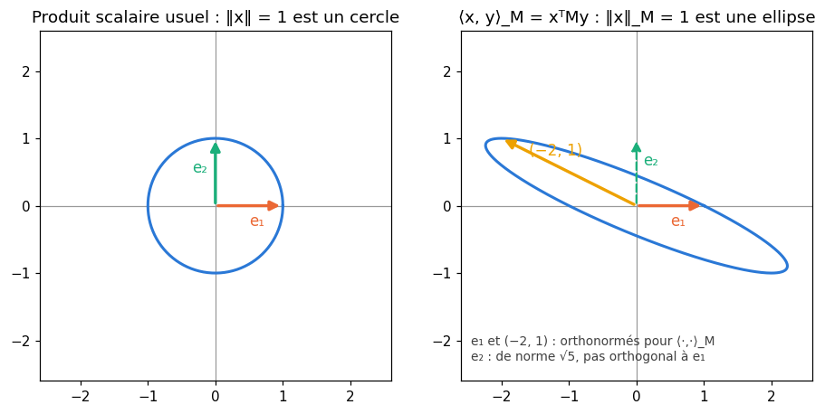
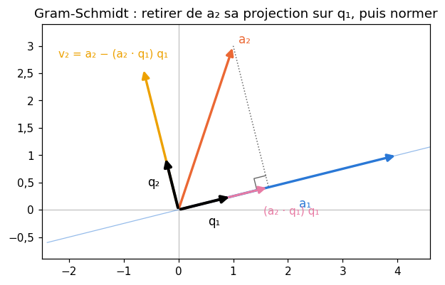
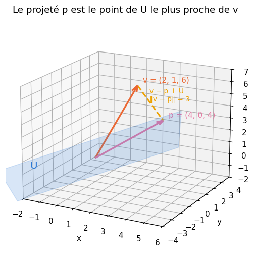
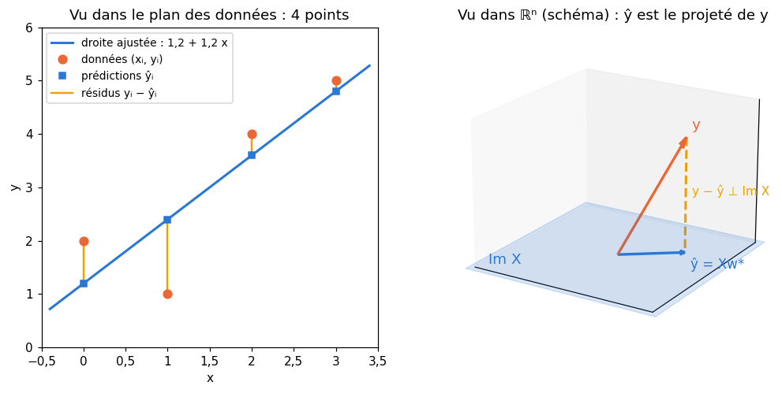

# M12b · Orthogonalité et projections — fiche de cours

> En M07, le produit scalaire de $\mathbb{R}^n$ donnait des longueurs, des angles et la projection sur une droite ; en M09b, les moindres carrés menaient aux équations normales ; en M12a, un sous-espace avait une base et une dimension. Ce chapitre réunit les trois : des **produits scalaires** plus généraux, les **bases orthonormées** (où les coordonnées se lisent par des produits scalaires) et les **matrices orthogonales**, le **procédé de Gram-Schmidt** qui fabrique une base orthonormée, le **complément orthogonal**, la **projection orthogonale** sur un sous-espace et le fait qu'elle donne le **point le plus proche**, les **moindres carrés** revus comme une projection, la **décomposition QR**, et enfin un produit scalaire entre **fonctions**. Au passage, centrer une colonne devient une projection, et l'on voit pourquoi les bibliothèques résolvent les moindres carrés sans jamais former $\mathbf{X}^\top\mathbf{X}$.

| | |
|---|---|
| **Sections** | §1 à §8 |
| **Temps total estimé** | ≈ 15,2 h : lecture et calculs de la fiche ≈ 3 h, exercices ≈ 11 h 30, flashcards ≈ 45 min (parcours essentiel ≈ 9,5 h) |
| **Prérequis** | M12a (base, dimension, rang, noyau et image) ; M09b (équations normales, matrice chapeau) ; M07 (produit scalaire, normes, projection sur une droite, Cauchy-Schwarz) ; M02a (intégrales) |
| **Fichiers du chapitre** | `02_exercices.md` (quiz, papier) · `03_notebook.ipynb` · `04_indices.md` · `05_solutions.md` et `05_solutions.ipynb` · `06_mes_reponses.md` · `flashcards.csv` |
| **mymath** | `orthogonal.py` : `gram_schmidt`, `project`, `qr`, `least_squares_qr` |
| **MML** | §3.2.2, §3.2.3, §3.5, §3.6, §3.7, §3.8, §9.4 (voir le guide de lecture ci-dessous) |

## Comment utiliser ce chapitre

**Ordre conseillé.**
1. `python tools/start_chapter.py M12b` (sur Colab : `00_setup/COLAB.md` §2) : il copie le notebook, ta feuille de réponses et le squelette `mymath/orthogonal.py`.
2. Section par section : lis **crayon en main**, refais chaque calcul ; puis fais les exercices de la section, quiz 🧠 d'abord.
3. Les exercices ✏️ et 🔗 se font sur papier, dans ta copie de `06_mes_reponses.md`, puis se vérifient dans la **partie 0** du notebook. Les démonstrations ∂ se rédigent dans ta copie et se jugent avec la grille de relecture de `05_solutions.md`.

**Un réflexe pour tout le chapitre** : avant de projeter ou de lire des coordonnées par des produits scalaires, demande-toi si ta base est **orthonormée**. Si elle l'est, tout se calcule par des produits scalaires ; si elle ne l'est pas, il faut résoudre un système (les équations normales) ou d'abord l'orthonormaliser (Gram-Schmidt). Presque toutes les erreurs de ce chapitre sont une formule de base orthonormée appliquée à une base qui ne l'est pas.

| Section | Quiz 🧠 | Papier et réflexion | Notebook |
|---|---|---|---|
| §1 Produits scalaires généraux | Q1 | M12b.1, M12b.5 ✏️, M12b.13 ∂, M12b.20 📖 | — |
| §2 Orthogonalité, bases orthonormées et matrices orthogonales | Q2 | M12b.2, M12b.3 ✏️, M12b.14 ∂, M12b.20 📖, M12b.E2 💼 | — |
| §3 Le procédé de Gram-Schmidt | Q3 | M12b.4, M12b.5 ✏️, M12b.15 ∂, M12b.18 🔗, M12b.21 📖, M12b.22 🧮 | M12b.24 🔨, M12b.28 🔮, M12b.29 🔬, M12b.31 🐛 |
| §4 Le complément orthogonal | Q4, R3 🔁 | M12b.6 ✏️, M12b.16 ∂, M12b.20 📖 | — |
| §5 La projection orthogonale sur un sous-espace | Q5, R1 🔁 | M12b.7, M12b.8, M12b.9 ✏️, M12b.17 ∂, M12b.18, M12b.19 🔗, M12b.21 📖, M12b.23 🗣️ | M12b.25 🔨, M12b.30 🎨, M12b.31 🐛, M12b.32 🛠️ |
| §6 Les moindres carrés vus comme une projection | Q6, R2 🔁 | M12b.9, M12b.10 ✏️, M12b.17 ∂, M12b.21 📖, M12b.E1 💼 | M12b.33 🏆 |
| §7 La décomposition QR | Q7 | M12b.11 ✏️, M12b.22 🧮, M12b.E1 💼 | M12b.26 🔨, M12b.27 📦, M12b.29 🔬, M12b.31 🐛, M12b.33 🏆 |
| §8 Le produit scalaire de fonctions | Q8 | M12b.12 ✏️, M12b.20 📖 | — |

Parcours essentiel : tout sauf M12b.Q7, M12b.Q8, M12b.5, M12b.8, M12b.11 à M12b.13, M12b.15, M12b.20 à M12b.22, M12b.E1, M12b.E2, M12b.26, M12b.27, M12b.29 et M12b.31 à M12b.33. La décomposition QR (§7) et le produit scalaire de fonctions (§8) se lisent en survol ; le chapitre 12 de workbookIA n'en a pas besoin.

## Guide de lecture de MML

*Mathematics for Machine Learning* (MML) consacre son chapitre 3, *Analytic Geometry*, à ce chapitre (ses §3.1, §3.3 et §3.4, normes, distances et angles, ont été lus en M07) :
- après le **§2** de la fiche : le **§3.2** (le §3.2.1 sur le produit scalaire usuel se survole ; lis le §3.2.2, produits scalaires généraux, et le §3.2.3, matrices symétriques définies positives), puis le **§3.5**, *Orthonormal Basis* ;
- après le **§4** : le **§3.6**, *Orthogonal Complement* ;
- après le **§8** : le **§3.7**, *Inner Product of Functions*. Questions sur les §3.2 et §3.5 à §3.7 : M12b.20 ;
- après le **§7** : le **§3.8**, *Orthogonal Projections* (le §3.8.1, la projection sur une droite, reprend M07 ; puis le §3.8.2 sur un sous-espace, le §3.8.3 sur Gram-Schmidt et le §3.8.4 sur les sous-espaces affines), et le **§9.4**, qui voit l'estimateur des moindres carrés comme une projection orthogonale (le reste du chapitre 9 parle de régression probabiliste : survole-le). Questions : M12b.21.

Le livre démontre peu et illustre beaucoup ; ses exemples se refont à la main. Ses exercices de fin de chapitre 3 sur les produits scalaires, les projections et Gram-Schmidt sont conseillés.

📐 **Notations.** La fiche écrit $\langle \mathbf{x}, \mathbf{y} \rangle$ un produit scalaire quelconque (MML aussi) et $\mathbf{x} \cdot \mathbf{y} = \mathbf{x}^\top\mathbf{y}$ le produit scalaire usuel ; $\lVert \mathbf{x} \rVert = \sqrt{\langle \mathbf{x}, \mathbf{x} \rangle}$ ; $\mathbf{x} \perp \mathbf{y}$ pour « orthogonaux » ; $U^\perp$ le complément orthogonal de $U$ ; $\pi_U(\mathbf{v})$ ou $\mathbf{p}$ le projeté orthogonal de $\mathbf{v}$ sur $U$ (MML : $\pi_U(\mathbf{x})$) et $\mathbf{P}$ la matrice de projection (MML : $\mathbf{P}_\pi$). Comme MML et comme `orthogonal.py`, une famille de vecteurs se range dans les **colonnes** d'une matrice ; $\mathbf{q}_1, \mathbf{q}_2, \ldots$ désigne une famille orthonormée et $\mathbf{Q}$ la matrice qui les a pour colonnes.

Vocabulaire anglais de ce chapitre : *inner product*, *bilinear mapping*, *symmetric*, *positive definite*, *inner product space*, *Euclidean vector space*, *symmetric positive definite matrix*, *orthogonal*, *orthonormal*, *orthonormal basis* (ONB), *orthogonal matrix*, *orthogonal complement*, *normal vector*, *orthogonal projection*, *projection matrix*, *idempotent*, *Gram-Schmidt orthogonalization*, *QR decomposition*, *back substitution*, *least squares*, *normal equation*, *residual*, *inner product of functions*.

## Objectifs d'apprentissage

À la fin du chapitre, tu sais :
- **reconnaître** un produit scalaire défini par une matrice symétrique, et **calculer** normes et angles avec ;
- **calculer** dans une base orthonormée, et **reconnaître** une matrice orthogonale ;
- **orthonormaliser** une famille par Gram-Schmidt ;
- **calculer** un complément orthogonal et une projection orthogonale, et **démontrer** que le projeté est le point le plus proche ;
- **résoudre** des moindres carrés par une projection, puis par la décomposition QR ;
- **calculer** un produit scalaire de fonctions et **orthogonaliser** des polynômes.

## L'essentiel en 10 lignes

1. Un **produit scalaire** est une application $\langle \cdot, \cdot \rangle$ **bilinéaire**, **symétrique** et **définie positive** ($\langle \mathbf{x}, \mathbf{x} \rangle > 0$ si $\mathbf{x} \ne \mathbf{0}$). Sur $\mathbb{R}^n$, ce sont exactement les $\langle \mathbf{x}, \mathbf{y} \rangle = \mathbf{x}^\top\mathbf{M}\mathbf{y}$ avec $\mathbf{M}$ symétrique définie positive. Il donne une norme, des distances, des angles, et Cauchy-Schwarz reste vrai.
2. Une famille **orthonormée** est faite de vecteurs unitaires deux à deux orthogonaux ; une famille orthogonale de vecteurs non nuls est libre. Dans une **base orthonormée**, les coordonnées sont des produits scalaires : $c_i = \langle \mathbf{v}, \mathbf{q}_i \rangle$, et $\lVert \mathbf{v} \rVert^2 = \sum c_i^2$.
3. Une matrice carrée $\mathbf{Q}$ est **orthogonale** si $\mathbf{Q}^\top\mathbf{Q} = \mathbf{I}$ : ses colonnes sont orthonormées, $\mathbf{Q}^{-1} = \mathbf{Q}^\top$, et elle conserve produits scalaires, normes, angles et distances.
4. **Gram-Schmidt** : à chaque vecteur $\mathbf{a}_k$, retirer ses projections sur $\mathbf{q}_1, \ldots, \mathbf{q}_{k-1}$, puis normer. On obtient une base orthonormée du même sous-espace.
5. Le **complément orthogonal** $U^\perp$ est l'ensemble des vecteurs orthogonaux à tout $U$ : un sous-espace, de dimension $n - \dim U$, et $(\operatorname{Im}\mathbf{A})^\perp = \ker\mathbf{A}^\top$.
6. Le **projeté orthogonal** $\mathbf{p}$ de $\mathbf{v}$ sur $U$ est l'unique point de $U$ tel que $\mathbf{v} - \mathbf{p} \perp U$ ; c'est le point de $U$ **le plus proche** de $\mathbf{v}$ (Pythagore).
7. Avec une base orthonormée $\mathbf{Q}$ de $U$ : $\mathbf{p} = \mathbf{Q}\mathbf{Q}^\top\mathbf{v}$. Avec une base quelconque $\mathbf{A}$ : $\mathbf{A}^\top\mathbf{A}\,\mathbf{c} = \mathbf{A}^\top\mathbf{v}$ et $\mathbf{p} = \mathbf{A}\mathbf{c}$. La matrice de projection vérifie $\mathbf{P}^2 = \mathbf{P}$ et $\mathbf{P}^\top = \mathbf{P}$.
8. Les **moindres carrés** cherchent le point de $\operatorname{Im}\mathbf{X}$ le plus proche de $\mathbf{y}$ : $\hat{\mathbf{y}} = \mathbf{X}\mathbf{w}^*$ est le projeté de $\mathbf{y}$, et « résidu orthogonal aux colonnes » donne les équations normales.
9. **QR** : $\mathbf{A} = \mathbf{Q}\mathbf{R}$, colonnes de $\mathbf{Q}$ orthonormées (Gram-Schmidt), $\mathbf{R}$ triangulaire supérieure à diagonale positive. Les moindres carrés deviennent $\mathbf{R}\mathbf{w} = \mathbf{Q}^\top\mathbf{y}$, sans former $\mathbf{X}^\top\mathbf{X}$.
10. Sur les fonctions continues de $[a ; b]$, $\langle f, g \rangle = \int_a^b f(x)\,g(x)\,dx$ est un produit scalaire : on y orthogonalise des polynômes et l'on y projette une fonction sur un sous-espace.

---

## §1 · Produits scalaires généraux

### Trois propriétés, pas une formule

En M07, le produit scalaire usuel $\mathbf{x} \cdot \mathbf{y} = \sum_i x_iy_i$ donnait la norme, la distance, l'angle et l'orthogonalité. Tout cela ne repose que sur trois de ses propriétés. Un **produit scalaire** (*inner product*) sur un espace vectoriel $V$ est une application qui à deux vecteurs associe un réel $\langle \mathbf{x}, \mathbf{y} \rangle$ et qui est :
1. **bilinéaire** : linéaire en chacun des deux arguments, $\langle \lambda\mathbf{x} + \mu\mathbf{x}', \mathbf{y} \rangle = \lambda\langle \mathbf{x}, \mathbf{y} \rangle + \mu\langle \mathbf{x}', \mathbf{y} \rangle$, et de même à droite ;
2. **symétrique** : $\langle \mathbf{x}, \mathbf{y} \rangle = \langle \mathbf{y}, \mathbf{x} \rangle$ ;
3. **défini positif** : $\langle \mathbf{x}, \mathbf{x} \rangle > 0$ pour tout $\mathbf{x} \ne \mathbf{0}$ (et $\langle \mathbf{0}, \mathbf{0} \rangle = 0$ par bilinéarité).

Un espace muni d'un produit scalaire est un **espace préhilbertien** (*inner product space*) ; en dimension finie, on dit aussi **espace euclidien**. Avec n'importe quel produit scalaire, on pose $\lVert \mathbf{x} \rVert = \sqrt{\langle \mathbf{x}, \mathbf{x} \rangle}$, $d(\mathbf{x}, \mathbf{y}) = \lVert \mathbf{x} - \mathbf{y} \rVert$, et l'**inégalité de Cauchy-Schwarz** reste vraie (M12b.13) :

$$|\langle \mathbf{x}, \mathbf{y} \rangle| \le \lVert \mathbf{x} \rVert\,\lVert \mathbf{y} \rVert,$$

ce qui permet de définir l'**angle** $\theta \in [0 ; \pi]$ par $\cos\theta = \frac{\langle \mathbf{x}, \mathbf{y} \rangle}{\lVert \mathbf{x} \rVert\,\lVert \mathbf{y} \rVert}$, et l'orthogonalité par $\langle \mathbf{x}, \mathbf{y} \rangle = 0$. L'inégalité triangulaire en découle. Changer de produit scalaire change donc les longueurs, les angles, et **ce qui est orthogonal**.

### Les produits scalaires de ℝⁿ : une matrice symétrique définie positive

Soit $\mathbf{M}$ une matrice carrée **symétrique** ($\mathbf{M}^\top = \mathbf{M}$). On pose $\langle \mathbf{x}, \mathbf{y} \rangle_{\mathbf{M}} = \mathbf{x}^\top\mathbf{M}\mathbf{y}$. Cette formule est bilinéaire (c'est un produit de matrices) et symétrique ($\mathbf{x}^\top\mathbf{M}\mathbf{y}$ est un nombre, égal à sa transposée $\mathbf{y}^\top\mathbf{M}^\top\mathbf{x} = \mathbf{y}^\top\mathbf{M}\mathbf{x}$). C'est un produit scalaire exactement quand $\mathbf{x}^\top\mathbf{M}\mathbf{x} > 0$ pour tout $\mathbf{x} \ne \mathbf{0}$ : on dit que $\mathbf{M}$ est **symétrique définie positive** (*symmetric, positive definite*). Réciproquement, tout produit scalaire de $\mathbb{R}^n$ s'écrit ainsi, avec $M_{ij} = \langle \mathbf{e}_i, \mathbf{e}_j \rangle$ : développe $\langle \sum_i x_i\mathbf{e}_i, \sum_j y_j\mathbf{e}_j \rangle$ par bilinéarité. Le produit scalaire usuel est le cas $\mathbf{M} = \mathbf{I}$.

**En dimension 2**, $\mathbf{M} = \begin{pmatrix} a & b \\ b & c \end{pmatrix}$ est définie positive si et seulement si $a > 0$ et $ac - b^2 > 0$. En effet, pour $a > 0$, en complétant le carré (R2) :

$$\mathbf{x}^\top\mathbf{M}\mathbf{x} = a x_1^2 + 2b x_1x_2 + c x_2^2 = a\Big(x_1 + \frac{b}{a}x_2\Big)^2 + \frac{ac - b^2}{a}\,x_2^2,$$

une somme de deux carrés à coefficients positifs, nulle seulement si $x_2 = 0$ puis $x_1 = 0$. Si $a \le 0$, $\mathbf{e}_1$ donne $a \le 0$ ; si $ac - b^2 \le 0$, le vecteur $(-b, a)$ donne $a(ac - b^2) \le 0$. (En dimension $n$, le critère passe par les valeurs propres : M12c.)

**Exemple.** $\mathbf{M} = \begin{pmatrix} 1 & 2 \\ 2 & 5 \end{pmatrix}$ : $a = 1 > 0$ et $ac - b^2 = 5 - 4 = 1 > 0$. En effet, $\mathbf{x}^\top\mathbf{M}\mathbf{x} = x_1^2 + 4x_1x_2 + 5x_2^2 = (x_1 + 2x_2)^2 + x_2^2$. Pour ce produit scalaire :
- $\langle \mathbf{e}_1, \mathbf{e}_2 \rangle_{\mathbf{M}} = M_{12} = 2$ : $\mathbf{e}_1$ et $\mathbf{e}_2$ **ne sont pas** orthogonaux ;
- $\lVert \mathbf{e}_1 \rVert_{\mathbf{M}} = 1$, $\lVert \mathbf{e}_2 \rVert_{\mathbf{M}} = \sqrt{5}$, et $\cos\theta = \frac{2}{\sqrt{5}} \approx 0{,}894$ : un angle d'environ $26{,}6°$ ;
- $\mathbf{u} = (-2, 1)$ vérifie $\langle \mathbf{e}_1, \mathbf{u} \rangle_{\mathbf{M}} = (1, 0)\,\mathbf{M}\,(-2, 1)^\top = (1, 0) \cdot (0, 1) = 0$ et $\lVert \mathbf{u} \rVert_{\mathbf{M}}^2 = (-2 + 2)^2 + 1^2 = 1$ : $(\mathbf{e}_1, \mathbf{u})$ est une base **orthonormée** pour ce produit scalaire, alors que $\mathbf{e}_1$ et $\mathbf{u}$ font un angle obtus pour le produit usuel.

**Contre-exemples.** $\mathbf{N} = \begin{pmatrix} 1 & 2 \\ 2 & 3 \end{pmatrix}$ est symétrique à coefficients positifs, mais $ac - b^2 = -1 < 0$ : pour $\mathbf{x} = (2, -1)$, $\mathbf{x}^\top\mathbf{N}\mathbf{x} = 4 - 8 + 3 = -1$. Un « produit » qui donne une norme au carré négative n'est pas un produit scalaire. À l'inverse, $\begin{pmatrix} 4 & -1 \\ -1 & 1 \end{pmatrix}$ a un coefficient négatif et définit un produit scalaire ($4 > 0$, $4 - 1 = 3 > 0$). Et $\langle \mathbf{x}, \mathbf{y} \rangle = x_1y_1$ sur $\mathbb{R}^2$ est bilinéaire et symétrique, mais $\langle \mathbf{e}_2, \mathbf{e}_2 \rangle = 0$ : il n'est pas défini positif.

### En machine learning

- **Des exemples pondérés.** Avec des poids $\omega_i > 0$, $\langle \mathbf{x}, \mathbf{y} \rangle_\omega = \sum_i \omega_i x_iy_i$ (la matrice diagonale des poids) compte certains exemples plusieurs fois : c'est le produit scalaire des moindres carrés pondérés (`sample_weight` de scikit-learn), et M12b.5 y fait Gram-Schmidt.
- **Des distances adaptées aux données.** $\lVert \mathbf{x} - \mathbf{y} \rVert_{\mathbf{M}}$ avec $\mathbf{M}$ bien choisie donne une distance qui tient compte des échelles et des corrélations des features (la distance de Mahalanobis, M12c) ; certaines méthodes apprennent $\mathbf{M}$ (*metric learning*).
- **Les noyaux.** Une SVM ou une régression à noyau remplace $\mathbf{x} \cdot \mathbf{y}$ par un produit scalaire calculé dans un autre espace : il doit, lui aussi, être symétrique et positif.

⚠️ **Erreur classique.** Croire qu'une matrice symétrique à coefficients positifs définit un produit scalaire, ou qu'un coefficient négatif l'interdit. Ce sont les deux conditions $a > 0$ et $ac - b^2 > 0$ (en dimension 2) qui décident ; en cas de doute, cherche un vecteur $\mathbf{x}$ avec $\mathbf{x}^\top\mathbf{M}\mathbf{x} \le 0$.

## §2 · Orthogonalité, bases orthonormées et matrices orthogonales

### Familles orthogonales et orthonormées

Pour un produit scalaire donné, $\mathbf{x}$ et $\mathbf{y}$ sont **orthogonaux** (*orthogonal*) si $\langle \mathbf{x}, \mathbf{y} \rangle = 0$. Une famille $(\mathbf{u}_1, \ldots, \mathbf{u}_k)$ est **orthogonale** si ses vecteurs sont deux à deux orthogonaux, **orthonormée** (*orthonormal*) si de plus chacun est de norme 1 :

$$\langle \mathbf{q}_i, \mathbf{q}_j \rangle = \begin{cases} 1 & \text{si } i = j, \\ 0 & \text{sinon.} \end{cases}$$

Avec le produit usuel et les vecteurs en colonnes d'une matrice $\mathbf{Q}$, cela s'écrit d'un coup : $\mathbf{Q}^\top\mathbf{Q} = \mathbf{I}_k$, puisque l'élément $(i, j)$ de $\mathbf{Q}^\top\mathbf{Q}$ est $\mathbf{q}_i \cdot \mathbf{q}_j$.

**Une famille orthogonale de vecteurs non nuls est libre** (M12b.14) : si $\sum_i \lambda_i\mathbf{u}_i = \mathbf{0}$, le produit scalaire avec $\mathbf{u}_j$ ne garde qu'un terme, $\lambda_j\lVert \mathbf{u}_j \rVert^2 = 0$, donc $\lambda_j = 0$. Ainsi, $n$ vecteurs non nuls deux à deux orthogonaux de $\mathbb{R}^n$ forment une base (M12a §3) : une **base orthogonale**, ou **orthonormée** (*orthonormal basis*) s'ils sont unitaires.

### Les coordonnées dans une base orthonormée : des produits scalaires

En M12a, les coordonnées d'un vecteur dans une base demandaient de résoudre un système. Dans une base orthonormée $(\mathbf{q}_1, \ldots, \mathbf{q}_n)$, il suffit de produits scalaires : si $\mathbf{v} = \sum_j c_j\mathbf{q}_j$, le produit scalaire avec $\mathbf{q}_i$ donne

$$c_i = \langle \mathbf{v}, \mathbf{q}_i \rangle, \qquad \text{et} \qquad \lVert \mathbf{v} \rVert^2 = \sum_i c_i^2 \quad \text{(Parseval)}.$$

Dans une base seulement orthogonale, $c_i = \frac{\langle \mathbf{v}, \mathbf{u}_i \rangle}{\lVert \mathbf{u}_i \rVert^2}$ : chaque coordonnée est celle de la projection sur une droite (M07).

**Exemple.** $\mathbf{q}_1 = \frac{1}{3}(2, 2, 1)$, $\mathbf{q}_2 = \frac{1}{3}(1, -2, 2)$, $\mathbf{q}_3 = \frac{1}{3}(-2, 1, 2)$ : chacun est de norme $\frac{1}{3}\sqrt{9} = 1$, et $\mathbf{q}_1 \cdot \mathbf{q}_2 = \frac{1}{9}(2 - 4 + 2) = 0$ ; de même pour les deux autres paires. Pour $\mathbf{v} = (3, 3, 0)$ :

$$c_1 = \tfrac{1}{3}(6 + 6 + 0) = 4, \qquad c_2 = \tfrac{1}{3}(3 - 6 + 0) = -1, \qquad c_3 = \tfrac{1}{3}(-6 + 3 + 0) = -1.$$

Vérification : $4\mathbf{q}_1 - \mathbf{q}_2 - \mathbf{q}_3 = \frac{1}{3}(8 - 1 + 2,\ 8 + 2 - 1,\ 4 - 2 - 2) = (3, 3, 0)$, et $16 + 1 + 1 = 18 = \lVert \mathbf{v} \rVert^2$.

### Matrices orthogonales

Une matrice **carrée** $\mathbf{Q}$ est **orthogonale** (*orthogonal matrix*) si $\mathbf{Q}^\top\mathbf{Q} = \mathbf{I}$, c'est-à-dire si ses colonnes forment une base orthonormée (pour le produit usuel). Alors :
- $\mathbf{Q}$ est inversible et $\mathbf{Q}^{-1} = \mathbf{Q}^\top$ : inverser, c'est transposer ; donc aussi $\mathbf{Q}\mathbf{Q}^\top = \mathbf{I}$, et les **lignes** sont orthonormées ;
- $\mathbf{Q}$ **conserve le produit scalaire** : $(\mathbf{Q}\mathbf{x}) \cdot (\mathbf{Q}\mathbf{y}) = \mathbf{x}^\top\mathbf{Q}^\top\mathbf{Q}\mathbf{y} = \mathbf{x} \cdot \mathbf{y}$, donc les normes, les distances et les angles (M12b.3) ;
- un produit de matrices orthogonales est orthogonal, l'inverse aussi.

La matrice de l'exemple, $\mathbf{Q} = \frac{1}{3}\begin{pmatrix} 2 & 1 & -2 \\ 2 & -2 & 1 \\ 1 & 2 & 2 \end{pmatrix}$ (les colonnes $\mathbf{q}_1, \mathbf{q}_2, \mathbf{q}_3$), est orthogonale, et les coordonnées de $\mathbf{v}$ étaient $\mathbf{Q}^{-1}\mathbf{v} = \mathbf{Q}^\top\mathbf{v}$. Dans le plan, les rotations $\begin{pmatrix} \cos t & -\sin t \\ \sin t & \cos t \end{pmatrix}$ et les symétries par rapport à une droite par l'origine sont orthogonales ; dans $\mathbb{R}^n$, les matrices de permutation aussi.

**Des colonnes orthonormées, sans être carrée.** Si $\mathbf{Q}$ a la forme $(m, k)$ avec $k < m$ et des colonnes orthonormées, $\mathbf{Q}^\top\mathbf{Q} = \mathbf{I}_k$ reste vrai, mais $\mathbf{Q}\mathbf{Q}^\top \ne \mathbf{I}_m$ : c'est une matrice de rang $k$, et c'est la projection sur l'espace des colonnes (§5).

### En machine learning

- Une matrice orthogonale est une **rotation** (ou une symétrie) des données : elle ne change ni les distances ni les produits scalaires entre exemples. Un kNN ou une régression ridge donnent les mêmes résultats sur des données tournées ; un arbre de décision, qui coupe selon les axes, non.
- Changer de base orthonormée pour exprimer des données est le cœur de l'ACP (workbookIA 12, M12d) : les nouvelles coordonnées sont des produits scalaires avec les nouveaux axes, et Parseval dit que la longueur totale est conservée.
- En calcul numérique, multiplier par une matrice orthogonale n'amplifie pas les erreurs d'arrondi (les normes sont conservées) : c'est ce qui rend QR (§7) plus sûre que les équations normales. On initialise aussi certains réseaux avec des matrices orthogonales (workbookIA 16).

⚠️ **Erreur classique.** Appeler « orthogonale » une matrice dont les colonnes sont seulement orthogonales : $\begin{pmatrix} 1 & 1 \\ -1 & 1 \end{pmatrix}$ a des colonnes orthogonales de norme $\sqrt{2}$, et $\mathbf{A}^\top\mathbf{A} = 2\mathbf{I} \ne \mathbf{I}$. Il faut des colonnes **orthonormées**. Et $\mathbf{Q}^{-1} = \mathbf{Q}^\top$ n'a de sens que si $\mathbf{Q}$ est carrée.

## §3 · Le procédé de Gram-Schmidt

### L'idée : retirer ce qui est déjà expliqué

On part de vecteurs libres $\mathbf{a}_1, \ldots, \mathbf{a}_k$, et l'on veut une famille orthonormée $\mathbf{q}_1, \ldots, \mathbf{q}_k$ qui engendre les mêmes sous-espaces : $\operatorname{Vect}(\mathbf{q}_1, \ldots, \mathbf{q}_j) = \operatorname{Vect}(\mathbf{a}_1, \ldots, \mathbf{a}_j)$ pour chaque $j$. Le **procédé de Gram-Schmidt** (*Gram-Schmidt orthogonalization*) traite les vecteurs dans l'ordre :

$$\mathbf{v}_k = \mathbf{a}_k - \sum_{j < k} \langle \mathbf{a}_k, \mathbf{q}_j \rangle\,\mathbf{q}_j, \qquad \mathbf{q}_k = \frac{\mathbf{v}_k}{\lVert \mathbf{v}_k \rVert}.$$

À chaque étape, on retire de $\mathbf{a}_k$ ses projections sur les directions déjà construites (la partie de $\mathbf{a}_k$ « déjà expliquée » par $\mathbf{a}_1, \ldots, \mathbf{a}_{k-1}$) ; ce qui reste, $\mathbf{v}_k$, est orthogonal à $\mathbf{q}_1, \ldots, \mathbf{q}_{k-1}$, et on le norme. Si $\mathbf{v}_k = \mathbf{0}$, c'est que $\mathbf{a}_k$ combinait les précédents : la famille était liée. La démonstration complète (orthogonalité, même sous-espace, $\mathbf{v}_k \ne \mathbf{0}$) est M12b.15.

**Exemple dans $\mathbb{R}^3$** (produit usuel), avec $\mathbf{a}_1 = (2, 2, 1)$, $\mathbf{a}_2 = (2, -2, 3)$, $\mathbf{a}_3 = (2, 1, 3)$.
1. $\lVert \mathbf{a}_1 \rVert = \sqrt{4 + 4 + 1} = 3$, donc $\mathbf{q}_1 = \frac{1}{3}(2, 2, 1)$.
2. $\mathbf{a}_2 \cdot \mathbf{q}_1 = \frac{1}{3}(4 - 4 + 3) = 1$, donc $\mathbf{v}_2 = \mathbf{a}_2 - \mathbf{q}_1 = \big(2 - \frac{2}{3},\ -2 - \frac{2}{3},\ 3 - \frac{1}{3}\big) = \frac{1}{3}(4, -8, 8)$, de norme $\frac{1}{3}\sqrt{144} = 4$ : $\mathbf{q}_2 = \frac{1}{3}(1, -2, 2)$.
3. $\mathbf{a}_3 \cdot \mathbf{q}_1 = \frac{1}{3}(4 + 2 + 3) = 3$ et $\mathbf{a}_3 \cdot \mathbf{q}_2 = \frac{1}{3}(2 - 2 + 6) = 2$, donc $\mathbf{v}_3 = \mathbf{a}_3 - 3\mathbf{q}_1 - 2\mathbf{q}_2 = (2, 1, 3) - (2, 2, 1) - \frac{1}{3}(2, -4, 4) = \frac{1}{3}(-2, 1, 2)$, de norme 1 : $\mathbf{q}_3 = \frac{1}{3}(-2, 1, 2)$.

On retrouve la base orthonormée du §2. Vérifie à chaque étape que $\mathbf{v}_k$ est orthogonal aux $\mathbf{q}_j$ déjà construits : c'est le meilleur contrôle.

**Deux conventions.** $\lVert \mathbf{v}_k \rVert > 0$ est choisi positif : chaque $\mathbf{q}_k$ a un produit scalaire **positif** avec $\mathbf{a}_k$ ($\langle \mathbf{a}_k, \mathbf{q}_k \rangle = \lVert \mathbf{v}_k \rVert$), ce qui fixe les signes. Et l'**ordre** compte : en commençant par $\mathbf{a}_3$, on obtiendrait une autre base orthonormée du même espace.

### Classique ou modifié : le même calcul, pas les mêmes arrondis

La formule ci-dessus calcule toutes les projections de $\mathbf{a}_k$ **d'origine** : c'est le procédé **classique**. Le procédé **modifié** retire les projections **une à une** du vecteur courant : $\mathbf{v} \leftarrow \mathbf{a}_k$, puis, pour $j = 1, \ldots, k-1$, $\mathbf{v} \leftarrow \mathbf{v} - \langle \mathbf{v}, \mathbf{q}_j \rangle\,\mathbf{q}_j$. En calcul exact, c'est identique (le $\mathbf{q}_j$ est orthogonal à ce qu'on a déjà retiré). En virgule flottante, quand les vecteurs sont **presque dépendants**, le classique perd vite l'orthogonalité ($\mathbf{Q}^\top\mathbf{Q}$ s'éloigne de $\mathbf{I}$), le modifié beaucoup moins : M12b.28 et M12b.29 le mesurent. Le coût est le même, environ $2mk^2$ opérations pour $k$ vecteurs de $\mathbb{R}^m$ (M12b.22).

Gram-Schmidt marche pour **n'importe quel** produit scalaire : il suffit de remplacer partout $\cdot$ par $\langle \cdot, \cdot \rangle$ (M12b.5, et les fonctions au §8).

### En machine learning

- **Ce qu'une feature apporte de nouveau.** Le vecteur $\mathbf{v}_k$ est la partie de la feature $\mathbf{a}_k$ que les précédentes n'expliquent pas linéairement. Si $\mathbf{v}_k$ est presque nul, la feature est presque redondante (M12a §4 et §6) ; M12b.18 s'en sert.
- **Centrer, c'est une étape de Gram-Schmidt.** Si $\mathbf{a}_1 = \mathbf{1}$ (la colonne de 1 d'un modèle avec biais), $\mathbf{q}_1 = \mathbf{1}/\sqrt{n}$ et $\langle \mathbf{x}, \mathbf{q}_1 \rangle\,\mathbf{q}_1 = \bar{x}\,\mathbf{1}$ : retirer cette projection, c'est **centrer** la colonne (§7).
- **Des features polynomiales.** $x, x^2, x^3, \ldots$ sont fortement liées sur un intervalle ; les orthogonaliser (§8) donne des features qui ne se « marchent pas dessus ».

⚠️ **Erreur classique.** Oublier de normer $\mathbf{v}_k$, puis utiliser $\langle \mathbf{a}, \mathbf{v}_k \rangle\,\mathbf{v}_k$ comme si $\mathbf{v}_k$ était unitaire : la projection est fausse d'un facteur $\lVert \mathbf{v}_k \rVert^2$. Ou projeter sur les $\mathbf{a}_j$ d'origine au lieu des $\mathbf{q}_j$ : la somme de projections sur des vecteurs **non orthogonaux** n'est pas une projection.

## §4 · Le complément orthogonal

### Définition

Soit $U$ un sous-espace de $\mathbb{R}^n$. Son **complément orthogonal** (*orthogonal complement*) est

$$U^\perp = \{\mathbf{x} \in \mathbb{R}^n : \langle \mathbf{x}, \mathbf{u} \rangle = 0 \text{ pour tout } \mathbf{u} \in U\}.$$

Il suffit de tester les vecteurs d'une famille génératrice de $U$ : si $\mathbf{x}$ est orthogonal à $\mathbf{a}_1, \ldots, \mathbf{a}_k$, il l'est à toute combinaison (bilinéarité). Avec le produit usuel et $U = \operatorname{Im}\mathbf{A}$ ($\mathbf{A} = [\mathbf{a}_1 \cdots \mathbf{a}_k]$), « $\mathbf{a}_j \cdot \mathbf{x} = 0$ pour tout $j$ » s'écrit $\mathbf{A}^\top\mathbf{x} = \mathbf{0}$ :

$$(\operatorname{Im}\mathbf{A})^\perp = \ker\mathbf{A}^\top \qquad \text{(M12b.16)}.$$

Calculer un complément orthogonal, c'est donc calculer un **noyau**, par le pivot de Gauss (M12a §6).

**Propriétés.**
- $U^\perp$ est un sous-espace (c'est un noyau), et $U \cap U^\perp = \{\mathbf{0}\}$ : un vecteur orthogonal à lui-même est nul.
- $\dim U + \dim U^\perp = n$ : par le théorème du rang appliqué à $\mathbf{A}^\top$, de forme $(k, n)$ et de rang $\dim U$.
- Tout $\mathbf{v}$ s'écrit **d'une seule façon** $\mathbf{v} = \mathbf{u} + \mathbf{w}$ avec $\mathbf{u} \in U$ et $\mathbf{w} \in U^\perp$ (le $\mathbf{u}$ est le projeté du §5) : on dit que $\mathbb{R}^n$ est la **somme directe orthogonale** de $U$ et $U^\perp$.
- $(U^\perp)^\perp = U$.

**Exemple.** Le plan $U = \operatorname{Vect}(\mathbf{a}_1, \mathbf{a}_2)$ du §3, avec $\mathbf{a}_1 = (2, 2, 1)$ et $\mathbf{a}_2 = (2, -2, 3)$. Son complément orthogonal est l'ensemble des solutions de $2x + 2y + z = 0$ et $2x - 2y + 3z = 0$. La différence des deux équations donne $4y - 2z = 0$, donc $z = 2y$ ; la première donne alors $x = -2y$. $U^\perp = \operatorname{Vect}\big((-2, 1, 2)\big)$, une droite : $2 + 1 = 3$. On retrouve la direction de $\mathbf{q}_3$, et $(-2, 1, 2)$ est un **vecteur normal** au plan $U$ : $U$ a pour équation $-2x + y + 2z = 0$.

**Les lignes et le noyau.** De même, $\ker\mathbf{A} = (\operatorname{Im}\mathbf{A}^\top)^\perp$ : $\mathbf{A}\mathbf{x} = \mathbf{0}$ dit exactement que $\mathbf{x}$ est orthogonal à chaque **ligne** de $\mathbf{A}$. Et l'on en déduit un critère : $\mathbf{A}\mathbf{x} = \mathbf{b}$ a une solution si et seulement si $\mathbf{b}$ est orthogonal à $\ker\mathbf{A}^\top$ (M12b.16).

### En machine learning

Un hyperplan par l'origine $\{\mathbf{x} : \mathbf{w} \cdot \mathbf{x} = 0\}$ (la frontière d'un classifieur linéaire sans biais, M07, M10) est le complément orthogonal de la droite $\operatorname{Vect}(\mathbf{w})$ : $\mathbf{w}$ est son vecteur normal. Et dans une régression, les directions $\mathbf{y}$ que **aucun** choix de poids ne peut atteindre forment $(\operatorname{Im}\mathbf{X})^\perp = \ker\mathbf{X}^\top$ : c'est là que vit le résidu (§6).

⚠️ **Erreur classique.** Confondre $U^\perp$ avec le **complémentaire** $\mathbb{R}^n \setminus U$ (tout ce qui n'est pas dans $U$). $U^\perp$ est un sous-espace, qui contient $\mathbf{0}$, et il est bien plus petit : pour un plan de $\mathbb{R}^3$, c'est une seule droite.

## §5 · La projection orthogonale sur un sous-espace

### Sur une droite (rappel de M07)

Le projeté de $\mathbf{v}$ sur la droite $\operatorname{Vect}(\mathbf{u})$ est $\mathbf{p} = \frac{\langle \mathbf{v}, \mathbf{u} \rangle}{\langle \mathbf{u}, \mathbf{u} \rangle}\,\mathbf{u}$, et $\mathbf{v} - \mathbf{p}$ est orthogonal à $\mathbf{u}$. Si $\mathbf{u}$ est unitaire, $\mathbf{p} = \langle \mathbf{v}, \mathbf{u} \rangle\,\mathbf{u}$ : le nombre $\langle \mathbf{v}, \mathbf{u} \rangle$ est la **coordonnée** de $\mathbf{p}$ sur la droite.

### Sur un sous-espace : la caractérisation

Soit $U$ un sous-espace. Le **projeté orthogonal** (*orthogonal projection*) de $\mathbf{v}$ sur $U$ est l'unique vecteur $\mathbf{p}$ tel que

$$\mathbf{p} \in U \qquad \text{et} \qquad \mathbf{v} - \mathbf{p} \perp U.$$

C'est le $\mathbf{u}$ de la décomposition $\mathbf{v} = \mathbf{u} + \mathbf{w}$ du §4. **C'est le point de $U$ le plus proche de $\mathbf{v}$** : pour tout $\mathbf{u} \in U$, $\mathbf{p} - \mathbf{u} \in U$ est orthogonal à $\mathbf{v} - \mathbf{p}$, et Pythagore donne

$$\lVert \mathbf{v} - \mathbf{u} \rVert^2 = \lVert \mathbf{v} - \mathbf{p} \rVert^2 + \lVert \mathbf{p} - \mathbf{u} \rVert^2 \ \ge\ \lVert \mathbf{v} - \mathbf{p} \rVert^2,$$

avec égalité seulement si $\mathbf{u} = \mathbf{p}$ (M12b.17). La **distance** de $\mathbf{v}$ à $U$ est $\lVert \mathbf{v} - \mathbf{p} \rVert$.

### Deux façons de calculer

**Avec une base orthonormée** $\mathbf{q}_1, \ldots, \mathbf{q}_k$ de $U$ (les colonnes de $\mathbf{Q}$) : on additionne les projections sur chaque droite,

$$\mathbf{p} = \sum_{i=1}^k \langle \mathbf{v}, \mathbf{q}_i \rangle\,\mathbf{q}_i = \mathbf{Q}\mathbf{Q}^\top\mathbf{v}.$$

En effet, $\mathbf{p} \in U$, et $\langle \mathbf{v} - \mathbf{p}, \mathbf{q}_j \rangle = \langle \mathbf{v}, \mathbf{q}_j \rangle - \langle \mathbf{v}, \mathbf{q}_j \rangle = 0$ pour chaque $j$. Avec une base seulement **orthogonale**, $\mathbf{p} = \sum_i \frac{\langle \mathbf{v}, \mathbf{u}_i \rangle}{\lVert \mathbf{u}_i \rVert^2}\,\mathbf{u}_i$.

**Avec une base quelconque** $\mathbf{a}_1, \ldots, \mathbf{a}_k$ (les colonnes de $\mathbf{A}$) : on cherche $\mathbf{p} = \mathbf{A}\mathbf{c}$, et « $\mathbf{v} - \mathbf{A}\mathbf{c}$ orthogonal à chaque colonne » s'écrit $\mathbf{A}^\top(\mathbf{v} - \mathbf{A}\mathbf{c}) = \mathbf{0}$ :

$$\mathbf{A}^\top\mathbf{A}\,\mathbf{c} = \mathbf{A}^\top\mathbf{v}, \qquad \mathbf{p} = \mathbf{A}\mathbf{c} = \mathbf{A}(\mathbf{A}^\top\mathbf{A})^{-1}\mathbf{A}^\top\mathbf{v}.$$

$\mathbf{A}^\top\mathbf{A}$ est inversible car les colonnes sont libres (M09b). Ce sont les équations normales de M09b ; le §6 dit pourquoi.

**Exemple.** On projette $\mathbf{v} = (2, 1, 6)$ sur le plan $U = \operatorname{Vect}(\mathbf{a}_1, \mathbf{a}_2)$ du §3.
- *Avec la base orthonormée* : $\mathbf{v} \cdot \mathbf{q}_1 = \frac{1}{3}(4 + 2 + 6) = 4$ et $\mathbf{v} \cdot \mathbf{q}_2 = \frac{1}{3}(2 - 2 + 12) = 4$, donc $\mathbf{p} = 4\mathbf{q}_1 + 4\mathbf{q}_2 = \frac{4}{3}(3, 0, 3) = (4, 0, 4)$.
- *Avec la base $\mathbf{a}_1, \mathbf{a}_2$* : $\mathbf{A}^\top\mathbf{A} = \begin{pmatrix} 9 & 3 \\ 3 & 17 \end{pmatrix}$ et $\mathbf{A}^\top\mathbf{v} = (12, 20)$ ; le système donne $\mathbf{c} = (1, 1)$, et $\mathbf{p} = \mathbf{a}_1 + \mathbf{a}_2 = (4, 0, 4)$.
- *Par le complément* : $\mathbf{v} - \mathbf{p} = (-2, 1, 2)$ est bien sur la droite $U^\perp$ du §4 ; la distance de $\mathbf{v}$ au plan vaut $\lVert (-2, 1, 2) \rVert = 3$. On pouvait aussi retirer la composante normale : $\mathbf{p} = \mathbf{v} - (\mathbf{v} \cdot \mathbf{q}_3)\,\mathbf{q}_3$, avec $\mathbf{v} \cdot \mathbf{q}_3 = 3$.

### La matrice de projection

$\mathbf{P} = \mathbf{Q}\mathbf{Q}^\top = \mathbf{A}(\mathbf{A}^\top\mathbf{A})^{-1}\mathbf{A}^\top$ ne dépend que de $U$, pas de la base choisie. Elle vérifie (M12b.8) :
- $\mathbf{P}^2 = \mathbf{P}$ (**idempotente**, *idempotent*) : projeter deux fois ne change rien, car $\mathbf{Q}^\top\mathbf{Q} = \mathbf{I}$ ;
- $\mathbf{P}^\top = \mathbf{P}$ (**symétrique**) : c'est ce qui la rend **orthogonale** ;
- $\mathbf{I} - \mathbf{P}$ est la projection sur $U^\perp$ ;
- $\operatorname{Im}\mathbf{P} = U$, $\ker\mathbf{P} = U^\perp$, et $\operatorname{tr}\mathbf{P} = \operatorname{rg}\mathbf{P} = \dim U$ ($\operatorname{tr}(\mathbf{Q}\mathbf{Q}^\top) = \operatorname{tr}(\mathbf{Q}^\top\mathbf{Q}) = \operatorname{tr}\mathbf{I}_k = k$).

Pour le plan de l'exemple, $\mathbf{P} = \mathbf{I} - \mathbf{q}_3\mathbf{q}_3^\top = \frac{1}{9}\begin{pmatrix} 5 & 2 & 4 \\ 2 & 8 & -2 \\ 4 & -2 & 5 \end{pmatrix}$, de trace $\frac{18}{9} = 2$. Une matrice idempotente mais **non symétrique**, comme $\begin{pmatrix} 1 & 1 \\ 0 & 0 \end{pmatrix}$, est une projection **oblique** : elle envoie sur une droite, mais pas perpendiculairement.

### En machine learning

- **Centrer, c'est projeter.** Avec $\mathbf{1} = (1, \ldots, 1)$, la projection de $\mathbf{x}$ sur $\operatorname{Vect}(\mathbf{1})$ est $\bar{x}\,\mathbf{1}$ (le coefficient $\frac{\mathbf{x} \cdot \mathbf{1}}{n}$ est la moyenne), et $\mathbf{x} - \bar{x}\,\mathbf{1} = (\mathbf{I} - \frac{1}{n}\mathbf{1}\mathbf{1}^\top)\,\mathbf{x}$ est la projection sur $\mathbf{1}^\perp$. Un tableau centré vit dans $\mathbf{1}^\perp$, de dimension $n - 1$ : c'est pourquoi il perd un rang (M12a §4).
- **Projeter, puis reconstruire.** Garder les coordonnées $\mathbf{Q}^\top\mathbf{x}$ sur $k$ directions orthonormées, c'est compresser $\mathbf{x}$ en $k$ nombres ; $\mathbf{Q}\mathbf{Q}^\top\mathbf{x}$ est la reconstruction, et l'erreur $\mathbf{x} - \mathbf{Q}\mathbf{Q}^\top\mathbf{x}$ est orthogonale aux directions gardées (M12b.19). L'ACP (workbookIA 12, M12d) choisit ces directions ; ce chapitre en donne la géométrie.

⚠️ **Erreur classique.** Écrire $\mathbf{P} = \mathbf{A}\mathbf{A}^\top$ avec une base $\mathbf{A}$ qui n'est pas orthonormée : ce n'est pas une projection ($\mathbf{P}^2 \ne \mathbf{P}$). $\mathbf{A}\mathbf{A}^\top$ n'est la projection que si $\mathbf{A}^\top\mathbf{A} = \mathbf{I}$ ; sinon, il faut le facteur $(\mathbf{A}^\top\mathbf{A})^{-1}$, ou orthonormaliser d'abord.

## §6 · Les moindres carrés vus comme une projection

### Le plus proche point de l'image

En M09b, on cherchait les poids $\mathbf{w}$ qui minimisent $\lVert \mathbf{y} - \mathbf{X}\mathbf{w} \rVert^2$, et le gradient donnait les équations normales. Voici la même chose sans dérivée. Quand $\mathbf{w}$ parcourt $\mathbb{R}^p$, les prédictions $\mathbf{X}\mathbf{w}$ parcourent le sous-espace $\operatorname{Im}\mathbf{X}$ de $\mathbb{R}^n$ (les combinaisons des colonnes, M12a). Minimiser $\lVert \mathbf{y} - \mathbf{X}\mathbf{w} \rVert$, c'est chercher **le point de $\operatorname{Im}\mathbf{X}$ le plus proche de $\mathbf{y}$** : c'est le projeté orthogonal (§5),

$$\hat{\mathbf{y}} = \mathbf{X}\mathbf{w}^* = \pi_{\operatorname{Im}\mathbf{X}}(\mathbf{y}).$$

Le résidu $\mathbf{r} = \mathbf{y} - \hat{\mathbf{y}}$ est orthogonal à chaque colonne de $\mathbf{X}$ : $\mathbf{X}^\top(\mathbf{y} - \mathbf{X}\mathbf{w}^*) = \mathbf{0}$, ce qui **est** l'équation normale $\mathbf{X}^\top\mathbf{X}\,\mathbf{w}^* = \mathbf{X}^\top\mathbf{y}$. La matrice chapeau de M09b, $\mathbf{H} = \mathbf{X}(\mathbf{X}^\top\mathbf{X})^{-1}\mathbf{X}^\top$, est la matrice de la projection sur $\operatorname{Im}\mathbf{X}$ : on comprend maintenant pourquoi $\mathbf{H}^2 = \mathbf{H}$, $\mathbf{H}^\top = \mathbf{H}$ et $\operatorname{tr}\mathbf{H} = p$. C'est le point de vue de MML §9.4 : l'estimateur des moindres carrés est une projection orthogonale.

**Exemple.** Quatre points $(x_i, y_i)$ : $x = (0, 1, 2, 3)$, $y = (2, 1, 4, 5)$, et une droite avec biais, $\mathbf{X} = [\mathbf{1} \mid \mathbf{x}]$. $\mathbf{X}^\top\mathbf{X} = \begin{pmatrix} 4 & 6 \\ 6 & 14 \end{pmatrix}$, $\mathbf{X}^\top\mathbf{y} = (12, 24)$, d'où $\mathbf{w}^* = (1{,}2 ;\ 1{,}2)$ : la droite $1{,}2 + 1{,}2\,x$. Les prédictions sont $\hat{\mathbf{y}} = (1{,}2 ;\ 2{,}4 ;\ 3{,}6 ;\ 4{,}8)$ et le résidu $\mathbf{r} = (0{,}8 ;\ -1{,}4 ;\ 0{,}4 ;\ 0{,}2)$. Vérification de l'orthogonalité : $\mathbf{r} \cdot \mathbf{1} = 0{,}8 - 1{,}4 + 0{,}4 + 0{,}2 = 0$ et $\mathbf{r} \cdot \mathbf{x} = 0 - 1{,}4 + 0{,}8 + 0{,}6 = 0$. Et Pythagore : $\lVert \mathbf{y} \rVert^2 = 46 = 43{,}2 + 2{,}8 = \lVert \hat{\mathbf{y}} \rVert^2 + \lVert \mathbf{r} \rVert^2$.

**Deux espaces à ne pas confondre.** Sur le nuage de points (à gauche), les résidus sont **verticaux**, pas perpendiculaires à la droite. L'angle droit est dans $\mathbb{R}^n$, l'espace qui a **une coordonnée par exemple** (à droite) : c'est $\mathbf{y}$, vecteur de $\mathbb{R}^4$, qu'on projette sur un plan de $\mathbb{R}^4$.

### Ce que la géométrie dit tout de suite

- **Avec une colonne de 1**, $\mathbf{r} \perp \mathbf{1}$ : la somme des résidus est nulle, et la moyenne des prédictions est celle de $\mathbf{y}$.
- **Pythagore** : $\lVert \mathbf{y} \rVert^2 = \lVert \hat{\mathbf{y}} \rVert^2 + \lVert \mathbf{r} \rVert^2$. Avec une colonne de 1, la même chose sur les vecteurs centrés donne la décomposition de la variance qui définit le $R^2$ : $\lVert \mathbf{y} - \bar{y}\mathbf{1} \rVert^2 = \lVert \hat{\mathbf{y}} - \bar{y}\mathbf{1} \rVert^2 + \lVert \mathbf{r} \rVert^2$.
- **Ajouter une feature** agrandit $\operatorname{Im}\mathbf{X}$ : le point le plus proche ne peut qu'être plus proche, et l'erreur d'entraînement ne peut que baisser, même si la feature est du bruit. C'est une des racines de l'overfitting (workbookIA 9).
- **Une base orthogonale de $\operatorname{Im}\mathbf{X}$ simplifie tout.** Si les colonnes de $\mathbf{X}$ sont orthogonales, $\mathbf{X}^\top\mathbf{X}$ est diagonale et chaque poids se calcule seul : $w_j = \frac{\mathbf{y} \cdot \mathbf{x}_j}{\lVert \mathbf{x}_j \rVert^2}$. D'où l'idée d'orthogonaliser d'abord les colonnes : c'est la décomposition QR.

⚠️ **Erreur classique.** Croire que les moindres carrés minimisent la distance **perpendiculaire** des points à la droite dans le plan $(x, y)$. Ils minimisent la somme des carrés des écarts **verticaux** ; l'orthogonalité est celle du résidu, vecteur de $\mathbb{R}^n$, aux colonnes de $\mathbf{X}$. (La droite qui minimise les distances perpendiculaires est celle de l'ACP, M12d : une autre droite.)

## §7 · La décomposition QR

### Gram-Schmidt écrit avec des matrices

Appliquons Gram-Schmidt aux colonnes libres $\mathbf{a}_1, \ldots, \mathbf{a}_n$ d'une matrice $\mathbf{A}$ de forme $(m, n)$. Chaque $\mathbf{a}_k$ est dans $\operatorname{Vect}(\mathbf{q}_1, \ldots, \mathbf{q}_k)$, et ses coordonnées dans la base orthonormée sont des produits scalaires :

$$\mathbf{a}_k = \sum_{j \le k} r_{jk}\,\mathbf{q}_j, \qquad r_{jk} = \langle \mathbf{q}_j, \mathbf{a}_k \rangle \ (j < k), \qquad r_{kk} = \lVert \mathbf{v}_k \rVert > 0.$$

Rangé en matrices : $\mathbf{A} = \mathbf{Q}\mathbf{R}$, avec $\mathbf{Q} = [\mathbf{q}_1 \cdots \mathbf{q}_n]$ de forme $(m, n)$, à colonnes orthonormées, et $\mathbf{R}$ de forme $(n, n)$, **triangulaire supérieure** à diagonale positive. C'est la **décomposition QR** (*QR decomposition*), forme réduite. On a aussi $\mathbf{R} = \mathbf{Q}^\top\mathbf{A}$ (multiplie $\mathbf{A} = \mathbf{Q}\mathbf{R}$ par $\mathbf{Q}^\top$). Avec la convention $r_{kk} > 0$, elle est unique.

**Exemple.** Pour la matrice $\mathbf{A} = [\mathbf{a}_1\ \mathbf{a}_2\ \mathbf{a}_3]$ du §3, les coefficients sont ceux qu'on a calculés : $r_{11} = 3$ ; $r_{12} = 1$ et $r_{22} = 4$ ; $r_{13} = 3$, $r_{23} = 2$ et $r_{33} = 1$ :

$$\begin{pmatrix} 2 & 2 & 2 \\ 2 & -2 & 1 \\ 1 & 3 & 3 \end{pmatrix} = \frac{1}{3}\begin{pmatrix} 2 & 1 & -2 \\ 2 & -2 & 1 \\ 1 & 2 & 2 \end{pmatrix}\begin{pmatrix} 3 & 1 & 3 \\ 0 & 4 & 2 \\ 0 & 0 & 1 \end{pmatrix}.$$

La colonne 2 de $\mathbf{R}$ dit $\mathbf{a}_2 = 1\,\mathbf{q}_1 + 4\,\mathbf{q}_2$ : vérifie-le.

La forme **complète** ajoute des colonnes à $\mathbf{Q}$ jusqu'à une matrice orthogonale $(m, m)$ (une base orthonormée de $(\operatorname{Im}\mathbf{A})^\perp$) et des lignes nulles à $\mathbf{R}$ ; `np.linalg.qr(A)` rend la forme réduite, et `mode="complete"` la forme complète.

### Les moindres carrés par QR

Avec $\mathbf{X} = \mathbf{Q}\mathbf{R}$ : $\mathbf{X}^\top\mathbf{X} = \mathbf{R}^\top\mathbf{Q}^\top\mathbf{Q}\mathbf{R} = \mathbf{R}^\top\mathbf{R}$ et $\mathbf{X}^\top\mathbf{y} = \mathbf{R}^\top\mathbf{Q}^\top\mathbf{y}$. Les équations normales deviennent $\mathbf{R}^\top\mathbf{R}\,\mathbf{w} = \mathbf{R}^\top\mathbf{Q}^\top\mathbf{y}$, et comme $\mathbf{R}^\top$ est inversible :

$$\mathbf{R}\,\mathbf{w}^* = \mathbf{Q}^\top\mathbf{y}.$$

C'est un système **triangulaire supérieur** : la dernière ligne donne $w_p$, l'avant-dernière $w_{p-1}$, et ainsi de suite en **remontant** (*back substitution*). Géométriquement, $\mathbf{Q}^\top\mathbf{y}$ sont les coordonnées du projeté $\hat{\mathbf{y}}$ dans la base orthonormée $\mathbf{q}_1, \ldots, \mathbf{q}_p$ de $\operatorname{Im}\mathbf{X}$, et $\mathbf{R}$ les traduit en poids.

**Exemple : la droite du §6 par QR.** $\mathbf{X} = [\mathbf{1} \mid \mathbf{x}]$, $\mathbf{x} = (0, 1, 2, 3)$.
1. $\lVert \mathbf{1} \rVert = 2$ : $\mathbf{q}_1 = \frac{1}{2}(1, 1, 1, 1)$, $r_{11} = 2$.
2. $r_{12} = \mathbf{q}_1 \cdot \mathbf{x} = \frac{6}{2} = 3$, et $\mathbf{v}_2 = \mathbf{x} - 3\,\mathbf{q}_1 = \mathbf{x} - 1{,}5 \cdot \mathbf{1} = (-1{,}5 ;\ -0{,}5 ;\ 0{,}5 ;\ 1{,}5)$ : **la colonne $\mathbf{x}$ centrée** ; $r_{22} = \lVert \mathbf{v}_2 \rVert = \sqrt{5}$ et $\mathbf{q}_2 = \mathbf{v}_2/\sqrt{5}$.
3. $\mathbf{Q}^\top\mathbf{y} = \big(\frac{12}{2},\ \frac{\mathbf{v}_2 \cdot \mathbf{y}}{\sqrt{5}}\big) = \big(6,\ \frac{6}{\sqrt{5}}\big)$, car $\mathbf{v}_2 \cdot \mathbf{y} = -3 - 0{,}5 + 2 + 7{,}5 = 6$.
4. On remonte : $\sqrt{5}\,w_2 = \frac{6}{\sqrt{5}}$ donne $w_2 = 1{,}2$ ; puis $2w_1 + 3 \times 1{,}2 = 6$ donne $w_1 = 1{,}2$. C'est bien la droite du §6.

### Pourquoi QR plutôt que les équations normales

Former $\mathbf{X}^\top\mathbf{X}$ **amplifie les erreurs d'arrondi** quand les colonnes de $\mathbf{X}$ sont presque dépendantes (M09b.32) : une erreur relative de l'ordre de $10^{-16}$ sur les données peut devenir énorme sur les poids. QR n'élève rien au carré : $\mathbf{Q}$, qui conserve les normes, ne grossit pas les erreurs, et l'on ne résout qu'un système triangulaire. En pratique, les bibliothèques (LAPACK, derrière `np.linalg.qr`) calculent QR non par Gram-Schmidt, mais par des **réflexions de Householder**, plus sûres encore ; `np.linalg.lstsq` passe, lui, par la SVD (M12d). Gram-Schmidt modifié est le bon compromis pour comprendre et programmer ; M12b.33 montre comment le rendre sûr pour les moindres carrés.

**Les signes.** Householder ne fixe pas $r_{kk} > 0$ : `np.linalg.qr` peut rendre des $r_{kk}$ négatifs, et les colonnes correspondantes de $\mathbf{Q}$ changées de signe. La décomposition est unique **au signe près** de chaque couple (colonne de $\mathbf{Q}$, ligne de $\mathbf{R}$) : M12b.27.

### En machine learning

Les régressions linéaires des bibliothèques ne forment jamais $\mathbf{X}^\top\mathbf{X}$ : elles passent par QR ou par la SVD. La décomposition QR sert aussi à fabriquer une matrice orthogonale au hasard (celle d'une matrice aléatoire), par exemple pour l'initialisation orthogonale d'un réseau (workbookIA 16). Et l'étape 2 de l'exemple le montre : orthogonaliser une feature contre la colonne de 1, c'est la **centrer**.

⚠️ **Erreur classique.** Résoudre $\mathbf{R}\mathbf{w} = \mathbf{Q}^\top\mathbf{y}$ en partant de la **première** ligne, comme pour un système triangulaire inférieur : la première ligne contient toutes les inconnues. $\mathbf{R}$ est triangulaire **supérieure** : on part de la dernière ligne, qui n'en contient qu'une.

## §8 · Le produit scalaire de fonctions

### Des intégrales au lieu de sommes

Sur l'espace des fonctions continues sur $[a ; b]$ (un espace vectoriel, M12a §1), on pose

$$\langle f, g \rangle = \int_a^b f(x)\,g(x)\,dx.$$

C'est un produit scalaire : bilinéaire (linéarité de l'intégrale, M02a), symétrique, et $\langle f, f \rangle = \int_a^b f^2 > 0$ pour une fonction continue non nulle (une fonction continue positive d'intégrale nulle est nulle). C'est le prolongement naturel de $\sum_i f_ig_i$ quand l'indice $i$ devient une variable continue $x$. On en tire une norme, $\lVert f \rVert = \sqrt{\int_a^b f^2}$, et une distance, $\lVert f - g \rVert$, qui mesure un écart **moyen** sur tout l'intervalle. Tout le chapitre s'applique : orthogonalité, Gram-Schmidt, projection.

**Exemple, sur $[0 ; 1]$.**
- $\langle 1, x \rangle = \int_0^1 x\,dx = \frac{1}{2}$ : les fonctions $1$ et $x$ ne sont pas orthogonales. $\lVert 1 \rVert = 1$ et $\lVert x \rVert^2 = \int_0^1 x^2\,dx = \frac{1}{3}$.
- Gram-Schmidt : $q_0 = 1$, puis $x - \langle x, 1 \rangle\,1 = x - \frac{1}{2}$, orthogonal à 1 ($\int_0^1 (x - \frac{1}{2})\,dx = 0$), de norme au carré $\int_0^1 (x - \frac{1}{2})^2\,dx = \frac{1}{12}$.
- Projeter $x^2$ sur $\operatorname{Vect}(1, x)$, avec la base orthogonale $(1, x - \frac{1}{2})$ : $\frac{\langle x^2, 1 \rangle}{\lVert 1 \rVert^2} = \frac{1}{3}$ et $\frac{\langle x^2, x - 1/2 \rangle}{\lVert x - 1/2 \rVert^2} = \frac{1/4 - 1/6}{1/12} = 1$. Le projeté est $\frac{1}{3} + (x - \frac{1}{2}) = x - \frac{1}{6}$ : **la droite la plus proche de $x^2$** sur $[0 ; 1]$, au sens où $\int_0^1 (x^2 - g(x))^2\,dx$ est minimal parmi les fonctions affines $g$. L'écart vaut $\int_0^1 (x^2 - x + \frac{1}{6})^2\,dx = \frac{1}{180}$.

C'est exactement une régression aux moindres carrés, avec une infinité de « points » répartis sur $[0 ; 1]$ : comparer avec M12b.10, qui fait la même chose avec cinq points.

![À gauche, 1 et x ne sont pas orthogonales sur [0 ; 1], mais 1 et x − 1/2 le sont ; à droite, x² et son projeté x − 1/6 sur les fonctions affines](figures/fonctions.png)

**L'intervalle fait partie du produit scalaire.** Sur $[-1 ; 1]$, $\langle 1, x \rangle = 0$ : les fonctions paires et impaires y sont orthogonales, et orthogonaliser $1, x, x^2, \ldots$ y donne d'autres polynômes (M12b.12). On peut aussi mettre un poids dans l'intégrale, $\int_a^b f\,g\,\omega$, comme les poids des exemples au §1. MML §3.7 donne un autre exemple célèbre de famille orthogonale, faite de fonctions trigonométriques : c'est le point de départ des séries de Fourier.

### En machine learning

- **Des features polynomiales orthogonales.** Les monômes $1, x, x^2, \ldots, x^d$ sont presque dépendants sur un intervalle (leurs graphes se ressemblent), ce qui rend une régression polynomiale numériquement fragile (M12b.29) ; une base de polynômes orthogonaux décrit le même espace sans ce défaut.
- **Approcher une fonction**, c'est la projeter sur un sous-espace de fonctions simples ; l'erreur au sens de $\int (f - g)^2$ est une erreur quadratique moyenne sur tout l'intervalle.
- **Les encodages par des sinus et des cosinus** (de positions, de temps) utilisent des familles de fonctions presque orthogonales, qui se distinguent bien les unes des autres.

⚠️ **Erreur classique.** Croire que deux fonctions sont orthogonales « en soi ». L'orthogonalité dépend de l'intervalle (et du poids) : $x$ et $x^2$ sont orthogonales sur $[-1 ; 1]$ ($\int_{-1}^1 x^3\,dx = 0$), pas sur $[0 ; 1]$ ($\int_0^1 x^3\,dx = \frac{1}{4}$).

🔗 **Dans workbookIA** — le chapitre 12 projette des données sur des directions orthonormées (l'ACP), mesure ce qu'on perd en reconstruisant, et centre les colonnes avant tout. Ce chapitre t'en a donné la géométrie : bases orthonormées et coordonnées par produits scalaires (§2), projection et point le plus proche (§5), Pythagore, centrage comme projection. Le choix des directions (les valeurs propres) vient en M12c, la SVD en M12d.

---

## Les pièges classiques ⚠️ (récapitulatif)

| Piège | Ce qu'il faut faire |
|---|---|
| Une matrice symétrique à coefficients positifs prise pour un produit scalaire | vérifier $a > 0$ et $ac - b^2 > 0$ (dimension 2), ou chercher $\mathbf{x}$ avec $\mathbf{x}^\top\mathbf{M}\mathbf{x} \le 0$ |
| « Orthogonaux » sans dire pour quel produit scalaire | l'orthogonalité dépend du produit scalaire (et, pour des fonctions, de l'intervalle) |
| Des colonnes orthogonales mais pas unitaires appelées « matrice orthogonale » | il faut $\mathbf{Q}^\top\mathbf{Q} = \mathbf{I}$ : des colonnes orthonormées |
| $c_i = \langle \mathbf{v}, \mathbf{u}_i \rangle$ dans une base non orthonormée | diviser par $\lVert \mathbf{u}_i \rVert^2$ (base orthogonale), ou résoudre un système |
| Gram-Schmidt sans normer, ou en projetant sur les $\mathbf{a}_j$ | projeter sur les $\mathbf{q}_j$ unitaires, puis normer $\mathbf{v}_k$ |
| $U^\perp$ pris pour le complémentaire $\mathbb{R}^n \setminus U$ | $U^\perp$ est un sous-espace, de dimension $n - \dim U$ : un noyau |
| $\mathbf{P} = \mathbf{A}\mathbf{A}^\top$ avec une base non orthonormée | $\mathbf{A}(\mathbf{A}^\top\mathbf{A})^{-1}\mathbf{A}^\top$, ou $\mathbf{Q}\mathbf{Q}^\top$ après Gram-Schmidt |
| La distance à $U$ prise égale à $\lVert \mathbf{p} \rVert$ | c'est $\lVert \mathbf{v} - \mathbf{p} \rVert$, la norme du résidu |
| Les résidus des moindres carrés vus perpendiculaires à la droite | verticaux dans le plan des données ; l'angle droit est dans $\mathbb{R}^n$ |
| $\mathbf{R}\mathbf{w} = \mathbf{Q}^\top\mathbf{y}$ résolu depuis la première ligne | $\mathbf{R}$ est triangulaire supérieure : remonter depuis la dernière |
| Les signes de `np.linalg.qr` comparés directement aux tiens | QR est unique au signe près de chaque $r_{kk}$ |
| Gram-Schmidt classique sur des colonnes presque dépendantes | le procédé modifié, et vérifier $\mathbf{Q}^\top\mathbf{Q} \approx \mathbf{I}$ |

## Et maintenant

**Dans ce dépôt** : M12c cherche les bases qui rendent une matrice diagonale (valeurs et vecteurs propres, déterminant) et montre qu'une matrice symétrique a toujours une base orthonormée de vecteurs propres (le théorème spectral), ce qui relie les §1 et §2 ; M12d en tire la SVD, l'ACP, l'erreur de reconstruction et le conditionnement, qui chiffre « presque dépendantes ».

**Dans workbookIA** : le chapitre 12 prépare les données. Tu y reconnaîtras le centrage (une projection, §5), les coordonnées sur des axes orthonormés et la reconstruction (§2 et §5), et des colonnes presque redondantes (§3).

## Pour aller plus loin

- MML §3.2, §3.5 à §3.8 et §9.4, et les exercices du chapitre 3 du livre sur les produits scalaires, les projections et Gram-Schmidt (conseillés).
- 3Blue1Brown, *Essence of linear algebra* : l'épisode sur le produit scalaire et la dualité (en anglais, sous-titres disponibles). Gilbert Strang, *Introduction to Linear Algebra*, chapitre 4 (orthogonalité, projections, moindres carrés, Gram-Schmidt) : le même chemin, avec beaucoup d'exemples.
- `annexes/symboles.md` (lire $\langle \cdot, \cdot \rangle$, $U^\perp$ et $\mathbf{Q}\mathbf{Q}^\top$ à voix haute), `annexes/formulaire.md` et `annexes/erreurs_frequentes.md`.
