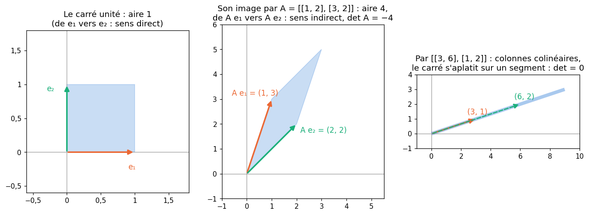
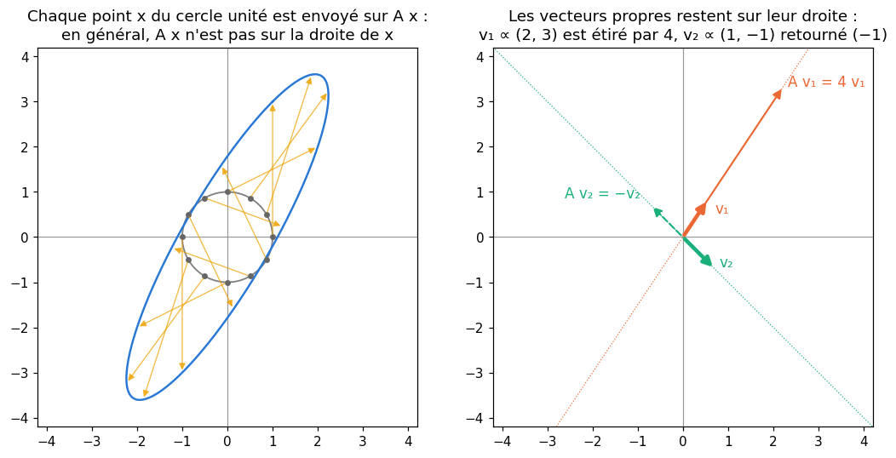
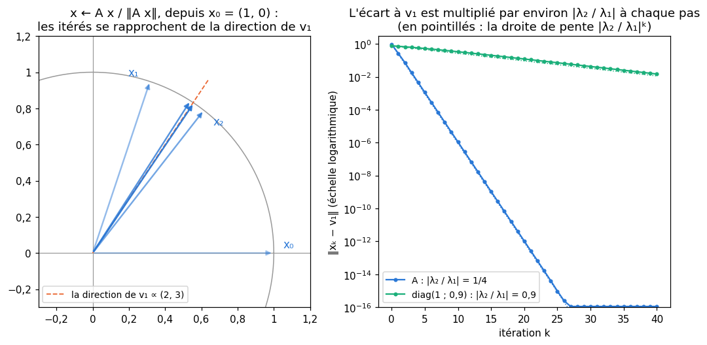
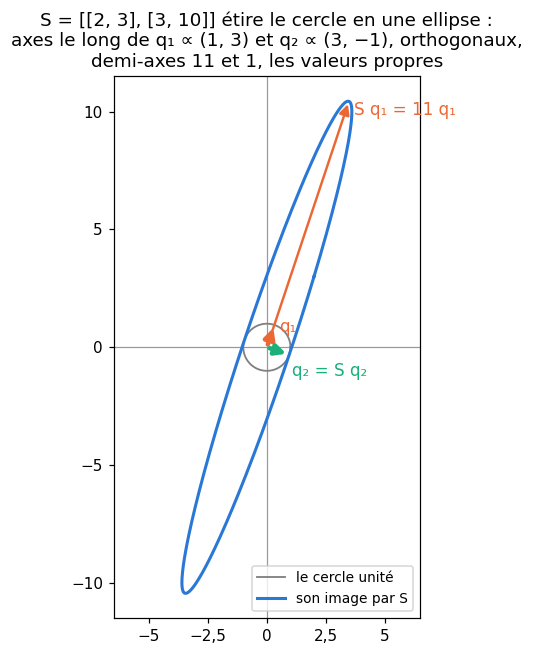
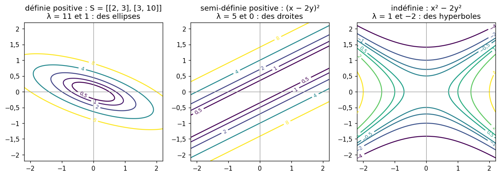
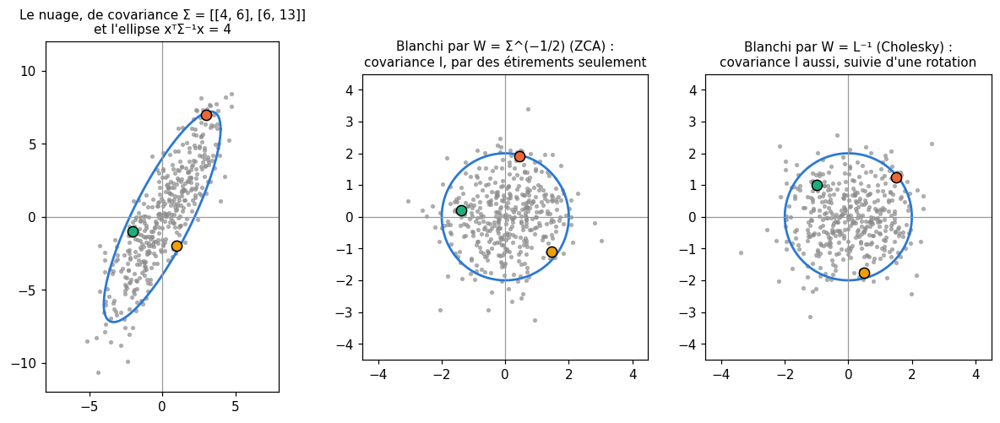

# M12c · Valeurs propres et matrices symétriques — fiche de cours

> En M12a, une matrice carrée représentait une application linéaire, et changer de base changeait sa matrice ; en M12b, les bases orthonormées et les matrices orthogonales rendaient les calculs simples. Ce chapitre cherche les nombres qui ne dépendent pas de la base, le **déterminant** (le facteur par lequel l'application multiplie les volumes) et la **trace**, puis les directions qu'une matrice ne fait pas tourner : ses **vecteurs propres**, et les **valeurs propres** qui disent de combien elle les étire. Dans une base de vecteurs propres, la matrice devient **diagonale** ; la **méthode de la puissance** trouve la plus grande valeur propre sans rien résoudre. Les **matrices symétriques** ont toujours une base orthonormée de vecteurs propres (le **théorème spectral**), ce qui donne le **quotient de Rayleigh**, les matrices **définies positives**, les **formes quadratiques**, la **décomposition de Cholesky** et, pour finir, la matrice de covariance, sa **racine carrée** et le **blanchiment** des données.

| | |
|---|---|
| **Sections** | §1 à §8 |
| **Temps total estimé** | ≈ 16,8 h : lecture et calculs de la fiche ≈ 3 h 30, exercices ≈ 12 h 30, flashcards ≈ 50 min (parcours essentiel ≈ 11,5 h) |
| **Prérequis** | M12a (base, rang, noyau, changement de base) ; M12b (bases orthonormées, matrices orthogonales, projection $\mathbf{q}\mathbf{q}^\top$) ; M02c (matrice de covariance empirique) ; M10 (fonctions convexes) ; M05b (hessienne d'une fonction de deux variables) ; R3 (racines d'un polynôme du second degré) |
| **Fichiers du chapitre** | `02_exercices.md` (quiz, papier) · `03_notebook.ipynb` · `04_indices.md` · `05_solutions.md` et `05_solutions.ipynb` · `06_mes_reponses.md` · `flashcards.csv` |
| **mymath** | `eigen.py` : `det`, `power_iteration`, `rayleigh_quotient`, `cholesky`, `is_positive_definite`, `sqrtm_psd`, `whitening_matrix` |
| **MML** | §4.1, §4.2, §4.3, §4.4 (voir le guide de lecture ci-dessous) |

## Comment utiliser ce chapitre

**Ordre conseillé.**
1. `python tools/start_chapter.py M12c` (sur Colab : `00_setup/COLAB.md` §2) : il copie le notebook, ta feuille de réponses et le squelette `mymath/eigen.py`.
2. Section par section : lis **crayon en main**, refais chaque calcul ; puis fais les exercices de la section, quiz 🧠 d'abord.
3. Les exercices ✏️ et 🔗 se font sur papier, dans ta copie de `06_mes_reponses.md`, puis se vérifient dans la **partie 0** du notebook. Les démonstrations ∂ se rédigent dans ta copie et se jugent avec la grille de relecture de `05_solutions.md`.

**Un réflexe pour tout le chapitre** : un vecteur propre se **vérifie** en une multiplication. Avant d'aller plus loin, calcule $\mathbf{A}\mathbf{v}$ et regarde si c'est bien $\lambda\mathbf{v}$ ; de même, une décomposition $\mathbf{P}\mathbf{D}\mathbf{P}^{-1}$, $\mathbf{Q}\boldsymbol{\Lambda}\mathbf{Q}^\top$ ou $\mathbf{L}\mathbf{L}^\top$ se vérifie en refaisant le produit. Et deux contrôles gratuits : la somme des valeurs propres est la trace, leur produit le déterminant.

| Section | Quiz 🧠 | Papier et réflexion | Notebook |
|---|---|---|---|
| §1 Le déterminant : volume orienté et inversibilité | Q1, Q2 | M12c.1, M12c.2 ✏️, M12c.14 ∂, M12c.22 📖, M12c.24 🧮 | M12c.26 🔨, M12c.30 📦, M12c.34 🐛 |
| §2 La trace | Q2, Q8 | M12c.16 ∂, M12c.22 📖 | — |
| §3 Valeurs propres et vecteurs propres | Q3, Q8, R1 🔁 | M12c.3, M12c.4, M12c.6 ✏️, M12c.16 ∂, M12c.22 📖, M12c.25 🗣️ | M12c.34 🐛, M12c.35 🛠️ |
| §4 La diagonalisation | Q4 | M12c.4, M12c.5, M12c.6 ✏️, M12c.23 📖 | M12c.35 🛠️ |
| §5 La méthode de la puissance | — | M12c.9 ✏️ | M12c.27 🔨, M12c.31 🔮, M12c.32 🔬, M12c.36 🏆 |
| §6 Matrices symétriques : le théorème spectral et le quotient de Rayleigh | Q5, R2 🔁 | M12c.7, M12c.8, M12c.12 ✏️, M12c.15, M12c.18 ∂, M12c.23 📖, M12c.E1 💼 | M12c.27, M12c.29 🔨, M12c.30 📦, M12c.33 🎨, M12c.36 🏆 |
| §7 Matrices définies positives, formes quadratiques et Cholesky | Q6, Q7 | M12c.10, M12c.11, M12c.12 ✏️, M12c.19 ∂, M12c.23 📖, M12c.E2 💼 | M12c.28 🔨, M12c.30 📦, M12c.33 🎨, M12c.34 🐛 |
| §8 La matrice de covariance, le blanchiment et la racine carrée d'une matrice | Q7, R3 🔁 | M12c.13 ✏️, M12c.17 ∂, M12c.20, M12c.21 🔗, M12c.E1 💼 | M12c.29 🔨 |

Parcours essentiel : tout sauf M12c.Q7, M12c.2, M12c.6, M12c.9, M12c.12, M12c.14, M12c.16, M12c.18, M12c.21 à M12c.24, M12c.E1, M12c.E2, M12c.32 et M12c.34 à M12c.36. La méthode de la puissance (§5) se fait dans le notebook ; l'élimination sur une matrice 4 × 4 et les démonstrations les plus longues sont hors parcours.

## Guide de lecture de MML

*Mathematics for Machine Learning* (MML) traite ce chapitre au début de son chapitre 4, *Matrix Decompositions* (la suite, la SVD, est pour M12d) :
- après le **§2** de la fiche : le **§4.1**, *Determinant and Trace* (le développement par cofacteurs, que le livre appelle *Laplace expansion*, se lit pour comprendre ; tu calculeras plutôt par élimination) ;
- après le **§4** : le **§4.2**, *Eigenvalues and Eigenvectors* (définitions, polynôme caractéristique, multiplicités, et l'énoncé du théorème spectral, que la fiche reprend au §6), puis le **§4.4**, *Eigendecomposition and Diagonalization*. Questions sur les §4.1 et §4.2 : M12c.22 ;
- après le **§7** : le **§4.3**, *Cholesky Decomposition*. Questions sur les §4.3 et §4.4 : M12c.23.

Ces sections ne parlent pas de la méthode de la puissance, et peu des formes quadratiques et du blanchiment : pour ces trois sujets, la fiche est le cours. Ses exercices de fin de chapitre 4 sur le déterminant, les valeurs propres et la diagonalisation sont conseillés.

📐 **Notations.** La fiche écrit $\det\mathbf{A}$ (MML : $\det(\mathbf{A})$ ou $|\mathbf{A}|$), $\operatorname{tr}\mathbf{A}$, $\lambda$ une valeur propre et $\mathbf{v}$ un vecteur propre ; $p_{\mathbf{A}}(\lambda) = \det(\mathbf{A} - \lambda\mathbf{I})$ le polynôme caractéristique (MML aussi) ; $E_\lambda$ l'espace propre ; $\mathbf{A} = \mathbf{P}\mathbf{D}\mathbf{P}^{-1}$ une diagonalisation ($\mathbf{D}$ diagonale, MML aussi) et, pour une matrice symétrique, $\mathbf{A} = \mathbf{Q}\boldsymbol{\Lambda}\mathbf{Q}^\top$ avec $\mathbf{Q}$ orthogonale et $\boldsymbol{\Lambda}$ diagonale ; $\mathbf{L}$ le facteur de Cholesky ; $\boldsymbol{\Sigma}$ une matrice de covariance et $\boldsymbol{\Sigma}^{1/2}$ sa racine carrée. Les valeurs propres d'une matrice symétrique se rangent en général par ordre **décroissant**, $\lambda_1 \ge \lambda_2 \ge \cdots$ (NumPy, `np.linalg.eigh`, les rend dans l'ordre **croissant**).

Vocabulaire anglais de ce chapitre : *determinant*, *Laplace expansion*, *minor*, *cofactor*, *triangular matrix*, *volume*, *orientation*, *trace*, *eigenvalue*, *eigenvector*, *eigenspace*, *characteristic polynomial*, *algebraic multiplicity*, *geometric multiplicity*, *defective matrix*, *spectrum*, *similar matrices*, *diagonalizable*, *eigendecomposition*, *power iteration*, *deflation*, *spectral theorem*, *Rayleigh quotient*, *positive definite*, *positive semidefinite*, *indefinite*, *quadratic form*, *Cholesky decomposition*, *Cholesky factor*, *covariance matrix*, *whitening*, *matrix square root*.

## Objectifs d'apprentissage

À la fin du chapitre, tu sais :
- **calculer** un déterminant (petites matrices, élimination), l'**interpréter** comme un volume orienté et t'en **servir** pour l'inversibilité ;
- **calculer** les valeurs et vecteurs propres d'une petite matrice, et **diagonaliser** ;
- **approcher** la plus grande valeur propre par la méthode de la puissance, et **prévoir** sa vitesse ;
- **appliquer** le théorème spectral et le quotient de Rayleigh à une matrice symétrique ;
- **reconnaître** une matrice définie positive et **calculer** sa décomposition de Cholesky ;
- **transformer** une matrice de covariance, **calculer** sa racine carrée et **blanchir** des données.

## L'essentiel en 10 lignes

1. Le **déterminant** d'une matrice carrée est le facteur par lequel elle multiplie les volumes, avec un signe pour l'orientation. $\det\mathbf{A} \ne 0$ si et seulement si $\mathbf{A}$ est inversible ; $\det(\mathbf{A}\mathbf{B}) = \det\mathbf{A}\,\det\mathbf{B}$.
2. Il se calcule par **élimination** : échanger deux lignes change le signe, ajouter un multiple d'une ligne à une autre ne change rien, et le déterminant d'une matrice triangulaire est le produit de sa diagonale.
3. La **trace** est la somme des éléments diagonaux ; $\operatorname{tr}(\mathbf{A}\mathbf{B}) = \operatorname{tr}(\mathbf{B}\mathbf{A})$, donc la trace ne dépend pas de la base.
4. $\mathbf{v} \ne \mathbf{0}$ est un **vecteur propre** de valeur propre $\lambda$ si $\mathbf{A}\mathbf{v} = \lambda\mathbf{v}$ : la matrice ne fait que l'étirer. Les valeurs propres sont les racines de $\det(\mathbf{A} - \lambda\mathbf{I}) = 0$ ; leur somme est la trace, leur produit le déterminant.
5. Avec $n$ vecteurs propres libres, $\mathbf{A} = \mathbf{P}\mathbf{D}\mathbf{P}^{-1}$ (**diagonalisation**), et $\mathbf{A}^k = \mathbf{P}\mathbf{D}^k\mathbf{P}^{-1}$. Des valeurs propres distinctes suffisent ; une matrice de cisaillement n'est pas diagonalisable, une rotation n'a pas de valeur propre réelle.
6. La **méthode de la puissance**, $\mathbf{x} \leftarrow \mathbf{A}\mathbf{x}/\lVert \mathbf{A}\mathbf{x} \rVert$, tend vers le vecteur propre de la valeur propre de plus grand module, avec une erreur multipliée par environ $|\lambda_2/\lambda_1|$ à chaque pas.
7. **Théorème spectral** : une matrice symétrique réelle a des valeurs propres réelles et une base orthonormée de vecteurs propres : $\mathbf{A} = \mathbf{Q}\boldsymbol{\Lambda}\mathbf{Q}^\top = \sum_i \lambda_i\mathbf{q}_i\mathbf{q}_i^\top$.
8. Le **quotient de Rayleigh** $\mathbf{x}^\top\mathbf{A}\mathbf{x}/\mathbf{x}^\top\mathbf{x}$ d'une matrice symétrique est compris entre $\lambda_{\min}$ et $\lambda_{\max}$, atteints sur les vecteurs propres.
9. $\mathbf{A}$ symétrique est **définie positive** si $\mathbf{x}^\top\mathbf{A}\mathbf{x} > 0$ pour tout $\mathbf{x} \ne \mathbf{0}$ : valeurs propres positives, mineurs principaux positifs, ou décomposition de **Cholesky** $\mathbf{A} = \mathbf{L}\mathbf{L}^\top$. Une hessienne semi-définie positive partout donne une fonction convexe.
10. Une **matrice de covariance** est symétrique semi-définie positive ; $\mathbf{A}\mathbf{x} + \mathbf{b}$ a pour covariance $\mathbf{A}\boldsymbol{\Sigma}\mathbf{A}^\top$. **Blanchir**, c'est trouver $\mathbf{W}$ avec $\mathbf{W}\boldsymbol{\Sigma}\mathbf{W}^\top = \mathbf{I}$ : $\boldsymbol{\Sigma}^{-1/2}$, $\boldsymbol{\Lambda}^{-1/2}\mathbf{Q}^\top$ ou $\mathbf{L}^{-1}$.

---

## §1 · Le déterminant : volume orienté et inversibilité

### Ce que mesure un déterminant

Une matrice $2 \times 2$ envoie le carré unité, construit sur $\mathbf{e}_1$ et $\mathbf{e}_2$, sur le **parallélogramme** construit sur ses deux colonnes $\mathbf{A}\mathbf{e}_1$ et $\mathbf{A}\mathbf{e}_2$. Le **déterminant** (*determinant*) dit deux choses de ce parallélogramme :
- sa valeur absolue est son **aire** : l'application multiplie toutes les aires par $|\det\mathbf{A}|$ ;
- son signe dit si l'**orientation** est conservée : positif si l'on tourne, de $\mathbf{A}\mathbf{e}_1$ vers $\mathbf{A}\mathbf{e}_2$, dans le même sens que de $\mathbf{e}_1$ vers $\mathbf{e}_2$ (le sens direct, inverse des aiguilles d'une montre), négatif sinon (la figure est retournée, comme dans un miroir).

En dimension 2, tu connais déjà la formule (M09a, et M10 pour le signe) : $\det\begin{pmatrix} a & b \\ c & d \end{pmatrix} = ad - bc$.

**Exemple.** $\mathbf{A} = \begin{pmatrix} 1 & 2 \\ 3 & 2 \end{pmatrix}$ : $\det\mathbf{A} = 1 \times 2 - 2 \times 3 = -4$. Le carré unité devient le parallélogramme construit sur $(1, 3)$ et $(2, 2)$, d'aire 4 ; le signe moins dit qu'il est retourné : $(1, 3)$ est au-dessus de $(2, 2)$, alors que $\mathbf{e}_1$ était en dessous de $\mathbf{e}_2$. Échanger les deux colonnes, $\begin{pmatrix} 2 & 1 \\ 2 & 3 \end{pmatrix}$, donne le même parallélogramme parcouru dans l'autre sens : déterminant $+4$. Et $\begin{pmatrix} 3 & 6 \\ 1 & 2 \end{pmatrix}$, dont la seconde colonne est le double de la première, aplatit tout sur une droite : déterminant $6 - 6 = 0$.

En dimension 3, $|\det\mathbf{A}|$ est le **volume** du parallélépipède construit sur les trois colonnes ; en dimension $n$, un « volume » à $n$ dimensions. Le signe dit toujours si l'orientation est conservée.

### Les propriétés qui servent

Le déterminant est entièrement fixé par trois propriétés de ses colonnes (ou, c'est la même chose, de ses lignes, car $\det\mathbf{A}^\top = \det\mathbf{A}$) : il est **linéaire** par rapport à chaque colonne quand les autres sont fixées, il **change de signe** quand on échange deux colonnes, et $\det\mathbf{I} = 1$. On en tire :
- deux colonnes égales, ou plus généralement des colonnes **liées**, donnent un déterminant nul ;
- **ajouter** à une ligne un multiple d'une autre ligne ne change pas le déterminant ; **échanger** deux lignes le change de signe ; **multiplier** une ligne par $c$ le multiplie par $c$, donc $\det(c\mathbf{A}) = c^n\det\mathbf{A}$ pour une matrice $n \times n$ ;
- le déterminant d'une matrice **triangulaire** (ou diagonale) est le **produit de sa diagonale** ;
- $\det(\mathbf{A}\mathbf{B}) = \det\mathbf{A}\,\det\mathbf{B}$ : faire $\mathbf{B}$ puis $\mathbf{A}$ multiplie les volumes par les deux facteurs (admis ; MML §4.1) ; d'où $\det(\mathbf{A}^{-1}) = 1/\det\mathbf{A}$ et $\det(\mathbf{S}^{-1}\mathbf{A}\mathbf{S}) = \det\mathbf{A}$ : le déterminant ne dépend pas de la base dans laquelle on écrit l'application (M12a §5).

> ⚠️ **Erreur classique.** $\det(\mathbf{A} + \mathbf{B}) \ne \det\mathbf{A} + \det\mathbf{B}$, et $\det(2\mathbf{A}) = 2^n\det\mathbf{A}$, pas $2\det\mathbf{A}$. Le déterminant est multiplicatif, pas additif. Avec $\mathbf{A}$ et $\mathbf{B} = \begin{pmatrix} 0 & 1 \\ 1 & 1 \end{pmatrix}$ : $\det(\mathbf{A}\mathbf{B}) = \det\begin{pmatrix} 2 & 3 \\ 2 & 5 \end{pmatrix} = 4 = (-4) \times (-1)$.

### Le déterminant et l'inversibilité

**Théorème.** Une matrice carrée est inversible si et seulement si son déterminant n'est pas nul. L'idée : $\det\mathbf{A} = 0$ veut dire que l'application aplatit l'espace dans un sous-espace plus petit ; des points différents y arrivent au même endroit, et l'on ne peut pas revenir en arrière. La démonstration, à partir de $\det(\mathbf{A}\mathbf{B}) = \det\mathbf{A}\,\det\mathbf{B}$ et de l'élimination, est l'exercice M12c.14. Avec M12a, tu as maintenant cinq façons de dire la même chose pour une matrice $n \times n$ : elle est inversible ; son rang vaut $n$ ; son noyau est $\{\mathbf{0}\}$ ; ses colonnes forment une base ; son déterminant n'est pas nul.

### Calculer : cofacteurs ou élimination

**Par cofacteurs** (*Laplace expansion*). En développant selon la première ligne, $\det\mathbf{A} = \sum_j (-1)^{1+j}a_{1j}\det\mathbf{A}_{1j}$, où $\mathbf{A}_{1j}$ est la matrice privée de la ligne 1 et de la colonne $j$ (un **mineur**, *minor*). C'est commode en dimension 3, ou quand une ligne a beaucoup de zéros ; mais développer récursivement une matrice $n \times n$ demande de l'ordre de $n!$ produits, qui explose vite (M12c.24).

**Par élimination.** On ramène $\mathbf{A}$ à une matrice triangulaire supérieure par les opérations de M09a, en notant les échanges de lignes ; le déterminant est le produit de la diagonale, avec un signe moins par échange. C'est de l'ordre de $n^3$ opérations : c'est ainsi que calculent les bibliothèques.

**Exemple** : $\mathbf{C} = \begin{pmatrix} 2 & 1 & 3 \\ 4 & 3 & 7 \\ -2 & 2 & 1 \end{pmatrix}$.
- Par élimination : $L_2 \leftarrow L_2 - 2L_1$ donne $(0, 1, 1)$ ; $L_3 \leftarrow L_3 + L_1$ donne $(0, 3, 4)$ ; puis $L_3 \leftarrow L_3 - 3L_2$ donne $(0, 0, 1)$. Aucun échange, et la diagonale vaut $2, 1, 1$ : $\det\mathbf{C} = 2$.
- Par cofacteurs, sur la première ligne : $2(3 \times 1 - 7 \times 2) - 1(4 \times 1 - 7 \times (-2)) + 3(4 \times 2 - 3 \times (-2)) = -22 - 18 + 42 = 2$.

**Le pivot partiel.** À la main, on prend le pivot qui arrange. Une machine, elle, choisit dans chaque colonne la ligne dont l'élément a la **plus grande valeur absolue** et la remonte (un échange, donc un signe) : diviser par un pivot minuscule ferait exploser les erreurs d'arrondi. C'est ce que demande `det` dans `eigen.py` (M12c.26), et c'est ce que fait LAPACK.

💻 **Aujourd'hui en pratique.** `np.linalg.det` calcule une factorisation LU (l'élimination avec pivot partiel, rangée dans deux matrices triangulaires) et multiplie la diagonale. En grande dimension, un déterminant dépasse vite les flottants (un produit de 1 000 nombres voisins de 10) : on calcule plutôt son logarithme, `np.linalg.slogdet`, qui rend le signe et $\ln|\det\mathbf{A}|$. Et l'on ne teste jamais l'inversibilité par « $\det\mathbf{A} == 0$ » : $\det(0{,}1\,\mathbf{I}_{50}) = 10^{-50}$ pour une matrice parfaitement inversible ; le bon outil est le rang ou le conditionnement (M12d).

### En machine learning

- La densité d'une loi normale à plusieurs dimensions contient $\det\boldsymbol{\Sigma}$ (M25a) : c'est le volume de l'ellipsoïde de la loi, et le log-déterminant apparaît dans la log-vraisemblance.
- Quand on transforme une variable aléatoire par une application inversible, sa densité est divisée par $|\det|$ de la jacobienne (le changement de variable de M02b, en plusieurs dimensions ; la jacobienne vient en M17) : le volume change, la probabilité totale reste 1.
- Un $\mathbf{X}^\top\mathbf{X}$ de déterminant nul signale des features liées (M09b, M12a) ; un déterminant minuscule ne suffit pas à le dire (💻 ci-dessus).

---

## §2 · La trace

**Définition.** La **trace** (*trace*) d'une matrice carrée est la somme de ses éléments diagonaux : $\operatorname{tr}\mathbf{A} = \sum_i a_{ii}$. Pour $\mathbf{A} = \begin{pmatrix} 1 & 2 \\ 3 & 2 \end{pmatrix}$, $\operatorname{tr}\mathbf{A} = 3$.

**Propriétés.** La trace est linéaire, $\operatorname{tr}(\mathbf{A} + \mathbf{B}) = \operatorname{tr}\mathbf{A} + \operatorname{tr}\mathbf{B}$ et $\operatorname{tr}(c\mathbf{A}) = c\operatorname{tr}\mathbf{A}$ ; $\operatorname{tr}\mathbf{A}^\top = \operatorname{tr}\mathbf{A}$ ; et surtout
$$\operatorname{tr}(\mathbf{A}\mathbf{B}) = \operatorname{tr}(\mathbf{B}\mathbf{A}),$$
même quand $\mathbf{A}\mathbf{B} \ne \mathbf{B}\mathbf{A}$, et même pour $\mathbf{A}$ de forme $(m, n)$ et $\mathbf{B}$ de forme $(n, m)$.

Démonstration

$\operatorname{tr}(\mathbf{A}\mathbf{B}) = \sum_i (\mathbf{A}\mathbf{B})_{ii} = \sum_i \sum_k a_{ik}b_{ki}$ et $\operatorname{tr}(\mathbf{B}\mathbf{A}) = \sum_k \sum_i b_{ki}a_{ik}$ : la même somme double, dans l'autre ordre.

**Exemple.** Avec $\mathbf{B} = \begin{pmatrix} 0 & 1 \\ 1 & 1 \end{pmatrix}$ : $\mathbf{A}\mathbf{B} = \begin{pmatrix} 2 & 3 \\ 2 & 5 \end{pmatrix}$ et $\mathbf{B}\mathbf{A} = \begin{pmatrix} 3 & 2 \\ 4 & 4 \end{pmatrix}$ sont différentes, mais toutes deux de trace 7. En revanche, $\operatorname{tr}\mathbf{A} \times \operatorname{tr}\mathbf{B} = 3 \times 1 = 3$ : la trace d'un produit n'est **pas** le produit des traces.

**Invariance.** Par conséquent $\operatorname{tr}(\mathbf{S}^{-1}\mathbf{A}\mathbf{S}) = \operatorname{tr}(\mathbf{A}\mathbf{S}\mathbf{S}^{-1}) = \operatorname{tr}\mathbf{A}$ : comme le déterminant, la trace ne dépend pas de la base. En particulier, pour une matrice orthogonale $\mathbf{Q}$, $\operatorname{tr}(\mathbf{Q}^\top\mathbf{A}\mathbf{Q}) = \operatorname{tr}\mathbf{A}$.

**Deux identités utiles.** Pour deux vecteurs, $\operatorname{tr}(\mathbf{x}\mathbf{y}^\top) = \mathbf{y}^\top\mathbf{x}$ (la trace d'un produit extérieur est un produit scalaire) ; et pour une matrice $\mathbf{X}$ quelconque, $\operatorname{tr}(\mathbf{X}^\top\mathbf{X}) = \sum_{i,j} x_{ij}^2$, la somme des carrés de tous ses éléments (le carré de la **norme de Frobenius**, M12d).

### En machine learning

- La trace d'une matrice de covariance est la somme des variances des features : la **variance totale** (§8), qui ne change pas quand on exprime les données dans une autre base orthonormée.
- L'astuce de la trace, écrire un nombre $\mathbf{x}^\top\mathbf{A}\mathbf{x}$ comme $\operatorname{tr}(\mathbf{A}\mathbf{x}\mathbf{x}^\top)$, sert à calculer des espérances de formes quadratiques et des gradients par rapport à une matrice (M18).

---

## §3 · Valeurs propres et vecteurs propres

### Les directions qu'une matrice ne fait pas tourner

En général, $\mathbf{A}\mathbf{x}$ n'est pas sur la même droite que $\mathbf{x}$ : la matrice fait tourner et étire. Certaines directions font exception : la matrice ne fait que les **étirer** (ou les retourner).

**Définition.** Un vecteur **non nul** $\mathbf{v}$ est un **vecteur propre** (*eigenvector*) de $\mathbf{A}$, de **valeur propre** (*eigenvalue*) $\lambda$, si
$$\mathbf{A}\mathbf{v} = \lambda\mathbf{v}.$$
Le vecteur nul est exclu (il vérifierait l'égalité pour tout $\lambda$) ; la valeur propre, elle, peut être nulle, négative, ou même complexe. Tout multiple non nul d'un vecteur propre est un vecteur propre de même valeur propre : c'est une **direction** qui compte, pas un vecteur.

**Exemple.** Avec $\mathbf{A} = \begin{pmatrix} 1 & 2 \\ 3 & 2 \end{pmatrix}$ : $\mathbf{A}\begin{pmatrix} 2 \\ 3 \end{pmatrix} = \begin{pmatrix} 8 \\ 12 \end{pmatrix} = 4\begin{pmatrix} 2 \\ 3 \end{pmatrix}$ et $\mathbf{A}\begin{pmatrix} 1 \\ -1 \end{pmatrix} = \begin{pmatrix} -1 \\ 1 \end{pmatrix} = -1 \cdot \begin{pmatrix} 1 \\ -1 \end{pmatrix}$. La direction $(2, 3)$ est étirée par 4 ; la direction $(1, -1)$ est retournée, sans changer de longueur. Mais $\mathbf{A}\mathbf{e}_1 = (1, 3)$ n'est pas sur la droite de $\mathbf{e}_1$.

### Le polynôme caractéristique

$\mathbf{A}\mathbf{v} = \lambda\mathbf{v}$ s'écrit $(\mathbf{A} - \lambda\mathbf{I})\mathbf{v} = \mathbf{0}$ : on cherche un vecteur non nul dans le **noyau** de $\mathbf{A} - \lambda\mathbf{I}$ (M12a). Il en existe un si et seulement si cette matrice n'est pas inversible (§1), c'est-à-dire
$$\det(\mathbf{A} - \lambda\mathbf{I}) = 0.$$
Le membre de gauche, $p_{\mathbf{A}}(\lambda)$, est un polynôme de degré $n$ en $\lambda$ : le **polynôme caractéristique** (*characteristic polynomial*). Les valeurs propres sont ses racines. D'où la méthode, à la main :
1. calculer $p_{\mathbf{A}}(\lambda) = \det(\mathbf{A} - \lambda\mathbf{I})$ et trouver ses racines ;
2. pour chaque racine $\lambda$, résoudre $(\mathbf{A} - \lambda\mathbf{I})\mathbf{v} = \mathbf{0}$ : ses solutions forment l'**espace propre** (*eigenspace*) $E_\lambda = \ker(\mathbf{A} - \lambda\mathbf{I})$, un sous-espace (sans le vecteur nul, ce sont les vecteurs propres de $\lambda$).

**En dimension 2**, le développement donne toujours
$$p_{\mathbf{A}}(\lambda) = \lambda^2 - (\operatorname{tr}\mathbf{A})\,\lambda + \det\mathbf{A}.$$

**Exemple.** Pour $\mathbf{A}$ : $\lambda^2 - 3\lambda - 4 = (\lambda - 4)(\lambda + 1)$, d'où $\lambda_1 = 4$ et $\lambda_2 = -1$. Pour $\lambda = 4$, $\mathbf{A} - 4\mathbf{I} = \begin{pmatrix} -3 & 2 \\ 3 & -2 \end{pmatrix}$ : une seule équation, $-3x + 2y = 0$, et $E_4 = \operatorname{Vect}(2, 3)$. Pour $\lambda = -1$, $\mathbf{A} + \mathbf{I} = \begin{pmatrix} 2 & 2 \\ 3 & 3 \end{pmatrix}$, et $E_{-1} = \operatorname{Vect}(1, -1)$. Contrôle : $4 + (-1) = 3 = \operatorname{tr}\mathbf{A}$ et $4 \times (-1) = -4 = \det\mathbf{A}$.

### Ce qu'on lit sans calculer

- **Trace et déterminant.** En développant $p_{\mathbf{A}}(\lambda) = (\lambda_1 - \lambda)\cdots(\lambda_n - \lambda)$ (racines complexes comprises, comptées avec leur multiplicité), on trouve $\sum_i \lambda_i = \operatorname{tr}\mathbf{A}$ et $\prod_i \lambda_i = \det\mathbf{A}$ (démonstration : M12c.16). En particulier, $0$ est valeur propre si et seulement si $\mathbf{A}$ n'est pas inversible.
- **Matrice triangulaire.** Ses valeurs propres sont ses éléments diagonaux : $\mathbf{A} - \lambda\mathbf{I}$ est triangulaire, de déterminant $\prod_i (a_{ii} - \lambda)$.
- **Puissances, inverse, décalage.** Si $\mathbf{A}\mathbf{v} = \lambda\mathbf{v}$, alors $\mathbf{A}^k\mathbf{v} = \lambda^k\mathbf{v}$, $(\mathbf{A} + c\mathbf{I})\mathbf{v} = (\lambda + c)\mathbf{v}$ et, si $\mathbf{A}$ est inversible, $\mathbf{A}^{-1}\mathbf{v} = \frac{1}{\lambda}\mathbf{v}$ : mêmes vecteurs propres, valeurs propres transformées.

> ⚠️ **Erreur classique.** Les valeurs propres de $\mathbf{A} + \mathbf{B}$ ne sont pas, en général, les sommes de celles de $\mathbf{A}$ et de $\mathbf{B}$ (elles n'ont pas les mêmes vecteurs propres), et celles de $\mathbf{A}$ ne se lisent pas sur sa diagonale si elle n'est pas triangulaire : la diagonale de $\mathbf{A}$ vaut $1, 2$, ses valeurs propres $4, -1$. Seules leur somme et la trace coïncident.

### Multiplicités, et des valeurs propres complexes

- La **multiplicité algébrique** (*algebraic multiplicity*) de $\lambda$ est sa multiplicité comme racine de $p_{\mathbf{A}}$ ; la **multiplicité géométrique** (*geometric multiplicity*) est $\dim E_\lambda$. On a toujours $1 \le \dim E_\lambda \le$ multiplicité algébrique.
- **Un cisaillement** : $\begin{pmatrix} 3 & 1 \\ 0 & 3 \end{pmatrix}$ est triangulaire, de valeur propre double 3 ; mais $\mathbf{A} - 3\mathbf{I} = \begin{pmatrix} 0 & 1 \\ 0 & 0 \end{pmatrix}$ a pour noyau la seule droite $\operatorname{Vect}(\mathbf{e}_1)$ : multiplicité géométrique 1. Il manque une direction propre.
- **Une rotation** d'angle $\theta$, $\begin{pmatrix} \cos\theta & -\sin\theta \\ \sin\theta & \cos\theta \end{pmatrix}$, fait tourner toutes les directions : pour $0 < \theta < \pi$, elle n'a **aucune** valeur propre réelle. En effet $p(\lambda) = \lambda^2 - 2\cos\theta\,\lambda + 1$ a pour discriminant $4\cos^2\theta - 4 < 0$. Ses valeurs propres sont complexes, $\cos\theta \pm i\sin\theta$ : une matrice réelle a toujours $n$ valeurs propres dans $\mathbb{C}$, comptées avec leur multiplicité, et les complexes vont par paires conjuguées.

💻 **Aujourd'hui en pratique.** Personne ne calcule les valeurs propres d'une grande matrice par les racines du polynôme caractéristique : les racines d'un polynôme sont extrêmement sensibles à ses coefficients. `np.linalg.eig` (n'importe quelle matrice carrée) et `np.linalg.eigh` (matrices symétriques) appellent des routines de LAPACK qui ramènent la matrice, par des transformations orthogonales, à une forme presque triangulaire, puis itèrent. Elles rendent les valeurs propres et une matrice dont les **colonnes** sont des vecteurs propres unitaires ; `eig` peut rendre des nombres complexes.

### En machine learning

- Les valeurs propres d'une matrice de covariance mesurent la variance des données dans des directions particulières (§6 et §8) : c'est le cœur de l'ACP (M12d).
- Les puissances $\mathbf{A}^k$ d'une matrice de poids gouvernent ce qui arrive à un signal répété $k$ fois : il explose ou s'éteint selon que les valeurs propres dépassent 1 en module (réseaux récurrents, M22).
- PageRank, le premier classement de Google, est un vecteur propre de valeur propre 1 d'une matrice de transition (chaînes de Markov, M26), calculé par la méthode du §5.

---

## §4 · La diagonalisation

### Changer de base pour rendre la matrice diagonale

Supposons que $\mathbf{A}$, $n \times n$, ait $n$ vecteurs propres **libres** $\mathbf{v}_1, \ldots, \mathbf{v}_n$, de valeurs propres $\lambda_1, \ldots, \lambda_n$. Rangeons-les dans les colonnes de $\mathbf{P}$, et les valeurs propres dans la matrice diagonale $\mathbf{D}$. Les $n$ égalités $\mathbf{A}\mathbf{v}_i = \lambda_i\mathbf{v}_i$ s'écrivent d'un coup $\mathbf{A}\mathbf{P} = \mathbf{P}\mathbf{D}$, et $\mathbf{P}$ est inversible (colonnes libres), donc
$$\mathbf{A} = \mathbf{P}\mathbf{D}\mathbf{P}^{-1} \qquad \text{et} \qquad \mathbf{D} = \mathbf{P}^{-1}\mathbf{A}\mathbf{P}.$$
On dit que $\mathbf{A}$ est **diagonalisable** (*diagonalizable*) ; $\mathbf{A}$ et $\mathbf{D}$ sont **semblables** (*similar*). C'est un changement de base au sens de M12a : $\mathbf{D}$ est la matrice de la **même** application, écrite dans la base des vecteurs propres, où elle ne fait qu'étirer chaque coordonnée. Réciproquement, si $\mathbf{A} = \mathbf{P}\mathbf{D}\mathbf{P}^{-1}$ avec $\mathbf{D}$ diagonale, les colonnes de $\mathbf{P}$ sont des vecteurs propres libres : **diagonalisable, c'est avoir une base de vecteurs propres**.

**Exemple.** Pour $\mathbf{A} = \begin{pmatrix} 1 & 2 \\ 3 & 2 \end{pmatrix}$ : $\mathbf{P} = \begin{pmatrix} 2 & 1 \\ 3 & -1 \end{pmatrix}$, $\mathbf{D} = \begin{pmatrix} 4 & 0 \\ 0 & -1 \end{pmatrix}$, $\det\mathbf{P} = -5$ et $\mathbf{P}^{-1} = \frac{1}{5}\begin{pmatrix} 1 & 1 \\ 3 & -2 \end{pmatrix}$. Vérifie que $\mathbf{P}\mathbf{D}\mathbf{P}^{-1}$ redonne $\mathbf{A}$. L'ordre compte : la $i$-ième colonne de $\mathbf{P}$ va avec le $i$-ième élément de $\mathbf{D}$.

**Quand est-ce possible ?**
- **Des valeurs propres distinctes suffisent** : des vecteurs propres de valeurs propres différentes sont toujours libres. Pour deux : si $c_1\mathbf{v}_1 + c_2\mathbf{v}_2 = \mathbf{0}$, appliquer $\mathbf{A}$ donne $c_1\lambda_1\mathbf{v}_1 + c_2\lambda_2\mathbf{v}_2 = \mathbf{0}$ ; retrancher $\lambda_2$ fois la première égalité laisse $c_1(\lambda_1 - \lambda_2)\mathbf{v}_1 = \mathbf{0}$, donc $c_1 = 0$, puis $c_2 = 0$. Le cas général se fait de même, par récurrence.
- Avec une valeur propre multiple, il faut que **chaque** espace propre ait la bonne dimension (multiplicité géométrique égale à l'algébrique). Le cisaillement du §3 échoue : une seule direction propre dans $\mathbb{R}^2$. On dit que la matrice est **défective** (*defective*).
- La rotation du §3 n'est pas diagonalisable avec des nombres réels (elle l'est avec des complexes).

### Les puissances

$\mathbf{A}^k = (\mathbf{P}\mathbf{D}\mathbf{P}^{-1})(\mathbf{P}\mathbf{D}\mathbf{P}^{-1})\cdots = \mathbf{P}\mathbf{D}^k\mathbf{P}^{-1}$ : les $\mathbf{P}^{-1}\mathbf{P}$ du milieu se simplifient, et $\mathbf{D}^k$ s'obtient en élevant chaque élément diagonal à la puissance $k$. Pour notre $\mathbf{A}$ :
$$\mathbf{A}^k = \frac{1}{5}\begin{pmatrix} 2 \cdot 4^k + 3(-1)^k & 2 \cdot 4^k - 2(-1)^k \\ 3 \cdot 4^k - 3(-1)^k & 3 \cdot 4^k + 2(-1)^k \end{pmatrix}.$$
Pour $k = 2$ : $\frac{1}{5}\begin{pmatrix} 35 & 30 \\ 45 & 50 \end{pmatrix} = \begin{pmatrix} 7 & 6 \\ 9 & 10 \end{pmatrix}$, qui est bien $\mathbf{A}^2$. Pour $k$ grand, le terme en $4^k$ écrase l'autre : $\mathbf{A}^k \approx \frac{4^k}{5}\begin{pmatrix} 2 & 2 \\ 3 & 3 \end{pmatrix}$, dont toutes les colonnes sont sur la droite de $(2, 3)$. C'est l'idée de la méthode du §5.

La même formule donne $\mathbf{A}^{-1} = \mathbf{P}\mathbf{D}^{-1}\mathbf{P}^{-1}$ (si aucune valeur propre n'est nulle) et, plus généralement, une **fonction de matrice** $f(\mathbf{A}) = \mathbf{P}f(\mathbf{D})\mathbf{P}^{-1}$ : on applique $f$ aux valeurs propres. La racine carrée d'une matrice (§8) se fabrique ainsi.

### En machine learning

- Une récurrence linéaire $\mathbf{h}_{t+1} = \mathbf{A}\mathbf{h}_t$ se lit dans la base des vecteurs propres : chaque coordonnée est multipliée par sa valeur propre à chaque pas (M22, gradient évanescent ou explosif).
- Une chaîne de Markov converge vers sa loi stationnaire à une vitesse fixée par sa deuxième plus grande valeur propre en module (M26).

---

## §5 · La méthode de la puissance

### Multiplier, normaliser, recommencer

Pour une grande matrice, on veut souvent **une seule** valeur propre : la plus grande en module. La **méthode de la puissance** (*power iteration*) l'obtient avec des produits matrice-vecteur seulement :
1. partir d'un vecteur $\mathbf{x}_0$, normalisé ;
2. répéter $\mathbf{x}_{k+1} = \dfrac{\mathbf{A}\mathbf{x}_k}{\lVert \mathbf{A}\mathbf{x}_k \rVert}$ ;
3. arrêter quand $\mathbf{x}$ ne bouge presque plus ; la valeur propre est estimée par le **quotient de Rayleigh** $\mathbf{x}_k^\top\mathbf{A}\mathbf{x}_k$ (pour un vecteur unitaire ; §6).

**Pourquoi ça marche.** Supposons $\mathbf{A}$ diagonalisable, de vecteurs propres $\mathbf{v}_1, \ldots, \mathbf{v}_n$, avec une valeur propre **strictement dominante** : $|\lambda_1| > |\lambda_2| \ge \cdots \ge |\lambda_n|$. Écrivons $\mathbf{x}_0 = c_1\mathbf{v}_1 + \cdots + c_n\mathbf{v}_n$, avec $c_1 \ne 0$. Alors
$$\mathbf{A}^k\mathbf{x}_0 = c_1\lambda_1^k\mathbf{v}_1 + \cdots + c_n\lambda_n^k\mathbf{v}_n = \lambda_1^k\Big(c_1\mathbf{v}_1 + c_2\big(\tfrac{\lambda_2}{\lambda_1}\big)^k\mathbf{v}_2 + \cdots\Big),$$
et chaque $(\lambda_i/\lambda_1)^k$ tend vers 0. Normaliser à chaque pas ne change que la longueur (sans cela, $\mathbf{A}^k\mathbf{x}_0$ déborderait ou s'annulerait en flottants) : la direction de $\mathbf{x}_k$ tend vers celle de $\mathbf{v}_1$, et l'écart est multiplié, à peu près, par $|\lambda_2/\lambda_1|$ à chaque pas.

**Exemple.** Avec $\mathbf{A} = \begin{pmatrix} 1 & 2 \\ 3 & 2 \end{pmatrix}$ et $\mathbf{x}_0 = (1, 0)$, les produits successifs, avant normalisation, sont $(1, 3)$, $(7, 9)$, $(25, 39)$, $(103, 153)$. Normalisés : $\mathbf{x}_1 \approx (0{,}316 ;\ 0{,}949)$, $\mathbf{x}_2 \approx (0{,}614 ;\ 0{,}789)$, $\mathbf{x}_3 \approx (0{,}540 ;\ 0{,}842)$, $\mathbf{x}_4 \approx (0{,}559 ;\ 0{,}830)$, qui s'approchent de $\mathbf{v}_1 = (2, 3)/\sqrt{13} \approx (0{,}555 ;\ 0{,}832)$ en oscillant autour d'elle : $\lambda_2/\lambda_1 = -1/4$ est négatif, la composante sur $\mathbf{v}_2$ change de signe à chaque pas. Les quotients de Rayleigh valent $1$ ; $3{,}4$ ; $4{,}046$ ; $3{,}980$… vers $\lambda_1 = 4$.

### Ce qu'il faut savoir

- **La vitesse** dépend de $|\lambda_2/\lambda_1|$ : $1/4$ gagne un chiffre décimal tous les 2 pas environ, $0{,}9$ un chiffre tous les 22 pas ($0{,}9^{22} \approx 0{,}1$). Quand les deux plus grandes valeurs propres sont proches, la méthode rampe (M12c.31, M12c.32).
- **Le signe.** Si $\lambda_1 < 0$, $\mathbf{x}_k$ change de signe à chaque pas : $\mathbf{A}\mathbf{x}$ pointe à l'opposé de $\mathbf{x}$. Pour comparer deux itérés, on fixe une convention, par exemple « l'élément de plus grande valeur absolue est positif » (celle de `power_iteration`, M12c.27).
- **Le départ.** Si $\mathbf{x}_0$ est orthogonal à $\mathbf{v}_1$ (pour une matrice symétrique) ou plus généralement si $c_1 = 0$, la méthode ne voit pas $\lambda_1$ en arithmétique exacte ; en flottants, les arrondis réintroduisent presque toujours un peu de $\mathbf{v}_1$, mais cela peut prendre du temps. Un départ tiré au hasard évite ce cas.
- **Les échecs.** Deux valeurs propres de même module (par exemple $3$ et $-3$, ou deux complexes conjuguées) : $\mathbf{x}_k$ ne converge pas, il tourne ou oscille sans fin ; d'où un nombre maximal d'itérations.
- **La valeur propre**, estimée par le quotient de Rayleigh, converge à la même vitesse que le vecteur en général, et **deux fois plus vite** (en $|\lambda_2/\lambda_1|^{2k}$) pour une matrice symétrique (§6).

💻 **Aujourd'hui en pratique.** La méthode de la puissance, et ses descendantes (itération inverse, méthode de Lanczos), servent quand la matrice est trop grande pour être stockée mais qu'on sait calculer $\mathbf{A}\mathbf{x}$ : un graphe du Web, une matrice creuse de millions de lignes, une hessienne de réseau de neurones accessible seulement par des produits. `scipy.sparse.linalg.eigsh` trouve ainsi les quelques plus grandes valeurs propres d'une grande matrice symétrique.

### En machine learning

- La norme spectrale d'une matrice de poids, sa plus grande valeur singulière (M12d), s'estime par une ou deux itérations de la puissance à chaque pas d'entraînement : c'est la **normalisation spectrale** des réseaux génératifs adverses (workbookIA 27).
- La plus grande valeur propre d'une hessienne dit la courbure la plus forte d'une loss ; on l'estime de la même façon (M19).

---

## §6 · Matrices symétriques : le théorème spectral et le quotient de Rayleigh

### Le théorème spectral

Les matrices de ce chapitre qui comptent le plus en ML (covariances, hessiennes, $\mathbf{X}^\top\mathbf{X}$) sont **symétriques**. Elles ont une propriété remarquable.

**Théorème spectral** (*spectral theorem*). Si $\mathbf{A}$ est une matrice symétrique réelle $n \times n$ :
1. ses $n$ valeurs propres sont **réelles** ;
2. des vecteurs propres de valeurs propres **distinctes** sont **orthogonaux** ;
3. il existe une **base orthonormée** de $\mathbb{R}^n$ faite de vecteurs propres de $\mathbf{A}$. Avec $\mathbf{Q}$, orthogonale, dont les colonnes sont ces vecteurs, et $\boldsymbol{\Lambda}$ la diagonale des valeurs propres :
$$\mathbf{A} = \mathbf{Q}\boldsymbol{\Lambda}\mathbf{Q}^\top = \sum_{i=1}^n \lambda_i\,\mathbf{q}_i\mathbf{q}_i^\top.$$

C'est une diagonalisation (§4) où $\mathbf{P}^{-1}$ se calcule sans effort : $\mathbf{Q}^{-1} = \mathbf{Q}^\top$ (M12b §2). La seconde forme, la **décomposition spectrale**, écrit $\mathbf{A}$ comme une somme de projections orthogonales sur ses directions propres ($\mathbf{q}_i\mathbf{q}_i^\top$, M12b §5), pondérées par les valeurs propres. Les points 1 et 2 se démontrent en quelques lignes (M12c.15) ; le point 3, qui dit qu'une valeur propre multiple a toujours assez de directions propres, est admis ici dans le cas général (MML §4.2 l'énonce aussi) ; quand les valeurs propres sont distinctes, il découle du point 2.

**Exemple.** $\mathbf{S} = \begin{pmatrix} 2 & 3 \\ 3 & 10 \end{pmatrix}$ : $p(\lambda) = \lambda^2 - 12\lambda + 11 = (\lambda - 11)(\lambda - 1)$. Pour 11, $\mathbf{S} - 11\mathbf{I} = \begin{pmatrix} -9 & 3 \\ 3 & -1 \end{pmatrix}$ donne la direction $(1, 3)$ ; pour 1, $\mathbf{S} - \mathbf{I} = \begin{pmatrix} 1 & 3 \\ 3 & 9 \end{pmatrix}$ donne $(3, -1)$. Les deux directions sont bien orthogonales ($3 - 3 = 0$). Normalisées :
$$\mathbf{Q} = \frac{1}{\sqrt{10}}\begin{pmatrix} 1 & 3 \\ 3 & -1 \end{pmatrix}, \qquad \boldsymbol{\Lambda} = \begin{pmatrix} 11 & 0 \\ 0 & 1 \end{pmatrix}, \qquad \mathbf{S} = \frac{11}{10}\begin{pmatrix} 1 & 3 \\ 3 & 9 \end{pmatrix} + \frac{1}{10}\begin{pmatrix} 9 & -3 \\ -3 & 1 \end{pmatrix}.$$

**La géométrie.** Lire $\mathbf{S}\mathbf{x} = \mathbf{Q}\boldsymbol{\Lambda}\mathbf{Q}^\top\mathbf{x}$ de droite à gauche : $\mathbf{Q}^\top$ donne les coordonnées de $\mathbf{x}$ dans la base orthonormée des $\mathbf{q}_i$, $\boldsymbol{\Lambda}$ étire chaque coordonnée par sa valeur propre, $\mathbf{Q}$ revient dans la base de départ. Une matrice symétrique, c'est donc un étirement selon des axes **orthogonaux** : elle envoie le cercle unité sur une ellipse dont les axes sont ses vecteurs propres et les demi-axes ses valeurs propres (en valeur absolue).

> ⚠️ **Erreur classique.** Ce n'est vrai que pour une matrice **symétrique**. La matrice $\mathbf{A}$ du §3 a des vecteurs propres $(2, 3)$ et $(1, -1)$ qui ne sont pas orthogonaux ($2 - 3 \ne 0$), et l'image du cercle par $\mathbf{A}$ est une ellipse dont les axes ne sont **pas** ses vecteurs propres (ce sont ses vecteurs singuliers, M12d).

### Le quotient de Rayleigh

**Définition.** Pour $\mathbf{x} \ne \mathbf{0}$, le **quotient de Rayleigh** (*Rayleigh quotient*) de $\mathbf{A}$ est
$$R(\mathbf{x}) = \frac{\mathbf{x}^\top\mathbf{A}\mathbf{x}}{\mathbf{x}^\top\mathbf{x}}.$$
Il ne dépend que de la direction de $\mathbf{x}$ ($R(c\mathbf{x}) = R(\mathbf{x})$), et si $\mathbf{x}$ est un vecteur propre de valeur propre $\lambda$, $R(\mathbf{x}) = \lambda\,\mathbf{x}^\top\mathbf{x}/\mathbf{x}^\top\mathbf{x} = \lambda$.

**Théorème.** Pour $\mathbf{A}$ symétrique, de plus petite et de plus grande valeurs propres $\lambda_{\min}$ et $\lambda_{\max}$ :
$$\lambda_{\min} \le R(\mathbf{x}) \le \lambda_{\max} \quad \text{pour tout } \mathbf{x} \ne \mathbf{0},$$
avec égalité sur les vecteurs propres correspondants. Le maximum de $\mathbf{x}^\top\mathbf{A}\mathbf{x}$ sur les vecteurs **unitaires** est donc $\lambda_{\max}$, atteint en $\pm\mathbf{q}_{\max}$.

**L'idée, sur l'exemple.** Écrivons $\mathbf{x}$ dans la base orthonormée des vecteurs propres de $\mathbf{S}$ : $\mathbf{x} = y_1\mathbf{q}_1 + y_2\mathbf{q}_2$, c'est-à-dire $\mathbf{y} = \mathbf{Q}^\top\mathbf{x}$. Alors $\mathbf{x}^\top\mathbf{S}\mathbf{x} = \mathbf{y}^\top\boldsymbol{\Lambda}\mathbf{y} = 11y_1^2 + y_2^2$ et $\mathbf{x}^\top\mathbf{x} = y_1^2 + y_2^2$ (Parseval, M12b §2). Le quotient $\frac{11y_1^2 + y_2^2}{y_1^2 + y_2^2}$ est une **moyenne pondérée** de 11 et de 1, avec des poids positifs : il est entre 1 et 11. Quelques valeurs : $R(1, 0) = 2$, $R(0, 1) = 10$, $R(1, 1) = 9$, $R(1, -1) = 3$, et $R(1, 3) = 11$. La démonstration générale suit exactement ce chemin (M12c.18), et M12c.8 la fait sur un exemple.

**Plus loin.** Parmi les vecteurs unitaires **orthogonaux** à $\mathbf{q}_1$, le maximum de $\mathbf{x}^\top\mathbf{A}\mathbf{x}$ est $\lambda_2$, atteint en $\mathbf{q}_2$, et ainsi de suite : chaque valeur propre est un maximum sur un sous-espace (théorème de Courant-Fischer, admis).

### La déflation

Une fois $\lambda_1$ et $\mathbf{q}_1$ trouvés (par la méthode de la puissance, par exemple), comment trouver $\lambda_2$ ? Pour une matrice symétrique, la décomposition spectrale répond :
$$\mathbf{A}' = \mathbf{A} - \lambda_1\mathbf{q}_1\mathbf{q}_1^\top = \sum_{i \ge 2} \lambda_i\,\mathbf{q}_i\mathbf{q}_i^\top$$
a les **mêmes** vecteurs propres, de valeurs propres $0, \lambda_2, \ldots, \lambda_n$ : la valeur propre $\lambda_1$ a été remplacée par 0. La méthode de la puissance appliquée à $\mathbf{A}'$ trouve alors la valeur propre de plus grand module parmi les autres. C'est la **déflation** (*deflation*) ; elle accumule les erreurs d'une étape à l'autre, et ne vaut que pour quelques valeurs propres (le défi M12c.36).

### En machine learning

- La variance des données dans une direction unitaire $\mathbf{w}$ est $\mathbf{w}^\top\boldsymbol{\Sigma}\mathbf{w}$, un quotient de Rayleigh de la covariance (§8) : elle est comprise entre la plus petite et la plus grande valeur propre de $\boldsymbol{\Sigma}$. Chercher la direction de plus grande variance, c'est chercher un vecteur propre : l'ACP (workbookIA 12, M12d).
- Un $\mathbf{X}^\top\mathbf{X}$, une hessienne et une matrice de covariance sont symétriques : leurs valeurs propres sont réelles, et leurs vecteurs propres donnent des axes orthogonaux.

---

## §7 · Matrices définies positives, formes quadratiques et Cholesky

### Le signe de $\mathbf{x}^\top\mathbf{A}\mathbf{x}$

**Définitions.** Une matrice **symétrique** $\mathbf{A}$ est :
- **définie positive** (*positive definite*) si $\mathbf{x}^\top\mathbf{A}\mathbf{x} > 0$ pour tout $\mathbf{x} \ne \mathbf{0}$ ;
- **semi-définie positive** (*positive semidefinite*) si $\mathbf{x}^\top\mathbf{A}\mathbf{x} \ge 0$ pour tout $\mathbf{x}$ ;
- **définie négative** ou **semi-définie négative** si $-\mathbf{A}$ est définie ou semi-définie positive ;
- **indéfinie** (*indefinite*) si $\mathbf{x}^\top\mathbf{A}\mathbf{x}$ prend les deux signes.

Tu as rencontré les matrices définies positives en M12b §1 : ce sont elles qui définissent des produits scalaires sur $\mathbb{R}^n$.

**Les critères**, pour $\mathbf{A}$ symétrique :
1. **Valeurs propres.** $\mathbf{A}$ est définie positive si et seulement si toutes ses valeurs propres sont **strictement positives** ; semi-définie positive si elles sont positives ou nulles. En effet, avec $\mathbf{y} = \mathbf{Q}^\top\mathbf{x}$ (§6), $\mathbf{x}^\top\mathbf{A}\mathbf{x} = \sum_i \lambda_i y_i^2$, et $\mathbf{y} \ne \mathbf{0}$ dès que $\mathbf{x} \ne \mathbf{0}$ : cette somme est toujours positive si et seulement si tous les $\lambda_i$ le sont (prendre $\mathbf{x} = \mathbf{q}_i$ donne $\lambda_i$).
2. **Mineurs principaux** (critère de Sylvester, admis). $\mathbf{A}$ est définie positive si et seulement si les déterminants de ses sous-matrices en haut à gauche, $1 \times 1$, $2 \times 2$, …, $n \times n$, sont tous strictement positifs. En dimension 2 : $a > 0$ et $ac - b^2 > 0$, le critère de M12b §1 et du test de la hessienne de M05b.
3. **Cholesky** : la décomposition de la sous-section suivante existe si et seulement si $\mathbf{A}$ est définie positive. C'est le test le plus rapide en pratique.

Une matrice définie positive est inversible (aucune valeur propre nulle) et a une diagonale strictement positive ($a_{ii} = \mathbf{e}_i^\top\mathbf{A}\mathbf{e}_i > 0$) ; mais une diagonale positive ne suffit pas : $\begin{pmatrix} 1 & 3 \\ 3 & 2 \end{pmatrix}$ a pour déterminant $-7$, elle est indéfinie.

**Exemple.** $\mathbf{S} = \begin{pmatrix} 2 & 3 \\ 3 & 10 \end{pmatrix}$ est définie positive par les trois critères : ses valeurs propres valent 11 et 1 ; ses mineurs, $2$ et $20 - 9 = 11$ ; et sa forme quadratique s'écrit, en complétant le carré, $2x^2 + 6xy + 10y^2 = 2(x + \tfrac{3}{2}y)^2 + \tfrac{11}{2}y^2$, nulle seulement en $(0, 0)$.

### Les formes quadratiques

Une **forme quadratique** (*quadratic form*) sur $\mathbb{R}^n$ est une fonction $q(\mathbf{x}) = \mathbf{x}^\top\mathbf{A}\mathbf{x} = \sum_{i,j} a_{ij}x_ix_j$, un polynôme dont chaque terme est de degré 2. On peut toujours prendre $\mathbf{A}$ **symétrique** : $\mathbf{x}^\top\mathbf{A}\mathbf{x} = \mathbf{x}^\top\frac{\mathbf{A} + \mathbf{A}^\top}{2}\mathbf{x}$, et le terme croisé $c\,x_ix_j$ se partage moitié-moitié entre $a_{ij}$ et $a_{ji}$. Ainsi $x^2 + 3xy + 5y^2 = \mathbf{x}^\top\begin{pmatrix} 1 & 3/2 \\ 3/2 & 5 \end{pmatrix}\mathbf{x}$.

**Réduite à une somme de carrés.** Dans la base orthonormée des vecteurs propres, $q(\mathbf{x}) = \lambda_1y_1^2 + \cdots + \lambda_ny_n^2$ : plus de terme croisé. Les **lignes de niveau** $q(\mathbf{x}) = c$, en dimension 2, se lisent alors sur les signes des valeurs propres :
- deux valeurs propres positives : des **ellipses**, d'axes les vecteurs propres et de demi-axes $\sqrt{c/\lambda_i}$, d'autant plus courts que $\lambda_i$ est grand ;
- une valeur propre nulle et une positive : des paires de **droites** parallèles, le long de la direction propre de la valeur propre 0, où $q$ ne change pas ;
- deux valeurs propres de signes contraires : des **hyperboles**, et un **point selle** en $\mathbf{0}$.

Pour $\mathbf{S}$, $q = 11y_1^2 + y_2^2$ : la ligne $q = 1$ est une ellipse de demi-axes $1/\sqrt{11} \approx 0{,}30$ le long de $\mathbf{q}_1 \propto (1, 3)$, et $1$ le long de $\mathbf{q}_2 \propto (3, -1)$. Attention au sens : l'image du cercle unité **par** $\mathbf{S}$ (§6) est allongée le long de $\mathbf{q}_1$ (demi-axe 11), alors que la ligne de niveau de $\mathbf{x}^\top\mathbf{S}\mathbf{x}$ y est **courte** : $q$ monte vite dans cette direction.

### La hessienne et la convexité

En M05b, la hessienne d'une fonction de deux variables classait un point critique ; en M10, une fonction convexe était au-dessous de ses cordes. Les deux se rejoignent :

**Théorème** (admis). Une fonction $f : \mathbb{R}^n \to \mathbb{R}$ deux fois dérivable est **convexe** si et seulement si sa hessienne $\nabla^2 f(\mathbf{x})$ est **semi-définie positive en tout point** $\mathbf{x}$. Si la hessienne est définie positive partout, $f$ est strictement convexe (la réciproque est fausse : $x^4$ est strictement convexe, de dérivée seconde nulle en 0).

L'intuition vient de Taylor (M05b) : près de $\mathbf{x}$, $f(\mathbf{x} + \mathbf{h}) \approx f(\mathbf{x}) + \nabla f(\mathbf{x})^\top\mathbf{h} + \frac{1}{2}\mathbf{h}^\top\nabla^2 f(\mathbf{x})\,\mathbf{h}$ ; si le dernier terme n'est jamais négatif, $f$ reste au-dessus de ses tangentes.

**Exemple.** $f(x, y) = x^2 + 3xy + 5y^2$ a pour hessienne, constante, $\begin{pmatrix} 2 & 3 \\ 3 & 10 \end{pmatrix} = \mathbf{S}$, définie positive : $f$ est strictement convexe, et son unique minimum est en $(0, 0)$. En fait $f(\mathbf{x}) = \frac{1}{2}\mathbf{x}^\top\mathbf{S}\mathbf{x}$ : ses lignes de niveau sont les ellipses de la figure.

**Le minimum d'une quadratique.** Pour $\mathbf{A}$ symétrique définie positive, $f(\mathbf{x}) = \frac{1}{2}\mathbf{x}^\top\mathbf{A}\mathbf{x} - \mathbf{b}^\top\mathbf{x}$ a pour gradient $\mathbf{A}\mathbf{x} - \mathbf{b}$ et pour hessienne $\mathbf{A}$ : elle est strictement convexe, et son unique minimum est la solution de $\mathbf{A}\mathbf{x} = \mathbf{b}$ (démonstration complète, sans dériver : M12c.19). Les moindres carrés sont de ce type, avec $\mathbf{A} = \mathbf{X}^\top\mathbf{X}$ et $\mathbf{b} = \mathbf{X}^\top\mathbf{y}$ (M09b) : c'est pourquoi les équations normales donnent le minimum.

### La décomposition de Cholesky

**Théorème** (admis). Une matrice symétrique $\mathbf{A}$ est définie positive si et seulement si elle s'écrit
$$\mathbf{A} = \mathbf{L}\mathbf{L}^\top$$
avec $\mathbf{L}$ **triangulaire inférieure** à diagonale **strictement positive**. Ce $\mathbf{L}$, le **facteur de Cholesky** (*Cholesky factor*), est alors unique. C'est une sorte de racine carrée de $\mathbf{A}$ (MML §4.3).

**Le calcul**, colonne par colonne, en identifiant $\mathbf{A}$ et $\mathbf{L}\mathbf{L}^\top$ :
$$l_{jj} = \sqrt{a_{jj} - \textstyle\sum_{k<j} l_{jk}^2}, \qquad l_{ij} = \frac{a_{ij} - \sum_{k<j} l_{ik}l_{jk}}{l_{jj}} \quad (i > j).$$
Si une quantité sous la racine n'est pas strictement positive, $\mathbf{A}$ n'est pas définie positive : l'algorithme sert aussi de test.

**Exemple.** $\mathbf{A} = \begin{pmatrix} 4 & 2 & -2 \\ 2 & 10 & 5 \\ -2 & 5 & 14 \end{pmatrix}$.
- Colonne 1 : $l_{11} = \sqrt{4} = 2$, puis $l_{21} = 2/2 = 1$ et $l_{31} = -2/2 = -1$.
- Colonne 2 : $l_{22} = \sqrt{10 - 1^2} = 3$, puis $l_{32} = (5 - (-1)(1))/3 = 2$.
- Colonne 3 : $l_{33} = \sqrt{14 - (-1)^2 - 2^2} = \sqrt{9} = 3$.

D'où $\mathbf{L} = \begin{pmatrix} 2 & 0 & 0 \\ 1 & 3 & 0 \\ -1 & 2 & 3 \end{pmatrix}$ : vérifie que $\mathbf{L}\mathbf{L}^\top = \mathbf{A}$. Au passage, $\det\mathbf{A} = (\det\mathbf{L})^2 = (2 \times 3 \times 3)^2 = 324$.

**Résoudre avec Cholesky.** $\mathbf{A}\mathbf{x} = \mathbf{b}$ devient deux systèmes triangulaires : $\mathbf{L}\mathbf{z} = \mathbf{b}$ (en descendant), puis $\mathbf{L}^\top\mathbf{x} = \mathbf{z}$ (en remontant, comme en M12b §7). Avec $\mathbf{b} = (6, 12, 3)$ : $z_1 = 6/2 = 3$, $z_2 = (12 - 3)/3 = 3$, $z_3 = (3 + 3 - 2 \times 3)/3 = 0$ ; puis $x_3 = 0$, $x_2 = (3 - 2 \times 0)/3 = 1$, $x_1 = (3 - 1 + 0)/2 = 1$. Donc $\mathbf{x} = (1, 1, 0)$ : c'est aussi le minimum de $\frac{1}{2}\mathbf{x}^\top\mathbf{A}\mathbf{x} - \mathbf{b}^\top\mathbf{x}$.

💻 **Aujourd'hui en pratique.** Cholesky coûte environ deux fois moins d'opérations que l'élimination générale et n'a jamais besoin d'échanger des lignes : c'est la méthode de choix pour une matrice définie positive (`np.linalg.cholesky`, `scipy.linalg.cho_factor` et `cho_solve`). En pratique, « est-elle définie positive ? » se teste en essayant Cholesky (`is_positive_definite`, M12c.28), et une matrice presque singulière se répare en ajoutant un petit multiple de $\mathbf{I}$ à sa diagonale.

### En machine learning

- La MSE d'une régression linéaire a pour hessienne $\frac{2}{n}\mathbf{X}^\top\mathbf{X}$, semi-définie positive (M12c.17) : la loss est convexe. Elle est définie positive quand les colonnes de $\mathbf{X}$ sont libres, et la ridge (M09b) ajoute $\alpha\mathbf{I}$, ce qui la rend toujours définie positive.
- Une matrice de covariance doit être semi-définie positive ; une matrice de noyau (M13b) aussi.
- Pour tirer des vecteurs gaussiens de covariance $\boldsymbol{\Sigma}$, on multiplie des tirages indépendants de variance 1 par le facteur de Cholesky de $\boldsymbol{\Sigma}$ (M25a ; §8).

---

## §8 · La matrice de covariance, le blanchiment et la racine carrée d'une matrice

### La matrice de covariance, une matrice symétrique positive

Rappel de M02c : pour des données $\mathbf{X}$ de forme $(n, p)$, une ligne par exemple, et $\mathbf{X}_c$ les données **centrées** (on retire à chaque colonne sa moyenne), la **matrice de covariance** est
$$\boldsymbol{\Sigma} = \frac{1}{n - 1}\mathbf{X}_c^\top\mathbf{X}_c \qquad \text{ou} \qquad \frac{1}{n}\mathbf{X}_c^\top\mathbf{X}_c.$$
Sur sa diagonale, les variances des features ; hors de la diagonale, leurs covariances. **Deux conventions** : $1/(n - 1)$ (ddof = 1 : `np.cov`, l'ACP de workbookIA 12) et $1/n$ (ddof = 0 : `StandardScaler`, le `covariance_matrix` de `mylearn`). Elles diffèrent du facteur $(n - 1)/n$, qui ne change ni les vecteurs propres ni les corrélations, mais multiplie toutes les variances et valeurs propres. Dis toujours laquelle tu prends.

**Propriétés.** $\boldsymbol{\Sigma}$ est **symétrique** et **semi-définie positive** : pour tout $\mathbf{w}$, $\mathbf{w}^\top\boldsymbol{\Sigma}\mathbf{w}$ est la variance de la combinaison $\mathbf{w}^\top\mathbf{x}$ des features, une variance, donc jamais négative. C'est vrai de toute matrice de Gram $\mathbf{X}^\top\mathbf{X}$ (démonstration : M12c.17). Elle est **définie** positive sauf si une combinaison des features est constante (des features liées, M12a §6).

**Exemple.** $\boldsymbol{\Sigma} = \begin{pmatrix} 4 & 6 \\ 6 & 13 \end{pmatrix}$ : variances 4 et 13 (écarts-types 2 et $\sqrt{13} \approx 3{,}61$), covariance 6, corrélation $6/(2\sqrt{13}) \approx 0{,}83$. La variance de la différence $x_1 - x_2$, avec $\mathbf{w} = (1, -1)$, est $\mathbf{w}^\top\boldsymbol{\Sigma}\mathbf{w} = 4 - 2 \times 6 + 13 = 5$. Ses valeurs propres valent 16 et 1, de vecteurs propres $\mathbf{q}_1 = (1, 2)/\sqrt{5}$ et $\mathbf{q}_2 = (2, -1)/\sqrt{5}$ : dans la direction $\mathbf{q}_1$, la variance est 16 (le maximum, §6), dans la direction $\mathbf{q}_2$, 1 (le minimum). La **variance totale**, $\operatorname{tr}\boldsymbol{\Sigma} = 4 + 13 = 17$, est aussi $16 + 1$ (§2 et §3).

### La covariance d'une transformation affine

**Propriété.** Si le vecteur $\mathbf{x}$ a pour moyenne $\boldsymbol{\mu}$ et pour covariance $\boldsymbol{\Sigma}$, alors $\mathbf{z} = \mathbf{A}\mathbf{x} + \mathbf{b}$ a pour moyenne $\mathbf{A}\boldsymbol{\mu} + \mathbf{b}$ et pour covariance
$$\boldsymbol{\Sigma}_{\mathbf{z}} = \mathbf{A}\boldsymbol{\Sigma}\mathbf{A}^\top.$$
La translation $\mathbf{b}$ disparaît (elle ne change pas les écarts à la moyenne). La même règle vaut pour la covariance empirique de données transformées exemple par exemple, $\mathbf{z}_i = \mathbf{A}\mathbf{x}_i + \mathbf{b}$.

Démonstration (pour un vecteur aléatoire)

$\mathbf{z} - \mathbb{E}[\mathbf{z}] = \mathbf{A}(\mathbf{x} - \boldsymbol{\mu})$, donc $\operatorname{Cov}(\mathbf{z}) = \mathbb{E}\big[\mathbf{A}(\mathbf{x} - \boldsymbol{\mu})(\mathbf{x} - \boldsymbol{\mu})^\top\mathbf{A}^\top\big] = \mathbf{A}\,\mathbb{E}\big[(\mathbf{x} - \boldsymbol{\mu})(\mathbf{x} - \boldsymbol{\mu})^\top\big]\mathbf{A}^\top = \mathbf{A}\boldsymbol{\Sigma}\mathbf{A}^\top$, par linéarité de l'espérance.

Avec une seule ligne $\mathbf{A} = \mathbf{w}^\top$, on retrouve $\mathbb{V}(\mathbf{w}^\top\mathbf{x}) = \mathbf{w}^\top\boldsymbol{\Sigma}\mathbf{w}$. **Exemple** : la somme et la différence, $\mathbf{T} = \begin{pmatrix} 1 & 1 \\ 1 & -1 \end{pmatrix}$, ont pour covariance $\mathbf{T}\boldsymbol{\Sigma}\mathbf{T}^\top = \begin{pmatrix} 29 & -9 \\ -9 & 5 \end{pmatrix}$ : $\mathbb{V}(x_1 + x_2) = 4 + 13 + 2 \times 6 = 29$, $\mathbb{V}(x_1 - x_2) = 5$, et $\operatorname{Cov}(x_1 + x_2, x_1 - x_2) = \mathbb{V}(x_1) - \mathbb{V}(x_2) = -9$.

### La racine carrée d'une matrice

**Théorème.** Une matrice symétrique semi-définie positive $\mathbf{A} = \mathbf{Q}\boldsymbol{\Lambda}\mathbf{Q}^\top$ a une unique racine carrée symétrique semi-définie positive :
$$\mathbf{A}^{1/2} = \mathbf{Q}\boldsymbol{\Lambda}^{1/2}\mathbf{Q}^\top, \qquad \boldsymbol{\Lambda}^{1/2} = \operatorname{diag}(\sqrt{\lambda_1}, \ldots, \sqrt{\lambda_n}).$$
On vérifie $\mathbf{A}^{1/2}\mathbf{A}^{1/2} = \mathbf{Q}\boldsymbol{\Lambda}^{1/2}\mathbf{Q}^\top\mathbf{Q}\boldsymbol{\Lambda}^{1/2}\mathbf{Q}^\top = \mathbf{Q}\boldsymbol{\Lambda}\mathbf{Q}^\top = \mathbf{A}$ : c'est la « fonction de matrice » du §4, avec $f = \sqrt{\phantom{x}}$ (l'unicité est admise). Si $\mathbf{A}$ est définie positive, $\mathbf{A}^{-1/2} = \mathbf{Q}\boldsymbol{\Lambda}^{-1/2}\mathbf{Q}^\top$ est l'inverse de $\mathbf{A}^{1/2}$.

**Exemple.** Pour $\boldsymbol{\Sigma}$, $\sqrt{16} = 4$ et $\sqrt{1} = 1$ :
$$\boldsymbol{\Sigma}^{1/2} = \frac{4}{5}\begin{pmatrix} 1 & 2 \\ 2 & 4 \end{pmatrix} + \frac{1}{5}\begin{pmatrix} 4 & -2 \\ -2 & 1 \end{pmatrix} = \frac{1}{5}\begin{pmatrix} 8 & 6 \\ 6 & 17 \end{pmatrix},$$
et l'on vérifie que son carré vaut $\frac{1}{25}\begin{pmatrix} 100 & 150 \\ 150 & 325 \end{pmatrix} = \boldsymbol{\Sigma}$. Le facteur de Cholesky de $\boldsymbol{\Sigma}$, lui, est $\mathbf{L} = \begin{pmatrix} 2 & 0 \\ 3 & 2 \end{pmatrix}$ : il vérifie aussi $\mathbf{L}\mathbf{L}^\top = \boldsymbol{\Sigma}$, mais il n'est pas symétrique. Une matrice définie positive a beaucoup de « racines » $\mathbf{R}$ avec $\mathbf{R}\mathbf{R}^\top = \boldsymbol{\Sigma}$ ; une seule est symétrique positive.

> ⚠️ **Erreur classique.** La racine carrée d'une matrice n'est **pas** la matrice des racines de ses éléments : $\begin{pmatrix} 2 & \sqrt{6} \\ \sqrt{6} & \sqrt{13} \end{pmatrix}$ au carré ne redonne pas $\boldsymbol{\Sigma}$. Cela ne marche que pour une matrice diagonale.

### Le blanchiment

**Le but.** Transformer des données corrélées, de covariance $\boldsymbol{\Sigma}$, en données **non corrélées et de variance 1** : de covariance $\mathbf{I}$. D'après la règle $\mathbf{A}\boldsymbol{\Sigma}\mathbf{A}^\top$, il suffit d'une matrice $\mathbf{W}$ telle que
$$\mathbf{W}\boldsymbol{\Sigma}\mathbf{W}^\top = \mathbf{I},$$
puis de calculer $\mathbf{z} = \mathbf{W}(\mathbf{x} - \boldsymbol{\mu})$ ; pour des données rangées en lignes, $\mathbf{Z} = \mathbf{X}_c\mathbf{W}^\top$. C'est le **blanchiment** (*whitening*) : un « bruit blanc » a des composantes non corrélées, de même variance. Il faut $\boldsymbol{\Sigma}$ définie positive.

**Trois choix**, tous valables :
- **ZCA** (*zero-phase component analysis*, ou blanchiment de Mahalanobis) : $\mathbf{W} = \boldsymbol{\Sigma}^{-1/2}$, symétrique. On vérifie $\boldsymbol{\Sigma}^{-1/2}\boldsymbol{\Sigma}\boldsymbol{\Sigma}^{-1/2} = \mathbf{I}$. De tous les blanchiments, c'est celui qui déplace le moins les données : il étire selon les axes propres, sans rien faire tourner.
- **Par l'ACP** : $\mathbf{W} = \boldsymbol{\Lambda}^{-1/2}\mathbf{Q}^\top$ : on passe dans la base des vecteurs propres ($\mathbf{Q}^\top$), puis on divise chaque coordonnée par son écart-type $\sqrt{\lambda_i}$. C'est le blanchiment de l'ACP de scikit-learn (`PCA(whiten=True)`) et de la PCA de `mylearn` en workbookIA 12 ; il change les axes.
- **Par Cholesky** : $\mathbf{W} = \mathbf{L}^{-1}$, avec $\boldsymbol{\Sigma} = \mathbf{L}\mathbf{L}^\top$ : $\mathbf{L}^{-1}\mathbf{L}\mathbf{L}^\top\mathbf{L}^{-\top} = \mathbf{I}$, où $\mathbf{L}^{-\top} = (\mathbf{L}^{-1})^\top = (\mathbf{L}^\top)^{-1}$. Triangulaire, donc rapide, et sans valeurs propres.

Deux blanchiments diffèrent toujours d'une matrice orthogonale : si $\mathbf{W}\boldsymbol{\Sigma}\mathbf{W}^\top = \mathbf{I}$, alors $\mathbf{W} = \mathbf{R}\boldsymbol{\Sigma}^{-1/2}$ avec $\mathbf{R}$ orthogonale. Les données blanchies ont toutes la même covariance ; elles ne diffèrent que par une rotation (ou une symétrie).

**Exemple**, avec $\boldsymbol{\Sigma} = \begin{pmatrix} 4 & 6 \\ 6 & 13 \end{pmatrix}$ :
- ZCA : $\boldsymbol{\Sigma}^{-1/2} = \frac{1}{4}\cdot\frac{1}{5}\begin{pmatrix} 1 & 2 \\ 2 & 4 \end{pmatrix} + \frac{1}{5}\begin{pmatrix} 4 & -2 \\ -2 & 1 \end{pmatrix} = \frac{1}{20}\begin{pmatrix} 17 & -6 \\ -6 & 8 \end{pmatrix}$ ;
- ACP : les lignes de $\mathbf{W}$ sont $\mathbf{q}_1^\top/4 = (1, 2)/(4\sqrt{5})$ et $\mathbf{q}_2^\top/1 = (2, -1)/\sqrt{5}$ ;
- Cholesky : $\mathbf{L}^{-1} = \begin{pmatrix} 1/2 & 0 \\ -3/4 & 1/2 \end{pmatrix}$, et l'on vérifie $\mathbf{L}^{-1}\boldsymbol{\Sigma}\mathbf{L}^{-\top} = \mathbf{I}$.

**Le chemin inverse.** Pour **fabriquer** des données de covariance $\boldsymbol{\Sigma}$ à partir de tirages $\mathbf{u}$ indépendants de variance 1, on fait $\mathbf{x} = \mathbf{L}\mathbf{u}$ (ou $\boldsymbol{\Sigma}^{1/2}\mathbf{u}$) : sa covariance est $\mathbf{L}\mathbf{I}\mathbf{L}^\top = \boldsymbol{\Sigma}$. C'est ainsi que la figure ci-dessus a été tirée, et que M25a échantillonnera une loi normale multivariée.

> ⚠️ **Prudence.** Blanchir divise la coordonnée sur chaque axe propre par $\sqrt{\lambda_i}$ : avec $\lambda_i = 10^{-4}$, elle est multipliée par 100. Si cette direction ne contenait que des erreurs de mesure, ou venait de deux features presque identiques, ces erreurs pèsent maintenant autant que le reste. Et standardiser (diviser chaque feature par son écart-type, workbookIA 12) n'est **pas** blanchir : cela met les variances à 1, mais laisse les corrélations en place, puisqu'il n'y a qu'une matrice diagonale.

### En machine learning

- La standardisation, l'ACP et le blanchiment de workbookIA 12 sont des transformations affines : la règle $\mathbf{A}\boldsymbol{\Sigma}\mathbf{A}^\top$ prévoit la covariance de ce qu'elles produisent.
- La distance de Mahalanobis, $\sqrt{(\mathbf{x} - \boldsymbol{\mu})^\top\boldsymbol{\Sigma}^{-1}(\mathbf{x} - \boldsymbol{\mu})}$, est la distance usuelle après un blanchiment ; elle sert à repérer des points aberrants en tenant compte des corrélations.
- La racine carrée d'une matrice revient dans la distance de Fréchet entre deux lois normales (le score FID des modèles génératifs, M27).

---

## Les pièges classiques ⚠️ (récapitulatif)

| Piège | Ce qu'il faut faire |
|---|---|
| $\det(\mathbf{A} + \mathbf{B}) = \det\mathbf{A} + \det\mathbf{B}$, ou $\det(2\mathbf{A}) = 2\det\mathbf{A}$ | le déterminant est multiplicatif : $\det(\mathbf{A}\mathbf{B}) = \det\mathbf{A}\det\mathbf{B}$ et $\det(c\mathbf{A}) = c^n\det\mathbf{A}$ |
| Oublier le changement de signe d'un échange de lignes | compter les échanges : un signe moins par échange |
| Tester l'inversibilité par « le déterminant est petit » | le rang, ou le conditionnement (M12d) |
| $\operatorname{tr}(\mathbf{A}\mathbf{B}) = \operatorname{tr}\mathbf{A}\operatorname{tr}\mathbf{B}$ | $\operatorname{tr}(\mathbf{A}\mathbf{B}) = \operatorname{tr}(\mathbf{B}\mathbf{A})$, rien de plus |
| Le vecteur nul pris pour un vecteur propre | un vecteur propre est non nul ; c'est la valeur propre qui peut être nulle |
| Les valeurs propres lues sur la diagonale d'une matrice non triangulaire | résoudre $\det(\mathbf{A} - \lambda\mathbf{I}) = 0$ ; seule leur somme se lit sur la diagonale |
| Une valeur propre double, et l'on croit la matrice diagonalisable | vérifier que l'espace propre a la dimension voulue (le cisaillement échoue) |
| Les colonnes de $\mathbf{P}$ et les éléments de $\mathbf{D}$ dans des ordres différents | la $i$-ième colonne de $\mathbf{P}$ va avec $d_{ii}$ |
| Des vecteurs propres orthogonaux pour une matrice non symétrique | le théorème spectral demande la symétrie |
| La méthode de la puissance sans normaliser, ou sans convention de signe | normaliser à chaque pas ; fixer le signe pour comparer deux itérés |
| Une diagonale positive prise pour « définie positive » | valeurs propres, mineurs principaux, ou Cholesky |
| Cholesky sur une matrice non symétrique | vérifier la symétrie d'abord : la décomposition n'existe pas sinon |
| La racine carrée d'une matrice prise élément par élément | $\mathbf{Q}\boldsymbol{\Lambda}^{1/2}\mathbf{Q}^\top$ |
| Covariances en $1/n$ et en $1/(n-1)$ mélangées | dire la convention ; le facteur $(n-1)/n$ |
| Standardiser pris pour blanchir | standardiser laisse les corrélations ; blanchir donne $\mathbf{I}$ |

## Et maintenant

**Dans ce dépôt** : M12d étend la diagonalisation à toutes les matrices, même rectangulaires, par la **SVD** ($\mathbf{A} = \mathbf{U}\boldsymbol{\Sigma}\mathbf{V}^\top$, dont les valeurs singulières sont les racines des valeurs propres de $\mathbf{A}^\top\mathbf{A}$), en tire l'ACP, la variance expliquée et le conditionnement ; M19 relie les valeurs propres de la hessienne à la vitesse de la descente de gradient ; M22 étudie les puissances de matrices et le rayon spectral ; M25a échantillonne une loi normale par Cholesky ; M27 se sert de la racine carrée d'une matrice.

**Dans workbookIA** : le chapitre 12 prépare les données. Tu y reconnaîtras la matrice de covariance (§8) et ses deux conventions, ses vecteurs propres orthogonaux (§6), la variance dans une direction (le quotient de Rayleigh du §6), la transformation de données par une matrice (§8) et le blanchiment, que tu sauras écrire de trois façons.

## Pour aller plus loin

- MML §4.1 à §4.4, et les exercices du chapitre 4 du livre sur le déterminant, les valeurs propres et la diagonalisation (conseillés).
- 3Blue1Brown, *Essence of linear algebra* : les épisodes sur le déterminant et sur les vecteurs et valeurs propres (en anglais, sous-titres disponibles). Gilbert Strang, *Introduction to Linear Algebra*, chapitre 5 (déterminants) et chapitre 6 (valeurs propres, matrices symétriques, matrices définies positives).
- `annexes/symboles.md` (lire $\det$, $\operatorname{tr}$, $\boldsymbol{\Lambda}$ et $\boldsymbol{\Sigma}^{1/2}$ à voix haute), `annexes/formulaire.md` et `annexes/erreurs_frequentes.md`.
