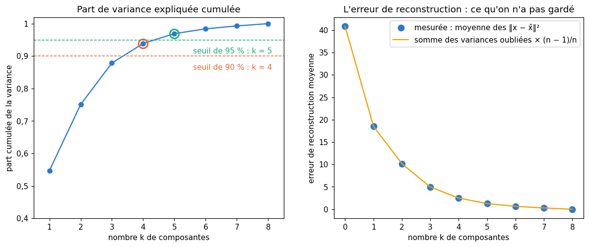

# M12d · SVD et analyse en composantes principales — fiche de cours

> En M12c, une matrice **symétrique** se diagonalisait dans une base orthonormée : $\mathbf{A} = \mathbf{Q}\boldsymbol{\Lambda}\mathbf{Q}^\top$. Ce chapitre fait la même chose pour **toute** matrice, même rectangulaire, avec deux bases orthonormées au lieu d'une : c'est la **décomposition en valeurs singulières** (SVD). Elle dit ce qu'une matrice fait à l'espace (une rotation, un étirement, une rotation), donne la meilleure **approximation de rang faible** d'une matrice, la **pseudo-inverse** et le **conditionnement**. Puis on revient aux données : les **axes principaux** d'un nuage sont les directions de plus grande variance, que le quotient de Rayleigh de M12c trouve en dimension quelconque ; l'**analyse en composantes principales** (ACP) centre, projette et reconstruit ; la **variance expliquée** et l'**erreur de reconstruction** disent ce que l'on garde et ce que l'on perd. Pour finir, un aperçu de **t-SNE** et d'**UMAP**, qui préservent des voisinages au lieu de variances.

| | |
|---|---|
| **Sections** | §1 à §8 |
| **Temps total estimé** | ≈ 18,0 h : lecture et calculs de la fiche ≈ 3 h 30, exercices ≈ 13 h 35, flashcards ≈ 50 min (parcours essentiel ≈ 11,3 h) |
| **Prérequis** | M12c (valeurs propres, théorème spectral, quotient de Rayleigh, matrice de covariance et règle $\mathbf{A}\boldsymbol{\Sigma}\mathbf{A}^\top$) ; M12b (bases orthonormées, projection orthogonale, moindres carrés comme projection) ; M12a (rang, noyau, image) ; M09b (moindres carrés, équations normales, ridge) ; M02c (moyenne, covariance, standardisation) ; M06 (entropie, divergence KL) |
| **Fichiers du chapitre** | `02_exercices.md` (quiz, papier) · `03_notebook.ipynb` · `04_indices.md` · `05_solutions.md` et `05_solutions.ipynb` · `06_mes_reponses.md` · `flashcards.csv` |
| **mymath** | `svd_pca.py` : `svd`, `low_rank_approximation`, `pinv`, `condition_number`, `principal_axes`, `explained_variance_ratio` |
| **MML** | §4.5, §4.6, §4.7, §10.1 à §10.6 (voir le guide de lecture ci-dessous) |

## Comment utiliser ce chapitre

**Ordre conseillé.**
1. `python tools/start_chapter.py M12d` (sur Colab : `00_setup/COLAB.md` §2) : il copie le notebook, ta feuille de réponses et le squelette `mymath/svd_pca.py`.
2. Section par section : lis **crayon en main**, refais chaque calcul ; puis fais les exercices de la section, quiz 🧠 d'abord.
3. Les exercices ✏️ et 🔗 se font sur papier, dans ta copie de `06_mes_reponses.md`, puis se vérifient dans la **partie 0** du notebook. Les démonstrations ∂ se rédigent dans ta copie et se jugent avec la grille de relecture de `05_solutions.md`.

**Un réflexe pour tout le chapitre** : une SVD se **vérifie** en refaisant le produit $\mathbf{U}\mathbf{S}\mathbf{V}^\top$, et deux contrôles sont gratuits : les valeurs singulières sont positives et rangées par ordre décroissant, et la somme de leurs carrés est la somme des carrés de **tous** les éléments de la matrice. Pour une ACP, la somme des variances le long des axes est la somme des variances des features (la trace de la covariance).

| Section | Quiz 🧠 | Papier et réflexion | Notebook |
|---|---|---|---|
| §1 La décomposition en valeurs singulières | Q1, Q2, R1 🔁 | M12d.1, M12d.2, M12d.11 ✏️, M12d.14 ∂, M12d.22 📖 | M12d.26 🔨, M12d.30 📦, M12d.33 🔬 |
| §2 Rotation, étirement, rotation : la géométrie de la SVD | Q2 | M12d.3 ✏️, M12d.15 ∂, M12d.22 📖, M12d.25 🗣️ | M12d.34 🎨 |
| §3 L'approximation de rang faible | Q3 | M12d.4, M12d.5 ✏️, M12d.16 ∂, M12d.22 📖 | M12d.27 🔨, M12d.31 🔮, M12d.32 🔬, M12d.36 🛠️, M12d.37 🏆 |
| §4 La pseudo-inverse et le conditionnement | Q4 | M12d.6, M12d.7 ✏️, M12d.17 ∂, M12d.22 📖, M12d.E2 💼 | M12d.27, M12d.28 🔨, M12d.30 📦, M12d.33 🔬 |
| §5 Les axes principaux : maximiser la variance sur la sphère | Q5, R2 🔁 | M12d.8 ✏️, M12d.23 📖 | M12d.29 🔨 |
| §6 L'ACP : centrer, projeter, reconstruire | Q6, R3 🔁 | M12d.8, M12d.9, M12d.11 ✏️, M12d.19 ∂, M12d.21 🔗, M12d.23 📖, M12d.24 🧮 | M12d.29 🔨, M12d.30 📦, M12d.35 🐛 |
| §7 Variance expliquée, erreur de reconstruction, grande dimension | Q7 | M12d.9, M12d.10, M12d.12 ✏️, M12d.18 ∂, M12d.20 🔗, M12d.23 📖, M12d.24 🧮, M12d.E1 💼 | M12d.29 🔨, M12d.36 🛠️ |
| §8 Au-delà du linéaire : t-SNE et UMAP (aperçu) | Q8 | M12d.13 ✏️ | — |

Parcours essentiel : tout sauf M12d.2, M12d.5, M12d.11, M12d.12, M12d.15 à M12d.17, M12d.19, M12d.21 à M12d.24, M12d.E1, M12d.E2, M12d.28, M12d.32, M12d.33 et M12d.35 à M12d.37. La pseudo-inverse (§4) s'y lit sans ses démonstrations ; la compression d'images se voit dans le 🔮 M12d.31.

## Guide de lecture de MML

*Mathematics for Machine Learning* (MML) traite ce chapitre à deux endroits : la fin de son chapitre 4, *Matrix Decompositions*, et son chapitre 10, *Dimensionality Reduction with Principal Component Analysis* :
- après le **§2** de la fiche : le **§4.5**, *Singular Value Decomposition* (l'énoncé, l'intuition géométrique, la construction à partir de $\mathbf{A}^\top\mathbf{A}$, la comparaison avec la décomposition en éléments propres) ;
- après le **§3** : le **§4.6**, *Matrix Approximation* (la norme spectrale et le théorème d'Eckart-Young) ;
- après le **§4** : le **§4.7**, *Matrix Phylogeny*, un arbre des familles de matrices et de leurs décompositions, à parcourir pour situer ce que tu as vu en M12a à M12d. Questions sur les §4.5 à §4.7 : M12d.22 ;
- après le **§7** : les **§10.1 à §10.6**. Le §10.2 trouve l'axe de variance maximale par les multiplicateurs de Lagrange : survole la dérivation (M13b la relira), la fiche y arrive par le quotient de Rayleigh ; le §10.3 voit l'ACP comme la projection qui minimise l'erreur de reconstruction ; le §10.5 traite la grande dimension ; le §10.6 récapitule les étapes en pratique. Le §10.7, le point de vue des variables latentes, se lira en M25b. Questions : M12d.23.

Le livre ne parle ni de t-SNE ni d'UMAP : pour le §8, la fiche est le cours. Ses exercices de fin de chapitre 4 sur la SVD et l'approximation de rang faible sont conseillés.

📐 **Notations.** La fiche écrit la SVD $\mathbf{A} = \mathbf{U}\mathbf{S}\mathbf{V}^\top$, avec $\mathbf{S}$ la matrice des **valeurs singulières** $s_1 \ge s_2 \ge \cdots \ge 0$ (MML : $\boldsymbol{\Sigma}$ et $\sigma_i$ ; la fiche garde $\boldsymbol{\Sigma}$ pour les covariances, comme en M12c), $\mathbf{u}_i$ et $\mathbf{v}_i$ les vecteurs singuliers à gauche et à droite, $r$ le rang. $\lVert \mathbf{A} \rVert_F$ est la norme de Frobenius, $\lVert \mathbf{A} \rVert_2$ la norme spectrale, $\mathbf{A}^+$ la pseudo-inverse, $\kappa(\mathbf{A})$ le conditionnement. Pour l'ACP : $n$ exemples en **lignes** d'une matrice $\mathbf{X}$ de forme $(n, p)$, comme dans workbookIA ; **MML range les exemples en colonnes** ($\mathbf{X} \in \mathbb{R}^{D \times N}$) et divise la covariance par $N$ : transpose ses formules, et pense au facteur $(N-1)/N$. La fiche note $\mathbf{C}$ la matrice de covariance des données (MML : $\mathbf{S}$ ; workbookIA : $\boldsymbol{\Sigma}$), $\mathbf{u}_1, \ldots, \mathbf{u}_p$ les axes principaux (MML : $\mathbf{b}_j$), $\lambda_1 \ge \cdots \ge \lambda_p$ les variances le long des axes, $k$ le nombre de composantes gardées (MML : $M$) et $t_{ij}$ les coordonnées des exemples sur les axes, leurs **scores** (MML : $\mathbf{z}_n$).

Vocabulaire anglais de ce chapitre : *singular value decomposition (SVD)*, *singular value*, *left / right singular vector*, *compact (thin) SVD*, *rank-k approximation*, *low-rank approximation*, *Frobenius norm*, *spectral norm*, *Eckart-Young theorem*, *pseudo-inverse (Moore-Penrose inverse)*, *minimum-norm solution*, *condition number*, *ill-conditioned*, *principal component analysis (PCA)*, *principal axis*, *principal component*, *score*, *explained variance (ratio)*, *reconstruction error*, *centering*, *standardization*, *Gram matrix*, *anomaly detection*, *t-SNE*, *perplexity*, *UMAP*, *manifold*.

## Objectifs d'apprentissage

À la fin du chapitre, tu sais :
- **calculer** la SVD d'une petite matrice et l'**interpréter** comme une rotation, un étirement et une rotation ;
- **calculer** une approximation de rang faible et son erreur (Eckart-Young) ;
- **calculer** une pseudo-inverse et un conditionnement, et **dire** ce qu'ils signifient ;
- **calculer** les axes principaux d'un nuage, les scores, une reconstruction et la variance expliquée ;
- **relier** l'erreur de reconstruction aux variances oubliées ;
- **situer** l'ACP par rapport à t-SNE et UMAP.

## L'essentiel en 10 lignes

1. Toute matrice $\mathbf{A}$ de forme $(m, n)$ et de rang $r$ s'écrit $\mathbf{A} = \mathbf{U}\mathbf{S}\mathbf{V}^\top = \sum_{i=1}^r s_i\,\mathbf{u}_i\mathbf{v}_i^\top$ : $\mathbf{U}$ et $\mathbf{V}$ orthogonales, $s_1 \ge \cdots \ge s_r > 0$, et $\mathbf{A}\mathbf{v}_i = s_i\mathbf{u}_i$.
2. Les $s_i^2$ sont les valeurs propres non nulles de $\mathbf{A}^\top\mathbf{A}$ (et de $\mathbf{A}\mathbf{A}^\top$), les $\mathbf{v}_i$ ses vecteurs propres, et $\mathbf{u}_i = \mathbf{A}\mathbf{v}_i/s_i$.
3. Géométrie : $\mathbf{V}^\top$ tourne, $\mathbf{S}$ étire chaque axe de $s_i$, $\mathbf{U}$ tourne ; la sphère unité devient un ellipsoïde de demi-axes $s_i\mathbf{u}_i$, et $\lVert \mathbf{A}\mathbf{x} \rVert \le s_1\lVert \mathbf{x} \rVert$.
4. **Eckart-Young** : $\mathbf{A}_k = \sum_{i \le k} s_i\mathbf{u}_i\mathbf{v}_i^\top$ est la meilleure approximation de rang $k$, d'erreur $\lVert \mathbf{A} - \mathbf{A}_k \rVert_F^2 = \sum_{i > k} s_i^2$.
5. La **pseudo-inverse** $\mathbf{A}^+ = \sum_{i \le r} \frac{1}{s_i}\mathbf{v}_i\mathbf{u}_i^\top$ donne la solution des moindres carrés de plus petite norme, $\mathbf{x}^+ = \mathbf{A}^+\mathbf{b}$.
6. Le **conditionnement** $\kappa(\mathbf{A}) = s_{\max}/s_{\min}$ borne l'amplification des erreurs relatives : $\frac{\lVert \delta\mathbf{x} \rVert}{\lVert \mathbf{x} \rVert} \le \kappa\,\frac{\lVert \delta\mathbf{b} \rVert}{\lVert \mathbf{b} \rVert}$ ; et $\kappa(\mathbf{A}^\top\mathbf{A}) = \kappa(\mathbf{A})^2$.
7. La variance d'un nuage centré le long d'une direction unitaire $\mathbf{u}$ est $\mathbf{u}^\top\mathbf{C}\mathbf{u}$ : les **axes principaux** sont les vecteurs propres de $\mathbf{C}$, par variance $\lambda_j$ décroissante.
8. L'**ACP** centre, calcule les scores $\mathbf{Z} = \mathbf{X}_c\mathbf{W}_k$ et reconstruit $\hat{\mathbf{X}} = \mathbf{Z}\mathbf{W}_k^\top + \boldsymbol{\mu}$ ; par la SVD de $\mathbf{X}_c$, les axes sont les $\mathbf{v}_j$ et $\lambda_j = s_j^2/(n-1)$.
9. La **part de variance expliquée** est $\lambda_j/\sum_l \lambda_l$ ; l'**erreur de reconstruction** moyenne est la somme des variances oubliées, au facteur $(n-1)/n$ près.
10. **t-SNE** et **UMAP** cherchent une carte en 2D qui garde les **voisins** de chaque point : utiles pour voir, pas pour mesurer.

---

## §1 · La décomposition en valeurs singulières

### Deux bases orthonormées au lieu d'une

Une matrice symétrique a une base orthonormée de vecteurs propres : dans cette base, elle ne fait qu'étirer (M12c §6). Une matrice quelconque n'en a pas : elle peut tourner toutes les directions, et si elle est rectangulaire, $(m, n)$ avec $m \ne n$, elle envoie $\mathbb{R}^n$ dans un **autre** espace, $\mathbb{R}^m$, et la question « $\mathbf{A}\mathbf{v} = \lambda\mathbf{v}$ » n'a même pas de sens. La bonne question devient : existe-t-il une base orthonormée $\mathbf{v}_1, \ldots, \mathbf{v}_n$ **au départ**, et une base orthonormée $\mathbf{u}_1, \ldots, \mathbf{u}_m$ **à l'arrivée**, telles que $\mathbf{A}$ envoie chaque $\mathbf{v}_i$ sur un multiple de $\mathbf{u}_i$ ? La réponse est toujours oui.

**Théorème (décomposition en valeurs singulières).** Toute matrice réelle $\mathbf{A}$ de forme $(m, n)$ et de rang $r$ s'écrit
$$\mathbf{A} = \mathbf{U}\mathbf{S}\mathbf{V}^\top,$$
avec $\mathbf{U}$ de forme $(m, m)$ et $\mathbf{V}$ de forme $(n, n)$ **orthogonales**, et $\mathbf{S}$ de forme $(m, n)$, nulle sauf sur sa diagonale, où se trouvent les **valeurs singulières** (*singular values*) $s_1 \ge s_2 \ge \cdots \ge s_r > 0$, suivies de zéros. Les colonnes $\mathbf{v}_i$ de $\mathbf{V}$ sont les **vecteurs singuliers à droite** (*right singular vectors*), les colonnes $\mathbf{u}_i$ de $\mathbf{U}$ les **vecteurs singuliers à gauche** (*left singular vectors*), et
$$\mathbf{A}\mathbf{v}_i = s_i\,\mathbf{u}_i \quad (i \le r), \qquad \mathbf{A}\mathbf{v}_i = \mathbf{0} \quad (i > r).$$

En ne gardant que les $r$ valeurs non nulles, on obtient la **SVD compacte** (*compact SVD*) : $\mathbf{A} = \mathbf{U}_r\mathbf{S}_r\mathbf{V}_r^\top$, avec $\mathbf{U}_r$ de forme $(m, r)$ et $\mathbf{V}_r$ de forme $(n, r)$ à colonnes orthonormées, et $\mathbf{S}_r = \operatorname{diag}(s_1, \ldots, s_r)$. Développée, c'est une somme de $r$ matrices de rang 1 :
$$\mathbf{A} = \sum_{i=1}^r s_i\,\mathbf{u}_i\mathbf{v}_i^\top.$$
Les valeurs singulières sont uniques ; quand les $s_i$ non nuls sont distincts, les vecteurs $\mathbf{v}_i$ et $\mathbf{u}_i$ correspondants le sont aussi, au signe près (on change à la fois $\mathbf{v}_i$ en $-\mathbf{v}_i$ et $\mathbf{u}_i$ en $-\mathbf{u}_i$) ; les $\mathbf{v}_i$ du noyau, eux, ne sont fixés qu'à une base orthonormée près. La convention de `mymath`, comme celle de scikit-learn pour l'ACP (depuis sa version 1.5) : la coordonnée de plus grande valeur absolue de chaque $\mathbf{v}_i$ est positive (en cas d'égalité, la première).

### La calculer : passer par $\mathbf{A}^\top\mathbf{A}$

D'où viennent ces deux bases ? La matrice $\mathbf{A}^\top\mathbf{A}$, de forme $(n, n)$, est **symétrique semi-définie positive** ($\mathbf{x}^\top\mathbf{A}^\top\mathbf{A}\mathbf{x} = \lVert \mathbf{A}\mathbf{x} \rVert^2 \ge 0$, M12c §7). Le théorème spectral lui donne une base orthonormée de vecteurs propres $\mathbf{v}_1, \ldots, \mathbf{v}_n$, de valeurs propres $\lambda_1 \ge \cdots \ge \lambda_n \ge 0$. La recette :
1. calculer $\mathbf{A}^\top\mathbf{A}$, ses valeurs propres et ses vecteurs propres unitaires ;
2. poser $s_i = \sqrt{\lambda_i}$ ;
3. pour chaque $s_i > 0$, poser $\mathbf{u}_i = \mathbf{A}\mathbf{v}_i/s_i$.

Pourquoi les ui sont orthonormés, et pourquoi le produit redonne A

$\mathbf{u}_i^\top\mathbf{u}_j = \frac{\mathbf{v}_i^\top\mathbf{A}^\top\mathbf{A}\mathbf{v}_j}{s_is_j} = \frac{\lambda_j\,\mathbf{v}_i^\top\mathbf{v}_j}{s_is_j}$, qui vaut 0 si $i \ne j$ et $\lambda_i/s_i^2 = 1$ si $i = j$. Ensuite, pour $i > r$, $\lVert \mathbf{A}\mathbf{v}_i \rVert^2 = \mathbf{v}_i^\top\mathbf{A}^\top\mathbf{A}\mathbf{v}_i = \lambda_i = 0$, donc $\mathbf{A}\mathbf{v}_i = \mathbf{0}$. Les deux matrices $\mathbf{A}$ et $\sum_{i \le r} s_i\mathbf{u}_i\mathbf{v}_i^\top$ envoient chaque $\mathbf{v}_j$ sur le même vecteur ($s_j\mathbf{u}_j$ si $j \le r$, $\mathbf{0}$ sinon) ; elles coïncident sur une base de $\mathbb{R}^n$, donc elles sont égales (M12a). Pour la SVD complète, on complète $\mathbf{u}_1, \ldots, \mathbf{u}_r$ en une base orthonormée de $\mathbb{R}^m$ (Gram-Schmidt, M12b).

**Exemple.** $\mathbf{A} = \begin{pmatrix} 6 & 4 \\ 1 & -6 \end{pmatrix}$.
- $\mathbf{A}^\top\mathbf{A} = \begin{pmatrix} 37 & 18 \\ 18 & 52 \end{pmatrix}$ : trace 89, déterminant $1\,924 - 324 = 1\,600$, donc $\lambda^2 - 89\lambda + 1\,600 = (\lambda - 64)(\lambda - 25)$. Les valeurs singulières sont $s_1 = 8$ et $s_2 = 5$.
- Pour 64 : $\begin{pmatrix} -27 & 18 \\ 18 & -12 \end{pmatrix}$ donne $3x = 2y$, $\mathbf{v}_1 = (2, 3)/\sqrt{13}$ ; pour 25, $\mathbf{v}_2 = (3, -2)/\sqrt{13}$ (orthogonal au premier, coordonnée de plus grande valeur absolue positive).
- $\mathbf{A}(2, 3) = (24, -16) = 8\,(3, -2)$, donc $\mathbf{u}_1 = (3, -2)/\sqrt{13}$ ; $\mathbf{A}(3, -2) = (10, 15) = 5\,(2, 3)$, donc $\mathbf{u}_2 = (2, 3)/\sqrt{13}$.
- Vérification : $8\,\mathbf{u}_1\mathbf{v}_1^\top + 5\,\mathbf{u}_2\mathbf{v}_2^\top = \frac{8}{13}\begin{pmatrix} 6 & 9 \\ -4 & -6 \end{pmatrix} + \frac{5}{13}\begin{pmatrix} 6 & -4 \\ 9 & -6 \end{pmatrix} = \frac{1}{13}\begin{pmatrix} 78 & 52 \\ 13 & -78 \end{pmatrix} = \mathbf{A}$.

Les valeurs propres de $\mathbf{A}$ elle-même sont $\pm\sqrt{40} \approx \pm 6{,}32$ (trace 0, déterminant $-40$) : elles n'ont rien à voir avec 8 et 5.

**Exemple rectangulaire.** $\mathbf{X} = \begin{pmatrix} 2 & 2 \\ 4 & 1 \\ 4 & -2 \end{pmatrix}$, de forme $(3, 2)$. Ses colonnes sont orthogonales ($4 + 4 - 8 = 0$) : $\mathbf{X}^\top\mathbf{X} = \begin{pmatrix} 36 & 0 \\ 0 & 9 \end{pmatrix}$ est déjà diagonale, donc $\mathbf{V} = \mathbf{I}$, $s_1 = 6$, $s_2 = 3$ (les normes des colonnes), $\mathbf{u}_1 = (2, 4, 4)/6 = (1, 2, 2)/3$ et $\mathbf{u}_2 = (2, 1, -2)/3$. La SVD compacte est $\mathbf{X} = \frac{1}{3}\begin{pmatrix} 1 & 2 \\ 2 & 1 \\ 2 & -2 \end{pmatrix}\begin{pmatrix} 6 & 0 \\ 0 & 3 \end{pmatrix}\mathbf{I}$. La SVD complète ajoute $\mathbf{u}_3 = (2, -2, 1)/3$, qui complète la base de $\mathbb{R}^3$ (les trois $\mathbf{u}_i$ sont les lignes de la matrice orthogonale de la fiche M12b, dans un autre ordre), et une ligne de zéros à $\mathbf{S}$, de forme $(3, 2)$. $\mathbf{X}\mathbf{X}^\top$, de forme $(3, 3)$, a pour valeurs propres 36, 9 et 0.

### Ce que la SVD dit d'une matrice

- **Le rang** est le nombre de valeurs singulières non nulles. L'**image** de $\mathbf{A}$ est engendrée par $\mathbf{u}_1, \ldots, \mathbf{u}_r$, son **noyau** par $\mathbf{v}_{r+1}, \ldots, \mathbf{v}_n$ (M12a ; et l'espace des lignes par $\mathbf{v}_1, \ldots, \mathbf{v}_r$, son complément orthogonal, M12b).
- $\mathbf{A}\mathbf{A}^\top = \mathbf{U}\mathbf{S}\mathbf{S}^\top\mathbf{U}^\top$ : ses valeurs propres non nulles sont aussi les $s_i^2$, et ses vecteurs propres les $\mathbf{u}_i$. $\mathbf{A}^\top$ a les mêmes valeurs singulières que $\mathbf{A}$.
- Pour une matrice **symétrique semi-définie positive**, la SVD est la décomposition spectrale ($\mathbf{U} = \mathbf{V} = \mathbf{Q}$, $s_i = \lambda_i$). Pour une matrice symétrique quelconque, $s_i = |\lambda_i|$ : le signe passe dans $\mathbf{u}_i = \pm\mathbf{v}_i$.
- Pour une matrice carrée, $|\det\mathbf{A}| = s_1s_2\cdots s_n$ ($\det\mathbf{U}$ et $\det\mathbf{V}$ valent $\pm 1$). Ici : $|{-40}| = 8 \times 5$.

> ⚠️ **Erreur classique.** Les valeurs singulières ne sont **pas** les valeurs propres, sauf pour une matrice symétrique semi-définie positive : elles sont toujours positives, existent même pour une matrice rectangulaire, et se lisent sur $\mathbf{A}^\top\mathbf{A}$, pas sur $\mathbf{A}$. Et une valeur singulière est la **racine** d'une valeur propre de $\mathbf{A}^\top\mathbf{A}$ : oublier la racine est l'erreur la plus fréquente.

> 💻 **Aujourd'hui en pratique.** `U, s, Vt = np.linalg.svd(A, full_matrices=False)` donne la SVD **réduite** (*thin SVD*), qui garde $\min(m, n)$ valeurs singulières, nulles comprises : on en tire la compacte en coupant sous un seuil (les **lignes** de `Vt` sont les $\mathbf{v}_i$), par un algorithme de LAPACK qui ne forme jamais $\mathbf{A}^\top\mathbf{A}$ : passer par $\mathbf{A}^\top\mathbf{A}$ perd de la précision sur les petites valeurs singulières (§4, et 🔬 M12d.33). Ta fonction `svd` le fait quand même, parce que c'est simple et que cela relie la SVD à M12c ; sa docstring dit ce que cela coûte. Les signes rendus par NumPy sont arbitraires.

### En machine learning

- L'ACP (§6) est une SVD des données centrées ; la compression et le débruitage gardent les grandes valeurs singulières (§3) ; les moindres carrés se résolvent par la pseudo-inverse (§4).
- La factorisation d'une matrice notes × utilisateurs en deux matrices de rang faible est l'idée des systèmes de recommandation ; des embeddings de mots se construisent par une SVD tronquée d'une matrice de cooccurrences (MB2) ; l'adaptation de rang faible d'un grand modèle (LoRA, MB4) ajoute aux poids une matrice de petit rang.

---

## §2 · Rotation, étirement, rotation : la géométrie de la SVD

### Trois étapes

Lis $\mathbf{A}\mathbf{x} = \mathbf{U}\big(\mathbf{S}(\mathbf{V}^\top\mathbf{x})\big)$ de droite à gauche :
1. $\mathbf{V}^\top\mathbf{x}$ donne les **coordonnées** de $\mathbf{x}$ dans la base $\mathbf{v}_1, \ldots, \mathbf{v}_n$ (M12b) : une rotation, ou une symétrie si $\det\mathbf{V} = -1$, qui amène $\mathbf{v}_i$ sur $\mathbf{e}_i$ ;
2. $\mathbf{S}$ **étire** chaque coordonnée : la $i$-ième est multipliée par $s_i$, et celles au-delà de $r$ disparaissent ; si $m \ne n$, c'est aussi là qu'on change de dimension (en ajoutant des zéros, ou en en retirant) ;
3. $\mathbf{U}$ **tourne** (ou symétrise) le résultat dans l'espace d'arrivée, en envoyant $\mathbf{e}_i$ sur $\mathbf{u}_i$.

Une application linéaire quelconque n'est donc rien de plus qu'un changement de repère orthonormé, des étirements le long des axes, et un autre changement de repère orthonormé.

![La SVD de A = [[6, 4], [1, −6]] en trois étapes : le cercle unité et v₁, v₂ ; Vᵀ les envoie sur e₁, e₂ (une symétrie, det V = −1) ; S étire les axes de 8 et de 5 ; U tourne l'ellipse, de demi-axes 8 u₁ et 5 u₂. Les couleurs suivent chaque point du cercle](figures/svd_geometrie.png)

### L'image de la sphère unité

Le cercle unité a pour image une **ellipse** de demi-axes $s_1\mathbf{u}_1$ et $s_2\mathbf{u}_2$ ; en dimension $n$, la sphère unité devient un ellipsoïde (aplati si $r < n$) de demi-axes $s_i\mathbf{u}_i$. Pour l'exemple, l'ellipse a ses demi-axes de longueurs 8 et 5 le long de $(3, -2)$ et $(2, 3)$, et son aire $\pi \times 8 \times 5 = 40\pi$ est bien $|\det\mathbf{A}|$ fois celle du disque (M12c §1). Les deux matrices orthogonales n'y changent ni longueurs ni aires ; ici $\det\mathbf{V} = -1$ et $\det\mathbf{U} = +1$, d'où $\det\mathbf{A} < 0$ : l'application retourne l'orientation.

**Le plus grand et le plus petit étirement.** Pour tout $\mathbf{x}$,
$$s_n\,\lVert \mathbf{x} \rVert \le \lVert \mathbf{A}\mathbf{x} \rVert \le s_1\,\lVert \mathbf{x} \rVert \qquad (\text{à gauche, pour } n \le m ;\ s_n \text{ peut être nulle}),$$
avec égalité en $\mathbf{v}_1$ à droite et en $\mathbf{v}_n$ à gauche. L'idée : $\lVert \mathbf{A}\mathbf{x} \rVert^2 = \mathbf{x}^\top(\mathbf{A}^\top\mathbf{A})\mathbf{x}$, et le quotient de Rayleigh de $\mathbf{A}^\top\mathbf{A}$ est compris entre sa plus petite et sa plus grande valeur propre, $s_n^2$ et $s_1^2$ (M12c §6 ; ∂ M12d.15). Le plus grand étirement $s_1$ s'appelle la **norme spectrale** (*spectral norm*) de $\mathbf{A}$, notée $\lVert \mathbf{A} \rVert_2$. Pour une matrice orthogonale, toutes les valeurs singulières valent 1 : elle n'étire rien.

> ⚠️ **Erreur classique.** Croire que la plus grande valeur propre (en module) mesure le plus grand étirement. C'est vrai pour une matrice symétrique, pas en général : la matrice de cisaillement $\begin{pmatrix} 1 & 10 \\ 0 & 1 \end{pmatrix}$ n'a que la valeur propre 1, mais elle envoie $(0, 1)$ sur $(10, 1)$, de norme $\sqrt{101}$ ; sa norme spectrale est $s_1 \approx 10{,}1$.

### En machine learning

- Une couche linéaire $\mathbf{x} \mapsto \mathbf{W}\mathbf{x}$ multiplie la norme de son entrée au plus par $s_1(\mathbf{W})$. Empiler des couches multiplie ces facteurs : c'est l'une des causes des gradients qui explosent ou s'évanouissent (M22), et l'idée de la normalisation spectrale, qui divise $\mathbf{W}$ par $s_1$.
- Le rapport $s_1/s_n$ de l'ellipse mesure à quel point $\mathbf{A}$ « aplatit » l'espace : c'est le conditionnement du §4.

---

## §3 · L'approximation de rang faible

### Garder les plus grandes couches

La SVD écrit $\mathbf{A}$ comme une somme de couches de rang 1, $s_i\,\mathbf{u}_i\mathbf{v}_i^\top$, rangées par importance. Garder les $k$ premières donne
$$\mathbf{A}_k = \sum_{i=1}^k s_i\,\mathbf{u}_i\mathbf{v}_i^\top = \mathbf{U}_k\mathbf{S}_k\mathbf{V}_k^\top,$$
une matrice de rang $k$ (au plus), de la même forme que $\mathbf{A}$.

**La norme de Frobenius.** Pour mesurer l'écart entre deux matrices, on prend la racine de la somme des carrés de tous les éléments : $\lVert \mathbf{A} \rVert_F = \sqrt{\sum_{i,j} a_{ij}^2}$, la **norme de Frobenius** (*Frobenius norm*). C'est $\sqrt{\operatorname{tr}(\mathbf{A}^\top\mathbf{A})}$ (M12c §2), donc la racine de la somme des valeurs propres de $\mathbf{A}^\top\mathbf{A}$ :
$$\lVert \mathbf{A} \rVert_F^2 = \sum_{i,j} a_{ij}^2 = s_1^2 + s_2^2 + \cdots + s_r^2.$$
On appelle souvent $\lVert \mathbf{A} \rVert_F^2$ l'**énergie** de la matrice, et $s_i^2$ la part portée par la $i$-ième couche.

**Théorème d'Eckart-Young (admis).** Pour toute matrice $\mathbf{B}$ de rang au plus $k$,
$$\lVert \mathbf{A} - \mathbf{B} \rVert_F \ge \lVert \mathbf{A} - \mathbf{A}_k \rVert_F, \qquad \text{et} \qquad \lVert \mathbf{A} - \mathbf{A}_k \rVert_F^2 = s_{k+1}^2 + \cdots + s_r^2.$$
Aucune matrice de rang $k$ n'est plus proche de $\mathbf{A}$ ; l'erreur est l'énergie des couches oubliées (∂ M12d.16 démontre cette égalité). En norme spectrale, l'erreur minimale vaut $s_{k+1}$.

**Exemple.** Pour $\mathbf{A} = \begin{pmatrix} 6 & 4 \\ 1 & -6 \end{pmatrix}$ : $\lVert \mathbf{A} \rVert_F^2 = 36 + 16 + 1 + 36 = 89 = 64 + 25$. L'approximation de rang 1 est $\mathbf{A}_1 = 8\,\mathbf{u}_1\mathbf{v}_1^\top = \frac{8}{13}\begin{pmatrix} 6 & 9 \\ -4 & -6 \end{pmatrix} \approx \begin{pmatrix} 3{,}69 & 5{,}54 \\ -2{,}46 & -3{,}69 \end{pmatrix}$ ; l'erreur $\mathbf{A} - \mathbf{A}_1 = 5\,\mathbf{u}_2\mathbf{v}_2^\top$ a pour norme de Frobenius 5 : $\mathbf{A}_1$ garde $64/89 \approx 72\,\%$ de l'énergie.

### Compresser

Stocker $\mathbf{A}_k$ demande $k$ vecteurs $\mathbf{u}_i$ ($m$ nombres chacun), $k$ vecteurs $\mathbf{v}_i$ ($n$ nombres) et $k$ valeurs singulières : $k(m + n + 1)$ nombres au lieu de $mn$. C'est rentable tant que $k < \frac{mn}{m + n + 1}$, et très rentable quand les valeurs singulières décroissent vite. Une image en niveaux de gris est une matrice : la figure en montre une de $120 \times 160$ pixels, que le rang 20 reconstruit à 96 % de son énergie avec 29 % des nombres.

> ⚠️ **Prudence.** L'énergie d'une image brute est dominée par son niveau de gris moyen, que la première couche suffit à rendre : sans le retirer, la même image a déjà 95 % de son énergie au rang 1, ce qui ne dit rien de sa qualité. On centre d'abord (en retirant la moyenne), et l'on regarde aussi l'image : la norme de Frobenius n'est pas la perception.

> 💻 **Aujourd'hui en pratique.** Pour une grande matrice dont on ne veut que les $k$ premières valeurs singulières, on ne calcule pas la SVD entière : `scipy.sparse.linalg.svds` ou la SVD aléatoire de scikit-learn (`sklearn.utils.extmath.randomized_svd`) ne cherchent que ces $k$ couches, en quelques produits de matrices.

### En machine learning

- Débruiter : le bruit se répartit sur toutes les couches, le signal se concentre dans les premières ; tronquer garde le signal.
- Les modèles de recommandation complètent une matrice notes × utilisateurs supposée de rang faible ; MB4 fera le même compte pour une correction des poids de rang faible.

---

## §4 · La pseudo-inverse et le conditionnement

### Résoudre quand on ne peut pas inverser

Un système $\mathbf{A}\mathbf{x} = \mathbf{b}$ peut n'avoir aucune solution ($\mathbf{b}$ hors de l'image : on prend alors les **moindres carrés**, M09b et M12b) ou en avoir une infinité ($\mathbf{A}$ a un noyau). Dans les deux cas, on demande le $\mathbf{x}$ qui minimise $\lVert \mathbf{A}\mathbf{x} - \mathbf{b} \rVert$ et, parmi ceux-là, celui de **plus petite norme**. La SVD le donne d'un coup.

**Définition.** La **pseudo-inverse** (de Moore-Penrose, *pseudo-inverse*) de $\mathbf{A} = \sum_{i \le r} s_i\mathbf{u}_i\mathbf{v}_i^\top$ est
$$\mathbf{A}^+ = \sum_{i=1}^r \frac{1}{s_i}\,\mathbf{v}_i\mathbf{u}_i^\top = \mathbf{V}_r\mathbf{S}_r^{-1}\mathbf{U}_r^\top,$$
de forme $(n, m)$ : on inverse ce qui s'inverse (les $s_i > 0$), et l'on ignore le reste. **Propriétés :**
- $\mathbf{x}^+ = \mathbf{A}^+\mathbf{b}$ est la solution des moindres carrés de plus petite norme (∂ M12d.17) ;
- si $\mathbf{A}$ est carrée et inversible, $\mathbf{A}^+ = \mathbf{A}^{-1}$ ;
- si les colonnes de $\mathbf{A}$ sont libres (rang $n$), $\mathbf{A}^+ = (\mathbf{A}^\top\mathbf{A})^{-1}\mathbf{A}^\top$ : ce sont les équations normales de M09b ;
- $\mathbf{A}\mathbf{A}^+ = \mathbf{U}_r\mathbf{U}_r^\top$ est la projection orthogonale sur l'image de $\mathbf{A}$ (M12b §5), et $\mathbf{A}^+\mathbf{A} = \mathbf{V}_r\mathbf{V}_r^\top$ celle sur l'espace des lignes.

**Exemple 1 : une équation, deux inconnues.** $x_1 + 2x_2 = 5$, soit $\mathbf{A} = \begin{pmatrix} 1 & 2 \end{pmatrix}$, de forme $(1, 2)$. Sa SVD : $s_1 = \sqrt{5}$, $\mathbf{v}_1 = (1, 2)/\sqrt{5}$, $u_1 = 1$. Donc $\mathbf{A}^+ = \frac{1}{\sqrt{5}}\mathbf{v}_1 = \frac{1}{5}\begin{pmatrix} 1 \\ 2 \end{pmatrix}$, et $\mathbf{x}^+ = 5\,\mathbf{A}^+ = (1, 2)$. Les solutions forment la droite $(1, 2) + t\,(2, -1)$ (le noyau est engendré par $(2, -1)$), de norme au carré $5 + 5t^2$ : la plus courte est bien $t = 0$, le pied de la perpendiculaire menée de l'origine.

**Exemple 2 : des colonnes libres.** Pour la matrice $\mathbf{X}$ du §1, $\mathbf{X}^+ = (\mathbf{X}^\top\mathbf{X})^{-1}\mathbf{X}^\top = \begin{pmatrix} 1/36 & 0 \\ 0 & 1/9 \end{pmatrix}\begin{pmatrix} 2 & 4 & 4 \\ 2 & 1 & -2 \end{pmatrix} = \frac{1}{18}\begin{pmatrix} 1 & 2 & 2 \\ 4 & 2 & -4 \end{pmatrix}$, et l'on vérifie $\mathbf{X}^+\mathbf{X} = \mathbf{I}_2$ ; mais $\mathbf{X}\mathbf{X}^+$, de forme $(3, 3)$, n'est que la projection sur le plan engendré par les colonnes.

**Les petites valeurs singulières.** Une valeur singulière minuscule, souvent du bruit, donne un $1/s_i$ énorme : la solution s'emballe. Deux remèdes : la **troncature**, qui traite comme nulles les $s_i$ sous un seuil relatif (le `rcond` de ta fonction `pinv`), et la **régularisation ridge** de M09b, qui remplace chaque $1/s_i$ par $\frac{s_i}{s_i^2 + \alpha}$ : presque $1/s_i$ quand $s_i^2 \gg \alpha$, presque 0 quand $s_i^2 \ll \alpha$. Écrite avec la SVD, la solution ridge est $\mathbf{x}_\alpha = \sum_i \frac{s_i}{s_i^2 + \alpha}\,(\mathbf{u}_i^\top\mathbf{b})\,\mathbf{v}_i$.

### Le conditionnement

**Définition.** Le **conditionnement** (*condition number*) d'une matrice de rang plein est le rapport de sa plus grande et de sa plus petite valeur singulière,
$$\kappa(\mathbf{A}) = \frac{s_{\max}}{s_{\min}} \ge 1,$$
où $s_{\min}$ est la $\min(m, n)$-ième ; on pose $\kappa = +\infty$ si $\mathbf{A}$ n'est pas de rang plein. C'est l'aplatissement de l'ellipse du §2. Pour une matrice symétrique définie positive, $\kappa = \lambda_{\max}/\lambda_{\min}$.

**Ce qu'il mesure.** Si $\mathbf{A}$ est carrée inversible, $\mathbf{A}\mathbf{x} = \mathbf{b}$ et $\mathbf{A}(\mathbf{x} + \delta\mathbf{x}) = \mathbf{b} + \delta\mathbf{b}$, alors
$$\frac{\lVert \delta\mathbf{x} \rVert}{\lVert \mathbf{x} \rVert} \le \kappa(\mathbf{A})\,\frac{\lVert \delta\mathbf{b} \rVert}{\lVert \mathbf{b} \rVert}.$$
Une erreur relative sur les données peut être amplifiée jusqu'à $\kappa$ fois sur la solution : on perd environ $\log_{10}\kappa$ chiffres significatifs.

Démonstration

$\delta\mathbf{x} = \mathbf{A}^{-1}\delta\mathbf{b}$, et $\mathbf{A}^{-1}$ a pour valeurs singulières les $1/s_i$ (sa SVD est $\mathbf{V}\mathbf{S}^{-1}\mathbf{U}^\top$), donc $\lVert \delta\mathbf{x} \rVert \le \lVert \delta\mathbf{b} \rVert/s_{\min}$ (§2). Et $\lVert \mathbf{b} \rVert = \lVert \mathbf{A}\mathbf{x} \rVert \le s_{\max}\lVert \mathbf{x} \rVert$, soit $\frac{1}{\lVert \mathbf{x} \rVert} \le \frac{s_{\max}}{\lVert \mathbf{b} \rVert}$. On multiplie les deux inégalités.

**Exemple.** $\mathbf{M} = \begin{pmatrix} 10 & 7 \\ 7 & 5 \end{pmatrix}$ a un déterminant de 1, et pourtant elle est mal conditionnée : ses valeurs propres sont $\frac{15 \pm \sqrt{221}}{2} \approx 14{,}93$ et $0{,}067$, donc $\kappa \approx 223$. Le système $\mathbf{M}\mathbf{x} = (17, 12)$ a pour solution $(1, 1)$ ; avec $(17 ;\ 12{,}01)$, la solution devient $(0{,}93 ;\ 1{,}10)$ (calcule-la avec $\mathbf{M}^{-1} = \begin{pmatrix} 5 & -7 \\ -7 & 10 \end{pmatrix}$). Les données ont bougé de $0{,}05\,\%$, la solution de $8{,}6\,\%$ : un facteur 180, sous la borne de 223. Pour la matrice $\mathbf{A}$ du §1, $\kappa = 8/5 = 1{,}6$ : aucune amplification à craindre.

**Le piège des équations normales.** $\mathbf{A}^\top\mathbf{A}$ a pour valeurs propres les $s_i^2$, donc
$$\kappa(\mathbf{A}^\top\mathbf{A}) = \kappa(\mathbf{A})^2.$$
Former $\mathbf{A}^\top\mathbf{A}$ double le nombre de chiffres perdus : avec $\kappa(\mathbf{A}) = 10^6$, les équations normales travaillent avec $\kappa = 10^{12}$, et il ne reste que 4 chiffres sur les 16 d'un flottant. C'est pourquoi on résout les moindres carrés par QR (M12b) ou par la SVD, sans former $\mathbf{A}^\top\mathbf{A}$, et c'est aussi la limite de ta fonction `svd`, qui passe par $\mathbf{A}^\top\mathbf{A}$ (🔬 M12d.33).

> ⚠️ **Erreur classique.** Juger le conditionnement par le déterminant. $\mathbf{M}$ ci-dessus a un déterminant de 1 et $\kappa \approx 223$ ; $0{,}1\,\mathbf{I}_9$ a un déterminant de $10^{-9}$ et $\kappa = 1$ (M12c §1). Le déterminant mesure un volume, le conditionnement un aplatissement.

> 💻 **Aujourd'hui en pratique.** `np.linalg.cond(A)` (le rapport des valeurs singulières), `np.linalg.pinv(A)` (avec un seuil relatif sur les petites valeurs singulières), `np.linalg.lstsq(A, b)` (les moindres carrés de plus petite norme, par la SVD) et `np.linalg.matrix_rank(A)` (le nombre de valeurs singulières au-dessus d'un seuil) font tous une SVD.

### En machine learning

- Des features presque redondantes rendent $\mathbf{X}^\top\mathbf{X}$ mal conditionnée : les poids d'une régression deviennent instables, et changent beaucoup quand on change un peu les données. La régularisation ridge (M09b) ajoute $\alpha$ aux valeurs propres $s_i^2$ de $\mathbf{X}^\top\mathbf{X}$ : $\kappa(\mathbf{X}^\top\mathbf{X} + \alpha\mathbf{I}) = \frac{s_1^2 + \alpha}{s_p^2 + \alpha}$, bien plus petit que $s_1^2/s_p^2$ quand $s_p$ est presque nul.
- Le conditionnement de la hessienne règle la vitesse de la descente de gradient sur une quadratique : M19 le montrera.

---

## §5 · Les axes principaux : maximiser la variance sur la sphère

### La variance le long d'une direction

On a maintenant $n$ exemples $\mathbf{x}_1, \ldots, \mathbf{x}_n$ de $\mathbb{R}^p$, en lignes d'une matrice $\mathbf{X}$ de forme $(n, p)$, de moyenne $\boldsymbol{\mu}$ ; $\mathbf{X}_c$ est la matrice centrée (on retire $\boldsymbol{\mu}$ à chaque ligne), et
$$\mathbf{C} = \frac{1}{n - 1}\,\mathbf{X}_c^\top\mathbf{X}_c$$
la matrice de covariance (M02c, M12c §8). Pour une direction **unitaire** $\mathbf{u}$, la coordonnée de l'exemple $i$ le long de $\mathbf{u}$ est $t_i = \mathbf{u}^\top(\mathbf{x}_i - \boldsymbol{\mu})$ (sa projection, M12b) ; ces coordonnées sont de moyenne nulle, et leur variance est
$$\mathbf{u}^\top\mathbf{C}\,\mathbf{u},$$
la règle $\mathbf{A}\boldsymbol{\Sigma}\mathbf{A}^\top$ de M12c §8 avec une seule ligne $\mathbf{A} = \mathbf{u}^\top$, qui vaut aussi pour la covariance empirique.

### Le maximum sur la sphère

Quelle direction unitaire donne la plus grande variance ? On cherche le maximum de $\mathbf{u}^\top\mathbf{C}\mathbf{u}$ sur la sphère $\lVert \mathbf{u} \rVert = 1$ : c'est exactement le quotient de Rayleigh de la matrice symétrique $\mathbf{C}$ (M12c §6), et la réponse est connue en **toute dimension** :
- le maximum est la plus grande valeur propre $\lambda_1$ de $\mathbf{C}$, atteint au vecteur propre unitaire $\mathbf{u}_1$ ;
- parmi les directions orthogonales à $\mathbf{u}_1$, le maximum est $\lambda_2$, en $\mathbf{u}_2$ ; et ainsi de suite.

**Définition.** Les **axes principaux** (*principal axes*) d'un nuage sont les vecteurs propres unitaires $\mathbf{u}_1, \ldots, \mathbf{u}_p$ de sa matrice de covariance, rangés par valeur propre décroissante ; la valeur propre $\lambda_j$ est la **variance le long de l'axe** $j$. Ils sont orthogonaux deux à deux (théorème spectral). Leur signe est arbitraire ; la convention de `mymath` et de scikit-learn rend positive la coordonnée de plus grande valeur absolue (la première, en cas d'égalité). On dit aussi **composantes principales** (*principal components*), un mot qui désigne selon les auteurs les axes ou les coordonnées sur ces axes.

**La variance totale ne change pas.** La somme des variances des $p$ features est $\operatorname{tr}\mathbf{C} = \lambda_1 + \cdots + \lambda_p$ (M12c §2) : les axes principaux ne créent ni ne détruisent de variance, ils la **répartissent**, le plus possible sur le premier, puis le plus possible de ce qui reste sur le deuxième.

**Exemple.** Cinq objets, trois mesures chacun :
$$\mathbf{X} = \begin{pmatrix} 3 & 2 & 5 \\ 7 & 6 & 5 \\ 9 & 8 & 1 \\ 9 & 8 & 9 \\ 12 & 6 & 5 \end{pmatrix}, \quad \boldsymbol{\mu} = (8, 6, 5), \quad \mathbf{X}_c = \begin{pmatrix} -5 & -4 & 0 \\ -1 & 0 & 0 \\ 1 & 2 & -4 \\ 1 & 2 & 4 \\ 4 & 0 & 0 \end{pmatrix}.$$
Les sommes de produits, divisées par $n - 1 = 4$, donnent
$$\mathbf{C} = \begin{pmatrix} 11 & 6 & 0 \\ 6 & 6 & 0 \\ 0 & 0 & 8 \end{pmatrix}$$
(par exemple $\sum x_1^2 = 25 + 1 + 1 + 1 + 16 = 44$, et $44/4 = 11$). La troisième mesure n'est corrélée à aucune autre : la matrice est **par blocs**, et son polynôme caractéristique se factorise en développant selon la dernière ligne :
$$\det(\mathbf{C} - \lambda\mathbf{I}) = (8 - \lambda)\big[(11 - \lambda)(6 - \lambda) - 36\big] = (8 - \lambda)(\lambda^2 - 17\lambda + 30) = (8 - \lambda)(\lambda - 15)(\lambda - 2).$$
Les variances le long des axes sont $\lambda_1 = 15$, $\lambda_2 = 8$, $\lambda_3 = 2$, de somme $25 = 11 + 6 + 8$. Les axes : pour 15, $\begin{pmatrix} -4 & 6 \\ 6 & -9 \end{pmatrix}$ donne $2x = 3y$, $\mathbf{u}_1 = (3, 2, 0)/\sqrt{13}$ ; pour 8, $\mathbf{u}_2 = (0, 0, 1)$ ; pour 2, $\mathbf{u}_3 = (-2, 3, 0)/\sqrt{13}$ (convention de signe). Aucune direction ne fait mieux que 15 : le long de la première mesure seule, la variance est 11 ; le long de $(1, 1, 1)/\sqrt{3}$, elle vaut $\frac{1}{3}\sum_{i,j} c_{ij} = \frac{37}{3} \approx 12{,}3$.

> ⚠️ **Erreur classique.** `np.linalg.eigh(C)` rend les valeurs propres par ordre **croissant**, et les vecteurs propres en **colonnes** : le premier axe principal est la **dernière** colonne. Lire une ligne au lieu d'une colonne, ou prendre la première colonne, donne une direction qui n'a rien de principal.

### Dans MML : la même réponse par Lagrange

MML (§10.2) trouve le même résultat en maximisant $\mathbf{u}^\top\mathbf{C}\mathbf{u}$ sous la contrainte $\lVert \mathbf{u} \rVert^2 = 1$ par un multiplicateur de Lagrange : la condition obtenue est $\mathbf{C}\mathbf{u} = \lambda\mathbf{u}$, une équation aux valeurs propres. M13b relira cette dérivation ; le quotient de Rayleigh donne la réponse sans multiplicateur.

---

## §6 · L'ACP : centrer, projeter, reconstruire

### Les trois étapes

L'**analyse en composantes principales** (ACP, *principal component analysis*, PCA) décrit chaque exemple par ses coordonnées sur les $k$ premiers axes principaux :
1. **Centrer** : $\mathbf{X}_c = \mathbf{X} - \boldsymbol{\mu}$ (chaque ligne moins la moyenne). C'est obligatoire.
2. **Projeter** : avec $\mathbf{W}_k = (\mathbf{u}_1 \mid \cdots \mid \mathbf{u}_k)$, de forme $(p, k)$ et à colonnes orthonormées, les **scores** sont $\mathbf{Z} = \mathbf{X}_c\mathbf{W}_k$, de forme $(n, k)$ : la ligne $i$ contient $t_{ij} = \mathbf{u}_j^\top(\mathbf{x}_i - \boldsymbol{\mu})$, $j = 1, \ldots, k$.
3. **Reconstruire** : $\hat{\mathbf{X}} = \mathbf{Z}\mathbf{W}_k^\top + \boldsymbol{\mu}$, soit $\hat{\mathbf{x}}_i = \boldsymbol{\mu} + \sum_{j \le k} t_{ij}\mathbf{u}_j$ : la projection orthogonale de $\mathbf{x}_i$ sur le sous-espace affine $\boldsymbol{\mu} + \operatorname{Vect}(\mathbf{u}_1, \ldots, \mathbf{u}_k)$ (la matrice $\mathbf{W}_k\mathbf{W}_k^\top$ de M12b §5).

On passe de $p$ nombres par exemple à $k$, et la reconstruction dit ce que ces $k$ nombres permettent de retrouver.

**Les scores ne sont pas corrélés.** La covariance des scores sur les axes $j$ et $l$ est $\mathbf{u}_j^\top\mathbf{C}\mathbf{u}_l$, qui vaut $\lambda_j$ si $j = l$ et 0 sinon (∂ M12d.19). Dans la base des axes principaux, la matrice de covariance devient diagonale : $\mathbf{W}_p^\top\mathbf{C}\mathbf{W}_p = \operatorname{diag}(\lambda_1, \ldots, \lambda_p)$, c'est la diagonalisation de M12c lue sur des données.

**Exemple (suite).** Les scores des cinq objets, avec $\mathbf{u}_1 = (3, 2, 0)/\sqrt{13}$, $\mathbf{u}_2 = (0, 0, 1)$ et $\mathbf{u}_3 = (-2, 3, 0)/\sqrt{13}$ :

| Objet | $\mathbf{x}_i - \boldsymbol{\mu}$ | $t_{i1}$ | $t_{i2}$ | $t_{i3}$ |
|---|---|---|---|---|
| 1 | $(-5, -4, 0)$ | $-23/\sqrt{13} \approx -6{,}38$ | 0 | $-2/\sqrt{13} \approx -0{,}55$ |
| 2 | $(-1, 0, 0)$ | $-3/\sqrt{13} \approx -0{,}83$ | 0 | $2/\sqrt{13} \approx 0{,}55$ |
| 3 | $(1, 2, -4)$ | $7/\sqrt{13} \approx 1{,}94$ | $-4$ | $4/\sqrt{13} \approx 1{,}11$ |
| 4 | $(1, 2, 4)$ | $7/\sqrt{13} \approx 1{,}94$ | 4 | $4/\sqrt{13} \approx 1{,}11$ |
| 5 | $(4, 0, 0)$ | $12/\sqrt{13} \approx 3{,}33$ | 0 | $-8/\sqrt{13} \approx -2{,}22$ |

Chaque colonne de scores est de moyenne nulle ; ses variances valent $\frac{(529 + 9 + 49 + 49 + 144)/13}{4} = 15$, puis 8 et 2, les valeurs propres. Avec $k = 2$, l'objet 5 est reconstruit en $\boldsymbol{\mu} + \frac{12}{\sqrt{13}}\mathbf{u}_1 = (8, 6, 5) + \frac{12}{13}(3, 2, 0) \approx (10{,}77 ;\ 7{,}85 ;\ 5)$ : sa composante sur $\mathbf{u}_3$ a été jetée.

### L'ACP par la SVD des données centrées

On n'a pas besoin de former $\mathbf{C}$. Si $\mathbf{X}_c = \mathbf{U}\mathbf{S}\mathbf{V}^\top$, alors
$$\mathbf{C} = \frac{1}{n - 1}\mathbf{X}_c^\top\mathbf{X}_c = \mathbf{V}\,\frac{\mathbf{S}^\top\mathbf{S}}{n - 1}\,\mathbf{V}^\top :$$
les axes principaux sont les vecteurs singuliers à droite $\mathbf{v}_j$, les variances sont $\lambda_j = s_j^2/(n - 1)$, et les scores sont $\mathbf{X}_c\mathbf{V} = \mathbf{U}\mathbf{S}$. Pour l'exemple, les valeurs singulières de $\mathbf{X}_c$ sont $\sqrt{60}$, $\sqrt{32}$ et $\sqrt{8}$ ($60/4 = 15$, et ainsi de suite). La SVD de $\mathbf{X}_c$ évite de former $\mathbf{X}_c^\top\mathbf{X}_c$, dont le conditionnement est le carré (§4) : c'est le calcul le plus sûr. scikit-learn le fait, sauf (depuis sa version 1.5) quand $p$ est petit (moins de $1\,000$ features) et $n > 10\,p$ : former la covariance $p \times p$ et la diagonaliser est alors bien plus rapide, et la précision perdue rarement gênante.

### Centrer, et parfois standardiser

**Sans centrer**, la « plus grande variance » est mesurée autour de l'origine, pas autour de la moyenne : le premier axe pointe vers le nuage au lieu de le traverser. Sur l'exemple, la matrice $\mathbf{X}^\top\mathbf{X}/4$ (non centrée) a pour premier vecteur propre $(0{,}72 ;\ 0{,}54 ;\ 0{,}43)$, à $1°$ de la direction de $\boldsymbol{\mu} = (8, 6, 5)$, et à $26°$ du vrai premier axe $\mathbf{u}_1$.

**Les unités comptent.** Changer l'unité de chaque feature multiplie $\mathbf{X}_c$ à droite par une matrice diagonale $\mathbf{D}$, et la covariance devient $\mathbf{D}\mathbf{C}\mathbf{D}$ (M12c §8) : les variances et les axes changent. Sur l'exemple, si la troisième mesure est exprimée dans une unité deux fois plus petite (ses valeurs doublent), sa variance passe de 8 à 32, et elle devient le **premier** axe, avec $\mathbf{u}_1 = (0, 0, 1)$ : l'unité a décidé à la place des données. Quand les features n'ont pas la même unité, on les **standardise** d'abord (M02c) : la covariance des données standardisées est la matrice de corrélation, qui ne dépend plus des unités (🔗 M12d.21). Quand elles ont la même unité et mesurent des grandeurs du même genre (des capteurs identiques, des mesures d'un même objet), on centre sans réduire : leurs écarts de variance sont alors de l'information, que la standardisation effacerait.

> ⚠️ **Erreur classique.** Oublier de centrer, mélanger $n$ et $n - 1$ entre la covariance et les variances rapportées, ou lire les axes en lignes au lieu de colonnes (ou l'inverse : les axes sont les **colonnes** de $\mathbf{V}$, donc les **lignes** de `Vt`). Ces trois erreurs donnent des résultats plausibles : seule une vérification ($\mathbf{C}\mathbf{u} = \lambda\mathbf{u}$, des scores de moyenne nulle) les détecte (🐛 M12d.35).

> 💻 **Aujourd'hui en pratique.** `sklearn.decomposition.PCA` centre, fait la SVD de $\mathbf{X}_c$ (ou, quand $n \gg p$ avec $p$ petit, diagonalise la covariance ; `svd_solver="full"` impose la SVD exacte) et range les axes en **lignes** de `components_`, les variances dans `explained_variance_` (avec $n - 1$) et leurs parts dans `explained_variance_ratio_` ; `transform` donne les scores et `inverse_transform` la reconstruction. Ta fonction `principal_axes` prend la matrice de covariance, pas les données : centrer et former $\mathbf{C}$ restent ton travail.

### En machine learning

Une ACP sert à compresser des features corrélées avant un modèle, à visualiser en deux ou trois dimensions, à débruiter (en reconstruisant avec peu de composantes) et à détecter des anomalies (§7). Elle n'utilise que les features, jamais la cible : si la cible est, par exemple, la coordonnée $y = \mathbf{u}_p^\top(\mathbf{x} - \boldsymbol{\mu})$ sur l'axe de plus petite variance, une ACP à $k < p$ composantes la perd entièrement.

---

## §7 · Variance expliquée, erreur de reconstruction, grande dimension

### La part de variance expliquée

La **part de variance expliquée** (*explained variance ratio*) par l'axe $j$ est
$$\frac{\lambda_j}{\lambda_1 + \lambda_2 + \cdots + \lambda_p},$$
la fraction de la variance totale que garde cette direction ; la somme des $k$ premières est la part gardée par une ACP à $k$ composantes. Sur l'exemple : $15/25 = 60\,\%$, $8/25 = 32\,\%$, $2/25 = 8\,\%$, soit des parts cumulées de 60 %, 92 % et 100 %. Avec un seuil de 90 %, deux composantes suffisent ; avec un seuil de 95 %, il en faut trois. Le dénominateur est la somme de **toutes** les variances : calculées après avoir coupé à $k$, les parts sommeraient à 1 et ne diraient plus rien.

**Choisir $k$.** Trois façons, de la plus rapide à la plus sûre : un seuil sur la part cumulée (90 %, 95 %) ; un « coude » dans la courbe des $\lambda_j$, au-delà duquel les variances deviennent petites et comparables (souvent du bruit) ; ou, quand l'ACP prépare un modèle, la valeur de $k$ qui donne le meilleur modèle en validation (workbookIA, ch. 15).

### L'erreur de reconstruction

Avec $k$ composantes, chaque exemple centré se décompose en $\mathbf{x}_i - \boldsymbol{\mu} = \sum_{j \le p} t_{ij}\mathbf{u}_j$ (une base orthonormée, M12b), et la reconstruction garde les $k$ premiers termes : l'écart $\mathbf{x}_i - \hat{\mathbf{x}}_i = \sum_{j > k} t_{ij}\mathbf{u}_j$ est ce qui se trouvait sur les axes oubliés, de norme au carré $\sum_{j > k} t_{ij}^2$ (Parseval). En moyenne sur les exemples :
$$\frac{1}{n}\sum_{i=1}^n \lVert \mathbf{x}_i - \hat{\mathbf{x}}_i \rVert^2 = \frac{n - 1}{n}\,(\lambda_{k+1} + \cdots + \lambda_p).$$
L'**erreur de reconstruction** (*reconstruction error*) moyenne est la somme des variances oubliées, au facteur $(n - 1)/n$ près, qui vient de la convention $1/(n - 1)$ de la covariance (∂ M12d.18). Sur l'exemple, avec $k = 2$ : $\frac{4 + 4 + 16 + 16 + 64}{13 \times 5} = \frac{104}{65} = 1{,}6 = \frac{4}{5} \times 2$. Et le sous-espace de l'ACP, $\boldsymbol{\mu} + \operatorname{Vect}(\mathbf{u}_1, \ldots, \mathbf{u}_k)$, est, parmi tous les sous-espaces affines de dimension $k$, celui qui rend cette erreur la plus petite (Eckart-Young appliqué à $\mathbf{X}_c$, et le fait que le meilleur sous-espace affine passe par la moyenne : admis) : la dispersion gardée et l'erreur commise sont les deux faces d'un même compte, puisque leur somme est fixe ($\frac{n-1}{n}$ fois la variance totale, ∂ M12d.18).

### Détecter une anomalie

Un exemple **nouveau** se projette avec les mêmes $\boldsymbol{\mu}$ et $\mathbf{W}_k$ ; son erreur de reconstruction mesure à quel point il sort du sous-espace où vivent les données. Sur l'exemple, avec $k = 2$ :
- l'objet $(11, 8, 7)$, centré $(3, 2, 2)$, a pour scores $t_1 = \sqrt{13}$, $t_2 = 2$, $t_3 = 0$ : il est **dans** le plan des deux premiers axes, son erreur est nulle ;
- l'objet $(6, 8, 5)$, centré $(-2, 2, 0)$, a pour score $t_3 = \frac{4 + 6}{\sqrt{13}}$ sur l'axe oublié : son erreur est $\frac{100}{13} \approx 7{,}7$, contre 1,6 en moyenne pour les cinq objets et au plus $\frac{64}{13} \approx 4{,}9$.

Chacune de ses mesures est pourtant dans la plage des données : c'est leur **combinaison** qui est inhabituelle (la première mesure est basse alors que la deuxième est haute, quand elles varient d'habitude ensemble). On fixe un seuil sur les erreurs de données normales, et l'on signale ce qui le dépasse.

### La grande dimension

Quand il y a moins d'exemples que de features ($n < p$ : des images, des gènes, des documents), deux faits changent les calculs :
- **au plus $n - 1$ variances sont non nulles** : les $n$ lignes centrées sont liées (leur somme est nulle), donc $\mathbf{X}_c$ est de rang au plus $n - 1$ ;
- **la petite matrice suffit** : $\mathbf{X}_c\mathbf{X}_c^\top$, de forme $(n, n)$, a les mêmes valeurs propres non nulles que $\mathbf{X}_c^\top\mathbf{X}_c$, de forme $(p, p)$ (§1) ; et si $\mathbf{X}_c\mathbf{X}_c^\top\mathbf{w} = \mu\mathbf{w}$, alors $\mathbf{X}_c^\top\mathbf{X}_c(\mathbf{X}_c^\top\mathbf{w}) = \mu\,\mathbf{X}_c^\top\mathbf{w}$ : le vecteur $\mathbf{X}_c^\top\mathbf{w}$, une fois normé, est un axe principal (M12d.12).

Ordre de grandeur : avec $p = 10^4$ features et $n = 500$ exemples, diagonaliser la matrice $p \times p$ coûte de l'ordre de $p^3 = 10^{12}$ opérations, former et diagonaliser la matrice $n \times n$ de l'ordre de $n^2p + n^3 \approx 2{,}6 \times 10^9$. La SVD de $\mathbf{X}_c$ s'adapte d'elle-même à la plus petite des deux dimensions, et pour de très grandes matrices, une SVD tronquée ou aléatoire (§3, 💻) ne calcule que les $k$ premiers axes.

> ⚠️ **Erreur classique.** Juger l'erreur de reconstruction, ou choisir $k$, sur les seules données qui ont servi à calculer les axes : sur elles, les $k$ premiers axes sont par construction le meilleur sous-espace (Eckart-Young), et l'erreur y est optimiste, puisque les axes ont été ajustés à cet échantillon-là. Sur des données nouvelles, la même projection fait **en moyenne** moins bien (un échantillon particulier peut faire mieux) : on mesure l'erreur, et l'on choisit $k$, sur d'autres données.

### En machine learning

- La courbe de variance cumulée est le premier outil pour choisir le nombre de composantes ; mais $k$ reste un hyperparamètre, à régler avec le modèle qui suit.
- L'erreur de reconstruction sert de **score d'anomalie** : une transaction, une pièce, un signal qui ne ressemble pas aux données d'entraînement se reconstruit mal. Les autoencodeurs (workbookIA 25) généralisent l'idée à des reconstructions non linéaires.

---

## §8 · Au-delà du linéaire : t-SNE et UMAP (aperçu)

### Ce que l'ACP ne sait pas faire

L'ACP projette sur un sous-espace : elle garde les **grandes** distances et les directions de grande variance. Mais des données qui vivent sur une surface courbe (une spirale enroulée dans l'espace, des groupes alignés différemment) se projettent mal : des points éloignés le long de la courbe tombent les uns sur les autres. Pour **regarder** un nuage de grande dimension en 2D, on préfère souvent garder les **voisinages** : que des points proches restent proches sur la carte, quitte à déformer les grandes distances.

### t-SNE en trois étapes

1. **Des probabilités de voisinage dans l'espace d'origine.** Pour chaque point $i$, on répartit une probabilité sur les autres points, selon une gaussienne centrée en $\mathbf{x}_i$ :
$$p_{j \mid i} = \frac{\exp\!\big(-\lVert \mathbf{x}_i - \mathbf{x}_j \rVert^2/(2\sigma_i^2)\big)}{\sum_{l \ne i}\exp\!\big(-\lVert \mathbf{x}_i - \mathbf{x}_l \rVert^2/(2\sigma_i^2)\big)}.$$
La largeur $\sigma_i$ est choisie pour chaque point, de sorte que la **perplexité** $2^{H(P_i)}$, avec $H(P_i) = -\sum_j p_{j \mid i}\log_2 p_{j \mid i}$ l'entropie en bits (M06), égale une valeur fixée : un nombre effectif de voisins. Si $p_{j \mid i}$ est uniforme sur $m$ voisins, $H = \log_2 m$ et la perplexité vaut $m$ ; avec les probabilités $\big(\frac{1}{2}, \frac{1}{4}, \frac{1}{4}\big)$, $H = 1{,}5$ bit et la perplexité vaut $2^{1{,}5} \approx 2{,}83$. Une petite $\sigma_i$ concentre la probabilité sur les plus proches voisins (petite perplexité), une grande l'étale. Comme la perplexité croît avec $\sigma_i$, on trouve la bonne largeur par dichotomie (R7). On symétrise ensuite : $p_{ij} = \frac{p_{j \mid i} + p_{i \mid j}}{2n}$.
2. **Des probabilités sur la carte.** On place des points $\mathbf{y}_i$ en 2D et l'on mesure leurs voisinages avec une loi à queue plus lourde : $q_{ij}$ proportionnel à $\big(1 + \lVert \mathbf{y}_i - \mathbf{y}_j \rVert^2\big)^{-1}$ (une loi de Student), normalisé sur tous les couples.
3. **Rapprocher les deux.** On déplace les $\mathbf{y}_i$ par descente de gradient pour rendre petite la divergence $\mathrm{KL}(P \,\Vert\, Q) = \sum_{i \ne j} p_{ij}\log\frac{p_{ij}}{q_{ij}}$ (M06). Elle n'est pas symétrique : placer loin deux points proches ($p_{ij}$ grand, $q_{ij}$ petit) coûte cher, rapprocher deux points lointains coûte peu. La carte garde donc les voisinages, pas les grandes distances.

Pourquoi une queue lourde ? En 2D, il n'y a pas assez de place pour garder toutes les distances moyennes d'un nuage de grande dimension ; la loi de Student laisse les points modérément éloignés s'écarter davantage sur la carte, ce qui sépare les groupes.

### UMAP

**UMAP** construit un graphe des $k$ plus proches voisins de chaque point (son réglage principal, `n_neighbors`), dont les arêtes portent des poids de voisinage, puis cherche une disposition en 2D qui préserve ce graphe, en minimisant une cross-entropy entre les poids d'origine et ceux de la carte (M06). Ses fondements viennent de la topologie ; en pratique, il est plus rapide que t-SNE sur de gros datasets, et il sait placer un point nouveau sur une carte existante.

### Ce que t-SNE ne garantit pas

- Pour deux points lointains de l'espace d'origine, $p_{ij}$ est presque nul : leur terme de $\mathrm{KL}(P \,\Vert\, Q)$ ne pèse presque rien, quelle que soit leur distance sur la carte. L'écart entre deux groupes bien séparés n'est donc presque pas contraint : il dépend de l'optimisation plus que des données.
- La perplexité donne à chaque point à peu près le même nombre effectif de voisins, dans une région dense comme dans une région clairsemée : la densité d'origine ne passe pas sur la carte.
- Les positions $\mathbf{y}_i$ ne sont qu'un minimum local de $\mathrm{KL}(P \,\Vert\, Q)$, qui n'est pas une fonction convexe des $\mathbf{y}_i$ : un autre point de départ donne une autre carte, de coût égal ou presque.
- t-SNE optimise les positions des $n$ points donnés, pas une fonction de $\mathbb{R}^p$ dans $\mathbb{R}^2$ : un point nouveau n'a pas de place définie (UMAP, lui, sait en placer un).

workbookIA 12 en tire les règles pratiques pour lire une carte.

---

## Les pièges classiques ⚠️ (récapitulatif)

| Piège | Ce qu'il faut faire |
|---|---|
| Prendre les valeurs propres de $\mathbf{A}$ pour ses valeurs singulières | les valeurs singulières sont les **racines** des valeurs propres de $\mathbf{A}^\top\mathbf{A}$ ; elles sont positives |
| Oublier la racine carrée, ou oublier de diviser $\mathbf{A}\mathbf{v}_i$ par $s_i$ | $s_i = \sqrt{\lambda_i}$ et $\mathbf{u}_i = \mathbf{A}\mathbf{v}_i/s_i$ |
| Lire les $\mathbf{v}_i$ en colonnes de `Vt` | `np.linalg.svd` rend $\mathbf{V}^\top$ : les $\mathbf{v}_i$ en sont les **lignes** |
| Comparer deux SVD sans tenir compte du signe | changer $\mathbf{v}_i$ et $\mathbf{u}_i$ de signe ensemble ; fixer une convention |
| La plus grande valeur propre prise pour le plus grand étirement | la norme spectrale est $s_1$ (un cisaillement le montre) |
| L'erreur de rang $k$ calculée avec les $s_i$ au lieu des $s_i^2$ | $\lVert \mathbf{A} - \mathbf{A}_k \rVert_F^2 = \sum_{i > k} s_i^2$ |
| Juger le conditionnement par le déterminant | $\kappa = s_{\max}/s_{\min}$ ; $\kappa(\mathbf{A}^\top\mathbf{A}) = \kappa(\mathbf{A})^2$ |
| Inverser sans regarder les petites valeurs singulières | tronquer (`rcond`) ou régulariser (ridge) |
| Une ACP sans centrer | retirer la moyenne d'abord : sinon le premier axe pointe vers la moyenne |
| Des features d'unités différentes, non standardisées | standardiser (la matrice de corrélation), ou justifier de ne pas le faire |
| Le premier axe pris dans la première colonne de `eigh` | `eigh` range par ordre croissant : prendre la dernière colonne |
| Les parts de variance calculées après avoir coupé à $k$ | diviser par la somme de **toutes** les variances |
| $\lambda_j = s_j^2/n$ avec une covariance en $n - 1$ | $\lambda_j = s_j^2/(n - 1)$ ; dire la convention |
| Juger l'ACP sur ses données d'entraînement | calculer les axes sur l'entraînement, mesurer l'erreur sur d'autres données |
| Lire des distances entre groupes sur une carte t-SNE | une carte montre des voisinages, pas des distances |

## Et maintenant

**Dans ce dépôt** : M13b relit l'ACP comme une optimisation sous contrainte, avec les multiplicateurs de Lagrange ; M19 relie le conditionnement de la hessienne à la vitesse de la descente de gradient ; M22 utilise les normes de matrices et le plus grand étirement pour les gradients qui explosent ; M25b donne le point de vue probabiliste de l'ACP (variables latentes) ; MB2 construit des embeddings par une SVD tronquée, et MB4 compte les paramètres d'une adaptation de rang faible.

**Dans workbookIA** : le chapitre 12 prépare les données. Tu y retrouveras l'ACP par la SVD des données centrées, la variance expliquée et le choix du nombre de composantes, la reconstruction et son erreur, la question des unités et de la standardisation, et les cartes de t-SNE et d'UMAP : tu sais maintenant d'où vient chaque formule, et ce que ta propre fonction calcule.

## Pour aller plus loin

- MML §4.5 à §4.7 et §10.1 à §10.6, et les exercices du chapitre 4 du livre sur la SVD (conseillés).
- Gilbert Strang, *Introduction to Linear Algebra* : dans les 2ᵉ à 4ᵉ éditions, §6.7 (*The Singular Value Decomposition*) et, au chapitre 7, la section *Diagonalization and the Pseudoinverse* (§7.4 dans la 2ᵉ) ; dans les 5ᵉ et 6ᵉ, tout le chapitre 7 (*The Singular Value Decomposition*).
- L. van der Maaten et G. Hinton, « Visualizing Data using t-SNE », *Journal of Machine Learning Research*, 2008 ; L. McInnes, J. Healy et J. Melville, « UMAP: Uniform Manifold Approximation and Projection for Dimension Reduction », 2018 (en anglais).
- `annexes/symboles.md` (lire $\mathbf{A}^+$, $\lVert \mathbf{A} \rVert_F$ et $\kappa(\mathbf{A})$ à voix haute), `annexes/formulaire.md` et `annexes/erreurs_frequentes.md`.
