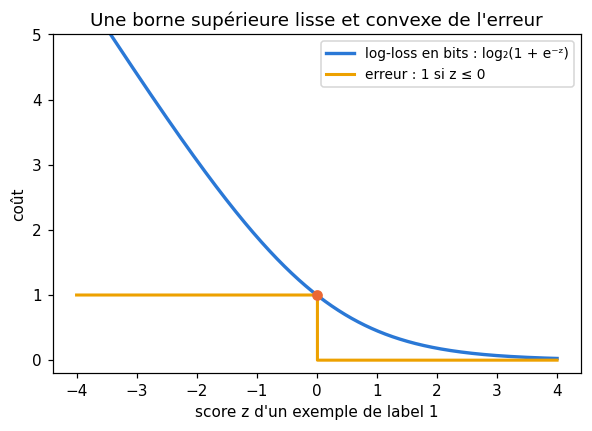
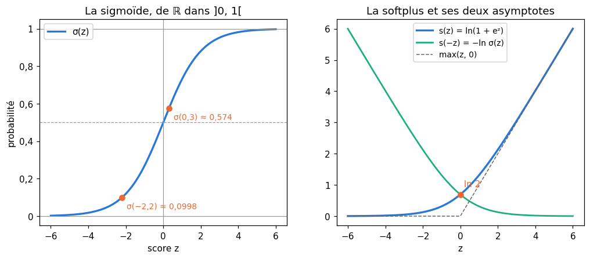
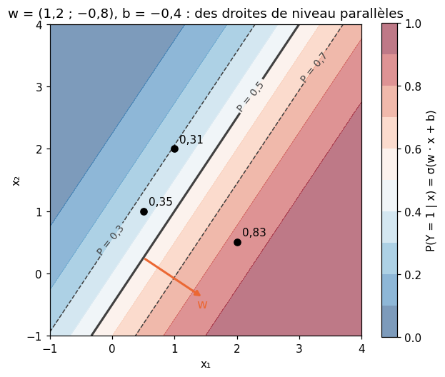
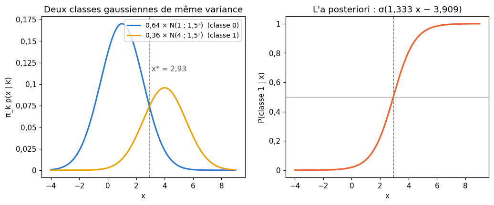
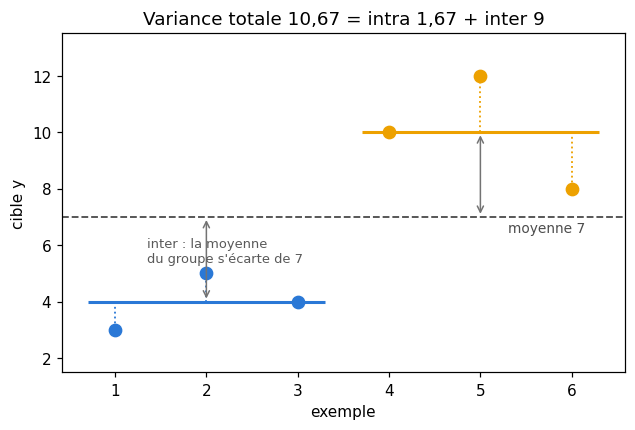

# M13a · Vraisemblance et régression logistique — fiche de cours

> En M04, la vraisemblance d'un taux d'échec t'a donné une première estimation : la fréquence observée. Ce chapitre fait du **maximum de vraisemblance** une méthode générale, pour une loi de Bernoulli, une loi catégorielle et une loi normale, et montre que la **log-loss** que minimisent les classifieurs n'est rien d'autre que moins la log-vraisemblance. Il étudie les deux fonctions qui l'écrivent, la **sigmoïde** et la **softplus**, et démontre que cette loss est **convexe**. Puis il présente deux façons de modéliser une classe : la **régression logistique**, qui modélise directement la probabilité de la classe sachant les features, et **Naïve Bayes**, qui modélise les features de chaque classe et retourne la question par la formule de Bayes. Pour finir, les mesures d'**impureté** d'une distribution (entropie, indice de Gini), le **gain d'information** et la **réduction de variance**, les outils mathématiques des arbres de décision.

| | |
|---|---|
| **Sections** | §1 à §7 |
| **Temps total estimé** | ≈ 14,4 h : lecture et calculs de la fiche ≈ 3 h, exercices ≈ 10 h 35, flashcards ≈ 50 min (parcours essentiel ≈ 10,6 h) |
| **Prérequis** | M04 (vraisemblance, maximum de vraisemblance, lissage de Laplace, log-probabilités et log-sum-exp) ; M06 (entropie, cross-entropy, divergence KL, information mutuelle, inégalité de Gibbs) ; R6 (sigmoïde, cote, logit) ; M05a (dérivée seconde, convexité d'une fonction d'une variable) ; M10 (fonctions convexes de plusieurs variables) ; M05b (gradient) ; M02b (loi normale) ; M02c (biais d'un estimateur, variance en $n$ ou $n - 1$) ; M07 (hyperplans, produit scalaire) |
| **Fichiers du chapitre** | `02_exercices.md` (quiz, papier) · `03_notebook.ipynb` · `04_indices.md` · `05_solutions.md` et `05_solutions.ipynb` · `06_mes_reponses.md` · `flashcards.csv` |
| **mymath** | `likelihood.py` : `bernoulli_log_likelihood`, `bernoulli_mle`, `categorical_mle`, `gaussian_mle`, `logistic_loss` |
| **MML** | §8.3 (voir le guide de lecture ci-dessous) |

## Comment utiliser ce chapitre

**Ordre conseillé.**
1. `python tools/start_chapter.py M13a` (sur Colab : `00_setup/COLAB.md` §2) : il copie le notebook, ta feuille de réponses et le squelette `mymath/likelihood.py`.
2. Section par section : lis **crayon en main**, refais chaque calcul ; puis fais les exercices de la section, quiz 🧠 d'abord.
3. Les exercices ✏️ et 🔗 se font sur papier, dans ta copie de `06_mes_reponses.md`, puis se vérifient dans la **partie 0** du notebook. Les démonstrations ∂ se rédigent dans ta copie et se jugent avec la grille de relecture de `05_solutions.md`.

**Un réflexe pour tout le chapitre** : une log-vraisemblance est une **somme** sur les exemples, toujours négative ou nulle pour des lois discrètes ; une log-loss est sa moyenne changée de signe, toujours positive ou nulle. Un résultat d'un autre signe trahit une erreur. Et tous les logarithmes de ce chapitre sont népériens, sauf ceux des impuretés des arbres (§6), en bits.

| Section | Quiz 🧠 | Papier et réflexion | Notebook |
|---|---|---|---|
| §1 Le maximum de vraisemblance, revisité | Q1 | M13a.1, M13a.2 ✏️, M13a.13 ∂, M13a.19 📖, M13a.E2 💼 | M13a.22, M13a.23 🔨, M13a.25 📦, M13a.27 🔬, M13a.29 🐛, M13a.30 🛠️, M13a.31 🏆 |
| §2 La log-loss est moins la log-vraisemblance | Q2, R2 🔁 | M13a.3, M13a.4 ✏️, M13a.14 ∂, M13a.21 🗣️, M13a.E1, M13a.E2 💼 | M13a.24 🔨, M13a.25 📦, M13a.26 🔮, M13a.29 🐛 |
| §3 La sigmoïde et la softplus | Q3, Q8, R3 🔁 | M13a.5, M13a.6 ✏️, M13a.15 ∂ | M13a.24 🔨, M13a.25 📦, M13a.29 🐛 |
| §4 La régression logistique, un modèle probabiliste | Q4, Q5, Q8 | M13a.7, M13a.9 ✏️, M13a.15 ∂, M13a.18 🔗, M13a.19 📖, M13a.21 🗣️ | — |
| §5 Naïve Bayes, un modèle génératif | Q5, R1 🔁 | M13a.8, M13a.9 ✏️, M13a.20 🧮 | M13a.23 🔨 |
| §6 Impureté : entropie, indice de Gini et gain d'information | Q6, R2 🔁 | M13a.10, M13a.11 ✏️, M13a.16, M13a.17 ∂ | M13a.28 🎨 |
| §7 Arbres de régression : la réduction de variance | Q7 | M13a.12 ✏️ | — |

Parcours essentiel : tout sauf Q7, Q8, M13a.4, M13a.9, M13a.12, M13a.16, M13a.17, M13a.19, M13a.20, M13a.E1, M13a.E2, M13a.27 et M13a.29 à M13a.31. Le §7 s'y lit sans exercice.

## Guide de lecture de MML

*Mathematics for Machine Learning* (MML) a déjà été lu pour ce chapitre en M04 : sa **§8.3**, *Parameter Estimation*, se relit maintenant avec un autre regard.
- après le **§2** de la fiche : les **§8.3.1** (*Maximum Likelihood Estimation* : la log-vraisemblance négative, l'hypothèse i.i.d. qui transforme le produit en somme, puis l'exemple d'un bruit gaussien qui redonne les moindres carrés) et **§8.3.2** (*Maximum A Posteriori Estimation*, vu en M04 : survole-le) ;
- après le **§4** : les **§8.3.3** (*Model Fitting*, l'overfitting et l'underfitting, à survoler) et **§8.3.4** (*Further Reading*) : ses quelques lignes sur les prédicteurs de la forme $\varphi(\boldsymbol{\theta}^\top\mathbf{x})$, les **modèles linéaires généralisés** et la fonction de lien, décrivent exactement la régression logistique du §4. Questions : M13a.19.

Le livre ne traite ni Naïve Bayes, ni les impuretés des arbres : pour les §5 à §7, la fiche est le cours. Pour aller plus loin, le §6.6.3 de MML (*Exponential Family*) montre que la sigmoïde est la fonction qui relie le paramètre d'une loi de Bernoulli à son paramètre « naturel » : c'est une autre façon de comprendre le §4.

📐 **Notations.** La fiche note $L(\boldsymbol{\theta})$ la vraisemblance, comme en M04, et $\ell(\boldsymbol{\theta}) = \ln L(\boldsymbol{\theta})$ la log-vraisemblance. **MML note $L(\boldsymbol{\theta})$ (ou $\mathcal{L}$) l'opposé de la log-vraisemblance**, la quantité qu'on minimise : lis ses formules avec un signe moins. MML écrit $\log$ pour le logarithme népérien, $N$ pour le nombre d'exemples et $\boldsymbol{\theta}$ pour les paramètres. La fiche écrit $\hat{p}$, $\hat{\mu}$, $\hat{\sigma}^2$ les estimations du maximum de vraisemblance, $\sigma(z) = \frac{1}{1 + e^{-z}}$ la sigmoïde (le $\sigma$ d'un écart-type se reconnaît à son exposant ou à son indice), $s(z) = \ln(1 + e^z)$ la softplus, $\mathrm{LSE}$ le log-somme-exp, et $z = \mathbf{w} \cdot \mathbf{x} + b$ le score d'un exemple. Les labels valent 0 ou 1.

Vocabulaire anglais de ce chapitre : *likelihood*, *log-likelihood*, *negative log-likelihood (NLL)*, *maximum likelihood estimate (MLE)*, *i.i.d.*, *Bernoulli / categorical / Gaussian distribution*, *log-loss*, *binary cross-entropy*, *proper scoring rule*, *sigmoid (logistic function)*, *softplus*, *log-sum-exp*, *odds*, *logit*, *log-odds*, *logistic regression*, *decision boundary*, *linear probe*, *generalized linear model*, *link function*, *generative / discriminative model*, *naive Bayes*, *conditional independence*, *Laplace (additive) smoothing*, *impurity*, *entropy*, *Gini index (Gini impurity)*, *information gain*, *mutual information*, *variance reduction*, *within-group / between-group variance*, *regression tree*.

## Objectifs d'apprentissage

À la fin du chapitre, tu sais :
- **calculer** et **démontrer** les estimations du maximum de vraisemblance d'une loi de Bernoulli, d'une loi catégorielle et d'une loi normale ;
- **écrire** la log-loss comme moins la log-vraisemblance, et la **calculer** à partir de probabilités ou de scores ;
- **calculer** avec la sigmoïde et la softplus, et **démontrer** que la softplus et log-somme-exp sont convexes ;
- **lire** un modèle logistique : probabilités, cote, frontière de décision ;
- **calculer** à la main un modèle Naïve Bayes, avec lissage et en log-probabilités, et **le comparer** à la régression logistique ;
- **calculer** une entropie, un indice de Gini, un gain d'information et une réduction de variance.

## L'essentiel en 10 lignes

1. Pour des observations indépendantes, la vraisemblance est un produit, la **log-vraisemblance** $\ell(\boldsymbol{\theta}) = \sum_i \ln p(x_i \mid \boldsymbol{\theta})$ une somme ; l'**estimation du maximum de vraisemblance** la rend maximale.
2. Bernoulli : $\hat{p}$ = la proportion de 1 ; catégorielle : $\hat{p}_k = n_k/N$ (avec lissage : $\frac{n_k + \alpha}{N + K\alpha}$) ; normale : $\hat{\mu}$ = la moyenne, $\hat{\sigma}^2 = \frac{1}{n}\sum_i (x_i - \hat{\mu})^2$, en $n$ et non $n - 1$.
3. La **log-loss** d'un classifieur est moins sa log-vraisemblance divisée par $n$ : minimiser l'une, c'est maximiser l'autre.
4. La log-loss récompense les probabilités **honnêtes** : pour un label de probabilité $\pi$, sa valeur moyenne $H(\pi) + \mathrm{KL}(\pi \,\Vert\, q)$ est la plus petite en $q = \pi$.
5. La **sigmoïde** $\sigma(z) = \frac{1}{1 + e^{-z}}$ envoie $\mathbb{R}$ sur $]0, 1[$ ; la **softplus** $s(z) = \ln(1 + e^z)$ vérifie $-\ln \sigma(z) = s(-z)$ et $s(z) - s(-z) = z$.
6. **Log-somme-exp** est convexe (sur une droite, sa dérivée seconde est une variance) ; la softplus aussi, et donc la log-loss d'un modèle logistique, en $(\mathbf{w}, b)$.
7. **Régression logistique** : $P(Y = 1 \mid \mathbf{x}) = \sigma(\mathbf{w} \cdot \mathbf{x} + b)$ ; le score est la log-cote ; la frontière $\mathbf{w} \cdot \mathbf{x} + b = 0$ est un hyperplan.
8. **Naïve Bayes** suppose les features indépendantes **sachant la classe** et estime chaque loi par maximum de vraisemblance ; deux classes gaussiennes de même variance donnent un a posteriori logistique.
9. **Impureté** : entropie $H = -\sum_k p_k \log_2 p_k$ (au plus $\log_2 K$), indice de Gini $G = 1 - \sum_k p_k^2$ (au plus $1 - \frac{1}{K}$) ; le **gain d'information** d'une variable est son information mutuelle avec la classe.
10. **Réduction de variance** : variance totale = variance intra-groupes + variance inter-groupes ; couper un groupe ne fait jamais monter la variance moyenne des groupes.

---

## §1 · Le maximum de vraisemblance, revisité

### Un principe, trois lois

Un **modèle** est une famille de lois $p(x \mid \boldsymbol{\theta})$, indexée par des paramètres $\boldsymbol{\theta}$. On observe $x_1, \ldots, x_n$, supposés **indépendants et de même loi** (*i.i.d.*, M02c). La probabilité (ou la densité) de l'ensemble des observations est alors un produit, et, vue comme une fonction de $\boldsymbol{\theta}$ à données fixées, c'est la **vraisemblance** (M04 §3) :

$$L(\boldsymbol{\theta}) = \prod_{i=1}^n p(x_i \mid \boldsymbol{\theta}), \qquad \ell(\boldsymbol{\theta}) = \ln L(\boldsymbol{\theta}) = \sum_{i=1}^n \ln p(x_i \mid \boldsymbol{\theta}).$$

L'**estimation du maximum de vraisemblance** (*maximum likelihood estimate*, MLE) est la valeur $\hat{\boldsymbol{\theta}}$ qui rend $\ell$ maximale. On travaille toujours avec $\ell$ : le logarithme est croissant, donc le maximum est au même endroit ; une somme se dérive terme à terme ; et un produit de milliers de probabilités tomberait à 0 en flottants (M04 §7), alors que leur somme de logarithmes reste un nombre ordinaire. Minimiser $-\ell$, ou $-\frac{1}{n}\ell$, revient au même : c'est la forme qu'on retrouvera comme loss.

**Bernoulli.** Huit visiteurs d'une page ont cliqué (1) ou non (0) sur un bouton : $(0, 1, 1, 0, 1, 0, 1, 1)$. Le modèle : chaque visiteur clique avec une probabilité $p$, indépendamment des autres. Une observation $y \in \{0, 1\}$ a la probabilité $p^y (1 - p)^{1 - y}$ ($p$ si $y = 1$, $1 - p$ si $y = 0$), donc

$$\ell(p) = \sum_i \big[y_i \ln p + (1 - y_i)\ln(1 - p)\big] = k\ln p + (n - k)\ln(1 - p),$$

avec $k = 5$ clics sur $n = 8$. Comme en M04, $\ell'(p) = \frac{k}{p} - \frac{n - k}{1 - p}$ s'annule en $\hat{p} = \frac{k}{n} = 0{,}625$, et $\ell'' < 0$ : c'est le maximum. Les valeurs : $\ell(0{,}625) = 5\ln 0{,}625 + 3\ln 0{,}375 \approx -5{,}293$, contre $\ell(0{,}5) = 8\ln 0{,}5 \approx -5{,}545$ et $\ell(0{,}7) \approx -5{,}395$.

**Catégorielle.** Une variable a $K$ valeurs possibles, de probabilités $p_1, \ldots, p_K$ (de somme 1) : c'est une **loi catégorielle** (M02b). Sur $N$ observations, la valeur $k$ apparaît $n_k$ fois, et

$$\ell(\mathbf{p}) = \sum_{k=1}^K n_k \ln p_k.$$

Le maximum, sous la contrainte $\sum_k p_k = 1$, est atteint en $\hat{p}_k = \frac{n_k}{N}$ : encore les fréquences observées. On ne peut pas annuler les dérivées partielles une à une (la contrainte lie les $p_k$) ; la démonstration passe par l'inégalité de Gibbs de M06 (∂ M13a.13). M13b donnera une méthode générale pour ce genre de maximum sous contrainte : les multiplicateurs de Lagrange. Exemple : vingt réponses à une question à quatre choix se répartissent en $(11, 6, 3, 0)$ ; alors $\hat{\mathbf{p}} = (0{,}55 ;\ 0{,}3 ;\ 0{,}15 ;\ 0)$.

Le zéro pose problème : une 21ᵉ réponse égale au quatrième choix aurait, pour ce modèle, la probabilité 0, et la log-vraisemblance deviendrait $-\infty$. Le **lissage** de M04 ajoute un pseudo-comptage $\alpha > 0$ à chaque valeur :

$$\hat{p}_k = \frac{n_k + \alpha}{N + K\alpha}, \qquad \text{ici, avec } \alpha = 1 : \ \Big(\tfrac{12}{24}, \tfrac{7}{24}, \tfrac{4}{24}, \tfrac{1}{24}\Big) \approx (0{,}5 ;\ 0{,}292 ;\ 0{,}167 ;\ 0{,}042).$$

Ce n'est plus un maximum de vraisemblance : c'est la moyenne d'un a posteriori (M04 §5), qui ne donne jamais la probabilité 0.

**Normale.** Cinq durées d'un même trajet, en minutes : $31, 24, 38, 29, 33$. Le modèle : une loi $\mathcal{N}(\mu, \sigma^2)$, de densité $\frac{1}{\sqrt{2\pi\sigma^2}} e^{-(x - \mu)^2/(2\sigma^2)}$ (M02b). En notant $v = \sigma^2$,

$$\ell(\mu, v) = -\frac{n}{2}\ln(2\pi v) - \frac{1}{2v}\sum_{i=1}^n (x_i - \mu)^2.$$

- En $\mu$, à $v$ fixé : il faut rendre $\sum_i (x_i - \mu)^2$ minimale, et c'est la **moyenne** (M07 : la moyenne minimise la somme des carrés des écarts). Donc $\hat{\mu} = \bar{x} = 31$.
- En $v$, avec $S = \sum_i (x_i - \hat{\mu})^2$ : $\frac{\partial \ell}{\partial v} = -\frac{n}{2v} + \frac{S}{2v^2}$ s'annule en $v = \frac{S}{n}$, positif avant, négatif après : c'est le maximum. Ici, les écarts $0, -7, 7, -2, 2$ donnent $S = 106$ et $\hat{\sigma}^2 = \frac{106}{5} = 21{,}2$.

$$\boxed{\hat{\mu} = \frac{1}{n}\sum_i x_i, \qquad \hat{\sigma}^2 = \frac{1}{n}\sum_i (x_i - \hat{\mu})^2.}$$

Le maximum de vraisemblance divise par $n$, pas par $n - 1$ : il est **biaisé** ($\mathbb{E}[\hat{\sigma}^2] = \frac{n - 1}{n}\sigma^2$, M02c), et l'estimation sans biais, $\frac{106}{4} = 26{,}5$, n'est pas celle qui rend les données les plus probables : $\ell(31 ;\ 21{,}2) \approx -14{,}730$, contre $\ell(31 ;\ 26{,}5) \approx -14{,}788$.

La figure de gauche montre une chose de plus : avec dix fois plus de données dans la même proportion, la log-vraisemblance est dix fois plus creuse autour de $\hat{p}$. Les données désignent le paramètre avec plus de netteté, et l'estimation varie moins d'un échantillon à l'autre (🔬 M13a.27).

⚠️ **Erreur classique.** Diviser par $n - 1$ en croyant calculer le maximum de vraisemblance d'une variance, ou l'inverse. Les deux formules sont légitimes, mais ce ne sont pas les mêmes estimations : `np.var(x)` divise par $n$ (maximum de vraisemblance), `np.var(x, ddof=1)` par $n - 1$ (sans biais).

⚠️ **Erreur classique.** Oublier qu'une log-vraisemblance est une **somme**. Sa valeur dépend de $n$ : pour comparer deux ajustements sur des datasets de tailles différentes, on regarde la moyenne $\frac{1}{n}\ell$, pas $\ell$.

💻 **Aujourd'hui en pratique.** `scipy.stats.norm.fit(x)` rend $(\hat{\mu}, \hat{\sigma})$ par maximum de vraisemblance (attention : l'écart-type, pas la variance), et chaque loi de `scipy.stats` a sa méthode `fit`. Quand le maximum n'a pas de formule, on minimise $-\ell$ numériquement (Newton, M05a ; descente de gradient, M05b) : 🏆 M13a.31 le fait pour un mélange de deux lois.

### En machine learning

Presque toutes les losses que tu minimiseras sont des log-vraisemblances changées de signe : les moindres carrés pour un bruit gaussien (M09b), la log-loss pour des labels de Bernoulli (§2), la cross-entropy multiclasse pour des labels catégoriels. Choisir une loss, c'est choisir un modèle de bruit.

---

## §2 · La log-loss est moins la log-vraisemblance

### Un classifieur probabiliste a une vraisemblance

Un classifieur probabiliste donne, pour chaque exemple $\mathbf{x}_i$, une probabilité $\hat{p}_i$ que son label soit 1. Si l'on suppose les labels indépendants sachant les features, le modèle attribue aux labels observés la vraisemblance

$$L = \prod_{i=1}^n \hat{p}_i^{\,y_i}\,(1 - \hat{p}_i)^{1 - y_i}, \qquad -\frac{1}{n}\ln L = -\frac{1}{n}\sum_{i=1}^n \big[y_i \ln \hat{p}_i + (1 - y_i)\ln(1 - \hat{p}_i)\big].$$

À droite, tu reconnais la **log-loss** de M06 §5. Minimiser la log-loss d'un classifieur, c'est maximiser la vraisemblance de ses labels (∂ M13a.14 rédige l'équivalence et sa lecture en cross-entropy). Chaque terme est la cross-entropy $H(\mathbf{y}_i, \hat{\mathbf{q}}_i)$ entre la loi du label observé (tout sur $y_i$) et la loi prédite $(1 - \hat{p}_i, \hat{p}_i)$ : d'où le nom de *binary cross-entropy*.

**Exemple.** Trois exemples, de labels $(1, 0, 1)$, reçoivent les probabilités $\hat{p} = (0{,}7 ;\ 0{,}4 ;\ 0{,}95)$. Les termes valent $-\ln 0{,}7 \approx 0{,}357$, $-\ln 0{,}6 \approx 0{,}511$ (le label est 0 : on prend $1 - \hat{p}$) et $-\ln 0{,}95 \approx 0{,}051$ ; la log-loss vaut leur moyenne, $\approx 0{,}306$ nat, soit $0{,}306/\ln 2 \approx 0{,}442$ bit.

### Une probabilité presque nulle coûte sans limite

Le terme d'un exemple est $-\ln q$, où $q$ est la probabilité donnée au label **observé**. Quand $q$ tend vers 0, il tend vers $+\infty$ : $-\ln 10^{-3} \approx 6{,}9$, $-\ln 10^{-6} \approx 13{,}8$. Un seul exemple auquel le modèle donnait une probabilité presque nulle peut donc peser plus que des centaines d'exemples bien prédits (M13a.4). En pratique, les bibliothèques écrêtent $\hat{p}$ loin de 0 et de 1, ou calculent la loss à partir du **score** (§3), sans passer par $\hat{p}$.

### Pourquoi la log-loss : elle récompense les probabilités honnêtes

Un exemple a, en vérité, la probabilité $\pi$ d'avoir le label 1, et le modèle annonce $q$. La log-loss **moyenne** de cet exemple, sur ses deux labels possibles, est

$$-\pi\ln q - (1 - \pi)\ln(1 - q) = H(\pi) + \mathrm{KL}(\pi \,\Vert\, q),$$

où $H(\pi)$ et $\mathrm{KL}$ sont l'entropie et la divergence de M06, en nats, appliquées aux lois $(1 - \pi, \pi)$ et $(1 - q, q)$. Le premier terme ne dépend pas de $q$, le second est positif et ne s'annule qu'en $q = \pi$ (M06 §6) : la log-loss moyenne est la plus petite quand le modèle annonce **la vraie probabilité**. Avec $\pi = 0{,}7$ : $0{,}693$ pour $q = 0{,}5$, $0{,}611$ pour $q = 0{,}7$, $0{,}765$ pour $q = 0{,}9$. Exagérer sa confiance coûte, la sous-estimer aussi. On dit que la log-loss est une **règle de score propre** (*proper scoring rule*). Le taux d'erreur, lui, ne regarde que le côté de 0,5 où tombe $q$ : il donne la même note à $q = 0{,}51$ et à $q = 0{,}99$.

Deux conséquences :
- **Le meilleur modèle constant.** Un modèle qui répond la même probabilité $q$ à tous les exemples a une log-loss égale à moins la log-vraisemblance de Bernoulli du §1 divisée par $n$ : elle est la plus petite en $q = \hat{p}$, la fréquence des 1, et vaut alors l'**entropie** de cette fréquence, en nats. Pour les huit visiteurs : $\frac{5{,}293}{8} \approx 0{,}662$, contre $\ln 2 \approx 0{,}693$ pour $q = 0{,}5$. C'est le niveau qu'un modèle qui regarde les features doit battre.
- **Maximum de vraisemblance et KL.** Pour des données discrètes de loi empirique $\hat{P}$ (les fréquences), $-\frac{1}{n}\ell(\boldsymbol{\theta}) = H(\hat{P}, Q_{\boldsymbol{\theta}}) = H(\hat{P}) + \mathrm{KL}(\hat{P} \,\Vert\, Q_{\boldsymbol{\theta}})$ : le maximum de vraisemblance choisit, dans le modèle, la loi la plus proche des fréquences observées au sens de la KL.

La figure montre une autre raison, pratique : en bits, la log-loss d'un exemple est une **borne supérieure** de son erreur (1 si le score est du mauvais côté de 0, 0 sinon), mais une borne lisse et convexe (§3), qu'on sait minimiser, alors que l'erreur est une marche d'escalier, plate presque partout (🗣️ M13a.21).

⚠️ **Erreur classique.** Mélanger les bases : la log-loss des bibliothèques est en nats (logarithme népérien) ; diviser par $\ln 2 \approx 0{,}693$ la convertit en bits. Et ne pas confondre $-\ln \hat{p}$ (le label est 1) et $-\ln(1 - \hat{p})$ (le label est 0).

💻 **Aujourd'hui en pratique.** `sklearn.metrics.log_loss(y, p)` calcule la log-loss moyenne en nats, à partir des probabilités (il les écrête près de 0 et de 1). Les frameworks d'apprentissage profond préfèrent une fonction qui prend les **scores** (en PyTorch, `BCEWithLogitsLoss`) : c'est plus précis, pour la raison du §3.

### En machine learning

La log-loss est la loss de la régression logistique (§4) et, sous le nom de cross-entropy, celle des réseaux de classification. Comme métrique, elle juge des **probabilités**, pas seulement des décisions : deux modèles de même accuracy peuvent avoir des log-loss très différentes.

---

## §3 · La sigmoïde et la softplus

### La sigmoïde, rappel

R6 §7 a défini la **sigmoïde** $\sigma(z) = \frac{1}{1 + e^{-z}}$, à valeurs dans $]0, 1[$, strictement croissante, avec $\sigma(0) = \frac{1}{2}$ et la symétrie $\sigma(-z) = 1 - \sigma(z)$ ; et sa réciproque, le **logit** $\ln\frac{p}{1 - p}$, le logarithme de la **cote** $\frac{p}{1 - p}$. Quelques valeurs nouvelles : $\sigma(0{,}3) \approx 0{,}574$, $\sigma(-2{,}2) \approx 0{,}0998$ ; le logit de 0,55 vaut $\ln\frac{11}{9} \approx 0{,}201$ (et celui de 0,45, son opposé). Pour la calculer sans débordement quand $z$ est très négatif (où $e^{-z}$ déborde), on écrit, pour $z < 0$, $\sigma(z) = \frac{e^{z}}{1 + e^{z}}$, où l'exponentielle est petite (M13a.29).

### La softplus

La **softplus** est

$$s(z) = \ln(1 + e^{z}).$$

Ses propriétés se lisent sur la formule, et sur la figure :
- $1 + e^z > 1$, donc $s(z) > 0$ ; et $1 + e^z > e^z$, donc $s(z) > z$ : elle passe au-dessus de $\max(z, 0)$ ;
- $s(0) = \ln 2$ ; quand $z \to -\infty$, $e^z \to 0$ et $s(z) \to 0$ ; quand $z \to +\infty$, $s(z) - z = \ln(1 + e^{-z}) \to 0$ : ses deux **asymptotes** sont $y = 0$ et $y = z$ ;
- $s(z) - s(-z) = \ln\frac{1 + e^z}{1 + e^{-z}} = \ln e^z = z$ (multiplie le haut et le bas de la fraction par $e^{-z}$, puis simplifie) ; par exemple $s(1) \approx 1{,}313$ et $s(-1) \approx 0{,}313$.

**Le lien avec la log-loss.** Comme $\sigma(z) = \frac{1}{1 + e^{-z}}$, on a $-\ln\sigma(z) = \ln(1 + e^{-z}) = s(-z)$ ; et, par la symétrie, $-\ln(1 - \sigma(z)) = -\ln\sigma(-z) = s(z)$. Pour un exemple de score $z$ et de label $y$, avec $\hat{p} = \sigma(z)$ :

$$-\big[y\ln\hat{p} + (1 - y)\ln(1 - \hat{p})\big] = \begin{cases} s(-z) & \text{si } y = 1, \\ s(z) & \text{si } y = 0, \end{cases} \qquad = s(z) - y\,z \ \text{ dans les deux cas}.$$

(Pour $y = 1$, $s(z) - z = s(-z)$ par la troisième propriété.) La log-loss s'écrit donc directement avec les scores, sans calculer $\hat{p}$. C'est plus précis : si $\sigma(z)$ s'arrondit à 1 en flottants (ce qui arrive pour un score de quelques dizaines), $\ln(1 - \hat{p})$ vaut $-\infty$, alors que $s(z)$ reste un nombre ordinaire.

**La calculer sans débordement.** Pour $z = 900$, $e^z$ déborde et `np.log(1 + np.exp(z))` rend `inf`. On utilise l'écriture équivalente, que donne la docstring de `logistic_loss` :

$$s(z) = \max(z, 0) + \ln\big(1 + e^{-\lvert z \rvert}\big),$$

où l'exponentielle est toujours au plus 1. Le second terme, entre 0 et $\ln 2$, est l'écart entre la softplus et son asymptote ; `np.log1p(u)` calcule $\ln(1 + u)$ précisément même quand $u$ est minuscule (🔨 M13a.24).

### Log-somme-exp est convexe, et la softplus aussi

Le **log-somme-exp** de $K$ nombres $\mathbf{u} = (u_1, \ldots, u_K)$ est

$$\mathrm{LSE}(\mathbf{u}) = \ln\sum_{k=1}^K e^{u_k}.$$

M04 §7 s'en servait pour normaliser des log-probabilités ; c'est aussi une version lisse du maximum : $\max_k u_k \le \mathrm{LSE}(\mathbf{u}) \le \max_k u_k + \ln K$. Et la softplus en est un cas particulier : $s(z) = \ln(e^0 + e^z) = \mathrm{LSE}(0, z)$.

**Théorème.** $\mathrm{LSE}$ est une fonction convexe sur $\mathbb{R}^K$.

L'idée de la démonstration (∂ M13a.15) : une fonction de plusieurs variables est convexe si et seulement si elle l'est sur chaque droite, c'est-à-dire si, pour tous $\mathbf{a}$ et $\mathbf{d}$, la fonction d'une variable $g(t) = \mathrm{LSE}(\mathbf{a} + t\,\mathbf{d})$ est convexe (la définition de M10 ne fait intervenir que des points d'un même segment). On calcule $g''(t)$, et on reconnaît la **variance** des nombres $d_1, \ldots, d_K$ sous des probabilités proportionnelles aux $e^{a_k + t d_k}$ : une variance est positive ou nulle, donc $g'' \ge 0$, et $g$ est convexe (M05a).

**Composer avec une application affine.** Si $f$ est convexe et $A$ affine, $f \circ A$ est convexe : $A$ envoie le point $(1 - t)\,\mathbf{a} + t\,\mathbf{b}$ sur $(1 - t)\,A(\mathbf{a}) + t\,A(\mathbf{b})$, et l'inégalité de convexité de $f$ s'applique à ces deux images. Or $s(z) = \mathrm{LSE}(0, z)$ est $\mathrm{LSE}$ composée avec l'application affine $z \mapsto (0, z)$ : **la softplus est convexe**.

⚠️ **Erreur classique.** Croire que $\ln(1 + e^z) \approx z$ « pour tout $z$ un peu grand » et l'écrire ainsi dans un code : pour $z = 1$, l'écart vaut $\ln(1 + e^{-1}) \approx 0{,}313$. L'écriture stable est exacte pour tout $z$.

### En machine learning

La softplus est aussi une fonction d'activation, une version lisse de la ReLU $\max(z, 0)$ (M17). Et la convexité de LSE dit que la cross-entropy multiclasse est, elle aussi, convexe en les scores : M17 y reviendra avec la softmax.

---

## §4 · La régression logistique, un modèle probabiliste

### Le modèle

La **régression logistique** (*logistic regression*) modélise la probabilité de la classe 1 sachant les features $\mathbf{x} \in \mathbb{R}^p$ :

$$P(Y = 1 \mid \mathbf{x}) = \sigma(\mathbf{w} \cdot \mathbf{x} + b),$$

avec un vecteur de poids $\mathbf{w}$ et un biais $b$. Le **score** $z = \mathbf{w} \cdot \mathbf{x} + b$ est le logit de cette probabilité : $\ln\frac{P(Y = 1 \mid \mathbf{x})}{P(Y = 0 \mid \mathbf{x})} = z$. Autrement dit, le modèle suppose que la **log-cote** de la classe 1 est une fonction affine des features ; la probabilité, elle, ne l'est pas.

**Exemple.** $\mathbf{w} = (1{,}2 ;\ -0{,}8)$ et $b = -0{,}4$.
- Pour $\mathbf{x} = (2 ;\ 0{,}5)$ : $z = 2{,}4 - 0{,}4 - 0{,}4 = 1{,}6$, la cote vaut $e^{1{,}6} \approx 4{,}95$ (« 4,95 contre 1 »), et la probabilité $\sigma(1{,}6) = \frac{4{,}95}{5{,}95} \approx 0{,}832$.
- Pour $\mathbf{x} = (0{,}5 ;\ 1)$ : $z = -0{,}6$ et $\sigma(-0{,}6) \approx 0{,}354$ ; pour $\mathbf{x} = (1, 2)$ : $z = -0{,}8$ et $\approx 0{,}310$.

**La cote est multiplicative.** La cote vaut $e^{z} = e^{b}\,e^{w_1x_1}\cdots e^{w_px_p}$ : un produit de facteurs, un par feature. Passer de $x_j$ à $x_j + 1$, les autres features fixées, multiplie donc la cote par le même facteur $e^{w_j}$, quel que soit le point de départ. Ici, $x_1 + 1$ multiplie la cote par $e^{1{,}2} \approx 3{,}32$, et $x_2 + 1$ par $e^{-0{,}8} \approx 0{,}449$. La probabilité, elle, change plus ou moins selon l'endroit : beaucoup près de 0,5, peu près de 0 ou de 1.

### La frontière et les lignes de niveau

Le modèle prédit la classe 1 quand $P(Y = 1 \mid \mathbf{x}) > 0{,}5$, c'est-à-dire quand $z > 0$ : la **frontière de décision** est l'hyperplan $\mathbf{w} \cdot \mathbf{x} + b = 0$ (M07), ici la droite $1{,}2\,x_1 - 0{,}8\,x_2 - 0{,}4 = 0$, soit $x_2 = 1{,}5\,x_1 - 0{,}5$. Plus généralement, l'ensemble des points de probabilité $c$ est l'hyperplan $\mathbf{w} \cdot \mathbf{x} + b = \operatorname{logit}(c)$ : les lignes de niveau de la probabilité sont **parallèles** à la frontière, et $\mathbf{w}$ leur est orthogonal et pointe vers la classe 1. Le score d'un point est sa distance signée à la frontière multipliée par $\lVert \mathbf{w} \rVert$ (M07) : plus $\lVert \mathbf{w} \rVert$ est grand, plus la probabilité passe vite de 0 à 1 quand on traverse la frontière.

### Ajuster le modèle : le maximum de vraisemblance

Sur des données $(\mathbf{x}_i, y_i)$, on choisit $(\mathbf{w}, b)$ par maximum de vraisemblance, donc en minimisant la log-loss :

$$J(\mathbf{w}, b) = \frac{1}{n}\sum_{i=1}^n \big[s(z_i) - y_i\,z_i\big], \qquad z_i = \mathbf{w} \cdot \mathbf{x}_i + b.$$

**$J$ est convexe en $(\mathbf{w}, b)$** : chaque $z_i$ est une fonction affine de $(\mathbf{w}, b)$ ; $s(z_i)$ est donc la softplus composée avec une application affine, convexe (§3) ; $-y_i z_i$ est affine ; et une somme de fonctions convexes est convexe (M10). Conséquence : tout minimum local est un minimum global, il n'y a qu'un niveau minimal à atteindre. Il n'y a pas de formule pour le minimum, contrairement aux moindres carrés (M09b) : on le cherche numériquement. Le calcul du gradient et la descente elle-même sont le sujet de workbookIA 13.

**Le lien avec MML.** MML §8.3.4 parle de prédicteurs de la forme $\varphi(\boldsymbol{\theta}^\top\mathbf{x})$ : une combinaison linéaire des features, puis une fonction fixée. Ce sont les **modèles linéaires généralisés** (*generalized linear models*) ; la régression linéaire en est un avec $\varphi$ l'identité et un bruit gaussien, la régression logistique un autre avec $\varphi = \sigma$ et des labels de Bernoulli. La réciproque de $\varphi$, ici le logit, s'appelle la **fonction de lien** (*link function*).

⚠️ **Erreur classique.** Lire un poids comme l'effet de la feature sur la **probabilité** : $w_j$ est l'effet sur la **log-cote**. Autre piège : comparer les poids de features d'unités différentes (des mètres et des grammes) ; un poids dépend de l'unité de sa feature, et l'on standardise d'abord quand on veut les comparer (M02c).

💻 **Aujourd'hui en pratique.** `sklearn.linear_model.LogisticRegression` minimise la log-loss **avec** une pénalité sur $\lVert \mathbf{w} \rVert^2$ par défaut, et rend $\mathbf{w}$ dans `coef_`, $b$ dans `intercept_`, les probabilités par `predict_proba`. Le paramètre `C` règle l'inverse de la force de la pénalité.

### Une sonde linéaire

Une **sonde linéaire** (*linear probe*) est une régression logistique entraînée, non pas sur les features d'origine, mais sur les représentations $\mathbf{h} = \varphi(\mathbf{x})$ calculées par un réseau déjà entraîné et laissé tel quel. Si une sonde prédit bien une propriété (le sujet d'une phrase, la présence d'un objet), c'est que la représentation la contient sous une forme **linéairement** lisible. Les mathématiques sont celles de ce §4, appliquées à un tableau de représentations au lieu d'un tableau de features (🔗 M13a.18).

### En machine learning

La régression logistique est le premier modèle à essayer sur une classification tabulaire : peu de paramètres ($p + 1$), une loss convexe, des probabilités directement lisibles. Avec $K$ classes, la sigmoïde devient la softmax, et la log-loss la cross-entropy multiclasse (M17). Et un réseau de neurones dont la dernière couche est une régression logistique se lit comme une régression logistique sur des features apprises.

---

## §5 · Naïve Bayes, un modèle génératif

### Génératif ou discriminant

La régression logistique modélise **directement** $P(Y \mid \mathbf{x})$ : c'est un modèle **discriminant** (*discriminative*). Un modèle **génératif** (*generative*) modélise l'autre sens : la loi des features **dans chaque classe**, $p(\mathbf{x} \mid Y = k)$, et la proportion des classes, $\pi_k = P(Y = k)$. Il en déduit ce qu'on veut par la formule de Bayes (M04 §1) :

$$P(Y = k \mid \mathbf{x}) = \frac{\pi_k\,p(\mathbf{x} \mid Y = k)}{\sum_j \pi_j\,p(\mathbf{x} \mid Y = j)}.$$

Un modèle génératif sait faire plus (simuler des exemples d'une classe, repérer un $\mathbf{x}$ improbable dans toutes les classes) ; il doit en contrepartie modéliser toute la loi des features, ce qui est difficile en grande dimension.

### L'hypothèse naïve

Avec $p$ features à $m$ valeurs chacune, la loi complète de $\mathbf{x}$ dans une classe a $m^p$ cases, donc $m^p - 1$ probabilités à estimer : pour 8 features à 3 valeurs, déjà $3^8 - 1 = 6\,560$, et il faudrait des dizaines de milliers d'exemples par classe pour les estimer. **Naïve Bayes** (*naive Bayes*) suppose les features **indépendantes sachant la classe** (*conditional independence*) :

$$p(\mathbf{x} \mid Y = k) = \prod_{j=1}^p p(x_j \mid Y = k).$$

Il ne reste que $p(m - 1)$ probabilités par classe (16 pour les 8 features à 3 valeurs), chacune estimée sur tous les exemples de sa classe (🧮 M13a.20).

L'indépendance **sachant la classe** n'est pas l'indépendance tout court. Deux thermomètres posés dans la même pièce donnent des lectures très corrélées : quand l'une est haute, l'autre aussi, parce que la pièce est chaude. Mais, la température vraie étant connue, leurs erreurs de mesure sont indépendantes : les lectures sont indépendantes **sachant** la température. Naïve Bayes fait le même pari, avec la classe à la place de la température. Quand ce pari est faux, les a posteriori calculés ne sont plus les vrais, et des décisions peuvent changer : ✏️ M13a.8 le mesure sur une petite loi, en comparant la factorisation et la vraie loi jointe.

### Estimer, puis décider en log-probabilités

Chaque morceau s'estime par le maximum de vraisemblance du §1, classe par classe :
- les proportions $\pi_k$ : une loi catégorielle sur les labels, $\hat{\pi}_k = \frac{n_k}{n}$ ;
- une feature à valeurs catégorielles dans la classe $k$ : une loi catégorielle, avec **lissage** pour qu'une valeur jamais vue dans la classe ne rende pas la classe impossible ;
- une feature réelle dans la classe $k$ : une loi normale, de moyenne et de variance celles des exemples de la classe (en $n_k$, maximum de vraisemblance).

Pour décider, on additionne des **log-probabilités** : $\ln\hat{\pi}_k + \sum_j \ln p(x_j \mid Y = k)$ pour chaque classe ; le produit de dizaines de petites probabilités tomberait à 0. La classe prédite est celle du plus grand total, et les probabilités a posteriori s'obtiennent en normalisant par log-somme-exp (M04 §7).

💻 **Aujourd'hui en pratique.** scikit-learn propose `GaussianNB` (features réelles), `MultinomialNB` (comptages, avec le paramètre de lissage `alpha`), `BernoulliNB` et `CategoricalNB`. Les fonctions `categorical_mle` et `gaussian_mle` de ta librairie sont les briques de leurs méthodes `fit`.

### Deux classes gaussiennes de même variance : un a posteriori logistique

Une seule feature réelle $x$. Dans la classe 0, $x \sim \mathcal{N}(\mu_0, \sigma^2)$ ; dans la classe 1, $x \sim \mathcal{N}(\mu_1, \sigma^2)$, avec la **même** variance ; les proportions sont $\pi_0$ et $\pi_1$. La log-cote a posteriori est

$$\ln\frac{P(Y = 1 \mid x)}{P(Y = 0 \mid x)} = \ln\frac{\pi_1}{\pi_0} - \frac{(x - \mu_1)^2 - (x - \mu_0)^2}{2\sigma^2} = \underbrace{\frac{\mu_1 - \mu_0}{\sigma^2}}_{w}\,x + \underbrace{\frac{\mu_0^2 - \mu_1^2}{2\sigma^2} + \ln\frac{\pi_1}{\pi_0}}_{b} :$$

les termes en $x^2$ s'annulent parce que les variances sont égales. Donc $P(Y = 1 \mid x) = \sigma(wx + b)$ : **exactement la forme de la régression logistique.** Avec $\mu_0 = 1$, $\mu_1 = 4$, $\sigma = 1{,}5$ et $\pi_1 = 0{,}36$ : $w = \frac{3}{2{,}25} \approx 1{,}333$, $b = \frac{1 - 16}{4{,}5} + \ln\frac{0{,}36}{0{,}64} \approx -3{,}333 - 0{,}575 = -3{,}909$, et la frontière $x^* = -\frac{b}{w} \approx 2{,}93$ : plus près de la classe rare que le milieu 2,5 des deux moyennes, puisque la classe 0, plus fréquente, l'emporte tant que les densités sont comparables.

La leçon : le modèle génératif et le modèle discriminant peuvent avoir **la même forme**, mais ils l'estiment différemment. Le premier estime $\mu_0$, $\mu_1$, $\sigma^2$ et $\pi_1$, puis en déduit $(w, b)$, ce qui n'est juste que si les données sont vraiment gaussiennes de même variance. Le second ajuste $(w, b)$ directement sur les labels, sans rien supposer sur la loi des features. Avec des variances différentes, les termes en $x^2$ restent, et la frontière du modèle génératif n'est plus un seul point (en dimension 1) ni un hyperplan (✏️ M13a.9 fait le calcul sur d'autres nombres).

⚠️ **Erreur classique.** Oublier les proportions $\pi_k$ (supposer les classes équiprobables sans le dire), ou les compter deux fois. Et estimer la variance d'une classe avec **toutes** les données au lieu des seuls exemples de la classe.

---

## §6 · Impureté : entropie, indice de Gini et gain d'information

### Mesurer le mélange d'une distribution

Une **impureté** (*impurity*) mesure à quel point une loi $\mathbf{p} = (p_1, \ldots, p_K)$ sur $K$ classes est mélangée : nulle quand toute la masse est sur une classe, maximale quand elle est répartie également. Deux impuretés servent en pratique.

- L'**entropie** de M06, ici **en bits** : $H(\mathbf{p}) = -\sum_k p_k \log_2 p_k$ (avec $0 \log_2 0 = 0$).
- L'**indice de Gini** (*Gini impurity*) : $G(\mathbf{p}) = 1 - \sum_k p_k^2 = \sum_k p_k(1 - p_k)$.

La seconde écriture de Gini a une lecture utile : $p_k(1 - p_k)$ est la variance de l'indicatrice « la classe est $k$ », une variable de Bernoulli (M02b). **L'indice de Gini est la somme des variances des $K$ indicatrices de classe** : le §7 en tirera un lien avec la réduction de variance.

**Exemples.** Pour $(0{,}72 ;\ 0{,}28)$ : $G = 1 - 0{,}5184 - 0{,}0784 = 0{,}4032$ et $H \approx 0{,}856$ bit. Pour $(0{,}7 ;\ 0{,}2 ;\ 0{,}1)$ : $G = 1 - 0{,}49 - 0{,}04 - 0{,}01 = 0{,}46$ et $H = 0{,}7\log_2\frac{1}{0{,}7} + 0{,}2\log_2 5 + 0{,}1\log_2 10 \approx 0{,}360 + 0{,}464 + 0{,}332 = 1{,}157$ bits.

**Les maxima.** Les deux impuretés sont maximales pour la loi uniforme $p_k = \frac{1}{K}$ : $H_{\max} = \log_2 K$ (l'inégalité de Gibbs de M06, ∂ M13a.17) et $G_{\max} = 1 - \frac{1}{K}$ (∂ M13a.16). Pour $K = 5$ : $\log_2 5 \approx 2{,}32$ bits et $0{,}8$. Elles grandissent avec $K$ : comparer l'impureté de deux nœuds n'a de sens qu'avec le même nombre de classes.

**La concavité.** Les deux impuretés sont des fonctions **concaves** de $\mathbf{p}$ (l'opposé d'une fonction convexe) : $-\sum_k p_k^2$ est concave comme opposé d'une somme de carrés, et $-p\log_2 p$ a une dérivée seconde $-\frac{1}{p\ln 2} < 0$. Conséquence : l'impureté d'un **mélange** est au moins la moyenne des impuretés de ses parties. Si l'on coupe un groupe en deux sous-groupes, de proportions $\mathbf{p}^{(1)}$ et $\mathbf{p}^{(2)}$ et de poids $t$ et $1 - t$, la loi du groupe entier est $t\,\mathbf{p}^{(1)} + (1 - t)\,\mathbf{p}^{(2)}$, et

$$I\big(t\,\mathbf{p}^{(1)} + (1 - t)\,\mathbf{p}^{(2)}\big) \ge t\,I(\mathbf{p}^{(1)}) + (1 - t)\,I(\mathbf{p}^{(2)}) :$$

couper ne fait jamais monter l'impureté moyenne pondérée.

### Le gain d'information est une information mutuelle

Une variable $X$ (une feature, la réponse à une question) et la classe $Y$ ont une loi jointe. La **baisse moyenne d'entropie** de $Y$ quand on apprend $X$, $H(Y) - H(Y \mid X)$, est par définition l'**information mutuelle** $I(X ; Y)$ de M06 §4. Dans le contexte des arbres, on l'appelle **gain d'information** (*information gain*). Elle est positive ou nulle, et nulle si et seulement si $X$ et $Y$ sont indépendantes.

**Exemple.** Cent clients, selon qu'ils ont ouvert une lettre d'information ($X$ = oui ou non) et qu'ils ont acheté ensuite ($Y$) :

| | a acheté | n'a pas acheté | total |
|---|---|---|---|
| a ouvert | 27 | 13 | 40 |
| n'a pas ouvert | 9 | 51 | 60 |
| total | 36 | 64 | 100 |

- Sans rien savoir : $H(Y) = H(0{,}36 ;\ 0{,}64) \approx 0{,}943$ bit.
- Sachant $X$ : $H(Y \mid X = \text{oui}) = H(0{,}675 ;\ 0{,}325) \approx 0{,}910$ et $H(Y \mid X = \text{non}) = H(0{,}15 ;\ 0{,}85) \approx 0{,}610$, d'où la moyenne pondérée $H(Y \mid X) = 0{,}4 \times 0{,}910 + 0{,}6 \times 0{,}610 \approx 0{,}730$.
- Le gain : $I(X ; Y) \approx 0{,}943 - 0{,}730 = 0{,}213$ bit.

Le même calcul avec Gini donne une **baisse de Gini** : $G(Y) = 1 - 0{,}36^2 - 0{,}64^2 = 0{,}4608$, et la moyenne pondérée des Gini des deux lignes vaut $\approx 0{,}3285$, soit une baisse de $\approx 0{,}132$. Un arbre de décision choisit, à chaque nœud, la question qui fait le plus baisser l'impureté moyenne pondérée ; la façon de chercher cette question est le sujet de workbookIA 13.

⚠️ **Erreur classique.** Moyenner les impuretés des sous-groupes **sans** les pondérer par leurs tailles : un sous-groupe de 2 exemples pèserait autant qu'un sous-groupe de 98. Et mélanger les bases : les impuretés des arbres sont en bits.

### En machine learning

Les arbres de décision, et donc les forêts aléatoires et le gradient boosting (workbookIA 14), choisissent leurs questions avec ces impuretés. L'information mutuelle sert aussi à **classer des features** selon ce qu'elles apprennent sur la cible (M06 §8).

---

## §7 · Arbres de régression : la réduction de variance

### Variance intra, variance inter

Pour une cible réelle, un groupe d'exemples se résume par la **moyenne** de ses cibles : c'est la constante qui minimise la somme des carrés des écarts (M07), donc la prédiction d'une feuille d'un arbre de régression. Son impureté naturelle est la **variance** des cibles du groupe. Coupons un groupe de $n$ cibles, de moyenne $m$ et de variance $V$ (en $\frac{1}{n}$), en deux sous-groupes A et B, de tailles $n_A$ et $n_B$, de moyennes $m_A$ et $m_B$, de variances $V_A$ et $V_B$. Alors

$$\boxed{V = \underbrace{\frac{n_A}{n}V_A + \frac{n_B}{n}V_B}_{\text{variance intra-groupes}} + \underbrace{\frac{n_A}{n}(m_A - m)^2 + \frac{n_B}{n}(m_B - m)^2}_{\text{variance inter-groupes}}.}$$

C'est la **décomposition de la variance** : dans chaque groupe, on écrit $y - m = (y - m_A) + (m_A - m)$ ; en développant le carré, le terme croisé $2(m_A - m)\sum_{y \in A}(y - m_A)$ est nul, puisque les écarts à la moyenne du groupe ont une somme nulle (✏️ M13a.12 rédige le calcul). La **réduction de variance** (*variance reduction*) d'une coupe est $V$ moins la variance intra-groupes, c'est-à-dire la variance **inter**-groupes : elle est positive ou nulle, et d'autant plus grande que les moyennes des deux groupes s'écartent.

**Exemple.** Six cibles, $(3, 5, 4, 10, 12, 8)$, de moyenne 7 et de variance $\frac{16 + 4 + 9 + 9 + 25 + 1}{6} = \frac{64}{6} \approx 10{,}67$. On les coupe en $A = (3, 5, 4)$ et $B = (10, 12, 8)$ : $m_A = 4$, $V_A = \frac{2}{3}$, $m_B = 10$, $V_B = \frac{8}{3}$.
- Variance intra : $\frac{1}{2} \times \frac{2}{3} + \frac{1}{2} \times \frac{8}{3} = \frac{5}{3} \approx 1{,}67$.
- Variance inter : $\frac{1}{2}(4 - 7)^2 + \frac{1}{2}(10 - 7)^2 = 9$.
- Et $\frac{5}{3} + 9 = \frac{32}{3} \approx 10{,}67$ : la coupe a fait baisser la variance de 9, en séparant deux groupes de moyennes éloignées.

**Gini est une variance.** Pour une classification, remplace la cible par le vecteur des $K$ indicatrices de classe. La variance d'un groupe, somme des variances des indicatrices, est son indice de Gini (§6) : la baisse de Gini d'une coupe est la réduction de variance de ces indicatrices. Les arbres de classification et de régression font donc le même geste.

⚠️ **Erreur classique.** Oublier les poids $\frac{n_A}{n}$ et $\frac{n_B}{n}$, ou mélanger des variances en $n$ et en $n - 1$ dans la même décomposition : elle n'est exacte qu'avec la même convention partout (ici $\frac{1}{n}$).

### En machine learning

Un arbre de régression choisit, à chaque nœud, la coupe qui fait le plus baisser la variance des cibles, et chaque feuille prédit la moyenne de ses cibles. Les mêmes décompositions reviennent dans l'analyse de la variance en statistique, et dans le critère de k-means (M07), qui rend la variance intra-groupes la plus petite.

---

## Les pièges classiques ⚠️ (récapitulatif)

| Piège | Ce qu'il faut faire |
|---|---|
| Dériver la vraisemblance, un produit, au lieu de sa log-vraisemblance | passer au logarithme : une somme, de même maximum |
| Diviser par $n - 1$ pour le maximum de vraisemblance d'une variance | $\hat{\sigma}^2 = \frac{1}{n}\sum_i (x_i - \hat{\mu})^2$ ; $n - 1$ donne l'estimation sans biais |
| Une valeur jamais observée qui reçoit la probabilité 0 | lisser : $\frac{n_k + \alpha}{N + K\alpha}$ |
| Confondre $-\ln\hat{p}$ et $-\ln(1 - \hat{p})$, ou les bases | le terme d'un exemple est $-\ln$ de la probabilité de son label **observé** ; en nats par défaut |
| Calculer $\ln(1 + e^z)$ ou $\ln\sigma(z)$ tels quels pour un grand score | $s(z) = \max(z, 0) + \ln(1 + e^{-\lvert z \rvert})$, avec `np.log1p` |
| Lire un poids logistique comme un effet sur la probabilité | c'est un effet sur la log-cote : la cote est multipliée par $e^{w_j}$ |
| Croire que Naïve Bayes suppose les features indépendantes | indépendantes **sachant la classe** |
| Oublier les proportions des classes dans un modèle génératif | $P(Y = k \mid \mathbf{x}) \propto \pi_k\,p(\mathbf{x} \mid Y = k)$ |
| Moyenner des impuretés sans pondérer par les tailles | pondérer par $\frac{n_A}{n}$ et $\frac{n_B}{n}$ |
| Comparer des impuretés de nœuds à nombres de classes différents | les maxima $\log_2 K$ et $1 - \frac{1}{K}$ dépendent de $K$ |

## Et maintenant

**Dans ce dépôt** : M13b optimise sous contraintes (multiplicateurs de Lagrange, KKT) : elle refera l'ACP par cette voie, puis construira les SVM ; M14 étudie les ensembles de modèles ; M17 dérive la sigmoïde, la softmax et leurs jacobiennes ; M18 calcule les gradients par la règle de la chaîne ; M25b reprend le maximum de vraisemblance avec des variables latentes.

**Dans workbookIA** : le chapitre 13 compare plusieurs classifieurs. Tu y retrouveras la régression logistique entraînée par descente de gradient, Naïve Bayes gaussien et multinomial, les arbres de décision et leurs critères d'impureté : tu sais maintenant d'où vient chaque loss, chaque estimation et chaque critère.

## Pour aller plus loin

- MML §8.3 (et §6.6.3 pour la sigmoïde vue depuis la famille exponentielle).
- J. K. Blitzstein et J. Hwang, *Introduction to Probability* (2ᵉ éd.) : les chapitres sur les lois usuelles et l'indépendance conditionnelle.
- D. J. C. MacKay, *Information Theory, Inference, and Learning Algorithms* : le chapitre sur l'entropie et l'information mutuelle, et celui sur l'inférence par maximum de vraisemblance.
- `annexes/symboles.md` (lire $\hat{\boldsymbol{\theta}}$, $\operatorname{argmax}$ et $\propto$ à voix haute), `annexes/formulaire.md` et `annexes/erreurs_frequentes.md`.
