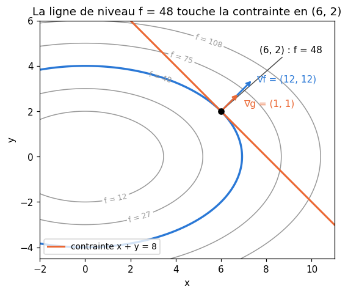
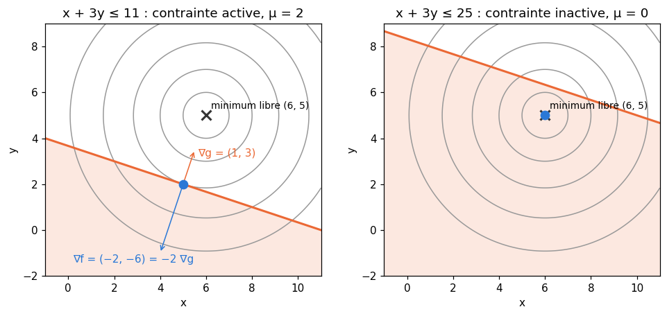
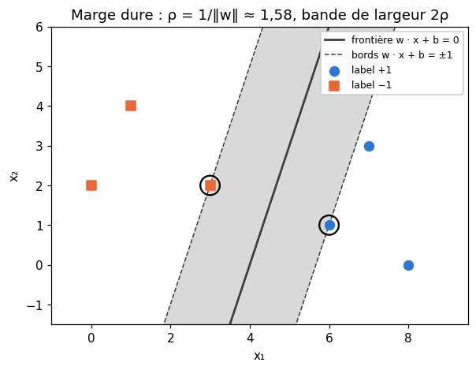
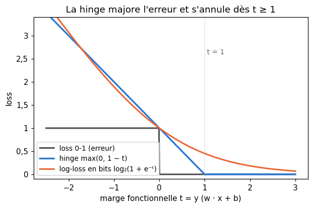
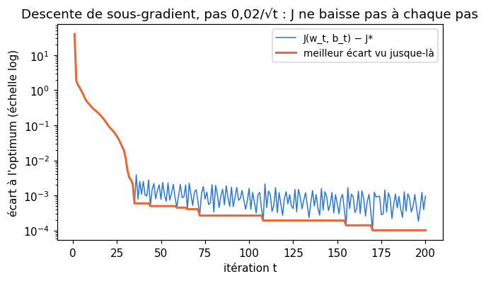
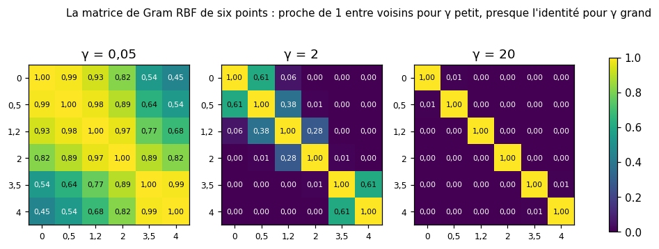

# M13b · Optimisation sous contraintes et SVM — fiche de cours

> Jusqu'ici, tu as cherché le minimum d'une fonction **partout** : on annule le gradient (M05b), on descend le long de $-\nabla f$. Beaucoup de problèmes imposent pourtant des **contraintes** : des probabilités de somme 1, un vecteur de norme 1, un classifieur qui doit laisser chaque exemple à une certaine distance de sa frontière. Ce chapitre apprend à optimiser sous contraintes : les **multiplicateurs de Lagrange** pour les égalités, les **conditions KKT** pour les inégalités, la **dualité**, qui associe à tout problème un problème jumeau, et l'**optimisation convexe**, où tout ce qui précède devient une garantie. Il s'en sert ensuite pour construire la **machine à vecteurs de support** (SVM) : le problème de la plus grande marge (M10), sa version souple avec la **hinge loss** et le **sous-gradient**, son **problème dual**, d'où sortent les **vecteurs de support**, et les **noyaux**, qui rendent la même méthode non linéaire.

| | |
|---|---|
| **Sections** | §1 à §8 |
| **Temps total estimé** | ≈ 16,1 h : lecture et calculs de la fiche ≈ 3 h, exercices ≈ 12 h 15, flashcards ≈ 50 min (parcours essentiel ≈ 9,6 h) |
| **Prérequis** | M10 (ensembles et fonctions convexes, séparabilité, astuce du biais, marge géométrique et forme canonique) ; M05b (gradient, lignes de niveau, gradient orthogonal aux lignes de niveau) ; M12c (matrices définies positives, quotient de Rayleigh, matrice de Gram $\mathbf{X}^\top\mathbf{X}$) ; M12d (axes principaux) ; M07 (distance à un hyperplan) ; M09a (systèmes linéaires) ; M09b (nombre de monômes, `count_monomials`) ; M13a (log-loss, softplus) |
| **Fichiers du chapitre** | `02_exercices.md` (quiz, papier) · `03_notebook.ipynb` · `04_indices.md` · `05_solutions.md` et `05_solutions.ipynb` · `06_mes_reponses.md` · `flashcards.csv` |
| **mymath** | `svm.py` : `lagrange_equality_qp`, `hinge_loss`, `svm_subgradient`, `rbf_kernel`, `polynomial_kernel` |
| **MML** | §7.2, §7.3, ch. 12 (voir le guide de lecture ci-dessous) |

## Comment utiliser ce chapitre

**Ordre conseillé.**
1. `python tools/start_chapter.py M13b` (sur Colab : `00_setup/COLAB.md` §2) : il copie le notebook, ta feuille de réponses et le squelette `mymath/svm.py`.
2. Section par section : lis **crayon en main**, refais chaque calcul ; puis fais les exercices de la section, quiz 🧠 d'abord.
3. Les exercices ✏️ et 🔗 se font sur papier, dans ta copie de `06_mes_reponses.md`, puis se vérifient dans la **partie 0** du notebook. Les démonstrations ∂ se rédigent dans ta copie et se jugent avec la grille de relecture de `05_solutions.md`.

**Un réflexe pour tout le chapitre** : une solution candidate se **vérifie**. Elle doit respecter les contraintes ; le gradient du lagrangien doit y être nul ; les multiplicateurs des inégalités doivent être positifs ou nuls, et nuls pour les contraintes qui ne sont pas atteintes. Si un seul point échoue, ce n'est pas la solution.

| Section | Quiz 🧠 | Papier et réflexion | Notebook |
|---|---|---|---|
| §1 Une contrainte d'égalité : les multiplicateurs de Lagrange | Q1, R2 🔁 | M13b.1, M13b.2 ✏️, M13b.14 ∂, M13b.21 📖, M13b.24 🗣️ | M13b.29 🔮, M13b.31 🎨 |
| §2 Plusieurs contraintes, et l'ACP relue par Lagrange | — | M13b.3, M13b.4 ✏️ | M13b.25 🔨, M13b.28 📦 |
| §3 Contraintes d'inégalité : les conditions KKT | Q2 | M13b.5 ✏️, M13b.21 📖 | M13b.32 🐛, M13b.33 🛠️ |
| §4 La dualité (aperçu) | Q3 | M13b.6 ✏️, M13b.15 ∂, M13b.21 📖, M13b.24 🗣️ | M13b.29 🔮 |
| §5 L'optimisation convexe | Q4, R3 🔁 | M13b.7 ✏️, M13b.16 ∂, M13b.21 📖, M13b.E1 💼 | — |
| §6 La SVM à marge dure | Q5, R1 🔁 | M13b.8 ✏️, M13b.17 ∂, M13b.22 📖 | M13b.32 🐛 |
| §7 Marge souple, hinge loss et sous-gradient | Q6 | M13b.9, M13b.10 ✏️, M13b.18 ∂, M13b.22 📖, M13b.E2 💼 | M13b.26 🔨, M13b.30 🔬, M13b.34 🏆 |
| §8 Le problème dual, les vecteurs de support et les noyaux | Q7, Q8, R3 🔁 | M13b.11, M13b.12, M13b.13 ✏️, M13b.19 ∂, M13b.20 🔗, M13b.22 📖, M13b.23 🧮 | M13b.27 🔨, M13b.28 📦, M13b.32 🐛 |

Parcours essentiel : tout sauf Q3, Q8, M13b.2, M13b.4, M13b.6, M13b.10, M13b.11, M13b.12, M13b.14, M13b.18, M13b.19, M13b.21, M13b.22, M13b.23, M13b.E1, M13b.E2 et M13b.30 à M13b.34. Au §4, il ne garde que ∂ M13b.15 et 🗣️ M13b.24.

## Guide de lecture de MML

*Mathematics for Machine Learning* (MML) traite l'optimisation sous contraintes au ch. 7 et les SVM au ch. 12, dont tu as lu le §12.1 en M10.
- après le **§3** de la fiche : le **§7.2** (*Constrained Optimization and Lagrange Multipliers*). Le livre y part d'une autre idée que la fiche : il remplace chaque contrainte par une pénalité infinie, puis la « relâche » en une pénalité linéaire ; tu y retrouveras le lagrangien, l'inégalité du minimax et la dualité faible du §4 ;
- après le **§5** : le **§7.3** (*Convex Optimization*), avec la programmation linéaire (§7.3.1) et quadratique (§7.3.2) ; le §7.3.3 (*Legendre–Fenchel Transform and Convex Conjugate*) se survole. Questions : M13b.21 ;
- après le **§7** : le **§12.2** (*Primal Support Vector Machine*) : la marge (§12.2.1 à §12.2.3, que M10 t'a préparée), puis la marge souple vue géométriquement (§12.2.4) et par une loss (§12.2.5) ;
- après le **§8** : le **§12.3** (*Dual Support Vector Machine* : la dualité par Lagrange, puis une lecture par les enveloppes convexes, qui prolonge M10 §2), le **§12.4** (*Kernels*) et le **§12.5** (*Numerical Solution*, à survoler). Questions : M13b.22.

📐 **Notations.** MML écrit une contrainte d'inégalité $g_i(\mathbf{x}) \le 0$, ses multiplicateurs $\lambda_i \ge 0$ et le lagrangien $f + \sum_i \lambda_i g_i$, comme la fiche ; mais la fiche réserve $\lambda$ aux contraintes d'**égalité** (multiplicateur de signe quelconque), écrit $\mu$ ceux des **inégalités** (positifs ou nuls) et $\alpha_i$ ceux de la SVM, un par exemple. MML écrit $\langle \mathbf{w}, \mathbf{x} \rangle$ le produit scalaire, $N$ le nombre d'exemples, $\xi_n$ les variables d'écart et $r$ la marge. **M10 notait $\gamma$ la marge ; ici, la marge s'écrit $\rho$**, parce que $\gamma$ devient le paramètre du noyau RBF (§8). La marge est $\rho = 1/\lVert\mathbf{w}\rVert$ (de la frontière au point le plus proche), la **bande** a une largeur $2\rho = 2/\lVert\mathbf{w}\rVert$. MML ($r$) et M10 ($\gamma$) appellent marge la distance de la frontière au point le plus proche ; d'autres textes donnent ce nom à $2\rho$ : fie-toi à la formule plutôt qu'au mot. Les labels d'une SVM valent $-1$ ou $+1$.

**Deux homonymes.** Le **noyau** d'une SVM (*kernel*, une fonction de deux points, §8) n'a rien à voir avec le noyau d'une application linéaire (M12a). Et la **matrice de Gram** du §8 est la matrice $n \times n$ des produits scalaires des **exemples** (les lignes de $\mathbf{X}$) : c'est $\mathbf{X}\mathbf{X}^\top$, alors que M12c appelait matrice de Gram $\mathbf{X}^\top\mathbf{X}$, de taille $p \times p$, celle des colonnes.

Vocabulaire anglais de ce chapitre : *constrained optimization*, *equality / inequality constraint*, *feasible set*, *Lagrangian*, *Lagrange multiplier*, *stationarity*, *KKT (Karush-Kuhn-Tucker) conditions*, *complementary slackness*, *active / inactive constraint*, *dual function*, *dual problem*, *weak / strong duality*, *duality gap*, *Slater's condition*, *shadow price*, *convex optimization problem*, *linear program*, *quadratic program*, *support vector machine (SVM)*, *hard / soft margin*, *slack variable*, *hinge loss*, *subgradient*, *subdifferential*, *support vector*, *kernel*, *kernel trick*, *feature map*, *Gram matrix*, *polynomial kernel*, *RBF (Gaussian) kernel*, *positive semi-definite kernel*.

## Objectifs d'apprentissage

À la fin du chapitre, tu sais :
- **résoudre** un problème d'optimisation sous contraintes d'égalité par les multiplicateurs de Lagrange, et **lire** un multiplicateur comme un prix ;
- **écrire** les conditions KKT d'un problème avec inégalités, **dire** quelles contraintes sont actives, et **écrire** sa fonction duale ;
- **reconnaître** un problème convexe et **dire** ce qu'il garantit ;
- **écrire** le problème d'une SVM à marge dure et à marge souple, et le **relier** à la hinge loss ; **calculer** un sous-gradient de son objectif ;
- **lire** le problème dual d'une SVM, ses vecteurs de support, et **retrouver** $\mathbf{w}$ et $b$ ;
- **calculer** avec des noyaux polynomiaux et RBF, et **reconnaître** un noyau valide.

## L'essentiel en 10 lignes

1. Au minimum de $f$ sous une contrainte $g(\mathbf{x}) = 0$, les gradients sont colinéaires : $\nabla f + \lambda\,\nabla g = 0$ pour un certain $\lambda$, le **multiplicateur de Lagrange**. On annule le gradient du **lagrangien** $\mathcal{L} = f + \lambda g$.
2. $-\lambda$ est la **sensibilité** du minimum quand on déplace la contrainte : un prix.
3. Minimiser $\frac{1}{2}\mathbf{x}^\top\mathbf{Q}\mathbf{x} + \mathbf{c}^\top\mathbf{x}$ sous $\mathbf{A}\mathbf{x} = \mathbf{b}$, c'est résoudre un seul système linéaire par blocs ; maximiser $\mathbf{u}^\top\mathbf{C}\mathbf{u}$ sous $\lVert\mathbf{u}\rVert = 1$ redonne l'ACP : $\mathbf{C}\mathbf{u} = \lambda\mathbf{u}$.
4. **KKT** (contraintes $g_i \le 0$) : stationnarité, faisabilité, $\mu_i \ge 0$, et $\mu_i\,g_i(\mathbf{x}) = 0$ : une contrainte non atteinte a un multiplicateur nul.
5. La **fonction duale** $D(\boldsymbol{\mu}) = \inf_{\mathbf{x}} \mathcal{L}(\mathbf{x}, \boldsymbol{\mu})$ minore toujours le minimum (dualité faible) ; pour un problème convexe raisonnable, son maximum l'atteint (dualité forte).
6. **Problème convexe** : objectif convexe, inégalités convexes, égalités affines. Tout minimum local y est global, et les conditions KKT suffisent.
7. **SVM à marge dure** : $\min \frac{1}{2}\lVert\mathbf{w}\rVert^2$ sous $y_i(\mathbf{w} \cdot \mathbf{x}_i + b) \ge 1$ ; marge $\rho = 1/\lVert\mathbf{w}\rVert$ ; $\mathbf{w}$ est unique.
8. **Marge souple** : $J(\mathbf{w}, b) = \frac{1}{2}\lVert\mathbf{w}\rVert^2 + C\sum_i \max(0, 1 - y_i(\mathbf{w} \cdot \mathbf{x}_i + b))$, la **hinge loss** ; on la minimise par **sous-gradient**, sans garantie de baisse à chaque pas.
9. **Dual** : $\mathbf{w} = \sum_i \alpha_i y_i \mathbf{x}_i$, $\sum_i \alpha_i y_i = 0$, $0 \le \alpha_i \le C$ ; les **vecteurs de support** sont les exemples où $\alpha_i > 0$ : $\mathbf{w}$ ne dépend que d'eux.
10. Le dual et la décision ne demandent que des produits scalaires $\mathbf{x}_i \cdot \mathbf{x}_j$ : les remplacer par un **noyau** $k(\mathbf{x}, \mathbf{z}) = \varphi(\mathbf{x}) \cdot \varphi(\mathbf{z})$ (polynomial, RBF), c'est travailler dans un autre espace sans jamais calculer $\varphi$.

---

## §1 · Une contrainte d'égalité : les multiplicateurs de Lagrange

### Le problème

On cherche le minimum de $f(\mathbf{x})$ non plus sur tout $\mathbb{R}^n$, mais sur l'ensemble des points qui vérifient une **contrainte d'égalité** $g(\mathbf{x}) = 0$ :
$$\min_{\mathbf{x}} f(\mathbf{x}) \quad \text{sous la contrainte} \quad g(\mathbf{x}) = 0.$$
Les points qui vérifient la contrainte forment l'**ensemble admissible** (*feasible set*). Annuler $\nabla f$ ne sert plus à rien : le minimum libre n'est en général pas admissible.

**Exemple.** Minimiser $f(x, y) = x^2 + 3y^2$ sous $x + y = 8$. On peut remplacer $y$ par $8 - x$ et minimiser une fonction d'une variable : $x^2 + 3(8 - x)^2$, de dérivée $2x - 6(8 - x) = 8x - 48$, nulle en $x = 6$, donc $y = 2$ et $f = 36 + 12 = 48$. Cette **élimination** marche ici, mais elle devient vite impraticable (une contrainte non linéaire, plusieurs contraintes, beaucoup de variables). Lagrange donne une méthode générale. (C'est l'ellipse de 🔮 M05b.22, deux fois plus grande : en $(3, 1)$, sa ligne de niveau 12 avait déjà la direction $(1, -1)$, celle des droites $x + y = \text{constante}$.)

### Les lignes de niveau touchent la contrainte

Regarde les lignes de niveau de $f$, ici des ellipses (M05b), et la droite $x + y = 8$. Une ligne de niveau $f = c$ qui **coupe** la droite en deux points n'est pas la meilleure : entre ces deux points, la droite passe à l'intérieur de l'ellipse, où $f < c$. La plus petite valeur de $f$ sur la droite est atteinte là où une ligne de niveau **touche** la droite sans la traverser : en ce point, la ligne de niveau et la contrainte ont la même tangente.

Or le gradient de $f$ est orthogonal à ses lignes de niveau (M05b), et celui de $g$ à la courbe $g = 0$, qui est aussi une ligne de niveau (de $g$). Deux vecteurs orthogonaux à la même tangente sont **colinéaires** :

> **Théorème (multiplicateurs de Lagrange).** Si $\mathbf{x}^*$ est un minimum (ou un maximum) de $f$ sous la contrainte $g(\mathbf{x}) = 0$, si $f$ et $g$ ont des dérivées partielles continues, et si $\nabla g(\mathbf{x}^*) \ne \mathbf{0}$, alors il existe un nombre $\lambda$ tel que
> $$\nabla f(\mathbf{x}^*) + \lambda\,\nabla g(\mathbf{x}^*) = \mathbf{0}.$$
> $\lambda$ s'appelle le **multiplicateur de Lagrange** (*Lagrange multiplier*) de la contrainte.

La démonstration (∂ M13b.14) suit une courbe tracée dans la contrainte et utilise la règle de la chaîne, comme M05b.12. Ce théorème donne une condition **nécessaire** : il dit où chercher, pas que le point trouvé est un minimum. On compare ensuite les candidats (ou l'on invoque la convexité, §5).

### Le lagrangien

On range la condition dans une seule fonction de $n + 1$ variables, le **lagrangien** (*Lagrangian*) :
$$\mathcal{L}(\mathbf{x}, \lambda) = f(\mathbf{x}) + \lambda\,g(\mathbf{x}).$$
Annuler toutes ses dérivées partielles donne exactement le système voulu : $\nabla_{\mathbf{x}}\mathcal{L} = \nabla f + \lambda\nabla g = \mathbf{0}$ (la colinéarité) et $\frac{\partial\mathcal{L}}{\partial\lambda} = g(\mathbf{x}) = 0$ (la contrainte). Un problème avec contrainte est devenu la recherche d'un point critique sans contrainte, au prix d'une inconnue de plus.

Sur l'exemple, $\mathcal{L} = x^2 + 3y^2 + \lambda(x + y - 8)$ :
$$2x + \lambda = 0, \qquad 6y + \lambda = 0, \qquad x + y = 8.$$
Les deux premières donnent $x = -\frac{\lambda}{2}$ et $y = -\frac{\lambda}{6}$, donc $x = 3y$ ; la troisième, $4y = 8$ : $y = 2$, $x = 6$, $\lambda = -12$. En $(6, 2)$, $\nabla f = (12, 12) = -\lambda\,(1, 1) = 12\,\nabla g$ : les gradients sont bien colinéaires.

⚠️ **Erreur classique.** Le signe de $\lambda$ dépend de la convention : avec $\mathcal{L} = f - \lambda g$ (celle de MML §10.2 pour l'ACP), on trouve $\lambda = +12$ au même point. Pour une contrainte d'**égalité**, le signe de $\lambda$ ne dit rien sur la solution ; il n'a de sens que pour une inégalité (§3).

### Ce que vaut λ : un prix

Déplaçons la contrainte : $x + y = b$ au lieu de $8$. La même méthode donne $x = \frac{3b}{4}$, $y = \frac{b}{4}$ et le minimum $f^*(b) = \frac{9b^2}{16} + \frac{3b^2}{16} = \frac{3b^2}{4}$, de dérivée $\frac{3b}{2}$, qui vaut 12 en $b = 8$ : exactement $-\lambda$. En général :

> **Sensibilité.** Pour la contrainte $g(\mathbf{x}) = c$ et le lagrangien $f + \lambda(g - c)$, la valeur du minimum vérifie $\dfrac{df^*}{dc} = -\lambda$.

Déplacer la contrainte de $0{,}1$ (passer à $x + y = 8{,}1$) fait monter le minimum d'environ $12 \times 0{,}1 = 1{,}2$ : on trouve $f^*(8{,}1) = 49{,}2075$. Le multiplicateur est le **prix** d'une unité de contrainte (*shadow price*) : ce que coûte, ou rapporte, à l'objectif un déplacement d'un cran de la contrainte. Un multiplicateur nul dit que la contrainte ne coûte rien (🗣️ M13b.24, 🔮 M13b.29).

### Une promesse tenue : le maximum de vraisemblance catégoriel

En M13a §1, l'estimation $\hat{p}_k = \frac{n_k}{N}$ d'une loi catégorielle a été démontrée par l'inégalité de Gibbs ; Lagrange la retrouve directement. On maximise $\ell(\mathbf{p}) = \sum_k n_k \ln p_k$ sous $\sum_k p_k = 1$ : le lagrangien $\sum_k n_k\ln p_k + \lambda\big(\sum_k p_k - 1\big)$ a pour dérivées $\frac{n_k}{p_k} + \lambda$, nulles pour $p_k = -\frac{n_k}{\lambda}$ ; la contrainte impose $-\frac{N}{\lambda} = 1$, donc $\lambda = -N$ et $p_k = \frac{n_k}{N}$. Le calcul ne dit pas encore que c'est un maximum : la concavité de $\ell$ (§5) s'en charge.

🔗 **Dans workbookIA** — le chapitre 9 dit que minimiser une loss sous une contrainte sur $\lVert\mathbf{w}\rVert$ revient à minimiser la loss plus une pénalité : le §4 explique pourquoi, par les multiplicateurs.

## §2 · Plusieurs contraintes, et l'ACP relue par Lagrange

### Un multiplicateur par contrainte

Avec $m$ contraintes d'égalité $g_1(\mathbf{x}) = 0, \ldots, g_m(\mathbf{x}) = 0$, on prend un multiplicateur par contrainte :
$$\mathcal{L}(\mathbf{x}, \boldsymbol{\lambda}) = f(\mathbf{x}) + \sum_{j=1}^m \lambda_j\,g_j(\mathbf{x}), \qquad \nabla f(\mathbf{x}^*) + \sum_j \lambda_j\,\nabla g_j(\mathbf{x}^*) = \mathbf{0},$$
à condition que les gradients $\nabla g_j(\mathbf{x}^*)$ soient **linéairement indépendants** (la version à plusieurs contraintes de $\nabla g \ne \mathbf{0}$). Géométriquement : au minimum, $\nabla f$ appartient à l'espace engendré par les gradients des contraintes.

### Le problème quadratique sous contraintes linéaires

Le cas le plus utile : un objectif quadratique et des contraintes affines,
$$\min_{\mathbf{x}} \ \frac{1}{2}\mathbf{x}^\top\mathbf{Q}\mathbf{x} + \mathbf{c}^\top\mathbf{x} \quad \text{sous} \quad \mathbf{A}\mathbf{x} = \mathbf{b},$$
avec $\mathbf{Q}$ symétrique $n \times n$, $\mathbf{A}$ de forme $(m, n)$. Le gradient de l'objectif est $\mathbf{Q}\mathbf{x} + \mathbf{c}$ (M12c.19), celui de la contrainte $j$ est la ligne $j$ de $\mathbf{A}$ : le lagrangien $\frac{1}{2}\mathbf{x}^\top\mathbf{Q}\mathbf{x} + \mathbf{c}^\top\mathbf{x} + \boldsymbol{\lambda}^\top(\mathbf{A}\mathbf{x} - \mathbf{b})$ donne
$$\mathbf{Q}\mathbf{x} + \mathbf{c} + \mathbf{A}^\top\boldsymbol{\lambda} = \mathbf{0}, \qquad \mathbf{A}\mathbf{x} = \mathbf{b} \qquad \Longleftrightarrow \qquad \begin{pmatrix} \mathbf{Q} & \mathbf{A}^\top \\ \mathbf{A} & \mathbf{0} \end{pmatrix}\begin{pmatrix} \mathbf{x} \\ \boldsymbol{\lambda} \end{pmatrix} = \begin{pmatrix} -\mathbf{c} \\ \mathbf{b} \end{pmatrix}.$$
**Un seul système linéaire** de $n + m$ équations (M09a). Quand $\mathbf{Q}$ est définie positive et que les lignes de $\mathbf{A}$ sont indépendantes, la matrice par blocs est inversible : la solution est unique, et c'est le minimum (§5). C'est ce que calcule `lagrange_equality_qp` (🔨 M13b.25).

**Exemple.** Le problème du §1 s'écrit ainsi avec $\mathbf{Q} = \begin{pmatrix} 2 & 0 \\ 0 & 6 \end{pmatrix}$, $\mathbf{c} = \mathbf{0}$, $\mathbf{A} = (1 \ \ 1)$, $b = 8$ :
$$\begin{pmatrix} 2 & 0 & 1 \\ 0 & 6 & 1 \\ 1 & 1 & 0 \end{pmatrix}\begin{pmatrix} x \\ y \\ \lambda \end{pmatrix} = \begin{pmatrix} 0 \\ 0 \\ 8 \end{pmatrix}, \qquad (x, y, \lambda) = (6, 2, -12).$$

💻 **Aujourd'hui en pratique.** Les solveurs de programmes quadratiques (ceux de `scipy.optimize`, les bibliothèques d'optimisation convexe) résolvent ce système par blocs, ou une version qui tient compte des inégalités (§3) ; personne n'élimine les variables à la main.

### L'ACP relue par Lagrange

En M12c et M12d, le premier axe principal d'une matrice de covariance $\mathbf{C}$ est le vecteur unitaire qui rend $\mathbf{u}^\top\mathbf{C}\mathbf{u}$ (la variance des projections) le plus grand, et le quotient de Rayleigh a montré que c'est un vecteur propre de la plus grande valeur propre. Lagrange y mène directement. On maximise $f(\mathbf{u}) = \mathbf{u}^\top\mathbf{C}\mathbf{u}$ sous $g(\mathbf{u}) = \mathbf{u}^\top\mathbf{u} - 1 = 0$. Avec $\mathcal{L}(\mathbf{u}, \lambda) = \mathbf{u}^\top\mathbf{C}\mathbf{u} - \lambda(\mathbf{u}^\top\mathbf{u} - 1)$ (le signe moins rend la suite plus lisible), et les gradients $\nabla(\mathbf{u}^\top\mathbf{C}\mathbf{u}) = 2\mathbf{C}\mathbf{u}$, $\nabla(\mathbf{u}^\top\mathbf{u}) = 2\mathbf{u}$ (M12c),
$$2\mathbf{C}\mathbf{u} - 2\lambda\mathbf{u} = \mathbf{0} \quad \Longleftrightarrow \quad \mathbf{C}\mathbf{u} = \lambda\mathbf{u} :$$
les points critiques sont les **vecteurs propres unitaires** de $\mathbf{C}$, et le multiplicateur est la **valeur propre**. En un tel point, l'objectif vaut $\mathbf{u}^\top\mathbf{C}\mathbf{u} = \lambda\,\mathbf{u}^\top\mathbf{u} = \lambda$ : le maximum est la plus grande valeur propre, atteint en son vecteur propre.

**Exemple.** $\mathbf{C} = \begin{pmatrix} 10 & 3 \\ 3 & 2 \end{pmatrix}$ : trace 12, déterminant 11, valeurs propres 11 et 1. Pour 11 : $(10 - 11)u_1 + 3u_2 = 0$, donc $\mathbf{u} \propto (3, 1)$, et $\mathbf{C}(3, 1) = (33, 11) = 11\,(3, 1)$. Le premier axe est $\frac{1}{\sqrt{10}}(3, 1)$, de variance 11 ; le point critique de valeur 1, $\frac{1}{\sqrt{10}}(-1, 3)$, est le minimum de $\mathbf{u}^\top\mathbf{C}\mathbf{u}$ sur le cercle unité.

Le deuxième axe s'obtient en ajoutant la contrainte $\mathbf{u} \cdot \mathbf{u}_1 = 0$, avec un second multiplicateur : ✏️ M13b.4 calcule ce multiplicateur, et l'on retombe sur le deuxième vecteur propre. MML §10.2 fait la même dérivation ; M12d.23 l'avait survolée.

🔗 **Dans workbookIA** — le chapitre 12 admet que les directions de plus grande variance sont les vecteurs propres de la covariance : tu en as maintenant deux démonstrations, par Rayleigh (M12c) et par Lagrange.

## §3 · Contraintes d'inégalité : les conditions KKT

### Active ou inactive

Une contrainte d'inégalité $g(\mathbf{x}) \le 0$ autorise toute une région. Deux situations se présentent au minimum :
- le minimum libre de $f$ est **dans** la région : la contrainte ne joue aucun rôle, elle est **inactive** (*inactive*), et $\nabla f(\mathbf{x}^*) = \mathbf{0}$ ;
- le minimum libre est **hors** de la région : le minimum contraint est sur le bord $g(\mathbf{x}) = 0$, la contrainte est **active** (*active*), et l'on retrouve Lagrange, avec une information de plus sur le signe.

**Exemple.** Minimiser $f(x, y) = (x - 6)^2 + (y - 5)^2$, le carré de la distance au point $(6, 5)$, sous $x + 3y \le c$.
- Pour $c = 25$ : $(6, 5)$ vérifie $6 + 15 = 21 \le 25$, il est admissible ; c'est le minimum, et la contrainte est inactive.
- Pour $c = 11$ : $21 > 11$, $(6, 5)$ n'est pas admissible. Le minimum est le projeté orthogonal de $(6, 5)$ sur la droite $x + 3y = 11$ (M07) : $(6, 5) - \frac{21 - 11}{10}(1, 3) = (5, 2)$, à la distance $\sqrt{10}$, donc $f^* = 10$. En $(5, 2)$, $\nabla f = 2\,(5 - 6, 2 - 5) = (-2, -6) = -2\,(1, 3) = -2\,\nabla g$.

Au point actif, $\nabla f = -\mu\,\nabla g$ avec $\mu = 2 > 0$ : le gradient de $f$ pointe **vers l'intérieur** de la région ($-\nabla g$ est la direction où $g$ diminue). C'est forcé : si $\nabla f$ pointait vers l'extérieur, on pourrait faire baisser $f$ en rentrant dans la région, et le point ne serait pas un minimum. D'où le signe : **un multiplicateur d'inégalité est positif ou nul**.

### Les conditions KKT

> **Conditions de Karush-Kuhn-Tucker (KKT).** Pour le problème
> $$\min_{\mathbf{x}} f(\mathbf{x}) \quad \text{sous} \quad g_i(\mathbf{x}) \le 0 \ (i = 1, \ldots, m), \qquad h_j(\mathbf{x}) = 0 \ (j = 1, \ldots, r),$$
> et son lagrangien $\mathcal{L}(\mathbf{x}, \boldsymbol{\mu}, \boldsymbol{\lambda}) = f(\mathbf{x}) + \sum_i \mu_i\,g_i(\mathbf{x}) + \sum_j \lambda_j\,h_j(\mathbf{x})$, un minimum $\mathbf{x}^*$ vérifie, pour des multiplicateurs $\boldsymbol{\mu}$ et $\boldsymbol{\lambda}$ :
> 1. **stationnarité** : $\nabla f(\mathbf{x}^*) + \sum_i \mu_i\,\nabla g_i(\mathbf{x}^*) + \sum_j \lambda_j\,\nabla h_j(\mathbf{x}^*) = \mathbf{0}$ ;
> 2. **faisabilité** : $g_i(\mathbf{x}^*) \le 0$ et $h_j(\mathbf{x}^*) = 0$ ;
> 3. **signe** : $\mu_i \ge 0$ (les $\lambda_j$ sont de signe quelconque) ;
> 4. **complémentarité** (*complementary slackness*) : $\mu_i\,g_i(\mathbf{x}^*) = 0$ pour chaque $i$.
>
> C'est vrai sous une **condition de qualification des contraintes**, toujours remplie quand elles sont affines, et pour un problème convexe qui a un point strictement admissible (§5).

La complémentarité résume les deux situations : pour chaque inégalité, ou bien elle est active ($g_i = 0$), ou bien son multiplicateur est nul ($\mu_i = 0$), ou les deux. Une contrainte non atteinte ne pousse pas. Sur l'exemple, $c = 11$ donne $\mu = 2$, $g = 0$ ; $c = 25$ donne $\mu = 0$, $g = 21 - 25 < 0$.

**Le prix, encore.** Pour $c = 11$, le minimum vaut $f^*(c) = \frac{(21 - c)^2}{10}$ tant que $c \le 21$ : sa dérivée en $c = 11$ est $-2 = -\mu$. Desserrer une contrainte active fait baisser le minimum de $\mu$ par unité ; desserrer une contrainte inactive ne change rien, et son prix est 0.

**Trouver une solution.** On choisit quelles contraintes sont actives (l'**ensemble actif**), on résout le système de Lagrange avec ces contraintes en égalité et des multiplicateurs nuls pour les autres, puis on vérifie : les autres contraintes sont-elles respectées, les $\mu_i$ positifs ? Si oui, c'est un point KKT. Sinon, on change d'ensemble actif. Avec $m$ inégalités, il y a $2^m$ ensembles possibles : les vrais solveurs s'y prennent plus habilement, mais à la main, sur deux ou trois contraintes, c'est la méthode (✏️ M13b.5, 🛠️ M13b.33).

⚠️ **Erreur classique.** Oublier la condition de signe : une solution du système de Lagrange avec $\mu < 0$ n'est **pas** un minimum, elle dit que la contrainte supposée active ne devrait pas l'être. Et le signe dépend de l'écriture : la contrainte $x \ge 2$ s'écrit $2 - x \le 0$ avant d'entrer dans le lagrangien (🐛 M13b.32).

## §4 · La dualité (aperçu)

### La fonction duale

Fixe les multiplicateurs ($\boldsymbol{\mu} \ge \mathbf{0}$, $\boldsymbol{\lambda}$ quelconques) et minimise le lagrangien **sans contrainte** en $\mathbf{x}$ :
$$D(\boldsymbol{\mu}, \boldsymbol{\lambda}) = \inf_{\mathbf{x}} \mathcal{L}(\mathbf{x}, \boldsymbol{\mu}, \boldsymbol{\lambda}).$$
C'est la **fonction duale** (*dual function*). L'infimum $\inf$ est la plus grande minoration : c'est le minimum quand il est atteint, et il peut valoir $-\infty$ (pour un lagrangien affine non constant en $\mathbf{x}$, par exemple). Pour chaque $\mathbf{x}$ fixé, $\mathcal{L}$ est affine en $(\boldsymbol{\mu}, \boldsymbol{\lambda})$ ; $D$, minimum de fonctions affines, est donc **concave**, même quand le problème de départ ne l'est pas.

> **Dualité faible.** Pour tout $\mathbf{x}$ admissible et tous $\boldsymbol{\mu} \ge \mathbf{0}$, $\boldsymbol{\lambda}$ : $D(\boldsymbol{\mu}, \boldsymbol{\lambda}) \le f(\mathbf{x})$. En particulier $\max D \le \min f$.

L'idée : en un point admissible, $\mu_i g_i(\mathbf{x}) \le 0$ et $\lambda_j h_j(\mathbf{x}) = 0$, donc $\mathcal{L}(\mathbf{x}, \boldsymbol{\mu}, \boldsymbol{\lambda}) \le f(\mathbf{x})$ ; et $D$ est un minimum de $\mathcal{L}$ (∂ M13b.15 rédige la preuve). Le **problème dual** (*dual problem*) cherche la meilleure minoration : $\max D(\boldsymbol{\mu}, \boldsymbol{\lambda})$ sous $\boldsymbol{\mu} \ge \mathbf{0}$. L'écart $\min f - \max D \ge 0$ est le **saut de dualité** (*duality gap*).

**Exemple.** Minimiser $x^2$ sous $x \ge 2$, c'est-à-dire $g(x) = 2 - x \le 0$. Le minimum est $f^* = 4$, en $x = 2$. Le lagrangien $x^2 + \mu(2 - x)$ est minimal en $x = \frac{\mu}{2}$, d'où
$$D(\mu) = \frac{\mu^2}{4} + 2\mu - \frac{\mu^2}{2} = 2\mu - \frac{\mu^2}{4}.$$
Pour tout $\mu \ge 0$, $D(\mu) \le 4$ : par exemple $D(1) = 1{,}75$, $D(6) = 3$. Le maximum, en $\mu = 4$, vaut $D(4) = 4 = f^*$ : ici, pas de saut. Et $\mu = 4$ est le multiplicateur KKT : en $x = 2$, $f'(2) + \mu\,g'(2) = 4 - \mu = 0$.

> **Dualité forte (énoncé).** Pour un problème **convexe** (§5) qui a un point **strictement** admissible ($g_i(\mathbf{x}) < 0$ pour toutes les inégalités non affines : la **condition de Slater**), $\max D = \min f$, et les multiplicateurs qui atteignent le maximum de $D$ sont ceux des conditions KKT.

**À quoi sert le dual.** Il donne un **certificat** : un $\mathbf{x}$ admissible et des multiplicateurs tels que $f(\mathbf{x}) = D(\boldsymbol{\mu}, \boldsymbol{\lambda})$ prouvent ensemble qu'ils sont optimaux. Ses contraintes sont simples ($\boldsymbol{\mu} \ge \mathbf{0}$). Et il a une variable par **contrainte** au lieu d'une par **inconnue** : pour une SVM, une variable par exemple, et, on le verra au §8, des données qui n'apparaissent que par des produits scalaires.

### Contrainte ou pénalité

Minimiser une loss $L(\mathbf{w})$ sous la contrainte $\lVert\mathbf{w}\rVert^2 \le t$ (une boule de rayon $\sqrt{t}$) a pour stationnarité KKT $\nabla L(\mathbf{w}) + 2\mu\,\mathbf{w} = \mathbf{0}$ : c'est exactement le point critique de $L(\mathbf{w}) + \mu\,\lVert\mathbf{w}\rVert^2$, la loss **pénalisée** de la régression ridge. Le poids de la pénalité est le multiplicateur de la contrainte : à chaque rayon $t$ (avec une contrainte active) correspond un poids $\mu \ge 0$, et réciproquement. C'est le lien que le chapitre 9 de workbookIA énonce entre contrainte et pénalité.

## §5 · L'optimisation convexe

### Les définitions

Rappels de M10 : un ensemble est **convexe** s'il contient tout segment entre deux de ses points ; une fonction est **convexe** si son graphe passe sous ses cordes, $f(t\mathbf{x} + (1 - t)\mathbf{y}) \le t f(\mathbf{x}) + (1 - t) f(\mathbf{y})$ pour $t \in [0, 1]$, et **strictement** convexe si l'inégalité est stricte pour $\mathbf{x} \ne \mathbf{y}$ et $0 < t < 1$. Une fonction deux fois dérivable est convexe quand sa hessienne est semi-définie positive en tout point (M10, M12c).

> **Problème convexe.** Le problème $\min f(\mathbf{x})$ sous $g_i(\mathbf{x}) \le 0$ et $h_j(\mathbf{x}) = 0$ est **convexe** si $f$ est convexe, chaque $g_i$ convexe et chaque $h_j$ **affine**.

Les conditions garantissent que l'ensemble admissible est convexe : $\{g_i \le 0\}$ est convexe pour $g_i$ convexe (une ligne de niveau inférieure d'une fonction convexe), $\{h_j = 0\}$ est un hyperplan, et une intersection de convexes est convexe (M10).

Deux familles reviennent sans cesse : les **programmes linéaires** (objectif et contraintes affines, M10 s'en est servi pour décider la séparabilité) et les **programmes quadratiques** (objectif $\frac{1}{2}\mathbf{x}^\top\mathbf{Q}\mathbf{x} + \mathbf{c}^\top\mathbf{x}$ avec $\mathbf{Q}$ semi-définie positive, contraintes affines). La SVM est un programme quadratique (§6).

**Ce qui n'est pas convexe.**
- Une contrainte d'égalité **non affine** : l'ACP du §2 maximise sur le cercle $\lVert\mathbf{u}\rVert = 1$, qui n'est pas convexe (le milieu de deux points du cercle est à l'intérieur). Et maximiser une fonction convexe n'est pas minimiser une fonction convexe. L'ACP se résout quand même, par l'algèbre linéaire, mais la théorie de cette section ne s'y applique pas.
- Une contrainte $g(\mathbf{x}) \ge 0$ avec $g$ convexe, comme $x^2 + y^2 \ge 1$ : la région est l'extérieur d'un disque, pas un convexe.
- Un objectif à plusieurs creux, comme $(x^2 - 4)^2 + x$, qui a un minimum local près de $x = 2$ et son minimum global près de $x = -2$.

### Ce que la convexité garantit

> **Théorème.** Pour un problème convexe :
> 1. tout minimum **local** est un minimum **global** (∂ M13b.16) ;
> 2. si $f$ est **strictement** convexe, le minimum, s'il existe, est **unique** ;
> 3. les conditions KKT sont **suffisantes** : un point qui les vérifie est un minimum global ; avec la condition de Slater, elles sont aussi nécessaires, et la dualité est forte (§4).

L'idée du premier point : si un point admissible $\mathbf{y}$ faisait mieux qu'un minimum local $\mathbf{x}$, tout le segment de $\mathbf{x}$ vers $\mathbf{y}$ resterait admissible, et la convexité ferait baisser $f$ le long de ce segment dès le départ, aussi près de $\mathbf{x}$ qu'on veut. Le deuxième : deux minima distincts auraient un milieu admissible strictement meilleur.

C'est pour cela que la convexité est une si bonne nouvelle (💼 M13b.E1) : un algorithme qui trouve un point où rien ne s'améliore localement a trouvé **le** minimum ; une solution candidate se vérifie par les conditions KKT ; et le dual en donne un certificat.

## §6 · La SVM à marge dure

### De la marge au problème

Des exemples $\mathbf{x}_1, \ldots, \mathbf{x}_n$ de $\mathbb{R}^p$, de labels $y_i \in \{-1, +1\}$, sont **linéairement séparables** (M10 §3). Un séparateur $(\mathbf{w}, b)$ classe $\mathbf{x}$ par le signe du score $s(\mathbf{x}) = \mathbf{w} \cdot \mathbf{x} + b$, et chaque exemple a une **marge fonctionnelle** $y_i\,s(\mathbf{x}_i)$, positive s'il est bien classé. M10 a montré qu'on peut choisir l'échelle de $(\mathbf{w}, b)$ pour que la plus petite marge fonctionnelle vaille 1 (la **forme canonique**) ; la marge géométrique vaut alors
$$\rho = \frac{1}{\lVert\mathbf{w}\rVert}.$$
Chercher la plus grande marge, c'est chercher le plus petit $\lVert\mathbf{w}\rVert$ sous ces contraintes (∂ M10.8). On minimise plutôt $\frac{1}{2}\lVert\mathbf{w}\rVert^2$, qui a le même minimiseur (le carré est croissant sur les nombres positifs) et qui est une fonction quadratique, dérivable et strictement convexe en $\mathbf{w}$ (∂ M13b.17 reprend le passage de « maximiser la marge » à ce problème) :

> **SVM à marge dure** (*hard-margin SVM*).
> $$\min_{\mathbf{w}, b} \ \frac{1}{2}\lVert\mathbf{w}\rVert^2 \quad \text{sous} \quad y_i(\mathbf{w} \cdot \mathbf{x}_i + b) \ge 1, \quad i = 1, \ldots, n.$$

Les $n$ contraintes sont affines en $(\mathbf{w}, b)$ : c'est un **programme quadratique convexe**. Tout le §5 s'applique : les conditions KKT sont nécessaires et suffisantes, et **$\mathbf{w}$ est unique** (l'objectif est strictement convexe en $\mathbf{w}$). Le biais $b$ l'est aussi, fixé par les points qui touchent la bande.

### Les conditions KKT de la SVM

Chaque contrainte s'écrit $1 - y_i(\mathbf{w} \cdot \mathbf{x}_i + b) \le 0$, avec un multiplicateur $\alpha_i \ge 0$ :
$$\mathcal{L}(\mathbf{w}, b, \boldsymbol{\alpha}) = \frac{1}{2}\lVert\mathbf{w}\rVert^2 + \sum_{i=1}^n \alpha_i\big(1 - y_i(\mathbf{w} \cdot \mathbf{x}_i + b)\big).$$
La stationnarité en $\mathbf{w}$ et en $b$ donne :
$$\mathbf{w} = \sum_{i=1}^n \alpha_i\,y_i\,\mathbf{x}_i, \qquad \sum_{i=1}^n \alpha_i\,y_i = 0,$$
et la complémentarité, $\alpha_i\big(y_i(\mathbf{w} \cdot \mathbf{x}_i + b) - 1\big) = 0$. Conséquences :
- un exemple dont la marge fonctionnelle dépasse 1 a $\alpha_i = 0$ : il n'entre pas dans $\mathbf{w}$ ;
- les exemples où $\alpha_i > 0$ sont **sur les bords de la bande** ($y_i\,s(\mathbf{x}_i) = 1$) : ce sont les **vecteurs de support** (*support vectors*), que M10 a rencontrés sans les nommer. $\mathbf{w}$ est une combinaison d'eux seuls ;
- la condition $\sum_i \alpha_i y_i = 0$ équilibre les poids des deux classes : il y a au moins un vecteur de support de chaque côté.

### Un exemple résolu

Six exemples : label $+1$ pour $(6, 1)$, $(7, 3)$, $(8, 0)$ ; label $-1$ pour $(3, 2)$, $(1, 4)$, $(0, 2)$.

**Deviner l'ensemble actif.** Les deux points de classes opposées les plus proches sont $\mathbf{p} = (6, 1)$ et $\mathbf{q} = (3, 2)$. Supposons qu'eux seuls soient actifs : $\alpha_{\mathbf{p}} = \alpha_{\mathbf{q}} = \alpha$ (par $\sum \alpha_i y_i = 0$) et $\mathbf{w} = \alpha(\mathbf{p} - \mathbf{q}) = \alpha(3, -1)$. Les deux contraintes actives, $\mathbf{w} \cdot \mathbf{p} + b = 1$ et $\mathbf{w} \cdot \mathbf{q} + b = -1$, se soustraient en $\mathbf{w} \cdot (\mathbf{p} - \mathbf{q}) = 2$, soit $10\alpha = 2$ : $\alpha = 0{,}2$, $\mathbf{w} = (0{,}6 ;\ -0{,}2)$, et $b = 1 - \mathbf{w} \cdot \mathbf{p} = 1 - 3{,}4 = -2{,}4$.

**Vérifier.** Les marges fonctionnelles $y_i(\mathbf{w} \cdot \mathbf{x}_i + b)$ valent $1$ ; $1{,}2$ ; $2{,}4$ pour les $+1$, et $1$ ; $2{,}6$ ; $2{,}8$ pour les $-1$ : toutes les contraintes sont respectées. Les multiplicateurs sont positifs (0,2 et 0,2), nuls pour les quatre autres points, dont la marge dépasse 1 : la complémentarité tient. Les conditions KKT suffisent (problème convexe) : c'est **la** solution.

**Lire.** La marge vaut $\rho = 1/\lVert\mathbf{w}\rVert = 1/\sqrt{0{,}4} \approx 1{,}58$ ; la bande a une largeur $2\rho = \sqrt{10} \approx 3{,}16$, exactement $\lVert\mathbf{p} - \mathbf{q}\rVert$ : ici, la frontière est la médiatrice du segment $[\mathbf{p}, \mathbf{q}]$, comme le prédisait le théorème de M10 sur les enveloppes convexes.

⚠️ **Erreur classique.** Confondre la marge et la largeur de la bande (un facteur 2), ou la marge et $\lVert\mathbf{w}\rVert$ : ici $\lVert\mathbf{w}\rVert \approx 0{,}63$, $\rho \approx 1{,}58$, $2\rho \approx 3{,}16$ (🐛 M13b.32).

## §7 · Marge souple, hinge loss et sous-gradient

### Autoriser des violations

Des données réelles ne sont presque jamais séparables, et même quand elles le sont, un seul point aberrant peut imposer une bande très étroite. La **marge souple** (*soft margin*) relâche chaque contrainte en $y_i(\mathbf{w} \cdot \mathbf{x}_i + b) \ge 1 - \xi_i$, avec une **variable d'écart** (*slack variable*) $\xi_i \ge 0$ par exemple, et ajoute $C\sum_i \xi_i$ à l'objectif :
$$\min_{\mathbf{w}, b, \boldsymbol{\xi}} \ \frac{1}{2}\lVert\mathbf{w}\rVert^2 + C\sum_{i=1}^n \xi_i \quad \text{sous} \quad y_i(\mathbf{w} \cdot \mathbf{x}_i + b) \ge 1 - \xi_i, \quad \xi_i \ge 0.$$
$C > 0$ règle l'échange entre une bande large ($\lVert\mathbf{w}\rVert$ petit) et peu de manques. C'est encore un programme quadratique convexe, en $p + 1 + n$ variables.

### La hinge loss

À $(\mathbf{w}, b)$ fixés, le meilleur $\xi_i$ est le plus petit qui respecte les deux contraintes, $\xi_i = \max\big(0,\ 1 - y_i(\mathbf{w} \cdot \mathbf{x}_i + b)\big)$ (∂ M13b.18 en fait une démonstration). Le problème devient donc un problème **sans contrainte** :
$$J(\mathbf{w}, b) = \frac{1}{2}\lVert\mathbf{w}\rVert^2 + C\sum_{i=1}^n \ell\big(y_i(\mathbf{w} \cdot \mathbf{x}_i + b)\big), \qquad \ell(t) = \max(0, 1 - t),$$
où $\ell$ est la **hinge loss** (« charnière »), une fonction de la marge fonctionnelle $t = y\,s$. Elle est nulle dès que $t \ge 1$, vaut $1 - t$ en dessous, et majore l'erreur de classification (1 si $t \le 0$, 0 sinon). Comme maximum de deux fonctions affines, elle est convexe ; $J$, somme de fonctions convexes, l'est aussi.

**Comparée à la log-loss** de M13a (ici en bits, pour passer par 1 en $t = 0$) : les deux sont convexes et majorent l'erreur ; la log-loss est dérivable partout et ne s'annule jamais, la hinge a un **coude** en $t = 1$ et vaut **exactement 0** au-delà. C'est ce zéro qui donnera des vecteurs de support peu nombreux (§8) (💼 M13b.E2).

**Exemple.** Reprenons $\mathbf{w} = (0{,}6 ;\ -0{,}2)$, $b = -2{,}4$ du §6, et ajoutons deux exemples : $(4, 4)$ de label $+1$ et $(5, 5)$ de label $-1$. Le premier a le score $2{,}4 - 0{,}8 - 2{,}4 = -0{,}8$, donc $t = -0{,}8$ : il est du mauvais côté, sa hinge vaut $1{,}8$. Le second a le score $3 - 1 - 2{,}4 = -0{,}4$ et le label $-1$, donc $t = 0{,}4$ : bien classé, mais dans la bande, hinge $0{,}6$. Les six autres ont $t \ge 1$ et ne coûtent rien. Avec $C = 1$ : $J = \frac{1}{2}(0{,}36 + 0{,}04) + 1{,}8 + 0{,}6 = 2{,}6$.

### Le rôle de C

En divisant $J$ par $nC$, on retrouve la forme « loss moyenne plus pénalité » des chapitres de régression :
$$\frac{J(\mathbf{w}, b)}{nC} = \frac{1}{n}\sum_{i=1}^n \ell\big(y_i\,s(\mathbf{x}_i)\big) + \frac{\lambda}{2}\lVert\mathbf{w}\rVert^2, \qquad \lambda = \frac{1}{nC} :$$
doubler $C$ divise $\lambda$ par 2. Quand $C$ grandit, $\lVert\mathbf{w}\rVert$ grandit (ou reste égal), donc la bande se rétrécit ; si les données sont séparables, la solution tend vers celle de la marge dure quand $C \to \infty$.

Pourquoi ‖w‖ grandit avec C

Notons $R = \frac{1}{2}\lVert\mathbf{w}\rVert^2$ et $H$ la somme des hinges, $\mathbf{w}_1$ optimal pour $C_1$ et $\mathbf{w}_2$ pour $C_2 > C_1$ (avec leurs biais). Par optimalité, $R(\mathbf{w}_1) + C_1H(\mathbf{w}_1) \le R(\mathbf{w}_2) + C_1H(\mathbf{w}_2)$ et $R(\mathbf{w}_2) + C_2H(\mathbf{w}_2) \le R(\mathbf{w}_1) + C_2H(\mathbf{w}_1)$. En additionnant : $(C_2 - C_1)\big(H(\mathbf{w}_2) - H(\mathbf{w}_1)\big) \le 0$, donc $H(\mathbf{w}_2) \le H(\mathbf{w}_1)$. La première inégalité donne alors $R(\mathbf{w}_1) - R(\mathbf{w}_2) \le C_1\big(H(\mathbf{w}_2) - H(\mathbf{w}_1)\big) \le 0$ : $\lVert\mathbf{w}_1\rVert \le \lVert\mathbf{w}_2\rVert$.

### Le sous-gradient

$J$ n'est pas dérivable aux points où une marge fonctionnelle vaut exactement 1 : on ne peut pas y parler de gradient. La notion qui le remplace pour une fonction convexe :

> **Sous-gradient** (*subgradient*). $\mathbf{g}$ est un **sous-gradient** de la fonction convexe $f$ en $\mathbf{u}$ si
> $$f(\mathbf{v}) \ge f(\mathbf{u}) + \mathbf{g} \cdot (\mathbf{v} - \mathbf{u}) \quad \text{pour tout } \mathbf{v} :$$
> la fonction affine $\mathbf{v} \mapsto f(\mathbf{u}) + \mathbf{g} \cdot (\mathbf{v} - \mathbf{u})$ minore $f$ partout, et la touche en $\mathbf{u}$. L'ensemble des sous-gradients en $\mathbf{u}$ est le **sous-différentiel** $\partial f(\mathbf{u})$.

Là où $f$ est dérivable, le seul sous-gradient est $\nabla f(\mathbf{u})$ (la tangente). À un coude, il y en a toute une famille : pour la hinge en $t = 1$, toute pente entre $-1$ et $0$ convient. Et $\mathbf{0} \in \partial f(\mathbf{u})$ si et seulement si $\mathbf{u}$ est un minimum : c'est la condition d'optimalité qui remplace $\nabla f = \mathbf{0}$.

Pour $J$, la somme des sous-gradients des termes en est un. Le terme $\ell(y_i\,s(\mathbf{x}_i))$ a pour gradient en $(\mathbf{w}, b)$ le vecteur $(-y_i\mathbf{x}_i, -y_i)$ si $y_i\,s(\mathbf{x}_i) < 1$, et $\mathbf{0}$ si $y_i\,s(\mathbf{x}_i) > 1$ ; au coude, on choisit $\mathbf{0}$ (c'est un sous-gradient valide). D'où un sous-gradient de $J$, celui que calcule `svm_subgradient` :
$$\mathbf{g}_{\mathbf{w}} = \mathbf{w} - C\sum_{i\,:\,y_i s(\mathbf{x}_i) < 1} y_i\,\mathbf{x}_i, \qquad g_b = -C\sum_{i\,:\,y_i s(\mathbf{x}_i) < 1} y_i.$$

**Exemple.** Avec les huit exemples ci-dessus, $C = 1$ et le même $(\mathbf{w}, b)$ : seuls $(4, 4)$ et $(5, 5)$ ont une marge fonctionnelle **strictement** sous 1 (les deux vecteurs de support du §6 sont exactement à 1 et ne comptent pas). $\mathbf{g}_{\mathbf{w}} = (0{,}6 ;\ -0{,}2) - \big[(+1)(4, 4) + (-1)(5, 5)\big] = (1{,}6 ;\ 0{,}8)$ et $g_b = -(1 - 1) = 0$.

### La descente de sous-gradient

On remplace le gradient par un sous-gradient : $(\mathbf{w}, b) \leftarrow (\mathbf{w}, b) - \eta_t\,\mathbf{g}_t$. Deux différences avec la descente de gradient de M05b :
- un pas dans la direction opposée à un sous-gradient **peut faire monter** $J$, même petit : ce n'est pas une méthode de descente. On garde en mémoire le meilleur point rencontré ;
- avec un pas **constant**, l'algorithme finit par osciller autour du minimum sans s'en approcher davantage ; avec un pas **décroissant** (par exemple $\eta_t = \eta_0/\sqrt{t}$), le meilleur point converge vers le minimum, lentement (🔬 M13b.30).

💻 **Aujourd'hui en pratique.** Les SVM linéaires sur de gros datasets s'entraînent par des variantes stochastiques de cette descente, un exemple ou un mini-batch à la fois ; les SVM à noyau, par des solveurs du dual (§8), qui optimisent quelques $\alpha_i$ à la fois (🏆 M13b.34 compare ta descente à l'un d'eux).

## §8 · Le problème dual, les vecteurs de support et les noyaux

### Le dual de la SVM

Reprenons le lagrangien du §6 et remplaçons $\mathbf{w}$ par $\sum_i \alpha_i y_i \mathbf{x}_i$, en utilisant $\sum_i \alpha_i y_i = 0$ : le terme en $b$ disparaît, et il reste une fonction des seuls $\alpha_i$.

> **Dual de la SVM.**
> $$\max_{\boldsymbol{\alpha}} \ \sum_{i=1}^n \alpha_i - \frac{1}{2}\sum_{i=1}^n\sum_{j=1}^n \alpha_i\alpha_j\,y_iy_j\,(\mathbf{x}_i \cdot \mathbf{x}_j) \quad \text{sous} \quad \sum_{i=1}^n \alpha_i y_i = 0, \quad 0 \le \alpha_i \le C.$$
> Pour la marge dure, on enlève la borne $\alpha_i \le C$ (c'est le cas $C = \infty$).

Le calcul

Avec $\mathbf{w} = \sum_i \alpha_i y_i \mathbf{x}_i$ : $\frac{1}{2}\lVert\mathbf{w}\rVert^2 = \frac{1}{2}\sum_{i,j}\alpha_i\alpha_jy_iy_j\,\mathbf{x}_i \cdot \mathbf{x}_j$, et $\sum_i \alpha_i y_i\,\mathbf{w} \cdot \mathbf{x}_i = \lVert\mathbf{w}\rVert^2$. Le lagrangien vaut donc $\frac{1}{2}\lVert\mathbf{w}\rVert^2 + \sum_i\alpha_i - \lVert\mathbf{w}\rVert^2 - b\sum_i\alpha_iy_i = \sum_i\alpha_i - \frac{1}{2}\lVert\mathbf{w}\rVert^2$. Pour la marge souple, les multiplicateurs $\beta_i \ge 0$ des contraintes $\xi_i \ge 0$ et la stationnarité en $\xi_i$, $C - \alpha_i - \beta_i = 0$, ajoutent seulement la borne $\alpha_i \le C$.

C'est un programme quadratique à maximiser, d'objectif concave, en $n$ variables. Le primal est un programme quadratique convexe à contraintes affines : dès qu'il a un point admissible (toujours pour la marge souple, si les données sont séparables pour la marge dure), la dualité est forte, et le maximum du dual égale le minimum du primal. Sur l'exemple du §6, $\boldsymbol{\alpha}$ vaut 0,2 sur les deux vecteurs de support et 0 ailleurs : le dual vaut $0{,}4 - \frac{1}{2}\lVert\mathbf{w}\rVert^2 = 0{,}4 - 0{,}2 = 0{,}2$, et le primal $\frac{1}{2}\lVert\mathbf{w}\rVert^2 = 0{,}2$.

### Lire les multiplicateurs

Les conditions KKT de la marge souple classent les exemples en trois groupes :

| $\alpha_i$ | Marge fonctionnelle $y_i\,s(\mathbf{x}_i)$ | Position |
|---|---|---|
| $\alpha_i = 0$ | $\ge 1$ | au-delà du bord de sa classe, ou dessus : n'entre pas dans $\mathbf{w}$ |
| $0 < \alpha_i < C$ | $= 1$ | sur le bord de sa classe : vecteur de support « libre » |
| $\alpha_i = C$ | $\le 1$ | entre ce bord et la frontière ($0 \le t_i \le 1$), ou de l'autre côté de la frontière ($t_i < 0$) : vecteur de support « borné » |

Les **vecteurs de support** sont les exemples où $\alpha_i > 0$. Une fois $\boldsymbol{\alpha}$ connu, $\mathbf{w} = \sum_i \alpha_i y_i \mathbf{x}_i$, et $b$ se lit sur un vecteur de support **libre** $\mathbf{x}_s$ : $y_s(\mathbf{w} \cdot \mathbf{x}_s + b) = 1$, donc $b = y_s - \mathbf{w} \cdot \mathbf{x}_s$ (car $y_s = \pm 1$, $1/y_s = y_s$). En pratique, on fait la moyenne sur tous les vecteurs libres (✏️ M13b.11).

**Retirer un exemple qui n'est pas vecteur de support ne change pas la solution.** Si $\alpha_k = 0$, enlever l'exemple $k$ et son multiplicateur laisse toutes les conditions KKT vraies pour les exemples restants (la somme $\sum \alpha_i y_i \mathbf{x}_i$ et la somme $\sum \alpha_i y_i$ ne changent pas, les autres contraintes non plus) ; le problème restant est convexe, donc ce point KKT est sa solution, et $\mathbf{w}$ y est unique. Autrement dit, les exemples où $\alpha_i = 0$ pourraient manquer au dataset sans rien changer.

### Des produits scalaires, puis des noyaux

Regarde où sont les données dans le dual : **seulement dans les produits scalaires** $\mathbf{x}_i \cdot \mathbf{x}_j$. Et dans la décision aussi :
$$s(\mathbf{x}) = \mathbf{w} \cdot \mathbf{x} + b = \sum_{i} \alpha_i y_i\,(\mathbf{x}_i \cdot \mathbf{x}) + b,$$
une somme sur les seuls vecteurs de support. Si l'on transformait d'abord chaque exemple par une application $\varphi : \mathbb{R}^p \to \mathbb{R}^q$ (des features construites, comme les features polynomiales de M09b), tout s'écrirait avec des $\varphi(\mathbf{x}_i) \cdot \varphi(\mathbf{x}_j)$. Si l'on sait calculer ce produit scalaire **directement** à partir de $\mathbf{x}_i$ et $\mathbf{x}_j$, le calcul se passe entièrement de $\varphi$ :

> **Noyau** (*kernel*). Une fonction $k(\mathbf{x}, \mathbf{z})$ telle que $k(\mathbf{x}, \mathbf{z}) = \varphi(\mathbf{x}) \cdot \varphi(\mathbf{z})$ pour une certaine application $\varphi$ (*feature map*). La SVM à noyau remplace chaque $\mathbf{x}_i \cdot \mathbf{x}_j$ du dual par $k(\mathbf{x}_i, \mathbf{x}_j)$, et décide par $s(\mathbf{x}) = \sum_i \alpha_i y_i\,k(\mathbf{x}_i, \mathbf{x}) + b$.

C'est l'**astuce du noyau** (*kernel trick*) : une SVM linéaire dans l'espace des $\varphi(\mathbf{x})$, qui donne une frontière **non linéaire** dans l'espace de départ, pour le prix d'évaluations de $k$. La **matrice de Gram** des exemples, $\mathbf{K}_{ij} = k(\mathbf{x}_i, \mathbf{x}_j)$, de taille $n \times n$, contient tout ce dont l'entraînement a besoin (🧮 M13b.23 en estime le coût). Avec le noyau linéaire $k(\mathbf{x}, \mathbf{z}) = \mathbf{x} \cdot \mathbf{z}$, $\mathbf{K} = \mathbf{X}\mathbf{X}^\top$.

**Primal ou dual ?** Le primal a $p + 1$ inconnues (plus les $\xi_i$), le dual $n$ et une matrice de Gram $n \times n$. Une SVM linéaire avec beaucoup d'exemples et peu de features se résout plutôt par le primal (§7) ; une SVM à noyau, par le dual (🧠 Q8).

### Le noyau polynomial

> $$k(\mathbf{x}, \mathbf{z}) = (\mathbf{x} \cdot \mathbf{z} + c)^d, \qquad c \ge 0, \ d \ge 1 \text{ entier}.$$

En dimension 1, avec $c = 1$ et $d = 2$ :
$$(1 + xz)^2 = 1 + 2xz + x^2z^2 = \big(1,\ \sqrt{2}\,x,\ x^2\big) \cdot \big(1,\ \sqrt{2}\,z,\ z^2\big) :$$
$\varphi(x) = (1, \sqrt{2}\,x, x^2)$ a trois coordonnées, et les $\sqrt{2}$ sont là pour que le terme croisé $2xz$ sorte d'un produit scalaire. En dimension $p$, le développement de $(1 + \mathbf{x} \cdot \mathbf{z})^d$ fait apparaître **tous les monômes** des $x_j$ de degré au plus $d$, chacun avec un coefficient : $\varphi$ a autant de coordonnées que `count_monomials(p, d, include_constant=True)` en compte (M09b). Pour $p = 50$ et $d = 3$, c'est déjà $\binom{53}{3} = 23\,426$ coordonnées, et autant de produits pour $\varphi(\mathbf{x}) \cdot \varphi(\mathbf{z})$ ; $k$, lui, se calcule en une cinquantaine de multiplications. ✏️ M13b.12 écrit $\varphi$ en dimension 2.

### Le noyau RBF

> **Noyau RBF** (gaussien, *radial basis function*). $k(\mathbf{x}, \mathbf{z}) = e^{-\gamma\lVert\mathbf{x} - \mathbf{z}\rVert^2}$, avec $\gamma > 0$.

Il ne dépend que de la distance $d = \lVert\mathbf{x} - \mathbf{z}\rVert$, et passe sous 1 % dès que $\gamma d^2 > 4{,}6$, soit $d > 2{,}15/\sqrt{\gamma}$ : $1/\sqrt{\gamma}$ est l'échelle de longueur du noyau. Son $\varphi$ a une **suite infinie** de coordonnées. En dimension 1 :
$$e^{-\gamma(x - z)^2} = e^{-\gamma x^2}\,e^{-\gamma z^2}\,e^{2\gamma xz} = \sum_{m=0}^{\infty} \Big(e^{-\gamma x^2}\sqrt{\tfrac{(2\gamma)^m}{m!}}\,x^m\Big)\Big(e^{-\gamma z^2}\sqrt{\tfrac{(2\gamma)^m}{m!}}\,z^m\Big),$$
par la série de l'exponentielle (M05a) : $\varphi_m(x) = e^{-\gamma x^2}\sqrt{(2\gamma)^m/m!}\;x^m$, pour $m = 0, 1, 2, \ldots$ Aucune machine ne calculerait $\varphi$, mais $k$ se calcule en une ligne.

**Distances dans l'espace des features.** Pour tout noyau, $\lVert\varphi(\mathbf{x}) - \varphi(\mathbf{z})\rVert^2 = k(\mathbf{x}, \mathbf{x}) - 2k(\mathbf{x}, \mathbf{z}) + k(\mathbf{z}, \mathbf{z})$ (développe le carré). Pour le RBF, où $k(\mathbf{x}, \mathbf{x}) = e^0 = 1$, c'est $2 - 2k(\mathbf{x}, \mathbf{z})$ : les images sont toutes sur une sphère de rayon 1, à moins de $\sqrt{2}$ les unes des autres.

**L'effet de γ.** Quand $\gamma \to 0$, toutes les valeurs $k(\mathbf{x}_i, \mathbf{x}_j)$ tendent vers 1 : la matrice de Gram tend vers la matrice pleine de 1, de rang 1, et la SVM ne distingue presque plus les exemples. Quand $\gamma \to \infty$, $k(\mathbf{x}_i, \mathbf{x}_j) \to 0$ pour $i \ne j$ : la matrice de Gram tend vers l'identité, chaque exemple n'agit plus que dans un tout petit voisinage de lui-même : la SVM apprend ses données par cœur (overfitting), et, loin de tous les exemples, la décision se réduit au signe de $b$ (🔗 M13b.20). $\gamma$ et $C$ sont des hyperparamètres : cette fiche n'en fixe pas la valeur, qui se choisit sur des données de validation (workbookIA 13). ✏️ M13b.13 calcule les deux limites.

### Quelles fonctions sont des noyaux ?

Si $k(\mathbf{x}, \mathbf{z}) = \varphi(\mathbf{x}) \cdot \varphi(\mathbf{z})$, toute matrice de Gram $\mathbf{K}$ est **symétrique** et **semi-définie positive** : pour tout vecteur $\mathbf{v}$, $\mathbf{v}^\top\mathbf{K}\mathbf{v} = \lVert\sum_i v_i\,\varphi(\mathbf{x}_i)\rVert^2 \ge 0$ (comme $\mathbf{X}^\top\mathbf{X}$ en M12c.17 ; ∂ M13b.19). La réciproque est vraie (on l'admet) : une fonction symétrique dont toutes les matrices de Gram, sur tous les ensembles finis de points, sont semi-définies positives, est un noyau. C'est le critère pratique d'un **noyau valide**.

Par exemple, $k(\mathbf{x}, \mathbf{z}) = \lVert\mathbf{x} - \mathbf{z}\rVert$ n'en est pas un : pour deux points distincts à la distance $d$, sa matrice de Gram $\begin{pmatrix} 0 & d \\ d & 0 \end{pmatrix}$ a la valeur propre $-d < 0$. À l'inverse, la somme et le produit de deux noyaux sont des noyaux (∂ M13b.19), une constante positive aussi : c'est une façon de démontrer que le noyau polynomial en est un, sans écrire $\varphi$.

⚠️ **Erreur classique.** Les fonctions de scikit-learn `sklearn.metrics.pairwise.rbf_kernel` et `polynomial_kernel` prennent par défaut $\gamma = 1/p$ (et `polynomial_kernel` un degré 3, avec un facteur $\gamma$ devant le produit scalaire) : comparer leurs sorties aux tiennes demande de passer les paramètres explicitement (📦 M13b.28).

🔗 **Dans workbookIA** — le chapitre 13 entraîne des SVM linéaires et à noyau RBF avec scikit-learn, règle $C$ et $\gamma$, et lit leurs vecteurs de support : la formule de décision, la bande et les trois groupes d'exemples viennent de ce chapitre.

## Les pièges classiques ⚠️ (récapitulatif)

- **Le signe des multiplicateurs.** Il n'a de sens que pour une inégalité écrite $g(\mathbf{x}) \le 0$ : $\mu \ge 0$. Pour une égalité, $\lambda$ a un signe quelconque, qui dépend de la convention $f + \lambda g$ ou $f - \lambda g$.
- **Oublier la complémentarité.** Une contrainte inactive a un multiplicateur nul ; un multiplicateur non nul vient d'une contrainte active.
- **Croire que Lagrange donne un minimum.** Les conditions sont nécessaires ; elles ne deviennent suffisantes que pour un problème convexe. L'ACP, non convexe, a aussi des points critiques qui sont des minima ou des cols.
- **Une égalité non affine dans un « problème convexe ».** $\lVert\mathbf{u}\rVert = 1$ ne définit pas un ensemble convexe.
- **Marge, bande, $\lVert\mathbf{w}\rVert$.** $\rho = 1/\lVert\mathbf{w}\rVert$, la bande fait $2\rho$ ; et $\gamma$ n'est plus la marge dans ce chapitre.
- **La hinge en somme ou en moyenne.** $C$ multiplie la **somme** des hinges dans $J$ ; diviser par $n$ change le sens de $C$.
- **Le coude.** Au point où $y_i\,s(\mathbf{x}_i) = 1$, la hinge n'a pas de dérivée : choisis un sous-gradient et dis lequel (`svm_subgradient` ne compte que les marges **strictement** sous 1).
- **Une descente de sous-gradient qui remonte.** C'est normal : garde le meilleur point.
- **$b$ lu sur un vecteur de support borné.** Seul un vecteur libre ($0 < \alpha_i < C$) est exactement sur un bord.
- **Une matrice de Gram non symétrique, ou mal orientée.** $\mathbf{K}_{ij} = k(\mathbf{x}_i, \mathbf{z}_j)$ : ligne $i$ pour le $i$-ième point du premier ensemble.
- **Les homonymes.** Noyau d'une SVM ou d'une application linéaire ; matrice de Gram des exemples ($\mathbf{X}\mathbf{X}^\top$) ou des colonnes ($\mathbf{X}^\top\mathbf{X}$).

## Et maintenant

**Dans ce dépôt** : M14 étudie les maths des ensembles de modèles (votes, poids exponentiels) ; M16 et la suite reviennent à l'optimisation sans contrainte, pour les réseaux de neurones, avec des fonctions non dérivables en un point (ReLU) où le sous-gradient ressert.

**Dans workbookIA** : le chapitre 13 entraîne des SVM, linéaires puis à noyau, et les compare aux autres classifieurs. Tu sais maintenant d'où viennent le problème qu'elles résolvent, la hinge loss, les vecteurs de support, et pourquoi un noyau suffit à les rendre non linéaires.

## Pour aller plus loin

- MML §7.2, §7.3 et ch. 12 (voir le guide de lecture) ; et MML §10.2 pour l'ACP par Lagrange.
- S. Boyd et L. Vandenberghe, *Convex Optimization*, Cambridge University Press, 2004 : mis en ligne gratuitement par les auteurs, avec l'accord de l'éditeur (page du livre sur le site de S. Boyd, à Stanford ; vérifié le 2026-11-11). Les chapitres 4 (problèmes convexes) et 5 (dualité, conditions KKT, sensibilité) prolongent les §3 à §5.
- `annexes/symboles.md` (lire $\nabla$, $\partial$, $\operatorname{argmin}$ et $\sum_{i,j}$ à voix haute), `annexes/formulaire.md` et `annexes/erreurs_frequentes.md`.
