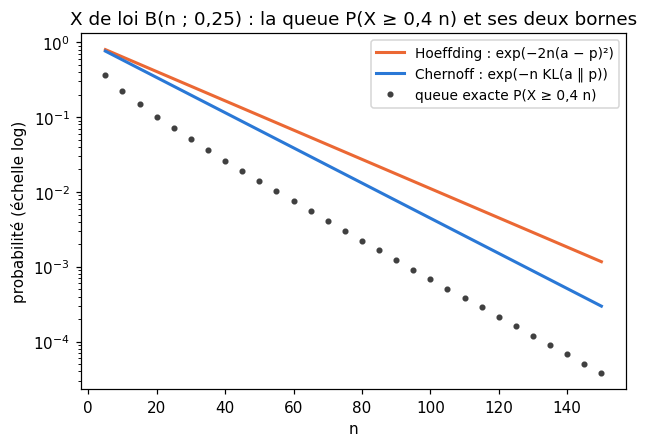
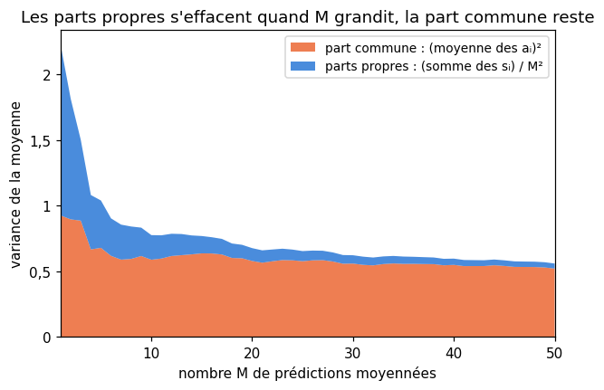
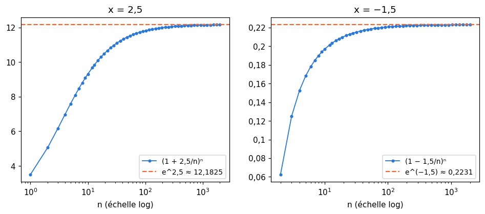
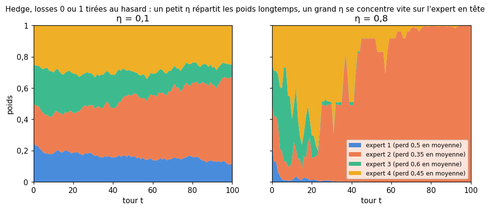
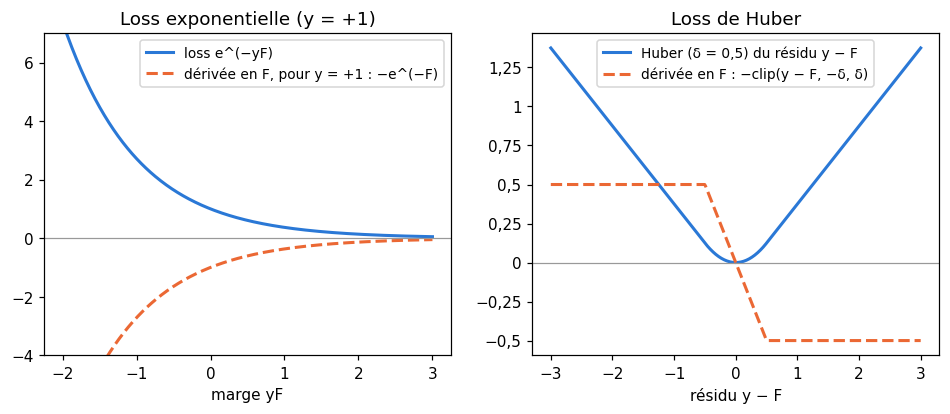

# M14 · Les maths des ensembles — fiche de cours

> Un **ensemble de modèles** combine plusieurs prédicteurs : il les fait voter, il moyenne leurs prédictions, il pondère leurs avis, ou il les ajoute l'un après l'autre en corrigeant les erreurs des précédents. Le chapitre 14 de workbookIA construit ces méthodes ; celui-ci rassemble les cinq outils mathématiques qu'elles utilisent. La **queue d'une loi binomiale** dit avec quelle probabilité beaucoup d'essais indépendants échouent à la fois, et la **borne de Chernoff** dit à quelle vitesse cette probabilité tend vers 0. La **variance d'une moyenne pondérée** $\mathbf{w}^\top\boldsymbol{\Sigma}\mathbf{w}$ dit ce que moyenner gagne, et ce que la corrélation lui reprend. La limite $(1 + x/n)^n \to e^x$ relie les produits répétés aux exponentielles. Les **poids exponentiels** de l'algorithme Hedge suivent le meilleur de plusieurs experts sans savoir lequel c'est. Enfin, le **gradient d'une loss par rapport aux prédictions** dit dans quelle direction corriger un ensemble de prédictions.

| | |
|---|---|
| **Sections** | §1 à §5 |
| **Temps total estimé** | ≈ 7,2 h : lecture et calculs de la fiche ≈ 1 h 30, exercices ≈ 5 h 20, 12 flashcards ≈ 20 min (parcours essentiel ≈ 4,7 h) |
| **Prérequis** | M02b (loi binomiale) ; M02c (covariance, variance d'une somme, matrice de covariance) ; M05a (Taylor, $\ln(1 + u)$) ; M06 (divergence KL) ; M08 (test binomial exact) ; M11 (Markov, Hoeffding, méthode de Chernoff, regret) ; M07 (Cauchy-Schwarz, pour ∂ M14.7) ; M05b (gradient) ; M09b (loss de Huber) ; M13a (log-loss) ; M13b (Lagrange, pour une remarque du §2) |
| **Fichiers du chapitre** | `02_exercices.md` (quiz, papier) · `03_notebook.ipynb` · `04_indices.md` · `05_solutions.md` et `05_solutions.ipynb` · `06_mes_reponses.md` · `flashcards.csv` |
| **mymath** | `ensembles.py` : `chernoff_bound`, `variance_of_average`, `hedge_weights` |
| **MML** | — (MML ne traite pas ces outils : la fiche est le cours) |

## Comment utiliser ce chapitre

**Ordre conseillé.**
1. `python tools/start_chapter.py M14` (sur Colab : `00_setup/COLAB.md` §2) : il copie le notebook, ta feuille de réponses et le squelette `mymath/ensembles.py`.
2. Section par section : lis **crayon en main**, refais chaque calcul ; puis fais les exercices de la section, quiz 🧠 d'abord.
3. Les exercices ✏️ et 🔗 se font sur papier, dans ta copie de `06_mes_reponses.md`, puis se vérifient dans la **partie 0** du notebook. Les démonstrations ∂ se rédigent dans ta copie et se jugent avec la grille de relecture de `05_solutions.md`.

Les cinq sections sont indépendantes : chacune prépare une méthode de workbookIA 14 sans la faire. Le vote, le bagging, AdaBoost et le gradient boosting restent à workbookIA.

| Section | Quiz 🧠 et rappels 🔁 | Papier et réflexion | Notebook |
|---|---|---|---|
| §1 La queue d'une loi binomiale | Q1, R1 | M14.1 ✏️, M14.8 ∂ | M14.11 🔨, M14.15 🐛, M14.16 🛠️ |
| §2 La variance d'une moyenne de variables corrélées | Q2, R2 | M14.2 ✏️, M14.7 ∂, M14.9 🔗, M14.10 🗣️ | M14.11 🔨, M14.13 🔬, M14.15 🐛 |
| §3 La limite $(1 + x/n)^n \to e^x$ | Q3, R3 | M14.3 ✏️, M14.6 ∂ | |
| §4 Des poids exponentiels : l'algorithme Hedge | Q4 | M14.4, M14.5 ✏️, M14.E1 💼 | M14.12 🔨, M14.14 🎨, M14.15 🐛, M14.17 🏆 |
| §5 Le gradient d'une loss par rapport aux prédictions | R1 | M14.5 ✏️ | |

Parcours essentiel : tout sauf M14.Q4, M14.5, M14.7, M14.8, M14.E1, M14.12 et M14.14 à M14.17. Le §5 se lit en survol.

## Lecture conseillée (facultatif)

MML ne traite pas ces outils : cette fiche est le cours. Pour aller plus loin, en anglais (références et conditions d'accès dans `annexes/ressources.md`) :
- J. K. Blitzstein et J. Hwang, *Introduction to Probability*, après le §2 : le chapitre sur les lois jointes, pour la covariance et la variance d'une somme ;
- T. Lattimore et C. Szepesvári, *Bandit Algorithms*, chapitre 5 (*Concentration of Measure*), après le §1, pour la méthode de Chernoff (déjà conseillé en M11) ;
- S. Arora, E. Hazan et S. Kale, « The Multiplicative Weights Update Method: a Meta-Algorithm and Applications », *Theory of Computing* 8 (2012), après le §4 : les poids multiplicatifs, et leurs nombreux usages.

Ces lectures ne sont nécessaires à aucun exercice.

Vocabulaire anglais de ce chapitre : *ensemble (of models)*, *binomial tail*, *k-out-of-n system*, *reliability*, *Chernoff bound*, *moment generating function*, *Kullback-Leibler divergence*, *Pinsker's inequality*, *majority vote*, *weighted average*, *covariance matrix*, *quadratic form*, *inverse-variance weighting*, *variance floor*, *decorrelation*, *compound interest*, *continuous compounding*, *experts (prediction with expert advice)*, *Hedge*, *exponential weights*, *multiplicative weights*, *learning rate*, *regret*, *anytime*, *full information*, *exponential loss*, *Huber loss*, *functional gradient*, *gradient boosting*.

## Objectifs d'apprentissage

À la fin du chapitre, tu sais :
- **calculer** la queue $P(X \ge k)$ d'une loi binomiale, et la **majorer** par les bornes de Hoeffding et de Chernoff, en sachant laquelle est la meilleure ;
- **calculer** la variance d'une moyenne pondérée de variables corrélées, $\mathbf{w}^\top\boldsymbol{\Sigma}\mathbf{w}$, et **expliquer** pourquoi moyenner des prédictions corrélées laisse un plancher de variance ;
- **démontrer** et **utiliser** la limite $(1 + x/n)^n \to e^x$, avec la vitesse de convergence ;
- **calculer** les poids exponentiels de l'algorithme Hedge et son regret, et **choisir** son learning rate ;
- **calculer** le gradient d'une loss par rapport au vecteur des prédictions, et **lire** les poids qu'il donne aux exemples.

## L'essentiel en 10 lignes

1. Si $X$ suit la loi $\mathcal{B}(n, p)$, sa **queue** est $P(X \ge k) = \sum_{j \ge k}\binom{n}{j}p^j(1 - p)^{n-j}$ ; attention à $P(X \ge k) = P(X > k - 1)$.
2. **Borne de Chernoff** : pour $a > p$, $P(X \ge na) \le e^{-n\,\mathrm{KL}(a \Vert p)}$, avec $\mathrm{KL}(a \Vert p) = a\ln\frac{a}{p} + (1 - a)\ln\frac{1 - a}{1 - p}$. Elle vient de Markov appliqué à $e^{\lambda X}$, avec le meilleur $\lambda$.
3. Comme $\mathrm{KL}(a \Vert p) \ge 2(a - p)^2$ (Pinsker), Chernoff fait toujours au moins aussi bien que Hoeffding, et beaucoup mieux pour les événements rares.
4. $\mathbb{V}\big(\sum_i w_iX_i\big) = \sum_{i,j}w_iw_j\operatorname{Cov}(X_i, X_j) = \mathbf{w}^\top\boldsymbol{\Sigma}\mathbf{w}$ : les covariances comptent autant que les variances.
5. Des prédictions indépendantes de même variance $\sigma^2$ : leur moyenne a la variance $\frac{\sigma^2}{M}$. Si chacune contient une **part commune** $a_iZ$, la variance de la moyenne reste au-dessus de $\bar{a}^2\,\mathbb{V}(Z)$ quel que soit $M$ : un **plancher**, fixé par les covariances.
6. $\left(1 + \frac{x}{n}\right)^n \to e^x$ pour tout réel $x$, car $n\ln\left(1 + \frac{x}{n}\right) \to x$ ; l'erreur relative vaut environ $-\frac{x^2}{2n}$.
7. **Hedge** : $K$ experts, des losses dans $[0, 1]$ ; avant le tour $t$, le poids de l'expert $k$ est proportionnel à $e^{-\eta L_t[k]}$, où $L_t[k]$ est sa loss cumulée. On retranche la plus petite loss cumulée avant l'exponentielle.
8. **Regret** de Hedge : $R_T \le \frac{\ln K}{\eta} + \frac{\eta T}{8}$ ; avec $\eta = \sqrt{8\ln K/T}$, $R_T \le \sqrt{\frac{T\ln K}{2}}$, et le regret moyen tend vers 0.
9. Le gradient d'une loss $\sum_i \ell(y_i, F_i)$ par rapport au **vecteur des prédictions** $\mathbf{F}$ a pour coordonnée $i$ la dérivée $\frac{\partial\ell}{\partial F}(y_i, F_i)$.
10. Loss exponentielle $e^{-yF}$ : gradient $-y_ie^{-y_iF_i}$, des **poids exponentiels** sur les exemples mal classés ; loss de Huber : gradient borné par $\delta$, un point aberrant tire au plus avec la force $\delta$.

## §1 · La queue d'une loi binomiale

### Au moins $k$ sur $n$

$n$ essais indépendants réussissent chacun avec la probabilité $p$ ; le nombre $X$ de succès suit la loi binomiale $\mathcal{B}(n, p)$ (M02b). La **queue** (*tail*) de la loi est la probabilité qu'il y ait **au moins** $k$ succès :
$$P(X \ge k) = \sum_{j=k}^{n}\binom{n}{j}p^j(1 - p)^{n-j}.$$

**Exemple : un système « $k$ parmi $n$ »** (*k-out-of-n system*). Une grappe de stockage a 10 disques, et elle fonctionne tant qu'au moins 7 disques fonctionnent. Chaque disque fonctionne toute l'année avec la probabilité $0{,}85$, indépendamment des autres. Avec $X$ le nombre de disques qui fonctionnent, de loi $\mathcal{B}(10 ;\ 0{,}85)$, la grappe fonctionne avec la probabilité
$$P(X \ge 7) = \sum_{j=7}^{10}\binom{10}{j}0{,}85^j\,0{,}15^{10-j} \approx 0{,}1298 + 0{,}2759 + 0{,}3474 + 0{,}1969 \approx 0{,}9500.$$
Elle tombe en panne si au moins 4 disques sur 10 lâchent : le nombre de pannes suit la loi $\mathcal{B}(10 ;\ 0{,}15)$, et $P(\text{panne}) \approx 0{,}0500$. Trois disques de réserve font passer d'une fiabilité de $0{,}85$ par disque à $0{,}95$ pour le système (✏️ M14.1).

⚠️ **Erreur classique.** $P(X \ge k)$ n'est pas $P(X > k)$ : la fonction de survie de SciPy, `binom.sf(m, n, p)`, rend $P(X > m)$, donc $P(X \ge k)$ = `binom.sf(k - 1, n, p)`. Avec M08, `testing.binomial_test(k, n, p, alternative="greater")` rend aussi $P(X \ge k)$ (🐛 M14.15).

### Majorer la queue : trois bornes

La somme se calcule exactement, mais elle ne dit pas **à quelle vitesse** la queue diminue quand $n$ grandit. Pour cela, on la majore. On regarde la probabilité d'avoir au moins une proportion $a$ de succès, $P(X \ge na)$, avec $a > p$ :
- **Markov** (M11) : $P(X \ge na) \le \frac{\mathbb{E}[X]}{na} = \frac{p}{a}$ ; cette borne ne dépend pas de $n$, elle ne voit pas que la queue diminue ;
- **Hoeffding** (M11), pour la moyenne $\frac{X}{n}$ de $n$ variables à valeurs dans $[0, 1]$ : $P(X \ge na) \le e^{-2n(a - p)^2}$ ;
- **Chernoff** :
$$\boxed{P(X \ge na) \le e^{-n\,\mathrm{KL}(a \Vert p)}, \qquad \mathrm{KL}(a \Vert p) = a\ln\frac{a}{p} + (1 - a)\ln\frac{1 - a}{1 - p},}$$
la divergence de Kullback-Leibler (M06) entre les lois de Bernoulli de paramètres $a$ et $p$ ($0\ln 0$ compte pour 0). M06 la comptait en bits, avec $\log_2$ ; ici, le logarithme est népérien et la divergence est en **nats**.

**D'où vient la borne de Chernoff.** C'est la méthode de M11 : Markov appliqué à $e^{\lambda X}$, pour un $\lambda > 0$ à choisir. Comme $x \mapsto e^{\lambda x}$ est croissante,
$$P(X \ge na) = P\big(e^{\lambda X} \ge e^{\lambda na}\big) \le e^{-\lambda na}\,\mathbb{E}\big[e^{\lambda X}\big] = e^{-\lambda na}\,\big(1 - p + pe^\lambda\big)^n :$$
$X$ est la somme de $n$ variables de Bernoulli indépendantes, et $\mathbb{E}[e^{\lambda X_i}] = (1 - p) \times e^0 + p \times e^\lambda$ ; l'indépendance transforme l'espérance du produit en produit des espérances. Chaque $\lambda > 0$ donne une borne. La meilleure annule la dérivée du logarithme, $-na + \frac{npe^\lambda}{1 - p + pe^\lambda}$, en
$$e^{\lambda^*} = \frac{a(1 - p)}{p(1 - a)},$$
et, reportée dans la borne, elle donne exactement $e^{-n\,\mathrm{KL}(a \Vert p)}$ (∂ M14.8 fait le calcul). CP2.9 B l'avait faite dans un cas particulier.

**Exemple.** $p = 0{,}25$ et $a = 0{,}4$ : $e^{\lambda^*} = \frac{0{,}4 \times 0{,}75}{0{,}25 \times 0{,}6} = 2$, soit $\lambda^* = \ln 2$, et
$$\mathrm{KL}(0{,}4 \Vert 0{,}25) = 0{,}4\ln\frac{0{,}4}{0{,}25} + 0{,}6\ln\frac{0{,}6}{0{,}75} \approx 0{,}0541, \qquad 2(a - p)^2 = 0{,}045.$$

| $n$ | queue exacte $P(X \ge 0{,}4\,n)$ | Chernoff $e^{-0{,}0541\,n}$ | Hoeffding $e^{-0{,}045\,n}$ |
|---|---|---|---|
| 20 | 0,102 | 0,339 | 0,407 |
| 40 | 0,0262 | 0,115 | 0,165 |
| 100 | $6{,}9 \times 10^{-4}$ | $4{,}5 \times 10^{-3}$ | $1{,}1 \times 10^{-2}$ |

Les trois courbes sont presque des droites en échelle logarithmique : la queue décroît **exponentiellement** en $n$. La borne de Chernoff a presque la bonne pente : la queue exacte vaut $e^{-n\,\mathrm{KL}(a \Vert p)}$ à un facteur près qui ne décroît que comme une puissance de $n$. Ni Markov ni Tchebychev ne voient cette décroissance exponentielle.

**Chernoff contre Hoeffding.** L'**inégalité de Pinsker** (*Pinsker's inequality*), que ∂ M14.8 démontre pour deux lois de Bernoulli, dit que $\mathrm{KL}(a \Vert p) \ge 2(a - p)^2$ : la borne de Chernoff est toujours au moins aussi bonne. L'écart est grand pour les **événements rares**, quand $p$ est près de 0 ou de 1 : pour $p = 0{,}01$ et $a = 0{,}05$, $\mathrm{KL} \approx 0{,}0413$, treize fois $2(a - p)^2 = 0{,}0032$. Hoeffding n'utilise que l'intervalle $[0, 1]$ des valeurs ; Chernoff utilise la loi exacte.

**De l'autre côté.** Pour $a < p$, la même méthode appliquée à $n - X$ (le nombre d'échecs, de loi $\mathcal{B}(n, 1 - p)$) donne $P(X \le na) \le e^{-n\,\mathrm{KL}(a \Vert p)}$.

### Des décisions indépendantes qui se trompent ensemble

La borne dit à quelle vitesse il devient improbable que **beaucoup d'essais indépendants échouent à la fois**. Si $n$ décisions indépendantes sont chacune justes avec une probabilité $q > \frac{1}{2}$, la probabilité que la majorité se trompe est au plus $e^{-n\,\mathrm{KL}(1/2 \Vert 1 - q)}$ : elle tend vers 0 exponentiellement en $n$. C'est la forme générale du **théorème du jury** de Condorcet. Tout repose sur l'**indépendance** : avec des décisions corrélées, la majorité se trompe ensemble, et le §2 dit ce que la corrélation coûte.

**Notations.** Ici, comme en M02b et M08, $p$ est la probabilité de succès d'un essai, et $n$ le nombre d'essais. workbookIA 14 note $q$ la probabilité qu'un votant ait raison (chez lui, $p$ est le nombre de features), et $M$ le nombre de modèles : c'est la lettre du §2.

🔗 **Dans workbookIA** — le chapitre 14 fait voter des classifieurs, et compte la probabilité qu'une majorité se trompe.

## §2 · La variance d'une moyenne de variables corrélées

### La formule

$X_1, \ldots, X_M$ sont des variables (les prédictions de $M$ modèles pour un même exemple, ou $M$ mesures d'une même grandeur), de matrice de covariance $\boldsymbol{\Sigma}$ : $\Sigma_{ij} = \operatorname{Cov}(X_i, X_j)$, et $\Sigma_{ii} = \mathbb{V}(X_i)$ (M02c). Pour des poids $w_1, \ldots, w_M$, la covariance est bilinéaire, donc
$$\boxed{\mathbb{V}\Big(\sum_{i=1}^M w_iX_i\Big) = \sum_{i=1}^M\sum_{j=1}^M w_iw_j\operatorname{Cov}(X_i, X_j) = \mathbf{w}^\top\boldsymbol{\Sigma}\mathbf{w}.}$$
Sur la diagonale, les variances, pondérées par $w_i^2$ ; hors de la diagonale, chaque paire $i < j$ apparaît deux fois ($\Sigma_{ij} = \Sigma_{ji}$) : $\mathbf{w}^\top\boldsymbol{\Sigma}\mathbf{w} = \sum_i w_i^2\,\mathbb{V}(X_i) + 2\sum_{i < j}w_iw_j\operatorname{Cov}(X_i, X_j)$. Une covariance positive **augmente** la variance de la moyenne, une covariance négative la **diminue**.

**Exemple : trois capteurs.** Trois capteurs mesurent la même température, avec des erreurs de matrice de covariance
$$\boldsymbol{\Sigma} = \begin{pmatrix} 2 & -1 & 0 \\ -1 & 6 & 2 \\ 0 & 2 & 3 \end{pmatrix}.$$
- La **moyenne simple** ($w_i = \frac{1}{3}$) : $\frac{1}{9}$ fois la somme de toutes les cases, $\frac{13}{9} \approx 1{,}44$. Sans les covariances, on aurait trouvé $\frac{2 + 6 + 3}{9} = \frac{11}{9} \approx 1{,}22$ : la covariance $+2$ coûte plus que ce que la covariance $-1$ rapporte.
- Avec les poids $\mathbf{w} = (0{,}5 ;\ 0{,}2 ;\ 0{,}3)$ : $0{,}25 \times 2 + 0{,}04 \times 6 + 0{,}09 \times 3 + 2\,(-0{,}5 \times 0{,}2 \times 1 + 0{,}2 \times 0{,}3 \times 2) = 1{,}01 + 0{,}04 = 1{,}05$, presque deux fois moins que le meilleur capteur seul (variance 2).

**Les meilleurs poids.** Minimiser $\mathbf{w}^\top\boldsymbol{\Sigma}\mathbf{w}$ sous $\sum_i w_i = 1$ est un problème de Lagrange (M13b) : $2\boldsymbol{\Sigma}\mathbf{w} = \lambda\mathbf{1}$, donc $\mathbf{w}^* \propto \boldsymbol{\Sigma}^{-1}\mathbf{1}$, et la variance minimale vaut $\frac{1}{\mathbf{1}^\top\boldsymbol{\Sigma}^{-1}\mathbf{1}}$. Ici, $\boldsymbol{\Sigma}\,(3, 1, 1)^\top = (5, 5, 5)^\top$ : $\mathbf{w}^* = \left(\frac{3}{5}, \frac{1}{5}, \frac{1}{5}\right)$, et la variance vaut 1. Pour des variables **indépendantes**, $\boldsymbol{\Sigma}$ est diagonale et $w_i^* \propto \frac{1}{\sigma_i^2}$ : la **pondération par l'inverse de la variance** (*inverse-variance weighting*), que CP1.9 A a utilisée pour deux mesures.

**Une borne générale.** Si chaque $X_i$ a une variance au plus $\sigma^2$, toute moyenne pondérée (poids positifs de somme 1) a une variance au plus $\sigma^2$ : moyenner ne fait jamais pire que le pire des $X_i$ (∂ M14.7, avec $\lvert\operatorname{Cov}(X_i, X_j)\rvert \le \sigma_i\sigma_j$).

### Moyenner des prédictions corrélées : un plancher

Pour $M$ variables **indépendantes** de même variance $\sigma^2$, la moyenne simple a la variance $\frac{\sigma^2}{M}$ : elle tend vers 0 quand $M$ grandit. Or les erreurs de modèles réels sont rarement indépendantes. Un modèle simple de cette situation : chaque prédiction a une **part commune** $Z$ et une **part propre** $E_i$,
$$X_i = a_iZ + E_i,$$
avec $\mathbb{V}(Z) = 1$, $\mathbb{V}(E_i) = s_i$, et toutes ces variables indépendantes. Alors $\operatorname{Cov}(X_i, X_j) = a_ia_j$ pour $i \ne j$, et la moyenne simple vaut $\bar{a}Z + \frac{1}{M}\sum_i E_i$, de variance
$$\mathbb{V}(\bar{X}) = \bar{a}^2 + \frac{1}{M^2}\sum_{i=1}^M s_i, \qquad \bar{a} = \frac{1}{M}\sum_{i=1}^M a_i.$$
Le second terme tend vers 0 (au plus $\frac{\max s_i}{M}$) ; le premier, $\bar{a}^2$, ne dépend pas de $M$ : c'est un **plancher**. Pour l'abaisser, il faut réduire les coefficients $a_i$, donc les covariances $a_ia_j$ entre prédictions ; ajouter des modèles construits de la même façon n'y change rien.

Une **forêt aléatoire** (*random forest*) vise ce terme-là : elle rend ses arbres moins semblables, donc leurs covariances plus petites, ce qui baisse le plancher $\bar{a}^2$ ; workbookIA 14 dit comment. 🔬 M14.13 et 🔗 M14.9 chiffrent un plancher sur deux groupes de modèles.

**Le vote souple.** Quand chaque modèle rend un vecteur de probabilités (une par classe), le **vote souple** (*soft voting*) en fait la moyenne, classe par classe : chaque coordonnée de la moyenne est une moyenne pondérée de variables, et sa variance se calcule par la même formule.

🔗 **Dans workbookIA** — le chapitre 14 moyenne des arbres (bagging, forêts aléatoires) et mesure ce que la corrélation entre eux coûte.

## §3 · La limite $(1 + x/n)^n \to e^x$

### L'énoncé et l'idée

> **Pour tout réel $x$,** $\displaystyle\lim_{n \to +\infty}\left(1 + \frac{x}{n}\right)^n = e^x$.

**Idée.** Pour $n > \lvert x \rvert$, $1 + \frac{x}{n} > 0$, et $\left(1 + \frac{x}{n}\right)^n = \exp\left(n\ln\left(1 + \frac{x}{n}\right)\right)$. Le développement de Taylor de M05a, $\ln(1 + u) = u - \frac{u^2}{2} + \cdots$ pour $u$ petit, donne, avec $u = \frac{x}{n}$,
$$n\ln\left(1 + \frac{x}{n}\right) = x - \frac{x^2}{2n} + \cdots \xrightarrow[n \to +\infty]{} x,$$
et l'exponentielle est continue. ∂ M02b.13 a fait ce calcul pour $x = -\lambda$ ; ∂ M14.6 le rend rigoureux pour tout $x$, en encadrant $\ln(1 + u)$, et il en tire la vitesse.

**La vitesse.** Le même calcul donne $\left(1 + \frac{x}{n}\right)^n \approx e^x\,e^{-x^2/(2n)} \approx e^x\left(1 - \frac{x^2}{2n}\right)$ : l'erreur relative vaut environ $-\frac{x^2}{2n}$. Il faut que $n$ soit grand **devant $x^2$**, pas seulement grand. Pour $x = 2{,}5$ ($e^{2{,}5} \approx 12{,}1825$) :

| $n$ | 1 | 5 | 50 | 500 | 5 000 |
|---|---|---|---|---|---|
| $(1 + 2{,}5/n)^n$ | 3,5 | 7,5938 | 11,4674 | 12,1068 | 12,1749 |
| erreur relative | $-71\,\%$ | $-38\,\%$ | $-5{,}87\,\%$ | $-0{,}621\,\%$ | $-0{,}062\,\%$ |
| $-x^2/(2n)$ | | | $-6{,}25\,\%$ | $-0{,}625\,\%$ | $-0{,}0625\,\%$ |

La suite **croît** vers $e^{2{,}5}$ ; l'approximation de l'erreur devient bonne dès que $\frac{x^2}{n}$ est petit.

### Deux usages

**Des intérêts composés en continu** (*continuous compounding*, déjà vus en R6 §2). Un placement à 6 % par an, dont les intérêts sont versés $n$ fois par an (chaque fois $\frac{6}{n}$ %), est multiplié en un an par $\left(1 + \frac{0{,}06}{n}\right)^n$ : 1,06 pour $n = 1$, $1{,}005^{12} \approx 1{,}061678$ pour un versement mensuel, et au plus $e^{0{,}06} \approx 1{,}061837$, quel que soit $n$. L'erreur relative du versement mensuel, $\approx -0{,}015\,\%$, est bien proche de $-\frac{0{,}06^2}{24} = -0{,}015\,\%$.

**Une survie.** Une journée est coupée en $n$ créneaux ; dans chacun, une panne survient avec la probabilité $\frac{1{,}5}{n}$, indépendamment. La probabilité d'une journée sans panne, $\left(1 - \frac{1{,}5}{n}\right)^n$, tend vers $e^{-1{,}5} \approx 0{,}2231$ : c'est la probabilité de 0 pour la loi de Poisson de paramètre $1{,}5$, limite de $\mathcal{B}\left(n, \frac{1{,}5}{n}\right)$ (∂ M02b.13). La vitesse dit combien de créneaux suffisent : pour $n = 60$, $0{,}975^{60} \approx 0{,}2189$, une erreur relative de $-1{,}89\,\%$, et l'approximation annonçait $-\frac{1{,}5^2}{120} = -1{,}875\,\%$.

**Multiplicatif et exponentiel.** Pour $\eta$ petit, $1 - \eta \approx e^{-\eta}$, donc multiplier $L$ fois un poids par $1 - \eta$ revient presque à le multiplier par $e^{-\eta L}$ : les poids **multiplicatifs** et les poids **exponentiels** du §4 sont presque les mêmes.

🔗 **Dans workbookIA** — le chapitre 14 rencontre cette limite dans les tirages avec remise du bagging (∂ 14.3), avec une valeur de $x$ que tu reconnaîtras.

## §4 · Des poids exponentiels : l'algorithme Hedge

### Prédire avec des experts

$K$ **experts** (des modèles, des règles, des prévisionnistes) font chacun une prédiction à chaque tour. Au tour $t$, avant de voir le résultat, tu choisis une loi $\mathbf{w}_t$ sur les experts (tu suis l'expert $k$ avec la probabilité $w_t[k]$, ou tu mélanges leurs avis avec ces poids). Puis chaque expert reçoit une loss $\ell_t[k] \in [0, 1]$, et tu subis la loss moyenne $\mathbf{w}_t \cdot \boldsymbol{\ell}_t$. On ne suppose rien sur la façon dont les losses sont produites : elles peuvent même être choisies contre toi.

Ton **regret** après $T$ tours compare ta loss totale à celle du meilleur expert, choisi après coup :
$$R_T = \sum_{t=1}^T \mathbf{w}_t \cdot \boldsymbol{\ell}_t - \min_k L_{T+1}[k], \qquad L_t[k] = \sum_{s < t}\ell_s[k].$$
C'est le regret de M11, dans un cadre plus riche : en M11, on ne voyait que la récompense de l'option choisie (un bandit) ; ici, on voit les losses de **tous** les experts (information complète, *full information*).

### Les poids exponentiels

**Hedge** donne à chaque expert un poids qui décroît exponentiellement avec sa loss cumulée :
$$w_t[k] = \frac{e^{-\eta L_t[k]}}{\sum_{j=1}^K e^{-\eta L_t[j]}},$$
avec un **learning rate** $\eta > 0$. Avant le premier tour, toutes les losses cumulées sont nulles : les poids sont uniformes. D'un tour à l'autre, chaque poids est multiplié par $e^{-\eta\ell_t[k]}$, puis tous sont renormalisés (une mise à jour **multiplicative**). Ce $\eta$ règle la vitesse à laquelle les poids réagissent aux losses ; il n'a rien à voir avec le pas d'une descente de gradient ni avec le learning rate d'un boosting.

**Ce que prédit le mélange.** Si l'expert $k$ annonce un nombre $x_t[k]$, le mélange annonce $\sum_k w_t[k]\,x_t[k]$ : une **moyenne pondérée** des avis, à poids positifs de somme 1, qui reste entre le plus petit et le plus grand avis. Si les avis sont des classes, tirer un expert selon $\mathbf{w}_t$ donne la classe $c$ avec la probabilité $\sum_k w_t[k]\,\mathbb{1}[x_t[k] = c]$ ; prédire la classe la plus probable, c'est le **vote pondéré** de workbookIA 14.

**Le calcul en pratique.** Pour de grandes losses, tous les $e^{-\eta L_t[k]}$ deviennent 0 en flottants (*underflow*), et la normalisation divise 0 par 0. On retranche donc la plus petite loss cumulée, $L_t[k] - \min_j L_t[j]$, avant l'exponentielle : la normalisation annule ce facteur commun, et le meilleur expert garde l'exposant 0 (l'astuce de log-somme-exp, M04 et M05a).

**Exemple.** Trois experts, $\eta = 0{,}5$, quatre tours :

| tour $t$ | losses $\boldsymbol{\ell}_t$ | losses cumulées avant $t$ | poids $\mathbf{w}_t$ | ta loss $\mathbf{w}_t \cdot \boldsymbol{\ell}_t$ |
|---|---|---|---|---|
| 1 | $(0 ;\ 1 ;\ 0{,}5)$ | $(0 ;\ 0 ;\ 0)$ | $(0{,}333 ;\ 0{,}333 ;\ 0{,}333)$ | 0,5 |
| 2 | $(1 ;\ 0 ;\ 0{,}5)$ | $(0 ;\ 1 ;\ 0{,}5)$ | $(0{,}419 ;\ 0{,}254 ;\ 0{,}326)$ | 0,582 |
| 3 | $(0 ;\ 1 ;\ 0{,}5)$ | $(1 ;\ 1 ;\ 1)$ | $(0{,}333 ;\ 0{,}333 ;\ 0{,}333)$ | 0,5 |
| 4 | $(0 ;\ 0 ;\ 1)$ | $(1 ;\ 2 ;\ 1{,}5)$ | $(0{,}419 ;\ 0{,}254 ;\ 0{,}326)$ | 0,326 |

Au tour 2, $e^{-0{,}5 \times (0 ;\ 1 ;\ 0{,}5)} = (1 ;\ 0{,}607 ;\ 0{,}779)$, de somme $2{,}385$, d'où les poids. Ta loss totale vaut $\approx 1{,}909$ ; le meilleur expert, le premier, a perdu 1 en tout : le regret vaut $\approx 0{,}909$.

### Le regret de Hedge

> **Théorème.** Pour des losses dans $[0, 1]$, Hedge de learning rate $\eta$ a, sur $T$ tours et pour toute suite de losses, un regret
> $$R_T \le \frac{\ln K}{\eta} + \frac{\eta T}{8}.$$

L'idée de la démonstration (facultatif)

On suit le « potentiel » $\Phi_t = \ln\sum_k e^{-\eta L_t[k]}$. Au départ, $\Phi_1 = \ln K$. À chaque tour, $\Phi_{t+1} - \Phi_t = \ln\sum_k w_t[k]\,e^{-\eta\ell_t[k]}$ : c'est le logarithme de l'espérance de $e^{-\eta\ell}$ quand on tire un expert selon $\mathbf{w}_t$. Le lemme de Hoeffding (M11) le majore par $-\eta\,\mathbf{w}_t \cdot \boldsymbol{\ell}_t + \frac{\eta^2}{8}$. En sommant sur les $T$ tours, $\Phi_{T+1} - \ln K \le -\eta\sum_t \mathbf{w}_t \cdot \boldsymbol{\ell}_t + \frac{T\eta^2}{8}$. Enfin, la somme qui définit $\Phi_{T+1}$ est au moins son plus grand terme : $\Phi_{T+1} \ge -\eta\min_k L_{T+1}[k]$. On réunit les deux inégalités et on divise par $\eta$.

Sur l'exemple : $\frac{\ln 3}{0{,}5} + \frac{0{,}5 \times 4}{8} \approx 2{,}45$, au-dessus du regret $0{,}909$.

**Choisir $\eta$.** Les deux termes tirent en sens contraires : un petit $\eta$ change lentement les poids (le premier terme grandit), un grand $\eta$ suit le dernier en tête, et ses à-coups (le second terme grandit). Le minimum de $\frac{\ln K}{\eta} + \frac{\eta T}{8}$ est atteint en $\eta = \sqrt{\frac{8\ln K}{T}}$, où la borne vaut
$$R_T \le \sqrt{\frac{T\ln K}{2}}.$$
Le regret grandit comme $\sqrt{T}$, donc le **regret moyen** $\frac{R_T}{T}$ tend vers 0 : à long terme, tu fais en moyenne aussi bien que le meilleur expert, sans jamais savoir lequel c'est. Et la borne ne dépend de $K$ que par $\sqrt{\ln K}$ : mille experts ne coûtent que $\sqrt{3} \approx 1{,}7$ fois plus que dix.

**Sans connaître $T$.** Le bon $\eta$ dépend de l'horizon $T$. Quand on ne le connaît pas, on prend un learning rate qui **décroît** avec le tour, $\eta_t = \sqrt{\frac{8\ln K}{t}}$ ; on admet que le regret reste alors au plus $\sqrt{2T\ln K} + \sqrt{\frac{\ln K}{8}}$, à peine deux fois la borne avec le meilleur $\eta$ fixe (🏆 M14.17).

🔗 **Dans workbookIA** — le chapitre 14 combine des classifieurs avec des poids, et AdaBoost repondère les **exemples** de façon exponentielle (§5).

## §5 · Le gradient d'une loss par rapport aux prédictions

### Le vecteur des prédictions

Sur $n$ exemples d'entraînement, un modèle produit un **vecteur de prédictions** $\mathbf{F} = (F_1, \ldots, F_n)$, une prédiction par exemple. La loss totale ne dépend que de lui :
$$\mathcal{L}(\mathbf{F}) = \sum_{i=1}^n \ell(y_i, F_i).$$
Chaque terme ne dépend que d'une coordonnée de $\mathbf{F}$ : la coordonnée $i$ du gradient (M05b) est la dérivée d'une fonction d'une variable,
$$\big(\nabla_{\mathbf{F}}\mathcal{L}\big)_i = \frac{\partial\ell}{\partial F}(y_i, F_i).$$
Sa coordonnée $i$ est la pente de la loss de l'exemple $i$ en sa prédiction : au premier ordre, déplacer $F_i$ de $\varepsilon$ change la loss de $\varepsilon\,(\nabla_{\mathbf{F}}\mathcal{L})_i$.

### La loss exponentielle : des poids exponentiels sur les exemples

Pour des labels $y_i \in \{-1, +1\}$ (avec des classes codées 0 et 1, on pose $y = 2 \times \text{classe} - 1$) et un score $F_i$, la **loss exponentielle** (*exponential loss*) vaut $\ell(y, F) = e^{-yF}$ : elle est petite quand la marge $yF$ est grande, et énorme quand l'exemple est nettement mal classé. Sa dérivée en $F$ vaut
$$\frac{\partial}{\partial F}e^{-yF} = -y\,e^{-yF} :$$
le gradient a le signe de $-y$ : un pas **contre** lui pousse chaque prédiction vers son label, avec une force égale à la **loss actuelle** de l'exemple.

**Exemple.** Quatre exemples, de labels $\mathbf{y} = (+1, -1, +1, -1)$ et de scores $\mathbf{F} = (0{,}5 ;\ 0{,}2 ;\ -0{,}6 ;\ -0{,}8)$. Les marges valent $0{,}5$, $-0{,}2$, $-0{,}6$ et $0{,}8$ ; les losses $e^{-yF}$, $0{,}607$, $1{,}221$, $1{,}822$ et $0{,}449$ ; le gradient, $(-0{,}607 ;\ 1{,}221 ;\ -1{,}822 ;\ 0{,}449)$. Normalisées, les losses donnent les poids $(0{,}148 ;\ 0{,}298 ;\ 0{,}444 ;\ 0{,}110)$ : l'exemple le plus mal classé (le troisième) pèse quatre fois plus que le mieux classé (le quatrième). Ce sont des **poids exponentiels**, comme au §4, mais sur les **exemples**, avec la marge à la place de la loss cumulée.

**Une mise à jour multiplicative.** Si l'on ajoute aux scores un modèle $h$ multiplié par un coefficient $\alpha$, la loss de l'exemple $i$ devient $e^{-y_i(F_i + \alpha h_i)} = e^{-y_iF_i}\,e^{-\alpha y_ih_i}$ : chaque poids est **multiplié** par $e^{-\alpha y_ih_i}$, plus grand que 1 si $h$ se trompe sur l'exemple, plus petit sinon, puis renormalisé. C'est la même mécanique qu'au §4.

### La loss de Huber : une force bornée

Pour une régression, la loss de Huber de M09b porte sur le résidu $r = y - F$ : $\frac{1}{2}r^2$ si $\lvert r \rvert \le \delta$, $\delta\left(\lvert r \rvert - \frac{\delta}{2}\right)$ sinon. Sa dérivée en $F$ vaut
$$\frac{\partial}{\partial F}\ell_\delta(y - F) = -\operatorname{clip}(y - F,\ -\delta,\ \delta),$$
où $\operatorname{clip}(r, -\delta, \delta)$ ramène $r$ dans $[-\delta, \delta]$. Avec $\delta = 0{,}5$ et les résidus $(0{,}4 ;\ -1{,}7 ;\ 0{,}6 ;\ -0{,}1)$, le gradient vaut $(-0{,}4 ;\ 0{,}5 ;\ -0{,}5 ;\ 0{,}1)$ : le point aberrant (résidu $-1{,}7$) pèse au plus $0{,}5$, pas $1{,}7$.

### Ajouter des modèles le long de ce gradient (idée)

Ajouter à l'ensemble un modèle $h$, multiplié par un coefficient $\alpha > 0$, change le vecteur des prédictions de $\alpha\,\mathbf{h}$, où $\mathbf{h} = (h_1, \ldots, h_n)$ sont ses prédictions sur les exemples. Au premier ordre (M05b, dérivée directionnelle), $\mathcal{L}(\mathbf{F} + \alpha\mathbf{h}) \approx \mathcal{L}(\mathbf{F}) + \alpha\,\nabla_{\mathbf{F}}\mathcal{L} \cdot \mathbf{h}$ : la loss baisse dès que $\nabla_{\mathbf{F}}\mathcal{L} \cdot \mathbf{h} < 0$, c'est-à-dire dès que $\mathbf{h}$ fait un angle aigu avec $-\nabla_{\mathbf{F}}\mathcal{L}$, et elle baisse le plus, à norme de $\mathbf{h}$ fixée, quand $\mathbf{h}$ lui est proportionnel (Cauchy-Schwarz, M07). Le coefficient $\alpha$ doit rester petit pour que ce premier ordre reste une bonne approximation. On parle de **gradient fonctionnel** (*functional gradient*). La loss fixe la direction : la loss exponentielle insiste sur les exemples mal classés, la loss de Huber ne laisse pas un point aberrant tout décider. Comment workbookIA 14 choisit le modèle $h$ : ∂ 14.4.

⚠️ **Erreur classique.** $\nabla_{\mathbf{F}}\mathcal{L}$ a une coordonnée par **exemple** ; le gradient de M05b par rapport aux coefficients d'un modèle en a une par **coefficient**. La règle de la chaîne passe de l'un à l'autre (M18).

🔗 **Dans workbookIA** — le chapitre 14 construit AdaBoost et le gradient boosting, qui ajoutent des modèles l'un après l'autre en suivant ce gradient.

## Les pièges classiques ⚠️ (récapitulatif)

- **$P(X \ge k)$ ou $P(X > k)$.** `binom.sf(k - 1, n, p)` pour « au moins $k$ ».
- **Le sens de la divergence.** La borne de Chernoff utilise $\mathrm{KL}(a \Vert p)$ : d'abord la proportion de l'événement, puis le paramètre de la loi. $\mathrm{KL}$ n'est pas symétrique.
- **La formule pour $a \le p$.** Pour $a < p$, $e^{-n\,\mathrm{KL}(a \Vert p)}$ n'est **pas** une borne de $P(X \ge na)$, qui tend vers 1 : la méthode ne donne alors que la borne triviale 1 (ce que rend `chernoff_bound`).
- **Oublier les covariances.** $\mathbb{V}(\sum w_iX_i) \ne \sum w_i^2\,\mathbb{V}(X_i)$ dès que les variables sont corrélées.
- **$\frac{\sigma^2}{M}$ pour des modèles corrélés.** Le terme en $\frac{1}{M}$ ne concerne que les parts propres ; les covariances laissent un plancher.
- **$(1 + x/n)^n$ pour $n$ « grand ».** Il faut $n$ grand devant $x^2$.
- **Des poids non renormalisés, ou qui débordent.** Divise par la somme ; retranche la plus petite loss cumulée avant l'exponentielle.
- **Le signe dans l'exponentielle.** Le poids d'un expert est $e^{-\eta L}$ : une grande loss, un **petit** poids.
- **Combien de coordonnées ?** $\nabla_{\mathbf{F}}\mathcal{L}$ en a $n$, une par exemple (⚠️ du §5).

## Et maintenant

**Dans ce dépôt** : CP3, l'examen blanc de la partie III, juste avant le checkpoint III de workbookIA ; puis M16, qui ouvre la partie IV (réseaux de neurones).

**Dans workbookIA** : le chapitre 14 fait voter des classifieurs, moyenne des arbres (bagging, forêts aléatoires) et construit AdaBoost et le gradient boosting. Tu sais maintenant pourquoi un vote de modèles indépendants se trompe rarement, ce que leur corrélation coûte, d'où viennent des poids exponentiels, et ce que veut dire « suivre le gradient » d'une loss quand on ajoute des modèles.

## Pour aller plus loin

- Les lectures conseillées en tête de fiche.
- `annexes/symboles.md` (lire $\mathrm{KL}(a \Vert p)$, $\mathbf{w}^\top\boldsymbol{\Sigma}\mathbf{w}$ et $\nabla_{\mathbf{F}}$ à voix haute), `annexes/formulaire.md` et `annexes/erreurs_frequentes.md`.
