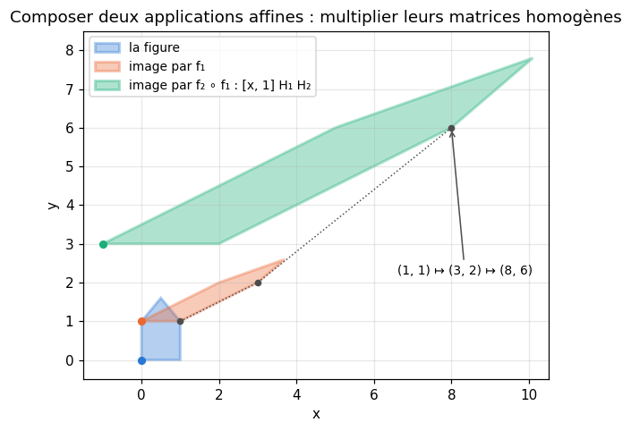
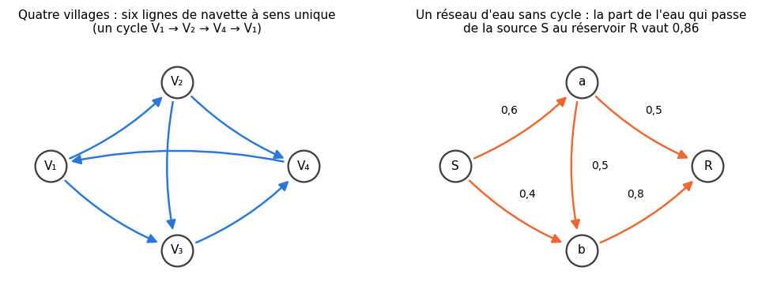

# M16 · Applications affines, graphes et variance d'un produit — fiche de cours

> Un réseau de neurones « feed-forward » enchaîne des calculs simples, organisés en graphe, et il commence sa vie avec des nombres tirés au hasard. Le chapitre 16 de workbookIA le construit ; celui-ci rassemble, **hors des réseaux**, les trois outils mathématiques qu'il utilise. Les **applications affines** $\mathbf{x} \mapsto \mathbf{x}\mathbf{W} + \mathbf{b}$, dans les deux conventions (vecteurs en lignes ou en colonnes), avec la forme de chaque objet, et leur composition, qui devient un simple produit de matrices en **coordonnées homogènes**. Les **graphes orientés**, lus sur leur **matrice d'adjacence** : ses puissances comptent les chemins, et un graphe est sans cycle exactement quand elle est **nilpotente**, ce qui permet de sommer sur tous ses chemins. Enfin, l'**espérance et la variance d'un produit** de variables indépendantes, la variance d'une somme de produits seulement **décorrélés**, et des variances qui **se multiplient d'étage en étage**.

| | |
|---|---|
| **Sections** | §1 à §7 |
| **Temps total estimé** | ≈ 8 h : lecture et calculs de la fiche ≈ 1 h 20, exercices ≈ 6 h 15, 12 flashcards ≈ 25 min (parcours essentiel ≈ 6 h) |
| **Prérequis** | M09a (produit matriciel, formes, coût, Hadamard, $\mathbf{Z} = \mathbf{X}\mathbf{W} + \mathbf{b}$) ; M12a (applications affines, composition, réciproque) ; M12c (matrices triangulaires et leurs valeurs propres) ; M02b (indépendance, $\mathbb{E}[XY] = \mathbb{E}[X]\,\mathbb{E}[Y]$, variance d'une somme, lois uniforme et normale) ; M02c (covariance, corrélation) ; R5 (suites géométriques et arithmético-géométriques, somme géométrique) ; R4 (récurrence) ; R8 (dénombrement, pour les chemins) |
| **Fichiers du chapitre** | `02_exercices.md` (quiz, papier) · `03_notebook.ipynb` · `04_indices.md` · `05_solutions.md` et `05_solutions.ipynb` · `06_mes_reponses.md` · `flashcards.csv` |
| **mymath** | `affine.py` : `homogeneous_matrix`, `sum_over_paths`, `variance_of_product` |
| **MML** | — (aucune section nouvelle : les applications affines sont MML §2.8, lu en M12a, et les sommes de variables aléatoires MML §6.4, lu en M02b et M02c) |

## Comment utiliser ce chapitre

**Ordre conseillé.**
1. `python tools/start_chapter.py M16` (sur Colab : `00_setup/COLAB.md` §2) : il copie le notebook, ta feuille de réponses et le squelette `mymath/affine.py`.
2. Section par section : lis **crayon en main**, refais chaque calcul ; puis fais les exercices de la section, quiz 🧠 d'abord.
3. Les exercices ✏️ et 🔗 se font sur papier, dans ta copie de `06_mes_reponses.md`, puis se vérifient dans la **partie 0** du notebook. Les démonstrations ∂ se rédigent dans ta copie et se jugent avec la grille de relecture de `05_solutions.md`.

Les trois blocs sont indépendants : §1 et §2 (applications affines), §3 et §4 (graphes), §5 à §7 (variance d'un produit). Aucun ne construit un réseau : c'est le travail de workbookIA 16.

| Section | Quiz 🧠 et rappels 🔁 | Papier et réflexion | Notebook |
|---|---|---|---|
| §1 Applications affines : formes et conventions | Q1, R1 | M16.1 ✏️, M16.10 🔗 | M16.18 🐛 |
| §2 Composer : les coordonnées homogènes | Q2 | M16.2 ✏️ | M16.12 🔨, M16.17 🎨, M16.19 🛠️ |
| §3 Graphes orientés et matrice d'adjacence | Q3 | M16.3 ✏️, M16.7 ∂ | M16.13 🔨 |
| §4 Graphes sans cycle | Q3, R3 | M16.4 ✏️, M16.8 ∂ | M16.13 🔨, M16.18 🐛 |
| §5 Espérance et variance d'un produit | Q4, R2 | M16.5 ✏️, M16.9 ∂, M16.11 🗣️ | M16.14 🔨, M16.18 🐛, M16.20 🏆 |
| §6 Sommes de produits : décorrélées suffit | Q4 | M16.6 ✏️, M16.E1 💼 | M16.15 🔮 |
| §7 Des variances qui se multiplient d'étage en étage | | M16.E1 💼 | M16.15 🔮, M16.16 🔬 |

Parcours essentiel : tout sauf M16.R3, M16.7, M16.9, M16.E1, M16.14, M16.16, M16.19 et M16.20.

## Lecture conseillée (facultatif)

Aucune section de MML n'est nouvelle ici. Si un rappel te manque : MML §2.8 (espaces et applications affines, déjà lu en M12a) avant le §1, et MML §6.4 (espérance, variance, sommes de variables aléatoires, déjà lu en M02b) avant le §5. MML ne parle pas de graphes : pour eux, cette fiche est le cours. Ces lectures ne sont nécessaires à aucun exercice.

Vocabulaire anglais de ce chapitre : *affine map*, *row vector*, *column vector*, *shape*, *broadcasting*, *homogeneous coordinates*, *augmented matrix*, *directed graph*, *node*, *vertex*, *edge*, *predecessor*, *successor*, *in-degree*, *out-degree*, *adjacency matrix*, *walk*, *path*, *cycle*, *directed acyclic graph (DAG)*, *nilpotent matrix*, *strictly upper triangular*, *topological order*, *independent*, *uncorrelated*, *second moment*, *coefficient of variation*, *random sign*, *Rademacher variable*, *gain*, *amplifier*, *noise*.

## Objectifs d'apprentissage

À la fin du chapitre, tu sais :
- **écrire** une application affine de $\mathbb{R}^n$ dans $\mathbb{R}^m$ dans les deux conventions, $\mathbf{x}\mathbf{W} + \mathbf{b}$ et $\mathbf{W}^\top\mathbf{x} + \mathbf{b}$, avec la forme de chaque objet, et **compter** ses paramètres ;
- **composer** des applications affines en multipliant leurs matrices en **coordonnées homogènes**, et inverser une application affine de la même façon ;
- **lire** un graphe orienté sur sa matrice d'adjacence : degrés entrants et sortants, nombre de chemins de longueur $k$ par $\mathbf{A}^k$ ;
- **reconnaître** un graphe sans cycle par la nilpotence de sa matrice, le **numéroter** pour la rendre triangulaire, et **sommer** sur tous ses chemins par $(\mathbf{I} - \mathbf{A})^{-1}$ ;
- **calculer** l'espérance et la variance d'un produit de variables indépendantes, et la variance d'une somme de variables seulement décorrélées ;
- **suivre** une variance multipliée par le même facteur à chaque étage, et prévoir son explosion ou son extinction.

## L'essentiel en 10 lignes

1. Une application affine de $\mathbb{R}^n$ dans $\mathbb{R}^m$, en **lignes** : $\mathbf{x} \mapsto \mathbf{x}\mathbf{W} + \mathbf{b}$, avec $\mathbf{x}$ de forme $(n,)$, $\mathbf{W}$ de forme $(n, m)$ (une colonne par sortie), $\mathbf{b}$ de forme $(m,)$ ; en **colonnes** (MML), la matrice est $\mathbf{W}^\top$, de forme $(m, n)$. Elle a $nm + m$ paramètres.
2. $N$ points rangés en lignes dans $\mathbf{X}$, de forme $(N, n)$ : leurs images sont les lignes de $\mathbf{X}\mathbf{W} + \mathbf{1}\mathbf{b}^\top$, de forme $(N, m)$ ; chaque ligne est calculée seule.
3. **Coordonnées homogènes** : $[\mathbf{x}, 1]\,\mathbf{H} = [\mathbf{x}\mathbf{W} + \mathbf{b}, 1]$ avec $\mathbf{H} = \begin{pmatrix} \mathbf{W} & \mathbf{0} \\ \mathbf{b} & 1 \end{pmatrix}$. Faire $f_1$ puis $f_2$, c'est multiplier par $\mathbf{H}_1\mathbf{H}_2$ ; l'ordre compte.
4. **Matrice d'adjacence** d'un graphe orienté : $A_{ij} = 1$ s'il y a une arête $i \to j$. Les sommes des lignes sont les degrés sortants, celles des colonnes les degrés entrants.
5. $(\mathbf{A}^k)_{ij}$ est le **nombre de chemins** de longueur $k$ (de $k$ arêtes) de $i$ à $j$ ; avec des poids, la somme, sur ces chemins, des produits des poids.
6. Un graphe à $n$ nœuds est **sans cycle** si et seulement si $\mathbf{A}^n = \mathbf{0}$ (**nilpotente**), si et seulement si on peut numéroter ses nœuds pour que toutes les arêtes aillent vers un numéro plus grand : $\mathbf{A}$ devient **strictement triangulaire supérieure**.
7. Sans cycle, $(\mathbf{I} - \mathbf{A})^{-1} = \mathbf{I} + \mathbf{A} + \cdots + \mathbf{A}^{n-1}$ : son coefficient $(s, t)$, pour $s \ne t$, est la somme, sur tous les chemins de $s$ à $t$, des produits des poids.
8. $X$ et $Y$ indépendantes : $\mathbb{E}[XY] = \mathbb{E}[X]\,\mathbb{E}[Y]$ et $\mathbb{V}(XY) = \mathbb{V}(X)\,\mathbb{V}(Y) + \mathbb{V}(X)\,\mathbb{E}[Y]^2 + \mathbb{V}(Y)\,\mathbb{E}[X]^2$, **pas** $\mathbb{V}(X)\,\mathbb{V}(Y)$ (sauf si les deux moyennes sont nulles).
9. Des variables deux à deux **décorrélées** ont une somme de variance égale à la somme des variances, même si elles ne sont pas indépendantes ; des multiplicateurs aléatoires centrés et indépendants rendent décorrélés des produits $\varepsilon_ix_i$ dont les $x_i$ sont corrélés : $\mathbb{V}\big(\sum_i\varepsilon_ix_i\big) = \sum_i\mathbb{V}(\varepsilon_i)\,\mathbb{E}[x_i^2]$.
10. Un gain aléatoire indépendant de second moment $\gamma$ à chaque étage : $\mathbb{E}[Z_k^2] = \gamma^k\,\mathbb{E}[Z_0^2]$, une suite géométrique, qui explose si $\gamma > 1$ et s'éteint si $\gamma < 1$.

## §1 · Applications affines : formes et conventions

### Deux conventions pour une même application

M12a a défini une **application affine** (*affine map*) comme une application linéaire suivie d'une translation. M09a a écrit une couche de réseau $\mathbf{Z} = \mathbf{X}\mathbf{W} + \mathbf{b}$, avec les exemples **en lignes**. Ces deux écritures sont la même application, rangée différemment.

**En lignes** (la convention de NumPy, de scikit-learn et de workbookIA) : un point $\mathbf{x} = (x_1, \ldots, x_n)$ est une ligne, et
$$f(\mathbf{x}) = \mathbf{x}\mathbf{W} + \mathbf{b}, \qquad \underbrace{\mathbf{x}}_{(n,)}\ \underbrace{\mathbf{W}}_{(n,\ m)} + \underbrace{\mathbf{b}}_{(m,)} \to (m,).$$
Le coefficient $W_{jk}$ est le poids de l'entrée $j$ dans la sortie $k$ : la **colonne** $k$ de $\mathbf{W}$ contient tout ce qu'il faut pour calculer la sortie $k$, la **ligne** $j$ dit comment l'entrée $j$ se répartit entre les sorties.

**En colonnes** (la convention de MML) : $\mathbf{x}$ est une colonne, et $f(\mathbf{x}) = \mathbf{A}\mathbf{x} + \mathbf{b}$ avec $\mathbf{A}$ de forme $(m, n)$. Comme $(\mathbf{x}\mathbf{W})^\top = \mathbf{W}^\top\mathbf{x}^\top$ (M09a §4), les deux écritures donnent la même application si et seulement si $\mathbf{A} = \mathbf{W}^\top$.

**Exemple.** $f(x_1, x_2) = (x_1 + x_2,\ 2x_1 - 1,\ -x_2 + 4)$, de $\mathbb{R}^2$ dans $\mathbb{R}^3$. Chaque sortie lit ses coefficients dans une colonne :
$$\mathbf{W} = \begin{pmatrix} 1 & 2 & 0 \\ 1 & 0 & -1 \end{pmatrix}\ (2, 3), \qquad \mathbf{b} = (0, -1, 4), \qquad \mathbf{A} = \mathbf{W}^\top = \begin{pmatrix} 1 & 1 \\ 2 & 0 \\ 0 & -1 \end{pmatrix}\ (3, 2).$$
Pour $\mathbf{x} = (3, -2)$ : $\mathbf{x}\mathbf{W} = (3 - 2,\ 6 + 0,\ 0 + 2) = (1, 6, 2)$, et $f(\mathbf{x}) = (1, 5, 6)$.

📐 **Notations.** Comme workbookIA, cette fiche range les points **en lignes** et écrit $\mathbf{x}\mathbf{W} + \mathbf{b}$ ; MML et M12a écrivent $\mathbf{A}\mathbf{x} + \mathbf{b}$ avec des colonnes. Pour passer de l'une à l'autre, on transpose la matrice ; l'ordre des produits s'inverse quand on compose (§2).

### Compter les paramètres

Une application affine de $\mathbb{R}^n$ dans $\mathbb{R}^m$ est déterminée par les $nm$ coefficients de $\mathbf{W}$ et les $m$ coordonnées de $\mathbf{b}$ : **$nm + m$ paramètres**. Ce nombre est la **dimension** (M12a §3) de l'ensemble des applications affines de $\mathbb{R}^n$ dans $\mathbb{R}^m$ : la somme de deux applications affines, ou le produit d'une application affine par un nombre, est encore affine, et les $nm + m$ applications « un seul coefficient vaut 1, tous les autres 0 » en forment une base. Pour l'exemple : $2 \times 3 + 3 = 9$ paramètres.

### Beaucoup de points d'un coup

Pour $N$ points rangés en lignes dans une matrice $\mathbf{X}$ de forme $(N, n)$, les images sont les lignes de
$$\mathbf{X}\mathbf{W} + \mathbf{1}\mathbf{b}^\top \qquad (N, n) \times (n, m) \to (N, m),$$
où $\mathbf{1}\mathbf{b}^\top$, produit d'une colonne de $N$ uns par la ligne $\mathbf{b}^\top$ (dans cette écriture matricielle, $\mathbf{b}$ est rangé en colonne, comme en M09a), est la matrice $(N, m)$ dont **toutes les lignes valent** $\mathbf{b}$. NumPy écrit simplement `X @ W + b` : la **diffusion** (*broadcasting*, workbookIA 0A) recopie $\mathbf{b}$ sur chaque ligne. La ligne $i$ du résultat ne dépend que de la ligne $i$ de $\mathbf{X}$ : traiter $N$ points ensemble, c'est faire $N$ calculs indépendants en un seul produit, pour $Nnm$ multiplications (M09a §3). Pour l'exemple, avec les points $(3, -2)$ et $(0, 1)$ :
$$\begin{pmatrix} 3 & -2 \\ 0 & 1 \end{pmatrix}\mathbf{W} + \mathbf{1}\mathbf{b}^\top = \begin{pmatrix} 1 & 6 & 2 \\ 1 & 0 & -1 \end{pmatrix} + \begin{pmatrix} 0 & -1 & 4 \\ 0 & -1 & 4 \end{pmatrix} = \begin{pmatrix} 1 & 5 & 6 \\ 1 & -1 & 3 \end{pmatrix}.$$

⚠️ **Erreur classique.** Ranger $\mathbf{W}$ dans la mauvaise convention. Si $\mathbf{W}$ est rangée $(m, n)$ et qu'on calcule `x @ W`, NumPy refuse dès que $m \ne n$ ; mais si l'application va de $\mathbb{R}^n$ dans lui-même ($m = n$), le calcul **passe sans erreur** et donne une autre application (celle de $\mathbf{W}^\top$). Vérifie toujours une sortie sur un point dont tu connais l'image (🐛 M16.18).

🔗 **Dans workbookIA** — le chapitre 16 range les poids d'une couche en $(n_{\text{in}}, n_{\text{out}})$, une colonne par neurone, comme ici.

## §2 · Composer des applications affines : les coordonnées homogènes

### Une application affine devient linéaire

L'astuce du biais de M10 (le biais comme une coordonnée en plus) va plus loin. On ajoute à chaque point la coordonnée 1, cette fois **en dernier** (M10 la mettait en premier) : $\mathbf{x} \in \mathbb{R}^n$ devient la ligne $[\mathbf{x}, 1]$ de $\mathbb{R}^{n+1}$ ; ce sont ses **coordonnées homogènes** (*homogeneous coordinates*). Alors
$$[\mathbf{x}, 1]\begin{pmatrix} \mathbf{W} & \mathbf{0} \\ \mathbf{b} & 1 \end{pmatrix} = [\mathbf{x}\mathbf{W} + \mathbf{b},\ 1].$$
La matrice $\mathbf{H} = \begin{pmatrix} \mathbf{W} & \mathbf{0} \\ \mathbf{b} & 1 \end{pmatrix}$, de forme $(n + 1, m + 1)$, s'appelle la **matrice homogène** (ou augmentée) de $f$ : $\mathbf{W}$ en haut à gauche, une colonne de zéros à droite, la ligne $\mathbf{b}$ en bas, suivie de 1. L'application affine $f$ est devenue une application **linéaire** de $\mathbb{R}^{n+1}$ dans $\mathbb{R}^{m+1}$, qui garde la dernière coordonnée égale à 1.

### Composer, c'est multiplier

Faire $f_1$, puis $f_2$ : $[\mathbf{x}, 1] \mapsto [\mathbf{x}, 1]\mathbf{H}_1 \mapsto \big([\mathbf{x}, 1]\mathbf{H}_1\big)\mathbf{H}_2 = [\mathbf{x}, 1]\,(\mathbf{H}_1\mathbf{H}_2)$, par associativité du produit matriciel. Le produit $\mathbf{H}_1\mathbf{H}_2$ a encore la même forme (une colonne $(0, \ldots, 0, 1)$ à droite) : la composée $f_2 \circ f_1$ est affine, et sa matrice homogène est $\mathbf{H}_1\mathbf{H}_2$. Avec des lignes, la première application appliquée est à **gauche**.

**Exemple.** $f_1$ : un cisaillement $(x, y) \mapsto (x + 2y,\ y)$ suivi de la translation de vecteur $(0, 1)$ ; $f_2$ : l'homothétie de rapport 3 suivie de la translation de vecteur $(-1, 0)$.
$$\mathbf{H}_1 = \begin{pmatrix} 1 & 0 & 0 \\ 2 & 1 & 0 \\ 0 & 1 & 1 \end{pmatrix}, \qquad \mathbf{H}_2 = \begin{pmatrix} 3 & 0 & 0 \\ 0 & 3 & 0 \\ -1 & 0 & 1 \end{pmatrix}, \qquad \mathbf{H}_1\mathbf{H}_2 = \begin{pmatrix} 3 & 0 & 0 \\ 6 & 3 & 0 \\ -1 & 3 & 1 \end{pmatrix}.$$
Donc $(f_2 \circ f_1)(x, y) = (3x + 6y - 1,\ 3y + 3)$. Vérification sur le point $(1, 1)$ : $f_1(1, 1) = (3, 2)$, puis $f_2(3, 2) = (8, 6)$ ; et $[1, 1, 1]\,\mathbf{H}_1\mathbf{H}_2 = (3 + 6 - 1,\ 3 + 3,\ 1) = (8, 6, 1)$.

**L'ordre compte.** $\mathbf{H}_2\mathbf{H}_1 = \begin{pmatrix} 3 & 0 & 0 \\ 6 & 3 & 0 \\ -1 & 1 & 1 \end{pmatrix}$ : faire $f_2$ d'abord envoie $(1, 1)$ sur $(2, 3)$, puis $f_1$ sur $(8, 4)$. Les deux translations ne sont pas transformées de la même façon.

**Inverser.** Si $\mathbf{W}$ est carrée et inversible, $f$ est bijective (M12a §8), et la matrice homogène de $f^{-1}$ est $\mathbf{H}^{-1}$ : $[\mathbf{x}, 1]\,\mathbf{H}\mathbf{H}^{-1} = [\mathbf{x}, 1]$. Pour l'exemple, $(\mathbf{H}_1\mathbf{H}_2)^{-1} = \begin{pmatrix} 1/3 & 0 & 0 \\ -2/3 & 1/3 & 0 \\ 7/3 & -1 & 1 \end{pmatrix}$, et $[8, 6, 1]$ revient bien sur $[1, 1, 1]$.

💻 **Aujourd'hui en pratique.** Les logiciels de dessin, les moteurs de jeu et la robotique composent des dizaines de rotations, homothéties et translations ainsi : des matrices $3 \times 3$ pour le plan, $4 \times 4$ pour l'espace, multipliées une fois pour toutes. La plupart (OpenGL, les bibliothèques de robotique) rangent les points **en colonnes** : leur matrice est la transposée, avec la translation dans la **dernière colonne**.

⚠️ **Erreur classique.** Mélanger les deux rangements : écrire la matrice homogène d'une bibliothèque en colonnes (translation à droite) et l'appliquer à des lignes. La translation disparaît, et la dernière coordonnée ne vaut plus 1 (🐛 M16.18).

## §3 · Graphes orientés et matrice d'adjacence

### Nœuds, arêtes, degrés

Un **graphe orienté** (*directed graph*) est un ensemble de **nœuds** (*nodes*, ou sommets) reliés par des **arêtes** orientées (*edges*) : l'arête $i \to j$ va du nœud $i$ au nœud $j$ ; $i$ est un **prédécesseur** de $j$, $j$ un **successeur** de $i$. Le **degré entrant** (*in-degree*) d'un nœud compte les arêtes qui y arrivent, son **degré sortant** (*out-degree*) celles qui en partent. Un réseau de rues à sens unique, des tâches dont certaines doivent précéder d'autres, des formules qui utilisent le résultat d'autres formules sont des graphes orientés.

La **matrice d'adjacence** (*adjacency matrix*) d'un graphe à $n$ nœuds numérotés $1, \ldots, n$ est la matrice $n \times n$
$$A_{ij} = \begin{cases} 1 & \text{s'il y a une arête } i \to j, \\ 0 & \text{sinon.} \end{cases}$$
La ligne $i$ liste les successeurs de $i$ : sa somme est le degré sortant de $i$. La colonne $j$ liste les prédécesseurs de $j$ : sa somme est le degré entrant de $j$. La somme de toutes les cases est le nombre d'arêtes.

**Exemple.** Quatre villages reliés par six lignes de navette à sens unique : $V_1 \to V_2$, $V_1 \to V_3$, $V_2 \to V_3$, $V_2 \to V_4$, $V_3 \to V_4$, $V_4 \to V_1$.
$$\mathbf{A} = \begin{pmatrix} 0 & 1 & 1 & 0 \\ 0 & 0 & 1 & 1 \\ 0 & 0 & 0 & 1 \\ 1 & 0 & 0 & 0 \end{pmatrix} \qquad \text{degrés sortants } (2, 2, 1, 1), \quad \text{degrés entrants } (1, 1, 2, 2).$$

### Les puissances de A comptent les chemins

Un **chemin** de longueur $k$ (*walk*) de $i$ à $j$ est une suite de $k$ arêtes consécutives qui part de $i$ et arrive en $j$ ; un même nœud peut y revenir. Un chemin qui revient à son point de départ est un **cycle** (*cycle*).

**Théorème.** $(\mathbf{A}^k)_{ij}$ est le nombre de chemins de longueur $k$ de $i$ à $j$.

L'idée, pour $k = 2$ : $(\mathbf{A}^2)_{ij} = \sum_l A_{il}A_{lj}$, et le terme $A_{il}A_{lj}$ vaut 1 exactement quand $i \to l \to j$ est un chemin : la somme compte les intermédiaires $l$ possibles. Une récurrence sur $k$ fait le cas général (∂ M16.7).

**Exemple.** Pour les villages,
$$\mathbf{A}^2 = \begin{pmatrix} 0 & 0 & 1 & 2 \\ 1 & 0 & 0 & 1 \\ 1 & 0 & 0 & 0 \\ 0 & 1 & 1 & 0 \end{pmatrix}, \qquad \mathbf{A}^3 = \begin{pmatrix} 2 & 0 & 0 & 1 \\ 1 & 1 & 1 & 0 \\ 0 & 1 & 1 & 0 \\ 0 & 0 & 1 & 2 \end{pmatrix}.$$
$(\mathbf{A}^2)_{14} = 2$ : $V_1 \to V_2 \to V_4$ et $V_1 \to V_3 \to V_4$. La diagonale de $\mathbf{A}^3$ compte les chemins de 3 arêtes qui reviennent à leur départ : $(\mathbf{A}^3)_{11} = 2$, les cycles $V_1 \to V_2 \to V_4 \to V_1$ et $V_1 \to V_3 \to V_4 \to V_1$. Tant qu'un graphe a un cycle, on peut le parcourir indéfiniment : aucune puissance de $\mathbf{A}$ ne s'annule.

### Des poids sur les arêtes

Si chaque arête $i \to j$ porte un **poids** $A_{ij}$ (une probabilité, un débit, un coût multiplicatif), la même récurrence montre que $(\mathbf{A}^k)_{ij}$ est la **somme, sur les chemins de longueur $k$ de $i$ à $j$, des produits des poids** de leurs arêtes. Avec des poids 0 et 1, on retrouve le comptage. (Une chaîne de Markov, en M26, est un graphe dont les poids sont des probabilités de transition.)

🔗 **Dans workbookIA** — le chapitre 16 décrit un réseau comme un graphe orienté dont les nœuds sont des calculs ; le degré entrant d'un nœud y est son *fan-in*.

## §4 · Graphes sans cycle : nilpotence, numérotation triangulaire, somme sur les chemins

### Sans cycle si et seulement si nilpotente

Un graphe **sans cycle** (*directed acyclic graph*, DAG) est un graphe orienté dont aucun chemin ne revient à son point de départ. Les tâches d'un projet, les étapes d'une recette, les formules d'un tableur en sont : un cycle y serait une impossibilité (une tâche qui attend une tâche qui l'attend).

**Théorème.** Un graphe orienté à $n$ nœuds est sans cycle si et seulement si sa matrice d'adjacence est **nilpotente** (*nilpotent*) : $\mathbf{A}^k = \mathbf{0}$ pour un $k$, et alors déjà $\mathbf{A}^n = \mathbf{0}$.

L'idée : un chemin de $n$ arêtes passe par $n + 1$ nœuds (en comptant le départ), donc deux fois par le même, puisqu'il n'y a que $n$ nœuds : c'est le **principe des tiroirs** (*pigeonhole principle*), $n + 1$ objets rangés dans $n$ tiroirs, dont l'un en reçoit au moins deux ; entre ces deux passages, il y a un cycle. Sans cycle, il n'y a donc aucun chemin de $n$ arêtes, et $\mathbf{A}^n = \mathbf{0}$. Avec un cycle, on peut le parcourir autant de fois qu'on veut, et aucune puissance ne s'annule (∂ M16.8).

### Une numérotation qui rend A triangulaire

Renuméroter les nœuds ne change pas le graphe ; sa matrice devient $\mathbf{P}\mathbf{A}\mathbf{P}^\top$, où $\mathbf{P}$ est la matrice de permutation qui range les nœuds dans le nouvel ordre. **Un graphe est sans cycle si et seulement si on peut numéroter ses nœuds de sorte que toutes les arêtes aillent d'un numéro vers un numéro plus grand** : la matrice devient alors **strictement triangulaire supérieure** (des zéros sur et sous la diagonale). Dans un sens, c'est facile : une matrice strictement triangulaire supérieure $n \times n$ est nilpotente (chaque puissance pousse les cases non nulles d'une diagonale plus haut, et la puissance $n$ n'en laisse plus aucune : 🔁 M16.R3), donc le graphe est sans cycle. Attention : des valeurs propres toutes nulles ne suffiraient pas à le montrer sans ce calcul. L'autre sens, construire une telle numérotation pour tout graphe sans cycle, est le travail de workbookIA 16, qui l'appelle un **ordre topologique** (*topological order*) ; on l'admet ici.

**Exemple.** Les tâches d'un petit chantier : Plans → Achats, Plans → Découpe, Achats → Découpe, Découpe → Assemblage, Achats → Assemblage. Dans l'ordre (Plans, Achats, Découpe, Assemblage), chaque arête monte vers un numéro plus grand :
$$\mathbf{A} = \begin{pmatrix} 0 & 1 & 1 & 0 \\ 0 & 0 & 1 & 1 \\ 0 & 0 & 0 & 1 \\ 0 & 0 & 0 & 0 \end{pmatrix}, \qquad \mathbf{A}^2 = \begin{pmatrix} 0 & 0 & 1 & 2 \\ 0 & 0 & 0 & 1 \\ 0 & 0 & 0 & 0 \\ 0 & 0 & 0 & 0 \end{pmatrix}, \qquad \mathbf{A}^3 = \begin{pmatrix} 0 & 0 & 0 & 1 \\ 0 & 0 & 0 & 0 \\ 0 & 0 & 0 & 0 \\ 0 & 0 & 0 & 0 \end{pmatrix}, \qquad \mathbf{A}^4 = \mathbf{0}.$$
C'est le graphe des villages du §3 sans la ligne $V_4 \to V_1$ : sans elle, plus de cycle, et les puissances s'annulent. Si l'on avait numéroté Découpe avant Achats, l'arête Achats → Découpe serait descendue sous la diagonale.

### Sommer sur tous les chemins

Sans cycle, chaque chemin a au plus $n - 1$ arêtes, et la somme, sur **tous** les chemins de $i$ à $j$, des produits des poids est le coefficient $(i, j)$ de
$$\mathbf{S} = \mathbf{A} + \mathbf{A}^2 + \cdots + \mathbf{A}^{n-1}.$$
C'est une somme géométrique de matrices, comme $1 + q + \cdots + q^{n-1} = \frac{1 - q^n}{1 - q}$ (R5) : en développant,
$$(\mathbf{I} - \mathbf{A})(\mathbf{I} + \mathbf{A} + \cdots + \mathbf{A}^{n-1}) = \mathbf{I} - \mathbf{A}^n = \mathbf{I},$$
et le produit dans l'autre ordre vaut aussi $\mathbf{I}$, car les deux facteurs, faits de puissances de $\mathbf{A}$, commutent. Donc $\mathbf{I} - \mathbf{A}$ est inversible et $(\mathbf{I} - \mathbf{A})^{-1} = \mathbf{I} + \mathbf{S}$. Pour deux nœuds distincts, $\big((\mathbf{I} - \mathbf{A})^{-1}\big)_{ij} = S_{ij}$ ; sur la diagonale, le 1 de $\mathbf{I}$ compte le « chemin vide ».

**Exemple : un réseau d'eau.** Une source $S$ envoie 60 % de son eau vers le nœud $a$ et 40 % vers le nœud $b$ ; $a$ envoie la moitié de ce qu'il reçoit vers $b$ et l'autre moitié vers le réservoir $R$ ; $b$ envoie 80 % de ce qu'il reçoit vers $R$ (le reste fuit). La part de l'eau de $S$ qui arrive en $R$ est la somme, sur les chemins de $S$ à $R$, des produits des parts :
$$\underbrace{0{,}6 \times 0{,}5}_{S \to a \to R} + \underbrace{0{,}4 \times 0{,}8}_{S \to b \to R} + \underbrace{0{,}6 \times 0{,}5 \times 0{,}8}_{S \to a \to b \to R} = 0{,}3 + 0{,}32 + 0{,}24 = 0{,}86.$$
C'est le coefficient $(S, R)$ de $(\mathbf{I} - \mathbf{A})^{-1}$ ; $\mathbf{A}^2$ y apporte $0{,}62$ (deux chemins de 2 arêtes) et $\mathbf{A}^3$ y apporte $0{,}24$. Sur un grand réseau, on ne liste pas les chemins (leur nombre peut croître comme $2^n$) : on calcule les puissances, ou on résout un système.

⚠️ **Erreur classique.** Calculer $(\mathbf{I} - \mathbf{A})^{-1}$ sur un graphe **avec** un cycle et l'appeler « somme sur les chemins » : la matrice peut être inversible, mais il y a alors une infinité de chemins (on fait des tours) ; leur somme est infinie ou n'existe pas, et quand les poids sont assez petits pour qu'elle converge, il faut le démontrer. Avec $\mathbf{A} = \begin{pmatrix} 0 & 2 \\ 2 & 0 \end{pmatrix}$, par exemple, $(\mathbf{I} - \mathbf{A})^{-1}$ existe et a des coefficients négatifs, alors que tous les produits de poids sont positifs. On vérifie d'abord l'absence de cycle (`sum_over_paths` refuse un graphe avec un cycle).

🔗 **Plus loin dans ce dépôt** — en M18, la dérivée d'un calcul organisé en graphe sans cycle sera exactement une **somme sur les chemins des produits des dérivées locales** : la règle de la chaîne.

## §5 · Espérance et variance d'un produit de variables indépendantes

### La formule

M02b §5 l'a montré : si $X$ et $Y$ sont **indépendantes**, $\mathbb{E}[XY] = \mathbb{E}[X]\,\mathbb{E}[Y]$. Des fonctions de variables indépendantes sont encore indépendantes : $X^2$ et $Y^2$ le sont, donc $\mathbb{E}[X^2Y^2] = \mathbb{E}[X^2]\,\mathbb{E}[Y^2]$. Avec $\mathbb{E}[X^2] = \mathbb{V}(X) + \mathbb{E}[X]^2$ (R8),
$$\boxed{\mathbb{V}(XY) = \mathbb{E}[X^2]\,\mathbb{E}[Y^2] - \mathbb{E}[X]^2\,\mathbb{E}[Y]^2 = \mathbb{V}(X)\,\mathbb{V}(Y) + \mathbb{V}(X)\,\mathbb{E}[Y]^2 + \mathbb{V}(Y)\,\mathbb{E}[X]^2.}$$
Trois termes, tous positifs ou nuls : la variance d'un produit est **au moins** le produit des variances, et lui est égale exactement quand $\mathbb{V}(X)\,\mathbb{E}[Y]^2 = 0$ et $\mathbb{V}(Y)\,\mathbb{E}[X]^2 = 0$, par exemple quand les deux moyennes sont nulles. Une seule variance nulle ne suffit pas : pour $X = 2$ (constante) et $\mathbb{V}(Y) = 1$, $\mathbb{V}(XY) = 4$ alors que $\mathbb{V}(X)\,\mathbb{V}(Y) = 0$. Si $Y$ est une constante $c$, on retrouve $\mathbb{V}(cX) = c^2\,\mathbb{V}(X)$.

**Exemple : un chiffre d'affaires.** Un marchand vend chaque jour une quantité $Q$ d'un produit, au prix $P$ du jour, les deux indépendants : $\mathbb{E}[P] = 2{,}5$ €, écart-type 0,2 € ; $\mathbb{E}[Q] = 80$, écart-type 10. Le chiffre d'affaires $R = PQ$ a pour espérance $2{,}5 \times 80 = 200$ € et pour variance
$$0{,}04 \times 100 + 0{,}04 \times 6\,400 + 100 \times 6{,}25 = 4 + 256 + 625 = 885,$$
soit un écart-type d'environ 29,7 €. Le produit des variances seul, 4, oublie presque tout : les fluctuations de $Q$ sont multipliées par un prix d'environ 2,5 €, celles de $P$ par une quantité d'environ 80.

**Une forme multiplicative.** En divisant par $\mathbb{E}[XY]^2 = \mathbb{E}[X]^2\,\mathbb{E}[Y]^2$ (moyennes non nulles), avec le **coefficient de variation** $c_X = \frac{\sigma_X}{\lvert\mathbb{E}[X]\rvert}$ :
$$1 + c_{XY}^2 = (1 + c_X^2)(1 + c_Y^2).$$
Pour l'exemple, $c_P = 0{,}08$ et $c_Q = 0{,}125$ : $c_R^2 = 1{,}0064 \times 1{,}015625 - 1 \approx 0{,}0221$, et $\sigma_R \approx 200 \times 0{,}1487 \approx 29{,}7$. Pour de petites variations, les carrés des coefficients de variation **s'ajoutent**, à peu près.

⚠️ **Erreur classique.** Écrire $\mathbb{V}(XY) = \mathbb{V}(X)\,\mathbb{V}(Y)$ pour des variables qui ne sont pas centrées : on oublie les deux termes qui, en pratique, dominent (🐛 M16.18). Et la formule demande l'**indépendance** : pour des variables dépendantes, $\mathbb{E}[XY] \ne \mathbb{E}[X]\,\mathbb{E}[Y]$ en général.

## §6 · Sommes de produits : décorrélées suffit

### Décorrélées n'est pas indépendantes

M02c §8 l'a dit : deux variables indépendantes ont une covariance nulle, mais la réciproque est fausse. Si $X$ vaut $-1$, 0 ou 1 avec la probabilité $\frac{1}{3}$ chacun et $Y = X^2$, alors $\operatorname{Cov}(X, Y) = \mathbb{E}[X^3] - \mathbb{E}[X]\,\mathbb{E}[X^2] = 0 - 0 = 0$ : $X$ et $Y$ sont **décorrélées** (*uncorrelated*), et pourtant $Y$ est une fonction de $X$.

Pour la variance d'une **somme**, la décorrélation suffit. La formule de M02c et M14 §2,
$$\mathbb{V}\Big(\sum_i Z_i\Big) = \sum_i\mathbb{V}(Z_i) + 2\sum_{i < j}\operatorname{Cov}(Z_i, Z_j),$$
montre que si les $Z_i$ sont **deux à deux décorrélées**, la variance de leur somme est la somme de leurs variances : seules les covariances comptent, pas l'indépendance complète.

### Des multiplicateurs aléatoires centrés

Des mesures $x_1, \ldots, x_n$ peuvent être fortement corrélées. Multiplions chacune par un nombre aléatoire $\varepsilon_i$ : on forme le vecteur des produits $\boldsymbol{\varepsilon} \odot \mathbf{x}$, coordonnée par coordonnée (le produit de Hadamard de M09a), et sa somme $S = \sum_i\varepsilon_ix_i$.

**Lemme** (admis ici). Si les $\varepsilon_i$ sont **centrés** ($\mathbb{E}[\varepsilon_i] = 0$), **indépendants entre eux et indépendants du vecteur $\mathbf{x} = (x_1, \ldots, x_n)$ tout entier**, alors les produits $\varepsilon_ix_i$ sont centrés et deux à deux décorrélés, **même si les $x_i$ sont corrélés**.

Avec la décorrélation et le §5 ($\varepsilon_i$ et $x_i$ indépendants, $\mathbb{E}[\varepsilon_i] = 0$, donc $\mathbb{V}(\varepsilon_ix_i) = \mathbb{E}[\varepsilon_i^2]\,\mathbb{E}[x_i^2] = \mathbb{V}(\varepsilon_i)\,\mathbb{E}[x_i^2]$) :
$$\boxed{\mathbb{V}\Big(\sum_{i=1}^n\varepsilon_ix_i\Big) = \sum_{i=1}^n\mathbb{V}(\varepsilon_i)\,\mathbb{E}[x_i^2].}$$
C'est le **second moment** $\mathbb{E}[x_i^2]$ de chaque mesure qui compte, pas sa variance (les $x_i$ ne sont pas forcément centrés), et les covariances des $x_i$ ont disparu.

**Exemple.** Deux capteurs mesurent la même grandeur : $x_2 = x_1$, avec $\mathbb{E}[x_1] = 0$ et $\mathbb{V}(x_1) = 3$. Sans multiplicateurs, $\mathbb{V}(x_1 + x_2) = \mathbb{V}(2x_1) = 12$ : la corrélation parfaite double l'écart-type. Avec des **signes aléatoires** indépendants $\varepsilon_i = \pm 1$ (une **variable de Rademacher**, de variance 1), $\mathbb{V}(\varepsilon_1x_1 + \varepsilon_2x_2) = 3 + 3 = 6$ : une fois sur deux, les deux signes s'opposent et la somme s'annule. Les signes ont « cassé » la corrélation.

⚠️ **Erreur classique.** Oublier une hypothèse du lemme. Si les $\varepsilon_i$ ne sont pas centrés (des multiplicateurs de moyenne 1, par exemple), les covariances des $x_i$ reviennent dans la variance de la somme. S'ils dépendent des $x$, le §5 ne s'applique plus.

## §7 · Des variances qui se multiplient d'étage en étage

### Un facteur par étage : une suite géométrique

Une grandeur traverse une chaîne d'étages ; à chaque étage, elle est multipliée par un gain aléatoire $G_k$, indépendant de tout ce qui précède : $Z_{k+1} = G_kZ_k$. Si $\mathbb{E}[G_k^2] = \gamma$ pour chaque étage, le §5 (indépendance de $G_k$ et $Z_k$) donne
$$\mathbb{E}[Z_{k+1}^2] = \mathbb{E}[G_k^2]\,\mathbb{E}[Z_k^2] = \gamma\,\mathbb{E}[Z_k^2], \qquad \text{donc} \qquad \mathbb{E}[Z_k^2] = \gamma^k\,\mathbb{E}[Z_0^2] :$$
une **suite géométrique** de raison $\gamma$ (R5). Après 25 étages, $1{,}2^{25} \approx 95$ : le second moment a été multiplié par près de cent ; $0{,}85^{25} \approx 0{,}017$ : il a été divisé par près de soixante. L'écart-type typique est multiplié par $\gamma^{k/2}$. Seul $\gamma = 1$ garde l'échelle d'un étage à l'autre ; et pour qu'elle tienne sur $L$ étages, il faut que $\gamma$ soit égal à 1 à environ $\frac{1}{L}$ près, puisque $\gamma^L = e^{L\ln\gamma} \approx e^{L(\gamma - 1)}$.

![À gauche, E[Zₖ²] = γᵏ en échelle logarithmique pour γ = 1,2, 1 et 0,85 : trois droites, et la simulation qui les suit ; à droite, la variance d'une chaîne d'amplificateurs bruités de gain 0,7, qui se stabilise vers 1,96](figures/variances_etages.png)

En échelle logarithmique, $\gamma^k$ est une **droite** de pente $\ln\gamma$ : une petite erreur sur $\gamma$ devient une énorme erreur après beaucoup d'étages.

### Avec un bruit à chaque étage

Un amplificateur réel ajoute aussi son propre bruit : $Z_{k+1} = gZ_k + N_k$, où le bruit $N_k$, centré, de variance $s^2$, est indépendant de $Z_k$. Les variances vérifient
$$v_{k+1} = g^2v_k + s^2,$$
une suite **arithmético-géométrique** (R5). Si $\lvert g \rvert < 1$, elle tend vers le point fixe $v^* = \frac{s^2}{1 - g^2}$, qui résout $v = g^2v + s^2$. Avec $g = 0{,}7$ et $s^2 = 1$, $v^* = \frac{1}{0{,}51} \approx 1{,}96$ : le bruit s'accumule, mais chaque étage atténue l'ancien, et la variance se stabilise (figure, à droite). Si $\lvert g \rvert \ge 1$ (et $s^2 > 0$), elle grandit sans limite.

🔗 **Dans workbookIA** — le chapitre 16 suit l'échelle des nombres qui traversent les couches d'un réseau ; tu sais maintenant ce qu'un facteur par étage fait sur beaucoup d'étages.

## Les pièges classiques ⚠️ (récapitulatif)

- **La convention de $\mathbf{W}$.** En lignes, $\mathbf{W}$ a la forme $(n, m)$ et une colonne par sortie ; en colonnes, c'est $\mathbf{W}^\top$. Une application carrée dans la mauvaise convention ne fait pas d'erreur : elle calcule autre chose.
- **La forme de $\mathbf{b}$.** $\mathbf{b}$ a $m$ coordonnées, une par **sortie**, et s'ajoute à chaque ligne.
- **L'ordre d'une composition.** Avec des lignes, $f_1$ puis $f_2$ s'écrit $\mathbf{H}_1\mathbf{H}_2$ ; avec des colonnes, $\mathbf{H}_2\mathbf{H}_1$.
- **Le rangement d'une matrice homogène.** En lignes, la translation est sur la dernière **ligne** ; en colonnes, dans la dernière **colonne**.
- **Chemin ou chemin sans répétition.** $(\mathbf{A}^k)_{ij}$ compte les chemins de $k$ arêtes, nœuds répétés compris : dans un graphe avec un cycle, il y en a de toutes les longueurs.
- **$(\mathbf{I} - \mathbf{A})^{-1}$ sur un graphe qui a un cycle.** Sans cycle, la somme sur les chemins est finie et vaut $\mathbf{S}$ ; avec un cycle, il y a une infinité de chemins, et l'inverse peut exister sans être cette somme.
- **$\mathbb{V}(XY) = \mathbb{V}(X)\,\mathbb{V}(Y)$.** Faux en général : il manque les deux termes amplifiés par les moyennes.
- **Variance ou second moment.** Dans $\mathbb{V}(\sum\varepsilon_ix_i) = \sum\mathbb{V}(\varepsilon_i)\,\mathbb{E}[x_i^2]$, c'est $\mathbb{E}[x_i^2]$, pas $\mathbb{V}(x_i)$.
- **Décorrélées ou indépendantes.** La variance d'une somme ne demande que des covariances nulles ; l'espérance d'un produit, elle, demande l'indépendance (ou au moins une covariance nulle).

## Et maintenant

**Dans ce dépôt** : M17 (jacobienne et règle de la chaîne), juste avant workbookIA 17.

**Dans workbookIA** : le chapitre 16 construit un réseau feed-forward : il enchaîne des couches qui sont des applications affines (rangées comme au §1) séparées par des fonctions d'activation, il organise le calcul comme un graphe sans cycle qu'il parcourt dans un ordre topologique, il compte les paramètres, et il choisit l'échelle des poids tirés au hasard au départ par un raisonnement sur des variances. Tu as les outils : les formes et les compositions d'applications affines, les graphes orientés et leurs chemins, la variance d'un produit et d'une somme de produits, et ce qu'un facteur répété fait à une variance.

## Pour aller plus loin

- Les relectures de MML en tête de fiche.
- `annexes/symboles.md` (lire $\mathbf{x}\mathbf{W} + \mathbf{b}$, $[\mathbf{x}, 1]$, $\mathbf{A}^k$ et $\odot$ à voix haute), `annexes/formulaire.md` et `annexes/erreurs_frequentes.md`.
