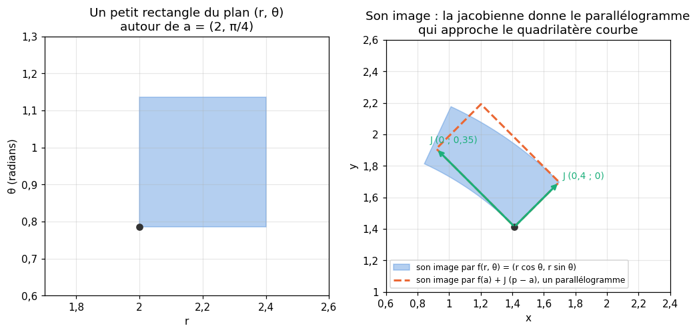
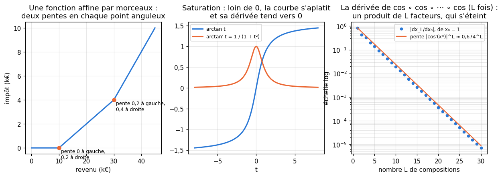
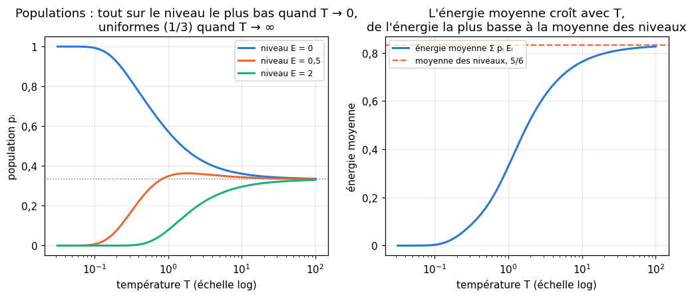

# M17 · Jacobienne et règle de la chaîne — fiche de cours

> Une fonction d'une variable a une dérivée, un nombre ; une fonction de plusieurs variables à valeurs réelles a un gradient (M05b), une ligne de dérivées partielles. Une application de $\mathbb{R}^n$ dans $\mathbb{R}^m$, qui a **plusieurs sorties**, a une **jacobienne** : la matrice de toutes ses dérivées partielles, une ligne par sortie, une colonne par entrée. Elle est la meilleure approximation linéaire de l'application près d'un point, et elle rend la dérivation des composées mécanique : la **règle de la chaîne** devient un produit de matrices. Ce chapitre l'enseigne sur des exemples de géométrie et de physique : les coordonnées polaires et sphériques, la normalisation $\mathbf{x}/\lVert\mathbf{x}\rVert$, des fonctions appliquées coordonnée par coordonnée, des fonctions définies par morceaux, de longues itérations, et la loi de Boltzmann de la physique statistique. Il explique aussi pourquoi l'on évite de former la jacobienne : un produit par un vecteur suffit souvent, et coûte beaucoup moins cher. Le chapitre 17 de workbookIA appliquera ces outils aux fonctions d'activation d'un réseau.

| | |
|---|---|
| **Sections** | §1 à §7 |
| **Temps total estimé** | ≈ 10,2 h : lecture et calculs de la fiche ≈ 2 h 10, exercices ≈ 7 h 30, 16 flashcards ≈ 35 min (parcours essentiel ≈ 7,2 h) |
| **Prérequis** | M05b (dérivées partielles, gradient en ligne, dérivée directionnelle) ; R7 (règle de la chaîne en une variable, dérivées usuelles, $\lvert x \rvert$ et $\max(0, x)$) ; R6 (exponentielle, logarithme) ; M09a (produit matriciel et formes, Hadamard, transposée, coût d'un produit) ; M12a (matrice d'une application linéaire, composition) ; M12b (projection orthogonale) ; M12c (déterminant, valeurs propres, matrices semi-définies positives) ; M12d (norme spectrale) ; M02b (loi catégorielle) ; M02c (matrice de covariance) ; M07 (vecteurs one-hot, base canonique) ; M05a (différences finies centrées) ; M13b (sous-gradient) ; M16 (applications affines, conventions lignes et colonnes) |
| **Fichiers du chapitre** | `02_exercices.md` (quiz, papier) · `03_notebook.ipynb` · `04_indices.md` · `05_solutions.md` et `05_solutions.ipynb` · `06_mes_reponses.md` · `flashcards.csv` |
| **mymath** | `jacobian.py` : `numerical_jacobian`, `diagonal_jacobian`, `jacobian_vector_product` |
| **MML** | §5.3 (*Gradients of Vector-Valued Functions*) |

## Comment utiliser ce chapitre

**Ordre conseillé.**
1. `python tools/start_chapter.py M17` (sur Colab : `00_setup/COLAB.md` §2) : il copie le notebook, ta feuille de réponses et le squelette `mymath/jacobian.py`.
2. Section par section : lis **crayon en main**, refais chaque calcul ; puis fais les exercices de la section, quiz 🧠 d'abord.
3. Les exercices ✏️ se font sur papier, dans ta copie de `06_mes_reponses.md`, puis se vérifient dans la **partie 0** du notebook. Les démonstrations ∂ se rédigent dans ta copie et se jugent avec la grille de relecture de `05_solutions.md`.

Les §1 à §5 forment un bloc (la jacobienne et la règle de la chaîne) ; le §6 revient à une variable (fonctions par morceaux, longues compositions) ; le §7 est indépendant (une loi de probabilité de la physique et sa matrice de covariance).

| Section | Quiz 🧠 et rappels 🔁 | Papier et réflexion | Notebook |
|---|---|---|---|
| §1 La jacobienne d'une application de ℝⁿ dans ℝᵐ | Q1, R1 | M17.1 ✏️, M17.12 📖, M17.E1 💼 | M17.14 🔨, M17.17 📦, M17.20 🎨 |
| §2 Fonctions appliquées coordonnée par coordonnée | Q2 | M17.2 ✏️, M17.9 ∂ | M17.15 🔨 |
| §3 La règle de la chaîne : un produit de jacobiennes | Q3, R2 | M17.3 ✏️, M17.4 ✏️, M17.8 ∂, M17.13 🗣️ | M17.18 🔮, M17.21 🐛, M17.22 🛠️, M17.23 🏆 |
| §4 Gradient en ligne ou de la forme de la variable | Q4 | M17.5 ✏️ | M17.21 🐛 |
| §5 Produits jacobienne-vecteur et vecteur-jacobienne | Q5 | M17.4 ✏️ | M17.16 🔨, M17.23 🏆 |
| §6 Fonctions définies par morceaux et longues compositions | | M17.6 ✏️ | M17.19 🔬 |
| §7 La loi de Boltzmann et la matrice diag(p) − pᵀp | Q6, R3 | M17.7 ✏️, M17.10 ∂, M17.11 ✏️ | |

Parcours essentiel : tout sauf M17.Q5, M17.R3, M17.4, M17.9, M17.11, M17.12, M17.E1, M17.16, M17.19, M17.22 et M17.23.

## Guide de lecture de MML

**MML §5.3** (*Gradients of Vector-Valued Functions*) : lis-le **après le §1** de cette fiche et **avant le §3**. Il définit la jacobienne dans la même disposition qu'ici (une ligne par sortie), parle de son déterminant comme d'un facteur de changement d'aire, et dérive ses premières composées ; le 📖 M17.12 te guide. Les exercices de MML sur cette section sont conseillés, pas obligatoires. Si un rappel te manque : MML §5.2 (dérivées partielles et gradient, lu en M05b).

Vocabulaire anglais de ce chapitre : *Jacobian*, *Jacobian determinant*, *vector-valued function*, *numerator layout*, *linear approximation*, *elementwise*, *diagonal matrix*, *chain rule*, *Jacobian-vector product (JVP)*, *vector-Jacobian product (VJP)*, *forward mode*, *reverse mode*, *one-sided derivative*, *left derivative*, *right derivative*, *kink*, *subgradient*, *saturation*, *fixed point*, *Boltzmann distribution*, *energy level*, *temperature*, *partition function*, *simulated annealing*, *one-hot vector*, *positive semidefinite*. workbookIA écrit « Jacobienne » avec une majuscule, dit « élément par élément » là où cette fiche dit « coordonnée par coordonnée », « coude » pour « point anguleux », et parle de dérivées qui « s'évanouissent » pour des dérivées qui s'éteignent.

## Objectifs d'apprentissage

À la fin du chapitre, tu sais :
- **calculer** la jacobienne d'une application de $\mathbb{R}^n$ dans $\mathbb{R}^m$, et t'en servir comme approximation linéaire ;
- **reconnaître** une jacobienne diagonale, et la calculer avec une seule paire d'évaluations ;
- **dériver** une composée par le produit des jacobiennes, dans le bon ordre et avec les bonnes formes ;
- **passer** du gradient en ligne de MML au gradient de la forme de la variable de NumPy ;
- **calculer** un produit jacobienne-vecteur ou vecteur-jacobienne sans former la jacobienne, et dire lequel coûte le moins ;
- **dériver** une fonction définie par morceaux (à gauche, à droite), et **suivre** la dérivée d'une longue composition ;
- **calculer** une loi de Boltzmann et ses limites en température, et la covariance $\operatorname{diag}(\mathbf{p}) - \mathbf{p}^\top\mathbf{p}$ d'un vecteur one-hot.

## L'essentiel en 10 lignes

1. La **jacobienne** de $\mathbf{f} : \mathbb{R}^n \to \mathbb{R}^m$ en $\mathbf{x}$ est la matrice $(m, n)$ de coefficients $J_{ij} = \frac{\partial f_i}{\partial x_j}$ : une **ligne par sortie** (le gradient de $f_i$), une **colonne par entrée** (comment toutes les sorties bougent quand $x_j$ bouge).
2. **Approximation linéaire** : $\mathbf{f}(\mathbf{x} + \mathbf{h}) \approx \mathbf{f}(\mathbf{x}) + \mathbf{J}\,\mathbf{h}$ pour $\mathbf{h}$ petit. Pour $n = m$, $\lvert\det\mathbf{J}\rvert$ est le facteur local de changement d'aire ou de volume.
3. Une application **linéaire** $\mathbf{x} \mapsto \mathbf{A}\mathbf{x}$ a pour jacobienne $\mathbf{A}$, partout ; en lignes, $\mathbf{x} \mapsto \mathbf{x}\mathbf{W} + \mathbf{b}$ a pour jacobienne $\mathbf{W}^\top$.
4. Une fonction $g$ appliquée **coordonnée par coordonnée** a une jacobienne **diagonale**, $\operatorname{diag}(g'(x_1), \ldots, g'(x_n))$, et $\mathbf{J}\mathbf{v} = g'(\mathbf{x}) \odot \mathbf{v}$.
5. **Règle de la chaîne** : $\mathbf{J}_{\mathbf{g} \circ \mathbf{f}}(\mathbf{x}) = \mathbf{J}_{\mathbf{g}}(\mathbf{f}(\mathbf{x}))\,\mathbf{J}_{\mathbf{f}}(\mathbf{x})$, de formes $(m, p) \times (p, n)$ : la dernière appliquée à **gauche**, évaluée au point **intermédiaire** ; coefficient par coefficient, une somme sur les variables intermédiaires.
6. Le gradient d'une fonction $L$ à valeurs réelles est une **ligne** chez MML ($\nabla_{\mathbf{x}}(L \circ \mathbf{f}) = \nabla_{\mathbf{y}}L\;\mathbf{J}_{\mathbf{f}}$) et a **la forme de la variable** dans NumPy ($\nabla_{\mathbf{x}} = \mathbf{J}_{\mathbf{f}}^\top\nabla_{\mathbf{y}}L$) : mêmes nombres, autre rangement.
7. $\mathbf{J}\mathbf{v}$ (**jacobienne-vecteur**) est la dérivée de toutes les sorties dans la direction $\mathbf{v}$ : deux évaluations de $\mathbf{f}$ par différences, contre $2n$ pour la matrice entière. $\mathbf{u}^\top\mathbf{J}$ (**vecteur-jacobienne**) est le gradient de $\mathbf{u} \cdot \mathbf{f}$.
8. En un point anguleux, une fonction a une dérivée **à gauche** et une dérivée **à droite** ; une fonction qui **sature** a une dérivée qui tend vers 0 loin de l'origine ($\arctan'(t) = \frac{1}{1 + t^2}$).
9. La dérivée d'une composée de $L$ fonctions d'une variable est le **produit** de $L$ dérivées : près d'un point fixe $x^*$, elle se comporte comme $\lvert\varphi'(x^*)\rvert^L$, et s'éteint ou explose.
10. **Boltzmann** : la population du niveau d'énergie $E_i$ à la température $T$ est $p_i = \frac{e^{-E_i/T}}{\sum_j e^{-E_j/T}}$ ; l'origine des énergies est arbitraire, et $T$ règle la concentration de la loi sur les niveaux bas ; un vecteur one-hot de loi $\mathbf{p}$ a pour covariance $\operatorname{diag}(\mathbf{p}) - \mathbf{p}^\top\mathbf{p}$, symétrique, semi-définie positive, qui annule $\mathbf{1}$.

## §1 · La jacobienne d'une application de ℝⁿ dans ℝᵐ

### Une ligne par sortie, une colonne par entrée

Une application $\mathbf{f} : \mathbb{R}^n \to \mathbb{R}^m$ (*vector-valued function*) a $m$ coordonnées, $f_1, \ldots, f_m$, chacune une fonction de $n$ variables. Si toutes leurs dérivées partielles existent en $\mathbf{x}$ (et sont continues autour), sa **jacobienne** (*Jacobian*) en $\mathbf{x}$ est la matrice $(m, n)$
$$\mathbf{J}_{\mathbf{f}}(\mathbf{x}) = \begin{pmatrix} \frac{\partial f_1}{\partial x_1} & \cdots & \frac{\partial f_1}{\partial x_n} \\ \vdots & & \vdots \\ \frac{\partial f_m}{\partial x_1} & \cdots & \frac{\partial f_m}{\partial x_n} \end{pmatrix}, \qquad J_{ij} = \frac{\partial f_i}{\partial x_j}(\mathbf{x}).$$
La **ligne** $i$ est le gradient de la sortie $f_i$ (une ligne, comme en M05b) ; la **colonne** $j$ est la dérivée de toutes les sorties le long de l'axe $x_j$, les autres entrées fixées. MML range ainsi les dérivées (*numerator layout* : le numérateur $f_i$ donne la ligne) ; c'est aussi la convention de workbookIA et de ce dépôt.

Deux cas connus : pour $m = 1$ (une seule sortie), la jacobienne est une ligne, le gradient de M05b ; pour $n = 1$ (une seule entrée $t$), c'est une colonne, la vitesse $\mathbf{f}'(t)$ d'un point qui se déplace.

**Exemple.** Un rectangle de longueur $L$ et de largeur $\ell$ a l'aire $L\ell$ et le périmètre $2L + 2\ell$ : $\mathbf{f}(L, \ell) = (L\ell,\ 2L + 2\ell)$, de $\mathbb{R}^2$ dans $\mathbb{R}^2$. Les quatre dérivées partielles :
$$\mathbf{J}_{\mathbf{f}}(L, \ell) = \begin{pmatrix} \ell & L \\ 2 & 2 \end{pmatrix}, \qquad \mathbf{J}_{\mathbf{f}}(5, 3) = \begin{pmatrix} 3 & 5 \\ 2 & 2 \end{pmatrix}.$$
La première ligne dit qu'en $(5, 3)$, l'aire gagne 3 par unité de longueur et 5 par unité de largeur ; la première colonne, qu'allonger le rectangle augmente l'aire de 3 et le périmètre de 2 par unité.

### La meilleure approximation linéaire

Comme la tangente pour une fonction d'une variable (R7), la jacobienne donne l'approximation **linéaire** de $\mathbf{f}$ près de $\mathbf{x}$ :
$$\mathbf{f}(\mathbf{x} + \mathbf{h}) \approx \mathbf{f}(\mathbf{x}) + \mathbf{J}_{\mathbf{f}}(\mathbf{x})\,\mathbf{h},$$
où $\mathbf{h}$ est une **colonne** de $n$ petits déplacements, et l'erreur est petite devant $\lVert\mathbf{h}\rVert$. Chaque sortie bouge de la somme des effets de chaque entrée : $f_i(\mathbf{x} + \mathbf{h}) - f_i(\mathbf{x}) \approx \sum_j \frac{\partial f_i}{\partial x_j}h_j$.

Pour l'exemple, de $(5, 3)$ à $(5{,}1 ;\ 2{,}9)$, $\mathbf{h} = (0{,}1 ;\ -0{,}1)$ et $\mathbf{J}\mathbf{h} = (0{,}3 - 0{,}5 ;\ 0{,}2 - 0{,}2) = (-0{,}2 ;\ 0)$ : l'aire passe d'environ 15 à 14,8 (exactement $5{,}1 \times 2{,}9 = 14{,}79$), et le périmètre ne change pas (exactement, puisqu'il est affine).

**Le déterminant.** Pour $n = m$, $\mathbf{J}$ est carrée, et l'application linéaire $\mathbf{h} \mapsto \mathbf{J}\mathbf{h}$ multiplie les aires (en dimension 2) ou les volumes (en dimension 3) par $\lvert\det\mathbf{J}\rvert$ (M12c §1). Près de $\mathbf{x}$, $\mathbf{f}$ envoie donc un petit carré d'aire $\delta^2$ sur une petite figure d'aire environ $\lvert\det\mathbf{J}_{\mathbf{f}}(\mathbf{x})\rvert\,\delta^2$ : la jacobienne dit de combien l'application dilate ou contracte les aires autour de chaque point, et son signe dit si elle conserve ou renverse l'orientation. Pour l'exemple, $\det = 3 \times 2 - 5 \times 2 = -4$.

La figure montre l'approximation linéaire des **coordonnées polaires** $(r, \theta) \mapsto (r\cos\theta,\ r\sin\theta)$ : l'image exacte d'un petit rectangle est un quadrilatère aux côtés courbes, et l'approximation linéaire le remplace par le parallélogramme construit sur les colonnes de $\mathbf{J}$, multipliées par les côtés du rectangle (✏️ M17.1).

### Les applications linéaires et affines

Une application **linéaire** $\mathbf{x} \mapsto \mathbf{A}\mathbf{x}$ ($\mathbf{A}$ de forme $(m, n)$) a pour sortie $i$ la combinaison $\sum_j A_{ij}x_j$, de dérivée $A_{ij}$ par rapport à $x_j$ : **sa jacobienne est $\mathbf{A}$**, en tout point. Une application affine $\mathbf{x} \mapsto \mathbf{A}\mathbf{x} + \mathbf{b}$ a la même : la translation ne change aucune dérivée.

⚠️ **Erreur classique.** Avec les points en **lignes** (M16, NumPy, workbookIA), $\mathbf{x} \mapsto \mathbf{x}\mathbf{W} + \mathbf{b}$ a pour sortie $k$ la somme $\sum_j x_jW_{jk}$ : $\frac{\partial f_k}{\partial x_j} = W_{jk}$, donc la jacobienne est $\mathbf{W}^\top$, de forme $(m, n)$, et **pas** $\mathbf{W}$, de forme $(n, m)$. La jacobienne suit toujours la règle « une ligne par sortie » ; c'est la matrice de l'application qui change de rangement selon la convention.

📐 **Notations.** Dans les formules de jacobiennes, les vecteurs sont des **colonnes**, comme chez MML : $\mathbf{J}\mathbf{h}$, avec $\mathbf{h}$ de forme $(n, 1)$. Un tableau NumPy à une dimension, de forme `(n,)`, n'est ni une ligne ni une colonne, et `J @ h` le traite comme il faut. Les notations $\frac{\partial\mathbf{f}}{\partial\mathbf{x}}$, $D\mathbf{f}(\mathbf{x})$, $\nabla_{\mathbf{x}}\mathbf{f}$ (chez MML) et $\mathbf{J}_{\mathbf{f}}(\mathbf{x})$ désignent la même matrice.

### La calculer par différences

Chaque colonne de $\mathbf{J}$ est une dérivée le long d'un axe : par différences centrées (M05a), la colonne $j$ vaut à peu près
$$\frac{\mathbf{f}(\mathbf{x} + h\,\mathbf{e}_j) - \mathbf{f}(\mathbf{x} - h\,\mathbf{e}_j)}{2h},$$
avec une erreur en $O(h^2)$, où $\mathbf{e}_j$ est le $j$-ième vecteur de la base canonique. La matrice entière coûte $2n$ évaluations de $\mathbf{f}$, quel que soit $m$ (🔨 M17.14). C'est un **contrôle** précieux d'une jacobienne calculée à la main, pas une méthode de calcul pour un grand $n$ (§5).

🔗 **Dans workbookIA** — le chapitre 17 appelle jacobienne la matrice des dérivées d'une fonction de $\mathbb{R}^K$ dans $\mathbb{R}^K$, avec la même disposition : la ligne $i$ pour la sortie $i$.

## §2 · Fonctions appliquées coordonnée par coordonnée : une jacobienne diagonale

### Une sortie ne dépend que de son entrée

Une fonction $g$ d'une variable, appliquée **coordonnée par coordonnée** (*elementwise*), définit $\mathbf{f}(\mathbf{x}) = (g(x_1), \ldots, g(x_n))$, une application de $\mathbb{R}^n$ dans $\mathbb{R}^n$ ; NumPy l'écrit `np.sin(x)` ou `x ** 3`. La sortie $i$ ne dépend que de $x_i$ : $\frac{\partial f_i}{\partial x_j} = 0$ pour $j \ne i$, et $\frac{\partial f_i}{\partial x_i} = g'(x_i)$. La jacobienne est **diagonale** :
$$\mathbf{J}_{\mathbf{f}}(\mathbf{x}) = \operatorname{diag}\big(g'(x_1), \ldots, g'(x_n)\big), \qquad \mathbf{J}_{\mathbf{f}}(\mathbf{x})\,\mathbf{v} = g'(\mathbf{x}) \odot \mathbf{v},$$
où $\odot$ est le produit de Hadamard (case par case, M09a) et $g'(\mathbf{x})$ le vecteur des dérivées. En pratique, on ne stocke donc pas cette matrice (sauf pour la comparer à une autre jacobienne, comme le fait `diagonal_jacobian` du notebook) : ses $n$ coefficients utiles tiennent dans un vecteur, et son produit par un vecteur coûte $n$ multiplications au lieu de $n^2$ (∂ M17.9).

**Exemple.** $\mathbf{f}(\mathbf{x}) = \sin(\mathbf{x})$ en $\mathbf{x} = (0,\ \frac{\pi}{3},\ \frac{\pi}{2})$ : $\mathbf{J} = \operatorname{diag}(\cos 0, \cos\frac{\pi}{3}, \cos\frac{\pi}{2}) = \operatorname{diag}(1 ;\ 0{,}5 ;\ 0)$, et pour $\mathbf{v} = (2, 4, 6)$, $\mathbf{J}\mathbf{v} = (2, 2, 0)$.

### Une seule paire d'évaluations

Puisque chaque sortie ne dépend que de son entrée, on peut **bouger toutes les entrées à la fois** : la coordonnée $i$ de $\frac{\mathbf{f}(\mathbf{x} + h\mathbf{1}) - \mathbf{f}(\mathbf{x} - h\mathbf{1})}{2h}$ ne voit que le déplacement de $x_i$, et vaut à peu près $g'(x_i)$. Deux évaluations de $\mathbf{f}$ donnent toute la diagonale, au lieu de $2n$ pour la jacobienne entière (🔨 M17.15).

⚠️ **Erreur classique.** Appliquer ce raccourci à une application qui n'est **pas** coordonnée par coordonnée. Pour $\mathbf{x} \mapsto \mathbf{A}\mathbf{x}$, bouger toutes les entrées de $h$ ajoute $h$ fois la somme des colonnes : le « raccourci » rend $\operatorname{diag}(\mathbf{A}\mathbf{1})$, qui n'a rien à voir avec la jacobienne $\mathbf{A}$. Une application comme $\mathbf{x} \mapsto (x_1x_2,\ x_2x_3,\ x_3x_1)$, ou $\mathbf{x} \mapsto \mathbf{x}/\lVert\mathbf{x}\rVert$, a une jacobienne pleine : chaque sortie dépend de plusieurs entrées.

🔗 **Dans workbookIA** — le chapitre 17 applique des fonctions coordonnée par coordonnée à des tableaux entiers, et ne garde de leur jacobienne que la diagonale.

## §3 · La règle de la chaîne : un produit de jacobiennes

### L'énoncé

Soient $\mathbf{f} : \mathbb{R}^n \to \mathbb{R}^p$, différentiable en $\mathbf{x}$, et $\mathbf{g} : \mathbb{R}^p \to \mathbb{R}^m$, différentiable en $\mathbf{f}(\mathbf{x})$ (c'est le cas dès que leurs dérivées partielles existent et sont continues autour de ces points), et $\mathbf{h} = \mathbf{g} \circ \mathbf{f}$ : on applique $\mathbf{f}$, puis $\mathbf{g}$. Alors
$$\boxed{\mathbf{J}_{\mathbf{g} \circ \mathbf{f}}(\mathbf{x}) = \mathbf{J}_{\mathbf{g}}\big(\mathbf{f}(\mathbf{x})\big)\,\mathbf{J}_{\mathbf{f}}(\mathbf{x})} \qquad (m, p) \times (p, n) \to (m, n).$$
Trois choses à retenir :
- l'**ordre** : la jacobienne de la dernière application est à **gauche**, comme la dernière fonction dans $\mathbf{g}(\mathbf{f}(\mathbf{x}))$ ;
- le **point** : $\mathbf{J}_{\mathbf{g}}$ est évaluée en $\mathbf{y} = \mathbf{f}(\mathbf{x})$, le point **intermédiaire**, pas en $\mathbf{x}$ (qui n'a d'ailleurs pas le bon nombre de coordonnées si $p \ne n$) ;
- les **formes** s'enchaînent : la dimension intermédiaire $p$ disparaît dans le produit.

**L'idée.** Près de $\mathbf{x}$, $\mathbf{f}$ se comporte comme $\mathbf{h} \mapsto \mathbf{J}_{\mathbf{f}}\mathbf{h}$ ; près de $\mathbf{f}(\mathbf{x})$, $\mathbf{g}$ se comporte comme $\mathbf{k} \mapsto \mathbf{J}_{\mathbf{g}}\mathbf{k}$. La composée se comporte donc comme la composée de ces deux applications linéaires, dont la matrice est le produit (M12a §5) : $\mathbf{J}_{\mathbf{g}}\mathbf{J}_{\mathbf{f}}$. ∂ M17.8 rend ce raisonnement rigoureux.

**Coefficient par coefficient.** Le produit matriciel écrit une **somme sur les variables intermédiaires** $y_1, \ldots, y_p$ :
$$\frac{\partial h_i}{\partial x_j} = \sum_{k=1}^{p}\frac{\partial g_i}{\partial y_k}\,\frac{\partial f_k}{\partial x_j}.$$
L'entrée $x_j$ agit sur la sortie $h_i$ **par tous les chemins** $x_j \to y_k \to h_i$ ; sur chaque chemin, les effets se **multiplient** ; d'un chemin à l'autre, ils s'**additionnent** (la somme sur les chemins de M16 §4). Pour $n = p = m = 1$, il ne reste qu'un terme : la règle de la chaîne de R7, $(g \circ f)'(x) = g'(f(x))\,f'(x)$.

**Exemple.** $\mathbf{f}(t) = (\cos t, \sin t)$ décrit le cercle unité (de $\mathbb{R}$ dans $\mathbb{R}^2$), et $g(u, v) = u^2 + 3v$ mesure une grandeur sur le plan (de $\mathbb{R}^2$ dans $\mathbb{R}$). La composée $h(t) = \cos^2 t + 3\sin t$ va de $\mathbb{R}$ dans $\mathbb{R}$. En $t = \frac{\pi}{6}$, $\mathbf{f}(t) = (\frac{\sqrt3}{2}, \frac12)$, et
$$\underbrace{\mathbf{J}_g\big(\mathbf{f}(t)\big)}_{(1,\ 2)} = \begin{pmatrix} 2u & 3 \end{pmatrix} = \begin{pmatrix} \sqrt3 & 3 \end{pmatrix}, \qquad \underbrace{\mathbf{J}_{\mathbf{f}}(t)}_{(2,\ 1)} = \begin{pmatrix} -\sin t \\ \cos t \end{pmatrix} = \begin{pmatrix} -\frac12 \\ \frac{\sqrt3}{2} \end{pmatrix},$$
d'où $h'(\frac{\pi}{6}) = -\frac{\sqrt3}{2} + \frac{3\sqrt3}{2} = \sqrt3 \approx 1{,}732$. La dérivation directe de $\cos^2 t + 3\sin t$ donne $-2\cos t\sin t + 3\cos t$, la même valeur.

### Plusieurs étages

Pour une composée de plusieurs applications, $\mathbf{h} = \mathbf{f}_L \circ \cdots \circ \mathbf{f}_2 \circ \mathbf{f}_1$, on applique la règle de proche en proche : avec $\mathbf{y}_0 = \mathbf{x}$ et $\mathbf{y}_k = \mathbf{f}_k(\mathbf{y}_{k-1})$,
$$\mathbf{J}_{\mathbf{h}}(\mathbf{x}) = \mathbf{J}_{\mathbf{f}_L}(\mathbf{y}_{L-1}) \cdots \mathbf{J}_{\mathbf{f}_2}(\mathbf{y}_1)\,\mathbf{J}_{\mathbf{f}_1}(\mathbf{y}_0).$$
Chaque jacobienne s'évalue au point où son application est appliquée : il faut donc d'abord calculer tous les points intermédiaires, de $\mathbf{y}_0$ à $\mathbf{y}_{L-1}$ (✏️ M17.3). Pour des applications **affines**, chaque jacobienne est constante, et la composée a pour jacobienne le produit des matrices, constant lui aussi : c'est le produit des matrices homogènes de M16, vu sous un autre angle.

⚠️ **Erreur classique.** Multiplier les jacobiennes dans l'ordre de l'application ($\mathbf{J}_{\mathbf{f}}\mathbf{J}_{\mathbf{g}}$ au lieu de $\mathbf{J}_{\mathbf{g}}\mathbf{J}_{\mathbf{f}}$) : si les formes le permettent (applications carrées), on obtient une autre matrice, sans erreur Python. Et évaluer $\mathbf{J}_{\mathbf{g}}$ en $\mathbf{x}$ au lieu de $\mathbf{f}(\mathbf{x})$ (🐛 M17.21).

🔗 **Plus loin dans ce dépôt** — en M18, la rétropropagation organise ce produit de jacobiennes dans un graphe de calcul sans cycle, en le parcourant depuis la sortie.

## §4 · Gradient en ligne ou de la forme de la variable

### Deux rangements pour les mêmes nombres

Pour une fonction $L : \mathbb{R}^p \to \mathbb{R}$ (une seule sortie, comme une loss), MML et M05b écrivent le gradient comme une **ligne** : c'est sa jacobienne, de forme $(1, p)$. La règle de la chaîne s'écrit alors sans transposition :
$$\nabla_{\mathbf{x}}(L \circ \mathbf{f}) = \underbrace{\nabla_{\mathbf{y}}L\big(\mathbf{f}(\mathbf{x})\big)}_{(1,\ p)}\ \underbrace{\mathbf{J}_{\mathbf{f}}(\mathbf{x})}_{(p,\ n)} \qquad \text{(une ligne de } n \text{ coordonnées).}$$
NumPy, PyTorch et workbookIA rangent le gradient comme **la variable** : pour $\mathbf{x}$ de forme `(n,)`, le gradient a la forme `(n,)` ; pour une matrice $\mathbf{W}$ de forme `(4, 2)`, la forme `(4, 2)`. Vu comme une colonne, il vaut
$$\nabla_{\mathbf{x}}(L \circ \mathbf{f}) = \mathbf{J}_{\mathbf{f}}(\mathbf{x})^\top\,\nabla_{\mathbf{y}}L\big(\mathbf{f}(\mathbf{x})\big),$$
la transposée de la ligne précédente : **les mêmes nombres**, rangés en colonne, et la jacobienne transposée.

**Exemple.** $\mathbf{f}(x_1, x_2) = (x_1x_2,\ x_1 + x_2)$ et $L(y_1, y_2) = y_1^2 + 2y_2$, en $\mathbf{x} = (1, 2)$. Le point intermédiaire est $\mathbf{y} = (2, 3)$, et
$$\nabla_{\mathbf{y}}L = (2y_1,\ 2) = (4,\ 2), \qquad \mathbf{J}_{\mathbf{f}} = \begin{pmatrix} x_2 & x_1 \\ 1 & 1 \end{pmatrix} = \begin{pmatrix} 2 & 1 \\ 1 & 1 \end{pmatrix}.$$
En ligne, $(4, 2)\,\mathbf{J}_{\mathbf{f}} = (8 + 2,\ 4 + 2) = (10, 6)$ ; en colonne, $\mathbf{J}_{\mathbf{f}}^\top\begin{pmatrix} 4 \\ 2 \end{pmatrix} = \begin{pmatrix} 10 \\ 6 \end{pmatrix}$. Vérification directe : $L(\mathbf{f}(\mathbf{x})) = x_1^2x_2^2 + 2x_1 + 2x_2$ a pour dérivées partielles $2x_1x_2^2 + 2 = 10$ et $2x_1^2x_2 + 2 = 6$.

⚠️ **Erreur classique.** Écrire $\mathbf{J}_{\mathbf{f}}\nabla_{\mathbf{y}}L$ (sans transposer) en convention colonne : les formes $(p, n) \times (p,)$ ne s'enchaînent pas si $n \ne p$, et, si $n = p$, le résultat est faux sans erreur Python. La règle mnémotechnique : en ligne, le gradient multiplie la jacobienne **à gauche** ; en colonne, c'est la **transposée** de la jacobienne qui multiplie le gradient.

📐 **Notations.** MML note $\frac{\mathrm{d}L}{\mathrm{d}\mathbf{x}}$ ou $\nabla_{\mathbf{x}}L$ la ligne ; workbookIA range le gradient comme la variable, et le note souvent $\frac{\partial L}{\partial\mathbf{W}}$ (ou `dW`) pour un paramètre $\mathbf{W}$. Devant une formule, demande-toi d'abord **quelle forme** a chaque objet.

🔗 **Dans workbookIA** — à partir du chapitre 17, les gradients ont la forme des tableaux de NumPy, et les chapitres suivants les font circuler à travers des jacobiennes transposées.

## §5 · Produits jacobienne-vecteur et vecteur-jacobienne

### Jacobienne-vecteur : dériver dans une direction

Le produit $\mathbf{J}_{\mathbf{f}}(\mathbf{x})\,\mathbf{v}$ (*Jacobian-vector product*, JVP), avec $\mathbf{v}$ une colonne de $n$ coordonnées, est la dérivée de **toutes les sorties** quand on part de $\mathbf{x}$ dans la direction $\mathbf{v}$ :
$$\mathbf{J}_{\mathbf{f}}(\mathbf{x})\,\mathbf{v} = \lim_{h \to 0}\frac{\mathbf{f}(\mathbf{x} + h\mathbf{v}) - \mathbf{f}(\mathbf{x})}{h} \approx \frac{\mathbf{f}(\mathbf{x} + h\mathbf{v}) - \mathbf{f}(\mathbf{x} - h\mathbf{v})}{2h}.$$
Pour un vecteur $\mathbf{v}$ unitaire, c'est la dérivée directionnelle de M05b, pour une application à plusieurs sorties ; pour un autre $\mathbf{v}$, elle est multipliée par $\lVert\mathbf{v}\rVert$ (la formule ne normalise pas $\mathbf{v}$). Par différences, elle coûte **deux** évaluations de $\mathbf{f}$, quel que soit $n$, sans former la matrice (🔨 M17.16). Et quand $\mathbf{J}$ a une structure, on la calcule à la main sans jamais l'écrire.

**Exemple.** Pour un vecteur fixe $\mathbf{a}$, $\mathbf{f}(\mathbf{x}) = (\mathbf{a} \cdot \mathbf{x})\,\mathbf{x}$ (de $\mathbb{R}^n$ dans $\mathbb{R}^n$). La sortie $i$ vaut $(\sum_k a_kx_k)\,x_i$, de dérivée $a_jx_i + (\mathbf{a} \cdot \mathbf{x})\,\delta_{ij}$ par rapport à $x_j$ ($\delta_{ij}$ vaut 1 si $i = j$, 0 sinon) :
$$\mathbf{J}_{\mathbf{f}}(\mathbf{x}) = \mathbf{x}\,\mathbf{a}^\top + (\mathbf{a} \cdot \mathbf{x})\,\mathbf{I}, \qquad \mathbf{J}_{\mathbf{f}}(\mathbf{x})\,\mathbf{v} = (\mathbf{a} \cdot \mathbf{v})\,\mathbf{x} + (\mathbf{a} \cdot \mathbf{x})\,\mathbf{v}.$$
Le produit coûte deux produits scalaires et deux combinaisons de vecteurs, $O(n)$ opérations, au lieu des $n^2$ coefficients de la matrice. Pour $\mathbf{a} = (1, 2, -1)$, $\mathbf{x} = (1, 0, 2)$ et $\mathbf{v} = (0, 1, 1)$ : $\mathbf{a} \cdot \mathbf{v} = 1$, $\mathbf{a} \cdot \mathbf{x} = -1$, et $\mathbf{J}\mathbf{v} = (1, 0, 2) - (0, 1, 1) = (1, -1, 1)$.

### Vecteur-jacobienne : un gradient d'un coup

Le produit $\mathbf{u}^\top\mathbf{J}_{\mathbf{f}}(\mathbf{x})$ (*vector-Jacobian product*, VJP), avec $\mathbf{u}$ une colonne de $m$ coordonnées, est une **ligne** de $n$ coordonnées : le gradient de la fonction réelle $\mathbf{x} \mapsto \mathbf{u} \cdot \mathbf{f}(\mathbf{x})$, une combinaison des sorties. C'est exactement ce que demande le §4 : $\nabla_{\mathbf{x}}(L \circ \mathbf{f}) = \nabla_{\mathbf{y}}L\;\mathbf{J}_{\mathbf{f}}$ est un produit vecteur-jacobienne, avec $\mathbf{u}^\top = \nabla_{\mathbf{y}}L$.

📐 **Notations.** Avec des vecteurs en lignes (NumPy, workbookIA), le vecteur est directement une ligne $\mathbf{g}$ de $m$ coordonnées, et le produit s'écrit $\mathbf{g}\,\mathbf{J}$, sans transposée : une ligne de $n$ coordonnées, de la forme de l'entrée.

### Qui coûte le moins ?

Pour une application de $\mathbb{R}^n$ dans $\mathbb{R}^m$ :
- former $\mathbf{J}$ demande $n$ produits jacobienne-vecteur (un par colonne, avec $\mathbf{v} = \mathbf{e}_j$), ou $m$ produits vecteur-jacobienne (un par ligne) ;
- **une seule sortie** ($m = 1$, une loss) : **un** produit vecteur-jacobienne donne tout le gradient, alors que les produits jacobienne-vecteur en demandent $n$, un par coordonnée ;
- **une seule entrée** ($n = 1$) : c'est l'inverse.

Pour une composée $\mathbf{J}_3\mathbf{J}_2\mathbf{J}_1$, l'ordre des produits change tout. Avec trois jacobiennes $1\,000 \times 1\,000$ et un gradient final $\mathbf{u}^\top$ :
- $\mathbf{u}^\top\mathbf{J}_3\mathbf{J}_2\mathbf{J}_1$, calculé **de gauche à droite**, ne fait que des produits ligne-matrice : $3 \times 10^6$ multiplications ;
- former d'abord $\mathbf{J}_3\mathbf{J}_2\mathbf{J}_1$ demande deux produits de matrices, $2 \times 10^9$ multiplications (M09a §3), près de 700 fois plus.

C'est pourquoi on évite de former les jacobiennes : on fait passer un vecteur à travers elles, de droite à gauche (**mode direct**, *forward mode* : des produits jacobienne-vecteur) ou de gauche à droite (**mode inverse**, *reverse mode* : des produits vecteur-jacobienne).

🔗 **Plus loin dans ce dépôt** — en M18, la rétropropagation est le mode inverse (*reverse mode*) : un gradient complet pour le prix de quelques évaluations, quel que soit le nombre de paramètres.

## §6 · Fonctions définies par morceaux et longues compositions

### Dérivées à gauche et à droite

Une fonction affine **par morceaux** (*piecewise linear*) est faite de segments de droites raccordés en des **points anguleux** (*kinks*). En un tel point $a$, la dérivée n'existe pas, mais les deux **dérivées latérales** existent :
$$f'_g(a) = \lim_{h \to 0^-}\frac{f(a + h) - f(a)}{h}, \qquad f'_d(a) = \lim_{h \to 0^+}\frac{f(a + h) - f(a)}{h},$$
la pente du morceau de gauche et celle du morceau de droite. La fonction est dérivable en $a$ si et seulement si elles existent et sont égales. Ailleurs, la dérivée est la pente du morceau. $\lvert x \rvert$ a en 0 les dérivées latérales $-1$ et $1$ (R7).

**Exemple : un impôt par tranches.** Un revenu $r$ (en k€) est imposé à 0 % jusqu'à 10, à 20 % entre 10 et 30, à 40 % au-delà : $T(r) = 0$ pour $r \le 10$, $0{,}2(r - 10)$ pour $10 \le r \le 30$, $4 + 0{,}4(r - 30)$ pour $r \ge 30$. La fonction est continue (les morceaux se raccordent : $0{,}2 \times 20 = 4$), et ses dérivées latérales en 30 sont $0{,}2$ et $0{,}4$ : le **taux marginal** saute. Partout ailleurs, la dérivée est le taux de la tranche.

**Sous-gradients.** Cet impôt est **convexe** (ses pentes croissent). En un point anguleux d'une fonction convexe d'une variable, tout nombre entre la dérivée à gauche et la dérivée à droite est un **sous-gradient** (M13b) : en 30, l'intervalle $[0{,}2 ;\ 0{,}4]$. Une fonction dont la pente **baisse** en un point (un coin concave) n'y a aucun sous-gradient.

**Dans une composée.** La règle de la chaîne vaut de chaque côté : $(g \circ f)'_d(a) = g'(f(a))\,f'_d(a)$ si $g$ est dérivable en $f(a)$. Si c'est $g$ qui a un coin en $f(a)$, ce sont ses pentes latérales qui comptent, selon le côté par lequel $f$ y arrive (✏️ M17.6).

### Saturation : une dérivée qui s'éteint loin de l'origine

$\arctan$ est croissante, de limites $\pm\frac{\pi}{2}$, et $\arctan'(t) = \frac{1}{1 + t^2}$ : la dérivée vaut 1 en 0, environ 0,038 en $t = 5$, environ 0,0011 en $t = 30$. Loin de l'origine, la fonction **sature** (*saturation*) : elle est presque plate, et une variation de son entrée ne change presque plus sa sortie. Dans une composée, un facteur saturé presque nul écrase toute la dérivée, puisque les dérivées se multiplient.

### Longues compositions : un produit de dérivées

Itérons une fonction d'une variable : $x_0$ donné, $x_{k+1} = \varphi(x_k)$, donc $x_L = \varphi^{\circ L}(x_0)$, la composée de $L$ copies de $\varphi$. La règle de la chaîne, appliquée $L$ fois, donne
$$\frac{\mathrm{d}x_L}{\mathrm{d}x_0} = \varphi'(x_{L-1})\,\varphi'(x_{L-2}) \cdots \varphi'(x_0) = \prod_{k=0}^{L-1}\varphi'(x_k),$$
le **produit** des dérivées le long de la trajectoire. Tant que la trajectoire reste près d'un **point fixe** $x^*$ ($\varphi(x^*) = x^*$), les facteurs valent presque $\varphi'(x^*)$, et le produit se comporte comme une suite géométrique (R5) de raison $\varphi'(x^*)$ :
- $\lvert\varphi'(x^*)\rvert < 1$ : les $x_k$ convergent vers $x^*$, et la dérivée **s'éteint** exponentiellement : la sortie oublie l'entrée ;
- $\lvert\varphi'(x^*)\rvert > 1$ : le point fixe est repoussant, une petite erreur sur $x_0$ grandit à chaque étape, et la dérivée **explose** tant que la trajectoire reste près de $x^*$ (ensuite, elle s'en éloigne, et ce sont les pentes rencontrées en chemin qui comptent : 🔬 M17.19).

**Exemple : itérer cos.** De $x_0 = 1$, $x_1 = \cos 1 \approx 0{,}540$, $x_2 \approx 0{,}858$, $x_3 \approx 0{,}654$… converge vers le point fixe $x^* \approx 0{,}7391$, solution de $\cos x = x$. La dérivée de la composée vaut $\prod_k(-\sin x_k)$ : $\approx -0{,}84$ pour $L = 1$, $\approx 0{,}0087$ pour $L = 12$, $\approx 0{,}00037$ pour $L = 20$. Elle se comporte comme $\lvert\cos'(x^*)\rvert^L = (\sin x^*)^L \approx 0{,}674^L$ : en échelle logarithmique, une droite (figure, à droite). Après 30 itérations, déplacer $x_0$ de $0{,}1$ ne déplace plus $x_{30}$ que d'environ $7 \times 10^{-7}$.

🔗 **Dans workbookIA** — le chapitre 17 multiplie de la même façon des dérivées d'une étape à la suivante, et regarde quand ce produit s'éteint.

## §7 · La loi de Boltzmann et la matrice diag(p) − pᵀp

### Des niveaux d'énergie et une température

En physique statistique, un système qui peut occuper $K$ états d'énergies $E_1, \ldots, E_K$, en équilibre avec un milieu à la température $T > 0$, occupe l'état $i$ avec la probabilité donnée par la **loi de Boltzmann** (*Boltzmann distribution*) :
$$p_i = \frac{e^{-E_i/T}}{Z}, \qquad Z = \sum_{j=1}^{K}e^{-E_j/T}.$$
(Les énergies et la température sont dans la même unité : la constante de Boltzmann est prise égale à 1.) $Z$, la **fonction de partition** (*partition function*), normalise : les $p_i$ sont positifs et de somme 1. Les états de basse énergie sont les plus peuplés.

**Exemple.** Trois niveaux d'énergies $0$, $0{,}5$ et $2$, à $T = 1$ : les poids $e^{-E_i}$ valent $1$, $0{,}6065$ et $0{,}1353$, de somme $Z \approx 1{,}7419$, d'où $\mathbf{p} \approx (0{,}5741 ;\ 0{,}3482 ;\ 0{,}0777)$. L'**énergie moyenne** vaut $\sum_ip_iE_i \approx 0{,}3482 \times 0{,}5 + 0{,}0777 \times 2 \approx 0{,}3295$.

**L'origine des énergies est arbitraire.** Le rapport de deux populations ne fait intervenir que la différence de leurs énergies :
$$\frac{p_i}{p_j} = e^{-(E_i - E_j)/T}.$$
Ajouter une même constante $c$ à toutes les énergies multiplie tous les poids par $e^{-c/T}$, qui se simplifie dans le quotient par $Z$ : la loi ne change pas. On peut donc toujours prendre l'énergie la plus basse comme zéro.

**Les deux limites en température.**
- $T \to 0$ : pour $E_i > E_{\min}$, $\frac{p_i}{p_{\min}} = e^{-(E_i - E_{\min})/T} \to 0$. Toute la probabilité va au niveau (ou aux niveaux) d'énergie minimale : le système gelé est dans son état fondamental.
- $T \to \infty$ : tous les $e^{-E_i/T}$ tendent vers 1, et $p_i \to \frac{1}{K}$ : la loi devient **uniforme**, et l'énergie moyenne tend vers la moyenne des niveaux.

Entre les deux, l'énergie moyenne croît avec la température (figure). Le **recuit simulé** (*simulated annealing*, ✏️ M17.11) s'en sert pour chercher un minimum : on tire des configurations selon une loi de Boltzmann dont l'« énergie » est le coût à minimiser, en baissant peu à peu la température, pour que la loi se concentre sur les configurations les moins chères.

### La covariance d'un vecteur one-hot

Tirons un état $I$ selon une loi $\mathbf{p} = (p_1, \ldots, p_K)$ (une loi de Boltzmann, ou n'importe quelle loi catégorielle de M02b), et codons-le par le vecteur **one-hot** $\mathbf{Y} = \mathbf{e}_I$ (M07) : $Y_i = 1$ si $I = i$, 0 sinon. Chaque $Y_i$ est une variable de Bernoulli de paramètre $p_i$, donc $\mathbb{E}[\mathbf{Y}] = \mathbf{p}$. Deux coordonnées distinctes ne valent jamais 1 ensemble : $Y_iY_j = 0$ pour $i \ne j$. Avec $\mathbf{p}$ écrit en **ligne**, la matrice de covariance (M02c) est
$$\operatorname{Cov}(\mathbf{Y}) = \operatorname{diag}(\mathbf{p}) - \mathbf{p}^\top\mathbf{p}, \qquad \text{de coefficients } p_i(1 - p_i) \text{ sur la diagonale et } -p_ip_j \text{ ailleurs}$$
($\mathbf{p}^\top\mathbf{p}$, une colonne fois une ligne, est la matrice des produits $p_ip_j$ ; avec des colonnes, on l'écrirait $\mathbf{p}\,\mathbf{p}^\top$, comme $\mathbf{u}\mathbf{u}^\top$ en ✏️ M17.4 : dans les deux conventions, une colonne fois une ligne donne une matrice, une ligne fois une colonne un nombre). Ses propriétés viennent toutes de ce qu'elle est une covariance (∂ M17.10) :
- elle est **symétrique** ;
- elle est **semi-définie positive** : pour toute ligne $\mathbf{v}$, $\mathbf{v}\,\operatorname{Cov}(\mathbf{Y})\,\mathbf{v}^\top = \mathbb{V}(\mathbf{v} \cdot \mathbf{Y}) \ge 0$ (M02c) ;
- elle **annule le vecteur $\mathbf{1}$** : $\sum_iY_i = 1$ est constant, de variance nulle, donc chaque ligne de la matrice a une somme nulle ; elle n'est jamais inversible ;
- quand tous les $p_i$ sont $> 0$, son rang est $K - 1$ (admis) : $\mathbf{1}$ est, à un facteur près, le seul vecteur qu'elle annule.

**Exemple.** Pour $\mathbf{p} = (0{,}5 ;\ 0{,}3 ;\ 0{,}2)$ :
$$\operatorname{diag}(\mathbf{p}) - \mathbf{p}^\top\mathbf{p} = \begin{pmatrix} 0{,}25 & -0{,}15 & -0{,}10 \\ -0{,}15 & 0{,}21 & -0{,}06 \\ -0{,}10 & -0{,}06 & 0{,}16 \end{pmatrix} :$$
chaque ligne a une somme nulle, et la diagonale est faite des variances de Bernoulli $p_i(1 - p_i)$. Ses valeurs propres sont $0$, environ $0{,}232$ et environ $0{,}388$ (M12c) : positives ou nulles, et une seule nulle.

🔗 **Dans workbookIA** — le chapitre 17 retrouve une matrice de cette forme en dérivant une fonction qu'il étudie ; ici, tu la connais déjà comme une covariance, avec ses propriétés.

## Les pièges classiques ⚠️ (récapitulatif)

- **Lignes et colonnes de la jacobienne.** Une ligne par **sortie**, une colonne par **entrée** : la forme est $(m, n)$ pour une application de $\mathbb{R}^n$ dans $\mathbb{R}^m$. La transposée est une autre matrice.
- **La jacobienne de $\mathbf{x} \mapsto \mathbf{x}\mathbf{W} + \mathbf{b}$.** En lignes, c'est $\mathbf{W}^\top$, pas $\mathbf{W}$.
- **Le raccourci diagonal.** Il ne vaut que pour une fonction appliquée coordonnée par coordonnée ; sur une autre application, il rend une diagonale fausse, sans erreur.
- **L'ordre et le point dans la règle de la chaîne.** $\mathbf{J}_{\mathbf{g}}(\mathbf{f}(\mathbf{x}))\,\mathbf{J}_{\mathbf{f}}(\mathbf{x})$ : la dernière appliquée à gauche, évaluée au point intermédiaire.
- **Le gradient et sa forme.** En ligne (MML), $\nabla_{\mathbf{y}}L\,\mathbf{J}_{\mathbf{f}}$ ; de la forme de la variable (NumPy), $\mathbf{J}_{\mathbf{f}}^\top\nabla_{\mathbf{y}}L$. Jamais $\mathbf{J}_{\mathbf{f}}\nabla_{\mathbf{y}}L$.
- **Former la jacobienne.** Un produit par un vecteur coûte bien moins cher ; pour un gradient (une seule sortie), un produit vecteur-jacobienne suffit.
- **Un point anguleux.** Deux dérivées latérales, pas de dérivée ; des sous-gradients seulement pour une fonction convexe (M13b).
- **Une longue composition.** Sa dérivée est un **produit** : un facteur presque nul l'écrase, des facteurs de module $> 1$ la font exploser.
- **Boltzmann.** L'origine des énergies est arbitraire ; $T \to 0$ concentre sur le minimum, $T \to \infty$ uniformise ; ne pas oublier de diviser par $Z$.
- **diag(p) − pᵀp.** Avec $\mathbf{p}$ en ligne, $\mathbf{p}^\top\mathbf{p}$ est une matrice $K \times K$ ; $\mathbf{p}\,\mathbf{p}^\top$ serait un nombre, $\sum_ip_i^2$.

## Et maintenant

**Dans ce dépôt** : M18 (rétropropagation et différentiation automatique), juste avant workbookIA 18 : le produit de jacobiennes du §3, organisé dans un graphe de calcul et parcouru depuis la sortie, avec les produits vecteur-jacobienne du §5.

**Dans workbookIA** : le chapitre 17 étudie les fonctions d'activation d'un réseau, appliquées coordonnée par coordonnée (§2), leurs dérivées et leurs saturations (§6), et une fonction de $\mathbb{R}^K$ dans $\mathbb{R}^K$ dont il calcule la jacobienne pleine (§1 à §5) ; tu y retrouveras aussi des températures (§7).

## Pour aller plus loin

- MML §5.3 (le 📖 M17.12), puis le début de MML §5.4 pour les gradients par rapport à des matrices (préparés en M18).
- `annexes/symboles.md` (lire $\mathbf{J}_{\mathbf{f}}$, $\frac{\partial f_i}{\partial x_j}$, $\odot$, $\mathbf{u}^\top\mathbf{J}$ et $\operatorname{diag}(\mathbf{p})$ à voix haute), `annexes/formulaire.md` et `annexes/erreurs_frequentes.md`.
