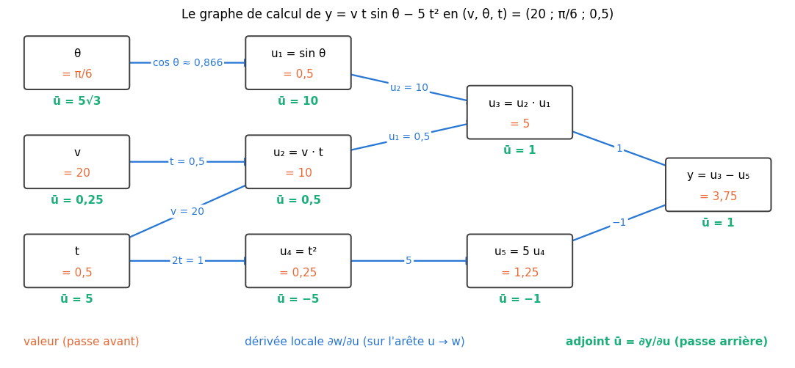
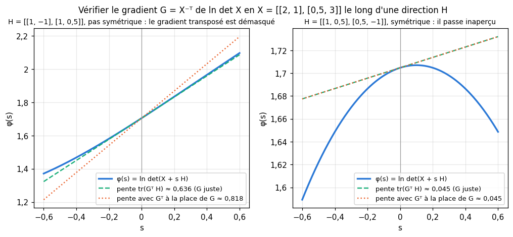

# M18 · Différentiation automatique et calcul matriciel — fiche de cours

> M17 a fait de la règle de la chaîne un produit de jacobiennes, pour une **chaîne** d'applications. Un vrai calcul est rarement une chaîne : un même nombre intermédiaire sert souvent plusieurs fois, et le calcul forme un **graphe**. Ce chapitre apprend à dériver un calcul entier, mécaniquement : le graphe de calcul d'une formule, la règle de la chaîne comme **somme sur les chemins** de ce graphe, puis les deux façons d'organiser cette somme, le **mode direct**, qui pousse les dérivées des entrées vers la sortie avec des **nombres duaux**, et le **mode inverse**, qui ramène les dérivées de la sortie vers les entrées avec des **adjoints** ; enfin ce que coûte chaque mode. La seconde moitié dérive des fonctions d'une **matrice** : leur gradient, de la forme de la matrice, la **différentielle** qui le donne sans calcul coordonnée par coordonnée, les identités des traces, des formes bilinéaires et du logarithme du déterminant, le gradient d'une moyenne, et la vérification d'un gradient le long d'une direction. Les exemples viennent de la physique, de la géométrie et de l'algèbre linéaire. Le chapitre 18 de workbookIA appliquera le mode inverse à un réseau de neurones : c'est la rétropropagation.

| | |
|---|---|
| **Sections** | §1 à §8 |
| **Temps total estimé** | ≈ 14,6 h : lecture et calculs de la fiche ≈ 2 h 40, exercices ≈ 11 h 10, 22 flashcards ≈ 45 min (parcours essentiel ≈ 8,9 h) |
| **Prérequis** | M17 (jacobiennes, règle de la chaîne multivariée, produits jacobienne-vecteur et vecteur-jacobienne, gradient en ligne ou de la forme de la variable) ; M16 (graphes sans cycle, numérotation triangulaire, somme sur les chemins) ; M09b (gradients de $\mathbf{a}^\top\mathbf{w}$ et $\mathbf{w}^\top\mathbf{A}\mathbf{w}$) ; M12c (trace, déterminant, $\operatorname{tr}(\mathbf{A}\mathbf{x}\mathbf{x}^\top)$) ; M05a (différences finies centrées, choix du pas) ; M05b (gradient, dérivée directionnelle) ; M09a (transposée, inverse, coût d'un produit) ; M07 (centroïde) ; R7 (dérivées usuelles) ; workbookIA 0A (classes Python, surcharge d'opérateurs) |
| **Fichiers du chapitre** | `02_exercices.md` (quiz, papier) · `03_notebook.ipynb` · `04_indices.md` · `05_solutions.md` et `05_solutions.ipynb` · `06_mes_reponses.md` · `flashcards.csv` |
| **mymath** | `autodiff.py` : la classe `Dual`, `dual_derivative`, `forward_gradient`, `gradient_from_differential` |
| **MML** | §5.4 (*Gradients of Matrices*), §5.5 (*Useful Identities for Computing Gradients*), §5.6 (*Backpropagation and Automatic Differentiation*) |

## Comment utiliser ce chapitre

**Ordre conseillé.**
1. `python tools/start_chapter.py M18` (sur Colab : `00_setup/COLAB.md` §2) : il copie le notebook, ta feuille de réponses et le squelette `mymath/autodiff.py`.
2. Section par section : lis **crayon en main**, refais chaque calcul ; puis fais les exercices de la section, quiz 🧠 d'abord.
3. Les exercices ✏️ et 🔗 se font sur papier, dans ta copie de `06_mes_reponses.md`, puis se vérifient dans la **partie 0** du notebook. Les démonstrations ∂ se rédigent dans ta copie et se jugent avec la grille de relecture de `05_solutions.md`.

Les §1 à §5 forment un premier bloc (dériver un calcul : le graphe, les chemins, les deux modes et leurs coûts) ; les §6 à §8 un second (les fonctions d'une matrice, et la vérification d'un gradient). Le second bloc ne demande du premier que la règle de la chaîne.

| Section | Quiz 🧠 et rappels 🔁 | Papier et réflexion | Notebook |
|---|---|---|---|
| §1 Le graphe de calcul d'une formule | Q1 | M18.1 ✏️, M18.18 📖 | M18.26 🎨 |
| §2 La règle de la chaîne sur un graphe | Q2, R1 | M18.2 ✏️, M18.11 ∂, M18.18 📖 | |
| §3 Le mode direct : les nombres duaux | Q3 | M18.3 ✏️, M18.5 ✏️, M18.12 ∂, M18.E1 💼 | M18.20 🔨, M18.21 🔨, M18.25 🔬, M18.28 🛠️, M18.29 🏆 |
| §4 Le mode inverse : des adjoints | Q4 | M18.4 ✏️, M18.5 ✏️, M18.13 ∂, M18.18 📖, M18.19 🗣️, M18.E1 💼 | M18.26 🎨, M18.27 🐛 |
| §5 Ce que coûte chaque mode | Q5 | M18.5 ✏️, M18.15 🔗, M18.18 📖, M18.E1 💼, M18.E2 💼 | M18.21 🔨, M18.24 🔮 |
| §6 Gradients par rapport à une matrice | Q6 | M18.6 ✏️, M18.10 ✏️, M18.16 🔗, M18.17 📖 | M18.22 🔨, M18.27 🐛 |
| §7 Les identités du calcul matriciel | Q7, R2 | M18.7 ✏️, M18.8 ✏️, M18.10 ✏️, M18.14 ∂, M18.17 📖 | M18.22 🔨, M18.23 📦 |
| §8 Le gradient d'une moyenne, et vérifier un gradient | Q8, R3 | M18.9 ✏️ | M18.25 🔬, M18.27 🐛 |

Parcours essentiel : tout sauf M18.Q7, M18.R3, M18.8, M18.10, M18.13, M18.14, M18.16, M18.17, M18.18, M18.E1, M18.E2, M18.21, M18.23, M18.25, M18.26, M18.28 et M18.29.

## Lecture conseillée

**MML §5.6** (*Backpropagation and Automatic Differentiation*) : lis-le **après le §2** de cette fiche et **avant le §4**. Son premier passage (§5.6.1, les gradients dans un réseau profond) applique la règle de la chaîne à un réseau de neurones : workbookIA 18 le fera en détail, tu peux le survoler ; le second (§5.6.2) présente la différentiation automatique, ses variables intermédiaires, et les deux modes ; le 📖 M18.18 te guide.

**MML §5.4 et §5.5** (*Gradients of Matrices*, *Useful Identities for Computing Gradients*) : lis-les **après le §5** et **avant le §6**. Le §5.4 range les dérivées d'une matrice par rapport à une autre ; le §5.5 donne une liste d'identités, dont plusieurs sont démontrées au §7 de la fiche ; le 📖 M18.17 te guide. Les exercices de MML sur ces sections sont conseillés, pas obligatoires.

Vocabulaire anglais de ce chapitre : *computation graph*, *intermediate variable*, *elementary operation*, *local derivative*, *path*, *automatic differentiation (autodiff, AD)*, *forward mode*, *reverse mode*, *dual number*, *seed*, *tangent*, *adjoint*, *forward pass*, *backward pass*, *tape*, *topological order*, *cheap gradient principle*, *gradient with respect to a matrix*, *differential*, *trace*, *Frobenius norm*, *bilinear form*, *determinant*, *cofactor matrix*, *adjugate*, *log-determinant*. workbookIA dit « passe avant » et « passe arrière » (*forward*, *backward*) comme cette fiche, « rétropropagation » (*backpropagation*) pour le mode inverse appliqué à un réseau, « autograd » pour la bibliothèque qui le fait, et appelle « gradient » d'un nœud (`grad`) ce que cette fiche appelle son adjoint.

## Objectifs d'apprentissage

À la fin du chapitre, tu sais :
- **écrire** le graphe de calcul d'une formule, et **dériver** sa sortie par la somme, sur les chemins, des produits des dérivées locales ;
- **propager** à la main des dérivées en mode direct (nombres duaux) et des adjoints en mode inverse ;
- **choisir** le mode selon le nombre d'entrées et de sorties, et en **estimer** le coût ;
- **calculer** le gradient d'une fonction d'une matrice, de la forme de cette matrice, par les coordonnées puis par la différentielle ;
- **dériver** une moyenne de fonctions, et **vérifier** un gradient matriciel par des différences centrées le long d'une direction.

## L'essentiel en 10 lignes

1. Un calcul se décompose en **opérations élémentaires** ; chaque résultat intermédiaire est un **nœud** d'un **graphe de calcul** sans cycle, avec une arête $u \to w$ quand $w$ utilise $u$. Une **dérivée locale** $\frac{\partial w}{\partial u}$ est posée sur chaque arête.
2. **Règle de la chaîne sur un graphe** : la dérivée de la sortie par rapport à une entrée est la **somme, sur tous les chemins** de l'entrée à la sortie, des **produits** des dérivées locales le long du chemin.
3. **Mode direct** : on pousse vers la sortie la dérivée de chaque nœud par rapport à **une** entrée, $\dot{w} = \sum_{u \to w}\frac{\partial w}{\partial u}\,\dot{u}$, en partant de la **graine** $\dot{x}_i = 1$.
4. **Nombres duaux** : $a + b\varepsilon$ avec $\varepsilon^2 = 0$. Pour toute fonction $f$ écrite avec les opérations usuelles, $f(a + \varepsilon) = f(a) + f'(a)\,\varepsilon$ : la dérivée se calcule toute seule, exacte, sans pas $h$.
5. **Mode inverse** : l'**adjoint** d'un nœud est $\bar{u} = \frac{\partial y}{\partial u}$ ; on part de $\bar{y} = 1$, et, dans l'ordre **inverse** du calcul, $\bar{u} = \sum_{u \to w}\bar{w}\,\frac{\partial w}{\partial u}$ : un nœud qui sert plusieurs fois **accumule** plusieurs contributions.
6. **Coûts**, pour $\mathbb{R}^n \to \mathbb{R}^m$ : le mode direct donne une colonne de la jacobienne par passage ($n$ passages), le mode inverse une ligne par passage ($m$ passages, et la mémoire de toute la passe avant). Pour un gradient ($m = 1$), le mode inverse coûte un **petit multiple** du calcul de $f$, quel que soit $n$ : c'est le principe du **gradient bon marché**.
7. **Gradient par rapport à une matrice** : $\nabla_{\mathbf{X}}f$ est le tableau des $\frac{\partial f}{\partial X_{ij}}$, **de la forme de $\mathbf{X}$** (NumPy, workbookIA) ; $f(\mathbf{X} + \mathbf{H}) \approx f(\mathbf{X}) + \sum_{ij}G_{ij}H_{ij}$.
8. **Différentielle** : $\mathrm{d}f = \operatorname{tr}(\mathbf{G}^\top\mathrm{d}\mathbf{X})$ ; on la calcule avec $\mathrm{d}(\mathbf{A}\mathbf{X}\mathbf{B}) = \mathbf{A}\,\mathrm{d}\mathbf{X}\,\mathbf{B}$, la règle du produit et $\operatorname{tr}(\mathbf{A}\mathbf{B}) = \operatorname{tr}(\mathbf{B}\mathbf{A})$, puis on y **lit** $\mathbf{G}$.
9. **Identités** : $\nabla\,\mathbf{a}^\top\mathbf{X}\mathbf{b} = \mathbf{a}\mathbf{b}^\top$, $\nabla\operatorname{tr}(\mathbf{A}\mathbf{X}) = \mathbf{A}^\top$, $\nabla\operatorname{tr}(\mathbf{X}^\top\mathbf{A}\mathbf{X}) = (\mathbf{A} + \mathbf{A}^\top)\mathbf{X}$, $\nabla\lVert\mathbf{X}\rVert_F^2 = 2\mathbf{X}$, $\nabla\det\mathbf{X} = \operatorname{com}(\mathbf{X})$, $\nabla\ln\det\mathbf{X} = \mathbf{X}^{-\top}$.
10. Le **gradient d'une moyenne** est la moyenne des gradients ; un gradient matriciel $\mathbf{G}$ se **vérifie** en comparant $\frac{f(\mathbf{X} + h\mathbf{H}) - f(\mathbf{X} - h\mathbf{H})}{2h}$ à $\operatorname{tr}(\mathbf{G}^\top\mathbf{H})$ pour quelques directions $\mathbf{H}$ tirées au hasard, **pas symétriques**.

## §1 · Le graphe de calcul d'une formule

### Des opérations élémentaires

Une calculatrice, comme un programme, n'évalue jamais une formule d'un bloc : elle enchaîne des **opérations élémentaires** (*elementary operations*), une somme, un produit, un sinus, un carré, chacune sur des nombres déjà calculés. Chaque résultat intermédiaire reçoit un nom, une **variable intermédiaire** (*intermediate variable*).

**Exemple : la hauteur d'un projectile.** Une balle lancée à la vitesse $v$ (en m/s), sous l'angle $\theta$ au-dessus de l'horizontale, est au bout de $t$ secondes à la hauteur
$$y(v, \theta, t) = v\,t\sin\theta - 5\,t^2 \qquad \text{(en mètres, avec } g = 10 \text{ m/s}^2 \text{ pour des calculs ronds).}$$
En $(v, \theta, t) = (20 ;\ \frac{\pi}{6} ;\ 0{,}5)$, on peut l'évaluer en six opérations :

| nœud | opération | valeur |
|---|---|---|
| $u_1$ | $\sin\theta$ | $0{,}5$ |
| $u_2$ | $v \cdot t$ | $10$ |
| $u_3$ | $u_2 \cdot u_1$ | $5$ |
| $u_4$ | $t^2$ | $0{,}25$ |
| $u_5$ | $5\,u_4$ | $1{,}25$ |
| $y$ | $u_3 - u_5$ | $3{,}75$ |

### Le graphe

Le **graphe de calcul** (*computation graph*) a un nœud par entrée ($v$, $\theta$, $t$) et par variable intermédiaire, et une arête $u \to w$ quand l'opération qui calcule $w$ utilise $u$. Les entrées n'ont pas de prédécesseur ; la sortie $y$ n'a pas de successeur. Il est **sans cycle** (M16 §4) : un nœud ne se calcule qu'à partir de nœuds déjà calculés. L'ordre du tableau est donc une **numérotation triangulaire** (M16 §4 ; *topological order* en anglais, « ordre topologique » dans workbookIA) : chaque arête va d'un nœud à un nœud calculé plus tard. Il n'est pas unique : $u_4$ et $u_5$ pourraient venir avant $u_1$.

Une entrée peut servir plusieurs fois : ici, **deux arêtes partent de $t$**, vers $u_2$ et vers $u_4$. C'est ce qui distingue un graphe d'une chaîne de M17, et c'est ce qui demande une règle de la chaîne un peu plus générale.

⚠️ **Erreur classique.** Écrire $u_4 = t \cdot t$ comme un produit dont les **deux** arguments sont $t$, puis ne compter qu'une arête de $t$ vers $u_4$ : la dérivée locale de $t \cdot t$ par rapport à $t$ est $2t$, pas $t$. Une opération qui utilise deux fois le même nœud a deux arêtes vers lui (ou une seule arête portant la somme des deux dérivées). Dans cette fiche, le carré est une opération à un argument.

🔗 **Dans workbookIA** — le chapitre 16 a rangé les couches d'un réseau dans un ordre de ce type ; le chapitre 18 construit et parcourt le graphe de calcul d'un réseau entier.

## §2 · La règle de la chaîne sur un graphe : une somme sur les chemins

### Des dérivées locales sur les arêtes

Sur chaque arête $u \to w$, on pose la **dérivée locale** (*local derivative*) $\frac{\partial w}{\partial u}$ : la dérivée partielle de l'opération qui calcule $w$, par rapport à son argument $u$, **évaluée aux valeurs de la passe avant**. Elle ne dépend que de cette opération, pas du reste du graphe. Pour le projectile :

| arête | dérivée locale | valeur |
|---|---|---|
| $\theta \to u_1$ | $\cos\theta$ | $\frac{\sqrt3}{2} \approx 0{,}866$ |
| $v \to u_2$ | $t$ | $0{,}5$ |
| $t \to u_2$ | $v$ | $20$ |
| $u_2 \to u_3$ | $u_1$ | $0{,}5$ |
| $u_1 \to u_3$ | $u_2$ | $10$ |
| $t \to u_4$ | $2t$ | $1$ |
| $u_4 \to u_5$ | $5$ | $5$ |
| $u_3 \to y$ | $1$ | $1$ |
| $u_5 \to y$ | $-1$ | $-1$ |

### La somme sur les chemins

**Théorème.** Dans un graphe de calcul sans cycle, la dérivée de la sortie $y$ par rapport à une entrée $x_i$ est la **somme, sur tous les chemins** de $x_i$ à $y$, des **produits des dérivées locales** le long de chaque chemin :
$$\frac{\partial y}{\partial x_i} = \sum_{\text{chemins } x_i \to \cdots \to y}\ \prod_{\text{arêtes } u \to w \text{ du chemin}}\frac{\partial w}{\partial u}.$$
C'est la règle de la chaîne de M17 §3, coefficient par coefficient, appliquée de proche en proche : le long d'un chemin, les effets se **multiplient** ; d'un chemin à l'autre, ils s'**additionnent** (∂ M18.11 la démontre, nœud par nœud, dans l'ordre de la numérotation).

**Exemple.** De $t$ à $y$, deux chemins :
$$\frac{\partial y}{\partial t} = \underbrace{20 \times 0{,}5 \times 1}_{t \to u_2 \to u_3 \to y} + \underbrace{1 \times 5 \times (-1)}_{t \to u_4 \to u_5 \to y} = 10 - 5 = 5.$$
De $v$ à $y$, un seul : $\frac{\partial y}{\partial v} = 0{,}5 \times 0{,}5 \times 1 = 0{,}25$. De $\theta$ à $y$, un seul : $\frac{\partial y}{\partial\theta} = \frac{\sqrt3}{2} \times 10 \times 1 = 5\sqrt3 \approx 8{,}660$. Vérification directe : à $v$ et $\theta$ fixés, $y = 10t - 5t^2$, de dérivée $10 - 10t = 5$ en $t = 0{,}5$ ; à $t$ et $\theta$ fixés, $y = 0{,}25\,v - 1{,}25$.

**Avec les matrices de M16.** Rangeons les dérivées locales dans la matrice $\mathbf{D}$ du graphe, $D_{uw} = \frac{\partial w}{\partial u}$ sur chaque arête et 0 ailleurs, ses nœuds dans un ordre de calcul : elle est strictement triangulaire supérieure, et la somme sur les chemins de M16 §4 donne toutes les dérivées d'un coup, dans la matrice $(\mathbf{I} - \mathbf{D})^{-1} = \mathbf{I} + \mathbf{D} + \mathbf{D}^2 + \cdots$. Les dérivées locales jouent le rôle des parts d'eau du réseau de M16.

### Trop de chemins pour les lister

Le nombre de chemins peut exploser. Dans un calcul en grille, où chaque case $(i, j)$ se calcule à partir de ses voisines $(i - 1, j)$ et $(i, j - 1)$ (comme un tableau de calcul rempli ligne par ligne), un chemin du coin $(0, 0)$ au coin $(k, k)$ fait $k$ pas dans chaque direction, dans n'importe quel ordre : il y en a $\binom{2k}{k}$ (R8), soit $184\,756$ pour $k = 10$ et plus de $10^{11}$ pour $k = 20$. On ne liste donc jamais les chemins : on range la somme **nœud par nœud**, en ne passant qu'une fois sur chaque arête. Deux rangements sont possibles, depuis les entrées (§3) ou depuis la sortie (§4) ; tous deux coûtent une multiplication et une addition par arête.

⚠️ **Erreur classique.** Oublier un chemin, en général celui d'une entrée qui sert deux fois : ici, ne garder que $t \to u_2 \to u_3 \to y$ donnerait $\frac{\partial y}{\partial t} = 10$, le double de la vraie valeur.

🔗 **Dans ce dépôt** — M16 §4 a calculé des sommes sur les chemins avec des parts d'eau ; M17 §3 a écrit la même somme comme un produit de jacobiennes, pour une chaîne.

## §3 · Le mode direct : les nombres duaux

### Pousser une dérivée des entrées vers la sortie

Choisissons **une** entrée, par exemple $t$, et notons $\dot{u} = \frac{\partial u}{\partial t}$ la dérivée de chaque nœud par rapport à elle (sa **tangente**, *tangent*). Les entrées ont $\dot{t} = 1$, $\dot{v} = \dot{\theta} = 0$ : c'est la **graine** (*seed*). Chaque nœud se calcule ensuite à partir de ses prédécesseurs, dans l'ordre du calcul, en regroupant les chemins qui arrivent à lui :
$$\dot{w} = \sum_{\text{arêtes } u \to w}\frac{\partial w}{\partial u}\,\dot{u}.$$
Chaque nœud porte maintenant **deux** nombres, sa valeur et sa tangente, calculés ensemble pendant la même passe. Pour le projectile, avec la graine sur $t$ : $\dot{u}_1 = 0$ ; $\dot{u}_2 = t\,\dot{v} + v\,\dot{t} = 20$ ; $\dot{u}_3 = u_1\dot{u}_2 + u_2\dot{u}_1 = 10$ ; $\dot{u}_4 = 2t\,\dot{t} = 1$ ; $\dot{u}_5 = 5$ ; $\dot{y} = \dot{u}_3 - \dot{u}_5 = 5$. On retrouve $\frac{\partial y}{\partial t} = 5$.

C'est le **mode direct** (*forward mode*) de la **différentiation automatique** (*automatic differentiation*) : ni formule de la dérivée écrite à la main, ni pas $h$ de différences finies. Avec une graine quelconque $(\dot{x}_1, \ldots, \dot{x}_n) = \mathbf{v}$, la passe donne le produit jacobienne-vecteur $\mathbf{J}\mathbf{v}$ de M17 §5 : le mode direct calcule des produits jacobienne-vecteur.

### Les nombres duaux

Un **nombre dual** (*dual number*) s'écrit $a + b\varepsilon$, où $a$ et $b$ sont réels et où $\varepsilon$ est un symbole qui vérifie $\varepsilon^2 = 0$ (sans être 0). On calcule avec eux comme avec des polynômes en $\varepsilon$, en effaçant $\varepsilon^2$ :
$$(a + b\varepsilon) + (c + d\varepsilon) = (a + c) + (b + d)\,\varepsilon, \qquad (a + b\varepsilon)(c + d\varepsilon) = ac + (ad + bc)\,\varepsilon,$$
$$\frac{a + b\varepsilon}{c + d\varepsilon} = \frac{a}{c} + \frac{bc - ad}{c^2}\,\varepsilon \quad (c \ne 0), \qquad (a + b\varepsilon)^p = a^p + p\,a^{p-1}b\,\varepsilon$$
(pour un exposant $p$ non entier, avec $a > 0$). Pour le quotient, multiplie le haut et le bas par $c - d\varepsilon$ : le bas devient $c^2 - d^2\varepsilon^2 = c^2$. Pour une fonction $g$ comme $\exp$, $\ln$, $\sin$ ou $\cos$, on **pose** $g(a + b\varepsilon) = g(a) + g'(a)\,b\,\varepsilon$, ce que donnerait le développement de Taylor (M05a) arrêté au premier ordre.

La partie en $\varepsilon$ suit exactement les règles de dérivation : la somme, le produit, le quotient, la composée. D'où le théorème (∂ M18.12) : pour toute fonction $f$ écrite avec ces opérations,
$$f(a + \varepsilon) = f(a) + f'(a)\,\varepsilon.$$
Pour dériver $f$ en $a$, il suffit de l'évaluer en $a + \varepsilon$ : la partie réelle est $f(a)$, la partie en $\varepsilon$ est $f'(a)$.

**Exemple.** $f(x) = x^2 + \frac{1}{x}$ en $x = 2$ : $(2 + \varepsilon)^2 = 4 + 4\varepsilon$ et $\frac{1}{2 + \varepsilon} = \frac12 - \frac14\varepsilon$, d'où $f(2 + \varepsilon) = 4{,}5 + 3{,}75\,\varepsilon$. En effet, $f'(x) = 2x - \frac{1}{x^2}$ vaut $3{,}75$ en 2.

**Le projectile, avec des nombres duaux.** Avec la graine sur $\theta$ : $\theta = \frac{\pi}{6} + \varepsilon$, $v = 20$, $t = 0{,}5$. Alors $u_1 = \sin(\frac{\pi}{6} + \varepsilon) = 0{,}5 + \frac{\sqrt3}{2}\varepsilon$, $u_2 = 10$, $u_3 = 5 + 5\sqrt3\,\varepsilon$, $u_5 = 1{,}25$, et $y = 3{,}75 + 5\sqrt3\,\varepsilon$ : $\frac{\partial y}{\partial\theta} = 5\sqrt3$. Le gradient complet demande **trois** passes, une par entrée, chacune avec sa graine.

### En Python : une classe

En Python, une classe `Dual` qui définit `__add__`, `__mul__`, `__truediv__`, `__pow__`… (la surcharge d'opérateurs de workbookIA 0A) et des méthodes `exp`, `log`, `sin`, `cos` fait le travail : une fonction écrite une seule fois, `def f(x): return x ** 2 + 1 / x`, s'applique à un flottant comme à un `Dual`, et `f(Dual(2.0, 1.0))` rend `Dual(value=4.5, derivative=3.75)`. Tu l'écriras dans 🔨 M18.20, puis le gradient par $n$ passes dans 🔨 M18.21. La dérivée est **exacte** au sens des flottants : pas de pas $h$ à choisir, pas d'erreur de troncature, contrairement aux différences finies de M05a (🔬 M18.25).

📐 **Notations.** $\dot{u}$ (« u point ») pour la tangente d'un nœud et $\bar{u}$ (« u barre ») pour son adjoint (§4) sont les notations courantes de la différentiation automatique ; MML écrit les dérivées des variables intermédiaires avec des $\frac{\partial}{\partial}$. La lettre $\varepsilon$ d'un nombre dual n'a rien à voir avec un petit nombre réel.

## §4 · Le mode inverse : des adjoints, dans l'ordre inverse

### L'adjoint d'un nœud

Le mode direct donne la dérivée de **tous** les nœuds par rapport à **une** entrée. Le **mode inverse** (*reverse mode*) fait l'inverse : il donne la dérivée de **la** sortie par rapport à **tous** les nœuds. L'**adjoint** (*adjoint*) d'un nœud $u$ est
$$\bar{u} = \frac{\partial y}{\partial u},$$
la dérivée de la sortie quand on fait varier $u$ seul, tout ce qui est calculé après lui étant recalculé. La sortie a $\bar{y} = 1$. Un nœud $u$ n'agit sur $y$ qu'à travers ses successeurs : en regroupant les chemins qui partent de lui par leur première arête,
$$\bar{u} = \sum_{\text{arêtes } u \to w}\bar{w}\,\frac{\partial w}{\partial u}.$$
Pour calculer $\bar{u}$, il faut les adjoints de tous ses successeurs : on visite donc les nœuds dans l'**ordre inverse** du calcul (∂ M18.13 démontre que $\bar{u}$ est bien la somme sur les chemins de $u$ à $y$).

### Deux passes

1. **Passe avant** (*forward pass*) : on calcule et on **garde** toutes les valeurs, car les dérivées locales en ont besoin ($\frac{\partial u_3}{\partial u_2} = u_1$, par exemple).
2. **Passe arrière** (*backward pass*) : on part de $\bar{y} = 1$ et on remonte, nœud par nœud.

**Le projectile.** Dans l'ordre inverse de la numérotation du §1 ($y$, $u_5$, $u_4$, $u_3$, $u_2$, $u_1$, puis les entrées) :
$$\bar{y} = 1, \quad \bar{u}_5 = \bar{y} \times (-1) = -1, \quad \bar{u}_4 = \bar{u}_5 \times 5 = -5, \quad \bar{u}_3 = \bar{y} \times 1 = 1,$$
$$\bar{u}_2 = \bar{u}_3 \times u_1 = 0{,}5, \quad \bar{u}_1 = \bar{u}_3 \times u_2 = 10,$$
$$\bar{t} = \bar{u}_2 \times v + \bar{u}_4 \times 2t = 10 - 5 = 5, \quad \bar{\theta} = \bar{u}_1 \times \cos\theta = 5\sqrt3, \quad \bar{v} = \bar{u}_2 \times t = 0{,}25.$$
**Une seule** passe arrière donne les trois dérivées partielles, que le mode direct obtenait en trois passes. La figure du §1 porte ces adjoints sous les nœuds.

### Accumuler

$t$ a deux successeurs : son adjoint reçoit deux **contributions**, $\bar{u}_2 \times v$ et $\bar{u}_4 \times 2t$, qui s'**additionnent**. En oublier une revient à oublier un chemin, la même erreur qu'au §2 : on obtiendrait 10 au lieu de 5 (🐛 M18.27).

**Le lien avec M17.** Pour une étape $\mathbf{w} = \mathbf{F}(\mathbf{u})$ de jacobienne $\mathbf{J}$, la formule des adjoints s'écrit, en lignes, $\bar{\mathbf{u}} = \bar{\mathbf{w}}\,\mathbf{J}$ : un **produit vecteur-jacobienne** (M17 §5). Le mode inverse fait passer un seul vecteur ligne à travers les jacobiennes, de la sortie vers les entrées, sans jamais les multiplier entre elles.

⚠️ **Erreur classique.** Évaluer une dérivée locale avec une valeur **mise à jour** au lieu de la valeur de la passe avant, ou dans le désordre (un adjoint utilisé avant d'avoir reçu toutes ses contributions). L'ordre inverse du calcul garantit que chaque adjoint est complet quand on s'en sert.

🔗 **Dans workbookIA** — la rétropropagation du chapitre 18 est ce mode inverse, appliqué au graphe d'un réseau, avec ses propres noms pour les adjoints ; sa bibliothèque le programme. Ici, tu le fais à la main sur des formules et tu le démontres ; `mymath` programme le mode direct.

## §5 · Ce que coûte chaque mode

### Une colonne ou une ligne de la jacobienne par passage

Soit $\mathbf{f} : \mathbb{R}^n \to \mathbb{R}^m$, calculée par un programme de $N$ opérations élémentaires, et sa jacobienne $\mathbf{J}$, de forme $(m, n)$ (M17).
- **Mode direct** : une passe, avec la graine $\mathbf{e}_j$, donne la **colonne** $j$ de $\mathbf{J}$ (les dérivées de toutes les sorties par rapport à $x_j$), pour un petit multiple de $N$ opérations (chaque opération calcule aussi une tangente). La jacobienne entière demande $n$ passes.
- **Mode inverse** : une passe arrière, partie de $\bar{y}_i = 1$ pour une sortie $i$, donne la **ligne** $i$ (le gradient de $f_i$), elle aussi pour un petit multiple de $N$ opérations, mais il faut **garder** les valeurs de la passe avant (la *tape*, la bande où elles sont enregistrées) : une mémoire proportionnelle à $N$. La jacobienne entière demande $m$ passes.

Le choix se fait donc sur la forme de $\mathbf{J}$ : **peu d'entrées** ($n \ll m$, jacobienne haute et étroite) → mode direct ; **peu de sorties** ($m \ll n$, jacobienne basse et large) → mode inverse.

### Le gradient bon marché

Pour une fonction **réelle** ($m = 1$), le gradient est une seule ligne : **une** passe arrière suffit, alors que le mode direct demande $n$ passes. C'est le **principe du gradient bon marché** (*cheap gradient principle*) : le gradient coûte un petit multiple, **indépendant de $n$**, du coût de la fonction. W. Baur et V. Strassen l'ont démontré en 1983 pour les fonctions rationnelles : une fonction et toutes ses dérivées partielles se calculent ensemble avec au plus trois fois plus de multiplications et de divisions que la fonction seule. En comptant aussi les additions, la constante reste petite.

**Exemple.** Une plaque métallique a 1 000 températures imposées sur son bord ; un programme en calcule la température moyenne de la plaque ($\mathbb{R}^{1\,000} \to \mathbb{R}$). Pour savoir quelle température du bord pèse le plus, il faut le gradient : 1 000 passes en mode direct, **une** passe en mode inverse. À l'opposé, la trajectoire d'un projectile échantillonnée en 1 000 instants, en fonction de sa seule vitesse de départ ($\mathbb{R} \to \mathbb{R}^{1\,000}$), se dérive en **une** passe directe, contre 1 000 passes arrière.

**La mémoire.** Le mode direct garde, comme le calcul de $f$ lui-même, les seules valeurs encore utiles, chacune avec sa tangente : environ deux fois la mémoire de $f$, qui ne grandit pas avec la longueur du calcul. Le mode inverse garde **toute** la passe avant : pour un très long calcul, c'est la mémoire qui coûte, pas le temps.

💻 **Aujourd'hui en pratique** — les bibliothèques de calcul (JAX, PyTorch) enregistrent la passe avant et font le mode inverse pour les gradients ; JAX propose aussi le mode direct (`jax.jvp`), et deux façons de former une jacobienne, colonne par colonne (`jax.jacfwd`) ou ligne par ligne (`jax.jacrev`), à choisir selon sa forme.

🔗 **Dans workbookIA** — le chapitre 18 compare le coût de la rétropropagation à celui d'autres méthodes, sur un réseau ; il s'appuie sur ce principe.

## §6 · Gradients par rapport à une matrice : la forme de la variable

### Le tableau des dérivées partielles

Pour une fonction **réelle** d'une matrice, $f : \mathbb{R}^{m \times n} \to \mathbb{R}$, chaque coefficient $X_{ij}$ est une variable. Le **gradient par rapport à $\mathbf{X}$** est le tableau de ses $mn$ dérivées partielles, rangé **comme $\mathbf{X}$** :
$$\nabla_{\mathbf{X}}f = \mathbf{G}, \qquad G_{ij} = \frac{\partial f}{\partial X_{ij}}, \qquad \mathbf{G} \text{ de forme } (m, n).$$
C'est la convention de NumPy, des bibliothèques de deep learning et de workbookIA : **le gradient a la forme de la variable**, et un pas de descente s'écrit $\mathbf{X} - \eta\,\mathbf{G}$, terme à terme. L'approximation linéaire de M17 devient, pour un petit déplacement $\mathbf{H}$ de même forme,
$$f(\mathbf{X} + \mathbf{H}) \approx f(\mathbf{X}) + \sum_{i,j}G_{ij}H_{ij}.$$

**Exemple : le déterminant d'une matrice $2 \times 2$.** $\det\begin{pmatrix} x_{11} & x_{12} \\ x_{21} & x_{22} \end{pmatrix} = x_{11}x_{22} - x_{12}x_{21}$, et ses quatre dérivées partielles se rangent en
$$\nabla_{\mathbf{X}}\det\mathbf{X} = \begin{pmatrix} x_{22} & -x_{21} \\ -x_{12} & x_{11} \end{pmatrix}.$$
Pour $\mathbf{X} = \begin{pmatrix} 3 & 1 \\ 2 & 4 \end{pmatrix}$ ($\det\mathbf{X} = 10$), le gradient vaut $\begin{pmatrix} 4 & -2 \\ -1 & 3 \end{pmatrix}$ : augmenter $x_{11}$ de $h$ fait passer le déterminant à $(3 + h) \times 4 - 2 = 10 + 4h$. Géométriquement, $\lvert\det\mathbf{X}\rvert$ est l'aire du parallélogramme construit sur les colonnes $\mathbf{c}_1$, $\mathbf{c}_2$ (M12c), et la première colonne du gradient, $(4 ;\ -1)$, est $\mathbf{c}_2 = (1 ;\ 4)$ tournée d'un quart de tour : déplacer $\mathbf{c}_1$ perpendiculairement à $\mathbf{c}_2$ change la hauteur du parallélogramme, donc son aire, au taux $\lVert\mathbf{c}_2\rVert$, la longueur de la base.

![Le parallélogramme des colonnes de X = [[3, 1], [2, 4]], d'aire 10, et le gradient du déterminant par rapport à chaque colonne : l'autre colonne tournée d'un quart de tour](figures/gradient_determinant.png)

### Lire le gradient dans l'approximation linéaire

Le terme du premier ordre, $\mathbf{H} \mapsto \sum_{ij}G_{ij}H_{ij}$, est une fonction **linéaire** du déplacement. Son coefficient $(i, j)$ se lit en déplaçant un seul coefficient : pour la matrice $\mathbf{E}_{ij}$, qui a un 1 en $(i, j)$ et des 0 ailleurs, $\sum_{kl}G_{kl}(\mathbf{E}_{ij})_{kl} = G_{ij}$. Connaître cette fonction linéaire, c'est donc connaître le gradient, une case à la fois (🔨 M18.22). Le §7 apprend à l'écrire sans passer par les coordonnées. Tout cela vaut pour un tableau à trois indices ou plus : le gradient d'une fonction réelle d'un tableau de forme $(4, 2, 3)$ a la forme $(4, 2, 3)$.

### Le cas d'un vecteur, et la convention de MML

Pour une fonction réelle d'un vecteur $\mathbf{x}$, la même convention donne un gradient de la forme de $\mathbf{x}$ : `(n,)` dans NumPy, une colonne dans les formules. MML range au contraire ce gradient en **ligne** (M17 §4), pour que la règle de la chaîne soit un produit de jacobiennes sans transposée. Pour une matrice, MML (§5.4) range les dérivées d'une matrice par rapport à une autre dans un tableau à quatre indices, qu'on peut aplatir en une jacobienne ordinaire en écrivant chaque matrice comme un long vecteur ; ses identités du §5.5, pour une fonction réelle d'une matrice, ont la forme de la matrice. Devant une formule, demande-toi toujours **quelle forme** a chaque objet (🔗 M18.16).

⚠️ **Erreur classique.** Rendre $\mathbf{G}^\top$ au lieu de $\mathbf{G}$ pour une matrice **carrée** : la forme est la même, aucune erreur Python, et la descente part dans une mauvaise direction. Pour le déterminant ci-dessus, $\mathbf{G}^\top = \begin{pmatrix} 4 & -1 \\ -2 & 3 \end{pmatrix}$ prédirait, pour $x_{12}$, un taux de $-1$ au lieu de $-2$.

## §7 · Les identités du calcul matriciel : traces, formes bilinéaires, log det

### La trace, et le produit scalaire des matrices

Rappels de M12c : la **trace** (*trace*) d'une matrice carrée est la somme de sa diagonale ; elle est linéaire, $\operatorname{tr}(\mathbf{A}^\top) = \operatorname{tr}(\mathbf{A})$, et **cyclique** : $\operatorname{tr}(\mathbf{A}\mathbf{B}) = \operatorname{tr}(\mathbf{B}\mathbf{A})$ dès que les deux produits existent (donc $\operatorname{tr}(\mathbf{A}\mathbf{B}\mathbf{C}) = \operatorname{tr}(\mathbf{C}\mathbf{A}\mathbf{B})$). Un nombre est sa propre trace : $\mathbf{a}^\top\mathbf{M}\mathbf{b} = \operatorname{tr}(\mathbf{a}^\top\mathbf{M}\mathbf{b})$. Et la somme des produits terme à terme de deux matrices de même forme s'écrit avec une trace :
$$\sum_{i,j}G_{ij}H_{ij} = \operatorname{tr}(\mathbf{G}^\top\mathbf{H}).$$
Pour $\mathbf{G} = \mathbf{H}$, c'est le carré de la **norme de Frobenius** (*Frobenius norm*), $\lVert\mathbf{H}\rVert_F^2 = \sum_{ij}H_{ij}^2 = \operatorname{tr}(\mathbf{H}^\top\mathbf{H})$.

### La différentielle

On note $\mathrm{d}\mathbf{X}$ un petit déplacement de $\mathbf{X}$ et $\mathrm{d}f$ le changement de $f$ **au premier ordre** : sa **différentielle** (*differential*). Le §6 dit alors
$$\mathrm{d}f = \operatorname{tr}(\mathbf{G}^\top\,\mathrm{d}\mathbf{X}), \qquad \mathbf{G} = \nabla_{\mathbf{X}}f.$$
Pour trouver un gradient, on calcule donc $\mathrm{d}f$ avec quelques règles, on le met sous la forme $\operatorname{tr}(\mathbf{M}\,\mathrm{d}\mathbf{X})$, et on **lit** $\mathbf{G} = \mathbf{M}^\top$. Les règles, pour des matrices constantes $\mathbf{A}$, $\mathbf{B}$ :
- $\mathrm{d}(\mathbf{A}\mathbf{X}\mathbf{B}) = \mathbf{A}\,\mathrm{d}\mathbf{X}\,\mathbf{B}$ et $\mathrm{d}(\mathbf{X}^\top) = (\mathrm{d}\mathbf{X})^\top$ (ce sont des applications linéaires de $\mathbf{X}$) ;
- la règle du produit : $\mathrm{d}(\mathbf{X}\mathbf{Y}) = (\mathrm{d}\mathbf{X})\,\mathbf{Y} + \mathbf{X}\,\mathrm{d}\mathbf{Y}$, **sans changer l'ordre** des facteurs ;
- $\mathrm{d}\operatorname{tr}(\mathbf{M}) = \operatorname{tr}(\mathrm{d}\mathbf{M})$.

### Cinq identités

1. **Une forme bilinéaire** (*bilinear form*), $f(\mathbf{X}) = \mathbf{a}^\top\mathbf{X}\mathbf{b} = \sum_{ij}a_iX_{ij}b_j$ : $\mathrm{d}f = \mathbf{a}^\top\mathrm{d}\mathbf{X}\,\mathbf{b} = \operatorname{tr}(\mathbf{b}\mathbf{a}^\top\mathrm{d}\mathbf{X})$, donc $\nabla_{\mathbf{X}}f = (\mathbf{b}\mathbf{a}^\top)^\top = \mathbf{a}\mathbf{b}^\top$.
2. **Une trace linéaire**, $f(\mathbf{X}) = \operatorname{tr}(\mathbf{A}\mathbf{X})$ : $\mathrm{d}f = \operatorname{tr}(\mathbf{A}\,\mathrm{d}\mathbf{X})$, donc $\nabla_{\mathbf{X}}f = \mathbf{A}^\top$.
3. **Une forme quadratique en $\mathbf{X}$**, $f(\mathbf{X}) = \operatorname{tr}(\mathbf{X}^\top\mathbf{A}\mathbf{X})$ : $\mathrm{d}f = \operatorname{tr}\big((\mathrm{d}\mathbf{X})^\top\mathbf{A}\mathbf{X}\big) + \operatorname{tr}(\mathbf{X}^\top\mathbf{A}\,\mathrm{d}\mathbf{X}) = \operatorname{tr}\big(\mathbf{X}^\top(\mathbf{A}^\top + \mathbf{A})\,\mathrm{d}\mathbf{X}\big)$ (le premier terme transposé), donc $\nabla_{\mathbf{X}}f = (\mathbf{A} + \mathbf{A}^\top)\,\mathbf{X}$. Pour une seule colonne $\mathbf{X} = \mathbf{w}$, on retrouve $\nabla(\mathbf{w}^\top\mathbf{A}\mathbf{w}) = (\mathbf{A} + \mathbf{A}^\top)\mathbf{w}$ (M09b).
4. **La norme de Frobenius**, $f(\mathbf{X}) = \lVert\mathbf{X}\rVert_F^2 = \operatorname{tr}(\mathbf{X}^\top\mathbf{X})$ : c'est 3 avec $\mathbf{A} = \mathbf{I}$, donc $\nabla_{\mathbf{X}}f = 2\mathbf{X}$.
5. **Le déterminant** : pour $\mathbf{X}$ carrée inversible, $\mathrm{d}(\det\mathbf{X}) = \det\mathbf{X}\,\operatorname{tr}(\mathbf{X}^{-1}\mathrm{d}\mathbf{X})$, donc
$$\nabla_{\mathbf{X}}\det\mathbf{X} = \det\mathbf{X}\,\mathbf{X}^{-\top}, \qquad \nabla_{\mathbf{X}}\ln\det\mathbf{X} = \mathbf{X}^{-\top} \quad (\det\mathbf{X} > 0),$$
où $\mathbf{X}^{-\top} = (\mathbf{X}^{-1})^\top$. Pour $\ln\lvert\det\mathbf{X}\rvert$, la même formule vaut dès que $\det\mathbf{X} \ne 0$.

**La comatrice.** Le cofacteur $C_{ij}$ de $\mathbf{X}$ est $(-1)^{i+j}$ fois le déterminant de la matrice obtenue en retirant la ligne $i$ et la colonne $j$ ; la **comatrice** (*cofactor matrix*) $\operatorname{com}(\mathbf{X})$ est la matrice des cofacteurs. Le développement du déterminant selon la ligne $i$, $\det\mathbf{X} = \sum_jX_{ij}C_{ij}$, et le fait qu'un déterminant à deux lignes égales est nul donnent (on l'admet ici)
$$\mathbf{X}\,\operatorname{com}(\mathbf{X})^\top = \operatorname{com}(\mathbf{X})^\top\,\mathbf{X} = \det\mathbf{X}\;\mathbf{I}, \qquad \text{donc } \mathbf{X}^{-1} = \frac{\operatorname{com}(\mathbf{X})^\top}{\det\mathbf{X}} \text{ si } \det\mathbf{X} \ne 0.$$
Comme $C_{ij}$ ne contient pas $X_{ij}$, le développement donne aussi $\frac{\partial\det\mathbf{X}}{\partial X_{ij}} = C_{ij}$ : le gradient du déterminant **est** la comatrice, $\operatorname{com}(\mathbf{X}) = \det\mathbf{X}\,\mathbf{X}^{-\top}$ (∂ M18.14 le démontre). Pour une matrice $2 \times 2$, $\operatorname{com}\begin{pmatrix} a & b \\ c & d \end{pmatrix} = \begin{pmatrix} d & -c \\ -b & a \end{pmatrix}$ : c'est le gradient du §6.

**Exemple.** $\mathbf{X} = \begin{pmatrix} 2 & 1 \\ 1 & 1 \end{pmatrix}$ a $\det\mathbf{X} = 1$ et $\mathbf{X}^{-1} = \begin{pmatrix} 1 & -1 \\ -1 & 2 \end{pmatrix}$, symétrique : $\nabla\ln\det\mathbf{X} = \begin{pmatrix} 1 & -1 \\ -1 & 2 \end{pmatrix}$. Vérification sur un coefficient : augmenter $x_{12}$ de $h$ donne $\det = 2 - (1 + h) = 1 - h$, et $\ln(1 - h) \approx -h$ : la dérivée vaut $-1$.

⚠️ **Erreur classique.** Oublier une transposée en lisant le gradient : $\mathrm{d}f = \operatorname{tr}(\mathbf{M}\,\mathrm{d}\mathbf{X})$ donne $\mathbf{G} = \mathbf{M}^\top$, pas $\mathbf{M}$. Pour $\operatorname{tr}(\mathbf{A}\mathbf{X})$, le gradient est $\mathbf{A}^\top$ ; pour $\ln\det\mathbf{X}$, $\mathbf{X}^{-\top}$, qui n'est $\mathbf{X}^{-1}$ que si $\mathbf{X}$ est symétrique. Et, dans la règle du produit, garder l'ordre des facteurs : les matrices ne commutent pas.

🔗 **Dans ce dépôt** — l'astuce de la trace de M12c ($\mathbf{x}^\top\mathbf{A}\mathbf{x} = \operatorname{tr}(\mathbf{A}\mathbf{x}\mathbf{x}^\top)$) est un cas de ces règles ; le gradient de $\ln\det$ reviendra avec la densité de la gaussienne multivariée (M25a).

## §8 · Le gradient d'une moyenne, et vérifier un gradient matriciel

### La moyenne des gradients

La dérivation est linéaire : pour des fonctions $f_1, \ldots, f_N$ d'une même variable $\boldsymbol{\theta}$ (un nombre, un vecteur ou une matrice),
$$F(\boldsymbol{\theta}) = \frac{1}{N}\sum_{k=1}^{N}f_k(\boldsymbol{\theta}) \quad \Longrightarrow \quad \nabla F(\boldsymbol{\theta}) = \frac{1}{N}\sum_{k=1}^{N}\nabla f_k(\boldsymbol{\theta}) :$$
le **gradient d'une moyenne est la moyenne des gradients**, chacun évalué au même point (et le gradient d'une somme, la somme des gradients).

**Exemple : le centroïde.** Pour des points $\mathbf{x}_1, \ldots, \mathbf{x}_N$ du plan, $F(\mathbf{p}) = \frac{1}{N}\sum_k\lVert\mathbf{p} - \mathbf{x}_k\rVert^2$ est la moyenne des carrés des distances de $\mathbf{p}$ aux points. Chaque terme a pour gradient $2(\mathbf{p} - \mathbf{x}_k)$, donc $\nabla F(\mathbf{p}) = 2(\mathbf{p} - \bar{\mathbf{x}})$, nul au **centroïde** $\bar{\mathbf{x}}$, le minimum de M07. Avec $\mathbf{x}_1 = (0, 0)$, $\mathbf{x}_2 = (4, 0)$, $\mathbf{x}_3 = (2, 6)$ et $\mathbf{p} = (1, 1)$ : les trois gradients valent $(2, 2)$, $(-6, 2)$ et $(-2, -10)$, de moyenne $(-2, -2) = 2\big((1, 1) - (2, 2)\big)$.

**Les distances elles-mêmes.** Pour $\mathbf{p} \ne \mathbf{x}$, $\nabla_{\mathbf{p}}\lVert\mathbf{p} - \mathbf{x}\rVert = \frac{\mathbf{p} - \mathbf{x}}{\lVert\mathbf{p} - \mathbf{x}\rVert}$, le vecteur **unitaire** qui s'éloigne de $\mathbf{x}$ (la règle de la chaîne sur $\sqrt{\lVert\mathbf{p} - \mathbf{x}\rVert^2}$) ; en $\mathbf{p} = \mathbf{x}$, la distance a un coin, comme $\lvert t \rvert$ en 0, et pas de gradient. La moyenne des distances a donc pour gradient la moyenne de vecteurs unitaires : en général, il n'y a plus de formule fermée pour son minimum, et on le cherche par une méthode itérative ; ✏️ M18.9 traite un cas où la géométrie le donne.

🔗 **Plus loin dans ce dépôt** — M19 estime le gradient d'une moyenne sur un échantillon tiré au hasard parmi les $N$ termes.

### Vérifier un gradient matriciel le long d'une direction

Un gradient écrit à la main peut être faux d'une transposée, d'un signe ou d'un facteur 2. Pour le vérifier sans le recalculer case par case, on choisit une **direction** $\mathbf{H}$ de la forme de $\mathbf{X}$ et on regarde $f$ le long de la droite $\mathbf{X} + s\mathbf{H}$ :
$$\varphi(s) = f(\mathbf{X} + s\mathbf{H}), \qquad \varphi'(0) = \sum_{i,j}G_{ij}H_{ij} = \operatorname{tr}(\mathbf{G}^\top\mathbf{H}).$$
D'un côté, $\varphi'(0)$ se calcule par une **différence centrée** (M05a) : $\frac{f(\mathbf{X} + h\mathbf{H}) - f(\mathbf{X} - h\mathbf{H})}{2h}$, avec $h$ de l'ordre de $10^{-5}$ en `float64` (M05a §7), soit **deux** évaluations de $f$, quelle que soit la taille de $\mathbf{X}$ ; de l'autre, $\operatorname{tr}(\mathbf{G}^\top\mathbf{H})$ = `np.sum(G * H)`. Les deux nombres doivent coïncider, à l'erreur des différences centrées près ; on recommence avec quelques directions.

**Pourquoi des directions au hasard.** Un $\mathbf{G}$ faux ne passe le test que si $\operatorname{tr}\big((\mathbf{G} - \mathbf{G}_{\text{vrai}})^\top\mathbf{H}\big) = 0$ : pour une direction tirée au hasard (des coefficients gaussiens, par exemple), cela n'arrive presque jamais. Une direction choisie trop simplement peut au contraire tout laisser passer :
- $\mathbf{H} = \mathbf{E}_{ij}$ ne teste qu'une case ;
- une direction **symétrique** ne voit pas une transposition : si $\mathbf{H}^\top = \mathbf{H}$, $\operatorname{tr}(\mathbf{G}\mathbf{H}) = \operatorname{tr}\big((\mathbf{G}\mathbf{H})^\top\big) = \operatorname{tr}(\mathbf{H}\mathbf{G}^\top) = \operatorname{tr}(\mathbf{G}^\top\mathbf{H})$, donc $\mathbf{G}^\top$ passe aussi bien que $\mathbf{G}$. La matrice identité et la matrice pleine de 1 sont symétriques.

**Exemple.** Pour $f = \ln\det$ en $\mathbf{X} = \begin{pmatrix} 2 & -1 \\ 1 & 3 \end{pmatrix}$ (non symétrique, $\det\mathbf{X} = 7$), $\mathbf{G} = \mathbf{X}^{-\top} = \frac17\begin{pmatrix} 3 & -1 \\ 1 & 2 \end{pmatrix}$. Le long de $\mathbf{H} = \begin{pmatrix} 1 & -1 \\ 1 & 0{,}5 \end{pmatrix}$, $\varphi'(0) = \operatorname{tr}(\mathbf{G}^\top\mathbf{H}) = \frac67 \approx 0{,}857$, alors qu'un gradient transposé, $\mathbf{X}^{-1}$, prédirait $\frac27 \approx 0{,}286$ : démasqué. Le long de la direction symétrique $\begin{pmatrix} 1 & 0{,}5 \\ 0{,}5 & -1 \end{pmatrix}$, les deux prédisent $\frac17$ (figure).

⚠️ **Erreur classique.** Vérifier un gradient avec un pas $h$ trop petit : les arrondis de $f(\mathbf{X} \pm h\mathbf{H})$, divisés par $2h$, grandissent quand $h$ diminue (M05a §7) ; vers $h = 10^{-12}$, il ne reste que trois ou quatre chiffres justes, et un gradient juste paraît faux. Ou vérifier en un point trop particulier (une matrice symétrique, la matrice identité), où plusieurs erreurs se compensent.

## Les pièges classiques ⚠️ (récapitulatif)

- **Un chemin oublié.** Un nœud qui sert deux fois a deux arêtes sortantes ; sa dérivée (ou son adjoint) additionne deux contributions.
- **$t \cdot t$ n'est pas $t$.** Une opération qui prend deux fois le même argument a pour dérivée locale la somme des deux dérivées partielles, $2t$.
- **L'ordre des passages.** Mode direct : dans l'ordre du calcul ; mode inverse : dans l'ordre **inverse**, et un adjoint ne sert qu'une fois toutes ses contributions reçues.
- **Un adjoint incomplet.** L'adjoint d'un nœud est la somme des contributions de **tous** ses successeurs ; en oublier une perd un chemin.
- **Les valeurs de la passe avant.** Les dérivées locales se calculent avec les valeurs de la passe avant, qu'il faut garder.
- **Le choix du mode.** Peu d'entrées : direct ; peu de sorties (un gradient) : inverse.
- **La forme du gradient.** Par rapport à une matrice, il a la forme de la matrice ; $\mathbf{G}^\top$ a la même forme pour une matrice carrée, et c'est une erreur silencieuse.
- **La transposée de la différentielle.** $\mathrm{d}f = \operatorname{tr}(\mathbf{M}\,\mathrm{d}\mathbf{X})$ donne $\mathbf{G} = \mathbf{M}^\top$.
- **$\ln\det$.** Son gradient est $\mathbf{X}^{-\top}$, égal à $\mathbf{X}^{-1}$ seulement pour une matrice symétrique.
- **La vérification.** Des directions au hasard et pas symétriques, un pas $h$ de l'ordre de $10^{-5}$, un point quelconque.

## Et maintenant

**Dans ce dépôt** : M19 (hessienne, conditionnement et convergence), juste avant workbookIA 19 : la courbure d'une fonction de $n$ variables, la convergence des méthodes itératives, et un gradient estimé sur un échantillon.

**Dans workbookIA** : le chapitre 18 applique le mode inverse (§4) au graphe d'un réseau de neurones, avec ses propres conventions, et en tire la rétropropagation ; il écrit sous forme matricielle les gradients d'une couche (§6, §7), vérifie des gradients par différences finies (§8) et programme un petit moteur de différentiation en mode inverse.

## Pour aller plus loin

- MML §5.4 à §5.6 (les 📖 M18.17 et M18.18).
- W. Baur et V. Strassen, « The complexity of partial derivatives », *Theoretical Computer Science* 22 (1983), p. 317-330 : le théorème du gradient bon marché, pour les fonctions rationnelles.
- `annexes/symboles.md` (lire $\dot{u}$, $\bar{u}$, $\varepsilon$, $\nabla_{\mathbf{X}}$, $\operatorname{tr}$, $\lVert\cdot\rVert_F$, $\mathbf{X}^{-\top}$ et $\operatorname{com}$ à voix haute), `annexes/formulaire.md` et `annexes/erreurs_frequentes.md`.
