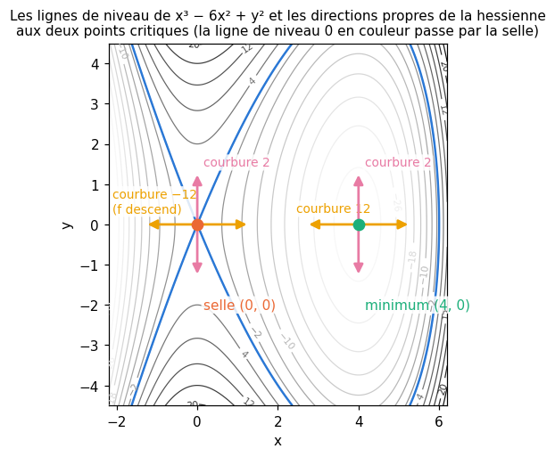
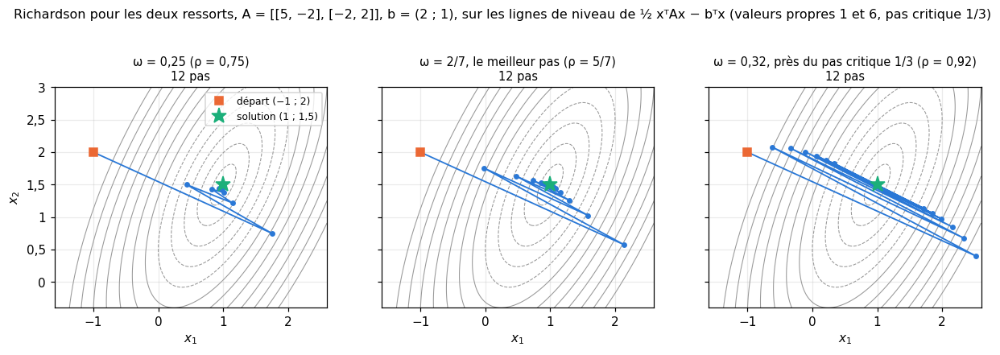
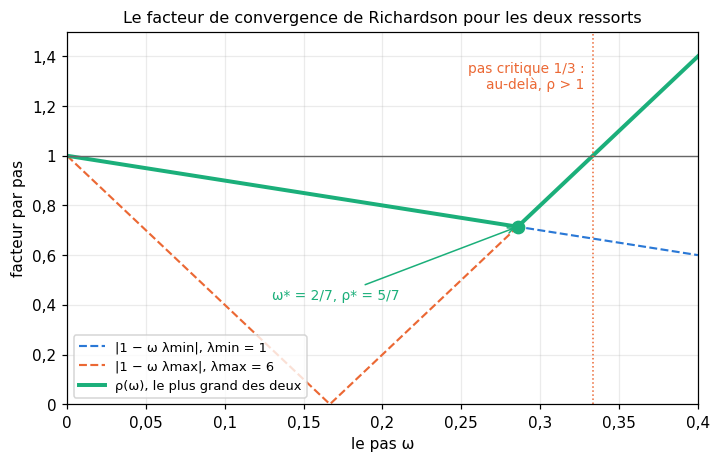
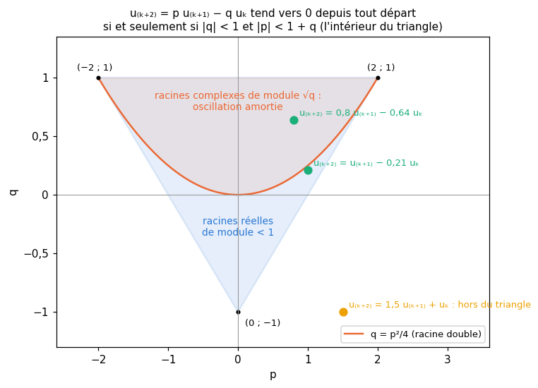

# M19 · Hessienne, conditionnement et convergence — fiche de cours

> M05b a classé les points critiques d'une fonction de **deux** variables par le signe d'un déterminant ; M12c a relié la hessienne à la convexité ; M18 a appris à calculer des gradients. Ce chapitre regarde la **courbure** d'une fonction de $n$ variables, puis la **convergence** des méthodes qui s'approchent d'une solution pas à pas. La première moitié : la **hessienne** et le développement de Taylor d'ordre 2, puis la nature d'un point critique lue sur les signes des **valeurs propres** de la hessienne. La seconde : les **itérations linéaires** $\mathbf{x} \leftarrow \mathbf{M}\mathbf{x} + \mathbf{c}$, qui convergent quand toutes les valeurs propres de $\mathbf{M}$ sont de module $< 1$ ; l'**itération de Richardson** pour résoudre $\mathbf{A}\mathbf{x} = \mathbf{b}$, son **pas critique** $2/\lambda_{\max}$, et le **conditionnement**, qui fixe le nombre d'itérations ; les **récurrences d'ordre 2** et le module des racines de leur polynôme (avec le strict minimum sur les nombres complexes) ; un **gradient estimé sur un échantillon**, sans biais, de variance en $1/B$ ; et la **projection** sur une boule ou sur un pavé. Les exemples viennent de la physique (une barre qui tiédit, des ressorts, un capteur) et de la géométrie. Le chapitre 19 de workbookIA s'en servira pour régler et comparer des méthodes d'optimisation.

| | |
|---|---|
| **Sections** | §1 à §8 |
| **Temps total estimé** | ≈ 13,8 h : lecture et calculs de la fiche ≈ 2 h 40, exercices ≈ 10 h 20, 22 flashcards ≈ 45 min (parcours essentiel ≈ 9,4 h) |
| **Prérequis** | M05b (dérivées partielles secondes, Schwarz, points critiques en dimension 2) ; M05a (Taylor en une variable, choix du pas des différences finies) ; M12c (valeurs propres, théorème spectral, quotient de Rayleigh, formes quadratiques, matrices définies positives, minimum de $\frac12\mathbf{x}^\top\mathbf{A}\mathbf{x} - \mathbf{b}^\top\mathbf{x}$) ; M12d (conditionnement) ; R5 (suites géométriques, récurrences d'ordre 1) ; R3 (trinôme, discriminant) ; M02c (espérance et variance d'une moyenne, tirages sans remise) ; M12b et M07 (point le plus proche, normes) ; M17 (jacobienne) ; M18 (gradient d'une moyenne) |
| **Fichiers du chapitre** | `02_exercices.md` (quiz, papier) · `03_notebook.ipynb` · `04_indices.md` · `05_solutions.md` et `05_solutions.ipynb` · `06_mes_reponses.md` · `flashcards.csv` |
| **mymath** | `iterative.py` : `numerical_hessian`, `critical_step_size`, `richardson_iterates`, `linear_recurrence` |
| **MML** | §5.7 (*Higher-Order Derivatives*), §5.8 (*Linearization and Multivariate Taylor Series*), §7.1 (*Optimization Using Gradient Descent*) |

## Comment utiliser ce chapitre

**Ordre conseillé.**
1. `python tools/start_chapter.py M19` (sur Colab : `00_setup/COLAB.md` §2) : il copie le notebook, ta feuille de réponses et le squelette `mymath/iterative.py`.
2. Section par section : lis **crayon en main**, refais chaque calcul ; puis fais les exercices de la section, quiz 🧠 d'abord.
3. Les exercices ✏️ et 🔗 se font sur papier, dans ta copie de `06_mes_reponses.md`, puis se vérifient dans la **partie 0** du notebook. Les démonstrations ∂ se rédigent dans ta copie et se jugent avec la grille de relecture de `05_solutions.md`.

Les §1 et §2 forment un premier bloc (la courbure : la hessienne, Taylor, les points critiques) ; les §3 à §6 un second (la convergence des itérations : linéaires, Richardson, conditionnement, ordre 2) ; les §7 et §8 deux outils courts (un gradient estimé, une projection). Le second bloc ne demande du premier que le §1 (la hessienne d'une forme quadratique).

| Section | Quiz 🧠 et rappels 🔁 | Papier et réflexion | Notebook |
|---|---|---|---|
| §1 La hessienne et Taylor d'ordre 2 | Q1 | M19.1 ✏️, M19.16 📖, M19.E1 💼 | M19.19 🔨, M19.26 🐛 |
| §2 Points critiques en dimension $n$ | Q2, R1 | M19.2 ✏️, M19.E1 💼 | M19.26 🐛 |
| §3 Itérations linéaires | Q3, R1, R2 | M19.3 ✏️, M19.10 ∂, M19.17 📖 | |
| §4 L'itération de Richardson | Q4 | M19.4 ✏️, M19.5 ✏️, M19.11 ∂, M19.14 🔗, M19.17 📖 | M19.20 🔨, M19.23 🔮, M19.25 🎨, M19.26 🐛, M19.27 🛠️ |
| §5 Conditionnement et préconditionnement | Q5, R3 | M19.5 ✏️, M19.15 🔗, M19.18 🗣️, M19.E2 💼 | M19.22 📦, M19.23 🔮, M19.24 🔬, M19.25 🎨 |
| §6 Récurrences d'ordre 2 | Q6, R2 | M19.6 ✏️, M19.7 ✏️, M19.12 ∂ | M19.21 🔨, M19.26 🐛, M19.28 🏆 |
| §7 Un gradient estimé sur un échantillon | Q7 | M19.8 ✏️, M19.17 📖 | |
| §8 Projeter sur une boule ou un pavé | Q8 | M19.9 ✏️, M19.13 ∂ | |

Parcours essentiel : tout sauf M19.Q8, M19.R3, M19.12, M19.13, M19.14, M19.15, M19.16, M19.17, M19.E1, M19.E2, M19.21, M19.22, M19.24, M19.27 et M19.28.

## Lecture conseillée

**MML §5.7 et §5.8** (*Higher-Order Derivatives*, *Linearization and Multivariate Taylor Series*) : lis-les **après le §1** de cette fiche et **avant le §2**. Le §5.7 définit la hessienne et ses notations ; le §5.8 écrit le développement de Taylor à plusieurs variables avec des tableaux à plusieurs indices (des *tensors*), et le termine par un exemple calculé jusqu'à l'ordre 3 ; le 📖 M19.16 te guide.

**MML §7.1** (*Optimization Using Gradient Descent*) : lis-le **après le §5** et **avant le §6**. Son début (la descente de gradient, le choix du pas, son exemple sur une forme quadratique et sa remarque sur le conditionnement) reprend les §4 et §5 avec d'autres notations ; ses deux sous-sections suivantes, sur le momentum (§7.1.2) et la version stochastique (§7.1.3), se lisent comme un aperçu : la fiche en étudie les outils mathématiques (§6 et §7), et workbookIA 19 les méthodes ; le 📖 M19.17 te guide. Les exercices de MML sur ces sections sont conseillés, pas obligatoires.

Vocabulaire anglais de ce chapitre : *Hessian*, *second-order partial derivative*, *Taylor polynomial*, *Taylor series*, *critical point*, *stationary point*, *saddle point*, *local minimum*, *positive definite*, *indefinite*, *fixed point*, *fixed-point iteration*, *Richardson iteration*, *residual*, *step size*, *spectral radius*, *condition number*, *ill-conditioned*, *preconditioning*, *preconditioner*, *Jacobi method*, *conjugate gradient*, *linear recurrence*, *characteristic polynomial*, *companion matrix*, *complex number*, *modulus*, *complex conjugate*, *unbiased estimator*, *variance*, *sampling with replacement*, *projection*, *ball*, *box*, *clipping*. MML note le pas $\gamma$ (*step-size*) ; workbookIA dit **learning rate** et le note $\eta$ ; la fiche note $\omega$ le pas de Richardson.

## Objectifs d'apprentissage

À la fin du chapitre, tu sais :
- **calculer** une hessienne, **écrire** le développement de Taylor d'ordre 2 en $n$ variables, et **classer** un point critique de $\mathbb{R}^n$ par les signes des valeurs propres de la hessienne ;
- **décider** de la convergence d'une itération linéaire $\mathbf{x} \leftarrow \mathbf{M}\mathbf{x} + \mathbf{c}$ par les valeurs propres de $\mathbf{M}$ symétrique, et **compter** ses itérations ;
- **choisir** le pas de l'itération de Richardson pour un système à matrice symétrique définie positive, et **prévoir** le nombre d'itérations par le conditionnement ;
- **préconditionner** un système par une matrice diagonale ;
- **résoudre** une récurrence linéaire d'ordre 2, et **décider** de sa convergence par le module des racines de son polynôme caractéristique ;
- **montrer** qu'un gradient estimé sur un échantillon tiré au hasard est sans biais, et **calculer** sa variance ;
- **projeter** un vecteur sur une boule et sur un pavé, et **comparer** les directions obtenues.

## L'essentiel en 10 lignes

1. La **hessienne** de $f : \mathbb{R}^n \to \mathbb{R}$ est la matrice $n \times n$ des dérivées secondes, $H_{ij} = \frac{\partial^2 f}{\partial x_i\partial x_j}$, symétrique (Schwarz) ; c'est la jacobienne du gradient.
2. **Taylor d'ordre 2** : $f(\mathbf{x} + \mathbf{h}) \approx f(\mathbf{x}) + \nabla f(\mathbf{x})^\top\mathbf{h} + \frac12\mathbf{h}^\top\nabla^2 f(\mathbf{x})\,\mathbf{h}$ ; la courbure dans la direction unitaire $\mathbf{u}$ vaut $\mathbf{u}^\top\nabla^2 f\,\mathbf{u}$, entre $\lambda_{\min}$ et $\lambda_{\max}$.
3. En un **point critique** ($\nabla f = \mathbf{0}$) : valeurs propres de la hessienne toutes $> 0$ → **minimum** local ; toutes $< 0$ → **maximum** ; des deux signes → **point selle** ; une valeur propre nulle et les autres de même signe → le test ne conclut pas.
4. **Itération linéaire** $\mathbf{x}_{k+1} = \mathbf{M}\mathbf{x}_k + \mathbf{c}$ : l'écart au point fixe vérifie $\mathbf{e}_{k+1} = \mathbf{M}\mathbf{e}_k$. Pour $\mathbf{M}$ symétrique, elle converge vers un même point depuis tout départ **si et seulement si** toutes ses valeurs propres sont de module $< 1$, et l'écart est multiplié au pire par $\rho = \max_i \lvert\lambda_i\rvert$ à chaque pas.
5. **Richardson** pour $\mathbf{A}\mathbf{x} = \mathbf{b}$ ($\mathbf{A}$ symétrique définie positive) : $\mathbf{x} \leftarrow \mathbf{x} + \omega(\mathbf{b} - \mathbf{A}\mathbf{x})$. Les valeurs propres de $\mathbf{I} - \omega\mathbf{A}$ sont les $1 - \omega\lambda_i$ : convergence si et seulement si $0 < \omega < 2/\lambda_{\max}$, le **pas critique**. C'est une descente de gradient sur $\frac12\mathbf{x}^\top\mathbf{A}\mathbf{x} - \mathbf{b}^\top\mathbf{x}$.
6. **Conditionnement** $\kappa = \lambda_{\max}/\lambda_{\min}$ : avec le meilleur pas $\frac{2}{\lambda_{\min} + \lambda_{\max}}$, l'écart est multiplié par $\frac{\kappa - 1}{\kappa + 1}$ à chaque pas, et le nombre d'itérations croît comme $\kappa$.
7. **Préconditionnement diagonal** : diviser chaque inconnue par $\sqrt{a_{ii}}$ remplace $\mathbf{A}$ par $\mathbf{D}^{-1/2}\mathbf{A}\mathbf{D}^{-1/2}$, de diagonale 1, souvent bien mieux conditionnée.
8. **Récurrence d'ordre 2** $u_{k+2} = p\,u_{k+1} - q\,u_k$ : racines de $r^2 - pr + q$ ; $u_k = \alpha r_1^k + \beta r_2^k$. Elle tend vers 0 depuis tout départ si et seulement si les deux racines sont de **module** $< 1$, c'est-à-dire $\lvert q\rvert < 1$ et $\lvert p\rvert < 1 + q$. Des racines complexes conjuguées ont pour module $\sqrt{q}$ : une oscillation amortie.
9. **Gradient sur un échantillon** de $B$ termes tirés au hasard parmi les $N$ d'une moyenne : **sans biais**, de variance $\sigma^2/B$ (avec remise) ; diviser l'erreur type par 2 demande 4 fois plus de termes.
10. **Projeter** sur la boule de rayon $r$ : $\mathbf{x}\min(1, r/\lVert\mathbf{x}\rVert)$, **même direction** ; sur un pavé : chaque coordonnée ramenée dans son intervalle, ce qui **change la direction** en général.

## §1 · La hessienne et Taylor d'ordre 2 en n variables

### La matrice des dérivées secondes

Soit $f : \mathbb{R}^n \to \mathbb{R}$ deux fois dérivable, de dérivées secondes continues. Ses dérivées partielles $\frac{\partial f}{\partial x_i}$ sont $n$ fonctions de $n$ variables ; en les dérivant à nouveau, on obtient $n^2$ **dérivées partielles secondes** (*second-order partial derivatives*), que l'on range dans la **hessienne** (*Hessian*) :
$$\nabla^2 f(\mathbf{x}) = \mathbf{H}, \qquad H_{ij} = \frac{\partial^2 f}{\partial x_i\,\partial x_j}(\mathbf{x}), \qquad \mathbf{H} \text{ de forme } (n, n).$$
Le **théorème de Schwarz** (M05b, admis) dit que $\frac{\partial^2 f}{\partial x_i\partial x_j} = \frac{\partial^2 f}{\partial x_j\partial x_i}$ : la hessienne est **symétrique**, et il suffit de calculer $\frac{n(n + 1)}{2}$ dérivées. Autre lecture : la ligne $i$ de $\mathbf{H}$ est le gradient de $\frac{\partial f}{\partial x_i}$, donc $\mathbf{H}$ est la **jacobienne du gradient** (M17), $\nabla^2 f = \mathbf{J}_{\nabla f}$. MML la note $\nabla_{\mathbf{x}}^2 f$ ou $\mathbf{H}$, d'autres livres $\mathbf{H}_f$ ou $D^2 f$.

**Exemple.** $f(x, y, z) = x^2y - 2yz + z^3$, au point $(1, 2, -1)$, où $f = 2 + 4 - 1 = 5$.
- Le gradient : $\nabla f = (2xy,\ x^2 - 2z,\ -2y + 3z^2)$, qui vaut $(4,\ 3,\ -1)$ au point.
- Les dérivées secondes : $f_{xx} = 2y$, $f_{xy} = 2x$, $f_{xz} = 0$, $f_{yy} = 0$, $f_{yz} = -2$, $f_{zz} = 6z$. Au point :
$$\mathbf{H} = \begin{pmatrix} 4 & 2 & 0 \\ 2 & 0 & -2 \\ 0 & -2 & -6 \end{pmatrix}.$$

### Taylor d'ordre 2

Pour un déplacement $\mathbf{h}$, on regarde $f$ le long du segment, $\varphi(t) = f(\mathbf{x} + t\mathbf{h})$. La règle de la chaîne (M17) donne $\varphi'(t) = \nabla f(\mathbf{x} + t\mathbf{h})^\top\mathbf{h}$, puis, en dérivant chaque $\frac{\partial f}{\partial x_i}(\mathbf{x} + t\mathbf{h})$ de la même façon, $\varphi''(t) = \mathbf{h}^\top\nabla^2 f(\mathbf{x} + t\mathbf{h})\,\mathbf{h}$. Le Taylor d'ordre 2 en une variable (M05a), $\varphi(1) \approx \varphi(0) + \varphi'(0) + \frac12\varphi''(0)$, devient le **développement de Taylor d'ordre 2** en $n$ variables :
$$f(\mathbf{x} + \mathbf{h}) = f(\mathbf{x}) + \nabla f(\mathbf{x})^\top\mathbf{h} + \tfrac12\,\mathbf{h}^\top\nabla^2 f(\mathbf{x})\,\mathbf{h} + R(\mathbf{h}), \qquad \frac{R(\mathbf{h})}{\lVert\mathbf{h}\rVert^2} \to 0 \text{ quand } \mathbf{h} \to \mathbf{0}.$$
Le terme d'ordre 1 est l'approximation linéaire (M05b, M17) ; le terme d'ordre 2 est une **forme quadratique** en $\mathbf{h}$ (M12c §7), de matrice $\frac12\nabla^2 f(\mathbf{x})$.

**Exemple (suite).** Avec $\mathbf{h} = (0{,}2 ;\ -0{,}1 ;\ 0{,}1)$ : $\nabla f^\top\mathbf{h} = 0{,}8 - 0{,}3 - 0{,}1 = 0{,}4$ ; $\mathbf{H}\mathbf{h} = (0{,}6 ;\ 0{,}2 ;\ -0{,}4)$ et $\mathbf{h}^\top\mathbf{H}\mathbf{h} = 0{,}12 - 0{,}02 - 0{,}04 = 0{,}06$. Taylor d'ordre 1 prédit $5{,}4$, d'ordre 2 $5{,}4 + 0{,}03 = 5{,}43$ ; la vraie valeur, $f(1{,}2 ;\ 1{,}9 ;\ -0{,}9) = 5{,}427$. L'erreur passe de $0{,}027$ à $0{,}003$.

**La courbure dans une direction.** Pour un vecteur **unitaire** $\mathbf{u}$, la dérivée seconde de $t \mapsto f(\mathbf{x} + t\mathbf{u})$ en 0 vaut $\mathbf{u}^\top\mathbf{H}\mathbf{u}$ (M05b le faisait en dimension 2, avec la formule développée). C'est le **quotient de Rayleigh** de M12c : il est compris entre la plus petite et la plus grande valeur propre de $\mathbf{H}$, et les atteint le long des vecteurs propres correspondants. La hessienne contient donc **toutes** les courbures ; ses vecteurs propres sont les directions de courbure extrême.

**Les formes quadratiques.** Pour $f(\mathbf{x}) = \frac12\mathbf{x}^\top\mathbf{A}\mathbf{x} - \mathbf{b}^\top\mathbf{x} + c$, avec $\mathbf{A}$ symétrique, $\nabla f(\mathbf{x}) = \mathbf{A}\mathbf{x} - \mathbf{b}$ (M09b, M12c) et $\nabla^2 f = \mathbf{A}$, **constante** : le développement de Taylor d'ordre 2 est exact, sans reste. Près de n'importe quel point, une fonction lisse ressemble à une telle forme quadratique : c'est pourquoi les §3 à §5 étudient les formes quadratiques en détail.

**Au-delà de l'ordre 2.** Les dérivées troisièmes forment un tableau à trois indices, $\frac{\partial^3 f}{\partial x_i\partial x_j\partial x_k}$, et le développement continue avec des termes de degré 3, 4… : c'est la **série de Taylor** (*Taylor series*) de MML §5.8, qui note ces tableaux $D^k_{\mathbf{x}}f$ et leurs produits avec $\boldsymbol{\delta}^k$. On s'arrêtera presque toujours à l'ordre 2.

### La hessienne par différences centrées

Comme le gradient (M05a, M05b), la hessienne se calcule par **différences finies** quand on ne veut pas dériver à la main. Avec un pas $h$ et les vecteurs de base $\mathbf{e}_i$ :
$$H_{ii} \approx \frac{f(\mathbf{x} + h\mathbf{e}_i) - 2f(\mathbf{x}) + f(\mathbf{x} - h\mathbf{e}_i)}{h^2}, \qquad H_{ij} \approx \frac{f(\mathbf{x} + h\mathbf{e}_i + h\mathbf{e}_j) - f(\mathbf{x} + h\mathbf{e}_i - h\mathbf{e}_j) - f(\mathbf{x} - h\mathbf{e}_i + h\mathbf{e}_j) + f(\mathbf{x} - h\mathbf{e}_i - h\mathbf{e}_j)}{4h^2}.$$
La première est la dérivée seconde centrée de M05a le long de $\mathbf{e}_i$ ; la seconde est la différence centrée, dans la direction $\mathbf{e}_j$, de la différence centrée dans la direction $\mathbf{e}_i$. Leur erreur de troncature est en $h^2$. On calcule chaque case au-dessus de la diagonale une seule fois, et on la recopie en dessous : la matrice est symétrique par construction. En tout, $1 + 2n + 4\cdot\frac{n(n - 1)}{2} = 2n^2 + 1$ évaluations de $f$.

**Le choix du pas.** Diviser par $h^2$ amplifie les erreurs d'arrondi de $f$ : de l'ordre de $\varepsilon\,\lvert f\rvert/h^2$, avec $\varepsilon \approx 2 \times 10^{-16}$ en `float64`. La troncature diminue avec $h$, les arrondis grandissent ; l'équilibre est vers $h \approx \varepsilon^{1/4} \approx 10^{-4}$, plus grand que le $10^{-5}$ d'une dérivée première centrée (M05a §7). Pour $f = \exp$ en 0 (dérivée seconde 1), l'erreur vaut environ $8 \times 10^{-6}$ pour $h = 10^{-2}$, $5 \times 10^{-9}$ pour $h = 10^{-4}$, et remonte à $2 \times 10^{-5}$ pour $h = 10^{-6}$. On garde au mieux 8 chiffres environ : assez pour lire des signes de valeurs propres, pas pour comparer des hessiennes au dernier chiffre.

⚠️ **Erreur classique.** Oublier le $\frac12$ devant le terme d'ordre 2, ou le facteur 4 au dénominateur de la formule croisée ; calculer $H_{ij}$ et $H_{ji}$ séparément, avec deux formules qui diffèrent par les arrondis : la hessienne numérique n'est alors plus exactement symétrique, et une fonction qui l'exige (comme `np.linalg.eigvalsh`, qui ne lit qu'un triangle) donne des résultats qui dépendent du triangle lu.

## §2 · Points critiques en dimension n : les signes des valeurs propres

### Le terme d'ordre 2 décide

En un **point critique** $\mathbf{p}$ (*critical point*, ou point stationnaire), $\nabla f(\mathbf{p}) = \mathbf{0}$ et le développement de Taylor se réduit à
$$f(\mathbf{p} + \mathbf{h}) \approx f(\mathbf{p}) + \tfrac12\,\mathbf{h}^\top\mathbf{H}\mathbf{h}, \qquad \mathbf{H} = \nabla^2 f(\mathbf{p}).$$
Le théorème spectral (M12c) écrit $\mathbf{H} = \mathbf{Q}\boldsymbol{\Lambda}\mathbf{Q}^\top$, avec une base orthonormée de vecteurs propres $\mathbf{q}_1, \ldots, \mathbf{q}_n$ ; dans cette base, $\mathbf{y} = \mathbf{Q}^\top\mathbf{h}$ et
$$\tfrac12\,\mathbf{h}^\top\mathbf{H}\mathbf{h} = \tfrac12\left(\lambda_1y_1^2 + \cdots + \lambda_ny_n^2\right).$$
Le signe de ce terme, selon la direction, se lit sur les signes des $\lambda_i$.

> **Test du second ordre en dimension $n$.** En un point critique $\mathbf{p}$, avec les valeurs propres $\lambda_1, \ldots, \lambda_n$ de $\nabla^2 f(\mathbf{p})$ :
> - toutes $> 0$ ($\mathbf{H}$ définie positive) : **minimum local strict** ;
> - toutes $< 0$ ($\mathbf{H}$ définie négative) : **maximum local strict** ;
> - au moins une $> 0$ et au moins une $< 0$ ($\mathbf{H}$ indéfinie) : **point selle** (*saddle point*) ;
> - sinon (au moins une valeur propre nulle, les autres de même signe) : le test **ne conclut pas**.

Les trois premiers cas sont admis ici ; ils viennent de Taylor et de la continuité des dérivées secondes : quand $\mathbf{H}$ est définie positive, $\frac12\mathbf{h}^\top\mathbf{H}\mathbf{h} \ge \frac{\lambda_{\min}}{2}\lVert\mathbf{h}\rVert^2$ l'emporte sur le reste pour $\mathbf{h}$ petit. Le long d'un vecteur propre de valeur propre négative, $f$ descend ; le long d'un vecteur propre de valeur propre positive, elle monte : un point selle a des directions des deux sortes, et le nombre de ses valeurs propres négatives (son **indice**) compte les directions indépendantes où $f$ descend.

**En dimension 2**, $\lambda_1\lambda_2 = \det\mathbf{H} = f_{xx}f_{yy} - f_{xy}^2$ et $\lambda_1 + \lambda_2 = \operatorname{tr}\mathbf{H}$ (M12c) : $\det > 0$ veut dire deux valeurs propres de même signe, celui de la trace (ou de $f_{xx}$) ; $\det < 0$, des signes contraires. C'est le test de M05b. En dimension 3 ou plus, le déterminant ne suffit plus : des valeurs propres $(-1, -2, 3)$ donnent $\det = 6 > 0$, et c'est une selle.

**Exemple.** $f(x, y, z) = x^3 - 6x^2 + y^2 + yz + z^2$.
- Le gradient, $(3x^2 - 12x,\ 2y + z,\ y + 2z)$, s'annule pour $x = 0$ ou $x = 4$, et $y = z = 0$ : deux points critiques.
- La hessienne : $\begin{pmatrix} 6x - 12 & 0 & 0 \\ 0 & 2 & 1 \\ 0 & 1 & 2 \end{pmatrix}$. Le bloc $\begin{pmatrix} 2 & 1 \\ 1 & 2 \end{pmatrix}$ a pour valeurs propres $3$ (vecteur $(1, 1)$) et $1$ (vecteur $(1, -1)$).
- En $(0, 0, 0)$ : valeurs propres $-12$, $1$, $3$ : un **point selle** d'indice 1. On le voit sur la fonction : $f(t, 0, 0) = t^3 - 6t^2 < 0$ pour $t$ petit non nul, alors que $f(0, t, 0) = t^2 > 0$.
- En $(4, 0, 0)$ : valeurs propres $12$, $1$, $3$ : un **minimum local**, où $f = 64 - 96 = -32$. Il n'est pas global : $f(t, 0, 0) \to -\infty$ quand $t \to -\infty$.

**Quand une valeur propre est nulle.** $g_1(x, y, z) = x^2 + y^2 + z^4$ et $g_2(x, y, z) = x^2 + y^2 - z^4$ ont toutes deux en $\mathbf{0}$ la hessienne $\operatorname{diag}(2, 2, 0)$ : le test ne conclut pas. $g_1$ y a un minimum ; $g_2$ une selle, puisqu'elle descend le long de l'axe des $z$. Dans la direction propre de la valeur propre nulle, Taylor d'ordre 2 est **plat**, et c'est l'ordre suivant qui décide.

⚠️ **Erreur classique.** Conclure « minimum » parce que la diagonale de la hessienne est positive : $\begin{pmatrix} 1 & 2 \\ 2 & 1 \end{pmatrix}$ a pour valeurs propres $3$ et $-1$, c'est une selle (M12c §7). Ou appliquer le test en un point qui n'est pas critique : là, le terme d'ordre 1 l'emporte. Ou conclure d'une hessienne **numérique** dont une valeur propre vaut $10^{-9}$ : à la précision des différences finies (§1), c'est un zéro.

🔗 **Dans workbookIA** — le chapitre 19 parle des points critiques des fonctions qu'il minimise, en très grande dimension, et du rôle qu'y jouent les points selles ; il décrit leur voisinage par les valeurs propres de la hessienne, comme ce paragraphe.

## §3 · Itérations linéaires : quand convergent-elles ?

### Point fixe et écart

Beaucoup de méthodes calculent une suite de vecteurs par une règle fixe, appliquée encore et encore. La plus simple est une **itération linéaire** (on dit aussi affine) :
$$\mathbf{x}_{k+1} = \mathbf{M}\mathbf{x}_k + \mathbf{c}, \qquad \mathbf{M} \text{ de forme } (n, n),\ \mathbf{c} \in \mathbb{R}^n.$$
Si elle converge, sa limite $\mathbf{x}^\star$ est un **point fixe** (*fixed point*) : $\mathbf{x}^\star = \mathbf{M}\mathbf{x}^\star + \mathbf{c}$, c'est-à-dire $(\mathbf{I} - \mathbf{M})\mathbf{x}^\star = \mathbf{c}$. En soustrayant cette égalité de la règle, l'**écart** $\mathbf{e}_k = \mathbf{x}_k - \mathbf{x}^\star$ vérifie
$$\mathbf{e}_{k+1} = \mathbf{M}\mathbf{e}_k, \qquad \text{donc} \qquad \mathbf{e}_k = \mathbf{M}^k\mathbf{e}_0 :$$
le $\mathbf{c}$ a disparu. C'est la récurrence géométrique de R5, $e_{k+1} = m\,e_k$, avec une matrice à la place du nombre $m$.

### Le cas d'une matrice symétrique

Si $\mathbf{M}$ est **symétrique**, $\mathbf{M} = \mathbf{Q}\boldsymbol{\Lambda}\mathbf{Q}^\top$ (M12c) et $\mathbf{M}^k = \mathbf{Q}\boldsymbol{\Lambda}^k\mathbf{Q}^\top$ (M12c §4). Écrivons l'écart de départ dans la base des vecteurs propres, $\mathbf{e}_0 = y_1\mathbf{q}_1 + \cdots + y_n\mathbf{q}_n$ :
$$\mathbf{e}_k = \lambda_1^ky_1\,\mathbf{q}_1 + \cdots + \lambda_n^ky_n\,\mathbf{q}_n.$$
Chaque composante évolue **seule**, multipliée par sa valeur propre à chaque pas : $n$ suites géométriques indépendantes. D'où le théorème (∂ M19.10 le démontre) :

> **Théorème.** Soit $\mathbf{M}$ symétrique, de valeurs propres $\lambda_1, \ldots, \lambda_n$. L'itération $\mathbf{x}_{k+1} = \mathbf{M}\mathbf{x}_k + \mathbf{c}$ converge **vers un même point depuis tout départ** si et seulement si $\lvert\lambda_i\rvert < 1$ pour tout $i$. Ce point est alors l'unique point fixe, et, avec $\rho = \max_i\lvert\lambda_i\rvert$,
> $$\lVert\mathbf{e}_k\rVert \le \rho^k\,\lVert\mathbf{e}_0\rVert,$$
> avec égalité quand $\mathbf{e}_0$ est un vecteur propre de valeur propre $\pm\rho$.

Le nombre $\rho$, le plus grand module des valeurs propres, s'appelle le **rayon spectral** (*spectral radius*) de $\mathbf{M}$ ; c'est lui qui fixe la vitesse. Pour diviser l'écart par $10^d$ (gagner $d$ décimales), il suffit de $k$ pas avec $\rho^k \le 10^{-d}$, soit
$$k \ge \frac{d\,\ln 10}{-\ln\rho}.$$
Avec $\rho = 0{,}5$, chaque pas gagne un peu plus de 0,3 décimale ; avec $\rho = 0{,}99$, il en faut environ 230 pour en gagner une.

**Un départ particulier.** Si une valeur propre vérifie $\lvert\lambda_j\rvert \ge 1$, la composante $y_j$ ne diminue pas : l'itération ne converge pas depuis les départs qui ont $y_j \ne 0$. Mais un départ dont l'écart n'a **aucune** composante sur $\mathbf{q}_j$ converge quand même (M19.4) ; le théorème parle de **tout** départ.

**Exemple : une barre qui tiédit.** Une barre a ses deux bouts maintenus à 0 °C et 40 °C ; on cherche la température d'équilibre en trois points intérieurs régulièrement espacés. À l'équilibre, chaque température est la moyenne de ses deux voisines. L'itération qui remplace chaque température par la moyenne de ses voisines s'écrit
$$\mathbf{T}_{k+1} = \underbrace{\tfrac12\begin{pmatrix} 0 & 1 & 0 \\ 1 & 0 & 1 \\ 0 & 1 & 0 \end{pmatrix}}_{\mathbf{M}}\mathbf{T}_k + \underbrace{\begin{pmatrix} 0 \\ 0 \\ 20 \end{pmatrix}}_{\mathbf{c}}$$
(le 20 est la moitié du bout à 40 °C). Le point fixe est le profil linéaire $\mathbf{T}^\star = (10 ;\ 20 ;\ 30)$. Les valeurs propres de $\mathbf{M}$ sont $\frac{\sqrt2}{2}$, $0$ et $-\frac{\sqrt2}{2}$ (vecteurs propres $(1, \sqrt2, 1)$, $(1, 0, -1)$, $(1, -\sqrt2, 1)$) : $\rho = \frac{\sqrt2}{2} \approx 0{,}707$, l'écart est divisé par 2 tous les deux pas. Depuis $\mathbf{T}_0 = \mathbf{0}$ : $\mathbf{T}_1 = (0 ;\ 0 ;\ 20)$, $\mathbf{T}_2 = (0 ;\ 10 ;\ 20)$, $\mathbf{T}_3 = (5 ;\ 10 ;\ 25)$, $\mathbf{T}_4 = (5 ;\ 15 ;\ 25)$ : les écarts $\mathbf{e}_2 = (-10 ;\ -10 ;\ -10)$ et $\mathbf{e}_4 = (-5 ;\ -5 ;\ -5)$ se divisent bien par 2. Pour gagner 6 décimales, il faut $\frac{6\ln 10}{\ln\sqrt2} \approx 39{,}9$, soit 40 pas.

**Une matrice qui n'est pas symétrique.** Le critère des valeurs propres reste vrai pour toute matrice $\mathbf{M}$ diagonalisable, avec des valeurs propres qui peuvent être complexes, mais l'écart peut **grandir** pendant plusieurs pas avant de décroître : la majoration $\rho^k$ ne vaut plus. M22 traite le cas général ; ici, les matrices seront symétriques, sauf au §6.

⚠️ **Erreur classique.** Regarder la plus grande valeur propre **signée** au lieu du plus grand **module** : $\mathbf{M}$ de valeurs propres $0{,}5$ et $-1{,}2$ diverge. Ou croire que la limite dépend du départ : quand toutes les valeurs propres sont de module $< 1$, la limite est l'unique point fixe, quel que soit le départ. (Avec $\mathbf{M} = \mathbf{I}$ et $\mathbf{c} = \mathbf{0}$, chaque départ est un point fixe : la suite « converge », vers son départ ; c'est pourquoi le théorème parle d'un **même** point.)

## §4 · L'itération de Richardson et le pas critique 2/λmax

### Corriger par le résidu

Pour résoudre $\mathbf{A}\mathbf{x} = \mathbf{b}$, avec $\mathbf{A}$ **symétrique définie positive**, sans élimination ni factorisation, on part d'un $\mathbf{x}_0$ et on le corrige par un multiple du **résidu** (*residual*) $\mathbf{r} = \mathbf{b} - \mathbf{A}\mathbf{x}$, qui mesure de combien l'équation est fausse :
$$\mathbf{x}_{k+1} = \mathbf{x}_k + \omega\,(\mathbf{b} - \mathbf{A}\mathbf{x}_k).$$
C'est l'**itération de Richardson** (*Richardson iteration*, L. F. Richardson, 1911), de **pas** $\omega > 0$. (Le même Richardson a donné son nom à l'extrapolation de M05a, `approx.richardson_derivative` : deux idées différentes, deux fonctions de `mymath`.) Elle coûte un produit $\mathbf{A}\mathbf{x}$ par pas, ce qui est très peu quand $\mathbf{A}$ est grande et **creuse** (presque toute nulle). C'est une itération linéaire : $\mathbf{M} = \mathbf{I} - \omega\mathbf{A}$ et $\mathbf{c} = \omega\mathbf{b}$ ; un point fixe vérifie $\omega(\mathbf{b} - \mathbf{A}\mathbf{x}^\star) = \mathbf{0}$, c'est **la** solution. $\mathbf{M}$ est symétrique, et ses valeurs propres se lisent sur celles de $\mathbf{A}$ : si $\mathbf{A}\mathbf{q} = \lambda\mathbf{q}$, alors $(\mathbf{I} - \omega\mathbf{A})\mathbf{q} = (1 - \omega\lambda)\mathbf{q}$.

> **Théorème** (∂ M19.11). Soit $\mathbf{A}$ symétrique définie positive, de valeurs propres $0 < \lambda_{\min} \le \cdots \le \lambda_{\max}$. L'itération de Richardson converge depuis tout départ si et seulement si
> $$0 < \omega < \frac{2}{\lambda_{\max}}.$$
> Son facteur de convergence est $\rho(\omega) = \max\left(\lvert1 - \omega\lambda_{\min}\rvert,\ \lvert1 - \omega\lambda_{\max}\rvert\right)$.

Le nombre $\omega_c = 2/\lambda_{\max}$ est le **pas critique** : au-delà, la composante de l'écart le long du vecteur propre de $\lambda_{\max}$ est multipliée par $1 - \omega\lambda_{\max} < -1$, change de signe et grandit à chaque pas. Seules les deux valeurs propres **extrêmes** comptent pour $\rho$, car $1 - \omega\lambda$ varie de façon monotone avec $\lambda$.

**Exemple : deux ressorts.** Une masse est accrochée à un mur par un ressort de raideur 3, une seconde masse à la première par un ressort de raideur 2 ; on tire sur la première avec une force 2 et sur la seconde avec une force 1. Les déplacements $\mathbf{x}$ à l'équilibre vérifient $\mathbf{A}\mathbf{x} = \mathbf{b}$ avec la **matrice de raideur**
$$\mathbf{A} = \begin{pmatrix} 3 + 2 & -2 \\ -2 & 2 \end{pmatrix} = \begin{pmatrix} 5 & -2 \\ -2 & 2 \end{pmatrix}, \qquad \mathbf{b} = \begin{pmatrix} 2 \\ 1 \end{pmatrix}, \qquad \mathbf{x}^\star = \begin{pmatrix} 1 \\ 1{,}5 \end{pmatrix}.$$
Ses valeurs propres sont $1$ (vecteur $(1, 2)$) et $6$ (vecteur $(2, -1)$) : le pas critique vaut $\frac{2}{6} = \frac13$.
- Avec $\omega = 0{,}25$, les valeurs propres de $\mathbf{I} - \omega\mathbf{A}$ sont $0{,}75$ et $-0{,}5$ : $\rho = 0{,}75$. Depuis $\mathbf{0}$ : $\mathbf{x}_1 = (0{,}5 ;\ 0{,}25)$, $\mathbf{x}_2 = (0{,}5 ;\ 0{,}625)$, $\mathbf{x}_3 = (0{,}6875 ;\ 0{,}8125)$, $\mathbf{x}_4 = (0{,}734375 ;\ 1)$, qui s'approchent lentement de $(1 ;\ 1{,}5)$.
- Avec $\omega = 0{,}32$, juste sous le pas critique : $1 - 0{,}32 \times 6 = -0{,}92$, la composante raide change de signe à chaque pas et diminue à peine : les itérés **oscillent** de part et d'autre de la solution.
- Avec $\omega = 0{,}35 > \frac13$ : $1 - 2{,}1 = -1{,}1$, l'itération diverge.

### Richardson est une descente de gradient

Pour $\mathbf{A}$ symétrique définie positive, la fonction $f(\mathbf{x}) = \frac12\mathbf{x}^\top\mathbf{A}\mathbf{x} - \mathbf{b}^\top\mathbf{x}$ a pour gradient $\mathbf{A}\mathbf{x} - \mathbf{b}$, pour hessienne $\mathbf{A}$, et pour unique minimum la solution de $\mathbf{A}\mathbf{x} = \mathbf{b}$ (M12c §7). Le résidu est donc **l'opposé du gradient**, et un pas de Richardson est un pas de **descente de gradient** sur $f$, de pas $\omega$ :
$$\mathbf{x} + \omega(\mathbf{b} - \mathbf{A}\mathbf{x}) = \mathbf{x} - \omega\,\nabla f(\mathbf{x}).$$
Pour les ressorts, $f$ est l'énergie des ressorts moins le travail des forces : l'équilibre est le minimum de l'énergie, et Richardson le cherche en descendant. Le pas critique $2/\lambda_{\max}$ se lit alors sur la **plus grande courbure** de $f$. On l'énonce sans le démontrer ici pour des fonctions plus générales :

> **Énoncé** (admis). Si la hessienne de $f$ a, en tout point, ses valeurs propres dans un intervalle $[\mu, L]$ avec $\mu > 0$, la descente de gradient de pas fixe $\eta$, avec $0 < \eta < 2/L$, converge depuis tout départ vers l'unique minimum de $f$.

Près d'un minimum $\mathbf{p}$, le gradient ressemble à $\nabla^2 f(\mathbf{p})\,(\mathbf{x} - \mathbf{p})$ : la descente s'y comporte comme Richardson avec $\mathbf{A} = \nabla^2 f(\mathbf{p})$.

💻 **Aujourd'hui en pratique** — personne ne résout un petit système dense par Richardson : `np.linalg.solve` ou Cholesky (M12c) le font exactement. Les méthodes itératives servent pour les très grands systèmes creux (des millions d'inconnues, dans les simulations de chaleur, de mécanique, de circuits), où l'on ne peut ni stocker ni factoriser $\mathbf{A}$ ; on y préfère des méthodes plus rapides que Richardson (le gradient conjugué, §5), qui reposent sur les mêmes idées. Et un critère d'arrêt s'impose : le **résidu relatif** $\lVert\mathbf{b} - \mathbf{A}\mathbf{x}_k\rVert/\lVert\mathbf{b}\rVert$ sous une tolérance, avec un nombre maximal d'itérations (🛠️ M19.27).

🔗 **Dans workbookIA** — le chapitre 19 règle le pas des méthodes qu'il étudie (le learning rate) ; la plus grande courbure de la fonction minimisée y joue le rôle de $\lambda_{\max}$.

⚠️ **Erreur classique.** Régler le pas sur la **plus petite** valeur propre, $\omega = 2/\lambda_{\min}$ : la composante raide est multipliée par $1 - 2\lambda_{\max}/\lambda_{\min} < -1$, et tout diverge. Ou oublier que $\omega$ doit être **positif** : un pas négatif monte au lieu de descendre.

## §5 · Conditionnement, vitesse et préconditionnement diagonal

### Le meilleur pas, et le prix du conditionnement

Le **conditionnement** (*condition number*) d'une matrice symétrique définie positive est
$$\kappa(\mathbf{A}) = \frac{\lambda_{\max}}{\lambda_{\min}} \ge 1,$$
le rapport $\sigma_{\max}/\sigma_{\min}$ de M12d, puisque les valeurs singulières d'une telle matrice sont ses valeurs propres. On l'énonce sans démonstration (le graphe ci-dessous le rend visible) :

> **Énoncé.** Le facteur $\rho(\omega)$ de Richardson est le plus petit pour $\omega^\star = \dfrac{2}{\lambda_{\min} + \lambda_{\max}}$, qui égale $\lvert 1 - \omega\lambda_{\min}\rvert$ et $\lvert 1 - \omega\lambda_{\max}\rvert$ ; il vaut alors
> $$\rho^\star = \frac{\lambda_{\max} - \lambda_{\min}}{\lambda_{\max} + \lambda_{\min}} = \frac{\kappa - 1}{\kappa + 1}.$$

Le facteur ne dépend que de $\kappa$. Pour les ressorts, $\kappa = 6$ : $\omega^\star = \frac27$ et $\rho^\star = \frac57 \approx 0{,}714$, et gagner 6 décimales demande $\frac{6\ln 10}{-\ln(5/7)} \approx 41{,}1$, soit 42 itérations, contre 49 avec $\omega = 0{,}25$ ($\rho = 0{,}75$).

**Le nombre d'itérations croît comme $\kappa$.** Pour $\kappa$ grand, $-\ln\frac{\kappa - 1}{\kappa + 1} \approx \frac{2}{\kappa}$, et gagner $d$ décimales demande environ
$$k \approx \frac{\kappa}{2}\,d\,\ln 10 \approx 1{,}15\,\kappa\,d \text{ itérations}.$$
Multiplier le conditionnement par 10 multiplie le travail par 10. Avec le pas prudent $\omega = 1/\lambda_{\max}$, le facteur vaut $1 - \frac1\kappa$, et il faut environ deux fois plus d'itérations qu'avec $\omega^\star$.

**Ce qui ne change rien.** Multiplier $\mathbf{A}$ et $\mathbf{b}$ par un même nombre $s > 0$ multiplie les valeurs propres par $s$ : le pas critique est divisé par $s$, mais $\kappa$, le facteur $\rho^\star$ et le nombre d'itérations ne changent pas. Tourner les inconnues ($\mathbf{x} = \mathbf{Q}\mathbf{y}$, avec $\mathbf{Q}$ orthogonale) remplace $\mathbf{A}$ par $\mathbf{Q}^\top\mathbf{A}\mathbf{Q}$, qui a les mêmes valeurs propres. Le conditionnement est une propriété de la **forme** des lignes de niveau, pas de leur échelle ni de leur orientation.

**Le dessin.** Les lignes de niveau de $f(\mathbf{x}) = \frac12\mathbf{x}^\top\mathbf{A}\mathbf{x} - \mathbf{b}^\top\mathbf{x}$ sont des ellipses centrées en $\mathbf{x}^\star$, de demi-axes proportionnels à $1/\sqrt{\lambda_i}$ le long des vecteurs propres (M12c §7) : leur allongement vaut $\sqrt\kappa$. Le résidu, opposé au gradient, est perpendiculaire aux lignes de niveau (M05b) ; sur des ellipses très allongées, il pointe presque en travers, vers l'axe court. Le pas doit rester sous $2/\lambda_{\max}$ pour ne pas sauter de plus en plus loin dans la direction raide, et, avec ce pas, la direction plate, de courbure $\lambda_{\min}$, ne progresse que d'un facteur $1 - \omega\lambda_{\min} \ge 1 - \frac{2}{\kappa}$ par pas : très lentement (🗣️ M19.18).

### Préconditionner

**Préconditionner** (*preconditioning*), c'est remplacer le système par un système équivalent dont la matrice est mieux conditionnée. Le plus simple : changer l'**échelle** de chaque inconnue. Avec $\mathbf{D} = \operatorname{diag}(a_{11}, \ldots, a_{nn})$, la diagonale de $\mathbf{A}$ (positive, puisque $a_{ii} = \mathbf{e}_i^\top\mathbf{A}\mathbf{e}_i > 0$), on pose $\mathbf{x} = \mathbf{D}^{-1/2}\mathbf{y}$, c'est-à-dire $x_i = y_i/\sqrt{a_{ii}}$ :
$$\mathbf{A}\mathbf{x} = \mathbf{b} \iff \underbrace{\mathbf{D}^{-1/2}\mathbf{A}\,\mathbf{D}^{-1/2}}_{\tilde{\mathbf{A}}}\,\mathbf{y} = \mathbf{D}^{-1/2}\mathbf{b}.$$
$\tilde{\mathbf{A}}$, de coefficients $\tilde a_{ij} = \frac{a_{ij}}{\sqrt{a_{ii}a_{jj}}}$, est symétrique définie positive et a des 1 sur sa diagonale. C'est le **préconditionnement diagonal**, ou de **Jacobi**.

**Exemple : un ressort raide et un ressort souple.** Avec des raideurs 96 et 4 à la place de 3 et 2, la matrice de raideur devient $\mathbf{K} = \begin{pmatrix} 100 & -4 \\ -4 & 4 \end{pmatrix}$, de valeurs propres environ $100{,}2$ et $3{,}83$ : $\kappa \approx 26{,}1$, et gagner 6 décimales demande 181 itérations au meilleur pas. Après mise à l'échelle, $\tilde{\mathbf{K}} = \begin{pmatrix} 1 & -0{,}2 \\ -0{,}2 & 1 \end{pmatrix}$ ($\frac{-4}{\sqrt{100 \times 4}} = -0{,}2$), de valeurs propres $0{,}8$ et $1{,}2$ : $\kappa = 1{,}5$, et 9 itérations suffisent. Le mauvais conditionnement venait surtout des **échelles** différentes des deux inconnues, que la mise à l'échelle corrige.

**Dans les inconnues de départ**, Richardson sur $\tilde{\mathbf{A}}$ revient à diviser chaque coordonnée du résidu par le coefficient diagonal correspondant :
$$\mathbf{x}_{k+1} = \mathbf{x}_k + \omega\,\mathbf{D}^{-1}(\mathbf{b} - \mathbf{A}\mathbf{x}_k).$$
Avec $\omega = 1$, c'est la **méthode de Jacobi** (*Jacobi method*) : chaque équation $i$ est résolue en $x_i$, les autres inconnues gardant leur ancienne valeur. La barre du §3 en était un exemple : son système a la matrice $\begin{pmatrix} 2 & -1 & 0 \\ -1 & 2 & -1 \\ 0 & -1 & 2 \end{pmatrix}$, de diagonale constante 2, et « chaque température devient la moyenne de ses voisines » est Jacobi. Là, la mise à l'échelle ne change pas $\kappa$ : une diagonale constante n'a pas d'échelles différentes à corriger. Le préconditionnement diagonal aide quand les inconnues vivent à des échelles très différentes, pas quand le mauvais conditionnement vient des couplages entre elles.

💻 **Aujourd'hui en pratique** — pour un grand système symétrique défini positif, la méthode de choix est le **gradient conjugué** (*conjugate gradient*, M. Hestenes et E. Stiefel, 1952) : à chaque pas, il choisit la meilleure combinaison de toutes les directions déjà explorées, et son nombre d'itérations croît comme $\sqrt\kappa$ au lieu de $\kappa$ ; en arithmétique exacte, il trouve la solution en au plus $n$ pas. `scipy.sparse.linalg.cg` l'implémente, avec un argument `M` pour un préconditionneur (📦 M19.22). Les préconditionneurs utilisés en pratique vont bien au-delà de la diagonale (Cholesky incomplet, multigrille).

🔗 **Dans workbookIA** — le chapitre 19 retrouve la même idée : plusieurs de ses méthodes divisent chaque coordonnée du pas par une échelle propre à cette coordonnée (🔗 M19.15).

## §6 · Récurrences linéaires d'ordre 2 et module des racines

### Le polynôme caractéristique

Une **récurrence linéaire d'ordre 2** (*linear recurrence*) calcule chaque terme à partir des **deux** précédents :
$$u_{k+2} = p\,u_{k+1} - q\,u_k, \qquad u_0,\ u_1 \text{ donnés}.$$
(Le signe de $q$ est choisi pour que $p$ et $q$ soient la somme et le produit des racines plus bas.) Sous forme vectorielle, avec $\mathbf{v}_k = (u_{k+1}, u_k)$, c'est une itération linéaire de R5 et du §3 :
$$\mathbf{v}_{k+1} = \underbrace{\begin{pmatrix} p & -q \\ 1 & 0 \end{pmatrix}}_{\mathbf{C}}\mathbf{v}_k,$$
où $\mathbf{C}$ est la **matrice compagnon** (*companion matrix*) ; son polynôme caractéristique est $r^2 - pr + q$ (M12c §3). $\mathbf{C}$ n'est **pas symétrique** : le théorème du §3 ne s'applique pas tel quel, et on travaille directement avec les racines.

On cherche des solutions géométriques $u_k = r^k$ : il faut $r^{k+2} = p\,r^{k+1} - q\,r^k$, soit $r^2 - pr + q = 0$, le **polynôme caractéristique** (*characteristic polynomial*) de la récurrence. Comme la récurrence est linéaire, toute combinaison de solutions est une solution :
- deux racines **distinctes** $r_1 \ne r_2$ : $u_k = \alpha\,r_1^k + \beta\,r_2^k$, où $\alpha$ et $\beta$ se calculent avec $u_0 = \alpha + \beta$ et $u_1 = \alpha r_1 + \beta r_2$ ;
- une racine **double** $r$ ($p^2 = 4q$, $r = p/2$) : $u_k = (\alpha + \beta k)\,r^k$.

Deux valeurs de départ fixent $\alpha$ et $\beta$, et toutes les solutions sont de cette forme (∂ M19.12).

**Exemple.** $u_{k+2} = u_{k+1} - 0{,}21\,u_k$, avec $u_0 = 2$, $u_1 = 1$. Le polynôme $r^2 - r + 0{,}21$ a pour racines $0{,}7$ et $0{,}3$ (somme 1, produit $0{,}21$). Les conditions $\alpha + \beta = 2$ et $0{,}7\alpha + 0{,}3\beta = 1$ donnent $\alpha = \beta = 1$ : $u_k = 0{,}7^k + 0{,}3^k$. Vérification : $u_2 = 1 - 0{,}42 = 0{,}58 = 0{,}49 + 0{,}09$.

### Le strict minimum sur les nombres complexes

Si le discriminant $\Delta = p^2 - 4q$ est **négatif**, le trinôme n'a pas de racine réelle (R3). On ajoute aux réels un nombre $i$ tel que $i^2 = -1$ ; un **nombre complexe** (*complex number*) s'écrit $z = a + ib$, avec $a$, $b$ réels (sa partie réelle et sa partie imaginaire), et se calcule comme un polynôme en $i$, en remplaçant $i^2$ par $-1$ : $(2 + 3i)(1 - i) = 2 - 2i + 3i - 3i^2 = 5 + i$.
- Le **conjugué** (*complex conjugate*) de $z = a + ib$ est $\bar z = a - ib$ ; $z\bar z = a^2 + b^2$, un réel positif.
- Le **module** (*modulus*) est $\lvert z\rvert = \sqrt{a^2 + b^2}$, la longueur du vecteur $(a, b)$ du plan. Il est multiplicatif : $\lvert zw\rvert = \lvert z\rvert\,\lvert w\rvert$ (on l'admet ; c'est un calcul), donc $\lvert z^k\rvert = \lvert z\rvert^k$, qui tend vers 0 si et seulement si $\lvert z\rvert < 1$.
- **Les racines complexes d'un trinôme réel.** Pour $\Delta < 0$, $r^2 - pr + q$ a les deux racines **conjuguées** $r = \frac{p}{2} \pm i\,\frac{\sqrt{-\Delta}}{2}$. Leur somme vaut $p$, leur produit $q = r\bar r = \lvert r\rvert^2$ : elles ont le même module, $\lvert r\rvert = \sqrt{q}$.
- **La forme trigonométrique.** On écrit $r = \lvert r\rvert(\cos\theta + i\sin\theta)$, avec $\cos\theta = \frac{p}{2\sqrt q}$ ; on admet que $r^k = \lvert r\rvert^k(\cos k\theta + i\sin k\theta)$ (formule de Moivre). M22 reprendra les nombres complexes et les valeurs propres complexes.

Avec des racines conjuguées, les solutions **réelles** de la récurrence s'écrivent
$$u_k = \lvert r\rvert^k\,(A\cos k\theta + B\sin k\theta) :$$
une **oscillation**, de période $2\pi/\theta$ pas, amortie d'un facteur $\lvert r\rvert$ à chaque pas si $\lvert r\rvert < 1$.

**Exemple.** $u_{k+2} = 0{,}8\,u_{k+1} - 0{,}64\,u_k$, avec $u_0 = 1$, $u_1 = 0{,}4$. $\Delta = 0{,}64 - 2{,}56 = -1{,}92 < 0$ ; les racines $0{,}4 \pm 0{,}4\sqrt3\,i$ ont pour module $\sqrt{0{,}64} = 0{,}8$, et $\cos\theta = \frac{0{,}8}{2 \times 0{,}8} = 0{,}5$, $\theta = \frac\pi3$. Ici $u_k = 0{,}8^k\cos\frac{k\pi}{3}$ : $1$ ; $0{,}4$ ; $-0{,}32$ ; $-0{,}512$ ; $-0{,}2048$ ; $0{,}16384$ ; $0{,}262144$… Une oscillation de période 6, dont l'amplitude est multipliée par 0,8 à chaque pas.

### Quand tend-elle vers 0 ?

D'après les formes ci-dessus, $u_k \to 0$ **depuis tout départ** si et seulement si les deux racines sont de **module strictement inférieur à 1** (pour une racine double, $k\,r^k \to 0$ quand $\lvert r\rvert < 1$) ; la vitesse est fixée par le plus grand des deux modules, qui joue le rôle du $\rho$ du §3. Ce critère se lit directement sur les coefficients :

> **Critère** (∂ M19.12). Les deux racines de $r^2 - pr + q$ sont de module $< 1$ si et seulement si
> $$\lvert q\rvert < 1 \qquad \text{et} \qquad \lvert p\rvert < 1 + q.$$

Dans le plan $(p, q)$, c'est l'intérieur du **triangle** de sommets $(-2, 1)$, $(2, 1)$ et $(0, -1)$. La parabole $q = p^2/4$ le coupe en deux : au-dessus, des racines complexes de module $\sqrt q$ (une oscillation amortie, d'autant plus lente que $q$ est proche de 1) ; au-dessous, des racines réelles. Les deux exemples sont dans le triangle : $(1 ;\ 0{,}21)$ et $(0{,}8 ;\ 0{,}64)$. La récurrence $u_{k+2} = 1{,}5\,u_{k+1} + u_k$, soit $(p, q) = (1{,}5 ;\ -1)$, n'y est pas : ses racines sont $2$ et $-0{,}5$.

⚠️ **Erreur classique.** Prendre la **partie réelle** d'une racine complexe pour son module : $0{,}4 \pm 0{,}4\sqrt3\,i$ a un module $0{,}8$, pas $0{,}4$. Se tromper de signe sur $q$ : $u_{k+2} = p\,u_{k+1} - q\,u_k$ donne $r^2 - pr + q$, et $u_{k+2} = a\,u_{k+1} + b\,u_k$ donne $r^2 - ar - b$. Ou conclure à la convergence parce que $\lvert q\rvert < 1$ seulement : $(p, q) = (1{,}5 ;\ 0{,}2)$ a les racines $1{,}35$ et $0{,}15$ environ.

🔗 **Dans workbookIA** — le chapitre 19 étudie des méthodes qui gardent en mémoire le pas précédent : leur écart obéit à une récurrence d'ordre 2, et c'est le module des racines de son polynôme qui décide de leur convergence. Le défi M19.28 applique le critère à un schéma de la mécanique.

## §7 · Un gradient estimé sur un échantillon : sans biais, et sa variance

### L'estimateur

Beaucoup de fonctions à minimiser sont des **moyennes** de $N$ termes, un par mesure : $F(\boldsymbol{\theta}) = \frac1N\sum_{k=1}^N f_k(\boldsymbol{\theta})$, de gradient $\nabla F = \frac1N\sum_k\nabla f_k$ (M18 §8). Quand $N$ est très grand, calculer les $N$ gradients à chaque pas coûte cher. On les **estime** : on tire au hasard $B$ indices $K_1, \ldots, K_B$, uniformément et indépendamment dans $\{1, \ldots, N\}$ (avec remise), et l'on prend
$$\mathbf{g} = \frac1B\sum_{j=1}^B\nabla f_{K_j}(\boldsymbol{\theta}).$$
C'est une moyenne d'échantillon (M02c), où la « population » est la liste des $N$ gradients.

**Sans biais.** Un indice $K$ tiré uniformément donne $\mathbb{E}[\nabla f_K(\boldsymbol{\theta})] = \sum_k\frac1N\nabla f_k(\boldsymbol{\theta}) = \nabla F(\boldsymbol{\theta})$ ; par linéarité de l'espérance, $\mathbb{E}[\mathbf{g}] = \nabla F(\boldsymbol{\theta})$. L'estimateur est **sans biais** (*unbiased estimator*) : en moyenne sur les tirages, il donne le vrai gradient.

**Sa variance.** On note $\sigma^2 = \frac1N\sum_k\lVert\nabla f_k - \nabla F\rVert^2$ la dispersion des gradients individuels autour de leur moyenne (pour un seul paramètre, leur variance ; pour plusieurs, la somme des variances des coordonnées). Les tirages étant indépendants, la variance d'une moyenne de $B$ d'entre eux est divisée par $B$ (M02c) :
$$\mathbb{E}\left[\lVert\mathbf{g} - \nabla F\rVert^2\right] = \frac{\sigma^2}{B}, \qquad \text{erreur type } \frac{\sigma}{\sqrt B}.$$
Diviser l'erreur type par 2 demande 4 fois plus de termes, et par 10, cent fois plus. **Sans remise**, le facteur de correction de population finie de M02c s'applique : $\frac{\sigma^2}{B}\cdot\frac{N - B}{N - 1}$, nul pour $B = N$ (on retrouve alors le gradient exact).

**Exemple : étalonner un capteur.** Un capteur rend une tension proportionnelle à la grandeur mesurée, $y \approx a\,x$, de coefficient $a$ inconnu. Trois mesures, $(x_k, y_k) = (1, 3)$, $(2, 5)$, $(4, 9)$, et les moindres carrés (M09b) : $F(a) = \frac13\sum_k(a\,x_k - y_k)^2$, avec $f_k'(a) = 2x_k(a\,x_k - y_k)$. En $a = 2$, les résidus valent $-1$, $-1$, $-1$ et les trois dérivées $-2$, $-4$, $-8$, de moyenne $F'(2) = -\frac{14}{3} \approx -4{,}67$ : il faut augmenter $a$ (le minimum est en $a^\star = \frac{3 + 10 + 36}{1 + 4 + 16} = \frac73$). Leur dispersion : $\sigma^2 = \frac13\left[\left(\frac83\right)^2 + \left(\frac23\right)^2 + \left(\frac{10}{3}\right)^2\right] = \frac{56}{9} \approx 6{,}22$. Avec $B = 2$ tirages avec remise, la variance de l'estimation vaut $\frac{28}{9} \approx 3{,}11$ (erreur type $\approx 1{,}76$) ; sans remise, $\frac{28}{9} \times \frac12 = \frac{14}{9} \approx 1{,}56$.

**Le bruit.** Une estimation isolée peut être loin du vrai gradient, et même de signe contraire quand $\lvert\nabla F\rvert$ est petit devant $\sigma/\sqrt B$ : c'est près d'un minimum, où le vrai gradient s'annule, que le bruit domine. Le choix de $B$ est un compromis entre le coût d'une estimation (proportionnel à $B$) et sa précision (en $1/\sqrt B$).

🔗 **Dans workbookIA** — le chapitre 19 calcule le gradient sur un mini-batch tiré au hasard dans le dataset : c'est cet estimateur, avec $B$ la taille du mini-batch.

⚠️ **Erreur classique.** Croire que « sans biais » veut dire « exact » : chaque estimation a une erreur, seule sa moyenne sur les tirages est juste. Diviser l'erreur type par $B$ au lieu de $\sqrt B$. Ou tirer les indices **non** uniformément (toujours les mêmes mesures, ou dans un ordre trié) : l'espérance n'est plus $\nabla F$.

## §8 · Projeter sur une boule ou sur un pavé

### Le point le plus proche

**Projeter** un point $\mathbf{x}$ sur un ensemble $C$, c'est le remplacer par le point de $C$ le plus proche de lui :
$$P_C(\mathbf{x}) = \arg\min_{\mathbf{y} \in C}\lVert\mathbf{x} - \mathbf{y}\rVert.$$
M12b l'a fait pour un sous-espace (la projection orthogonale). Pour un ensemble **convexe** et **fermé** (M10), ce point existe et il est unique (admis). Si $\mathbf{x}$ est déjà dans $C$, $P_C(\mathbf{x}) = \mathbf{x}$, et projeter deux fois revient à projeter une fois. Deux ensembles convexes reviennent sans cesse : une boule et un pavé.

**La boule** de centre $\mathbf{0}$ et de rayon $r$, $\{\mathbf{y} : \lVert\mathbf{y}\rVert \le r\}$ (norme L2, M07) :
$$P(\mathbf{x}) = \begin{cases} \mathbf{x} & \text{si } \lVert\mathbf{x}\rVert \le r, \\ r\,\dfrac{\mathbf{x}}{\lVert\mathbf{x}\rVert} & \text{sinon,} \end{cases} \qquad \text{soit } P(\mathbf{x}) = \mathbf{x}\,\min\left(1,\ \frac{r}{\lVert\mathbf{x}\rVert}\right).$$
Un point trop loin est ramené sur la sphère **le long du rayon** : sa **direction ne change pas**, seule sa longueur devient $r$ (∂ M19.13 démontre que c'est bien le point le plus proche).

**Le pavé** (*box*) $[l_1, u_1] \times \cdots \times [l_n, u_n]$ : le carré de la distance, $\sum_i(x_i - y_i)^2$, est une somme de termes qui ne dépendent chacun que d'une coordonnée. On minimise donc chaque terme séparément, sur son intervalle : la coordonnée $y_i$ la plus proche de $x_i$ dans $[l_i, u_i]$ est $x_i$ lui-même s'il y est, sinon le bord le plus proche :
$$P(\mathbf{x})_i = \min\big(\max(x_i, l_i),\ u_i\big),$$
ce que NumPy écrit `np.clip(x, l, u)`. Chaque coordonnée est **coupée** (*clipping*) indépendamment des autres : les grandes coordonnées sont ramenées au bord, les petites ne bougent pas. La **direction change** en général.

**Exemple.** $\mathbf{x} = (12 ;\ -5)$, de norme 13.
- Sur la boule de rayon $2{,}6$ : $P(\mathbf{x}) = \frac{2{,}6}{13}\,\mathbf{x} = (2{,}4 ;\ -1)$, à la distance $13 - 2{,}6 = 10{,}4$ de $\mathbf{x}$.
- Sur le pavé $[-2, 2]^2$ : $P(\mathbf{x}) = (2 ;\ -2)$, à la distance $\lVert(10 ;\ -3)\rVert = \sqrt{109} \approx 10{,}44$. Sa direction est la diagonale, tournée d'environ 22° par rapport à celle de $\mathbf{x}$ : les deux coordonnées, très inégales au départ, sont devenues égales en valeur absolue.

![Le vecteur (12 ; −5) projeté sur la boule de rayon 2,6 (le long du rayon, même direction) et sur le pavé [−2, 2]² (chaque coordonnée coupée : la direction tourne vers la diagonale)](figures/projections.png)

**Quand la projection sur le pavé garde-t-elle la direction ?** Pour un pavé $[-c, c]^n$ et un $\mathbf{x}$ à l'extérieur, seulement si toutes ses coordonnées non nulles ont la même valeur absolue (∂ M19.13) : le pavé égalise les grandes coordonnées.

**À quoi ça sert.** À respecter une contrainte après chaque pas d'une méthode itérative (un paramètre qui doit rester dans un intervalle, une longueur bornée) : on fait le pas, puis on projette. Pour une boule, cela limite la **longueur** d'un vecteur sans toucher à sa direction ; pour un pavé, cela borne chaque coordonnée, au prix de la direction. MML §7.2 traite l'optimisation sous contraintes plus généralement.

🔗 **Dans workbookIA** — le chapitre 19 limite la longueur de certains vecteurs trop grands en les ramenant sur une boule, et explique pourquoi il préfère cette projection à celle qui coupe chaque coordonnée.

⚠️ **Erreur classique.** Projeter sur la boule en coupant chaque coordonnée à $\pm r$ : c'est la projection sur le **pavé** $[-r, r]^n$, qui laisse des points de norme jusqu'à $r\sqrt n$ et change la direction. Ou multiplier par $r/\lVert\mathbf{x}\rVert$ **même quand** $\lVert\mathbf{x}\rVert < r$ : un point déjà dans la boule serait agrandi.

## Les pièges classiques ⚠️ (récapitulatif)

- **Le ½ de Taylor.** Le terme d'ordre 2 est $\frac12\mathbf{h}^\top\mathbf{H}\mathbf{h}$ ; la hessienne est symétrique, et sa version numérique doit l'être exactement.
- **Le pas d'une dérivée seconde numérique.** Vers $10^{-4}$ en `float64`, pas $10^{-8}$ : on divise par $h^2$.
- **Le test du second ordre.** Il se lit sur les **valeurs propres** de la hessienne, en un point **critique** ; une diagonale positive ne suffit pas, et une valeur propre nulle laisse la question ouverte.
- **Le module, pas le signe.** Une itération linéaire converge quand toutes les valeurs propres sont de **module** $< 1$ ; une valeur propre $-1{,}2$ fait diverger.
- **Le pas critique.** $2/\lambda_{\max}$, réglé sur la **plus grande** valeur propre ; au-delà, la composante raide grandit en changeant de signe.
- **Le conditionnement.** Il fixe le nombre d'itérations, à peu près proportionnel à $\kappa$ ; multiplier $\mathbf{A}$ par un nombre ne le change pas, changer l'échelle de chaque inconnue peut le changer beaucoup.
- **Le signe de $q$.** $u_{k+2} = p\,u_{k+1} - q\,u_k$ a pour polynôme $r^2 - pr + q$ ; les racines complexes conjuguées ont pour module $\sqrt q$, pas leur partie réelle.
- **Sans biais n'est pas exact.** L'erreur type d'un gradient estimé sur $B$ termes est en $\sigma/\sqrt B$.
- **Boule ou pavé.** La boule garde la direction, le pavé la change ; projeter un point déjà dans l'ensemble ne le bouge pas.

## Et maintenant

**Dans ce dépôt** : M20 (tenseurs, axes et estimateurs pondérés), juste avant workbookIA 20 : les tableaux à plusieurs axes, les moyennes et variances le long d'axes, un estimateur qui divise par une probabilité, et les applications proches de l'identité. M22 reprendra les valeurs propres complexes et le rayon spectral d'une matrice quelconque.

**Dans workbookIA** : le chapitre 19 règle le pas des méthodes de descente par la courbure, les compare sur des fonctions mal conditionnées, ajoute à certaines une mémoire du pas précédent ou une échelle par coordonnée, estime le gradient sur des mini-batches et limite la longueur des pas trop grands.

## Pour aller plus loin

- MML §5.7, §5.8 et §7.1 (les 📖 M19.16 et M19.17).
- L. F. Richardson, « The approximate arithmetical solution by finite differences of physical problems involving differential equations », *Philosophical Transactions of the Royal Society A* 210 (1911), p. 307-357 : l'itération qui porte son nom, pour des problèmes de physique.
- M. Hestenes et E. Stiefel, « Methods of conjugate gradients for solving linear systems », *Journal of Research of the National Bureau of Standards* 49 (1952), p. 409-436 : le gradient conjugué.
- `annexes/symboles.md` (lire $\nabla^2 f$, $\kappa$, $\rho$, $\omega$, $i$, $\bar z$, $\lvert z\rvert$ et $P_C$ à voix haute), `annexes/formulaire.md` et `annexes/erreurs_frequentes.md`.
