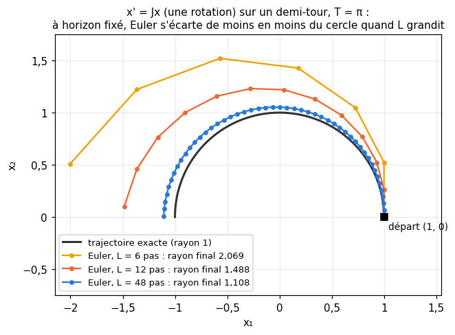

# M20 · Tenseurs, axes et estimateurs pondérés — fiche de cours

> Jusqu'ici, les données tenaient dans un vecteur ou dans une matrice. Ce chapitre passe aux **tableaux à $k$ dimensions** (des *tenseurs*, au sens de l'informatique) : des mesures rangées par station, par jour et par heure, une image rangée par ligne, par colonne et par canal. La première moitié apprend à les manier en mathématicien : la **forme** et les **axes**, l'**ordre** dans lequel les nombres sont rangés et le **remodelage**, les **réductions** (sommes, moyennes, variances) le long d'axes choisis et la **diffusion** qui les recombine au tableau d'origine, puis la **notation d'Einstein**, qui écrit tous ces calculs d'indices en une ligne, et son outil `einsum`. La seconde moitié réunit trois outils que workbookIA 20 utilise sans les démontrer : le **centrage**, qui est une **projection orthogonale**, et la **standardisation**, qui ne voit ni l'origine ni l'unité des données ; l'**estimateur de Horvitz-Thompson**, qui divise chaque observation par sa probabilité d'avoir été tirée et devient ainsi **sans biais** ; et les applications **proches de l'identité** $\mathbf{x} \mapsto \mathbf{x} + h\,F(\mathbf{x})$, dont la jacobienne $\mathbf{I} + h\mathbf{J}$ garde des produits bornés quand on en enchaîne beaucoup. Les exemples viennent de la météo, des notes d'une classe, des sondages et des équations différentielles.

| | |
|---|---|
| **Sections** | §1 à §6 |
| **Temps total estimé** | ≈ 8,8 h : lecture et calculs de la fiche ≈ 1 h 30, exercices ≈ 6 h 46, 15 flashcards ≈ 30 min (parcours essentiel ≈ 6,8 h) |
| **Prérequis** | workbookIA 0A (tableaux NumPy, `shape`, `axis`, diffusion) ; M02c (moyenne, variance, ddof, z-score) ; M02b (loi de Bernoulli, espérance, variance d'une somme de variables indépendantes) ; M12b (projection orthogonale sur une droite, matrice de projection) ; M09a (produit matriciel et son coût) ; M12c (trace) ; M12d (valeurs singulières, norme d'une matrice) ; M17 (jacobienne, règle de la chaîne) ; M14 ($(1 + x/n)^n \to e^x$) ; R8 (dénombrer les sous-ensembles) |
| **Fichiers du chapitre** | `02_exercices.md` (quiz, papier) · `03_notebook.ipynb` · `04_indices.md` · `05_solutions.md` et `05_solutions.ipynb` · `06_mes_reponses.md` · `flashcards.csv` |
| **mymath** | `tensors.py` : `einsum_pair`, `moments_along_axes`, `horvitz_thompson_total` |
| **MML** | — (le livre n'a pas de section sur les tableaux à plusieurs axes ni sur les sondages) |

## Comment utiliser ce chapitre

**Ordre conseillé.**
1. `python tools/start_chapter.py M20` (sur Colab : `00_setup/COLAB.md` §2) : il copie le notebook, ta feuille de réponses et le squelette `mymath/tensors.py`.
2. Section par section : lis **crayon en main**, refais chaque calcul ; puis fais les exercices de la section, quiz 🧠 d'abord.
3. Les exercices ✏️ et 🔗 se font sur papier, dans ta copie de `06_mes_reponses.md`, puis se vérifient dans la **partie 0** du notebook. Les démonstrations ∂ se rédigent dans ta copie et se jugent avec la grille de relecture de `05_solutions.md`.

Les §1 à §3 forment un premier bloc (manier un tableau à plusieurs axes : sa forme, ses réductions, `einsum`) ; les §4 à §6 trois outils indépendants les uns des autres (centrer et réduire, diviser par une probabilité, enchaîner des applications proches de l'identité), qui ne demandent du premier bloc que le vocabulaire des axes.

| Section | Quiz 🧠 et rappels 🔁 | Papier et réflexion | Notebook |
|---|---|---|---|
| §1 Tableaux à k dimensions : forme, axes, remodelage | Q1 | M20.1 ✏️, M20.9 🗣️ | M20.13 🔮 |
| §2 Réductions et diffusion le long d'axes | Q2, R1 | M20.1 ✏️, M20.9 🗣️ | M20.11 🔨, M20.16 🐛, M20.17 🛠️ |
| §3 La notation d'Einstein et `einsum` | Q3 | M20.2 ✏️ | M20.10 🔨, M20.13 🔮 |
| §4 Centrer et réduire : une projection et des invariances | R2 | M20.3 ✏️, M20.6 ∂, M20.E1 💼 | |
| §5 Diviser par la probabilité d'inclusion : Horvitz-Thompson | Q4 | M20.4 ✏️, M20.7 ∂, M20.8 🔗 | M20.12 🔨, M20.14 🔬, M20.18 🏆 |
| §6 Des applications proches de l'identité : I + hJ | R3 | M20.5 ✏️ | M20.15 🎨 |

Parcours essentiel : tout sauf M20.R3, M20.6, M20.E1, M20.12, M20.14, M20.17 et M20.18.

## Lecture conseillée

Pas de lecture de MML pour ce chapitre : le livre range les dérivées d'ordre supérieur dans des tableaux à plusieurs indices (MML §5.8, que tu as lu en M19), mais ne traite ni des axes d'un tableau, ni de la notation d'Einstein, ni des sondages. Pour `einsum`, la documentation de NumPy (`numpy.einsum`) donne beaucoup d'exemples ; lis-la **après le §3**.

Vocabulaire anglais de ce chapitre : *array*, *tensor*, *axis* (pluriel *axes*), *shape*, *rank* (le nombre d'axes, au sens de NumPy, à ne pas confondre avec le rang d'une matrice), *reshape*, *row-major order* (*C order*), *transpose*, *reduction*, *keepdims*, *broadcasting*, *Einstein summation*, *free index*, *dummy index* (indice muet, sommé), *contraction*, *centering matrix*, *orthogonal projection*, *standardization*, *z-score*, *degrees of freedom*, *translation invariance*, *scale invariance*, *survey sampling*, *inclusion probability*, *design weight*, *Poisson sampling*, *Horvitz-Thompson estimator*, *probability proportional to size* (PPS), *unbiased*, *explicit Euler method*, *near-identity map*, *singular value*, *matrix exponential*.

## Objectifs d'apprentissage

À la fin du chapitre, tu sais :
- **décrire** un tableau à $k$ dimensions par sa forme et ses axes, **retrouver** la position d'un élément dans l'ordre C, le **remodeler** sans le confondre avec une transposition, et le **réduire** le long d'axes choisis ;
- **écrire** produits, traces et contractions en notation d'Einstein, les **calculer** avec `einsum`, et **compter** leur coût ;
- **calculer** moyennes et variances le long d'axes, avec le bon ddof, et **centrer** par diffusion ;
- **reconnaître** le centrage comme une projection orthogonale, et **utiliser** les invariances de la standardisation ;
- **construire** un estimateur sans biais en divisant par une probabilité d'inclusion, et **calculer** sa variance ;
- **calculer** la jacobienne d'une application proche de l'identité, et **borner** le produit de $L$ telles jacobiennes.

## L'essentiel en 10 lignes

1. Un **tableau à $k$ dimensions** a une **forme** $(n_0, \ldots, n_{k-1})$ : $k$ **axes**, de longueurs $n_a$, et $n_0 n_1 \cdots n_{k-1}$ éléments. En **ordre C**, le dernier indice varie le plus vite : l'élément $(i_0, i_1, i_2)$ d'un tableau $(n_0, n_1, n_2)$ est à la position $(i_0 n_1 + i_1)\,n_2 + i_2$.
2. **Remodeler** garde les éléments dans l'ordre C et change seulement la forme ; **transposer** change l'ordre des axes. Ce ne sont pas les mêmes opérations.
3. **Réduire** le long d'un axe (somme, moyenne, maximum) fait **disparaître** cet axe ; avec `keepdims=True`, il reste avec la longueur 1, et le résultat se **diffuse** contre le tableau d'origine.
4. **Diffusion** : on aligne les formes à droite ; deux longueurs vont ensemble si elles sont égales ou si l'une vaut 1. Un vecteur $(n,)$ moins une colonne $(n, 1)$ donne, sans erreur, un tableau $(n, n)$.
5. Moyenne et variance le long d'axes portent sur les $N$ valeurs réduites ensemble ; la variance divise par $N - \text{ddof}$. Moyenner sur deux axes d'un coup ou l'un après l'autre donne la même chose ; pour la variance, non.
6. **Einstein** : un indice répété est sommé. `einsum("ij,jk->ik", A, B)` est le produit matriciel ; une lettre absente du résultat est sommée ; le coût est le produit des longueurs de toutes les lettres.
7. La **matrice de centrage** $\mathbf{C} = \mathbf{I} - \frac1m\mathbf{1}\mathbf{1}^\top$ est la **projection orthogonale** sur l'hyperplan $\{\mathbf{v} : \sum_i v_i = 0\}$, de dimension $m - 1$ : d'où le $m - 1$ de la variance non biaisée.
8. La **standardisation** $\mathbf{z} = (\mathbf{x} - \bar x\mathbf{1})/s$ ne change pas si l'on remplace $\mathbf{x}$ par $a\mathbf{x} + b\mathbf{1}$ avec $a > 0$ : elle ne voit ni l'origine ni l'unité.
9. **Horvitz-Thompson** : chaque unité $i$ entre dans l'échantillon avec la probabilité $\pi_i > 0$ ; $\hat Y = \sum_{i \in S} y_i/\pi_i$ est **sans biais** pour le total $\sum_i y_i$, et, si les tirages sont indépendants, $\mathbb{V}(\hat Y) = \sum_i y_i^2\,\frac{1 - \pi_i}{\pi_i}$.
10. Un pas d'Euler $\mathbf{x} \mapsto \mathbf{x} + h\,F(\mathbf{x})$ a pour jacobienne $\mathbf{I} + h\mathbf{J}_F$, de valeurs singulières entre $1 - h\lVert\mathbf{J}_F\rVert$ et $1 + h\lVert\mathbf{J}_F\rVert$ ; le produit de $L$ telles jacobiennes reste entre $(1 - hK)^L$ et $e^{hKL}$ ; à horizon $T = hL$ fixé, il reste donc entre deux constantes $> 0$ qui ne dépendent pas de $L$ ; $(1 + \lambda T/L)^L \to e^{\lambda T}$.

## §1 · Tableaux à k dimensions : forme, axes, remodelage

### Un tableau, sa forme, ses axes

Un vecteur range des nombres selon un indice, une matrice selon deux. Un **tableau à $k$ dimensions** (*array*) les range selon $k$ indices : c'est une fonction qui, à chaque $k$-uplet d'indices $(i_0, \ldots, i_{k-1})$, avec $0 \le i_a < n_a$, associe un nombre. Le $k$-uplet des longueurs $(n_0, \ldots, n_{k-1})$ est sa **forme** (*shape*) ; chaque position du $k$-uplet est un **axe** (*axis*), numéroté à partir de 0 comme en Python ; le tableau a $n_0 n_1 \cdots n_{k-1}$ **éléments**. NumPy appelle $k$ le nombre de dimensions (`ndim`) ; les bibliothèques d'apprentissage disent **tenseur** (*tensor*). Ce n'est qu'un autre nom du tableau : le tenseur des mathématiciens et des physiciens est un objet plus riche, qui ne nous servira pas. Un nombre seul est un tableau à 0 dimension, de forme `()` ; un vecteur de $n$ nombres a la forme `(n,)` ; une matrice $m \times n$, la forme `(m, n)`.

**Exemple.** Quatre stations météo relèvent la température à chaque heure, pendant une semaine. On range les relevés dans un tableau $T$ de forme $(4, 7, 24)$ : $T[s, d, h]$ est la température de la station $s$, le jour $d$, à l'heure $h$. L'axe 0 est celui des stations, l'axe 1 celui des jours, l'axe 2 celui des heures ; il y a $4 \times 7 \times 24 = 672$ relevés. Fixer des indices enlève des axes : `T[2]` (la station 2) a la forme $(7, 24)$ ; `T[:, 3]` (le jour 3, toutes stations) a la forme $(4, 24)$ ; `T[:, :, 12]` (les relevés de midi) a la forme $(4, 7)$.

Une **image en couleur** de 480 lignes et 640 colonnes se range de même en $(\text{hauteur}, \text{largeur}, \text{canaux}) = (480, 640, 3)$ : chaque pixel $(i, j)$ porte trois nombres, ses intensités de rouge, de vert et de bleu ; en tout, $921\,600$ nombres. `img[:, :, 0]`, de forme $(480, 640)$, est le canal rouge.

### L'ordre C : où est rangé chaque élément

En mémoire, un tableau est une seule file de nombres. NumPy les range par défaut dans l'**ordre C** (*row-major order*) : le **dernier** indice varie le plus vite, puis l'avant-dernier, et ainsi de suite, comme les secondes, puis les minutes, puis les heures d'une horloge. Dans un tableau de forme $(n_0, n_1, n_2)$, l'élément $(i_0, i_1, i_2)$ occupe la position
$$p = (i_0\,n_1 + i_1)\,n_2 + i_2 = i_0\,(n_1 n_2) + i_1\,n_2 + i_2 .$$
Les nombres $n_1 n_2$, $n_2$ et $1$ sont les pas qu'il faut faire dans la file pour avancer d'un cran le long de chaque axe. Pour revenir de $p$ aux indices, on fait des divisions euclidiennes successives, en commençant par le dernier axe.

**Exemple.** Dans $T$, de forme $(4, 7, 24)$, le relevé $T[2, 3, 5]$ est à la position $(2 \times 7 + 3) \times 24 + 5 = 17 \times 24 + 5 = 413$. Dans l'autre sens : $413 = 17 \times 24 + 5$ donne $i_2 = 5$, puis $17 = 2 \times 7 + 3$ donne $i_1 = 3$ et $i_0 = 2$. NumPy fait ces deux calculs avec `np.ravel_multi_index((2, 3, 5), (4, 7, 24))` et `np.unravel_index(413, (4, 7, 24))`.

### Remodeler, transposer

**Remodeler** (*reshape*) donne au tableau une nouvelle forme qui a le même nombre d'éléments, en relisant la file dans l'ordre C et en la rangeant dans l'ordre C : aucun nombre ne bouge dans la file. (La file dont on parle est l'ordre C des indices. Après une transposition, NumPy ne déplace rien en mémoire, et un `reshape` qui suit relit les éléments dans l'ordre C des **nouveaux** indices, en faisant une copie.) Une longueur peut s'écrire $-1$ : NumPy la calcule. Le remodelage a un sens simple quand il **fusionne des axes voisins**, dans leur ordre, ou quand il **découpe** un axe en plusieurs :
- `T.reshape(4, 168)` : chaque ligne contient les 168 relevés d'une station dans l'ordre chronologique (les axes 1 et 2 fusionnés) ;
- `T.reshape(28, 24)` : une ligne par couple (station, jour) (les axes 0 et 1 fusionnés) ;
- `T.reshape(4, 7, 4, 6)` : chaque journée découpée en 4 tranches de 6 heures ; l'élément $[s, d, q, r]$ est le relevé de l'heure $6q + r$.

**Transposer** change l'**ordre des axes** : `T.transpose(2, 0, 1)` a la forme $(24, 4, 7)$, et son élément $[h, s, d]$ est $T[s, d, h]$. Pour mettre les canaux d'une image en premier, $(480, 640, 3) \to (3, 480, 640)$, c'est `img.transpose(2, 0, 1)`.

Ajouter un axe de longueur 1 (`x[:, None]` ou `np.expand_dims`) ou en retirer un (`np.squeeze`) ne change rien à la file : un vecteur de forme $(5,)$ devient une colonne $(5, 1)$ ou une ligne $(1, 5)$.

⚠️ **Erreur classique.** Remodeler pour réordonner des axes : `T.reshape(24, 4, 7)` a bien la forme voulue, mais son élément $[0, 0, 1]$ est le deuxième nombre de la file, $T[0, 0, 1]$ (la station 0, le jour 0, à 1 h), et non $T[0, 1, 0]$ (la station 0, le jour 1, à 0 h), qu'aurait donné `T.transpose(2, 0, 1)`. Les nombres sont mélangés, sans aucune erreur. Pour réordonner des axes, on transpose.

🔗 **Dans workbookIA** — le chapitre 20 range ses données dans des tenseurs PyTorch, dont la forme, les axes et le remodelage suivent les mêmes règles, et suit leur forme d'une étape de calcul à la suivante.

## §2 · Réductions et diffusion le long d'axes

### Réduire le long d'un axe

**Réduire** un tableau le long d'un axe, c'est combiner, pour chaque valeur des **autres** indices, les nombres alignés le long de cet axe : par une somme, une moyenne, un maximum… L'axe nommé **disparaît** du résultat. Dans $T$ :
- `T.mean(axis=2)`, de forme $(4, 7)$ : la moyenne de chaque station, chaque jour, $M[s, d] = \frac1{24}\sum_h T[s, d, h]$ ;
- `T.mean(axis=1)`, de forme $(4, 24)$ : le profil horaire moyen de chaque station sur la semaine ;
- `T.mean(axis=(1, 2))`, de forme $(4,)$ : la moyenne de chaque station sur ses 168 relevés ;
- `T.max(axis=0)`, de forme $(7, 24)$ : la plus haute température relevée, toutes stations confondues, à chaque heure de chaque jour.

Avec **`keepdims=True`**, l'axe réduit reste, avec la longueur 1 : `T.mean(axis=2, keepdims=True)` a la forme $(4, 7, 1)$. Ce n'est pas un détail : la forme gardée dit à quels éléments du tableau d'origine chaque résultat correspond, et permet de l'y recombiner (plus bas).

**Réduire en plusieurs fois.** Pour une somme, réduire les axes 1 et 2 d'un coup ou l'un après l'autre donne le même résultat ; pour une moyenne aussi, parce que tous les groupes ont la même taille : la moyenne des 7 moyennes journalières, chacune sur 24 heures, est la moyenne des 168 relevés. Pour une **variance**, non. Sur les valeurs d'un tableau réparties en groupes de même taille, la variance de toutes les valeurs est la **moyenne des variances des groupes** plus la **variance des moyennes des groupes**, toutes trois avec ddof = 0 : calculer la variance de chaque groupe puis leur moyenne oublie le second terme ; calculer la moyenne de chaque groupe puis la variance de ces moyennes oublie le premier.

### La diffusion

Une opération entre deux tableaux de formes différentes est permise quand leurs formes sont **compatibles**, selon la règle de **diffusion** (*broadcasting*) :
1. on aligne les deux formes **à droite** ; s'il manque des axes à gauche à l'une des deux, ils comptent pour la longueur 1 ;
2. sur chaque axe, les deux longueurs doivent être égales, ou l'une des deux doit valoir 1 ;
3. un axe de longueur 1 est répété autant qu'il le faut ; le résultat a, sur chaque axe, la longueur qui n'est pas 1 (ou 1 si les deux valent 1).

Avec $T$ de forme $(4, 7, 24)$ :
- `T - T.mean(axis=2, keepdims=True)` : $(4, 7, 24)$ contre $(4, 7, 1)$, compatibles ; chaque relevé moins la moyenne de sa journée ;
- `T - T.mean(axis=2)` : $(4, 7, 24)$ contre $(4, 7)$, alignés à droite, $24$ contre $7$ : erreur. Ici l'erreur est une chance ;
- `T - T.mean(axis=(0, 1))` : $(4, 7, 24)$ contre $(24,)$, compatibles : chaque relevé moins le profil horaire moyen. Sans `keepdims`, cela marche parce que l'axe qui reste est le dernier.

⚠️ **Erreur classique — la diffusion silencieuse.** Un vecteur $\mathbf{u}$ de forme $(5,)$ et une colonne $\mathbf{v}$ de forme $(5, 1)$ sont compatibles : `u - v` donne un tableau $(5, 5)$, toutes les différences $u_j - v_i$, sans aucune erreur. Si l'on voulait les 5 différences $u_i - v_i$, toutes les sommes et moyennes qui suivent sont fausses. Vérifie la forme d'un résultat chaque fois que tu mélanges des vecteurs et des colonnes.

### Moyenne et variance le long d'axes, et ddof

Pour réduire le long d'un ensemble d'axes, on compte les valeurs réduites ensemble : $N$ est le produit des longueurs de ces axes. Pour chaque valeur des autres indices, la moyenne est $\bar x = \frac1N\sum x$ et la variance
$$\frac{1}{N - \text{ddof}}\sum (x - \bar x)^2 ,$$
la somme portant sur les $N$ valeurs. Avec **ddof = 0**, c'est la moyenne des carrés des écarts (le choix par défaut de `np.var`) ; avec **ddof = 1**, c'est l'estimateur sans biais de la variance d'une loi, à partir de $N$ tirages indépendants (M02c), le choix par défaut de pandas. Le §4 explique d'où vient ce $N - 1$.

On calcule la moyenne d'abord, puis les écarts : la formule « moyenne des carrés moins carré de la moyenne », juste sur le papier, perd en `float64` d'autant plus de chiffres que les valeurs sont grandes devant leur dispersion ; pour des horodatages en secondes (de l'ordre de $1{,}7 \times 10^9$) qui varient de quelques secondes, il n'en reste aucun, et la variance calculée peut même être négative.

**Exemple.** Les notes de 5 élèves dans 3 matières forment un tableau $\mathbf{N}$ de forme $(5, 3)$ :
$$\mathbf{N} = \begin{pmatrix} 11 & 6 & 10 \\ 10 & 18 & 17 \\ 10 & 9 & 17 \\ 6 & 16 & 14 \\ 13 & 11 & 12 \end{pmatrix}.$$
`N.mean(axis=0)` $= (10,\ 12,\ 14)$, la moyenne de chaque matière ; `N.mean(axis=1)` $= (9,\ 15,\ 12,\ 12,\ 12)$, la moyenne de chaque élève. Les variances des matières valent $(5{,}2 ;\ 19{,}6 ;\ 7{,}6)$ avec ddof = 0 et $(6{,}5 ;\ 24{,}5 ;\ 9{,}5)$ avec ddof = 1. Sur les 15 notes, la moyenne vaut 12 et la variance (ddof = 0) $13{,}47$ ; c'est bien la moyenne des variances des élèves, $9{,}87$, plus la variance de leurs moyennes, $3{,}6$.

⚠️ **Erreur classique.** Se tromper d'axe : sur un tableau (élèves, matières), `axis=0` parcourt les élèves et donne la moyenne de chaque **matière**. Ou mélanger les ddof : NumPy divise par $N$, pandas par $N - 1$ ; sur 5 valeurs, l'écart est un facteur $\frac54$.

## §3 · La notation d'Einstein et `einsum`

### Des indices répétés

Le produit matriciel s'écrit $(\mathbf{A}\mathbf{B})_{ik} = \sum_j A_{ij}B_{jk}$. La **convention d'Einstein** supprime le signe somme : un indice **répété** dans un produit est sommé, sur toutes ses valeurs. On écrit $C_{ik} = A_{ij}B_{jk}$. Les indices qui restent dans le résultat ($i$, $k$) sont **libres** ; ceux qui sont sommés ($j$) sont **muets** : on peut les renommer sans rien changer. Quelques traductions :

| Calcul | Einstein | Résultat |
|---|---|---|
| produit scalaire $\mathbf{u}^\top\mathbf{v}$ | $u_iv_i$ | un nombre |
| produit $\mathbf{A}\mathbf{v}$ | $A_{ij}v_j$ | un vecteur, indice $i$ |
| trace $\operatorname{tr}\mathbf{A}$ | $A_{ii}$ | un nombre |
| forme bilinéaire $\mathbf{x}^\top\mathbf{A}\mathbf{y}$ | $x_iA_{ij}y_j$ | un nombre |
| produit extérieur $\mathbf{u}\mathbf{v}^\top$ | $u_iv_j$ (rien n'est sommé) | une matrice, indices $i, j$ |
| $\sum_{i,j}A_{ij}B_{ij}$ | $A_{ij}B_{ij}$ | un nombre |

Les indices font le travail des formes : dans $A_{ij}B_{jk}$, le $j$ commun dit que la deuxième longueur de $\mathbf{A}$ doit égaler la première de $\mathbf{B}$.

### `einsum`

`np.einsum` reçoit la formule sous forme de texte : une lettre par axe de chaque tableau, des virgules entre les tableaux, puis `->` et les lettres du résultat, dans l'ordre voulu. La règle : **pour chaque valeur des lettres du résultat, on fait la somme, sur toutes les valeurs des autres lettres, du produit des éléments correspondants.**

| Formule | Calcul | Forme du résultat |
|---|---|---|
| `"i,i->"` | produit scalaire | `()` |
| `"i,j->ij"` | produit extérieur | `(m, n)` |
| `"ij,j->i"` | matrice fois vecteur | `(m,)` |
| `"ij,jk->ik"` | produit matriciel | `(m, p)` |
| `"ij,kj->ik"` | $\mathbf{A}\mathbf{B}^\top$ | `(m, p)` |
| `"ij,ij->i"` | un produit scalaire par ligne | `(m,)` |
| `"sij,sjk->sik"` | un produit matriciel pour chaque valeur de $s$ (des matrices empilées le long d'un axe) | `(r, m, p)` |
| `"ij->ji"`, `"ii->"` | transposée, trace (un seul tableau) | `(n, m)`, `()` |

Une lettre peut n'apparaître que dans un tableau et pas dans le résultat : elle est sommée quand même (`"ij,j->j"` somme sur $i$). Avec les relevés de température et un poids $w_h$ par heure, `np.einsum("sdh,h->sd", T, w)` calcule $\sum_h T[s, d, h]\,w_h$ pour chaque station et chaque jour : une moyenne journalière pondérée, si les poids ont pour somme 1. On écrit toujours la forme **explicite**, avec `->` : sans flèche, NumPy range les lettres du résultat par ordre alphabétique, et `"ji"` serait une transposée.

### Le coût d'une contraction

Calculée par des boucles, une formule à deux tableaux fait une multiplication pour **chaque combinaison de valeurs de toutes ses lettres** : son coût est le produit des longueurs de toutes les lettres. Pour `"ij,jk->ik"` avec des formes $(m, n)$ et $(n, p)$, c'est $mnp$ multiplications, le coût du produit matriciel (M09a). Une telle somme sur un ou plusieurs indices répétés s'appelle une **contraction**.

Avec trois tableaux, l'**ordre** des contractions compte. $\mathbf{A}$ de forme $(20, 200)$, $\mathbf{B}$ de forme $(200, 4)$, $\mathbf{C}$ de forme $(4, 60)$ : $(\mathbf{A}\mathbf{B})\mathbf{C}$ coûte $20 \cdot 200 \cdot 4 + 20 \cdot 4 \cdot 60 = 20\,800$ multiplications, $\mathbf{A}(\mathbf{B}\mathbf{C})$ en coûte $200 \cdot 4 \cdot 60 + 20 \cdot 200 \cdot 60 = 288\,000$, près de 14 fois plus, pour le même résultat. `np.einsum(..., optimize=True)` et `np.linalg.multi_dot` choisissent l'ordre.

⚠️ **Erreur classique.** Oublier qu'une lettre absente du résultat est sommée : `"ij,jk->ijk"` ne fait **pas** le produit matriciel, il garde tous les produits $A_{ij}B_{jk}$ sans rien sommer. Ou écrire la même lettre pour deux axes de longueurs différentes : `np.einsum` refuse, sauf si l'une des deux vaut 1, qu'il diffuse alors sans erreur (la fonction `einsum_pair` du notebook, elle, refuse toujours).

🔗 **Dans workbookIA** — `einsum` ne sert pas au chapitre 20, mais revient dans les chapitres sur les convolutions et sur les Transformers, pour écrire en une ligne des produits sur des tableaux à trois ou quatre axes.

## §4 · Centrer et réduire : une projection et des invariances

### La matrice de centrage

Centrer un vecteur $\mathbf{x} \in \mathbb{R}^m$, c'est lui retirer sa moyenne $\bar x = \frac1m\mathbf{1}^\top\mathbf{x}$ (où $\mathbf{1}$ est le vecteur de $m$ uns) : $\mathbf{x} - \bar x\,\mathbf{1} = \mathbf{x} - \frac1m\mathbf{1}\mathbf{1}^\top\mathbf{x}$. C'est une application linéaire, de matrice
$$\mathbf{C} = \mathbf{I} - \tfrac1m\,\mathbf{1}\mathbf{1}^\top, \qquad C_{ii} = 1 - \tfrac1m, \quad C_{ij} = -\tfrac1m \ (i \ne j).$$
La matrice $\frac1m\mathbf{1}\mathbf{1}^\top = \frac{\mathbf{1}\mathbf{1}^\top}{\mathbf{1}^\top\mathbf{1}}$ est celle de la projection orthogonale sur la droite engendrée par $\mathbf{1}$ (M12b) : elle envoie $\mathbf{x}$ sur $\bar x\,\mathbf{1}$. Centrer, c'est retirer cette projection. On vérifie que $\mathbf{C}$ est symétrique, que $\mathbf{C}\mathbf{1} = \mathbf{0}$, que $\mathbf{C}\mathbf{v} = \mathbf{v}$ quand $\sum_i v_i = 0$, et que $\mathbf{C}^2 = \mathbf{C}$ ; le ∂ M20.6 en déduit :

> **Le centrage est une projection orthogonale.** $\mathbf{C}$ est la matrice de la projection orthogonale sur l'hyperplan $H = \{\mathbf{v} \in \mathbb{R}^m : v_1 + \cdots + v_m = 0\}$, l'orthogonal de $\mathbf{1}$. Tout vecteur s'écrit $\mathbf{x} = \bar x\,\mathbf{1} + \mathbf{C}\mathbf{x}$, deux vecteurs orthogonaux, et donc
> $$\lVert\mathbf{x}\rVert^2 = m\,\bar x^2 + \lVert\mathbf{C}\mathbf{x}\rVert^2, \qquad \text{c'est-à-dire} \qquad \sum_i x_i^2 = m\,\bar x^2 + \sum_i (x_i - \bar x)^2 .$$

La seconde forme est la formule de König-Huygens (M02c) : c'est le théorème de Pythagore.

**Exemple.** Les températures $\mathbf{x} = (12, 19, 14, 17, 13)$ (en °C) ont pour moyenne 15 ; $\mathbf{C}\mathbf{x} = (-3, 4, -1, 2, -2)$, de somme nulle ; $\lVert\mathbf{x}\rVert^2 = 1\,159 = 5 \times 225 + 34$.

### Pourquoi m − 1

Une projection orthogonale a pour trace la dimension de l'espace sur lequel elle projette (ses valeurs propres valent 1 sur cet espace et 0 sur son orthogonal ; la trace est leur somme, M12c) : $\operatorname{tr}\mathbf{C} = m - 1$, ce que l'on vérifie aussi sur la diagonale, $m\,(1 - \frac1m)$. Le vecteur centré $\mathbf{C}\mathbf{x}$ vit dans un espace de dimension $m - 1$ : c'est le sens de l'expression « $m - 1$ **degrés de liberté** ».

C'est aussi ce qui donne le $m - 1$ de la variance sans biais. Supposons les $x_i$ indépendants, de même espérance $\mu$ et de même variance $\sigma^2$, et posons $\mathbf{e} = \mathbf{x} - \mu\mathbf{1}$ : comme $\mathbf{C}\mathbf{1} = \mathbf{0}$, $\mathbf{C}\mathbf{x} = \mathbf{C}\mathbf{e}$, et, $\mathbf{C}$ étant symétrique avec $\mathbf{C}^2 = \mathbf{C}$,
$$\sum_i (x_i - \bar x)^2 = \lVert\mathbf{C}\mathbf{e}\rVert^2 = \mathbf{e}^\top\mathbf{C}\mathbf{e} = \sum_{i,j} C_{ij}\,e_ie_j, \qquad \mathbb{E}\Big[\sum_i (x_i - \bar x)^2\Big] = \sum_{i,j} C_{ij}\,\mathbb{E}[e_ie_j] = \sigma^2\sum_i C_{ii} = (m - 1)\,\sigma^2,$$
puisque $\mathbb{E}[e_ie_j] = 0$ pour $i \ne j$ (indépendance) et $\sigma^2$ pour $i = j$. Diviser la somme des carrés des écarts par $m - 1$ donne donc en moyenne $\sigma^2$ : c'est le ddof = 1 du §2.

**Centrer le long d'un axe.** Pour un tableau $\mathbf{X}$ de forme $(m, n)$, centrer chaque colonne, `X - X.mean(axis=0, keepdims=True)`, c'est calculer $\mathbf{C}_m\mathbf{X}$ ; centrer chaque ligne, c'est $\mathbf{X}\mathbf{C}_n$. En pratique, on ne construit pas $\mathbf{C}$ : la diffusion fait le calcul. La matrice sert à raisonner.

### Standardiser, et ce que la standardisation ne voit pas

**Standardiser** $\mathbf{x}$, c'est le centrer puis le diviser par son écart type : $\mathbf{z} = (\mathbf{x} - \bar x\,\mathbf{1})/s$, avec $s = \sqrt{\sum_i (x_i - \bar x)^2/(m - \text{ddof})}$, défini quand $s > 0$ (les $x_i$ ne sont pas tous égaux). Les $z_i$ sont les **z-scores** de M02c : de moyenne nulle et d'écart type 1, ils disent de combien d'écarts types chaque valeur s'éloigne de la moyenne.

> **Invariances.** Pour tous réels $a > 0$ et $b$, la standardisation de $a\,\mathbf{x} + b\,\mathbf{1}$ est celle de $\mathbf{x}$. Pour $a < 0$, elle en est l'opposée.

En effet, la moyenne de $a\mathbf{x} + b\mathbf{1}$ est $a\bar x + b$ ; ses écarts à la moyenne sont $a(x_i - \bar x)$ ; son écart type est $\lvert a\rvert\,s$ ; le quotient vaut $\frac{a}{\lvert a\rvert}\,z_i$. La standardisation ne voit donc ni l'**origine** (une translation le long de $\mathbf{1}$, que le centrage retire, comme sur la figure) ni l'**unité** (une dilatation, que la division par $s$ retire).

**Exemple.** Les températures de l'exemple, en degrés Fahrenheit ($F = 1{,}8\,C + 32$), valent $(53{,}6 ;\ 66{,}2 ;\ 57{,}2 ;\ 62{,}6 ;\ 55{,}4)$. Avec ddof = 0, les deux séries ont les mêmes z-scores : $(-1{,}150 ;\ 1{,}534 ;\ -0{,}383 ;\ 0{,}767 ;\ -0{,}767)$. Des notes sur 20 recopiées sur 100 aussi.

Ce qu'elle voit : tout le reste. Ajouter 10 à **une seule** coordonnée n'est pas une translation le long de $\mathbf{1}$ : la moyenne change, et, en général, l'écart type et tous les z-scores aussi. Et un seul relevé aberrant change les z-scores de tous les autres, par la moyenne et par l'écart type.

**Le long d'un axe.** Sur le tableau des notes, standardiser chaque **matière** (le long de l'axe 0) compare les élèves entre eux dans chaque matière : si un professeur ajoute 2 points à tous ses élèves, ou note sur 40, rien ne change. On choisit l'axe selon la question posée : il dit quelles différences on veut effacer.

⚠️ **Erreur classique.** Croire que la standardisation efface toute différence d'échelle entre deux séries : elle efface une translation et une dilatation de **toute** la série, pas un changement qui touche certaines valeurs et pas d'autres. Ou standardiser une série constante : en théorie $s = 0$ ; en pratique, on obtient des `nan`, ou, si les arrondis laissent un $s$ minuscule (`np.full(3, 0.1)`), des z-scores de $\pm 1$ qui n'ont aucun sens. Compare $s$ à un seuil avant de diviser.

💼 **En entreprise** — on standardise les variables d'un modèle pour que leurs unités (des euros, des mètres, des années) ne pèsent pas dans les calculs de distance ou dans le réglage du pas d'une méthode itérative (M19). L'invariance garantit que le résultat ne dépend pas de l'unité choisie par celui qui a saisi les données.

🔗 **Dans workbookIA** — le chapitre 20 standardise des valeurs le long d'axes choisis ; la matrice de centrage et ses $m - 1$ degrés de liberté aident à lire ses formules.

## §5 · Diviser par la probabilité d'inclusion : l'estimateur de Horvitz-Thompson

### Un sondage à probabilités inégales

Une **population** de $N$ unités (des communes, des entreprises, les parcelles d'une forêt) porte des valeurs $y_1, \ldots, y_N$, et l'on veut leur **total** $Y = \sum_i y_i$ (le nombre d'arbres de la forêt) sans visiter toutes les unités. On tire un **échantillon** $S$ : l'unité $i$ y entre avec une probabilité $\pi_i > 0$, sa **probabilité d'inclusion**, fixée à l'avance et connue. On note $I_i$ l'indicatrice « $i$ est tirée » : une variable de Bernoulli de paramètre $\pi_i$ (M02b). Dans le **tirage de Poisson**, les $I_i$ sont indépendantes : on lance une pièce truquée par unité. La taille de l'échantillon, $n = \sum_i I_i$, est alors aléatoire, d'espérance $\sum_i \pi_i$.

Pourquoi des probabilités **inégales** ? Parce que certaines unités coûtent moins cher à visiter, ou parce que les grandes unités pèsent davantage dans le total et méritent plus d'attention.

### L'estimateur de Horvitz-Thompson

Une unité tirée avec la probabilité $\pi_i$ « représente » $1/\pi_i$ unités : celle qui avait une chance sur dix d'être tirée compte pour dix. D'où l'**estimateur de Horvitz-Thompson** du total :
$$\hat Y = \sum_{i \in S} \frac{y_i}{\pi_i} = \sum_{i=1}^N I_i\,\frac{y_i}{\pi_i}.$$
Le nombre $1/\pi_i$ est le **poids de sondage** de l'unité $i$. Seules les valeurs des unités tirées servent : les autres sont inconnues.

> **Horvitz-Thompson.** Si tous les $\pi_i$ sont $> 0$, $\mathbb{E}[\hat Y] = Y$ : l'estimateur est **sans biais**, quelles que soient les probabilités. Si de plus les tirages sont indépendants (tirage de Poisson),
> $$\mathbb{V}(\hat Y) = \sum_{i=1}^N y_i^2\,\frac{1 - \pi_i}{\pi_i}.$$

L'espérance se voit terme à terme : $\mathbb{E}[I_i\,y_i/\pi_i] = \pi_i\,y_i/\pi_i = y_i$, et l'espérance d'une somme est la somme des espérances, même si les tirages ne sont pas indépendants. La variance demande l'indépendance (le ∂ M20.7 fait les deux preuves). Le terme de l'unité $i$ est nul si $\pi_i = 1$ (elle est toujours tirée : on la recense), et il est grand quand $y_i$ est grand et $\pi_i$ petit.

**Exemple.** Une forêt de 5 parcelles ; les nombres d'arbres $\mathbf{y} = (120, 40, 300, 90, 60)$, de total $Y = 610$, sont inconnus de celui qui sonde, mais il a fixé les probabilités $\boldsymbol{\pi} = (0{,}3 ;\ 0{,}1 ;\ 0{,}9 ;\ 0{,}15 ;\ 0{,}3)$. L'échantillon a en moyenne $1{,}75$ parcelle.
- S'il tire les parcelles 1 et 3 : $\hat Y = \frac{120}{0{,}3} + \frac{300}{0{,}9} = 400 + 333{,}3 = 733{,}3$.
- S'il ne tire que la parcelle 3 : $\hat Y = 333{,}3$.
- En moyenne sur tous les échantillons possibles ($2^5 = 32$, chacun avec sa probabilité), $\hat Y$ vaut exactement 610.
- Sa variance : $120^2\cdot\frac{0{,}7}{0{,}3} + 40^2\cdot\frac{0{,}9}{0{,}1} + 300^2\cdot\frac{0{,}1}{0{,}9} + 90^2\cdot\frac{0{,}85}{0{,}15} + 60^2\cdot\frac{0{,}7}{0{,}3} = 33\,600 + 14\,400 + 10\,000 + 45\,900 + 8\,400 = 112\,300$, un écart type de 335 arbres : sans biais ne veut pas dire précis, surtout avec moins de deux parcelles en moyenne.

**L'estimateur naïf.** Multiplier par $N$ la moyenne des valeurs tirées, $N\,\bar y_S$, est raisonnable quand toutes les unités ont la même probabilité. Ici, la parcelle 3, la plus grande, est presque toujours tirée : l'estimateur naïf vaut en moyenne 1 039 arbres (en comptant 0 quand l'échantillon est vide), loin des 610. Il est **biaisé**, parce que les unités tirées ne ressemblent pas à la population : elles sont plus grandes qu'elle en moyenne.

### Choisir les probabilités

Pour une taille moyenne $\sum_i \pi_i$ fixée, quelles probabilités rendent la variance la plus petite ? Elle vaut $\sum_i y_i^2/\pi_i - \sum_i y_i^2$, et l'on peut montrer que $\sum_i y_i^2/\pi_i$ est le plus petit quand les $\pi_i$ sont **proportionnels aux $y_i$** (supposés $> 0$, et tant que les $\pi_i$ restent $\le 1$). L'idée se voit sans calcul : si $\pi_i = c\,y_i$, chaque unité tirée apporte $y_i/\pi_i = 1/c$, la même chose ; la seule incertitude qui reste vient du **nombre** d'unités tirées. Avec un tirage qui prend exactement $n$ unités tout en donnant à chacune la probabilité $\pi_i$ (le tirage systématique du 🏆 M20.18), l'estimation vaut toujours $n/c = Y$ : une variance nulle.

On ne connaît pas les $y_i$ (sinon, pas besoin de sondage), mais souvent une **taille** qui leur est à peu près proportionnelle : la surface d'une parcelle, la population d'une commune au dernier recensement, l'effectif d'une entreprise. On tire alors avec des **probabilités proportionnelles à la taille**. Une unité dont la probabilité dépasserait 1 est prise d'office ($\pi_i = 1$), et l'on répartit le reste entre les autres.

⚠️ **Erreur classique.** Croire qu'un estimateur sans biais donne le bon total sur chaque échantillon : il le donne **en moyenne**. Ou laisser à une unité une probabilité nulle : elle n'est jamais tirée, l'estimateur ne la voit pas, et son espérance devient le total des seules unités tirables. Ou calculer $\sum_i I_i\,y_i/\pi_i$ en multipliant **toutes** les valeurs par les indicatrices : si les valeurs des unités non tirées sont inconnues (des `nan`), $0 \times$ `nan` donne `nan`.

💼 **En entreprise** — les instituts de statistique publique et les études de marché pondèrent chaque répondant par l'inverse de sa probabilité d'avoir été interrogé ; les mêmes poids corrigent une étude dont les clients interrogés ne ressemblent pas à l'ensemble des clients.

🔗 **Dans workbookIA** — le chapitre 20 divise par une probabilité dans l'une de ses couches de régularisation (🔗 M20.8).

## §6 · Des applications proches de l'identité : I + hJ

### Un pas d'Euler et sa jacobienne

Pour suivre une équation différentielle $\mathbf{x}'(t) = F(\mathbf{x}(t))$, avec $F : \mathbb{R}^n \to \mathbb{R}^n$, la **méthode d'Euler** avance par petits pas de durée $h$ :
$$\mathbf{x}_{k+1} = \Phi_h(\mathbf{x}_k), \qquad \Phi_h(\mathbf{x}) = \mathbf{x} + h\,F(\mathbf{x}).$$
Pour $h$ petit, $\Phi_h$ est **proche de l'identité** : elle bouge peu chaque point. Sa jacobienne (M17) est
$$\mathbf{J}_{\Phi_h}(\mathbf{x}) = \mathbf{I} + h\,\mathbf{J}_F(\mathbf{x}).$$
Notons $\lVert\mathbf{J}\rVert$ la plus grande valeur singulière de $\mathbf{J}$ (sa norme, M12d) : $\lVert\mathbf{J}\mathbf{v}\rVert \le \lVert\mathbf{J}\rVert\,\lVert\mathbf{v}\rVert$. Pour un vecteur $\mathbf{v}$ unitaire, $\lVert(\mathbf{I} + h\mathbf{J})\mathbf{v}\rVert$ est entre $1 - h\lVert\mathbf{J}\rVert$ et $1 + h\lVert\mathbf{J}\rVert$ (inégalité triangulaire) ; comme la plus grande et la plus petite valeur singulière sont le maximum et le minimum de cette longueur sur les vecteurs unitaires (M12d),
$$1 - h\lVert\mathbf{J}\rVert \ \le\ s_{\min}(\mathbf{I} + h\mathbf{J}) \ \le\ s_{\max}(\mathbf{I} + h\mathbf{J}) \ \le\ 1 + h\lVert\mathbf{J}\rVert .$$
Un pas proche de l'identité n'étire ni ne comprime beaucoup, dans aucune direction.

### L pas : un produit de L jacobiennes

Après $L$ pas, $\mathbf{x}_L = \Phi_h(\Phi_h(\cdots\Phi_h(\mathbf{x}_0)))$. Par la règle de la chaîne (M17), la jacobienne de $\mathbf{x}_0 \mapsto \mathbf{x}_L$ est le **produit** des jacobiennes des pas, le dernier à gauche :
$$\mathbf{J}_L = \big(\mathbf{I} + h\mathbf{J}_F(\mathbf{x}_{L-1})\big)\cdots\big(\mathbf{I} + h\mathbf{J}_F(\mathbf{x}_1)\big)\big(\mathbf{I} + h\mathbf{J}_F(\mathbf{x}_0)\big).$$
Or les valeurs singulières d'un produit vérifient $s_{\max}(\mathbf{A}\mathbf{B}) \le s_{\max}(\mathbf{A})\,s_{\max}(\mathbf{B})$ et $s_{\min}(\mathbf{A}\mathbf{B}) \ge s_{\min}(\mathbf{A})\,s_{\min}(\mathbf{B})$ (on applique les bornes de M12d deux fois). Si $\lVert\mathbf{J}_F\rVert \le K$ le long du chemin et $hK < 1$, avec $1 + u \le e^u$ :
$$(1 - hK)^L \ \le\ s_{\min}(\mathbf{J}_L) \ \le\ s_{\max}(\mathbf{J}_L) \ \le\ (1 + hK)^L \ \le\ e^{hKL}.$$
À **horizon fixé** $T = hL$, la borne de droite vaut $e^{KT}$ quel que soit $L$. Celle de gauche, $(1 - KT/L)^L$, dépend de $L$, mais elle croît avec $L$ (vers $e^{-KT}$), et, comme $\ln(1 - u) \ge -2u$ pour $0 \le u \le \frac12$, elle dépasse $e^{-2KT}$ dès que $hK \le \frac12$ : pour tout $L \ge 2KT$,
$$e^{-2KT} \ \le\ s_{\min}(\mathbf{J}_L) \ \le\ s_{\max}(\mathbf{J}_L) \ \le\ e^{KT},$$
**deux constantes qui ne dépendent pas de $L$**. Un produit d'un très grand nombre de facteurs proches de l'identité ne tend ni vers 0 ni vers l'infini, tant que $hL$ reste fixé. À pas $h$ fixé, en revanche, $e^{hKL}$ grandit et $(1 - hK)^L$ tend vers 0 quand $L$ grandit : les bornes ne disent plus rien.

### Le cas linéaire : (1 + λT/L)ᴸ et l'exponentielle

Pour $F(x) = \lambda x$ en dimension 1, chaque pas multiplie par $1 + h\lambda$, et
$$x_L = (1 + h\lambda)^L\,x_0 = \Big(1 + \frac{\lambda T}{L}\Big)^L x_0 \ \xrightarrow[L \to \infty]{}\ e^{\lambda T}x_0$$
(M14), la solution exacte de $x' = \lambda x$ au temps $T$. Pour $\lambda = -0{,}5$ et $T = 1$ : $0{,}5862$ avec $L = 4$ pas, $0{,}6035$ avec $L = 25$, $0{,}6058$ avec $L = 100$, pour la limite $e^{-0{,}5} = 0{,}6065$.

En dimension $n$, pour $F(\mathbf{x}) = \mathbf{J}\mathbf{x}$ avec $\mathbf{J}$ constante, $\mathbf{x}_L = (\mathbf{I} + \frac{T}{L}\mathbf{J})^L\mathbf{x}_0$. Si $\mathbf{J} = \mathbf{P}\mathbf{D}\mathbf{P}^{-1}$ est diagonalisable, $(\mathbf{I} + \frac TL\mathbf{J})^L = \mathbf{P}\,(\mathbf{I} + \frac TL\mathbf{D})^L\,\mathbf{P}^{-1}$, dont la diagonale du milieu tend vers $\operatorname{diag}(e^{\lambda_1T}, \ldots, e^{\lambda_nT})$ : la limite est l'**exponentielle de matrice** $e^{T\mathbf{J}} = \mathbf{P}\,\operatorname{diag}(e^{\lambda_iT})\,\mathbf{P}^{-1}$ (la limite existe aussi pour une matrice non diagonalisable ; on l'admet). `scipy.linalg.expm` la calcule.

**Exemple : une rotation.** $\mathbf{J} = \begin{pmatrix} 0 & -1 \\ 1 & 0 \end{pmatrix}$ fait tourner les points à vitesse 1 sur des cercles : $e^{T\mathbf{J}}$ est la rotation d'angle $T$, de valeurs singulières 1. Un pas d'Euler, $\mathbf{I} + h\mathbf{J} = \begin{pmatrix} 1 & -h \\ h & 1 \end{pmatrix}$, vérifie $(\mathbf{I} + h\mathbf{J})^\top(\mathbf{I} + h\mathbf{J}) = (1 + h^2)\,\mathbf{I}$ : c'est une rotation multipliée par $\sqrt{1 + h^2}$. Après $L$ pas, les deux valeurs singulières valent $(1 + h^2)^{L/2} = (1 + T^2/L^2)^{L/2}$ : pour $T = 1$, $1{,}1289$ avec $L = 4$, $1{,}0126$ avec $L = 40$, et la limite 1. Euler fait une spirale qui s'écarte du cercle, de moins en moins quand $L$ grandit.

⚠️ **Erreur classique.** Multiplier les jacobiennes dans le mauvais ordre : celle du dernier pas est à **gauche**. En général, les matrices ne commutent pas (elles commutent, par exemple, quand $\mathbf{J}_F$ est constante). Ou croire que le produit reste borné indépendamment de $L$ à pas fixé : il ne l'est qu'à **horizon** $hL$ fixé.

🔗 **Dans workbookIA** — le chapitre 20 enchaîne des applications de la forme $\mathbf{x} \mapsto \mathbf{x} + F(\mathbf{x})$ ; la jacobienne de chacune est l'identité plus celle de $F$.

## Les pièges classiques ⚠️ (récapitulatif)

- **Remodeler n'est pas transposer.** `reshape` garde l'ordre C de la file ; pour changer l'ordre des axes, `transpose`.
- **L'axe nommé disparaît.** `axis=0` d'un tableau (élèves, matières) donne une valeur par matière ; `keepdims=True` le garde, de longueur 1, pour diffuser contre le tableau d'origine.
- **La diffusion silencieuse.** $(n,)$ contre $(n, 1)$ donne $(n, n)$, sans erreur : vérifie les formes.
- **Le ddof.** NumPy divise par $N$, pandas par $N - 1$ ; la variance sur deux axes n'est pas la variance des variances.
- **Une lettre absente du résultat est sommée.** Écris `einsum` sous sa forme explicite, avec `->`.
- **L'ordre des produits.** Le résultat ne change pas, le coût si.
- **Les invariances de la standardisation.** Translation et dilatation de **toute** la série : oui ; changement d'une seule valeur : non.
- **Sans biais n'est pas exact.** Horvitz-Thompson donne le total en moyenne ; une unité de probabilité nulle n'est jamais vue ; la moyenne naïve est biaisée quand les probabilités sont inégales.
- **Horizon fixé.** Les bornes $(1 - hK)^L$ et $e^{hKL}$ restent entre deux constantes $> 0$ quand $hL$ est fixé, pas quand $h$ l'est ; le dernier pas est à gauche du produit.

## Et maintenant

**Dans ce dépôt** : l'examen blanc CP4 clôt la partie IV ; puis M21 (la convolution), où les tableaux à plusieurs axes et `einsum` reviennent à chaque page.

**Dans workbookIA** : le chapitre 20 range ses données dans des tenseurs dont il suit la forme couche après couche, standardise des valeurs le long d'axes choisis, divise par une probabilité dans une couche de régularisation, et enchaîne des applications proches de l'identité.

## Pour aller plus loin

- D. G. Horvitz et D. J. Thompson, « A generalization of sampling without replacement from a finite universe », *Journal of the American Statistical Association* 47 (1952), p. 663-685 : l'estimateur qui porte leur nom.
- Y. Tillé, *Théorie des sondages : échantillonnage et estimation en populations finies*, Dunod (2001) : les plans de sondage à probabilités inégales, dont le tirage systématique.
- La documentation de NumPy sur la diffusion (*Broadcasting*) et sur `numpy.einsum`.
- `annexes/symboles.md` (lire $\mathbf{1}$, $\mathbf{C}$, $\pi_i$, $\hat Y$ et $e^{T\mathbf{J}}$ à voix haute), `annexes/formulaire.md` et `annexes/erreurs_frequentes.md`.
