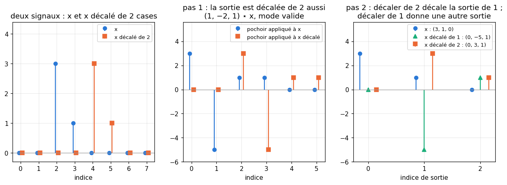
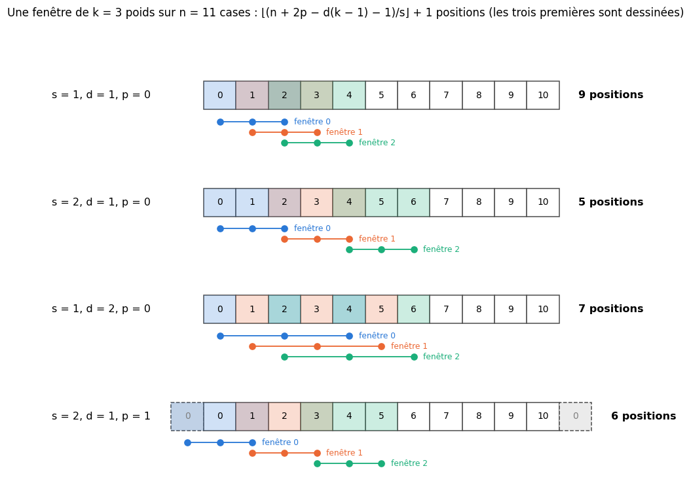

# M21 · Convolution, matrices de Toeplitz et équivariance — fiche de cours

> Une moyenne mobile (R5), le produit de deux polynômes (R3), la loi de la somme de deux dés (R8, M02b) : trois calculs qui sont la même opération, la **convolution** de deux suites. Ce chapitre la calcule d'abord à la main, sous ses deux formes : la convolution des mathématiciens, qui **retourne** le noyau, et la **corrélation croisée** des bibliothèques, qui ne le retourne pas, avec leurs modes et les **pochoirs** de différences finies. Il la regarde ensuite comme une application linéaire : sa matrice, de **Toeplitz**, est presque entièrement nulle (une **matrice creuse**) ; elle **commute avec les décalages** (l'**équivariance**), et, sur des signaux périodiques, les applications linéaires qui commutent avec les décalages sont exactement les convolutions **circulaires**. Puis il compte : les positions d'une fenêtre avec un **pas**, une **dilatation** et du **padding**, la taille d'une **convolution transposée**, les paramètres et le **coût** d'un filtrage à plusieurs **canaux**, le **champ récepteur** d'une pile de filtres ; au passage, les **noyaux séparables**. Il finit par le pire cas d'une petite perturbation, une **forme linéaire maximisée sur une boule**. Les exemples viennent des capteurs, des sons, des cartes d'altitudes et de météo, des polynômes et des dés ; le chapitre 21 de workbookIA appliquera ces outils aux réseaux convolutifs.

| | |
|---|---|
| **Sections** | §1 à §8 |
| **Temps total estimé** | ≈ 14,8 h : lecture et calculs de la fiche ≈ 2 h 40, exercices ≈ 11 h 25, 22 flashcards ≈ 45 min (parcours essentiel ≈ 11 h) |
| **Prérequis** | R5 (moyenne mobile) ; R3 (polynômes) ; R8 et M02b (loi d'un couple de variables discrètes, indépendance) ; M05a (différences finies avant, centrée et seconde) ; M09a (produit matriciel, transposée, coût d'un produit) ; M12a (matrice d'une application linéaire, noyau, rang, théorème du rang) ; M12d (rang 1, décomposition en valeurs singulières) ; R1 (parties entières $\lfloor x\rfloor$ et $\lceil x\rceil$) ; R4 (sommes $\Sigma$, récurrence) ; M07 (normes L1, L2 et L∞, Cauchy-Schwarz) ; R2 (fonction signe) ; M05b (approximation au premier ordre) ; M09b (moindres carrés) ; M20 (tableaux à plusieurs axes, formes, `einsum`) |
| **Fichiers du chapitre** | `02_exercices.md` (quiz, papier) · `03_notebook.ipynb` · `04_indices.md` · `05_solutions.md` et `05_solutions.ipynb` · `06_mes_reponses.md` · `flashcards.csv` |
| **mymath** | `convolution.py` : `convolve`, `toeplitz_matrix`, `circular_convolve`, `equivalent_kernel`, `separable_factors` |
| **MML** | — (le livre ne traite pas la convolution) |

## Comment utiliser ce chapitre

**Ordre conseillé.**
1. `python tools/start_chapter.py M21` (sur Colab : `00_setup/COLAB.md` §2) : il copie le notebook, ta feuille de réponses et le squelette `mymath/convolution.py`.
2. Section par section : lis **crayon en main**, refais chaque calcul ; puis fais les exercices de la section, quiz 🧠 d'abord.
3. Les exercices ✏️ et 🔗 se font sur papier, dans ta copie de `06_mes_reponses.md`, puis se vérifient dans la **partie 0** du notebook. Les démonstrations ∂ se rédigent dans ta copie et se jugent avec la grille de relecture de `05_solutions.md`.

Les §1 et §2 forment le socle (calculer une convolution et une corrélation à la main) ; les §3 et §4 regardent la convolution comme une application linéaire (sa matrice, sa transposée, les décalages) ; les §5 à §7 comptent (des positions, des paramètres, des opérations, un champ récepteur) ; le §8 est un outil court et indépendant, qui ne demande que M07 et M05b.

| Section | Quiz 🧠 et rappels 🔁 | Papier et réflexion | Notebook |
|---|---|---|---|
| §1 La convolution de deux suites | Q1, Q2, R1 | M21.1 ✏️, M21.12 ∂ | M21.19 🔨 |
| §2 Corrélation croisée, modes et pochoirs | Q1 | M21.2 ✏️, M21.3 ✏️, M21.17 🔗 | M21.19 🔨, M21.27 🐛 |
| §3 Matrices de Toeplitz et matrices creuses | Q3, R2 | M21.4 ✏️, M21.E1 💼 | M21.20 🔨, M21.28 🛠️, M21.29 🏆 |
| §4 Équivariance, convolutions circulaires, pooling | Q4 | M21.5 ✏️, M21.13 ∂, M21.18 🗣️ | M21.21 🔨, M21.24 🔮 |
| §5 Pas, dilatation, padding, convolution transposée | Q5 | M21.6 ✏️, M21.7 ✏️, M21.14 ∂ | M21.24 🔮, M21.26 🎨, M21.27 🐛 |
| §6 Grilles, canaux, noyaux séparables, coût | Q6, R3 | M21.8 ✏️, M21.9 ✏️, M21.17 🔗 | M21.22 🔨, M21.25 🔬, M21.27 🐛 |
| §7 Noyau équivalent et champ récepteur | Q7 | M21.10 ✏️, M21.15 ∂ | M21.23 🔨 |
| §8 Une forme linéaire sur une boule | Q8 | M21.11 ✏️, M21.16 ∂ | |

Parcours essentiel : tout sauf M21.Q8, M21.R3, M21.12, M21.13, M21.15, M21.16, M21.E1, M21.21, M21.22, M21.25, M21.28 et M21.29. Le théorème des convolutions circulaires (§4) se lit en survol.

## Lecture conseillée

Pas de lecture de MML pour ce chapitre : le livre ne traite pas la convolution. La documentation de NumPy sur `numpy.convolve` décrit les trois modes du §2 : lis-la **après le §2**. Celle de SciPy sur `scipy.signal.convolve2d` et `scipy.signal.correlate2d` reprend le §6 en deux dimensions.

Vocabulaire anglais de ce chapitre : *convolution*, *kernel*, *flipped kernel*, *cross-correlation*, *full*, *valid*, *same*, *moving average*, *generating function*, *stencil*, *finite difference*, *discrete Laplacian*, *Toeplitz matrix*, *banded matrix*, *sparse matrix*, *im2col*, *shift*, *translation equivariance*, *translation invariance*, *circular convolution*, *circulant matrix*, *fast Fourier transform* (FFT), *pooling* (*max pooling*, *average pooling*, *global pooling*), *stride*, *dilation* (*atrous*), *padding* (*zero padding*), *downsampling*, *upsampling*, *transposed convolution*, *output padding*, *checkerboard artifact*, *channel*, *depthwise convolution*, *grouped convolution*, *pointwise convolution* (1 × 1), *separable kernel*, *rank-one*, *outer product*, *multiply-accumulate* (MAC), *equivalent kernel*, *receptive field*, *dual norm*.

## Objectifs d'apprentissage

À la fin du chapitre, tu sais :
- **calculer** à la main la convolution et la corrélation croisée de deux suites, dans les modes plein, valide et même taille, et **passer** d'une convention à l'autre ;
- **écrire** la matrice de Toeplitz d'une convolution, **compter** ses coefficients non nuls, et **lire** son rang et son noyau ;
- **démontrer** et **utiliser** l'équivariance par translation, et **reconnaître** une convolution circulaire ;
- **compter** les positions d'une fenêtre avec pas, dilatation et padding, et **calculer** la taille d'une convolution transposée ;
- **compter** les paramètres et le coût d'un filtrage à plusieurs canaux, et **séparer** un noyau de rang 1 ;
- **composer** des convolutions en une seule, et **calculer** un champ récepteur ;
- **trouver** le pire cas d'une perturbation bornée d'une forme linéaire, pour les normes L∞ et L2.

## L'essentiel en 10 lignes

1. **Convolution** de deux suites : $(\mathbf{a} * \mathbf{b})_m = \sum_i a_i\,b_{m-i}$, de longueur $n + k - 1$. C'est le produit de deux polynômes, la loi de la somme de deux variables indépendantes à valeurs entières, une moyenne mobile ; elle est commutative, associative, linéaire.
2. **Corrélation croisée** (celle des bibliothèques) : $(\mathbf{w} \star \mathbf{x})_i = \sum_u w_u\,x_{i+u}$, sans retournement ; c'est la convolution par le **noyau retourné** $\tilde{\mathbf{w}}$, en mode valide. On dit toujours laquelle on calcule.
3. **Modes** : plein ($n + k - 1$ valeurs), valide ($n - k + 1$), même taille ($n$, à partir de l'indice $\lfloor\frac{k-1}{2}\rfloor$ de la pleine chez NumPy) ; pour un noyau de longueur paire, le « même taille » de NumPy et celui de PyTorch sont décalés d'une case.
4. **Pochoirs** : $(-1, 1)/h$, $(-1, 0, 1)/(2h)$ et $(1, -2, 1)/h^2$ dérivent un signal échantillonné ; le laplacien discret à 5 points en est la version 2D.
5. **Toeplitz** : $\mathbf{x} \mapsto \mathbf{x} * \mathbf{w}$ a pour matrice $T_{ij} = w_{i-j}$, constante sur chaque diagonale, avec au plus $nk$ coefficients non nuls : une **matrice creuse**. Sa transposée (mode valide) est la matrice de la convolution pleine par $\tilde{\mathbf{w}}$.
6. **Équivariance** : décaler puis filtrer = filtrer puis décaler, aux bords près ; avec un pas $s$, seulement pour les décalages multiples de $s$. Sur des signaux périodiques, une application linéaire commute avec le décalage si et seulement si c'est une **convolution circulaire**, et $\operatorname{circ}(\mathbf{h})^\top = \operatorname{circ}(\check{\mathbf{h}})$ avec $\check{\mathbf{h}} = (h_0, h_{n-1}, \ldots, h_1)$.
7. **Positions** : $\big\lfloor\frac{n + 2p - d(k-1) - 1}{s}\big\rfloor + 1$ quand la fenêtre tient ; « même taille » avec un pas : $\lceil n/s\rceil$. **Convolution transposée** : insérer $s - 1$ zéros puis convoluer en mode plein, $(m - 1)s - 2p + d(k - 1) + 1 + p_{\text{out}}$ valeurs.
8. **Canaux** : $C_{\text{out}}\big(\frac{C_{\text{in}}}{g}k_hk_w + 1\big)$ paramètres, $H_{\text{out}}W_{\text{out}}\,C_{\text{out}}\frac{C_{\text{in}}}{g}k_hk_w$ multiplications-additions ; un noyau de **rang 1** se sépare en deux passes 1D (environ $k_h + k_w$ multiplications au lieu de $k_hk_w$ par valeur).
9. **Composition** : deux sommes glissantes d'affilée font une seule somme glissante, de noyau $\mathbf{w}_1 * \mathbf{w}_2$ ; **champ récepteur** $r = 1 + \sum_\ell d_\ell(k_\ell - 1)\,s_1\cdots s_{\ell-1}$, pas total $S = s_1\cdots s_L$.
10. **Pire cas** : $\max_{\lVert\boldsymbol{\delta}\rVert_\infty \le \varepsilon}\mathbf{g} \cdot \boldsymbol{\delta} = \varepsilon\lVert\mathbf{g}\rVert_1$, atteint en $\varepsilon\operatorname{signe}(\mathbf{g})$ ; sur la boule L2, $\varepsilon\lVert\mathbf{g}\rVert_2$ ; et $\lVert\varepsilon\operatorname{signe}(\mathbf{g})\rVert_2 = \varepsilon\sqrt{n}$ (si aucun $g_i$ n'est nul).

## §1 · La convolution de deux suites : polynômes, dés et moyennes mobiles

### Trois calculs, une seule opération

Dans tout le chapitre, une **suite finie** $\mathbf{a} = (a_0, a_1, \ldots, a_{n-1})$ a ses indices **à partir de 0**, comme en Python, et l'on convient que $a_i = 0$ pour tout indice hors de $\{0, \ldots, n - 1\}$.

**Le produit de deux polynômes.** $P(X) = 1 - 2X + 4X^2$ a pour coefficients $\mathbf{a} = (1, -2, 4)$, $Q(X) = 3 + X$ a pour coefficients $\mathbf{b} = (3, 1)$. Dans le produit $PQ$, le coefficient de $X^m$ rassemble tous les produits $a_i b_j$ avec $i + j = m$ :

| | $b_0 = 3$ | $b_1 = 1$ |
|---|---|---|
| $a_0 = 1$ | $3$ | $1$ |
| $a_1 = -2$ | $-6$ | $-2$ |
| $a_2 = 4$ | $12$ | $4$ |

On additionne le tableau le long des anti-diagonales ($i + j$ constant) : $3$ ; $1 - 6 = -5$ ; $-2 + 12 = 10$ ; $4$. Donc $PQ = 3 - 5X + 10X^2 + 4X^3$, de coefficients $(3, -5, 10, 4)$.

**La loi de la somme de deux dés.** On lance un dé à 4 faces $D$ (numéros 1 à 4) et un dé à 6 faces $D'$ (numéros 1 à 6), équilibrés et indépendants. On range chaque loi dans une suite indexée par les valeurs : $\mathbf{p} = (0, \frac14, \frac14, \frac14, \frac14)$ et $\mathbf{q} = (0, \frac16, \ldots, \frac16)$ (7 termes). La somme $S = D + D'$ vaut $m$ quand $D = i$ et $D' = m - i$ pour un certain $i$ ; ces événements sont disjoints, et l'indépendance (M02b) donne
$$P(S = m) = \sum_i P(D = i)\,P(D' = m - i) = \sum_i p_i\,q_{m-i}.$$
En multipliant par 24 : $S = 2, 3, \ldots, 10$ a les poids $1, 2, 3, 4, 4, 4, 3, 2, 1$. Par exemple $P(S = 5) = \frac{4}{24} = \frac16$ (les couples $(1, 4)$, $(2, 3)$, $(3, 2)$, $(4, 1)$) et $P(S \ge 8) = \frac{3 + 2 + 1}{24} = \frac14$. C'est le calcul des polynômes : le tableau à double entrée où R8 comptait les couples, lu le long de ses anti-diagonales. D'ailleurs, $\frac{X + X^2 + X^3 + X^4}{4}\cdot\frac{X + \cdots + X^6}{6}$ a pour coefficients la loi de $S$ (le polynôme dont le coefficient de $X^m$ est $P(D = m)$ s'appelle la **fonction génératrice** de la loi).

**Une moyenne mobile.** R5 lissait une série de mesures par la moyenne des 3 dernières valeurs, $m_t = \frac{x_{t-2} + x_{t-1} + x_t}{3}$. Avec $\mathbf{h} = (\frac13, \frac13, \frac13)$, la somme $\sum_i x_i\,h_{t-i}$ ne garde que $i = t - 2$, $t - 1$, $t$ : c'est $m_t$. Pour les relevés horaires d'un capteur, $\mathbf{x} = (5, 11, 8, 2, 14)$, on trouve $m_2 = 8$, $m_3 = 7$ et $m_4 = 8$ ; aux indices 0, 1, 5 et 6, la fenêtre déborde du signal, et la même formule (avec des zéros hors du signal) donne $\frac53$, $\frac{16}{3}$, $\frac{16}{3}$ et $\frac{14}{3}$ : des moyennes faussées par les zéros (le §2 les appelle le mode plein).

Une moyenne **pondérée** dit quel poids donner à la valeur d'il y a $j$ pas : avec $\mathbf{w} = (0{,}6 ;\ 0{,}3 ;\ 0{,}1)$, $y_t = 0{,}6\,x_t + 0{,}3\,x_{t-1} + 0{,}1\,x_{t-2} = \sum_j w_j\,x_{t-j}$. Sur le même capteur : $y_2 = 4{,}8 + 3{,}3 + 0{,}5 = 8{,}6$, puis $y_3 = 4{,}7$ et $y_4 = 9{,}8$. C'est encore la même somme, et elle explique le **retournement** : $w_0$ multiplie la valeur la plus récente. Si l'on écrit la fenêtre dans l'ordre du temps, $(x_{t-2}, x_{t-1}, x_t)$, les poids qui lui correspondent se lisent à l'envers, $(w_2, w_1, w_0)$.

> **Définition.** La **convolution** (*convolution*) de deux suites finies $\mathbf{a}$ (de longueur $n$) et $\mathbf{b}$ (de longueur $k$) est la suite
> $$(\mathbf{a} * \mathbf{b})_m = \sum_i a_i\,b_{m-i}, \qquad m = 0, 1, \ldots, n + k - 2,$$
> la somme portant sur les indices $i$ où $a_i$ et $b_{m-i}$ existent. Elle a $n + k - 1$ termes. Quand l'une des deux suites joue le rôle d'un filtre, on l'appelle le **noyau** (*kernel*).

### Les propriétés

> **Propriétés** (∂ M21.12 démontre les deux premières sur la formule).
> - **Commutative** : $\mathbf{a} * \mathbf{b} = \mathbf{b} * \mathbf{a}$.
> - **Associative** : $(\mathbf{a} * \mathbf{b}) * \mathbf{c} = \mathbf{a} * (\mathbf{b} * \mathbf{c})$.
> - **Linéaire** par rapport à chacune des deux suites : $(\lambda\mathbf{a} + \mu\mathbf{a}') * \mathbf{b} = \lambda\,(\mathbf{a} * \mathbf{b}) + \mu\,(\mathbf{a}' * \mathbf{b})$.
> - **Élément neutre** : la suite $(1)$, $\mathbf{a} * (1) = \mathbf{a}$ ; et la suite $(0, \ldots, 0, 1)$ à $t$ zéros **retarde** de $t$ : $(\mathbf{a} * (0, \ldots, 0, 1))_m = a_{m-t}$.
> - **Sommes** : $\sum_m (\mathbf{a} * \mathbf{b})_m = \big(\sum_i a_i\big)\big(\sum_j b_j\big)$.

Le point de vue des polynômes les rend naturelles : le produit de polynômes est commutatif, associatif et distributif, et évaluer en $X = 1$ donne la propriété des sommes ($3 - 5 + 10 + 4 = 12 = 3 \times 4$). Pour les dés, la somme d'une loi vaut 1, et $1 \times 1 = 1$ : la convolution de deux lois est une loi.

**Une conséquence.** Sur une portion de signal **constante**, égale à $c$, chaque valeur complète $\sum_j w_j\,x_{t-j}$ vaut $c\sum_j w_j$. Un noyau de somme 1 (une moyenne) laisse un signal constant inchangé ; un noyau de somme 0 (une différence, §2) l'efface.

⚠️ **Erreur classique.** Oublier des produits sur une anti-diagonale ; croire que le résultat a la longueur de la plus longue suite (il en a $n + k - 1$) ; ou écrire $\sum_i a_i\,b_{m+i}$ : ce n'est plus une convolution, c'est la corrélation du §2.

## §2 · Corrélation croisée, retournement, modes et pochoirs

### La somme glissante des bibliothèques

Les bibliothèques d'apprentissage (et workbookIA) calculent autre chose : elles posent le noyau sur une **fenêtre** du signal, multiplient case par case, additionnent, puis font glisser la fenêtre d'un cran, **sans retourner** le noyau.

> **Définition.** La **corrélation croisée** (*cross-correlation*) d'un signal $\mathbf{x}$ de longueur $n$ par un noyau $\mathbf{w}$ de longueur $k \le n$, en mode valide (les seules fenêtres entières ; les autres modes viennent plus bas), est
> $$(\mathbf{w} \star \mathbf{x})_i = \sum_{u=0}^{k-1} w_u\,x_{i+u}, \qquad i = 0, 1, \ldots, n - k.$$
> La fenêtre numéro $i$ est repérée par sa **première case** : elle couvre $x_i, \ldots, x_{i+k-1}$.

**Exemple.** $\mathbf{x} = (2, 5, -1, 3, 0, 4)$ et $\mathbf{w} = (3, 1, -2)$ :
- $i = 0$ : $3 \times 2 + 1 \times 5 + (-2) \times (-1) = 6 + 5 + 2 = 13$ ;
- $i = 1$ : $3 \times 5 + 1 \times (-1) + (-2) \times 3 = 15 - 1 - 6 = 8$ ;
- $i = 2$ : $-3 + 3 + 0 = 0$ ; $i = 3$ : $9 + 0 - 8 = 1$.

Donc $\mathbf{w} \star \mathbf{x} = (13, 8, 0, 1)$ : $6 - 3 + 1 = 4$ valeurs.

### Le lien : retourner le noyau

Le **noyau retourné** est $\tilde{\mathbf{w}} = (w_{k-1}, \ldots, w_1, w_0)$, c'est-à-dire $\tilde w_u = w_{k-1-u}$. En posant $j = i + u$ dans la définition de la convolution, on obtient :

> **Le lien.** Pour $i = 0, \ldots, n - k$ : $(\mathbf{w} \star \mathbf{x})_i = (\mathbf{x} * \tilde{\mathbf{w}})_{i+k-1}$. La corrélation croisée par $\mathbf{w}$ est la convolution par le noyau retourné, en ne gardant que les fenêtres complètes ; et la convolution par $\mathbf{w}$ est la corrélation croisée par $\tilde{\mathbf{w}}$.

**Exemple (suite).** La convolution $\mathbf{x} * \mathbf{w}$, sur les fenêtres complètes, se calcule en faisant glisser $\tilde{\mathbf{w}} = (-2, 1, 3)$ : $(-2) \times 2 + 1 \times 5 + 3 \times (-1) = -2$, puis $-2$, $5$ et $6$. Elle vaut $(-2, -2, 5, 6)$, rien à voir avec $(13, 8, 0, 1)$.

Deux cas particuliers : si le noyau est **symétrique** ($\tilde{\mathbf{w}} = \mathbf{w}$, comme $(1, -2, 1)$), convolution et corrélation coïncident ; s'il est **antisymétrique** ($\tilde{\mathbf{w}} = -\mathbf{w}$, comme $(-1, 0, 1)$), elles sont opposées. Et contrairement à la convolution, la corrélation croisée n'est ni commutative ni associative (∂ M21.12).

📐 **Notations.** Deux opérations portent le nom de convolution, et la fiche les distingue partout :
- la **convolution** des mathématiciens, $\mathbf{x} * \mathbf{w}$, retourne le noyau : c'est celle des polynômes, des lois de probabilité, de `np.convolve` et de la fonction `convolve` de `mymath` (M21.19), et c'est celle que M22 retrouvera dans les récurrences ;
- la **corrélation croisée**, $\mathbf{w} \star \mathbf{x}$, ne le retourne pas : c'est celle de `np.correlate` et des couches de convolution des bibliothèques (PyTorch, Keras), que workbookIA 21 utilise. Ces bibliothèques l'appellent pourtant « convolution » : comme leurs noyaux sont appris, les retourner ne changerait rien à ce qu'elles peuvent calculer.

Indices à partir de 0 ; $\mathbf{x}$ un signal de longueur $n$, $\mathbf{w}$ (ou $\mathbf{h}$) un noyau de longueur $k$, $\tilde{\mathbf{w}}$ le noyau retourné. Certains livres **centrent** la fenêtre (noyau numéroté de $-r$ à $r$ pour $k = 2r + 1$) : la sortie $i$ est alors associée à la case $i$, comme dans le mode « même taille » ci-dessous (pour $k$ impair).

### Trois modes

On peut garder plus ou moins de valeurs selon ce qu'on fait des bords :
- **plein** (*full*) : toutes les positions où le noyau touche le signal, en complétant par des zéros ; $n + k - 1$ valeurs ;
- **valide** (*valid*) : seulement les fenêtres entièrement dans le signal ; $n - k + 1$ valeurs (en général $\max(n, k) - \min(n, k) + 1$, la plus courte des deux suites glissant dans la plus longue) ;
- **même taille** (*same*) : autant de valeurs que la plus longue des deux suites, $\max(n, k)$ (le signal, quand $n \ge k$). NumPy les prend dans la convolution pleine **à partir de l'indice** $\big\lfloor\frac{\min(n, k) - 1}{2}\big\rfloor$.

Sur l'exemple, $\mathbf{x} * \mathbf{w}$ vaut, en mode plein, $(6, 17, -2, -2, 5, 6, 4, -8)$ ; en mode valide, $(-2, -2, 5, 6)$ (les indices 2 à 5 de la pleine) ; en mode même taille, $(17, -2, -2, 5, 6, 4)$ (les indices 1 à 6). Vu comme une corrélation par $\tilde{\mathbf{w}}$, le mode plein ajoute $k - 1$ zéros de chaque côté du signal, le mode valide aucun ; pour $k$ impair, le mode même taille en ajoute $\frac{k-1}{2}$ de chaque côté, et le coefficient du **milieu** du noyau tombe sur $x_i$ : la fenêtre est centrée.

**Un noyau de longueur paire.** Le mode même taille demande alors $k - 1$ zéros en tout, un nombre impair : un côté en reçoit un de plus. Vu comme une corrélation par $\tilde{\mathbf{w}}$, `np.convolve` (et donc `convolve`) met le zéro en trop **à gauche** ; PyTorch, avec `padding="same"`, le met **à droite**. Avec $\mathbf{x} = (2, 6, 1, 5)$ et la corrélation de poids $(1, 3)$ : PyTorch calcule $y_i = x_i + 3x_{i+1}$, avec un zéro à droite, soit $(20, 9, 16, 5)$ ; `np.convolve(x, [3, 1], "same")` donne $(6, 20, 9, 16)$, les mêmes nombres **décalés d'une case**.

⚠️ **Erreur classique.** Passer à `np.convolve` les poids d'une corrélation, sans les retourner : pour un noyau antisymétrique (une dérivée), le résultat change de signe ; pour un noyau quelconque, il est faux.

### Les pochoirs de différences finies

Un capteur donne les valeurs $f_i = f(t_i)$ d'une fonction en des instants régulièrement espacés, $t_i = t_0 + i\,h$. Les différences finies de M05a s'écrivent alors comme des sommes glissantes à poids fixes, des **pochoirs** (*stencils*) :
- la **différence avant** $\frac{f_{i+1} - f_i}{h}$ : les poids $\frac1h(-1, 1)$ ; elle approche $f'$ au milieu $t_i + \frac h2$ avec une erreur d'ordre 2, et en $t_i$ avec une erreur d'ordre 1 ;
- la **différence centrée** $\frac{f_{i+1} - f_{i-1}}{2h}$ : les poids $\frac1{2h}(-1, 0, 1)$, sur la fenêtre qui commence en $i - 1$ ; ordre 2 ;
- la **dérivée seconde** $\frac{f_{i+1} - 2f_i + f_{i-1}}{h^2}$ : les poids $\frac1{h^2}(1, -2, 1)$ ; ordre 2.

Ce sont des corrélations : pour les appliquer avec `np.convolve`, on retourne les poids, ce qui change le signe des deux premiers (antisymétriques) et ne change pas le troisième (symétrique).

**Exemple.** Un chariot avance sur un rail ; sa position est relevée toutes les $h = 0{,}5$ s : $(1 ;\ 1{,}5 ;\ 3 ;\ 5{,}5 ;\ 9)$ m. La différence avant donne $\frac{(0{,}5 ;\ 1{,}5 ;\ 2{,}5 ;\ 3{,}5)}{0{,}5} = (1, 3, 5, 7)$ m/s ; la différence centrée, aux instants 0,5, 1 et 1,5 s, $(2, 4, 6)$ m/s ; la dérivée seconde, $(4, 4, 4)$ m/s². Ces positions sont celles de $x(t) = 2t^2 + 1$, de vitesse $4t$ et d'accélération 4 : les trois pochoirs sont **exacts** ici (sur une parabole, l'erreur de la différence centrée, en $\frac{h^2}{6}f'''$, est nulle, et celle de la différence avant au milieu aussi).

**En deux dimensions**, sur une grille de pas $h$ dans les deux directions, la somme des dérivées secondes le long des deux axes est le **laplacien discret** (*discrete Laplacian*) :
$$\Delta f_{i,j} \approx \frac{f_{i+1,j} + f_{i-1,j} + f_{i,j+1} + f_{i,j-1} - 4f_{i,j}}{h^2}, \qquad \text{pochoir } \frac1{h^2}\begin{pmatrix} 0 & 1 & 0 \\ 1 & -4 & 1 \\ 0 & 1 & 0 \end{pmatrix}.$$
Au facteur $\frac4{h^2}$ près, il mesure l'écart entre la moyenne des quatre voisines d'une case et la case elle-même : il est **négatif sur un sommet** (la case dépasse ses voisines), **positif dans un creux**. Le §6 l'applique à une carte d'altitudes.

## §3 · La convolution comme application linéaire : matrices de Toeplitz et matrices creuses

### La matrice d'une convolution

Pour un noyau $\mathbf{w}$ fixé, de longueur $k$, l'application $\mathbf{x} \mapsto \mathbf{x} * \mathbf{w}$, de $\mathbb{R}^n$ dans $\mathbb{R}^{n+k-1}$, est **linéaire** (§1). Sa matrice $\mathbf{T}$ (M12a) a pour colonne $j$ l'image du $j$-ième vecteur de la base canonique, $\mathbf{e}_j * \mathbf{w}$ : c'est le noyau, **descendu de $j$ lignes**. D'où
$$T_{ij} = w_{i-j} \quad (\text{et } 0 \text{ quand } i - j \notin \{0, \ldots, k - 1\}), \qquad \mathbf{T} \text{ de forme } (n + k - 1, n).$$

**Exemple.** $\mathbf{w} = (3, -1, 2)$ et $n = 4$ :
$$\mathbf{T} = \begin{pmatrix} 3 & 0 & 0 & 0 \\ -1 & 3 & 0 & 0 \\ 2 & -1 & 3 & 0 \\ 0 & 2 & -1 & 3 \\ 0 & 0 & 2 & -1 \\ 0 & 0 & 0 & 2 \end{pmatrix}, \qquad \mathbf{T}\begin{pmatrix} 2 \\ -1 \\ 0 \\ 1 \end{pmatrix} = \begin{pmatrix} 6 \\ -5 \\ 5 \\ 1 \\ -1 \\ 2 \end{pmatrix} = (2, -1, 0, 1) * \mathbf{w}.$$
Chaque **diagonale** est constante : le coefficient $(i, j)$ ne dépend que de $i - j$. Une telle matrice s'appelle une **matrice de Toeplitz** (*Toeplitz matrix*). Le mode valide garde les lignes $k - 1$ à $n - 1$ (ici les lignes 2 et 3), soit $\begin{pmatrix} 2 & -1 & 3 & 0 \\ 0 & 2 & -1 & 3 \end{pmatrix}$, de forme $(n - k + 1, n)$ ; le mode même taille garde $n$ lignes à partir de la ligne $\lfloor\frac{k-1}{2}\rfloor$ (ici les lignes 1 à 4). C'est ce que calcule `toeplitz_matrix` (M21.20).

### Une matrice creuse

Sur ses $(n + k - 1)\,n$ coefficients, $\mathbf{T}$ en a au plus $nk$ non nuls ($k$ par colonne, exactement quand aucun coefficient de $\mathbf{w}$ n'est nul ; le pochoir $(-1, 0, 1)$ n'en met que 2 par colonne) : 12 sur 24 dans l'exemple, et, en mode valide, $(n - k + 1)k = 6$ sur 8. Pour un vrai signal, la proportion s'effondre : pour un son de $n = 10\,000$ échantillons et un noyau de $k = 5$ coefficients, $\mathbf{T}$ a $10\,004 \times 10\,000 \approx 10^8$ coefficients, dont $50\,000$ non nuls, soit $0{,}05$ %. Une matrice dont presque tous les coefficients sont nuls est dite **creuse** (*sparse matrix*) ; on ne stocke que ses coefficients non nuls, avec leur position, et un produit $\mathbf{T}\mathbf{x}$ coûte alors une multiplication-addition **par coefficient non nul** : $5 \times 10^4$ au lieu des $10^8$ d'un produit dense (M09a). C'est le coût d'une convolution pleine : $nk$ multiplications. Comme ses coefficients non nuls sont tous près de la diagonale, on dit aussi une **matrice bande** (*banded matrix*).

### Rang et noyau

Le mot **noyau** a ici deux sens : le noyau $\mathbf{w}$ d'une convolution, et le noyau $\ker\mathbf{T}$ d'une application linéaire (M12a), l'ensemble des signaux qu'elle envoie sur $\mathbf{0}$. Le contexte tranche ; la fiche écrit $\ker$ pour le second.

- **Mode plein.** Sur l'exemple, les 4 colonnes de $\mathbf{T}$ sont indépendantes : $\operatorname{rg}\mathbf{T} = 4 = n$, et $\ker\mathbf{T} = \{\mathbf{0}\}$. On admet que c'est vrai pour tout noyau non nul : une convolution pleine ne perd aucune information.
- **Mode valide.** La matrice a $n - k + 1 < n$ lignes, donc un rang au plus $n - k + 1$, et, par le théorème du rang, $\dim\ker \ge k - 1$ : pour $k \ge 2$, il y a des signaux non nuls que le filtre **ne voit pas**. La différence $(-1, 1)$ efface les signaux constants ($\dim\ker = 1$) ; la dérivée seconde $(1, -2, 1)$ efface les signaux affines $a + bi$, comme $(4, 1, -2, -5, -8)$ ($\dim\ker = 2$). La moyenne mobile sur 3 valeurs, en mode valide sur $n = 6$ valeurs, a une matrice $4 \times 6$ de rang 4 : son noyau, de dimension 2, est engendré par $(1, -1, 0, 1, -1, 0)$ et $(0, 1, -1, 0, 1, -1)$. Toute oscillation de période 3 et de somme nulle sur une période est effacée. Pour $\mathbf{w} = (3, -1, 2)$ et $n = 4$, le rang vaut 2 et le noyau est de dimension 2.

### La matrice des fenêtres

Le même produit s'écrit dans l'autre sens. Rangeons les fenêtres du signal dans les **lignes** d'une matrice $\mathbf{X}_{\text{f}}$, de forme $(n - k + 1, k)$, de ligne $i$ égale à $(x_i, \ldots, x_{i+k-1})$ : alors
$$\mathbf{w} \star \mathbf{x} = \mathbf{X}_{\text{f}}\,\mathbf{w}.$$
Avec le signal du §2 : $\begin{pmatrix} 2 & 5 & -1 \\ 5 & -1 & 3 \\ -1 & 3 & 0 \\ 3 & 0 & 4 \end{pmatrix}\begin{pmatrix} 3 \\ 1 \\ -2 \end{pmatrix} = \begin{pmatrix} 13 \\ 8 \\ 0 \\ 1 \end{pmatrix}$. Cette fois, la matrice est faite avec le **signal**, et le vecteur est le **noyau**. Les bibliothèques construisent cette **matrice des fenêtres** sous le nom d'*im2col* (*image to columns* : elles rangent les fenêtres en colonnes plutôt qu'en lignes) ; chaque valeur du signal y est recopiée jusqu'à $k$ fois, mais toute la convolution devient **un seul produit matriciel**, que les machines font très vite. Cette écriture montre aussi que la sortie est **linéaire en $\mathbf{w}$** : retrouver un noyau inconnu à partir d'un signal et de sa version filtrée et bruitée, c'est minimiser $\lVert\mathbf{X}_{\text{f}}\mathbf{w} - \mathbf{y}\rVert^2$, un problème de moindres carrés (M09b ; 🏆 M21.29).

### La transposée

> **Énoncé** (admis ici ; ∂ M21.13 le démontre pour les matrices circulantes du §4). Soit $\mathbf{w}$ un noyau de longueur $k$, et des signaux de longueur $n \ge k$.
> - La transposée de la matrice de la convolution **valide** par $\mathbf{w}$ est la matrice de la convolution **pleine** par le noyau retourné $\tilde{\mathbf{w}}$ (sur des signaux de longueur $n - k + 1$).
> - Réciproquement, la transposée de la matrice de la convolution pleine par $\mathbf{w}$ est celle de la convolution valide par $\tilde{\mathbf{w}}$.
> - En mode **même taille**, la transposée est la matrice du mode même taille par $\tilde{\mathbf{w}}$ **seulement si $k$ est impair** ; pour $k$ pair, le décalage du §2 la met en défaut.

**Exemple.** Pour $\mathbf{w} = (3, -1, 2)$ et $n = 4$, la transposée de la matrice valide est $\begin{pmatrix} 2 & 0 \\ -1 & 2 \\ 3 & -1 \\ 0 & 3 \end{pmatrix}$ : ses colonnes sont $(2, -1, 3)$ descendu de 0 puis de 1 ligne, c'est la matrice de $\mathbf{y} \mapsto \mathbf{y} * (2, -1, 3)$ en mode plein, pour $\mathbf{y} \in \mathbb{R}^2$.

Comment la lire : les lignes de $\mathbf{T}^\top$ sont les colonnes de $\mathbf{T}$, le noyau descendu ligne après ligne. Le §5 en tire la convolution transposée.

💻 **Aujourd'hui en pratique** — personne ne construit la matrice de Toeplitz d'une convolution : elle demande $n^2$ cases pour $nk$ nombres utiles. Les bibliothèques font des boucles optimisées, passent par la matrice des fenêtres, ou, pour les longs noyaux, par la transformée de Fourier (§4). La matrice sert à **raisonner** : linéarité, rang, transposée. Quand une matrice creuse doit être stockée (les grands systèmes de M19), `scipy.sparse` ne garde que ses coefficients non nuls.

🔗 **Dans workbookIA** — le chapitre 21 décrit une convolution comme la multiplication par une grande matrice creuse, et la convolution transposée comme la multiplication par sa transposée (§5).

## §4 · Équivariance par translation : décalages, convolutions circulaires et pooling

### Décaler puis filtrer, ou filtrer puis décaler

Prenons d'abord des suites indexées par tous les entiers, nulles hors d'un ensemble fini : il n'y a pas encore de bords. Le **décalage** (*shift*) de $t$ cases est $\tau_t$ : $(\tau_t\mathbf{x})_i = x_{i-t}$ ; il retarde le signal de $t$ (il le pousse vers la droite). Une application $F$ qui transforme des signaux est **équivariante** par translation (*translation equivariance*) si $F(\tau_t\mathbf{x}) = \tau_t F(\mathbf{x})$ pour tout $t$ : décaler l'entrée décale la sortie d'autant. Elle est **invariante** (*translation invariance*) si $F(\tau_t\mathbf{x}) = F(\mathbf{x})$ : décaler l'entrée ne change rien.

> **Propriété.** La convolution et la corrélation croisée par un noyau fixé sont équivariantes par translation : $(\tau_t\mathbf{x}) * \mathbf{w} = \tau_t(\mathbf{x} * \mathbf{w})$.

En effet, $((\tau_t\mathbf{x}) * \mathbf{w})_m = \sum_i x_{i-t}\,w_{m-i} = \sum_j x_j\,w_{m-t-j} = (\mathbf{x} * \mathbf{w})_{m-t}$, en posant $j = i - t$. Le sens : les **mêmes poids** servent à toutes les positions, donc un motif produit la même réponse où qu'il soit, et cette réponse se déplace avec lui. Une convolution est équivariante, pas invariante : sa sortie bouge.

**Exemple.** Un capteur enregistre un bref événement, $\mathbf{x} = (0, 0, 3, 1, 0, 0, 0, 0)$, que l'on filtre par le pochoir $(1, -2, 1)$ en mode valide : $(3, -5, 1, 1, 0, 0)$. Le même événement, deux cases plus tard, $(0, 0, 0, 0, 3, 1, 0, 0)$, donne $(0, 0, 3, -5, 1, 1)$ : la même réponse, décalée de deux cases.

**Les bords.** Sur un signal fini, un décalage fait sortir des valeurs par un bout et entrer des zéros par l'autre : l'équivariance ne vaut que tant que le motif reste loin des bords. Décalé de 4 cases, l'événement devient $(0, 0, 0, 0, 0, 0, 3, 1)$ et donne $(0, 0, 0, 0, 3, -5)$ : les deux dernières valeurs de la réponse, $1$ et $1$, sont perdues, faute de positions. Avec du padding (§5), les valeurs près du bord sont calculées avec des zéros qui ne sont pas des mesures.

**Le pas.** Avec un pas $s$ (§5), on ne calcule qu'une position sur $s$ : $y_i = \sum_u w_u\,x_{si+u}$. Un décalage de $t$ cases, avec $t$ multiple de $s$, décale la sortie de $\frac ts$ ; sinon, les positions calculées tombent ailleurs sur le signal, et la nouvelle sortie n'est pas, en général, un décalage de l'ancienne. Avec le même pochoir et un pas de 2 : l'événement donne $(3, 1, 0)$ ; décalé de 2 cases, $(0, 3, 1)$, décalé d'une case de sortie ; décalé d'une seule case, $(0, -5, 1)$, qui n'est ni $(3, 1, 0)$ ni un décalage de $(3, 1, 0)$.

### Les convolutions circulaires

Certains signaux sont **périodiques** : la température en $n$ points régulièrement répartis autour d'une conduite circulaire, ou le profil moyen d'une journée, où l'heure 24 est l'heure 0. On lit alors les indices **modulo $n$** : l'indice $n$ est l'indice $0$. Le décalage circulaire $\mathbf{P}$ pousse tout d'une case, et la dernière valeur revient au début : $(\mathbf{P}\mathbf{x})_i = x_{(i-1) \bmod n}$. Pour $n = 4$,
$$\mathbf{P} = \begin{pmatrix} 0 & 0 & 0 & 1 \\ 1 & 0 & 0 & 0 \\ 0 & 1 & 0 & 0 \\ 0 & 0 & 1 & 0 \end{pmatrix}, \qquad \mathbf{P}\,(5, 6, 7, 8) = (8, 5, 6, 7).$$

> **Définition.** La **convolution circulaire** de deux suites de même longueur $n$ est
> $$(\mathbf{a} \circledast \mathbf{b})_m = \sum_{i=0}^{n-1} a_i\,b_{(m-i) \bmod n}, \qquad m = 0, \ldots, n - 1.$$
> L'application $\mathbf{x} \mapsto \mathbf{x} \circledast \mathbf{h}$ a pour matrice $\operatorname{circ}(\mathbf{h})$, de coefficients $h_{(i-j) \bmod n}$ : chaque colonne est la précédente, descendue d'une case, la dernière case remontant en haut. C'est une **matrice circulante** (*circulant matrix*), un cas particulier de matrice de Toeplitz.

**Exemple.** $\mathbf{h} = (4, 1, 0, 2)$ :
$$\operatorname{circ}(\mathbf{h}) = \begin{pmatrix} 4 & 2 & 0 & 1 \\ 1 & 4 & 2 & 0 \\ 0 & 1 & 4 & 2 \\ 2 & 0 & 1 & 4 \end{pmatrix}, \qquad \mathbf{a} = (1, 0, 3, 2) : \quad \mathbf{a} \circledast \mathbf{h} = \operatorname{circ}(\mathbf{h})\,\mathbf{a} = (6, 7, 16, 13).$$
Elle est commutative, comme la convolution ordinaire, et `circular_convolve` la calcule (M21.21). Le lien avec la convolution ordinaire : $\mathbf{a} * \mathbf{h} = (4, 1, 12, 13, 2, 6, 4)$, et en **repliant** ses termes modulo 4 (on ajoute le terme $m + 4$ au terme $m$), $(4 + 2, 1 + 6, 12 + 4, 13) = (6, 7, 16, 13)$. Donc, si l'on complète deux suites de longueurs $n$ et $k$ par des zéros jusqu'à une même longueur $N \ge n + k - 1$, rien ne se replie, et leur convolution circulaire de période $N$ donne leur convolution pleine.

Le décalage $\mathbf{P}$ est lui-même la convolution circulaire par $(0, 1, 0, \ldots, 0)$, et deux convolutions circulaires commutent : $\operatorname{circ}(\mathbf{h})\,\mathbf{P} = \mathbf{P}\operatorname{circ}(\mathbf{h})$, l'équivariance du cas périodique, cette fois sans bords. La réciproque est vraie :

> **Théorème** (∂ M21.13). Une matrice $\mathbf{A}$ de forme $(n, n)$ commute avec le décalage circulaire, $\mathbf{A}\mathbf{P} = \mathbf{P}\mathbf{A}$, si et seulement si $\mathbf{A} = \operatorname{circ}(\mathbf{h})$, où $\mathbf{h}$ est la première colonne de $\mathbf{A}$. De plus, $\operatorname{circ}(\mathbf{h})^\top = \operatorname{circ}(\check{\mathbf{h}})$, avec le **noyau retourné circulaire**
> $$\check{\mathbf{h}} = (h_0, h_{n-1}, h_{n-2}, \ldots, h_1), \qquad \check h_m = h_{(-m) \bmod n}.$$

L'idée de la première partie : les vecteurs de la base canonique sont tous des décalés du premier, $\mathbf{e}_j = \mathbf{P}^j\mathbf{e}_0$, donc une matrice qui commute avec $\mathbf{P}$ est connue dès qu'on connaît sa première colonne. **Les applications linéaires qui respectent les décalages sont exactement les convolutions** : l'équivariance caractérise la convolution. Sur l'exemple, $\check{\mathbf{h}} = (4, 2, 0, 1)$, et $\operatorname{circ}(\mathbf{h})^\top = \begin{pmatrix} 4 & 1 & 0 & 2 \\ 2 & 4 & 1 & 0 \\ 0 & 2 & 4 & 1 \\ 1 & 0 & 2 & 4 \end{pmatrix} = \operatorname{circ}(4, 2, 0, 1)$ : c'est la version périodique, et démontrée, de l'énoncé du §3.

⚠️ **Erreur classique.** Retourner un noyau circulaire en renversant simplement la suite : le renversement de $(4, 1, 0, 2)$ est $(2, 0, 1, 4)$, alors que $\check{\mathbf{h}} = (4, 2, 0, 1)$ garde $h_0$ à sa place, puisque l'indice $-0$ est $0$. Le renversement simple, $(h_{n-1}, \ldots, h_0)$, ne coïncide avec $\check{\mathbf{h}}$ qu'à un décalage circulaire près.

💻 **Aujourd'hui en pratique** — toutes les matrices circulantes de taille $n$ ont les **mêmes vecteurs propres** (des suites de nombres complexes) : dans cette base commune, la **transformée de Fourier discrète**, une convolution circulaire devient un produit coordonnée par coordonnée, et la **transformée de Fourier rapide** (FFT, *fast Fourier transform*) fait ce changement de base en environ $n\log_2 n$ opérations au lieu de $n^2$. `scipy.signal.fftconvolve` s'en sert, après un padding de zéros pour que rien ne se replie : c'est rentable pour de longs noyaux, pas pour $k = 3$ ou $5$. Ce chapitre n'enseigne pas la transformée de Fourier.

### Le pooling

Le **pooling** de largeur $k$ et de pas $k$ remplace chaque bloc de $k$ valeurs consécutives par leur **moyenne** (*average pooling*) ou par leur **maximum** (*max pooling*). Pour $\mathbf{x} = (2, 7, 1, 1, 4, 0, 5, 3)$, par blocs de 2 : les moyennes $(4{,}5 ;\ 1 ;\ 2 ;\ 4)$, les maximums $(7, 1, 4, 5)$.
- Le pooling **moyen** est une corrélation par $(\frac1k, \ldots, \frac1k)$, suivie d'un **sous-échantillonnage** qui garde une valeur sur $k$ : c'est une convolution avec un pas $k$ (§5), donc une application linéaire.
- Le pooling **max** n'est **pas linéaire** : $\max(1, 0) + \max(0, 1) = 2$, alors que le maximum de la somme $(1, 1)$ vaut 1.

**Décaler.** Décalé de 2 cases (un bloc), le signal devient $(0, 0, 2, 7, 1, 1, 4, 0)$, et ses maximums $(0, 7, 1, 4)$ : décalés d'un bloc, l'équivariance avec un pas. Décalé d'une seule case, $(0, 2, 7, 1, 1, 4, 0, 5)$, il donne les maximums $(2, 7, 4, 5)$ et les moyennes $(1 ;\ 4 ;\ 2{,}5 ;\ 2{,}5)$. Les maximums des deux derniers blocs n'ont pas bougé : quand le décalage laisse le maximum dans son bloc, le max ne voit rien. C'est une **invariance locale**, approchée, qui vaut pour certains petits décalages. Les moyennes, elles, ont toutes changé.

**Le pooling global** prend le maximum (ou la moyenne) de tout le signal : il est **invariant** par tout décalage qui garde le signal entier (un signal périodique, ou entouré d'assez de zéros). Sur l'exemple, le maximum reste 7 après les deux décalages, parce que le 7 n'est pas sorti du signal ; la moyenne, elle, passe de 23/8 à 20/8, car une valeur est sortie.

🔗 **Dans workbookIA** — le chapitre 21 applique les mêmes poids à toutes les positions d'une image, et alterne ses convolutions avec des étapes de pooling.

## §5 · Pas, dilatation, padding : compter les positions, et la convolution transposée

### Trois réglages

Une somme glissante (une corrélation, comme celles des bibliothèques) se règle de trois façons :
- le **padding** $p$ : on ajoute $p$ zéros de chaque côté du signal, qui devient $\hat{\mathbf{x}}$, de longueur $n + 2p$ ($\hat x_j = x_{j-p}$) ;
- le **pas** $s$ (*stride*) : la fenêtre avance de $s$ cases à la fois ;
- la **dilatation** $d$ (*dilation*) : la fenêtre ne lit qu'une case sur $d$ ; ses $k$ cases couvrent une **étendue** de $d(k - 1) + 1$ cases.

$$y_i = \sum_{u=0}^{k-1} w_u\,\hat x_{si + du}, \qquad \text{la fenêtre } i \text{ lisant les cases } si,\ si + d,\ \ldots,\ si + d(k - 1) \text{ de } \hat{\mathbf{x}}.$$
Avec $p = 0$, $s = 1$ et $d = 1$, c'est la corrélation valide du §2.

### Compter les positions

> **Théorème** (∂ M21.14). Si $n + 2p \ge d(k - 1) + 1$ (la fenêtre tient au moins une fois dans le signal complété), le nombre de positions est
> $$n_{\text{out}} = \left\lfloor\frac{n + 2p - d(k - 1) - 1}{s}\right\rfloor + 1.$$

L'idée : une position existe quand la **dernière case** de sa fenêtre reste dans le signal complété ; ∂ M21.14 en fait un dénombrement. Sans l'hypothèse, la formule donne 0 ou un nombre négatif : aucune position.

**Exemples.**
- $n = 50$, $k = 4$, $s = 3$, $p = 1$ : $\big\lfloor\frac{50 + 2 - 3 - 1}{3}\big\rfloor + 1 = \lfloor 16\rfloor + 1 = 17$. Avec en plus $d = 2$ (étendue 7) : $\big\lfloor\frac{45}{3}\big\rfloor + 1 = 16$.
- Une seconde de son à 8 000 Hz, $k = 6$, $s = 4$, $p = 1$ : $\big\lfloor\frac{8\,000 + 2 - 5 - 1}{4}\big\rfloor + 1 = \lfloor 1\,999\rfloor + 1 = 2\,000$.
- **La fenêtre incomplète est perdue.** $n = 26$, $k = 4$, $s = 3$, $p = 0$ : $\big\lfloor\frac{22}{3}\big\rfloor + 1 = 8$ fenêtres, qui commencent en 0, 3, …, 21 ; la dernière couvre les cases 21 à 24, et la case 25 n'est **jamais lue**.
- **Plusieurs tailles d'entrée, une taille de sortie.** Avec $k = 4$, $s = 3$, $p = 0$ : $n = 25$, $26$ et $27$ donnent tous trois 8 positions, et $n = 28$ en donne 9. La partie entière confond $s$ tailles d'entrée consécutives.
- **À l'envers.** La somme glissante a $q$ positions si et seulement si $(q - 1)s \le n + 2p - d(k - 1) - 1 \le qs - 1$ : un encadrement qui donne toutes les tailles $n$ possibles. Ici, $q = 8$ donne $21 \le n - 4 \le 23$, soit $n = 25$, 26 ou 27.

⚠️ **Erreur classique.** Arrondir **vers le haut** : la fenêtre incomplète n'existe pas, c'est $\lfloor\cdot\rfloor$. Oublier le « $+ 1$ » (la position 0 compte), le 2 de $2p$ (le padding est de chaque côté), ou, avec une dilatation, garder $k - 1$ au lieu de $d(k - 1)$.

### « Même taille »

**Avec un pas de 1**, on veut $n_{\text{out}} = n$ : il faut $d(k - 1)$ zéros en tout. Pour $k$ impair (et $d = 1$), $p = \frac{k-1}{2}$ de chaque côté ($k = 9$ : $p = 4$). Pour $k$ pair, le partage est inégal (le décalage d'une case du §2).

**Avec un pas $s$**, la règle « même taille » de TensorFlow et de Keras (`padding="same"`) donne
$$n_{\text{out}} = \left\lceil\frac{n}{s}\right\rceil, \qquad P_{\text{tot}} = \max\big((n_{\text{out}} - 1)\,s + d(k - 1) + 1 - n,\ 0\big) \text{ zéros en tout},$$
$\lfloor\frac{P_{\text{tot}}}{2}\rfloor$ au début et le reste à la fin : une sortie par bloc de $s$ entrées, le dernier bloc pouvant être incomplet, et juste assez de zéros pour que la dernière fenêtre tienne. **Exemple** : $n = 50$, $k = 5$, $s = 3$ : $n_{\text{out}} = \lceil 16{,}67\rceil = 17$ et $P_{\text{tot}} = 16 \times 3 + 5 - 50 = 3$, soit **1 zéro au début et 2 à la fin**. Avec $n = 49$, $P_{\text{tot}} = 4$ : 2 et 2.

### Sous-échantillonner, insérer des zéros

Le **sous-échantillonnage** (*downsampling*) de pas $s$ garde une valeur sur $s$ : $(\mathbf{D}_s\mathbf{x})_i = x_{si}$. Pour 5 valeurs et $s = 2$ :
$$\mathbf{D}_2 = \begin{pmatrix} 1 & 0 & 0 & 0 & 0 \\ 0 & 0 & 1 & 0 & 0 \\ 0 & 0 & 0 & 0 & 1 \end{pmatrix}, \qquad \mathbf{D}_2\,(4, 9, 1, 6, 2) = (4, 1, 2), \qquad \mathbf{D}_2^\top(4, 1, 2) = (4, 0, 1, 0, 2).$$
Sa transposée remet chaque valeur à sa place et **insère $s - 1$ zéros** entre deux valeurs : sous-échantillonner et insérer des zéros sont deux applications transposées l'une de l'autre. Une somme glissante avec un pas $s$ est la somme glissante avec un pas de 1, suivie de $\mathbf{D}_s$ : sa matrice est $\mathbf{C} = \mathbf{D}_s\mathbf{C}_1$, où $\mathbf{C}_1$ est la matrice de la corrélation valide par $\mathbf{w}$, c'est-à-dire de la convolution valide par $\tilde{\mathbf{w}}$ (§2). Le pooling moyen du §4 en est un exemple.

### La convolution transposée

> **Définition.** La **convolution transposée** (*transposed convolution*) associée à un noyau $\mathbf{w}$, un pas $s$, un padding $p$ (et une dilatation $d$) est l'application linéaire de matrice $\mathbf{C}^\top$, où $\mathbf{C}$ est la matrice de la somme glissante de mêmes réglages sur des signaux d'une longueur $n$ choisie (le padding de sortie, plus bas, dit laquelle).

Pour $p = 0$ : $\mathbf{C}^\top = \mathbf{C}_1^\top\mathbf{D}_s^\top$, et, par l'énoncé du §3, $\mathbf{C}_1^\top$ est la matrice de la convolution **pleine** par $\mathbf{w}$ (le retourné du retourné). D'où la recette : **insérer $s - 1$ zéros entre les valeurs, puis convoluer en mode plein par $\mathbf{w}$** (pour une bibliothèque, faire une corrélation par $\tilde{\mathbf{w}}$). Autre lecture, celle d'un **tampon** : chaque valeur $y_i$ imprime une copie de $y_i\,\mathbf{w}$ à partir de la case $s\,i$, et les tampons s'additionnent là où ils se recouvrent.

**Exemple.** $\mathbf{y} = (2, -1, 3)$, $\mathbf{w} = (1, 3, 3, 1)$, $s = 3$. Avec les zéros insérés, $(2, 0, 0, -1, 0, 0, 3)$, puis la convolution pleine par $\mathbf{w}$ : $(2, 6, 6, 1, -3, -3, 2, 9, 9, 3)$, 10 valeurs. En tampons : $2\mathbf{w}$ sur les cases 0 à 3, $-\mathbf{w}$ sur les cases 3 à 6, $3\mathbf{w}$ sur les cases 6 à 9 ; les cases 3 et 6 reçoivent deux tampons, $2 - 1 = 1$ et $-1 + 3 = 2$.

**Sa taille.** $m$ valeurs d'entrée, $m - 1$ intervalles de $s$ cases, plus l'étendue du noyau : $(m - 1)s + k$ valeurs pour $p = 0$ et $d = 1$. En général,
$$n = (m - 1)\,s - 2p + d(k - 1) + 1 + p_{\text{out}}.$$
Le $-2p$ retire les cases du padding à chaque bout. Le **padding de sortie** $p_{\text{out}} \in \{0, \ldots, s - 1\}$ choisit parmi les $s$ tailles d'entrée que la somme glissante confond : la convolution transposée ne peut pas deviner laquelle on veut. Exemple : $m = 5$, $k = 4$, $s = 3$, $p = 0$ donne 16, 17 ou 18 valeurs pour $p_{\text{out}} = 0$, 1 ou 2 ; réciproquement, 16, 17 et 18 cases donnent 5 positions, et 19 en donnent 6.

**Les recouvrements.** La case $j$ reçoit un tampon de chaque $i$ tel que $0 \le j - s\,i \le k - 1$. Pour $k = 4$ et $s = 3$, les cases reçoivent $(1, 1, 1, 2, 1, 1, 2, 1, 1, 1)$ tampons : c'est irrégulier. Pour $k = 6$ et $s = 3$, toutes les cases intérieures en reçoivent 2. La règle : le nombre de tampons est le même sur toutes les cases intérieures (il vaut alors $\frac ks$) si et seulement si **$s$ divise $k$**. Sinon, certaines cases en reçoivent un de plus, périodiquement ; en deux dimensions, cela dessine un **damier** de cases fortes et faibles (*checkerboard artifact*), que le 🎨 M21.26 te fait voir.

**Ce n'est pas un inverse.** La moyenne de 2 valeurs avec un pas de 2 envoie $(6, 2, 5, 9)$ sur $(4, 7)$ ; sa matrice $\mathbf{C}$, de forme $(2, 4)$, n'a pas d'inverse, et sa transposée envoie $(4, 7)$ sur $(2 ;\ 2 ;\ 3{,}5 ;\ 3{,}5)$, qui n'est pas $(6, 2, 5, 9)$.

⚠️ **Erreur classique.** Confondre la **dilatation** (des trous dans le noyau : la fenêtre lit une case sur $d$) et la **convolution transposée** (des zéros insérés entre les valeurs d'entrée) : les deux font apparaître des zéros, pas au même endroit. Ou calculer la taille d'une convolution transposée en oubliant que plusieurs tailles sont possibles : sans $p_{\text{out}}$, on n'obtient que la plus petite.

🔗 **Dans workbookIA** — le chapitre 21 calcule la taille des sorties avec cette formule, utilise le padding « même taille » et la convolution transposée pour agrandir des cartes ; le chapitre 24 se sert du « même taille » avec un pas.

## §6 · Grilles de mesures et canaux : noyaux séparables, paramètres et coût

### La corrélation en deux dimensions

Une grille de mesures $\mathbf{X}$, de forme $(H, W)$ (des altitudes, des températures), se filtre par un noyau $\mathbf{K}$ de forme $(k_h, k_w)$ :
$$Y_{i,j} = \sum_{u=0}^{k_h-1}\sum_{v=0}^{k_w-1} K_{u,v}\,X_{i+u,\,j+v}, \qquad \mathbf{Y} \text{ de forme } (H - k_h + 1,\ W - k_w + 1) \text{ en mode valide}.$$
Chaque axe se compte comme au §5, avec son propre padding, son propre pas, sa propre dilatation. La convolution 2D retourne le noyau **selon les deux axes** (une rotation d'un demi-tour).

**Exemple.** Les altitudes d'un terrain (en dizaines de mètres), sur une grille $4 \times 5$, filtrées par le pochoir du laplacien discret du §2, avec $h = 1$ (une case) (symétrique : corrélation et convolution coïncident) :
$$\mathbf{Z} = \begin{pmatrix} 12 & 14 & 15 & 13 & 11 \\ 13 & 19 & 16 & 12 & 10 \\ 11 & 15 & 14 & 8 & 9 \\ 10 & 12 & 11 & 9 & 7 \end{pmatrix} \longmapsto \begin{pmatrix} -18 & -4 & -1 \\ -4 & -6 & 12 \end{pmatrix}.$$
La sortie $(0, 0)$ correspond à la case $(1, 1)$ de $\mathbf{Z}$, centre de sa fenêtre : $14 + 15 + 13 + 16 - 4 \times 19 = 58 - 76 = -18$, un **sommet** (19 domine ses voisines). La sortie $(1, 2)$, centrée sur la case $(2, 3)$ d'altitude 8 entourée de 12, 9, 14 et 9 : $44 - 32 = 12$, un **creux**.

### Noyaux séparables

Un noyau **séparable** (*separable kernel*) est un produit extérieur, $\mathbf{K} = \mathbf{a}\,\mathbf{b}^\top$, c'est-à-dire $K_{u,v} = a_u\,b_v$ : une matrice de **rang 1** (M12d). Alors
$$Y_{i,j} = \sum_u a_u\Big(\sum_v b_v\,X_{i+u,\,j+v}\Big) :$$
on filtre chaque ligne par $\mathbf{b}$ (une passe horizontale), puis chaque colonne du résultat par $\mathbf{a}$ (une passe verticale), ou l'inverse. Par valeur de sortie, on fait environ $k_h + k_w$ multiplications au lieu de $k_hk_w$ : pour un noyau $13 \times 13$, 26 au lieu de 169 (le 🔬 M21.25 le mesure).

**Exemple.** Le lissage $\mathbf{K} = \frac1{36}\begin{pmatrix} 1 & 4 & 1 \\ 4 & 16 & 4 \\ 1 & 4 & 1 \end{pmatrix} = \mathbf{a}\,\mathbf{a}^\top$, avec $\mathbf{a} = \frac16(1, 4, 1)$, appliqué aux altitudes. Directement, la valeur $(0, 0)$ demande 9 produits : $\frac{588}{36} \approx 16{,}33$. En deux passes : la passe verticale sur les trois premières colonnes des lignes 0 à 2 donne $\frac{12 + 52 + 11}{6} = 12{,}5$, puis $17{,}5$ et $15{,}5$ ; la passe horizontale, $\frac{12{,}5 + 70 + 15{,}5}{6} = \frac{98}{6} \approx 16{,}33$. Toute la sortie : $\begin{pmatrix} 16{,}33 & 15{,}17 & 11{,}92 \\ 14{,}28 & 13{,}22 & 9{,}67 \end{pmatrix}$.

**Reconnaître un noyau séparable** : toutes ses lignes sont proportionnelles à une même ligne. $\begin{pmatrix} 2 & 6 & 4 \\ 1 & 3 & 2 \\ 3 & 9 & 6 \end{pmatrix} = \mathbf{a}\mathbf{b}^\top$, avec $\mathbf{a} = (2, 1, 3)$ et $\mathbf{b} = (1, 3, 2)$, l'est ; le laplacien, de rang 2, ne l'est pas, mais il est la **somme** de deux noyaux séparables, $\mathbf{e}_1\mathbf{c}^\top + \mathbf{c}\,\mathbf{e}_1^\top$, avec $\mathbf{e}_1 = (0, 1, 0)$ et $\mathbf{c} = (1, -2, 1)$, les dérivées secondes le long des deux axes. Pour un noyau quelconque, la décomposition en valeurs singulières (M12d), de valeurs singulières $s_1 \ge s_2 \ge \cdots$ (à ne pas confondre avec les pas), $\mathbf{K} = \sum_i s_i\,\mathbf{u}_i\mathbf{v}_i^\top$, tranche : il est séparable si et seulement si $s_2 = 0$ (en pratique, $s_2$ minuscule devant $s_1$), et alors $\mathbf{K} = s_1\,\mathbf{u}_1\mathbf{v}_1^\top$ ; sinon, $s_1\,\mathbf{u}_1\mathbf{v}_1^\top$ est son **meilleur approximant de rang 1** (Eckart-Young). C'est ce que fait `separable_factors` (M21.22).

⚠️ **Erreur classique — deux sens de « séparable ».** Ici, un **noyau séparable** est un noyau de rang 1 : un filtrage 2D qui se fait en deux filtrages 1D, le long des deux axes de la grille. Dans workbookIA 21 (et dans les réseaux de la famille MobileNet), une **convolution séparable** (*depthwise separable convolution*) est autre chose : un filtrage canal par canal, suivi d'une convolution $1 \times 1$ qui mélange les canaux ; elle sépare les canaux, pas les deux axes. Et « séparer » un noyau de rang 2 en prenant sa première ligne et sa première colonne donne un résultat faux, sans message d'erreur (🐛 M21.27).

### Plusieurs canaux

Une grille peut porter plusieurs mesures par case : un modèle météo donne, en chaque case, la température, la pression, l'humidité et le vent. On range ces **canaux** (*channels*) en premier, comme PyTorch (et workbookIA) : $\mathbf{X}$ de forme $(C_{\text{in}}, H, W)$, ici $(4, H, W)$. Un filtrage à $C_{\text{out}}$ sorties a des poids $\mathbf{W}$ de forme $(C_{\text{out}}, C_{\text{in}}, k_h, k_w)$ et un biais $\mathbf{b}$ de longueur $C_{\text{out}}$ :
$$Y_{o,i,j} = b_o + \sum_{c=0}^{C_{\text{in}}-1}\ \sum_{u=0}^{k_h-1}\sum_{v=0}^{k_w-1} W_{o,c,u,v}\,X_{c,\,i+u,\,j+v}.$$
Chaque sortie $o$ additionne les contributions de **tous** les canaux d'entrée : elle a son propre noyau à trois axes, $\mathbf{W}_o$, de forme $(C_{\text{in}}, k_h, k_w)$. Le résultat a la forme $(C_{\text{out}}, H_{\text{out}}, W_{\text{out}})$. Avec les fenêtres rangées dans un tableau $\mathbf{F}$ de forme $(H_{\text{out}}, W_{\text{out}}, C_{\text{in}}, k_h, k_w)$, c'est une seule contraction d'Einstein (M20), `np.einsum("ocuv,ijcuv->oij", W, F)`, plus le biais.

Trois cas particuliers :
- la **convolution 1 × 1** ($k_h = k_w = 1$) : $Y_{o,i,j} = b_o + \sum_c W_{o,c}\,X_{c,i,j}$, la même application affine $\mathbb{R}^{C_{\text{in}}} \to \mathbb{R}^{C_{\text{out}}}$ (M16) en chaque case ; elle mélange les canaux et ne voit aucune case voisine ;
- la **convolution groupée** (*grouped convolution*) à $g$ groupes : les canaux d'entrée sont coupés en $g$ groupes de $\frac{C_{\text{in}}}{g}$, et chaque sortie ne lit que les canaux de son groupe ($C_{\text{in}}$ et $C_{\text{out}}$ divisibles par $g$) ;
- la **convolution par canal** (*depthwise convolution*) : $g = C_{\text{in}}$, chaque canal est filtré seul.

### Paramètres, coût, mémoire

> **Comptes** (pour une sortie de taille $H_{\text{out}} \times W_{\text{out}}$, $g$ groupes ; en 1D, $k_hk_w$ devient $k$ et $H_{\text{out}}W_{\text{out}}$ devient $n_{\text{out}}$) :
> - paramètres : $C_{\text{out}}\Big(\dfrac{C_{\text{in}}}{g}\,k_hk_w + 1\Big)$ (le $+1$ est le biais) ;
> - coût : une **multiplication-addition** (*multiply-accumulate*, MAC) par poids et par position de sortie, soit $H_{\text{out}}W_{\text{out}}\;C_{\text{out}}\,\dfrac{C_{\text{in}}}{g}\,k_hk_w$ ;
> - mémoire de la sortie : $C_{\text{out}}H_{\text{out}}W_{\text{out}}$ valeurs (4 octets chacune en `float32`).

**Exemple.** Une grille météo de $100 \times 150$ cases, $C_{\text{in}} = 4$ variables, $C_{\text{out}} = 10$ sorties, des noyaux $3 \times 3$ avec $p = 1$ (même taille) : $H_{\text{out}}W_{\text{out}} = 15\,000$ positions.

| Filtrage | Paramètres | Multiplications-additions |
|---|---|---|
| standard | $10 \times (4 \times 9 + 1) = 370$ | $15\,000 \times 10 \times 4 \times 9 = 5\,400\,000$ |
| groupé, $g = 2$ | $10 \times (2 \times 9 + 1) = 190$ | $2\,700\,000$ |
| par canal (4 sorties) | $4 \times (9 + 1) = 40$ | $540\,000$ |
| $1 \times 1$, de 4 vers 10 | $10 \times (4 + 1) = 50$ | $600\,000$ |

La sortie du filtrage standard occupe $10 \times 15\,000 = 150\,000$ valeurs, soit $600\,000$ octets. Le nombre de paramètres **ne dépend pas** de la taille de la grille ; le coût, si : il est **proportionnel à l'aire**. Sur une grille de $50 \times 75$, quatre fois moins de cases, le filtrage standard coûte $1\,350\,000$ multiplications-additions, pour les mêmes 370 paramètres.

🔗 **Dans workbookIA** — le chapitre 21 compte les paramètres et les opérations de ses couches de convolution avec ces formules ; le 🔗 M21.17 fait le pont entre les formes de ce paragraphe et celles des bibliothèques.

## §7 · Composer des convolutions : noyau équivalent et champ récepteur

### Deux filtres d'affilée

L'associativité (§1) dit que $(\mathbf{x} * \mathbf{a}) * \mathbf{b} = \mathbf{x} * (\mathbf{a} * \mathbf{b})$ : deux filtres appliqués l'un après l'autre font **un seul filtre**, de noyau $\mathbf{a} * \mathbf{b}$, de longueur $k_a + k_b - 1$. Et la commutativité dit que l'ordre des deux filtres ne compte pas. Il en va de même pour les sommes glissantes des bibliothèques : si $\mathbf{y} = \mathbf{a} \star \mathbf{x}$ puis $\mathbf{z} = \mathbf{b} \star \mathbf{y}$,
$$z_j = \sum_v b_v\sum_u a_u\,x_{j+v+u} = \sum_t\Big(\sum_{u+v=t} a_u\,b_v\Big)x_{j+t}, \qquad \text{donc} \qquad \mathbf{z} = (\mathbf{a} * \mathbf{b}) \star \mathbf{x} :$$
le **noyau équivalent** est la convolution des deux noyaux, sans retournement.

**Exemple.** La moyenne mobile $\mathbf{a} = \frac13(1, 1, 1)$, puis la différence $\mathbf{b} = (-1, 1)$ : $\mathbf{a} * \mathbf{b} = \frac13(-1, 0, 0, 1)$, c'est-à-dire $z_j = \frac{x_{j+3} - x_j}{3}$ : la somme se **télescope**. Sur le capteur du §1, $\mathbf{x} = (5, 11, 8, 2, 14)$ : les moyennes valent $(8, 7, 8)$, leurs différences $(-1, 1)$ ; directement, $\frac{2 - 5}{3} = -1$ et $\frac{14 - 11}{3} = 1$.

### Avec un pas

Premier étage : noyau $\mathbf{w}_1$, pas $s_1$, $y_i = \sum_u w_{1,u}\,x_{s_1i+u}$ ; second étage : noyau $\mathbf{w}_2$, pas $s_2$, $z_j = \sum_v w_{2,v}\,y_{s_2j+v}$. En remplaçant :
$$z_j = \sum_v\sum_u w_{2,v}\,w_{1,u}\,x_{s_1s_2j + s_1v + u} = \sum_t K_t\,x_{Sj+t}, \qquad S = s_1s_2, \qquad K_t = \sum_{s_1v + u = t} w_{2,v}\,w_{1,u}.$$
C'est encore une seule somme glissante, de **pas produit** $S$ ; son noyau $\mathbf{K}$ est la convolution de $\mathbf{w}_1$ par $\mathbf{w}_2$ **dilaté de $s_1$** : le second étage lit le signal d'origine avec des trous de $s_1$ cases. $\mathbf{K}$ a $(k_1 - 1) + s_1(k_2 - 1) + 1$ coefficients.

**Exemple.** La moyenne de deux valeurs avec un pas de 2 (un pooling moyen), $\mathbf{w}_1 = (\frac12, \frac12)$, $s_1 = 2$, puis la différence $\mathbf{w}_2 = (-1, 1)$ avec un pas de 1 : $\mathbf{K} = (\frac12, \frac12) * (-1, 0, 1) = \frac12(-1, -1, 1, 1)$ et $S = 2$, la moyenne de la paire suivante moins celle de la paire en cours. Sur $\mathbf{x} = (3, 5, 2, 8, 6, 4, 1, 7)$ : les moyennes des paires $(4, 5, 5, 4)$, puis leurs différences $(1, 0, -1)$ ; directement, $\frac{-3 - 5 + 2 + 8}{2} = 1$.

Pour $L$ étages, on recommence : $\mathbf{K} \leftarrow \mathbf{K} * (\mathbf{w}_\ell \text{ dilaté de } S)$, puis $S \leftarrow S\,s_\ell$. C'est l'algorithme de `equivalent_kernel` (🔨 M21.23).

### Le champ récepteur

Le **champ récepteur** (*receptive field*) d'une sortie est la plage des cases du signal d'origine que lisent ses calculs, de la première à la dernière, trous compris : une dilatation ou un coefficient nul peut laisser dans la plage des cases sans effet. Pour la sortie $z_j$ de la pile, ce sont les cases $Sj$ à $Sj + r - 1$, où $r$ est la longueur du noyau équivalent.

> **Théorème** (∂ M21.15). Pour une pile de $L$ sommes glissantes de noyaux de longueurs $k_\ell$, de pas $s_\ell$ et de dilatations $d_\ell$, posons $r_0 = 1$ et $J_0 = 1$, puis
> $$r_\ell = r_{\ell-1} + d_\ell(k_\ell - 1)\,J_{\ell-1}, \qquad J_\ell = J_{\ell-1}\,s_\ell .$$
> Le champ récepteur d'une sortie de la pile a $r_L$ cases, et
> $$r_L = 1 + \sum_{\ell=1}^{L} d_\ell(k_\ell - 1)\,s_1s_2\cdots s_{\ell-1}.$$

$J_\ell$ est l'écart, compté en cases du signal d'origine, entre deux sorties voisines de l'étage $\ell$. Chaque étage ajoute $d_\ell(k_\ell - 1)$ de **ses** cases, et chacune vaut $J_{\ell-1}$ cases du signal d'origine : les pas des étages précédents **multiplient** la croissance. Un pooling compte comme un étage (noyau $k$, pas $s$), même le pooling max : il n'a pas de noyau équivalent, puisqu'il n'est pas linéaire, mais son champ récepteur se compte de la même façon.

**Exemple.** Trois étages, $(k, s, d) = (4, 2, 1)$, $(3, 2, 1)$ et $(3, 1, 2)$ : $r$ passe de 1 à $1 + 3 \times 1 = 4$, puis à $4 + 2 \times 2 = 8$, puis à $8 + (2 \times 2) \times 4 = 24$, et le pas total vaut $S = 2 \times 2 \times 1 = 4$. La sortie $z_0$ dépend des cases 0 à 23, la sortie $z_1$ des cases 4 à 27.

⚠️ **Erreur classique.** Additionner les tailles des noyaux sans tenir compte des pas (ici $4 + 3 + 3$, ou $4 + 3 + 5$ avec l'étendue dilatée) : un pas ne change pas sa propre contribution, mais il multiplie celles de tous les étages suivants. Ou oublier la dilatation, qui remplace $k_\ell - 1$ par $d_\ell(k_\ell - 1)$.

🔗 **Dans workbookIA** — le chapitre 21 calcule les champs récepteurs de piles de convolutions et de poolings avec cette récurrence.

## §8 · Le pire cas d'une petite perturbation : une forme linéaire sur une boule

### Des capteurs à tolérance

Une grandeur est calculée à partir de $n$ mesures, $f(\mathbf{x})$. Chaque capteur a une **tolérance** $\varepsilon$ : la vraie valeur est $\mathbf{x} + \boldsymbol{\delta}$, avec $\lvert\delta_i\rvert \le \varepsilon$ pour tout $i$, c'est-à-dire $\lVert\boldsymbol{\delta}\rVert_\infty \le \varepsilon$ : $\boldsymbol{\delta}$ est dans la **boule L∞** de rayon $\varepsilon$, un cube (M07). Au premier ordre (M05b), $f(\mathbf{x} + \boldsymbol{\delta}) \approx f(\mathbf{x}) + \mathbf{g} \cdot \boldsymbol{\delta}$, avec $\mathbf{g} = \nabla f(\mathbf{x})$ ; pour une grandeur linéaire (un pochoir, une moyenne pondérée), c'est exact, et $\mathbf{g}$ est le vecteur des poids. La question : jusqu'où peut aller $\mathbf{g} \cdot \boldsymbol{\delta}$ ?

> **Théorème** (∂ M21.16 démontre le premier point). Pour $\mathbf{g} \in \mathbb{R}^n$ et $\varepsilon > 0$ :
> - sur la boule L∞ : $\displaystyle\max_{\lVert\boldsymbol{\delta}\rVert_\infty \le \varepsilon}\mathbf{g} \cdot \boldsymbol{\delta} = \varepsilon\lVert\mathbf{g}\rVert_1$, atteint en $\boldsymbol{\delta} = \varepsilon\operatorname{signe}(\mathbf{g})$ (le signe pris coordonnée par coordonnée) ;
> - sur la boule L2 : $\displaystyle\max_{\lVert\boldsymbol{\delta}\rVert_2 \le \varepsilon}\mathbf{g} \cdot \boldsymbol{\delta} = \varepsilon\lVert\mathbf{g}\rVert_2$, atteint en $\boldsymbol{\delta} = \varepsilon\,\dfrac{\mathbf{g}}{\lVert\mathbf{g}\rVert_2}$ (pour $\mathbf{g} \ne \mathbf{0}$).

L'idée. Sur la boule L∞, les coordonnées sont **indépendantes** : chaque terme $g_i\delta_i$ vaut au plus $\varepsilon\lvert g_i\rvert$, et l'atteint quand $\delta_i$ a le signe de $g_i$ (la fonction signe de R2, `np.sign`). Sur la boule L2, c'est Cauchy-Schwarz (M07), avec égalité quand $\boldsymbol{\delta}$ est dans la direction de $\mathbf{g}$. Le minimum est l'opposé : au premier ordre, $\lvert f(\mathbf{x} + \boldsymbol{\delta}) - f(\mathbf{x})\rvert \le \varepsilon\lVert\mathbf{g}\rVert_1$ pour toute erreur dans les tolérances. On dit que la norme L1 est la norme **duale** de la norme L∞ (et la norme L2 sa propre duale).

**Exemple.** Un indicateur se calcule à partir de quatre thermomètres, $f(\mathbf{x}) = 3x_0 - x_1 + 2x_2 - 2x_3$ ; chacun est juste à $\varepsilon = 0{,}05$ °C près. Ici $\mathbf{g} = (3, -1, 2, -2)$, $\lVert\mathbf{g}\rVert_1 = 8$ : dans le pire cas, l'indicateur se trompe de $0{,}05 \times 8 = 0{,}4$, quand les erreurs valent $\boldsymbol{\delta} = (0{,}05 ;\ -0{,}05 ;\ 0{,}05 ;\ -0{,}05)$. Si l'on savait seulement que l'erreur **globale** vérifie $\lVert\boldsymbol{\delta}\rVert_2 \le 0{,}05$, le pire cas serait $0{,}05\sqrt{18} \approx 0{,}212$, en $\boldsymbol{\delta} = 0{,}05\,\mathbf{g}/\sqrt{18}$. Le vecteur du pire cas L∞ a pour norme L2 $\lVert\varepsilon\operatorname{signe}(\mathbf{g})\rVert_2 = \varepsilon\sqrt4 = 0{,}1$ : il est deux fois plus long que le rayon de la boule L2.

**Les pochoirs amplifient les erreurs.** Les positions du chariot du §2 sont mesurées à $0{,}01$ m près, avec $h = 0{,}5$ s. La différence centrée a les poids $\frac1{2h}(-1, 0, 1)$, de norme L1 $\frac1h = 2$ : la vitesse estimée peut se tromper de $0{,}02$ m/s. La dérivée seconde a les poids $\frac1{h^2}(1, -2, 1)$, de norme L1 $\frac4{h^2} = 16$ : l'accélération peut se tromper de $0{,}16$ m/s². Diviser $h$ par 2 multiplie ces deux pires cas par 2 et par 4.

### En grande dimension

Pour tout $\mathbf{g} \in \mathbb{R}^n$, $\lVert\mathbf{g}\rVert_2 \le \lVert\mathbf{g}\rVert_1 \le \sqrt n\,\lVert\mathbf{g}\rVert_2$ (M07 ; la seconde inégalité est Cauchy-Schwarz appliquée à $\lvert\mathbf{g}\rvert$ et au vecteur de uns), et $\lVert\varepsilon\operatorname{signe}(\mathbf{g})\rVert_2 = \varepsilon\sqrt n$ quand aucune coordonnée de $\mathbf{g}$ n'est nulle. Avec $n = 10\,000$ échantillons d'un son et une grandeur dont les poids valent $\pm 0{,}01$ : $\lVert\mathbf{g}\rVert_1 = 100$ et $\lVert\mathbf{g}\rVert_2 = 1$. Une erreur de $\varepsilon = 0{,}001$ sur chaque échantillon peut changer la grandeur de $0{,}1$ ; une erreur de norme L2 $0{,}001$, cent fois moins. Imperceptibles une à une, mais toutes du bon signe, les petites erreurs s'**additionnent** : leur effet croît comme $n$ (quand les coordonnées de $\mathbf{g}$ sont du même ordre), alors que la norme L2 de la perturbation ne croît que comme $\sqrt n$.

**Rester dans la plage du capteur.** Si les mesures perturbées doivent rester dans un intervalle $[a, b]$ (la plage du capteur), on les y ramène coordonnée par coordonnée : c'est la projection sur un pavé de M19 §8, `np.clip`.

⚠️ **Erreur classique.** Associer la boule L∞ à la norme L∞ de $\mathbf{g}$ : c'est sa norme **L1** qui donne le pire cas (et la boule L1 donnerait $\varepsilon\lVert\mathbf{g}\rVert_\infty$). Ou prendre $\boldsymbol{\delta} = \varepsilon\,\mathbf{g}$ pour la boule L∞ : $0{,}05\,(3, -1, 2, -2)$ a une coordonnée de $0{,}15 > \varepsilon$, il sort de la boule. Le pire cas L∞ ne regarde que les **signes** de $\mathbf{g}$.

🔗 **Dans workbookIA** — le chapitre 21 retrouve, dans sa dernière section, le vecteur $\varepsilon\operatorname{signe}(\mathbf{g})$ et la comparaison des normes L∞ et L2 de ce paragraphe.

## Les pièges classiques ⚠️ (récapitulatif)

- **Convolution ou corrélation.** La convolution retourne le noyau (`np.convolve`), la corrélation des bibliothèques non ; pour un noyau antisymétrique, elles sont opposées. Dis laquelle tu calcules.
- **Les modes.** Plein $n + k - 1$, valide $n - k + 1$, même taille $n$ ; pour un noyau de longueur paire, NumPy et PyTorch sont décalés d'une case.
- **Deux sens de « noyau ».** Le noyau $\mathbf{w}$ d'un filtre, le noyau $\ker$ d'une application linéaire : une convolution valide a toujours un $\ker$ non nul (pour $k \ge 2$).
- **Équivariant n'est pas invariant.** La sortie se déplace avec l'entrée, exactement loin des bords et, avec un pas $s$, pour les décalages multiples de $s$. Le pooling global est invariant ; le pooling max ne l'est que pour certains petits décalages.
- **Le retourné circulaire.** $\check{\mathbf{h}} = (h_0, h_{n-1}, \ldots, h_1)$, pas le renversement simple.
- **Compter les positions.** Partie entière **inférieure**, $+1$, padding des deux côtés, étendue $d(k - 1) + 1$, et la fenêtre doit tenir.
- **La convolution transposée.** Des zéros entre les entrées, puis une convolution pleine ; plusieurs tailles possibles ($p_{\text{out}}$) ; un damier quand $s$ ne divise pas $k$ ; pas un inverse.
- **Deux sens de « séparable ».** Un noyau de rang 1, ou une convolution par canal suivie d'une $1 \times 1$ ; un noyau de rang 2 ne se sépare pas.
- **Le coût** suit l'aire de la sortie ; les paramètres n'en dépendent pas.
- **Le champ récepteur.** Chaque étage ajoute $d_\ell(k_\ell - 1)$ fois le produit des pas **précédents**.
- **La boule L∞ va avec la norme L1** : le pire cas vaut $\varepsilon\lVert\mathbf{g}\rVert_1$, en $\varepsilon\operatorname{signe}(\mathbf{g})$, et non en $\varepsilon\,\mathbf{g}$.

## Et maintenant

**Dans ce dépôt** : M22 (récurrences vectorielles, rayon spectral et normes de matrices), juste avant workbookIA 22 : la sortie d'une récurrence linéaire avec entrée y sera la convolution de l'entrée par une « réponse impulsionnelle », et les puissances d'une matrice décideront si elle explose ou s'éteint. Puis l'examen blanc CP5 clôt la partie V.

**Dans workbookIA** : le chapitre 21 fait glisser des noyaux appris sur des images (des corrélations croisées, à plusieurs canaux), règle leur pas, leur padding et leur dilatation, alterne convolutions et poolings, agrandit des cartes par des convolutions transposées, compte paramètres et opérations, calcule des champs récepteurs, et finit par la fragilité de ses modèles face à de petites perturbations. Le chapitre 24 reprend le padding « même taille » avec un pas et le coût d'une convolution.

## Pour aller plus loin

- R. M. Gray, « Toeplitz and Circulant Matrices: A Review », *Foundations and Trends in Communications and Information Theory* 2 (2006), p. 155-239 : les matrices de Toeplitz et circulantes, leurs valeurs propres et le lien avec la transformée de Fourier.
- V. Dumoulin et F. Visin, « A guide to convolution arithmetic for deep learning » (2016), prépublication arXiv : les tailles de sortie avec pas, padding et dilatation, et la convolution transposée, en dessins.
- La documentation de NumPy (`numpy.convolve`) et de SciPy (`scipy.signal.convolve`, `scipy.signal.fftconvolve`, `scipy.linalg.toeplitz`, `scipy.linalg.circulant`).
- `annexes/symboles.md` (lire $\mathbf{a} * \mathbf{b}$, $\mathbf{w} \star \mathbf{x}$, $\mathbf{a} \circledast \mathbf{b}$, $\tilde{\mathbf{w}}$, $\check{\mathbf{h}}$, $\operatorname{circ}(\mathbf{h})$, $\lfloor x\rfloor$ et $\lceil x\rceil$ à voix haute), `annexes/formulaire.md` et `annexes/erreurs_frequentes.md`.
