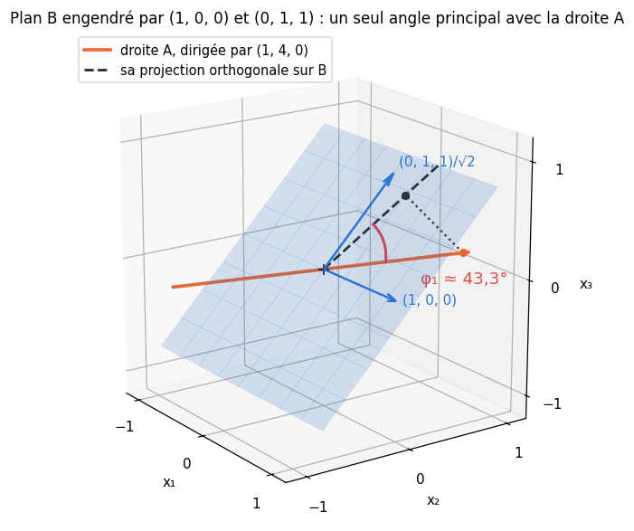

# M25b · Variables latentes et ELBO — fiche de cours

> Le voyant d'une chaudière s'allume sans dire pourquoi ; une température relevée à 6 h dépend d'un ciel nocturne que personne n'a noté. Dans ces modèles, une partie des variables reste **cachée** : ce sont des **variables latentes**. Ce chapitre écrit leur loi jointe sur un graphe orienté et inverse le modèle par la règle de Bayes ; il ajuste un **mélange de gaussiennes** par l'**algorithme EM** et démontre en général la **borne inférieure de l'évidence** (ELBO), dont l'EM est une montée par coordonnées ; il traite l'**ACP probabiliste**, où tout se calcule exactement, puis l'inférence approchée et β, le multiplicateur d'une contrainte d'information. Le chapitre 25 de workbookIA s'en servira pour ses modèles génératifs.

| | |
|---|---|
| **Sections** | §1 à §8 |
| **Temps total estimé** | ≈ 17,1 h : lecture et calculs de la fiche ≈ 2 h 45, exercices ≈ 13 h 35, 22 flashcards ≈ 45 min (parcours essentiel ≈ 14,0 h) |
| **Prérequis** | M02a (intégration par parties) ; M02b (espérance d'une variable continue, théorème de transfert, loi normale et sa fonction de répartition $\Phi$, loi exponentielle) ; M04 (règle de Bayes, probabilités totales, logarithme d'une somme) ; M05a (log-sum-exp stable) ; M06 (entropie, divergence KL discrète, information mutuelle, inégalité de Jensen) ; M07 (distance euclidienne, k-means) ; M12b (base orthonormée d'un sous-espace, Gram-Schmidt, projection orthogonale) ; M12c (théorème spectral, valeurs propres d'une covariance) ; M12d (SVD, ACP, pseudo-inverse) ; M13a (maximum de vraisemblance, proportion d'un mélange à composantes connues) ; M13b (multiplicateurs de Lagrange, KKT) ; M16 (graphes orientés sans cycle, numérotation des nœuds) ; M18 (gradients de $\ln\det$ et de la trace) ; M19 (estimateur sans biais d'un gradient et sa variance) ; M25a (densité et log-densité de $\mathcal{N}(\boldsymbol{\mu}, \boldsymbol{\Sigma})$, modèle linéaire gaussien, loi conditionnelle, maximum de vraisemblance de $\boldsymbol{\mu}$ et $\boldsymbol{\Sigma}$, loi de $\boldsymbol{\mu} + \mathbf{L}\boldsymbol{\varepsilon}$, Jensen continu, KL continue et entropie différentielle) |
| **Fichiers du chapitre** | `02_exercices.md` (quiz, papier) · `03_notebook.ipynb` · `04_indices.md` · `05_solutions.md` et `05_solutions.ipynb` · `06_mes_reponses.md` · `flashcards.csv` |
| **mymath** | `latent.py` : `gmm_e_step`, `gmm_m_step`, `gmm_log_likelihood`, `gmm_elbo` (il importe `mvn_logpdf` de ton `gaussian.py`, M25a) |
| **MML** | §8.4 (*Probabilistic Modeling and Inference*) et §8.5 (*Directed Graphical Models*) ; §6.5.3 (Théorème 6.12) ; ch. 11 (*Density Estimation with Gaussian Mixture Models*, §11.1 à §11.4) ; §10.7 (*Latent Variable Perspective*) |

## Comment utiliser ce chapitre

**Ordre conseillé.**
1. `python tools/start_chapter.py M25b` (sur Colab : `00_setup/COLAB.md` §2) : il copie le notebook, ta feuille de réponses et le squelette `mymath/latent.py`. Ton `latent.py` importe le `mvn_logpdf` de ton `gaussian.py` : termine M25a avant le 🔨 M25b.20.
2. Pour chaque bloc : le passage de MML que le guide place **avant** la section, puis la section, **crayon en main**, puis ses exercices, quiz 🧠 d'abord.
3. Les exercices ✏️ et 🔗 se font sur papier, dans ta copie de `06_mes_reponses.md`, puis se vérifient dans la **partie 0** du notebook. Les démonstrations ∂ se rédigent dans ta copie et se jugent avec la grille de relecture de `05_solutions.md`.

Le §6 ne demande que le §1 et M25a ; les §7 et §8 s'appuient sur le §5, et le §8 reprend l'exemple du §6.

| Section | Quiz 🧠 et rappels 🔁 | Papier et réflexion | Notebook |
|---|---|---|---|
| §1 Graphes orientés | Q1 | M25b.1 ✏️, M25b.16 📖 | |
| §2 Marginaliser, inverser, moments | Q2, R1 | M25b.1 ✏️, M25b.2 ✏️, M25b.16 📖 | |
| §3 Mélanges de gaussiennes | Q3, R1 | M25b.3 ✏️, M25b.17 📖 | M25b.20 🔨, M25b.22 🔨, M25b.25 🔮, M25b.28 🐛 |
| §4 L'algorithme EM | Q4 | M25b.3 ✏️, M25b.4 ∂, M25b.7 ∂, M25b.17 📖, M25b.19 🗣️, M25b.E1 💼 | M25b.21 🔨, M25b.25 🔮, M25b.26 🔬, M25b.28 🐛, M25b.29 🛠️, M25b.30 🏆 |
| §5 L'ELBO | Q5, R2 | M25b.5 ∂, M25b.6 ✏️, M25b.7 ∂, M25b.17 📖, M25b.23 🔗, M25b.E1 💼 | M25b.22 🔨, M25b.26 🔬, M25b.28 🐛, M25b.29 🛠️ |
| §6 L'ACP probabiliste | Q6, R3 | M25b.8 ∂, M25b.9 ✏️, M25b.10 ✏️, M25b.18 📖 | M25b.24 📦 |
| §7 Inférence approchée | Q7 | M25b.9 ✏️, M25b.11 ∂, M25b.12 ✏️, M25b.13 ✏️ | M25b.27 🎨 |
| §8 Pondérer la KL | Q8, R2 | M25b.14 ✏️, M25b.15 ∂ | |

Parcours essentiel : tout sauf M25b.12, M25b.16, M25b.17, M25b.18, M25b.25, M25b.27, M25b.29 et M25b.30.

## Guide de lecture de MML

Ici, chaque bloc du livre se lit **avant** la partie de la fiche qu'il prépare ; la fiche reprend tout et va plus loin là où il s'arrête.

- **Avant le §1 et le §2** : **§8.4** (8.4.1 à 8.4.3 : l'inférence bayésienne (8.22) et (8.23), les modèles à variables latentes (8.24) à (8.28)) et **§8.5** (8.5.1 : l'Exemple 8.7 et la factorisation (8.31)) ; survole **8.5.2** (la d-séparation, (8.34), l'Exemple 8.9). Le 📖 M25b.16 te guide.
- **Avant le §2** : dans **§6.5.3**, le **Théorème 6.12** (les moments d'un mélange de deux gaussiennes, (6.80) à (6.85)) et la remarque et le paragraphe qui le suivent (la loi de la variance totale) ; la fiche le démontre en général.
- **Avant les §3 à §5** : le **ch. 11**, §11.1 à §11.4 : le modèle (11.3), les responsabilités (11.17), les Théorèmes 11.1 à 11.3 (les mises à jour (11.20), (11.30) et (11.42)), l'algorithme (11.53) à (11.56), le point de vue latent (11.58) à (11.73) ; le 📖 M25b.17 te fait refaire l'Exemple 11.1 avec tes données. MML n'a pas l'ELBO : son §11.4.5 s'arrête à $Q(\boldsymbol{\theta} \mid \boldsymbol{\theta}^{(t)})$ ; il ne mentionne les singularités qu'en une phrase, au §11.5 (*Further Reading*).
- **Avant le §6** : **§10.7** (10.7.1 à 10.7.3 : le modèle (10.63) à (10.67), la loi jointe (10.68) à (10.72), le posterior (10.73) à (10.75)) ; le 📖 M25b.18 te guide. Survole l'Exemple 10.5. Le maximum de vraisemblance de Tipping et Bishop est au §10.8 (*Further Reading*), (10.77) à (10.79).

Pour les §7 et §8, la fiche est le cours. En lecture libre : MacKay (`annexes/ressources.md`), ch. 22 (l'EM et le k-means « doux ») et ch. 33 (les méthodes variationnelles). Exercices du livre conseillés : 6.11 (*Iterated Expectations*, l'espérance totale) et 6.2 (les marginales, la moyenne et le mode d'un mélange de deux gaussiennes de $\mathbb{R}^2$) ; les ch. 8, 10 et 11 n'ont pas d'exercices.

📐 **Notations.**
- MML note $N$ les données, $D$ la dimension et $\log$ le logarithme népérien ; la fiche écrit $n$, $d$ et $\ln$. Les KL, les ELBO et les informations sont en **nats**.
- Le latent d'un mélange est un numéro $z \in \{1, \ldots, K\}$ ; MML (11.58) en fait un vecteur *one-hot* $\mathbf{z}$, avec $z_k = 1$ pour la composante $k$. Les paramètres s'écrivent $\boldsymbol{\theta}$ ; ceux d'une itération, $\boldsymbol{\theta}_t$ (MML : $\boldsymbol{\theta}^{(t)}$).
- Responsabilités $r_{ik}$ (MML : $r_{nk}$), effectifs $N_k = \sum_i r_{ik}$, comme dans `latent.py`. La borne s'écrit $\operatorname{ELBO}(q, \boldsymbol{\theta})$ ; on trouve aussi $\mathcal{L}(q, \boldsymbol{\theta})$ dans les livres.
- ACP probabiliste : la fiche écrit $\mathbf{x} = \mathbf{W}\mathbf{z} + \boldsymbol{\mu} + \boldsymbol{\varepsilon}$ avec $\mathbf{W}$ de forme $(d, k)$, comme Tipping et Bishop ; MML écrit $\mathbf{B}$, et $M$ la dimension du latent. Ici, $\mathbf{M} = \mathbf{W}^\top\mathbf{W} + \sigma^2\mathbf{I}_k$ est une **matrice**. $\mathbf{U}_k$ range les $k$ premiers axes principaux (M12d les notait $\mathbf{W}_k$) et $\mathbf{D}_k = \operatorname{diag}(\lambda_1, \ldots, \lambda_k)$ leurs variances (MML (10.78) : $\boldsymbol{\Lambda}$, que M25a réserve à la précision).
- Les **angles principaux** s'écrivent $\phi_i$ : $\theta$ est déjà pris par les paramètres. La densité de $\mathcal{N}(\mu, \sigma^2)$ en $c$ s'écrit $\mathcal{N}(c \mid \mu, \sigma^2)$.
- $\boldsymbol{\varepsilon}$ est un tirage de $\mathcal{N}(\mathbf{0}, \mathbf{I})$ (M25a), sauf au §6 : comme MML et Tipping et Bishop, l'ACP probabiliste note $\boldsymbol{\varepsilon}$ son bruit, de loi $\mathcal{N}(\mathbf{0}, \sigma^2\mathbf{I}_d)$ (M25a notait $\mathbf{w}$ le bruit d'un modèle ; ici, $\mathbf{w}$ est la colonne de $\mathbf{W}$ quand $k = 1$). $\xi$ est un tirage d'une loi fixe quelconque. Les vecteurs de la fiche sont des **colonnes** ; dans `mymath` et le notebook, les données sont les **lignes** d'un tableau $(n, d)$.
- $\varphi$ (les paramètres d'une règle amortie, §7) n'est pas un angle $\phi_i$ ; $\psi(\theta, \xi)$ (§7) n'est pas une entropie $h$ ; $\mathcal{R}^\star(B)$ (§8) est la meilleure reconstruction pour un budget $B$.

Vocabulaire anglais de ce chapitre : *latent variable*, *generative process*, *directed graphical model*, *ancestral sampling*, *d-separation*, *explaining away*, *marginal likelihood*, *evidence*, *law of total variance*, *mixture weight*, *responsibility*, *label switching*, *E-step*, *M-step*, *hard / soft assignment*, *evidence lower bound (ELBO)*, *coordinate ascent*, *probabilistic PCA (PPCA)*, *factor loading*, *principal angles*, *identifiability*, *variational inference*, *mode-seeking*, *mass-covering*, *moment matching*, *amortized inference*, *amortization gap*, *reparameterization trick*, *pathwise derivative*, *score function*, *rate-distortion*, *aggregated posterior*, *posterior collapse*.

## Objectifs d'apprentissage

À la fin du chapitre, tu sais :
- **écrire** la loi jointe d'un modèle à variables latentes selon son graphe orienté, en **tirer** un échantillon ancestral, et **calculer** la vraisemblance marginale et le posterior d'un latent ;
- **définir** l'espérance et la variance conditionnelles sachant une variable discrète, et **calculer** la moyenne et la covariance d'un mélange par les lois de l'espérance et de la variance totales ;
- **calculer** les responsabilités et la log-vraisemblance d'un mélange de gaussiennes en log, et **expliquer** pourquoi cette vraisemblance n'est pas bornée ;
- **dériver** les pas E et M de l'algorithme EM pour un mélange de gaussiennes, et **démontrer** qu'il ne fait jamais baisser la vraisemblance ;
- **démontrer** $\ln p(\mathbf{x}) = \operatorname{ELBO}(q) + \mathrm{KL}(q \,\|\, p(\mathbf{z} \mid \mathbf{x}))$ pour toute loi $q$, en **déduire** la borne et le cas d'égalité, et **lire** l'EM comme une montée par coordonnées de l'ELBO ;
- **écrire** la loi marginale et le posterior de l'ACP probabiliste, en **estimer** les paramètres à partir des valeurs propres, et **comparer** deux sous-espaces par leurs angles principaux ;
- **dériver** une espérance par rapport à un paramètre de la loi par le chemin $X = \mu + \sigma\varepsilon$, et **choisir** le sens de la KL dans une approximation ;
- **interpréter** β comme un multiplicateur de Lagrange, **décomposer** la KL moyenne au prior en information mutuelle et écart du posterior agrégé, et **reconnaître** un code effondré.

## L'essentiel en 10 lignes

1. **Modèle à variable latente** : $p(\mathbf{x}, \mathbf{z}) = p(\mathbf{z})\,p(\mathbf{x} \mid \mathbf{z})$ ; sur un graphe orienté, la loi jointe est le produit des lois de chaque nœud sachant ses parents, et le **tirage ancestral** tire les parents d'abord. Chaîne et fourche : indépendance sachant le nœud du milieu ; **collision** : deux causes indépendantes deviennent dépendantes quand on observe leur effet commun.
2. **Marginaliser, inverser** : $p(\mathbf{x}) = \sum_z p(z)\,p(\mathbf{x} \mid z)$ (l'évidence) et $p(z \mid \mathbf{x}) = p(z)\,p(\mathbf{x} \mid z)/p(\mathbf{x})$.
3. **Totales** : $\mathbb{E}[X] = \mathbb{E}\big[\mathbb{E}[X \mid Z]\big]$ et $\mathbb{V}(X) = \mathbb{E}\big[\mathbb{V}(X \mid Z)\big] + \mathbb{V}\big(\mathbb{E}[X \mid Z]\big)$ ; pour un mélange, $\boldsymbol{\mu} = \sum_k\pi_k\boldsymbol{\mu}_k$ et $\boldsymbol{\Sigma} = \sum_k\pi_k(\boldsymbol{\Sigma}_k + \boldsymbol{\mu}_k\boldsymbol{\mu}_k^\top) - \boldsymbol{\mu}\boldsymbol{\mu}^\top$.
4. **Mélange de gaussiennes** : avec $a_{ik} = \ln\pi_k + \ln\mathcal{N}(\mathbf{x}_i \mid \boldsymbol{\mu}_k, \boldsymbol{\Sigma}_k)$, $\ln p(\mathbf{x}_i) = \operatorname{LSE}_j\,a_{ij}$ et $\ln r_{ik} = a_{ik} - \operatorname{LSE}_j\,a_{ij}$. La vraisemblance n'est pas bornée (une composante qui s'effondre sur un point) ; $K!$ numérotations donnent la même loi.
5. **EM** : pas E (les $r_{ik}$), pas M ($N_k = \sum_i r_{ik}$, $\pi_k = N_k/n$, moyennes et covariances pondérées). Sans régularisation, la log-vraisemblance ne baisse jamais ; avec `reg > 0`, plus de garantie. k-means est la limite $\boldsymbol{\Sigma}_k = \gamma\mathbf{I}$, $\gamma \to 0$.
6. **ELBO** : $\operatorname{ELBO}(q) = \mathbb{E}_q[\ln p(\mathbf{x}, \mathbf{z}) - \ln q(\mathbf{z})] = \mathbb{E}_q[\ln p(\mathbf{x} \mid \mathbf{z})] - \mathrm{KL}(q \,\|\, p(\mathbf{z}))$, et $\ln p(\mathbf{x}) = \operatorname{ELBO}(q) + \mathrm{KL}(q \,\|\, p(\mathbf{z} \mid \mathbf{x}))$ : une borne, atteinte si et seulement si $q$ est le posterior. L'EM la monte en $q$ (pas E), puis en $\boldsymbol{\theta}$ (pas M). $\nabla_{\boldsymbol{\theta}}\ln p(\mathbf{x}) = \mathbb{E}_{p(\mathbf{z} \mid \mathbf{x})}[\nabla_{\boldsymbol{\theta}}\ln p(\mathbf{x}, \mathbf{z})]$.
7. **ACP probabiliste** : $\mathbf{x} \sim \mathcal{N}(\boldsymbol{\mu}, \mathbf{W}\mathbf{W}^\top + \sigma^2\mathbf{I})$ et $\mathbf{z} \mid \mathbf{x} \sim \mathcal{N}\big(\mathbf{M}^{-1}\mathbf{W}^\top(\mathbf{x} - \boldsymbol{\mu}),\ \sigma^2\mathbf{M}^{-1}\big)$. Maximum de vraisemblance : $\sigma^2$ = moyenne des valeurs propres écartées, $\mathbf{W} = \mathbf{U}_k(\mathbf{D}_k - \sigma^2\mathbf{I})^{1/2}\mathbf{R}$ ; $\mathbf{W}$ et $\mathbf{W}\mathbf{R}$ donnent la même loi ; à $\sigma^2$ fixé, une direction de variance $\lambda \le \sigma^2$ s'éteint.
8. **Angles principaux** : les $\cos\phi_i$ sont les valeurs singulières de $\mathbf{Q}_A^\top\mathbf{Q}_B$ ; tous nuls si et seulement si le plus petit sous-espace est contenu dans l'autre.
9. **Inférence approchée** : $\mathrm{KL}(q \,\|\, p)$ choisit un mode, $\mathrm{KL}(p \,\|\, q)$ couvre la masse (pour une gaussienne $q$ : mêmes moments que $p$) ; maximiser l'ELBO, c'est minimiser $\mathrm{KL}(q \,\|\, p(\mathbf{z} \mid \mathbf{x}))$ ; amortie : ELBO amortie ≤ meilleure ELBO par observation ≤ $\ln p(\mathbf{x})$. Par le chemin $X = g_\theta(\xi)$ : $\frac{d}{d\theta}\mathbb{E}[f(X)] = \mathbb{E}[f'(g_\theta(\xi))\,\partial_\theta g_\theta(\xi)]$ sous une hypothèse de domination (et des coins de probabilité nulle) ; faux pour une indicatrice.
10. **β** : multiplicateur d'un budget d'information et pente de la meilleure reconstruction ; avec un bruit gaussien, seul $2\sigma^2\beta$ compte. Posterior agrégé $q(\mathbf{z}) = \mathbb{E}_{\mathbf{x}}[q(\mathbf{z} \mid \mathbf{x})]$ ; $\mathbb{E}_{\mathbf{x}}\mathrm{KL}(q(\mathbf{z} \mid \mathbf{x}) \,\|\, p(\mathbf{z})) = I(X ; Z) + \mathrm{KL}(q(\mathbf{z}) \,\|\, p(\mathbf{z}))$, nulle seulement pour un code effondré. $I(X ; Z) = h(Z) - h(Z \mid X)$.

## §1 · Variables latentes et graphes orientés : processus génératif, loi jointe, tirage ancestral et indépendance conditionnelle

### Une variable qu'on ne voit pas

Une station météo relève chaque jour la température $x$ à 6 h, en °C. Les nuits couvertes sont plus douces que les nuits dégagées, mais personne n'a noté l'état du ciel. Pour modéliser $x$, on raconte comment il est fabriqué : d'abord la nuit est couverte ($z = 1$) ou dégagée ($z = 2$), puis la température suit une loi qui dépend de $z$. Ce récit est un **processus génératif** (*generative process*) ; $z$ est une **variable latente** (*latent variable*), une variable du modèle qu'on n'observe pas, et l'ensemble de ses valeurs est l'**espace latent** (*latent space*).

> **Définition.** Un **modèle à variable latente** se donne par une loi a priori $p(\mathbf{z})$ du latent et une loi de l'observation sachant le latent, $p(\mathbf{x} \mid \mathbf{z})$. Leur produit est la **loi jointe** (*joint distribution*) :
> $$p(\mathbf{x}, \mathbf{z}) = p(\mathbf{z})\,p(\mathbf{x} \mid \mathbf{z}).$$

Dans la station, $p(z = 1) = \pi_1 = \frac14$ et $p(z = 2) = \pi_2 = \frac34$ ; sachant $z = 1$, $x \sim \mathcal{N}(11, 4)$ ; sachant $z = 2$, $x \sim \mathcal{N}(3, 9)$. La loi jointe vaut, par exemple, $p(x, z = 1) = \frac14\,\mathcal{N}(x \mid 11, 4)$ : une densité en $x$, une probabilité en $z$. Ce modèle servira de fil rouge jusqu'au §5, et reviendra au §7.

### Les graphes orientés et la factorisation

Un modèle à plusieurs variables se dessine : un **nœud** par variable, une **flèche** de chaque variable vers celles dont elle fixe directement la loi, sans cycle (M16), et les nœuds observés grisés. C'est un **modèle graphique orienté** (*directed graphical model*), ou réseau bayésien.

> **Factorisation** (MML (8.31)). Si les **parents** (*parents*) $\mathrm{pa}_j$ de chaque nœud $x_j$ sont les nœuds dont une flèche part vers lui,
> $$p(x_1, \ldots, x_m) = \prod_{j=1}^m p(x_j \mid \mathrm{pa}_j).$$

Le graphe dit **qui dépend de qui**, pas les lois elles-mêmes ; une flèche dit une factorisation, pas une causalité prouvée.

**Exemple : le voyant d'une chaudière.** Deux pannes cachées, indépendantes : une pression trop basse ($z_1 = 1$, avec la probabilité 0,1) et une sonde encrassée ($z_2 = 1$, avec la probabilité 0,2). Un voyant ($x = 1$ s'il s'allume) réagit à chacune, avec des ratés et de fausses alertes :

| $(z_1, z_2)$ | $(0, 0)$ | $(1, 0)$ | $(0, 1)$ | $(1, 1)$ |
|---|---|---|---|---|
| $p(z_1, z_2)$ | 0,72 | 0,08 | 0,18 | 0,02 |
| $p(x = 1 \mid z_1, z_2)$ | 0,05 | 0,8 | 0,6 | 0,9 |

Le graphe est $z_1 \to x \leftarrow z_2$, et $p(z_1, z_2, x) = p(z_1)\,p(z_2)\,p(x \mid z_1, z_2)$ : la deuxième ligne du tableau est le produit $p(z_1)\,p(z_2)$.

### Le tirage ancestral

Pour simuler le modèle, on tire les nœuds dans un ordre où chaque parent passe avant ses enfants (M16), chacun sachant ses parents déjà tirés : c'est le **tirage ancestral** (*ancestral sampling*). Pour la chaudière, avec trois nombres uniformes sur $[0, 1[$ (M02b) : $u_1 = 0{,}05 < 0{,}1$ donne $z_1 = 1$ ; $u_2 = 0{,}47 \ge 0{,}2$ donne $z_2 = 0$ ; la ligne $(1, 0)$ du tableau dit $p(x = 1) = 0{,}8$, et $u_3 = 0{,}33 < 0{,}8$ donne $x = 1$. Pour la station, on tire le ciel avec les poids $(\frac14, \frac34)$, puis une température de la composante choisie. Générer de nouvelles données, c'est faire un tirage ancestral.

### Chaîne, fourche et collision

Trois nœuds $a$, $b$, $c$ reliés par deux flèches forment l'un de trois motifs (figure ci-dessous), où l'indépendance conditionnelle (M13a) se lit directement.

- **Chaîne** $a \to c \to b$ : $p(a, c, b) = p(a)\,p(c \mid a)\,p(b \mid c)$, donc $p(a, b \mid c) = \frac{p(a)\,p(c \mid a)}{p(c)}\,p(b \mid c) = p(a \mid c)\,p(b \mid c)$ : **sachant $c$**, $a$ et $b$ sont indépendants. Sans $c$, ils sont en général dépendants : $a$ renseigne sur $b$ à travers $c$.
- **Fourche** $a \leftarrow c \to b$ (une cause commune) : $p(a, b \mid c) = \frac{p(c)\,p(a \mid c)\,p(b \mid c)}{p(c)} = p(a \mid c)\,p(b \mid c)$ : la même conclusion.
- **Collision** $a \to c \leftarrow b$ (un effet commun) : $p(a, b) = \sum_c p(a)\,p(b)\,p(c \mid a, b) = p(a)\,p(b)$, donc $a$ et $b$ sont **indépendants** ; mais $p(a, b \mid c) \propto p(a)\,p(b)\,p(c \mid a, b)$ ne se factorise pas en général : **observer $c$** (ou l'un de ses descendants) les rend dépendants.

Dans un grand graphe, un chemin entre deux nœuds, pris sans tenir compte du sens des flèches (ce n'est pas un chemin orienté de M16), est **bloqué** par un ensemble observé $C$ s'il passe par une chaîne ou une fourche dont le nœud du milieu est dans $C$, ou par une collision dont ni le nœud ni aucun descendant n'est dans $C$. Si tous les chemins entre $A$ et $B$ sont bloqués, $A$ et $B$ sont indépendants sachant $C$ : c'est la **d-séparation** (*d-separation*, MML 8.5.2, en survol).

### Une cause observée en disculpe une autre

Revenons à la chaudière, une collision $z_1 \to x \leftarrow z_2$. Le voyant est allumé. Par la règle de Bayes (M04), avec les quatre produits $p(z_1, z_2)\,p(x = 1 \mid z_1, z_2)$, soit $0{,}036$, $0{,}064$, $0{,}108$ et $0{,}018$ :
$$p(x = 1) = 0{,}226, \qquad P(z_1 = 1 \mid x = 1) = \frac{0{,}064 + 0{,}018}{0{,}226} \approx 0{,}363 .$$
La pression basse passe de 10 % à 36 % : le voyant l'accuse. Le technicien démonte alors la sonde et la trouve encrassée :
$$P(z_1 = 1 \mid x = 1, z_2 = 1) = \frac{0{,}018}{0{,}108 + 0{,}018} = \frac17 \approx 0{,}143, \qquad P(z_1 = 1 \mid x = 1, z_2 = 0) = \frac{0{,}064}{0{,}036 + 0{,}064} = 0{,}64 .$$
La sonde explique déjà le voyant, et la pression retombe à 14 % (64 % si la sonde avait été propre). Une cause observée en **disculpe** une autre (*explaining away*) : les deux pannes, indépendantes a priori, deviennent dépendantes dès qu'on voit leur effet commun.

💻 **Aujourd'hui en pratique** — les langages probabilistes (Stan, PyMC, NumPyro) se programment ainsi : on écrit le processus génératif, nœud après nœud, et le logiciel en tire des tirages ancestraux et des posteriors.

⚠️ **Erreur classique.** Croire que deux causes indépendantes le restent quand on observe leur effet commun (c'est le contraire). Lire une flèche comme une causalité démontrée. Tirer un nœud avant ses parents.

🔗 **Dans workbookIA** — le chapitre 25 décrit ses modèles génératifs par le graphe le plus simple, un latent $\mathbf{z}$ puis une observation $\mathbf{x}$, et génère par un tirage ancestral.

## §2 · Marginaliser et inverser : vraisemblance marginale, posterior d'un latent, et les moments d'un mélange (espérance et variance conditionnelles, puis totales)

### La vraisemblance marginale et le posterior

On n'observe que $\mathbf{x}$ : sa loi s'obtient en sommant la loi jointe sur le latent (les probabilités totales de M04) :
$$p(\mathbf{x}) = \sum_z p(z)\,p(\mathbf{x} \mid z) \qquad \Big(\text{ou } \int p(\mathbf{z})\,p(\mathbf{x} \mid \mathbf{z})\,\mathrm{d}\mathbf{z} \text{ pour un latent continu}\Big).$$
C'est la **vraisemblance marginale** (*marginal likelihood*), ou **évidence** (*evidence*) : M04 et M25a l'ont déjà rencontrée comme constante de normalisation de la règle de Bayes. Inverser le modèle, c'est calculer le **posterior** (*posterior*) du latent :
$$p(z \mid \mathbf{x}) = \frac{p(z)\,p(\mathbf{x} \mid z)}{p(\mathbf{x})}.$$

**Exemple.** La station relève $x = 8$ °C. Les deux densités valent $\mathcal{N}(8 \mid 11, 4) = \frac{1}{\sqrt{8\pi}}e^{-9/8} \approx 0{,}06476$ et $\mathcal{N}(8 \mid 3, 9) = \frac{1}{\sqrt{18\pi}}e^{-25/18} \approx 0{,}03316$ ; pondérées par $\frac14$ et $\frac34$, elles donnent $0{,}01619$ et $0{,}02487$, dont la somme est $p(8) \approx 0{,}04106$ par °C. D'où
$$P(z = 1 \mid x = 8) \approx \frac{0{,}01619}{0{,}04106} \approx 0{,}394, \qquad P(z = 2 \mid x = 8) \approx 0{,}606 .$$
8 °C est plus typique d'une nuit couverte (à 1,5 écart-type de 11, contre 1,7 de 3), mais les nuits dégagées sont trois fois plus fréquentes : l'a priori l'emporte.

### L'espérance et la variance conditionnelles

> **Définition.** Soit $Z$ une variable discrète et $X$ une variable réelle. Pour chaque valeur $k$ telle que $P(Z = k) > 0$, la **loi conditionnelle** de $X$ sachant $Z = k$ a une espérance et une variance :
> $$m(k) = \mathbb{E}[X \mid Z = k] = \int x\,p(x \mid Z = k)\,\mathrm{d}x, \qquad v(k) = \mathbb{V}(X \mid Z = k) = \mathbb{E}\big[(X - m(k))^2 \mid Z = k\big].$$
> L'**espérance conditionnelle** (*conditional expectation*) $\mathbb{E}[X \mid Z]$ est la **variable aléatoire** $m(Z)$ : elle vaut $m(k)$ quand $Z = k$. De même, $\mathbb{V}(X \mid Z) = v(Z)$.

Pour un mélange, la loi de $X$ sachant $Z = k$ est la composante $k$ : $\mathbb{E}[\mathbf{X} \mid Z = k] = \boldsymbol{\mu}_k$ et $\operatorname{Cov}(\mathbf{X} \mid Z = k) = \boldsymbol{\Sigma}_k$. Dans la station, $\mathbb{E}[X \mid Z]$ vaut 11 avec la probabilité $\frac14$ et 3 avec la probabilité $\frac34$ ; $\mathbb{V}(X \mid Z)$ vaut 4 ou 9.

### Les lois de l'espérance et de la variance totales

> **Théorème** (MML Théorème 6.12, en général). Si $X$ a une espérance et une variance finies,
> $$\mathbb{E}[X] = \mathbb{E}\big[\mathbb{E}[X \mid Z]\big], \qquad \mathbb{V}(X) = \mathbb{E}\big[\mathbb{V}(X \mid Z)\big] + \mathbb{V}\big(\mathbb{E}[X \mid Z]\big).$$
> Ce sont la **loi de l'espérance totale** (*law of total expectation*) et la **loi de la variance totale** (*law of total variance*).

*Démonstration.* Notons $\pi_k = P(Z = k)$ et $p_k$ la densité de $X$ sachant $Z = k$. Par les probabilités totales, $X$ a pour densité $\sum_k\pi_k\,p_k(x)$, donc, par linéarité de l'intégrale,
$$\mathbb{E}[X] = \sum_k\pi_k\int x\,p_k(x)\,\mathrm{d}x = \sum_k\pi_k\,m(k) = \mathbb{E}[m(Z)],$$
la dernière égalité par le théorème de transfert (M02b). Le même calcul avec $x^2$, et $\mathbb{E}[X^2 \mid Z = k] = v(k) + m(k)^2$ (la formule $\mathbb{V} = \mathbb{E}[X^2] - \mathbb{E}[X]^2$, M02b), donne $\mathbb{E}[X^2] = \sum_k\pi_k\big(v(k) + m(k)^2\big)$. Alors
$$\mathbb{V}(X) = \mathbb{E}[X^2] - \mathbb{E}[X]^2 = \underbrace{\sum_k\pi_k\,v(k)}_{\mathbb{E}[v(Z)]} + \underbrace{\sum_k\pi_k\,m(k)^2 - \Big(\sum_k\pi_k\,m(k)\Big)^2}_{\mathbb{V}(m(Z))}. \qquad \square$$

La variance totale est la **variance moyenne dans les groupes** plus la **variance entre les groupes** (celle des moyennes). En dimension $d$, le même calcul avec $\mathbf{x}\mathbf{x}^\top$ au lieu de $x^2$ donne, pour un mélange :
$$\boldsymbol{\mu} = \sum_k\pi_k\boldsymbol{\mu}_k, \qquad \boldsymbol{\Sigma} = \sum_k\pi_k\big(\boldsymbol{\Sigma}_k + \boldsymbol{\mu}_k\boldsymbol{\mu}_k^\top\big) - \boldsymbol{\mu}\boldsymbol{\mu}^\top = \sum_k\pi_k\boldsymbol{\Sigma}_k + \sum_k\pi_k(\boldsymbol{\mu}_k - \boldsymbol{\mu})(\boldsymbol{\mu}_k - \boldsymbol{\mu})^\top .$$

**Exemple.** Pour la station : $\mathbb{E}[X] = \frac14 \times 11 + \frac34 \times 3 = 5$ °C ; la variance dans les groupes vaut $\frac14 \times 4 + \frac34 \times 9 = 7{,}75$ ; celle entre les groupes, $\frac14 \times 6^2 + \frac34 \times 2^2 = 12$. D'où $\mathbb{V}(X) = 19{,}75$ (un écart-type de 4,44 °C), dont $\frac{12}{19{,}75} \approx 61\,\%$ vient de l'écart entre les deux régimes.

💻 **Aujourd'hui en pratique** — l'analyse de la variance (ANOVA, `scipy.stats.f_oneway`) repose sur la même décomposition, avec des groupes observés.

⚠️ **Erreur classique.** Moyenner les variances des composantes en oubliant la variance entre les groupes. Confondre la **densité** d'un mélange, somme pondérée de densités, avec la loi d'une **somme pondérée de variables** (la remarque qui précède le Théorème 6.12 de MML) : si $X_1 \sim \mathcal{N}(11, 4)$ et $X_2 \sim \mathcal{N}(3, 9)$ sont indépendantes, $\frac14X_1 + \frac34X_2$ suit $\mathcal{N}(5 ;\ 5{,}3125)$, une seule bosse, bien plus étroite que le mélange.

🔗 **Dans ce dépôt** — M26 rappelle l'espérance conditionnelle et y ajoute la propriété de la tour et l'analyse au premier pas.

## §3 · Mélanges de gaussiennes : responsabilités en log, log-vraisemblance, singularités et composantes à numérotation arbitraire

### Le modèle et sa log-vraisemblance

Un **mélange de gaussiennes** (*Gaussian mixture model*, GMM) à $K$ composantes a pour densité (MML (11.3))
$$p(\mathbf{x} \mid \boldsymbol{\theta}) = \sum_{k=1}^K\pi_k\,\mathcal{N}(\mathbf{x} \mid \boldsymbol{\mu}_k, \boldsymbol{\Sigma}_k), \qquad \pi_k > 0, \quad \sum_k\pi_k = 1,$$
avec $\boldsymbol{\theta} = (\pi_k, \boldsymbol{\mu}_k, \boldsymbol{\Sigma}_k)_{k \le K}$ : des **poids de mélange** (*mixture weights*), des moyennes et des covariances. Chaque donnée $\mathbf{x}_i$ a son latent $z_i$, et les couples $(z_i, \mathbf{x}_i)$ sont indépendants. Pour $n$ données, la log-vraisemblance est (MML (11.10))
$$\ell(\boldsymbol{\theta}) = \sum_{i=1}^n\ln\Big(\sum_{k=1}^K\pi_k\,\mathcal{N}(\mathbf{x}_i \mid \boldsymbol{\mu}_k, \boldsymbol{\Sigma}_k)\Big).$$
Le logarithme d'une somme ne se découpe pas (M04) : contrairement à M25a §6, annuler le gradient ne donne pas de formule fermée.

### Les responsabilités, calculées en log

La **responsabilité** (*responsibility*) de la composante $k$ pour la donnée $i$ est le posterior de son latent (MML (11.17)) :
$$r_{ik} = P(z_i = k \mid \mathbf{x}_i, \boldsymbol{\theta}) = \frac{\pi_k\,\mathcal{N}(\mathbf{x}_i \mid \boldsymbol{\mu}_k, \boldsymbol{\Sigma}_k)}{\sum_j\pi_j\,\mathcal{N}(\mathbf{x}_i \mid \boldsymbol{\mu}_j, \boldsymbol{\Sigma}_j)}, \qquad \sum_k r_{ik} = 1 .$$
On ne la calcule jamais avec les densités elles-mêmes : loin des moyennes, elles sortent des flottants. On pose
$$a_{ik} = \ln\pi_k + \ln\mathcal{N}(\mathbf{x}_i \mid \boldsymbol{\mu}_k, \boldsymbol{\Sigma}_k)$$
(la log-densité par Cholesky de M25a §1, `mvn_logpdf`), puis, avec le **log-sum-exp** stable de M05a, $\operatorname{LSE}_j\,a_{ij} = m + \ln\sum_j e^{a_{ij} - m}$ où $m = \max_j a_{ij}$ :
$$\ln p(\mathbf{x}_i \mid \boldsymbol{\theta}) = \operatorname{LSE}_j\,a_{ij}, \qquad \ln r_{ik} = a_{ik} - \operatorname{LSE}_j\,a_{ij} .$$
Le même tableau $(a_{ik})$, de forme $(n, K)$, donne les deux.

**Exemple.** Pour la station en $x = 8$ : $a_1 = \ln\frac14 - \frac12\ln(8\pi) - \frac98 \approx -4{,}1234$ et $a_2 = \ln\frac34 - \frac12\ln(18\pi) - \frac{25}{18} \approx -3{,}6941$. Avec $m = a_2$ : $\operatorname{LSE} = -3{,}6941 + \ln(1 + e^{-0{,}4293}) \approx -3{,}6941 + 0{,}5014 = -3{,}1927$, le logarithme de $p(8) \approx 0{,}04106$, et $\ln r_1 = a_1 - \operatorname{LSE} \approx -0{,}9306$, soit $r_1 \approx 0{,}394$ : le résultat du §2.

**Pourquoi le log est indispensable.** Une sonde défectueuse renvoie 250 °C. Les deux densités valent $e^{-7140}$ et $e^{-3389}$ à des facteurs près : en flottants, deux zéros, et le rapport donne $0/0$, `nan`. En log, $a_1 - a_2 \approx -3751$ : $r_2 = 1$ en flottants, et $\ln p(250) \approx a_2 \approx -3392$ est un nombre ordinaire.

La figure montre un fait moins attendu : $r_1$ ne tend pas vers 1 aux grandes températures. Le logarithme de $r_1/r_2$ vaut $a_1 - a_2$, un polynôme du second degré en $x$ de coefficient dominant $-\frac18 + \frac{1}{18} < 0$ : très loin, d'un côté comme de l'autre, la composante la plus **large** explique le mieux une valeur extrême.

### Une vraisemblance qui n'est pas bornée

Prenons $K \ge 2$, une composante centrée sur une donnée, $\boldsymbol{\mu}_k = \mathbf{x}_1$, de covariance $s^2\mathbf{I}$, et faisons tendre $s$ vers 0, sans toucher aux autres composantes. Dans $\ell$, le terme de $\mathbf{x}_1$ contient $\pi_k\,\mathcal{N}(\mathbf{x}_1 \mid \mathbf{x}_1, s^2\mathbf{I}) = \pi_k(2\pi s^2)^{-d/2}$, qui tend vers $+\infty$ ; les autres données gardent la densité finie que leur donnent les autres composantes. Donc $\ell \to +\infty$ : la vraisemblance d'un mélange **n'est pas bornée**, et son maximum global n'existe pas. Ces **singularités** (*singularities*) sont des pièges : une composante d'épaisseur nulle n'explique rien. Ce qu'on cherche est un bon maximum local, où chaque composante couvre plusieurs données (en M25a §6, il fallait $n \le d$ pour que $\ell$ explose ; ici, une donnée suffit).

Le remède courant est la **régularisation** : on remplace chaque covariance par $\boldsymbol{\Sigma}_k + \mathrm{reg}\cdot\mathbf{I}$, avec un petit `reg > 0`. Toute valeur propre est alors au moins `reg`, chaque densité est majorée par $(2\pi\,\mathrm{reg})^{-d/2}$, et $\ell$ reste bornée ; le §4 dira ce que cela coûte à l'EM.

### Des composantes à numérotation arbitraire

Échanger les numéros de deux composantes (leurs $\pi_k$, $\boldsymbol{\mu}_k$ et $\boldsymbol{\Sigma}_k$ ensemble) ne change pas la somme $\sum_k\pi_k\,\mathcal{N}(\mathbf{x} \mid \boldsymbol{\mu}_k, \boldsymbol{\Sigma}_k)$. Un maximum à $K$ composantes distinctes vient donc en $K!$ exemplaires équivalents, de même vraisemblance (*label switching*). Deux ajustements se comparent donc à une permutation près.

💻 **Aujourd'hui en pratique** — `sklearn.mixture.GaussianMixture(n_components=K)` ajuste un mélange par l'algorithme EM du §4 ; son option `reg_covar` (par défaut $10^{-6}$) est le `reg` ci-dessus, `predict_proba` rend les responsabilités et `score_samples` les log-densités $\ln p(\mathbf{x}_i)$. Tu écris `gmm_e_step` et `gmm_log_likelihood` en 🔨 M25b.20 et M25b.22.

⚠️ **Erreur classique.** Calculer les responsabilités avec les densités, d'où $0/0$ loin des composantes (🐛 M25b.28). Écrire $\ln\sum = \sum\ln$. Oublier $\ln\pi_k$ dans $a_{ik}$. Croire qu'une vraisemblance plus grande est toujours meilleure : une composante qui s'effondre sur une donnée la rend infinie.

🔗 **Dans ce dépôt** — M13a estimait la proportion d'un mélange dont les deux composantes étaient connues ; ici, les poids, les moyennes et les covariances sont tous inconnus (✏️ M25b.3).

## §4 · L'algorithme EM : le pas E, le pas M pondéré, la monotonie, et k-means comme limite

### L'idée : deviner les latents, puis réestimer

Si l'on connaissait les latents $z_i$, $\pi_k$ serait la proportion des données de la composante $k$, et $\boldsymbol{\mu}_k$, $\boldsymbol{\Sigma}_k$ leur moyenne et leur covariance (M25a §6, groupe par groupe). On ne les connaît pas ; mais, à paramètres donnés, on connaît leur posterior, les responsabilités. L'**algorithme EM** (*expectation-maximization*) alterne les deux : il remplace chaque $z_i$ par sa loi a posteriori, refait l'estimation avec des **poids**, et recommence.

> **Algorithme EM pour un mélange de gaussiennes** (MML (11.53) à (11.56)). Partir de paramètres $\boldsymbol{\theta}_0$, puis répéter :
> 1. **Pas E** (*E-step*) : $r_{ik} = P(z_i = k \mid \mathbf{x}_i, \boldsymbol{\theta}_t)$, en log (§3).
> 2. **Pas M** (*M-step*) : avec $N_k = \sum_i r_{ik}$, le nombre effectif de données de la composante $k$,
> $$\pi_k = \frac{N_k}{n}, \qquad \boldsymbol{\mu}_k = \frac{1}{N_k}\sum_i r_{ik}\,\mathbf{x}_i, \qquad \boldsymbol{\Sigma}_k = \frac{1}{N_k}\sum_i r_{ik}\,(\mathbf{x}_i - \boldsymbol{\mu}_k)(\mathbf{x}_i - \boldsymbol{\mu}_k)^\top,$$
> avec la **nouvelle** moyenne dans la covariance ; ce sont les paramètres $\boldsymbol{\theta}_{t+1}$.
>
> On arrête quand $\ell$ ne monte presque plus.

> **Théorème** (∂ M25b.4 ; MML Théorèmes 11.1 à 11.3 trouvent les mêmes formules en annulant le gradient de $\ell$, les $r_{ik}$ gelées). Quand les covariances qu'il rend sont définies positives, le pas M maximise en $\boldsymbol{\theta}$
> $$Q(\boldsymbol{\theta} \mid \boldsymbol{\theta}_t) = \sum_{i=1}^n\sum_{k=1}^K r_{ik}\big[\ln\pi_k + \ln\mathcal{N}(\mathbf{x}_i \mid \boldsymbol{\mu}_k, \boldsymbol{\Sigma}_k)\big],$$
> l'espérance, sous les responsabilités, de la log-vraisemblance des données complètes (MML (11.73)).

L'idée : $Q$ se sépare. La partie en $\boldsymbol{\pi}$, $\sum_k N_k\ln\pi_k$, se maximise sous la contrainte $\sum_k\pi_k = 1$ par un multiplicateur de Lagrange (M13b) ; la partie en $(\boldsymbol{\mu}_k, \boldsymbol{\Sigma}_k)$ est la log-vraisemblance gaussienne de M25a §6, chaque donnée comptant pour $r_{ik}$, et le même calcul (M18) donne la moyenne et la covariance pondérées. Le ∂ M25b.4 rédige le tout.

**Exemple : une itération.** Cinq matins : $x = 2,\ 5,\ 8,\ 12,\ 13$ °C ; on part du modèle du §1, $\boldsymbol{\pi} = (\frac14, \frac34)$, $\mu = (11, 3)$, $\sigma^2 = (4, 9)$.
- **Pas E** : les responsabilités de la nuit couverte sont $r_{i1} \approx 0{,}00002 ;\ 0{,}0069 ;\ 0{,}3943 ;\ 0{,}9754 ;\ 0{,}9874$ (et $r_{i2} = 1 - r_{i1}$) ; la troisième est celle du §2.
- **Pas M** : $N_1 \approx 2{,}3641$ et $N_2 \approx 2{,}6359$, d'où $\boldsymbol{\pi} \approx (0{,}4728 ;\ 0{,}5272)$. Puis $\mu_1 = \frac{\sum_i r_{i1}x_i}{N_1} \approx \frac{27{,}731}{2{,}3641} \approx 11{,}730$ et $\mu_2 \approx \frac{12{,}269}{2{,}6359} \approx 4{,}655$. Enfin $\sigma_1^2 \approx 3{,}157$ et $\sigma_2^2 \approx 6{,}125$.

Les deux matins chauds tirent la composante « couvert » vers 11,7 °C et lui donnent presque la moitié du poids.

### Ce qui est garanti, et ce qui ne l'est pas

> **Théorème** (∂ M25b.7, par le §5). Sans régularisation, chaque itération de l'EM vérifie $\ell(\boldsymbol{\theta}_{t+1}) \ge \ell(\boldsymbol{\theta}_t)$.

Ce qui n'est **pas** garanti : un bon maximum local (le maximum global n'existe pas, §3) ; la vitesse, lente quand les composantes se recouvrent. En pratique, on lance l'EM depuis plusieurs initialisations et l'on garde la meilleure log-vraisemblance (MML, fin de §11.4.5).

### Avec une régularisation, plus de garantie

Le pas M régularisé rend $\boldsymbol{\Sigma}_k + \mathrm{reg}\cdot\mathbf{I}$ : ce n'est plus le maximum de $Q(\cdot \mid \boldsymbol{\theta}_t)$, alors que la monotonie repose sur $Q(\boldsymbol{\theta}_{t+1} \mid \boldsymbol{\theta}_t) \ge Q(\boldsymbol{\theta}_t \mid \boldsymbol{\theta}_t)$ (§5). Un cas où elle tombe : partons d'un maximum local strict $\boldsymbol{\theta}_t$ de $\ell$, où l'EM sans régularisation ne bouge plus. Le pas M régularisé s'en écarte en ajoutant `reg` aux covariances : pour un petit `reg`, $\ell$ **baisse**. L'EM régularisé n'est donc plus monotone à coup sûr ; c'est pourquoi le 🔬 M25b.26 et le 🛠️ M25b.29 tracent leurs courbes avec `reg = 0`, et seuls le 🔮 M25b.25 et le 🏆 M25b.30 régularisent.

### k-means comme limite

Fixons toutes les covariances à $\gamma\mathbf{I}$ (communes et connues) et les poids $\pi_k > 0$. Le facteur $(2\pi\gamma)^{-d/2}$ se simplifie dans les responsabilités :
$$r_{ik} = \frac{\pi_k\,e^{-\lVert\mathbf{x}_i - \boldsymbol{\mu}_k\rVert^2/(2\gamma)}}{\sum_j\pi_j\,e^{-\lVert\mathbf{x}_i - \boldsymbol{\mu}_j\rVert^2/(2\gamma)}} = \frac{1}{1 + \sum_{j \ne k}\frac{\pi_j}{\pi_k}\exp\Big(-\frac{\lVert\mathbf{x}_i - \boldsymbol{\mu}_j\rVert^2 - \lVert\mathbf{x}_i - \boldsymbol{\mu}_k\rVert^2}{2\gamma}\Big)}.$$
Si $\boldsymbol{\mu}_k$ est strictement le centre le plus proche de $\mathbf{x}_i$, chaque différence de carrés est positive, et chaque exponentielle tend vers 0 quand $\gamma \to 0$ : $r_{ik} \to 1$. Les responsabilités deviennent **dures** (*hard assignment*) : chaque donnée va au centre le plus proche, et le pas M (les moyennes seulement) met chaque centre au barycentre de ses données. C'est **k-means** (M07), la limite « dure » d'un EM « doux » (*soft*). Par exemple, en $x = 8$ avec les centres 11 et 3 et les poids $(\frac14, \frac34)$ : $r_1 = 1/(1 + 3e^{-16/(2\gamma)})$ vaut 0,711 pour $\gamma = 4$, 0,9990 pour $\gamma = 1$, et tend vers 1 ; le modèle complet, avec ses variances 4 et 9, lui donnait 0,394.

💻 **Aujourd'hui en pratique** — `GaussianMixture` s'initialise par un k-means (`init_params="kmeans"`) et ne lance l'EM qu'une fois par défaut : `n_init` relance depuis d'autres initialisations et garde la meilleure. Tu écris `gmm_m_step` en 🔨 M25b.21.

⚠️ **Erreur classique.** Diviser par $n$ au lieu de $N_k$ dans le pas M (🐛 M25b.28). Calculer $\boldsymbol{\Sigma}_k$ avec l'ancienne moyenne. Conclure d'une seule initialisation. Croire que l'EM régularisé monte toujours.

🔗 **Dans workbookIA** — le chapitre 7 a présenté k-means, la limite dure de l'EM ; le bonus B2 estime les probabilités de ses tokens par un algorithme EM.

## §5 · La borne inférieure de l'évidence (ELBO) : ln p(x) = ELBO + KL, l'EM comme montée par coordonnées, et le gradient de ln p(x)

### Une borne inférieure, pour n'importe quelle loi q

Fixons un modèle $p(\mathbf{x}, \mathbf{z})$, une observation $\mathbf{x}$ et une loi $q$ quelconque sur le latent, discret ou continu. On définit
$$\operatorname{ELBO}(q) = \mathbb{E}_{\mathbf{z} \sim q}\big[\ln p(\mathbf{x}, \mathbf{z}) - \ln q(\mathbf{z})\big],$$
la **borne inférieure de l'évidence** (*evidence lower bound*, ELBO).

> **Théorème** (∂ M25b.5). Pour toute loi $q$ (une densité si le latent est continu) qui ne charge que des $\mathbf{z}$ où $p(\mathbf{x}, \mathbf{z}) > 0$,
> $$\ln p(\mathbf{x}) = \operatorname{ELBO}(q) + \mathrm{KL}\big(q \,\|\, p(\mathbf{z} \mid \mathbf{x})\big).$$
> Donc $\operatorname{ELBO}(q) \le \ln p(\mathbf{x})$, avec égalité si et seulement si $q$ est le posterior $p(\mathbf{z} \mid \mathbf{x})$ (presque partout, pour un latent continu).

L'idée : pour chaque $\mathbf{z}$, la règle de Bayes donne $\ln p(\mathbf{x}) = \ln p(\mathbf{x}, \mathbf{z}) - \ln p(\mathbf{z} \mid \mathbf{x})$ ; on prend l'espérance des deux membres sous $q$, puis on ajoute et retire $\mathbb{E}_q[\ln q(\mathbf{z})]$. La borne et le cas d'égalité viennent de la positivité de la KL (M06 pour un latent discret, M25a §7 pour un latent continu). Le ∂ M25b.5 rédige le calcul, puis retrouve la borne seule, sans passer par la KL, par l'inégalité de Jensen (M06, M25a §7). L'identité dit en plus **de combien** on se trompe.

**Deux autres lectures.**
- $\operatorname{ELBO}(q) = \mathbb{E}_q[\ln p(\mathbf{x}, \mathbf{z})] + H(q)$ : une log-vraisemblance complète moyenne, plus l'**entropie** de $q$ (M06 ; une entropie différentielle $h(q)$ pour un latent continu, M25a §7).
- $\operatorname{ELBO}(q) = \mathbb{E}_q[\ln p(\mathbf{x} \mid \mathbf{z})] - \mathrm{KL}\big(q \,\|\, p(\mathbf{z})\big)$, en écrivant $p(\mathbf{x}, \mathbf{z}) = p(\mathbf{z})\,p(\mathbf{x} \mid \mathbf{z})$ (∂ M25b.5) : une **reconstruction** moins une **KL au prior**. Les deux termes s'opposent : la reconstruction veut concentrer $q$ sur les latents qui expliquent le mieux $\mathbf{x}$, la KL la retient près du prior.

Pour $n$ observations indépendantes, chacune avec sa loi $q_i$, les ELBO s'additionnent et $\sum_i\operatorname{ELBO}(q_i) \le \ell$. Pour un mélange de gaussiennes, avec les lignes d'un tableau $(r_{ik})$ quelconque comme lois $q_i$, c'est $\sum_i\sum_k r_{ik}\big(a_{ik} - \ln r_{ik}\big)$, avec la convention $0\ln 0 = 0$ : la fonction `gmm_elbo` du 🔨 M25b.22.

**Exemple : la chaudière.** Le voyant est allumé : $\ln p(x = 1) = \ln 0{,}226 \approx -1{,}4872$. Le latent $\mathbf{z} = (z_1, z_2)$ a quatre valeurs.
- **$q$ = le prior** $(0{,}72 ;\ 0{,}08 ;\ 0{,}18 ;\ 0{,}02)$ : la KL au prior est nulle, et l'ELBO est la reconstruction seule, $0{,}72\ln 0{,}05 + 0{,}08\ln 0{,}8 + 0{,}18\ln 0{,}6 + 0{,}02\ln 0{,}9 \approx -2{,}2688$. L'écart, $0{,}7816$, est $\mathrm{KL}\big(p(\mathbf{z}) \,\|\, p(\mathbf{z} \mid x = 1)\big)$ : le prior ne sait pas que le voyant s'est allumé.
- **$q$ certaine que seule la sonde est en cause** ($q(0, 1) = 1$) : son entropie est nulle, et $\operatorname{ELBO} = \ln p(x = 1, \mathbf{z} = (0, 1)) = \ln 0{,}108 \approx -2{,}2256$. L'écart vaut $-\ln P(\mathbf{z} = (0, 1) \mid x = 1) = -\ln\frac{0{,}108}{0{,}226} \approx 0{,}738$ : la KL d'une loi certaine au posterior.

Les deux restent sous $\ln p(x = 1)$ ; seul le posterior, $(0{,}159 ;\ 0{,}283 ;\ 0{,}478 ;\ 0{,}080)$, atteint $-1{,}4872$.

### L'EM, une montée par coordonnées

Revenons à un modèle de paramètres $\boldsymbol{\theta}$ et à $n$ données, et regardons l'ELBO comme une fonction de deux arguments : $\operatorname{ELBO}(q, \boldsymbol{\theta}) = \sum_i\mathbb{E}_{q_i}\big[\ln p(\mathbf{x}_i, \mathbf{z} \mid \boldsymbol{\theta}) - \ln q_i(\mathbf{z})\big]$, avec $q = (q_1, \ldots, q_n)$.

> **Théorème** (∂ M25b.7). L'EM est une **montée par coordonnées** (*coordinate ascent*) de l'ELBO :
> - le **pas E** la maximise en $q$, à $\boldsymbol{\theta}_t$ fixé : la solution est le posterior, $q_i = p(\mathbf{z} \mid \mathbf{x}_i, \boldsymbol{\theta}_t)$, et alors $\operatorname{ELBO}(q_t, \boldsymbol{\theta}_t) = \ell(\boldsymbol{\theta}_t)$ ;
> - le **pas M** la maximise en $\boldsymbol{\theta}$, à $q_t$ fixée : comme $\operatorname{ELBO}(q_t, \boldsymbol{\theta}) = Q(\boldsymbol{\theta} \mid \boldsymbol{\theta}_t) + \sum_iH(q_{t,i})$ et que l'entropie ne dépend pas de $\boldsymbol{\theta}$, c'est maximiser $Q$ (MML (11.73)).
>
> D'où la chaîne $\ell(\boldsymbol{\theta}_{t+1}) \ge \operatorname{ELBO}(q_t, \boldsymbol{\theta}_{t+1}) \ge \operatorname{ELBO}(q_t, \boldsymbol{\theta}_t) = \ell(\boldsymbol{\theta}_t)$.

La première inégalité est la borne en $\boldsymbol{\theta}_{t+1}$ ; la seconde dit que le pas M ne fait pas baisser $Q$, et c'est elle que la régularisation casse (§4). Dans la figure, seul $\mu_1$ est libre : chaque borne $\mu_1 \mapsto \operatorname{ELBO}(q_t, \mu_1)$ touche $\ell$ en $\mu_{1,t}$, reste en dessous ailleurs, et son sommet donne $\mu_{1,t+1}$.

### Le gradient de ln p(x)

> **Théorème** (∂ M25b.7). Si l'on peut dériver sous la somme ou l'intégrale,
> $$\nabla_{\boldsymbol{\theta}}\ln p(\mathbf{x} \mid \boldsymbol{\theta}) = \mathbb{E}_{p(\mathbf{z} \mid \mathbf{x}, \boldsymbol{\theta})}\big[\nabla_{\boldsymbol{\theta}}\ln p(\mathbf{x}, \mathbf{z} \mid \boldsymbol{\theta})\big].$$
> C'est aussi le gradient en $\boldsymbol{\theta}$ de $\operatorname{ELBO}(q, \boldsymbol{\theta})$, $q$ étant fixée au posterior en $\boldsymbol{\theta}$.

L'idée : par la règle de la chaîne et la règle de Bayes, le gradient d'un logarithme de somme devient une moyenne, sous le posterior, de gradients faciles ; le ∂ M25b.7 fait le calcul. Par exemple, pour le poids de la station ($\pi_1 = \pi$, $\pi_2 = 1 - \pi$) en $x = 8$ : $\ln p(x, z)$ dépend de $\pi$ par $\ln\pi$ ou $\ln(1 - \pi)$, d'où
$$\frac{\partial}{\partial\pi}\ln p(8) = \frac{r_1}{\pi} - \frac{r_2}{1 - \pi} \approx \frac{0{,}3943}{0{,}25} - \frac{0{,}6057}{0{,}75} \approx 0{,}770,$$
la valeur que donne la dérivée directe $\frac{\mathcal{N}(8 \mid 11, 4) - \mathcal{N}(8 \mid 3, 9)}{p(8)}$. Le ∂ M25b.7 l'applique à la moyenne d'une composante.

💻 **Aujourd'hui en pratique** — Pyro et NumPyro maximisent une ELBO estimée sur des tirages de $q$ (`Trace_ELBO`) ; le §7 dit comment la dériver. Tu écris `gmm_elbo` en 🔨 M25b.22.

⚠️ **Erreur classique.** Oublier l'entropie de $q$ (🐛 M25b.28) : pour un latent discret, l'entropie est positive ou nulle, donc ce qui reste est encore sous $\ln p(\mathbf{x})$, mais la borne n'est plus atteinte au posterior ; pour un latent continu, l'entropie différentielle peut être négative, et ce n'est même plus une borne. Écrire l'écart $\mathrm{KL}(p(\mathbf{z} \mid \mathbf{x}) \,\|\, q)$ : c'est $\mathrm{KL}(q \,\|\, p(\mathbf{z} \mid \mathbf{x}))$, $q$ en premier. Croire que l'ELBO est une vraisemblance : elle n'égale $\ln p(\mathbf{x})$ qu'au posterior.

🔗 **Dans workbookIA** — le chapitre 25 maximise l'ELBO d'un autoencodeur variationnel (VAE), écrite « reconstruction moins KL au prior », et en affirme la borne : tu l'as démontrée ici, pour n'importe quel modèle.

## §6 · L'ACP probabiliste : posterior exact, maximum de vraisemblance, rotation de W, angles principaux et directions éteintes

### Le modèle

L'ACP de M12d projette les données sur un sous-espace, sans modèle de probabilité. L'**ACP probabiliste** (*probabilistic PCA*, MML §10.7) raconte comment elles seraient fabriquées : quelques facteurs cachés, mélangés linéairement, plus un bruit isotrope.
$$\mathbf{z} \sim \mathcal{N}(\mathbf{0}, \mathbf{I}_k), \qquad \mathbf{x} = \mathbf{W}\mathbf{z} + \boldsymbol{\mu} + \boldsymbol{\varepsilon}, \qquad \boldsymbol{\varepsilon} \sim \mathcal{N}(\mathbf{0}, \sigma^2\mathbf{I}_d) \text{ indépendant de } \mathbf{z},$$
avec $\mathbf{W}$ de forme $(d, k)$, $k < d$ (ses colonnes sont les **poids des facteurs**, *factor loadings*). C'est le **modèle linéaire gaussien** de M25a §5, avec la variable cachée $\mathbf{z}$ ($\mathbf{m} = \mathbf{0}$, $\mathbf{V} = \mathbf{I}_k$), $\mathbf{A} = \mathbf{W}$, $\mathbf{b} = \boldsymbol{\mu}$ et un bruit de covariance $\sigma^2\mathbf{I}_d$ (la matrice que M25a notait $\mathbf{R}$ ; dans ce §, $\mathbf{R}$ est une matrice orthogonale).

### La loi marginale et le posterior exact

> **Théorème** (∂ M25b.8). Avec $\mathbf{C} = \mathbf{W}\mathbf{W}^\top + \sigma^2\mathbf{I}_d$ et $\mathbf{M} = \mathbf{W}^\top\mathbf{W} + \sigma^2\mathbf{I}_k$ :
> $$\mathbf{x} \sim \mathcal{N}(\boldsymbol{\mu}, \mathbf{C}), \qquad \mathbf{z} \mid \mathbf{x} \sim \mathcal{N}\big(\mathbf{M}^{-1}\mathbf{W}^\top(\mathbf{x} - \boldsymbol{\mu}),\ \sigma^2\mathbf{M}^{-1}\big).$$

L'idée : la loi marginale du modèle linéaire gaussien est $\mathcal{N}(\mathbf{A}\mathbf{m} + \mathbf{b}, \mathbf{A}\mathbf{V}\mathbf{A}^\top + \sigma^2\mathbf{I}_d)$, et sa loi conditionnelle donne directement la forme de MML (10.74) et (10.75) : la moyenne $\mathbf{W}^\top\mathbf{C}^{-1}(\mathbf{x} - \boldsymbol{\mu})$ et la covariance $\mathbf{I} - \mathbf{W}^\top\mathbf{C}^{-1}\mathbf{W}$. On passe à la forme en $\mathbf{M}$ par l'identité
$$\mathbf{W}^\top(\mathbf{W}\mathbf{W}^\top + \sigma^2\mathbf{I}_d)^{-1} = (\mathbf{W}^\top\mathbf{W} + \sigma^2\mathbf{I}_k)^{-1}\mathbf{W}^\top$$
(∂ M25b.8). La forme en $\mathbf{M}$ n'inverse qu'une matrice $(k, k)$, au lieu de $(d, d)$. Deux faits à retenir : la moyenne a posteriori est une **règle affine** de $\mathbf{x}$, la même pour toutes les observations ; la covariance a posteriori **ne dépend pas** de $\mathbf{x}$.

**Exemple.** Les rendements de deux parcelles voisines (en quintaux par hectare, écarts à leur moyenne $\boldsymbol{\mu}$) dépendent d'un facteur caché, la qualité de la saison : $k = 1$, $\mathbf{w} = (3, 2)$, $\sigma^2 = 2$. Alors
$$\mathbf{C} = \begin{pmatrix} 11 & 6 \\ 6 & 6 \end{pmatrix}, \qquad M = \lVert\mathbf{w}\rVert^2 + \sigma^2 = 13 + 2 = 15 .$$
Les valeurs propres de $\mathbf{C}$ sont 15 (dans la direction de $\mathbf{w}$) et 2 (orthogonalement) : $\lVert\mathbf{w}\rVert^2 + \sigma^2$ et $\sigma^2$. Une saison donne $\mathbf{x} - \boldsymbol{\mu} = (3, 3)$ : $\mathbf{w}^\top(\mathbf{x} - \boldsymbol{\mu}) = 15$, donc $z \mid \mathbf{x} \sim \mathcal{N}(1,\ \frac{2}{15})$, d'écart-type 0,365.

**Le lien avec l'ACP.** La reconstruction $\boldsymbol{\mu} + \mathbf{w}\,\mathbb{E}[z \mid \mathbf{x}] = \boldsymbol{\mu} + (3, 2)$ est sur la droite $\boldsymbol{\mu} + \mathbb{R}\mathbf{w}$, comme la projection orthogonale de M12d, $\boldsymbol{\mu} + \frac{15}{13}(3, 2) = \boldsymbol{\mu} + \big(\frac{45}{13}, \frac{30}{13}\big)$, mais **plus près de $\boldsymbol{\mu}$** d'un facteur $\frac{\lVert\mathbf{w}\rVert^2}{\lVert\mathbf{w}\rVert^2 + \sigma^2} = \frac{13}{15}$ : l'a priori tire $z$ vers 0. Quand $\sigma^2 \to 0$, $\mathbf{M}^{-1}\mathbf{W}^\top \to (\mathbf{W}^\top\mathbf{W})^{-1}\mathbf{W}^\top$, la pseudo-inverse de M12d : la moyenne a posteriori devient les coordonnées de la projection orthogonale, et la covariance a posteriori tend vers 0.

![À gauche, 400 saisons tirées du modèle (w = (3, 2), σ² = 2), la droite μ + ℝw, l'ellipse de la covariance marginale C, une saison x − μ = (3, 3), sa projection orthogonale sur la droite et sa reconstruction μ + w E[z | x], plus près de μ (facteur 13/15). À droite, la loi a posteriori de z pour trois saisons : trois gaussiennes de même largeur (variance 2/15), décalées selon la saison, et l'a priori N(0, 1) en pointillés](figures/acp_probabiliste.png)

### Le maximum de vraisemblance

> **Théorème** (Tipping et Bishop, 1999 ; admis, MML (10.77) à (10.79)). Soit $\bar{\mathbf{x}}$ et $\hat{\boldsymbol{\Sigma}}$ la moyenne et la covariance des données au sens du maximum de vraisemblance (M25a §6), de valeurs propres $\lambda_1 \ge \cdots \ge \lambda_d$, avec $\lambda_k > \lambda_{k+1}$ et $\hat\sigma^2 > 0$, et $\mathbf{U}_k$ la matrice $(d, k)$ des $k$ premiers vecteurs propres. La vraisemblance de l'ACP probabiliste est maximale en
> $$\hat{\boldsymbol{\mu}} = \bar{\mathbf{x}}, \qquad \hat\sigma^2 = \frac{1}{d - k}\sum_{j=k+1}^d\lambda_j, \qquad \hat{\mathbf{W}} = \mathbf{U}_k\big(\mathbf{D}_k - \hat\sigma^2\mathbf{I}_k\big)^{1/2}\mathbf{R},$$
> où $\mathbf{D}_k = \operatorname{diag}(\lambda_1, \ldots, \lambda_k)$ et $\mathbf{R}$ est une matrice orthogonale $(k, k)$ **quelconque**.

Le bruit est la variance moyenne des directions écartées ; dans chaque direction gardée, de variance $\lambda_j$, le facteur explique $\lambda_j - \hat\sigma^2$ et le bruit le reste. Par exemple, des mesures en dimension 4 de valeurs propres 27, 18, 3 et 1, avec $k = 2$ : $\hat\sigma^2 = \frac{3 + 1}{2} = 2$ et $\hat{\mathbf{W}} = \mathbf{U}_2\operatorname{diag}(5, 4)\,\mathbf{R}$. La covariance du modèle, $\hat{\mathbf{W}}\hat{\mathbf{W}}^\top + \hat\sigma^2\mathbf{I}$, a pour valeurs propres 27, 18, 2 et 2 : elle garde exactement les deux grandes et remplace les deux petites par leur moyenne. Quand $\sigma^2 \to 0$, $\hat{\mathbf{W}} = \mathbf{U}_k\mathbf{D}_k^{1/2}\mathbf{R}$ : on retrouve l'ACP de M12d.

**Les directions éteintes.** Si le bruit est **connu** et fixé à $\sigma^2$ au lieu d'être estimé, le maximum de vraisemblance est $\hat{\mathbf{W}} = \mathbf{U}_k\operatorname{diag}\big(\max(\lambda_j - \sigma^2, 0)\big)^{1/2}\mathbf{R}$ (admis) : avant la rotation $\mathbf{R}$, la colonne de la direction $j$ a pour carré de norme $\max(\lambda_j - \sigma^2, 0)$, et une direction où les données ne varient pas plus que le bruit, $\lambda_j \le \sigma^2$, reçoit une colonne nulle. Le facteur correspondant ne sert plus : la direction est **éteinte** (on dit parfois *pruned* ou *switched off* ; ✏️ M25b.9).

### La rotation : seul le sous-espace est déterminé

Pour toute matrice orthogonale $\mathbf{R}$, $(\mathbf{W}\mathbf{R})(\mathbf{W}\mathbf{R})^\top = \mathbf{W}\mathbf{R}\mathbf{R}^\top\mathbf{W}^\top = \mathbf{W}\mathbf{W}^\top$ : $\mathbf{W}$ et $\mathbf{W}\mathbf{R}$ donnent la **même loi** de $\mathbf{x}$ (∂ M25b.8). Les colonnes de $\mathbf{W}$ ne sont donc pas identifiables (*identifiability*) ; seul le **sous-espace** qu'elles engendrent (celui de $\mathbf{U}_k$) est déterminé. Pour comparer deux ajustements, on compare les sous-espaces qu'ils engendrent.

### Les angles principaux entre deux sous-espaces

> **Définition.** Soit $A$ et $B$ deux sous-espaces de $\mathbb{R}^d$, de dimensions $k_A$ et $k_B$, et $\mathbf{Q}_A$, $\mathbf{Q}_B$ des matrices dont les colonnes sont des bases orthonormées de $A$ et de $B$ (Gram-Schmidt, M12b). Les valeurs singulières $s_1 \ge \cdots \ge s_m$ de $\mathbf{Q}_A^\top\mathbf{Q}_B$, au nombre de $m = \min(k_A, k_B)$, sont dans $[0, 1]$, et les **angles principaux** (*principal angles*) sont $\phi_i = \arccos s_i$, rangés $\phi_1 \le \cdots \le \phi_m$, dans $[0, \frac\pi2]$.

Les $s_i$ sont au plus 1, car $\lVert\mathbf{Q}_A^\top\mathbf{Q}_B\mathbf{v}\rVert \le \lVert\mathbf{Q}_B\mathbf{v}\rVert = \lVert\mathbf{v}\rVert$ (une projection orthogonale raccourcit, M12b). Pour deux droites de vecteurs unitaires $\mathbf{u}$ et $\mathbf{v}$, il y a un seul angle, $\arccos\lvert\mathbf{u}^\top\mathbf{v}\rvert$ : l'angle de M07, sans orientation. Les angles principaux **ne dépendent pas des bases** choisies (le ✏️ M25b.10 te fait montrer pourquoi).

> **Propriété.** Si $k_A \le k_B$, tous les angles principaux sont nuls si et seulement si $A \subset B$. En particulier, deux sous-espaces de même dimension sont égaux si et seulement si tous leurs angles principaux sont nuls.

*Démonstration.* Tous les $s_i$ valent 1 si et seulement si $\mathbf{Q}_A^\top\mathbf{Q}_B\mathbf{Q}_B^\top\mathbf{Q}_A = \mathbf{I}_{k_A}$ (une matrice symétrique dont toutes les valeurs propres, les $s_i^2$, valent 1), c'est-à-dire $\lVert\mathbf{Q}_B^\top\mathbf{Q}_A\mathbf{a}\rVert = \lVert\mathbf{a}\rVert$ pour tout $\mathbf{a}$. Or $\mathbf{Q}_B\mathbf{Q}_B^\top\mathbf{y}$ est la projection orthogonale de $\mathbf{y} = \mathbf{Q}_A\mathbf{a}$ sur $B$, de norme $\lVert\mathbf{Q}_B^\top\mathbf{y}\rVert$, et $\lVert\mathbf{y}\rVert = \lVert\mathbf{a}\rVert$. Par Pythagore, un vecteur a la même norme que sa projection si et seulement s'il est égal à elle, c'est-à-dire s'il est dans $B$. $\square$

**Exemple.** Dans $\mathbb{R}^3$, la droite $A$ dirigée par $(1, 4, 0)$ et le plan $B$ engendré par $(1, 0, 0)$ et $(0, 1, 1)$. Ces deux vecteurs sont orthogonaux : $\mathbf{Q}_B$ a pour colonnes $(1, 0, 0)$ et $\frac{1}{\sqrt2}(0, 1, 1)$. Avec $\mathbf{u} = \frac{1}{\sqrt{17}}(1, 4, 0)$, $\mathbf{Q}_B^\top\mathbf{u} = \big(\frac{1}{\sqrt{17}}, \frac{4}{\sqrt{34}}\big)$, de norme $\sqrt{\frac{1}{17} + \frac{16}{34}} = \frac{3}{\sqrt{17}}$. Un seul angle : $\phi_1 = \arccos\frac{3}{\sqrt{17}} \approx 43{,}3°$, l'angle entre la droite et sa projection sur le plan.

💻 **Aujourd'hui en pratique** — `scipy.linalg.subspace_angles(A, B)` calcule les angles principaux entre les sous-espaces engendrés par les colonnes de `A` et de `B` ; il orthonormalise lui-même (📦 M25b.24).

⚠️ **Erreur classique.** Comparer une à une les colonnes de $\mathbf{W}$ aux axes de l'ACP : la rotation $\mathbf{R}$ les mélange. Former $\mathbf{Q}_A^\top\mathbf{Q}_B$ avec des bases non orthonormées. Prendre les valeurs singulières pour des angles (ce sont des cosinus).

🔗 **Dans workbookIA** — le chapitre 25 compare deux sous-espaces par leurs angles principaux.

## §7 · Inférence approchée : le sens de la KL, l'inférence amortie, et dériver une espérance par rapport à un paramètre de la loi

### Quand le posterior ne se calcule pas

Dans un mélange et dans l'ACP probabiliste, le posterior est exact ; mais, pour un latent continu, dès que $p(\mathbf{x} \mid \mathbf{z})$ n'est plus une gaussienne de moyenne affine en $\mathbf{z}$, $p(\mathbf{x}) = \int p(\mathbf{z})\,p(\mathbf{x} \mid \mathbf{z})\,\mathrm{d}\mathbf{z}$ n'a en général plus de formule. L'**inférence approchée** (*approximate inference*) cherche alors, dans une famille $\mathcal{Q}$ de lois simples, la plus proche du posterior. Comme $\ln p(\mathbf{x}) = \operatorname{ELBO}(q) + \mathrm{KL}(q \,\|\, p(\mathbf{z} \mid \mathbf{x}))$ et que $\ln p(\mathbf{x})$ ne dépend pas de $q$ :
$$\text{maximiser } \operatorname{ELBO}(q) \text{ sur } \mathcal{Q} \iff \text{minimiser } \mathrm{KL}\big(q \,\|\, p(\mathbf{z} \mid \mathbf{x})\big) \text{ sur } \mathcal{Q},$$
sans jamais calculer $p(\mathbf{x})$ ni le posterior. C'est l'**inférence variationnelle** (*variational inference*).

### Le sens de la KL

La KL n'est pas symétrique (M25a §7), et le sens choisi change la loi trouvée.
- **$\mathrm{KL}(q \,\|\, p) = \mathbb{E}_q[\ln q - \ln p]$**, la KL **inverse** (*reverse KL*), celle de l'inférence variationnelle : $\ln\frac{q}{p}$ est énorme là où $q$ met de la masse et $p$ presque pas, donc la meilleure $q$ **évite** les régions où $p$ est faible ; si $p$ a deux bosses séparées et $q$ une seule, $q$ se pose sur l'une d'elles (*mode-seeking*), et chaque bosse donne un minimum local.
- **$\mathrm{KL}(p \,\|\, q) = \mathbb{E}_p[\ln p - \ln q]$**, la KL **directe** (*forward KL*) : la pénalité est énorme là où $p$ a de la masse et $q$ presque pas. La meilleure $q$ **couvre** toute la masse de $p$ (*mass-covering*), quitte à en mettre entre les bosses.

> **Propriété.** Si $p$ est une densité de variance finie, parmi les lois $q = \mathcal{N}(m, s^2)$, $\mathrm{KL}(p \,\|\, q)$ est minimale quand $m$ et $s^2$ sont la moyenne et la variance de $p$ (*moment matching*). En dimension $d$, de même avec la moyenne et la covariance.

*Démonstration* (dimension 1). Soit $\mu_p$ et $v_p$ la moyenne et la variance de $p$. $\mathrm{KL}(p \,\|\, q) = -h(p) - \mathbb{E}_p[\ln q(X)]$, et le premier terme ne dépend pas de $q$. Par le lemme de la trace de M25a §7 en dimension 1, $\mathbb{E}_p[(X - m)^2] = v_p + (\mu_p - m)^2$, donc
$$-\mathbb{E}_p[\ln q(X)] = \frac12\ln(2\pi s^2) + \frac{v_p + (\mu_p - m)^2}{2s^2}.$$
C'est minimal en $m = \mu_p$ ; il reste $\frac12\ln(2\pi s^2) + \frac{v_p}{2s^2}$, de dérivée $\frac{1}{2s^2} - \frac{v_p}{2s^4}$ en $s^2$, négative puis positive, nulle en $s^2 = v_p$. $\square$

Pour le mélange de la station, la gaussienne qui minimise $\mathrm{KL}(p \,\|\, q)$ est donc $\mathcal{N}(5 ;\ 19{,}75)$, avec les moments du §2 : plus large que chacune des deux composantes. L'autre sens n'a pas de formule ; il se cherche numériquement. (Ici, les deux bosses se recouvrent trop : $\mathrm{KL}(q \,\|\, p)$ n'a qu'un minimum, assez proche de cette gaussienne ; il faut des bosses bien séparées pour que $q$ en choisisse une.)

### L'inférence amortie

L'inférence variationnelle cherche une loi $q_i$ par observation, par une optimisation chaque fois. L'**inférence amortie** (*amortized inference*) apprend plutôt une **règle** $\mathbf{x} \mapsto q_\varphi(\mathbf{z} \mid \mathbf{x})$, de paramètres $\varphi$ communs à toutes les observations : une nouvelle observation coûte une évaluation, et non plus une optimisation.

> **Propriété.** Pour toute observation $\mathbf{x}$ :
> $$\operatorname{ELBO}\big(q_\varphi(\cdot \mid \mathbf{x})\big) \le \sup_{q \in \mathcal{Q}}\operatorname{ELBO}(q) \le \ln p(\mathbf{x}).$$

La première inégalité vient de ce que $q_\varphi(\cdot \mid \mathbf{x})$ est une loi de $\mathcal{Q}$, la seconde du §5. Le premier écart est l'**écart d'amortissement** (*amortization gap*), dû à une règle commune trop rigide ; le second, à une famille trop pauvre pour contenir le posterior.

**Deux exemples.** Dans l'ACP probabiliste, le posterior exact $\mathcal{N}\big(\mathbf{M}^{-1}\mathbf{W}^\top(\mathbf{x} - \boldsymbol{\mu}), \sigma^2\mathbf{M}^{-1}\big)$ est déjà une règle affine en $\mathbf{x}$, de covariance constante : des règles affines n'y laissent aucun écart. Dans la station, au contraire, $\ln\frac{r_1(x)}{r_2(x)} = a_1(x) - a_2(x)$ est du **second degré** en $x$ (§3) : une règle logistique $q(z = 1 \mid x) = \frac{1}{1 + e^{-(\alpha_0 + \alpha_1x)}}$ (M13a), de logit affine, ne peut pas suivre le retour de la composante large au-delà de 26,5 °C ; un logit du second degré n'aurait pas d'écart.

### Dériver une espérance par rapport à un paramètre de la loi

Pour maximiser une ELBO, ou un coût moyen, il faut dériver $J(\theta) = \mathbb{E}_{X \sim p_\theta}[f(X)]$ par rapport à un paramètre $\theta$ de la **loi**. On écrit $X$ comme une transformation fixe d'un tirage dont la loi ne dépend pas de $\theta$ : $X = g_\theta(\xi)$. Pour une gaussienne, $X = \mu + \sigma\varepsilon$ avec $\varepsilon \sim \mathcal{N}(0, 1)$ (et $\boldsymbol{\mu} + \mathbf{L}\boldsymbol{\varepsilon}$ en dimension $d$, M25a §2) : c'est ce que workbookIA 25 appelle l'**astuce de reparamétrisation** (*reparameterization trick*). Alors $J(\theta) = \mathbb{E}_\xi[f(g_\theta(\xi))]$ : la loi est fixe, et $\theta$ est passé **dans la fonction**.

> **Théorème** (∂ M25b.11). Soit $\psi(\theta, \xi) = f(g_\theta(\xi))$. On suppose que, pour presque tout $\xi$, $\theta \mapsto \psi(\theta, \xi)$ est continue sur un intervalle $I$ et dérivable sauf en un nombre fini de points ; que, pour chaque $\theta$ de $I$, $\psi(\cdot, \xi)$ est dérivable en $\theta$ pour presque tout $\xi$ (un coin ne tombe pas sur un $\theta$ donné avec une probabilité positive) ; et qu'il existe $G(\xi) \ge 0$ avec $\mathbb{E}[G(\xi)] < \infty$ et $\lvert\partial_\theta \psi(\theta, \xi)\rvert \le G(\xi)$ partout où la dérivée existe (une **hypothèse de domination**). Alors $J$ est dérivable sur $I$ et
> $$J'(\theta) = \mathbb{E}\big[\partial_\theta \psi(\theta, \xi)\big] = \mathbb{E}\big[f'(g_\theta(\xi))\,\partial_\theta g_\theta(\xi)\big].$$

L'idée : le taux d'accroissement $\frac{\psi(\theta + t, \xi) - \psi(\theta, \xi)}{t}$ est la moyenne de $\partial_\theta \psi$ sur $[\theta, \theta + t]$ (la continuité sert ici), donc il est majoré par $G(\xi)$ ; le théorème de **convergence dominée** (*dominated convergence*, admis) permet alors de faire tendre $t$ vers 0 sous l'espérance. Sans la condition sur les coins, la conclusion tombe : si $\xi$ vaut 1 ou 2 avec la probabilité ½, $J(\theta) = \frac12\min(\theta, T) + \frac12\min(2\theta, T)$ a des coins en $\theta = T/2$ et $\theta = T$. Le ∂ M25b.11 rédige l'argument. Pour le chemin gaussien, $\partial_\mu(\mu + \sigma\varepsilon) = 1$ et $\partial_\sigma(\mu + \sigma\varepsilon) = \varepsilon$, d'où
$$\frac{\mathrm{d}}{\mathrm{d}\mu}\mathbb{E}[f(X)] = \mathbb{E}[f'(X)], \qquad \frac{\mathrm{d}}{\mathrm{d}\sigma}\mathbb{E}[f(X)] = \mathbb{E}[f'(X)\,\varepsilon].$$
Un seul tirage $\xi$ donne l'estimateur $\hat g = \partial_\theta \psi(\theta, \xi)$ : **sans biais**, puisque $\mathbb{E}[\hat g] = J'(\theta)$ ; la moyenne de $B$ tirages indépendants divise sa variance par $B$ (M19 §7). C'est la **dérivée par le chemin** (*pathwise derivative*).

**Exemple : la durée d'usage d'une ampoule.** La durée de vie d'une ampoule suit une loi exponentielle de moyenne $\theta$ années (M02b) : $X = \theta\xi$ avec $\xi$ exponentielle de paramètre 1. On la remplace d'office au bout de $T = 3$ ans ; sa durée d'usage est $\min(X, T)$, et $J(\theta) = \mathbb{E}[\min(\theta\xi, T)]$. La fonction $\psi(\theta, \xi) = \min(\theta\xi, T)$ est continue en $\theta$, de dérivée $\xi$ si $\theta\xi < T$ et 0 si $\theta\xi > T$ (un coin en $\theta = T/\xi$), majorée par $G(\xi) = \xi$, d'espérance 1. Comme $\xi$ a une densité, le coin tombe sur un $\theta$ donné avec la probabilité 0. Le théorème donne
$$J'(\theta) = \mathbb{E}\big[\xi\,\mathbb{1}\{\xi < T/\theta\}\big] = \int_0^{T/\theta}u\,e^{-u}\,\mathrm{d}u = 1 - e^{-T/\theta}\Big(1 + \frac T\theta\Big).$$
Vérification par la formule fermée : $J(\theta) = \int_0^T x\,\frac{e^{-x/\theta}}{\theta}\,\mathrm{d}x + T\,e^{-T/\theta} = \theta\big(1 - e^{-T/\theta}\big)$ (intégration par parties, M02a), dont la dérivée est bien $1 - e^{-T/\theta} - \frac T\theta e^{-T/\theta}$. Pour $\theta = 2$ : $J(2) = 2(1 - e^{-1{,}5}) \approx 1{,}554$ an et $J'(2) = 1 - 2{,}5\,e^{-1{,}5} \approx 0{,}442$. L'estimateur à un tirage, $\hat g = \xi\,\mathbb{1}\{\xi < 1{,}5\}$, a pour moment d'ordre 2 $\int_0^{1{,}5}u^2e^{-u}\,\mathrm{d}u = 2 - e^{-1{,}5}(1{,}5^2 + 3 + 2) \approx 0{,}382$, donc pour variance $0{,}382 - 0{,}442^2 \approx 0{,}187$ : un écart-type de 0,43, aussi grand que la dérivée elle-même. Avec 100 tirages, il est divisé par 10.

**Quand l'échange échoue.** Pour l'indicatrice $f(x) = \mathbb{1}\{x > c\}$ et $X = \mu + \sigma\varepsilon$, $\psi(\mu, \varepsilon) = \mathbb{1}\{\mu + \sigma\varepsilon > c\}$ a une dérivée nulle en $\mu$ pour tout $\varepsilon$ sauf un : la dérivée par le chemin vaut 0. Pourtant $\frac{\mathrm{d}}{\mathrm{d}\mu}P(X > c) = \mathcal{N}(c \mid \mu, \sigma^2) > 0$ (∂ M25b.11). Il manque la continuité : toute la variation de $P(X > c)$ vient des tirages qui franchissent le seuil, invisibles à une dérivée prise tirage par tirage. Pour une fonction qui saute, on utilise la **méthode du score** (*score function*), que MB8 traitera.

💻 **Aujourd'hui en pratique** — en finance, la sensibilité du prix moyen d'une option à un paramètre (son « delta ») s'estime par Monte-Carlo avec cette dérivée par le chemin, sur les mêmes tirages pour toutes les valeurs du paramètre ; pour une option binaire, dont le gain saute, il faut une autre méthode, comme pour l'indicatrice ci-dessus.

⚠️ **Erreur classique.** Dériver une indicatrice par le chemin (on trouve 0). Oublier la domination. Croire qu'un seul tirage donne une bonne dérivée : sans biais ne veut pas dire précis. Inverser les deux sens de la KL : l'inférence variationnelle minimise $\mathrm{KL}(q \,\|\, p)$.

🔗 **Dans workbookIA** — le chapitre 25 approche le posterior de ses latents par une règle amortie, maximise une ELBO, et dérive à travers des tirages écrits sous la forme $\mu + \sigma\varepsilon$.

## §8 · Pondérer la KL : β comme multiplicateur de Lagrange, information mutuelle, posterior agrégé et effondrement du code

### Un budget d'information, et son multiplicateur

Prenons des données $\mathbf{x}$, un code stochastique $q(\mathbf{z} \mid \mathbf{x})$, un prior $p(\mathbf{z})$ et une reconstruction $p(\mathbf{x} \mid \mathbf{z})$. En moyenne sur les données, la seconde forme de l'ELBO (§5) a deux termes :
$$\underbrace{\mathbb{E}_{\mathbf{x}}\,\mathbb{E}_{q(\mathbf{z} \mid \mathbf{x})}[\ln p(\mathbf{x} \mid \mathbf{z})]}_{\text{reconstruction } \mathcal{R}(q)} - \underbrace{\mathbb{E}_{\mathbf{x}}\,\mathrm{KL}\big(q(\mathbf{z} \mid \mathbf{x}) \,\|\, p(\mathbf{z})\big)}_{\text{coût d'information } \mathcal{K}(q)} .$$
Posons le problème autrement : **maximiser la reconstruction sous un budget d'information**, $\mathcal{K}(q) \le B$ nats. C'est une optimisation sous contrainte (M13b), de lagrangien
$$\mathcal{R}(q) - \beta\big(\mathcal{K}(q) - B\big), \qquad \beta \ge 0 .$$
À $\beta$ fixé, on maximise donc $\mathcal{R} - \beta\mathcal{K}$ : une ELBO dont la KL est **pondérée** par $\beta$ (l'ELBO du §5 en est le cas sans pondération). Les conditions KKT disent que $\beta > 0$ seulement si le budget est atteint.

**β est une pente.** Soit $\mathcal{R}^\star(B)$ la meilleure reconstruction possible avec le budget $B$. Comme en M13b (qui noterait $\mu$ ce multiplicateur d'inégalité), le multiplicateur est un **prix** : $\mathcal{R}^{\star\prime}(B) = \beta$, ce que rapporte un nat de budget en plus (à l'optimum, $\mathcal{R}^\star(B)$ est la valeur du lagrangien, dont seul le terme $+\beta B$ dépend explicitement de $B$). $\mathcal{R}^\star$ monte en général de moins en moins vite : un **grand** $\beta$ correspond à un **petit** budget.

**Le bruit joue le rôle de β.** Avec un modèle de reconstruction gaussien, $p(\mathbf{x} \mid \mathbf{z}) = \mathcal{N}(\mathbf{x} \mid \hat{\mathbf{x}}(\mathbf{z}), \sigma^2\mathbf{I})$, on a $\ln p(\mathbf{x} \mid \mathbf{z}) = -\frac{\lVert\mathbf{x} - \hat{\mathbf{x}}(\mathbf{z})\rVert^2}{2\sigma^2} + \text{constante}$. Maximiser $\mathcal{R} - \beta\mathcal{K}$ revient à minimiser $\mathbb{E}\lVert\mathbf{x} - \hat{\mathbf{x}}\rVert^2 + 2\sigma^2\beta\,\mathcal{K}$ : seul le produit $2\sigma^2\beta$ compte, et un bruit plus grand agit comme un $\beta$ plus grand (au §6 déjà, à $\sigma^2$ fixé, les directions de variance $\lambda \le \sigma^2$ s'éteignaient).

### Le posterior agrégé

> **Définition.** Le **posterior agrégé** (*aggregated posterior*) est la loi du code quand $\mathbf{x}$ suit la loi des données : $q(\mathbf{z}) = \mathbb{E}_{\mathbf{x}}[q(\mathbf{z} \mid \mathbf{x})]$, un **mélange** des lois $q(\mathbf{z} \mid \mathbf{x})$, une composante par donnée.

> **Propriété.** Si $q(\mathbf{z} \mid \mathbf{x})$ est le posterior exact $p(\mathbf{z} \mid \mathbf{x})$ du modèle, et si les données suivent la loi marginale du modèle, $p(\mathbf{x}) = \sum_{\mathbf{z}}p(\mathbf{z})\,p(\mathbf{x} \mid \mathbf{z})$, alors le posterior agrégé est le prior : $q(\mathbf{z}) = \sum_{\mathbf{x}}p(\mathbf{x})\,p(\mathbf{z} \mid \mathbf{x}) = \sum_{\mathbf{x}}p(\mathbf{x}, \mathbf{z}) = p(\mathbf{z})$ (une intégrale pour des variables continues).

Sinon, $q(\mathbf{z})$ s'écarte en général du prior. Ses moments se lisent par le §2 : si $q(\mathbf{z} \mid \mathbf{x})$ a pour moyenne $\mathbf{m}(\mathbf{x})$ et pour covariance $\mathbf{S}(\mathbf{x})$, alors $q(\mathbf{z})$ a pour moyenne $\mathbb{E}_{\mathbf{x}}[\mathbf{m}(\mathbf{x})]$ et pour covariance $\mathbb{E}_{\mathbf{x}}[\mathbf{S}(\mathbf{x})] + \operatorname{Cov}_{\mathbf{x}}(\mathbf{m}(\mathbf{x}))$.

**Exemple : les parcelles du §6.** Le posterior a pour moyenne $m(\mathbf{x}) = \frac{\mathbf{w}^\top(\mathbf{x} - \boldsymbol{\mu})}{15}$ et pour variance $\frac{2}{15}$. Si les saisons suivent le modèle, $\mathbf{x} \sim \mathcal{N}(\boldsymbol{\mu}, \mathbf{C})$, alors $\mathbb{E}[m(\mathbf{x})] = 0$ et $\mathbb{V}(m(\mathbf{x})) = \frac{\mathbf{w}^\top\mathbf{C}\mathbf{w}}{15^2} = \frac{13 \times 15}{225} = \frac{13}{15}$, car $\mathbf{C}\mathbf{w} = 15\,\mathbf{w}$. La variance totale vaut $\frac{2}{15} + \frac{13}{15} = 1$ : le posterior agrégé, gaussien de moyenne 0 et de variance 1, est bien le prior $\mathcal{N}(0, 1)$. Avec des saisons plus dispersées que ne le prévoit le modèle, $\mathbb{V}(m(\mathbf{x}))$ grandirait, et le posterior agrégé serait plus large que le prior.

### La KL moyenne au prior : information mutuelle et écart

> **Théorème.** Avec la loi jointe $p(\mathbf{x})\,q(\mathbf{z} \mid \mathbf{x})$ des données et du code,
> $$\mathbb{E}_{\mathbf{x}}\,\mathrm{KL}\big(q(\mathbf{z} \mid \mathbf{x}) \,\|\, p(\mathbf{z})\big) = I(X ; Z) + \mathrm{KL}\big(q(\mathbf{z}) \,\|\, p(\mathbf{z})\big) \ \ge\ I(X ; Z).$$

*Démonstration.* On coupe le logarithme en deux : $\ln\frac{q(\mathbf{z} \mid \mathbf{x})}{p(\mathbf{z})} = \ln\frac{q(\mathbf{z} \mid \mathbf{x})}{q(\mathbf{z})} + \ln\frac{q(\mathbf{z})}{p(\mathbf{z})}$, puis on prend l'espérance sous la loi jointe. Le premier terme donne $\mathbb{E}\big[\ln\frac{p(\mathbf{x})\,q(\mathbf{z} \mid \mathbf{x})}{p(\mathbf{x})\,q(\mathbf{z})}\big]$, la KL entre la loi jointe et le produit de ses marges : l'information mutuelle de M06. Le second ne dépend que de $\mathbf{z}$, dont la loi marginale est $q(\mathbf{z})$ : c'est $\mathrm{KL}(q(\mathbf{z}) \,\|\, p(\mathbf{z})) \ge 0$. $\square$

**Exemple.** Une source à deux symboles, $a$ avec la probabilité 0,7 et $b$ avec 0,3, est codée par $z \in \{1, 2\}$ : $q(z \mid a) = (0{,}9 ;\ 0{,}1)$, $q(z \mid b) = (0{,}2 ;\ 0{,}8)$, avec le prior $p(z) = (0{,}6 ;\ 0{,}4)$. Le posterior agrégé est $q(z) = 0{,}7\,(0{,}9 ;\ 0{,}1) + 0{,}3\,(0{,}2 ;\ 0{,}8) = (0{,}69 ;\ 0{,}31)$. Les deux KL au prior valent $\approx 0{,}2263$ et $\approx 0{,}3348$ nat, de moyenne $\approx 0{,}2588$ ; l'information mutuelle vaut $\approx 0{,}2414$ et $\mathrm{KL}(q(z) \,\|\, p(z)) \approx 0{,}0174$ : la somme redonne 0,2588.

**L'effondrement du code.** Si la KL moyenne au prior est nulle, les deux termes, positifs, sont nuls : $I(X ; Z) = 0$, le code est indépendant de la donnée, et $q(\mathbf{z}) = p(\mathbf{z})$ ; donc $q(\mathbf{z} \mid \mathbf{x}) = p(\mathbf{z})$ pour tout $\mathbf{x}$. Le code ne transmet plus rien : il s'est **effondré** (*posterior collapse*). Un $\beta$ assez grand pousse vers cet état, puisqu'il rend chaque nat d'information trop cher.

### L'information mutuelle de deux variables continues

> **Définition.** Pour deux variables à densité, l'**entropie différentielle conditionnelle** (*conditional differential entropy*) est $h(Z \mid X) = -\mathbb{E}[\ln p(Z \mid X)] = \mathbb{E}_{\mathbf{x}}\big[h(p(\cdot \mid \mathbf{x}))\big]$, et l'**information mutuelle** (*mutual information*) est
> $$I(X ; Z) = h(Z) - h(Z \mid X) = \mathrm{KL}\big(p(x, z) \,\|\, p(x)\,p(z)\big).$$

Les deux expressions sont égales (développe le logarithme de la KL). Comme une KL, $I(X ; Z)$ est positive ou nulle, nulle si et seulement si $X$ et $Z$ sont indépendantes (M25a §7), et, contrairement aux entropies différentielles, elle ne dépend pas des unités. Elle peut être infinie : si $Z = X$, la loi de $Z$ sachant $X$ est concentrée en un point, et $I(X ; Z) = +\infty$ (la limite $a \to 0$ de l'exemple qui suit).

**Exemple.** Une position $X$ uniforme sur $[0, 1]$ (en mètres) est lue avec une erreur $U$ indépendante, uniforme sur $[0, a]$, $a = 0{,}4$ : $Z = X + U$. Sachant $X = x$, $Z$ est uniforme sur $[x, x + a]$, donc $h(Z \mid X) = \ln a$. La densité de $Z$ est un trapèze : elle monte de 0 à 1 sur $[0, a]$, vaut 1 sur $[a, 1]$, redescend sur $[1, 1 + a]$. Le palier ne contribue pas à $h(Z) = -\int f\ln f$, et chaque rampe donne $-\int_0^a\frac ta\ln\frac ta\,\mathrm{d}t = \frac a4$ : $h(Z) = \frac a2 = 0{,}2$. D'où $I(X ; Z) = 0{,}2 - \ln 0{,}4 = 0{,}2 + \ln 2{,}5 \approx 1{,}116$ nat.

**Une mesure gaussienne bruitée** (∂ M25b.15). Si $X \sim \mathcal{N}(m, s^2)$ et $Z = X + U$ avec un bruit $U \sim \mathcal{N}(0, v)$ indépendant, $I(X ; Z) = \frac12\ln\big(1 + \frac{s^2}{v}\big)$. Elle se calcule par les entropies différentielles de M25a §7. Le ∂ M25b.15 montre en plus que la meilleure distorsion possible avec une information $I$ est $s^2e^{-2I}$, puis traite le lagrangien « distorsion + $\beta I$ » : le code s'éteint quand $\beta$ est assez grand.

💻 **Aujourd'hui en pratique** — estimer une information mutuelle continue à partir de tirages est difficile ; `sklearn.feature_selection.mutual_info_regression` le fait par les plus proches voisins. La théorie « débit-distorsion » (*rate-distortion*) de Shannon étudie la courbe $\mathcal{R}^\star(B)$.

⚠️ **Erreur classique.** Prendre une KL moyenne au prior nulle pour un bon résultat : c'est un code effondré. Confondre le posterior agrégé et le prior (ils ne coïncident que si les données suivent le modèle et que le posterior est exact). Oublier que la KL moyenne majore l'information mutuelle, sans l'égaler.

🔗 **Dans workbookIA** — le chapitre 25 pondère la KL de son ELBO par un coefficient $\beta$ et regarde ce que deviennent les codes quand ce poids varie.

## Les pièges classiques ⚠️ (récapitulatif)

- **Les graphes** : observer l'effet commun rend dépendantes deux causes indépendantes ; les parents se tirent avant les enfants.
- **Les moments d'un mélange** : variance moyenne dans les groupes **plus** variance entre les groupes ; la densité d'un mélange n'est pas la loi d'une somme pondérée de variables.
- **Les responsabilités** : en log, avec un log-sum-exp, et sans oublier $\ln\pi_k$ ; $\ln\sum \ne \sum\ln$.
- **La vraisemblance d'un mélange** n'est pas bornée ; elle a $K!$ maxima équivalents.
- **L'EM** : diviser par $N_k$, utiliser la nouvelle moyenne, essayer plusieurs initialisations ; monotone sans régularisation seulement.
- **L'ELBO** : ne pas oublier l'entropie de $q$ ; l'écart est $\mathrm{KL}(q \,\|\, p(\mathbf{z} \mid \mathbf{x}))$, $q$ en premier ; égalité au posterior seulement.
- **L'ACP probabiliste** : $\mathbf{W}$ n'est connue qu'à une rotation près ; on compare des sous-espaces par leurs angles principaux (bases orthonormées, arccos).
- **La KL** : $\mathrm{KL}(q \,\|\, p)$ évite les régions où $p$ est faible, $\mathrm{KL}(p \,\|\, q)$ couvre la masse.
- **Dériver une espérance** : pas d'échange sans continuité ni domination (l'indicatrice) ; un tirage donne un estimateur sans biais, mais très variable.
- **β et le code** : une KL moyenne nulle signale un code effondré ; le posterior agrégé n'est le prior que pour un posterior exact et des données qui suivent le modèle.

## Et maintenant

**Dans ce dépôt** : M26 rappelle l'espérance conditionnelle et en fait un outil (la propriété de la tour, l'analyse au premier pas) ; M27 compare des lois par d'autres distances que la KL ; MB5 écrira l'ELBO d'une chaîne de latents, celle des modèles de diffusion ; MB8 traitera la méthode du score, l'autre façon de dériver une espérance.

**Dans workbookIA** : le chapitre 25 construit des autoencodeurs, puis des autoencodeurs variationnels (VAE). Tu y reconnaîtras un espace latent et un tirage ancestral, une ELBO écrite « reconstruction moins KL au prior », une règle amortie qui donne une loi des latents pour chaque donnée, la dérivée d'une espérance par le chemin $\mu + \sigma\varepsilon$, une KL pondérée par $\beta$, et un modèle linéaire comparé à l'ACP.

## Pour aller plus loin

- MML §8.4, §8.5, ch. 11 et §10.7 (les 📖 M25b.16 à M25b.18), et les exercices 6.11 et 6.2 du livre.
- D. J. C. MacKay, *Information Theory, Inference, and Learning Algorithms* (`annexes/ressources.md`) : ch. 20 et 22 (k-means, puis le k-means « doux » et l'EM d'un mélange) et ch. 33 (les méthodes variationnelles, et le sens de la KL).
- C. M. Bishop, *Pattern Recognition and Machine Learning*, Springer, 2006 : ch. 9 (mélanges et EM, singularités, l'EM vu par une borne), §10.1 (l'inférence variationnelle et les deux sens de la KL) et §12.2 (l'ACP probabiliste).
- M. E. Tipping et C. M. Bishop, « Probabilistic Principal Component Analysis », *Journal of the Royal Statistical Society B* 61 (3), 1999 : le maximum de vraisemblance du §6, démontré.
- S. Mohamed, M. Rosca, M. Figurnov et A. Mnih, « Monte Carlo Gradient Estimation in Machine Learning », *Journal of Machine Learning Research* 21, 2020 : la dérivée par le chemin et la méthode du score, comparées.
- T. M. Cover et J. A. Thomas, *Elements of Information Theory*, 2ᵉ éd., Wiley, 2006 : ch. 8 (information mutuelle continue) et ch. 10 (débit et distorsion).
- `annexes/symboles.md`, `annexes/formulaire.md` et `annexes/erreurs_frequentes.md`.
