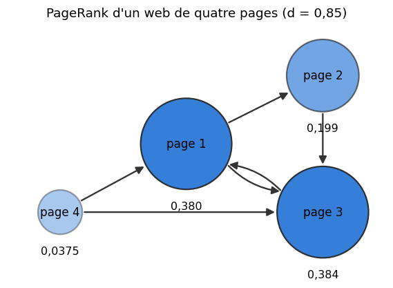

# M26 · Chaînes de Markov et équation de Bellman — fiche de cours

> Le samedi soir, une boutique compte les articles qui restent sur son étagère ; un visiteur passe d'une page à l'autre d'un site marchand ; une machine tombe en panne, puis repart. Chaque fois, l'état de demain ne dépend que de celui d'aujourd'hui et du hasard : c'est une **chaîne de Markov**. Ce chapitre écrit sa **matrice de transition**, calcule la loi après $n$ pas et la **loi stationnaire** vers laquelle la chaîne oublie son départ (le PageRank en est une), puis, avec l'**espérance conditionnelle**, la probabilité de finir dans un état et la durée moyenne avant la fin. Il ajoute ensuite des gains et des décisions : le **retour actualisé**, la **valeur** d'un état sous une **politique** fixée, et l'**équation de Bellman**, un système linéaire qu'on résout exactement ou en itérant une **contraction**. Un maximum dans l'opérateur résout un problème d'**arrêt optimal**. Enfin, quand on n'a que des simulations, la moyenne des retours, l'**erreur TD** et le **biais du maximum** relient les échantillons aux équations exactes. Le chapitre 26 de workbookIA appliquera ces outils à l'apprentissage par renforcement.

| | |
|---|---|
| **Sections** | §1 à §8 |
| **Temps total estimé** | ≈ 14,6 h : lecture et calculs de la fiche ≈ 2 h 40, exercices ≈ 11 h 10, 22 flashcards ≈ 45 min (parcours essentiel ≈ 11,1 h) |
| **Prérequis** | R5 (suites géométriques et leur somme, actualisation, moyennes mobile et exponentielle) ; R6 (logarithmes : résoudre $\gamma^k \le \varepsilon$) ; M02b (loi géométrique et son espérance, loi normale, linéarité de l'espérance) ; M02c (loi des grands nombres, erreur type d'une moyenne) ; M03 (probabilité conditionnelle, probabilités totales) ; M06 (inégalité de Jensen) ; M09a (systèmes linéaires, inverse d'une matrice) ; M11 (moyenne incrémentale, ε-greedy) ; M12c (valeurs propres, diagonalisation et puissances, méthode de la puissance) ; M16 (puissances d'une matrice d'adjacence : sommes sur les chemins d'un graphe) ; M19 (itérations linéaires, point fixe, itération de Richardson) ; M20 (tableaux à plusieurs axes) ; M22 (normes induites $\lVert\cdot\rVert_1$ et $\lVert\cdot\rVert_\infty$, $\rho(\mathbf{A}) \le \lVert\mathbf{A}\rVert$, $\mathbf{A}^t \to \mathbf{0}$ si $\rho(\mathbf{A}) < 1$, applications contractantes et oubli du départ) ; M25b (espérance conditionnelle sachant une variable discrète, espérance et variance totales) |
| **Fichiers du chapitre** | `02_exercices.md` (quiz, papier) · `03_notebook.ipynb` · `04_indices.md` · `05_solutions.md` et `05_solutions.ipynb` · `06_mes_reponses.md` · `flashcards.csv` |
| **mymath** | `markov.py` : `n_step_distribution`, `stationary_distribution`, `bellman_linear_solve`, `bellman_fixed_point_iterates` |
| **Références** | pas de MML (le livre ne traite pas les chaînes de Markov) ; J. K. Blitzstein et J. Hwang, *Introduction to Probability* (2ᵉ éd.), ch. 11 ; R. S. Sutton et A. G. Barto, *Reinforcement Learning: An Introduction* (2ᵉ éd.), §3.5-3.6 et §4.1-4.4 |

## Comment utiliser ce chapitre

**Ordre conseillé.**
1. `python tools/start_chapter.py M26` (sur Colab : `00_setup/COLAB.md` §2) : il copie le notebook, ta feuille de réponses et le squelette `mymath/markov.py`.
2. Section par section : lis **crayon en main** et refais chaque calcul, puis fais les exercices de la section, quiz 🧠 d'abord. Ce chapitre n'a pas de lecture de MML ; les références de « Pour aller plus loin » sont facultatives.
3. Les exercices ✏️ et 🔗 se font sur papier, dans ta copie de `06_mes_reponses.md`, puis se vérifient dans la **partie 0** du notebook. Les démonstrations ∂ se rédigent dans ta copie et se jugent avec la grille de relecture de `05_solutions.md`.

Les §1 et §2 étudient une chaîne seule ; le §3 apporte l'outil de tout le chapitre, conditionner sur le premier pas, et ne demande que le §1. Les §4 à §6 forment le cœur : la valeur d'un état, l'équation de Bellman, son itération. Les §7 et §8 sont deux prolongements, un maximum dans l'opérateur et des échantillons à la place des probabilités ; le §8 s'appuie sur les §5 et §6.

| Section | Quiz 🧠 et rappels 🔁 | Papier et réflexion | Notebook |
|---|---|---|---|
| §1 Matrice de transition, loi à n pas | Q1, R1 | M26.1 ✏️ | M26.16 🔨, M26.23 🎨, M26.24 🐛 |
| §2 Loi stationnaire, PageRank | Q2, R1 | M26.2 ✏️, M26.3 ✏️, M26.15 🗣️ | M26.17 🔨, M26.20 📦, M26.21 🔮, M26.23 🎨, M26.24 🐛, M26.25 🛠️ |
| §3 Analyse au premier pas | Q3, R3 | M26.1 ✏️, M26.4 ✏️, M26.10 ∂ | |
| §4 Retour, valeur, politiques | Q4, R3 | M26.5 ✏️, M26.6 ✏️, M26.11 ∂, M26.14 🔗 | M26.26 🏆 |
| §5 Le système de Bellman | Q5, R2 | M26.6 ✏️, M26.11 ∂, M26.14 🔗, M26.E1 💼 | M26.18 🔨, M26.21 🔮, M26.24 🐛 |
| §6 Itérer l'opérateur de Bellman | Q6, R2 | M26.7 ✏️, M26.12 ∂ | M26.19 🔨, M26.25 🛠️ |
| §7 Un maximum : arrêt optimal | Q7 | M26.8 ✏️, M26.12 ∂ | |
| §8 Des échantillons au lieu de P | Q8 | M26.9 ✏️, M26.13 ∂ | M26.22 🔬, M26.26 🏆 |

Parcours essentiel : tout sauf M26.3, M26.9, M26.10, M26.13, M26.E1, M26.20, M26.22, M26.23, M26.25 et M26.26.

📐 **Notations.**
- Les états d'une chaîne sont numérotés $0, \ldots, m - 1$, comme dans `markov.py` ; $S_t$ est l'état au pas $t$. $\mathbf{P}$ (en gras) est une matrice de transition et $P(\cdot)$ une probabilité ; $\mathbf{1}$ est le vecteur dont toutes les coordonnées valent 1 et $\mathbb{1}\{\cdot\}$ une indicatrice.
- Une **loi** sur les états est une **ligne** ($\boldsymbol{\mu}_n$, $\boldsymbol{\pi}$) ; une fonction des états, une récompense ou une valeur est une **colonne** ($\mathbf{f}$, $\mathbf{r}$, $\mathbf{V}$). $\mathbf{V}$ reste une majuscule, comme dans les livres d'apprentissage par renforcement et dans `markov.py`, bien que ce soit un vecteur ; $V(s)$ est sa coordonnée $s$. Le §1 relie cette convention à celle de M22.
- Aux §1 à §3, $\boldsymbol{\pi}$ (en gras) est une loi stationnaire ; à partir du §4, $\pi(a \mid s)$ est une politique, et la loi stationnaire de la chaîne qu'elle induit s'écrit $\mathbf{d}_\pi$. Le nombre $\pi \approx 3{,}14159$ n'apparaît qu'au §8, dans $1/\sqrt{\pi}$.
- Au §3, $\mathbf{Q}$ (en gras) est le bloc des états transitoires et $\mathbf{t}$ (en gras) le vecteur des durées moyennes ; au §4, $Q^\pi(s, a)$ est la valeur d'une action, et $t$ (en italique) reste un instant.
- $\gamma \in [0, 1]$ est le facteur d'actualisation, $G$ un retour, $\mathcal{T}$ l'opérateur de Bellman ; $\lVert\mathbf{x}\rVert_\infty = \max_i\lvert x_i\rvert$, $\lVert\cdot\rVert_1$, $\lVert\mathbf{A}\rVert_\infty$ (la plus grande somme des $\lvert a_{ij}\rvert$ d'une ligne) et le rayon spectral $\rho$ sont ceux de M22.

Vocabulaire anglais de ce chapitre : *Markov chain*, *Markov property*, *state*, *transition matrix*, *stochastic matrix*, *substochastic matrix*, *transition graph*, *n-step transition probability*, *Chapman-Kolmogorov equations*, *stationary distribution*, *Perron-Frobenius theorem*, *irreducible*, *period*, *aperiodic*, *ergodic theorem*, *spectral gap*, *PageRank*, *random surfer*, *damping factor*, *dangling node*, *conditional expectation*, *law of total expectation*, *tower property*, *absorbing state*, *transient state*, *first-step analysis*, *absorption probability*, *expected hitting time*, *fundamental matrix*, *reward*, *discounted return*, *discount factor*, *value function*, *Markov decision process (MDP)*, *action*, *policy*, *deterministic policy*, *stochastic policy*, *action value*, *Bellman equation*, *policy evaluation*, *Neumann series*, *discounted state-visitation distribution*, *terminal state*, *Bellman operator*, *contraction*, *fixed point*, *Banach fixed-point theorem*, *synchronous update*, *in-place update*, *Gauss-Seidel*, *a priori bound*, *a posteriori bound*, *stopping criterion*, *optimal stopping*, *continuation value*, *threshold rule*, *Bellman optimality equation*, *value iteration*, *greedy policy*, *Monte Carlo estimate*, *step size*, *Robbins-Monro conditions*, *stochastic approximation*, *temporal-difference (TD) error*, *Bellman residual*, *telescoping sum*, *reward shaping*, *maximization bias*, *winner's curse*, *double estimator*.

## Objectifs d'apprentissage

À la fin du chapitre, tu sais :
- **écrire** la matrice de transition d'une chaîne de Markov, en convention ligne, et **calculer** la loi après $n$ pas ;
- **calculer** une loi stationnaire, **dire** si elle est unique et si la loi de la chaîne y converge, et à quelle vitesse ;
- **calculer** une probabilité d'absorption et une durée moyenne par l'analyse au premier pas (espérance conditionnelle) ;
- **définir** le retour actualisé et la valeur d'un état sous une politique fixée, et **interpréter** $\gamma$ comme une probabilité de continuer ;
- **écrire** et **résoudre** le système de Bellman d'une politique fixée, et **justifier** qu'il a une unique solution ;
- **itérer** l'opérateur de Bellman, **borner** l'erreur et **choisir** le nombre d'itérations ;
- **résoudre** un problème d'arrêt optimal par un opérateur avec un maximum, et **lire** l'équation d'optimalité de Bellman ;
- **relier** la moyenne de retours simulés, l'erreur TD et le biais du maximum aux équations exactes.

## L'essentiel en 10 lignes

1. **Chaîne de Markov** : $p_{ij} = P(S_{t+1} = j \mid S_t = i)$, matrice $\mathbf{P}$ **stochastique** ($p_{ij} \ge 0$, $\mathbf{P}\mathbf{1} = \mathbf{1}$). Loi en ligne : $\boldsymbol{\mu}_{t+1} = \boldsymbol{\mu}_t\mathbf{P}$, $\boldsymbol{\mu}_n = \boldsymbol{\mu}_0\mathbf{P}^n$, $(\mathbf{P}^n)_{ij}$ = somme sur les chemins de $i$ à $j$ ; fonction en colonne : $\mathbb{E}[f(S_{t+1}) \mid S_t = i] = (\mathbf{P}\mathbf{f})_i$.
2. **Loi stationnaire** $\boldsymbol{\pi} = \boldsymbol{\pi}\mathbf{P}$, $\sum_j\pi_j = 1$ : elle existe toujours ($\lVert\mathbf{P}\rVert_\infty = 1 = \rho(\mathbf{P})$, Perron-Frobenius) ; unique si la chaîne est irréductible ; $\boldsymbol{\mu}_n \to \boldsymbol{\pi}$ si elle est de plus apériodique, avec un écart en $\lvert\lambda_2\rvert^n$. À deux états : $\mathbf{P}^n = \mathbf{1}\boldsymbol{\pi} + (1 - a - b)^n(\mathbf{I} - \mathbf{1}\boldsymbol{\pi})$.
3. **PageRank** : la loi stationnaire de $\mathbf{P}_d = d\,\mathbf{L} + \frac{1-d}{m}\mathbf{1}\mathbf{1}^\top$ ($d = 0{,}85$), par la méthode de la puissance, qui converge au moins comme $d^k$.
4. **Tour** : $\mathbb{E}\big[\mathbb{E}[X \mid Y, Z] \mid Y\big] = \mathbb{E}[X \mid Y]$. **Premier pas** : $\mathbf{h} = \mathbf{Q}\mathbf{h} + \mathbf{b}$ (absorption), $\mathbf{t} = \mathbf{1} + \mathbf{Q}\mathbf{t}$ (durée) ; $\mathbf{N} = (\mathbf{I} - \mathbf{Q})^{-1} = \sum_t\mathbf{Q}^t$ compte les visites.
5. **Retour** $G = \sum_t\gamma^tR_t$, **valeur** $V(s) = \mathbb{E}[G \mid S_0 = s]$. Arrêter à chaque pas avec la probabilité $1 - \gamma$ donne une durée moyenne $\frac{1}{1-\gamma}$ et un gain total moyen égal à $V(s)$.
6. **MDP** : matrices $\mathbf{P}_a$, récompenses $r(s, a, s')$ et leur moyenne $r(s, a)$ ; politique $\pi(a \mid s)$ ; chaîne induite $\mathbf{P}_\pi(s, s') = \sum_a\pi(a \mid s)\,\mathbf{P}_a(s, s')$, $r_\pi(s) = \sum_a\pi(a \mid s)\,r(s, a)$ ; $Q^\pi(s, a) = r(s, a) + \gamma\sum_{s'}\mathbf{P}_a(s, s')\,V^\pi(s')$.
7. **Bellman** : $\mathbf{V} = \mathbf{r} + \gamma\mathbf{P}\mathbf{V}$, soit $(\mathbf{I} - \gamma\mathbf{P})\mathbf{V} = \mathbf{r}$, inversible pour $\gamma < 1$, $\mathbf{V} = \sum_t\gamma^t\mathbf{P}^t\mathbf{r}$ ; $(1 - \gamma)(\mathbf{I} - \gamma\mathbf{P})^{-1}$ a pour lignes des lois (l'occupation actualisée) ; une fin possible = une ligne sous-stochastique, et $\gamma = 1$ est permis si la fin est sûre.
8. $\mathcal{T}(\mathbf{V}) = \mathbf{r} + \gamma\mathbf{P}\mathbf{V}$ est une **γ-contraction** pour $\lVert\cdot\rVert_\infty$ : $\lVert\mathbf{V}_k - \mathbf{V}\rVert_\infty \le \gamma^k\lVert\mathbf{V}_0 - \mathbf{V}\rVert_\infty$ et $\le \frac{\gamma}{1-\gamma}\lVert\mathbf{V}_k - \mathbf{V}_{k-1}\rVert_\infty$ ; itérations synchrones (Richardson de pas 1) ou en place (Gauss-Seidel).
9. $\lvert\max\mathbf{x} - \max\mathbf{y}\rvert \le \lVert\mathbf{x} - \mathbf{y}\rVert_\infty$. **Arrêt optimal** $\mathbf{V} = \max(\mathbf{g}, \mathbf{c} + \gamma\mathbf{P}\mathbf{V})$ ; offres indépendantes : $C = c + \gamma\,\mathbb{E}[\max(X, C)]$, accepter si $x \ge C$. Optimalité $V^\star(s) = \max_a\big[r(s, a) + \gamma(\mathbf{P}_a\mathbf{V}^\star)(s)\big]$ (énoncée).
10. **Échantillons** : moyenne de retours (erreur $\sigma/\sqrt{n}$, troncature $\le \gamma^T\lVert\mathbf{V}\rVert_\infty$) ; pas $\frac1n$ = moyenne, pas constant = moyenne exponentielle ; Robbins-Monro $\sum\alpha_t = \infty$, $\sum\alpha_t^2 < \infty$ ; $\mathbb{E}[\delta \mid S = s]$ = résidu de Bellman ; $\mathbb{E}[\max_i\hat{X}_i] \ge \max_i\mathbb{E}[\hat{X}_i]$, $\mathbb{E}[\max(Z_1, Z_2)] = \frac{1}{\sqrt\pi}$, et l'estimateur double.

## §1 · Chaînes de Markov : matrice de transition, graphe et loi à n pas

### Demain ne dépend que d'aujourd'hui

Une boutique vend un article dont son étagère tient au plus deux exemplaires. Chaque samedi soir, on compte ceux qui restent : $S_t \in \{0, 1, 2\}$ à la fin de la semaine $t$. La demande d'une semaine, notée $Y$, vaut 0, 1 ou 2 articles avec les probabilités 0,3, 0,5 et 0,2, indépendamment d'une semaine à l'autre, et la boutique vend ce qu'elle peut. Sa règle : quand l'étagère est vide le samedi soir, elle commande deux articles, livrés le samedi suivant après la fermeture ; pendant cette semaine-là, elle ne vend rien. D'un samedi au suivant :
- depuis 0, la semaine passe sans article, puis la livraison arrive : $S_{t+1} = 2$ à coup sûr ;
- depuis 1, l'article part si la demande vaut au moins 1 (probabilité 0,7), sinon il reste (0,3) ;
- depuis 2, il en reste 2, 1 ou 0 avec les probabilités 0,3, 0,5 et 0,2.

> **Définition.** Une suite de variables aléatoires $S_0, S_1, S_2, \ldots$ à valeurs dans un ensemble fini d'**états** (*states*) $\{0, \ldots, m - 1\}$ est une **chaîne de Markov** (*Markov chain*) homogène si, pour tout $t$ et tous les états,
> $$P(S_{t+1} = j \mid S_t = i,\ S_{t-1} = i_{t-1},\ \ldots,\ S_0 = i_0) = P(S_{t+1} = j \mid S_t = i) = p_{ij},$$
> un nombre qui ne dépend ni des états d'avant $t$ (la **propriété de Markov**, *Markov property*), ni de $t$. La **matrice de transition** (*transition matrix*) $\mathbf{P} = (p_{ij})$, de forme $(m, m)$, est **stochastique** (*stochastic matrix*) : $p_{ij} \ge 0$, et chaque ligne a pour somme 1, $\mathbf{P}\mathbf{1} = \mathbf{1}$.

Pour la boutique, ligne $i$ = l'état du samedi, colonne $j$ = celui du samedi suivant :
$$\mathbf{P} = \begin{pmatrix} 0 & 0 & 1 \\ 0{,}7 & 0{,}3 & 0 \\ 0{,}2 & 0{,}5 & 0{,}3 \end{pmatrix}.$$

La propriété de Markov est une **hypothèse de modélisation**. Elle tient ici parce que la demande d'une semaine ne dépend pas des précédentes et que la règle ne regarde que le stock du samedi. Si la boutique ne commandait qu'après deux samedis vides de suite, le stock seul ne suffirait plus : il faudrait mettre dans l'état le samedi précédent aussi.

**Le graphe de transition** (*transition graph*) dessine la chaîne : un nœud par état, une flèche de $i$ vers $j$ pour chaque $p_{ij} > 0$, qui porte la probabilité $p_{ij}$ ; c'est un graphe orienté pondéré (M16), avec des boucles quand $p_{ii} > 0$. Les flèches qui partent d'un nœud ont des poids de somme 1.

### La loi après n pas

Notons $\boldsymbol{\mu}_t = \big(P(S_t = 0), \ldots, P(S_t = m - 1)\big)$ la **loi** de $S_t$, une ligne. Par les probabilités totales (M03), en conditionnant sur l'état du pas $t$,
$$P(S_{t+1} = j) = \sum_i P(S_t = i)\,p_{ij}, \qquad \text{c'est-à-dire} \qquad \boldsymbol{\mu}_{t+1} = \boldsymbol{\mu}_t\mathbf{P}, \qquad \text{donc} \qquad \boldsymbol{\mu}_n = \boldsymbol{\mu}_0\mathbf{P}^n .$$

**Exemple.** L'étagère est pleine ce samedi : $\boldsymbol{\mu}_0 = (0, 0, 1)$. Alors $\boldsymbol{\mu}_1 = (0{,}2 ;\ 0{,}5 ;\ 0{,}3)$, la troisième ligne de $\mathbf{P}$. Puis
$$\boldsymbol{\mu}_2 = \boldsymbol{\mu}_1\mathbf{P} = \big(0{,}5 \times 0{,}7 + 0{,}3 \times 0{,}2 ;\ \ 0{,}5 \times 0{,}3 + 0{,}3 \times 0{,}5 ;\ \ 0{,}2 \times 1 + 0{,}3 \times 0{,}3\big) = (0{,}41 ;\ 0{,}3 ;\ 0{,}29),$$
et $\boldsymbol{\mu}_3 = (0{,}268 ;\ 0{,}235 ;\ 0{,}497)$. Dans deux semaines, l'étagère sera vide avec la probabilité 0,41.

> **Équations de Chapman-Kolmogorov** (*Chapman-Kolmogorov equations*). $(\mathbf{P}^n)_{ij} = P(S_n = j \mid S_0 = i)$, et $\mathbf{P}^{m+n} = \mathbf{P}^m\mathbf{P}^n$ : pour aller de $i$ à $j$ en $m + n$ pas, on passe par un état $k$ au pas $m$, $(\mathbf{P}^{m+n})_{ij} = \sum_k(\mathbf{P}^m)_{ik}(\mathbf{P}^n)_{kj}$.

Comme en M16, $(\mathbf{P}^n)_{ij}$ est la somme, sur les chemins de longueur $n$ de $i$ à $j$ dans le graphe, des produits des probabilités de leurs flèches. Par exemple, $(\mathbf{P}^2)_{20} = p_{20}p_{00} + p_{21}p_{10} + p_{22}p_{20} = 0 + 0{,}5 \times 0{,}7 + 0{,}3 \times 0{,}2 = 0{,}41$ : les chemins $2 \to 1 \to 0$ et $2 \to 2 \to 0$ (le chemin $2 \to 0 \to 0$ n'existe pas, $p_{00} = 0$). C'est la première coordonnée de $\boldsymbol{\mu}_2$ ci-dessus, puisque $\boldsymbol{\mu}_0$ était la loi concentrée en 2.

### Une loi à gauche, une fonction à droite

Une **fonction des états** $f$ s'écrit comme une colonne $\mathbf{f} = (f(0), \ldots, f(m - 1))^\top$. Alors
$$\mathbb{E}[f(S_{t+1}) \mid S_t = i] = \sum_j p_{ij}\,f(j) = (\mathbf{P}\mathbf{f})_i, \qquad \mathbb{E}[f(S_t)] = \boldsymbol{\mu}_t\mathbf{f}, \qquad \mathbb{E}[f(S_n)] = \boldsymbol{\mu}_0\mathbf{P}^n\mathbf{f} .$$
Placée à gauche de $\mathbf{P}$, une loi avance d'un pas ($\boldsymbol{\mu}\mathbf{P}$) ; placée à droite, une fonction est moyennée sur le pas suivant ($\mathbf{P}\mathbf{f}$). Le produit $\boldsymbol{\mu}_0\mathbf{P}^n\mathbf{f}$ se calcule dans l'ordre qu'on veut : $(\boldsymbol{\mu}_0\mathbf{P}^n)\mathbf{f}$ ou $\boldsymbol{\mu}_0(\mathbf{P}^n\mathbf{f})$.

**Exemple.** Avec $f(s) = s$, le nombre d'articles restants : $\mathbf{P}\mathbf{f} = (2 ;\ 0{,}3 ;\ 1{,}1)$. Depuis une étagère vide, il y aura 2 articles samedi prochain à coup sûr ; depuis une étagère pleine, $0{,}5 \times 1 + 0{,}3 \times 2 = 1{,}1$ en moyenne.

📐 **Notations.** Les lois sont des **lignes**, comme chez les probabilistes et dans `markov.py` : $\boldsymbol{\mu}_{t+1} = \boldsymbol{\mu}_t\mathbf{P}$. M22 écrivait les états en **colonnes**, $\mathbf{x}_{t+1} = \mathbf{A}\mathbf{x}_t$ : en transposant, $\boldsymbol{\mu}_{t+1}^\top = \mathbf{P}^\top\boldsymbol{\mu}_t^\top$, la récurrence de M22 pour $\mathbf{A} = \mathbf{P}^\top$, sans entrée (`linear_system_states`). Les fonctions, et plus loin les récompenses et les valeurs, restent des colonnes : $\mathbf{P}\mathbf{f}$. Une matrice stochastique a des **lignes** de somme 1 ; c'est $\mathbf{P}^\top$, aux colonnes de somme 1, qui agit sur des lois écrites en colonnes. Certains livres rangent $\mathbf{P}$ dans l'autre sens ($p_{ij}$ de $j$ vers $i$) : vérifie toujours quelles sommes valent 1.

💻 **Aujourd'hui en pratique** — on ne calcule pas $\mathbf{P}^n$ pour avoir une loi : $n$ produits $\boldsymbol{\mu} \leftarrow \boldsymbol{\mu}\mathbf{P}$ suffisent (`n_step_distribution`, 🔨 M26.16), et pour un très grand $n$, on élève au carré ($\mathbf{P}^2$, $\mathbf{P}^4$, $\mathbf{P}^8$…, environ $\log_2 n$ produits). Une chaîne de millions d'états a une matrice **creuse**, presque toute nulle, rangée par `scipy.sparse`.

⚠️ **Erreur classique.** Lire $\mathbf{P}$ en colonnes ; écrire $\mathbf{P}\boldsymbol{\mu}$ au lieu de $\boldsymbol{\mu}\mathbf{P}$ ; ou construire une matrice dont une ligne n'a pas pour somme 1 (🐛 M26.24). Croire que la propriété de Markov dit que le passé ne compte pas : il compte, mais tout ce qu'il apporte est déjà dans l'état présent.

🔗 **Dans workbookIA** — le chapitre 26 décrit un environnement par des probabilités de transition $P(s' \mid s, a)$, écrites comme des sommes, jamais comme une matrice : à action fixée, ce sont les lignes d'une matrice stochastique (§4).

## §2 · La loi stationnaire : existence, unicité, convergence et vitesse ; le PageRank

### Une loi qui ne bouge plus

> **Définition.** Une **loi stationnaire** (*stationary distribution*) de $\mathbf{P}$ est une ligne $\boldsymbol{\pi}$ telle que
> $$\boldsymbol{\pi}\mathbf{P} = \boldsymbol{\pi}, \qquad \pi_j \ge 0, \qquad \sum_j\pi_j = 1 .$$
> Si $S_0$ suit $\boldsymbol{\pi}$, chaque $S_t$ suit $\boldsymbol{\pi}$.

Transposée, l'égalité devient $\mathbf{P}^\top\boldsymbol{\pi}^\top = \boldsymbol{\pi}^\top$ : $\boldsymbol{\pi}^\top$ est un **vecteur propre de $\mathbf{P}^\top$** de valeur propre 1 (M12c), positif et de somme 1. Le vecteur propre **à droite** de $\mathbf{P}$ pour la valeur propre 1 est $\mathbf{1}$, qui ne dit rien.

> **Théorème** (existence ; Perron-Frobenius admis). Une matrice stochastique a pour rayon spectral $\rho(\mathbf{P}) = 1$, et au moins une loi stationnaire.

*Démonstration de $\rho(\mathbf{P}) = 1$.* Les coefficients sont positifs et chaque ligne a pour somme 1, donc $\lVert\mathbf{P}\rVert_\infty = 1$, et $\rho(\mathbf{P}) \le \lVert\mathbf{P}\rVert_\infty = 1$ (M22 §4). D'autre part $\mathbf{P}\mathbf{1} = \mathbf{1}$ : 1 est une valeur propre, donc $\rho(\mathbf{P}) = 1$. $\mathbf{P}^\top$ a le même polynôme caractéristique, donc la valeur propre 1 aussi : il existe $\mathbf{v} \ne \mathbf{0}$ avec $\mathbf{P}^\top\mathbf{v} = \mathbf{v}$. Le **théorème de Perron-Frobenius** (*Perron-Frobenius theorem*), admis, permet de choisir $\mathbf{v}$ à coordonnées positives ou nulles ; $\boldsymbol{\pi} = \mathbf{v}^\top/\sum_j v_j$ convient. $\square$

**Le calcul par un système linéaire.** Les $m$ équations de $(\mathbf{P}^\top - \mathbf{I})\boldsymbol{\pi}^\top = \mathbf{0}$ ont pour somme $0 = 0$ (chaque colonne de $\mathbf{P}^\top - \mathbf{I}$ a pour somme $1 - 1$) : l'une est en trop. On la remplace par $\sum_j\pi_j = 1$. Pour la boutique :
$$\pi_0 = 0{,}7\,\pi_1 + 0{,}2\,\pi_2, \qquad \pi_1 = 0{,}3\,\pi_1 + 0{,}5\,\pi_2, \qquad \pi_2 = \pi_0 + 0{,}3\,\pi_2, \qquad \pi_0 + \pi_1 + \pi_2 = 1 .$$
La deuxième donne $\pi_1 = \frac57\pi_2$, la troisième $\pi_0 = 0{,}7\,\pi_2$ ; la somme vaut alors $\pi_2\big(0{,}7 + \frac57 + 1\big) = \frac{16{,}9}{7}\pi_2 = 1$. D'où
$$\boldsymbol{\pi} = \Big(\frac{49}{169},\ \frac{50}{169},\ \frac{70}{169}\Big) \approx (0{,}290 ;\ 0{,}296 ;\ 0{,}414),$$
et la première équation, laissée de côté, est bien vérifiée ($0{,}7 \times 50 + 0{,}2 \times 70 = 49$). À long terme, l'étagère est vide 29 % des samedis : autant de semaines sans vente. Si le système carré obtenu est singulier, la loi stationnaire n'est pas unique (`stationary_distribution` le refuse, 🔨 M26.17).

### Unicité et convergence

Deux contre-exemples montrent ce qui peut manquer.

- **Une chaîne périodique.** Trois états visités en tournant, $0 \to 1 \to 2 \to 0$, chaque flèche de probabilité 1. Sa loi stationnaire est unique, $(\frac13, \frac13, \frac13)$. Mais depuis l'état 0, $\boldsymbol{\mu}_n$ vaut $(1, 0, 0)$, $(0, 1, 0)$, $(0, 0, 1)$, puis recommence : elle ne converge pas. Les trois valeurs propres de $\mathbf{P}$ sont les racines cubiques de 1, toutes de module 1.
- **Une chaîne à deux classes.** Ajoute à la boutique un état 3, « boutique fermée », où l'on reste toujours et où l'on n'arrive jamais. La matrice $4 \times 4$ a deux blocs qui ne communiquent pas ; $(\frac{49}{169}, \frac{50}{169}, \frac{70}{169}, 0)$ et $(0, 0, 0, 1)$ sont deux lois stationnaires, ainsi que tous leurs mélanges $\theta\,(\ldots) + (1 - \theta)\,(\ldots)$, $\theta \in [0, 1]$. La loi limite existe, mais elle dépend du départ.

> **Définitions.** Une chaîne est **irréductible** (*irreducible*) si, de chaque état, un chemin du graphe mène à chaque autre. La **période** (*period*) d'un état $i$ est le plus grand diviseur commun des longueurs des chemins de $i$ à $i$ ; tous les états d'une chaîne irréductible ont la même période, et la chaîne est **apériodique** (*aperiodic*) si elle vaut 1. Une boucle $p_{ii} > 0$ dans une chaîne irréductible suffit.
>
> **Théorème** (admis). Si la chaîne est irréductible, sa loi stationnaire est unique et $\pi_j > 0$ pour tout $j$ ; quel que soit le départ, la **fréquence des visites** à $j$, $\frac1n\#\{t < n : S_t = j\}$, tend vers $\pi_j$ avec la probabilité 1 (le **théorème ergodique**, *ergodic theorem*). Si elle est de plus apériodique, $\boldsymbol{\mu}_0\mathbf{P}^n \to \boldsymbol{\pi}$ pour toute loi initiale, et 1 est la seule valeur propre de $\mathbf{P}$ de module 1.

La boutique est irréductible ($0 \to 2 \to 1 \to 0$) et apériodique (une boucle en 1) ; la chaîne qui tourne est irréductible mais de période 3 ; la chaîne à deux classes n'est pas irréductible.

### La vitesse : la deuxième valeur propre

**Une chaîne à deux états, entièrement calculée.** Une machine est en marche (état 0) ou en panne (état 1). Chaque jour, une machine en marche tombe en panne avec la probabilité $a = 0{,}12$ ; une machine en panne est réparée avec la probabilité $b = 0{,}28$ :
$$\mathbf{P} = \begin{pmatrix} 1 - a & a \\ b & 1 - b \end{pmatrix} = \begin{pmatrix} 0{,}88 & 0{,}12 \\ 0{,}28 & 0{,}72 \end{pmatrix}.$$
- **La loi stationnaire.** $\boldsymbol{\pi}\mathbf{P} = \boldsymbol{\pi}$ se réduit à $a\,\pi_0 = b\,\pi_1$ (ce qui sort de l'état 0 compense ce qui y entre), d'où $\boldsymbol{\pi} = \big(\frac{b}{a+b}, \frac{a}{a+b}\big) = (0{,}7 ;\ 0{,}3)$ : la machine tourne 70 % du temps.
- **Les valeurs propres.** La trace vaut $2 - a - b = 1{,}6$ et l'une des valeurs propres est 1, donc l'autre est $\lambda_2 = 1 - a - b = 0{,}6$ (le déterminant, $0{,}6336 - 0{,}0336 = 0{,}6$, le confirme).
- **Les puissances.** Posons $\mathbf{E} = \mathbf{1}\boldsymbol{\pi}$, la matrice dont chaque ligne est $\boldsymbol{\pi}$. Elle vérifie $\mathbf{E}^2 = \mathbf{1}(\boldsymbol{\pi}\mathbf{1})\boldsymbol{\pi} = \mathbf{E}$, et l'on vérifie coefficient par coefficient que $\mathbf{P} = \mathbf{E} + \lambda_2(\mathbf{I} - \mathbf{E})$ (par exemple $0{,}7 + 0{,}6 \times 0{,}3 = 0{,}88$). Comme $\mathbf{E}(\mathbf{I} - \mathbf{E}) = (\mathbf{I} - \mathbf{E})\mathbf{E} = \mathbf{0}$ et $(\mathbf{I} - \mathbf{E})^2 = \mathbf{I} - \mathbf{E}$, une récurrence donne
$$\mathbf{P}^n = \mathbf{1}\boldsymbol{\pi} + \lambda_2^n(\mathbf{I} - \mathbf{1}\boldsymbol{\pi}) = \begin{pmatrix} 0{,}7 & 0{,}3 \\ 0{,}7 & 0{,}3 \end{pmatrix} + 0{,}6^n\begin{pmatrix} 0{,}3 & -0{,}3 \\ -0{,}7 & 0{,}7 \end{pmatrix}.$$
C'est la diagonalisation de M12c, regroupée par valeur propre.
- **L'oubli du départ.** Depuis une machine en panne, $P(S_n = 0) = 0{,}7 - 0{,}7 \times 0{,}6^n$ ; depuis une machine en marche, $0{,}7 + 0{,}3 \times 0{,}6^n$. L'écart à la loi stationnaire est multiplié par $\lambda_2 = 0{,}6$ chaque jour. Pour qu'il passe sous 0,01 depuis le pire départ, il faut $0{,}7 \times 0{,}6^n \le 0{,}01$, soit $n \ge \frac{\ln 70}{\ln(1/0{,}6)} \approx 8{,}3$ (R6) : 9 jours.

**En général.** Si $\mathbf{P}$ est diagonalisable, de valeurs propres $1 = \lambda_1$, $\lvert\lambda_2\rvert \ge \lvert\lambda_3\rvert \ge \cdots$, avec $\lvert\lambda_2\rvert < 1$, alors $\boldsymbol{\mu}_n - \boldsymbol{\pi}$ est une combinaison des $\lambda_i^n$, $i \ge 2$, et l'écart décroît comme $\lvert\lambda_2\rvert^n$ : c'est la promesse de M12c §4. L'écart $1 - \lvert\lambda_2\rvert$ s'appelle le **trou spectral** (*spectral gap*) : plus il est grand, plus la chaîne oublie vite son départ. Pour la boutique, le polynôme caractéristique est $(\lambda - 1)(\lambda^2 + 0{,}4\,\lambda + 0{,}29)$, de racines $1$ et $-0{,}2 \pm 0{,}5\,i$ : $\lvert\lambda_2\rvert = \sqrt{0{,}29} \approx 0{,}539$. Ces valeurs propres complexes font **tourner** l'écart (M22 §2) : $P(S_n = 2)$ vaut $0{,}3$ ; $0{,}29$ ; $0{,}497$ ; $0{,}417$ ; $0{,}389$… depuis l'étagère pleine, et oscille autour de $0{,}414$ en se resserrant.

### Pourquoi ce paragraphe

workbookIA 26 n'utilise pas la loi stationnaire. Elle sert pourtant quatre fois. D'abord, le théorème ergodique dit qu'à long terme une chaîne passe dans chaque état la fraction $\pi_j$ du temps : un état rarement visité est rarement observé, donc mal estimé à partir de simulations (§8). Ensuite, M12c a promis le PageRank par la méthode de la puissance et la vitesse par la deuxième valeur propre : les voici. Enfin, MB5 fera converger une chaîne vers sa loi stationnaire, et MB8 se servira de la loi d'occupation actualisée du §5.

### Le PageRank

Un internaute clique au hasard : sur une page, il choisit un des liens au hasard, uniformément ; sur une page sans lien (*dangling node*), il va sur une page quelconque. Cela fait une chaîne de matrice $\mathbf{L}$ sur les $m$ pages. Ce **surfeur aléatoire** (*random surfer*) peut rester piégé dans un groupe de pages ; on le fait donc **sauter** : à chaque pas, avec la probabilité $1 - d$, il va sur une page tirée uniformément. Sa matrice est
$$\mathbf{P}_d = d\,\mathbf{L} + \frac{1 - d}{m}\,\mathbf{1}\mathbf{1}^\top,$$
avec un **facteur d'amortissement** (*damping factor*) $d$, souvent $0{,}85$ (S. Brin et L. Page, 1998). Tous ses coefficients sont strictement positifs : la chaîne est irréductible et apériodique, sa loi stationnaire est unique, et c'est le **PageRank** des pages. On admet que les valeurs propres de $\mathbf{P}_d$ autres que 1 sont celles de $\mathbf{L}$ multipliées par $d$ : la méthode de la puissance converge au moins comme $d^k$.

**Exemple : un web de quatre pages.** Les liens : $1 \to 2$, $1 \to 3$, $2 \to 3$, $3 \to 1$, $4 \to 1$, $4 \to 3$ ; aucune page ne pointe vers la page 4. Avec $d = 0{,}85$, chaque coefficient de $\mathbf{P}_d$ vaut $0{,}85\,\ell_{ij} + 0{,}0375$. La méthode de la puissance part de la loi uniforme : $\boldsymbol{x}_1 = \frac14\mathbf{1}^\top\mathbf{P}_d$ est le quart des sommes des colonnes, $0{,}0375 + 0{,}2125 \times (1{,}5 ;\ 0{,}5 ;\ 2 ;\ 0)$, soit $(0{,}35625 ;\ 0{,}14375 ;\ 0{,}4625 ;\ 0{,}0375)$. Puis $\boldsymbol{x}_2 \approx (0{,}447 ;\ 0{,}189 ;\ 0{,}327 ;\ 0{,}0375)$, …, $\boldsymbol{x}_{10} \approx (0{,}381 ;\ 0{,}199 ;\ 0{,}383 ;\ 0{,}0375)$, vers
$$\boldsymbol{\pi} \approx (0{,}380 ;\ 0{,}199 ;\ 0{,}384 ;\ 0{,}0375).$$
La page 4 ne reçoit que les sauts : $\frac{1 - d}{4} = 0{,}0375$. La page 3, pointée par trois pages, devance de peu la page 1, pointée par deux seulement, mais dont l'une, la page 3, lui donne tout ce qu'elle reçoit. Les valeurs propres de $\mathbf{L}$ autres que 1 sont $0$ et $-0{,}5 \pm 0{,}5\,i$, de module au plus $0{,}707$ ; celles de $\mathbf{P}_d$ ont donc un module au plus $0{,}85 \times 0{,}707 \approx 0{,}60$ : chaque pas divise l'écart par 1,7 environ.

💻 **Aujourd'hui en pratique** — un moteur de recherche ne résout pas le système : il itère la méthode de la puissance avec des produits creux, sans jamais écrire $\mathbf{P}_d$ (dont la partie $\frac{1-d}{m}\mathbf{1}\mathbf{1}^\top$ est pleine). `networkx.pagerank(G, alpha=0.85)` le fait sur un graphe ; le 📦 M26.20 compare trois méthodes.

⚠️ **Erreur classique.** Croire qu'une loi stationnaire n'existe que pour les chaînes bien faites (elle existe toujours) ; ou qu'elle est toujours unique, ou que la loi de la chaîne y converge toujours (la chaîne périodique). Chercher le vecteur propre de $\mathbf{P}$ au lieu de celui de $\mathbf{P}^\top$. Oublier de normaliser $\boldsymbol{\pi}$ (🐛 M26.24).

🔗 **Dans workbookIA** — le chapitre 26 estime des valeurs à partir d'épisodes simulés et demande que chaque état soit visité souvent ; la fréquence des visites à long terme est celle du théorème ergodique.

## §3 · Espérance conditionnelle et analyse au premier pas : absorption et durée moyenne

### L'espérance conditionnelle (rappel de M25b)

Pour une variable discrète $Y$ et une valeur $y$ telle que $P(Y = y) > 0$, l'**espérance conditionnelle** (*conditional expectation*) $\mathbb{E}[X \mid Y = y]$ est l'espérance de $X$ sous la loi conditionnelle $P(\cdot \mid Y = y)$. Elle définit une fonction $m(y)$, et $\mathbb{E}[X \mid Y] = m(Y)$ est une **variable aléatoire**. M25b a démontré la **formule de l'espérance totale** (*law of total expectation*) :
$$\mathbb{E}[X] = \mathbb{E}\big[\mathbb{E}[X \mid Y]\big] = \sum_y P(Y = y)\,\mathbb{E}[X \mid Y = y].$$
Dans une chaîne, $\mathbb{E}[f(S_1) \mid S_0 = i] = (\mathbf{P}\mathbf{f})_i$ (§1), et $\mathbb{E}[f(S_1)] = \boldsymbol{\mu}_0\mathbf{P}\mathbf{f}$ en est la moyenne sous la loi de $S_0$. Pour la boutique, avec $S_0$ de loi $\boldsymbol{\pi}$ et $f(s) = s$ : $\boldsymbol{\pi}(\mathbf{P}\mathbf{f}) = \frac{49 \times 2 + 50 \times 0{,}3 + 70 \times 1{,}1}{169} = \frac{190}{169} \approx 1{,}124$ article, la même chose que $\boldsymbol{\pi}\mathbf{f} = \frac{50 + 140}{169}$, puisque $\boldsymbol{\pi}\mathbf{P} = \boldsymbol{\pi}$.

### La propriété de la tour

> **Propriété de la tour** (*tower property*). Pour des variables discrètes $Y$ et $Z$, et $X$ d'espérance finie,
> $$\mathbb{E}\big[\,\mathbb{E}[X \mid Y, Z] \;\big|\; Y\big] = \mathbb{E}[X \mid Y] .$$
> Conditionner d'abord sur plus d'information, puis moyenner ce surplus, revient à conditionner sur moins. L'espérance totale en est le cas où l'on ne garde rien.

*Démonstration.* Fixons $y$. Sous la loi conditionnelle $P(\cdot \mid Y = y)$, qui est une loi de probabilité, la formule de l'espérance totale, appliquée avec la variable $Z$, donne
$$\mathbb{E}[X \mid Y = y] = \sum_z P(Z = z \mid Y = y)\,\mathbb{E}[X \mid Y = y, Z = z],$$
et le membre de droite est l'espérance de $\mathbb{E}[X \mid Y, Z]$ sachant $Y = y$. $\square$

**Dans une chaîne.** Avec la propriété de Markov, la tour fait avancer d'un pas à la fois :
$$\mathbb{E}[f(S_2) \mid S_0 = i] = \sum_j p_{ij}\,\mathbb{E}[f(S_2) \mid S_0 = i, S_1 = j] = \sum_j p_{ij}\,\mathbb{E}[f(S_2) \mid S_1 = j] = \sum_j p_{ij}(\mathbf{P}\mathbf{f})_j = (\mathbf{P}^2\mathbf{f})_i .$$
La deuxième égalité est la propriété de Markov : sachant $S_1 = j$, l'état $S_0$ n'apporte plus rien. Pour la boutique, $\mathbb{E}[S_2 \mid S_0 = 2] = 0{,}2 \times 2 + 0{,}5 \times 0{,}3 + 0{,}3 \times 1{,}1 = 0{,}88$, ce que redonne $\boldsymbol{\mu}_2\mathbf{f} = 0{,}3 + 2 \times 0{,}29$. Cette idée, **conditionner sur le premier pas**, porte la suite du chapitre.

### États absorbants et états transitoires

Un état $i$ est **absorbant** (*absorbing state*) si $p_{ii} = 1$ : une fois là, on y reste. Un état non absorbant d'où l'on peut atteindre un état absorbant est **transitoire** (*transient state*) : la chaîne finit par le quitter pour toujours. En rangeant les états transitoires d'abord,
$$\mathbf{P} = \begin{pmatrix} \mathbf{Q} & \mathbf{B} \\ \mathbf{0} & \mathbf{I} \end{pmatrix},$$
où $\mathbf{Q}$ (transitoires vers transitoires) est **sous-stochastique** (*substochastic*) : des lignes de somme au plus 1, la masse manquante partant vers les états absorbants.

**Exemple : un site marchand.** Un visiteur arrive sur l'accueil (état 1). Il passe à une fiche produit (état 2), au panier (état 3), et finit par un achat ou un départ, deux états absorbants :
- de l'accueil : fiche produit 0,6, départ 0,4 ;
- de la fiche produit : accueil 0,3, panier 0,4, départ 0,3 ;
- du panier : achat 0,7, fiche produit 0,2, départ 0,1.

$$\mathbf{Q} = \begin{pmatrix} 0 & 0{,}6 & 0 \\ 0{,}3 & 0 & 0{,}4 \\ 0 & 0{,}2 & 0 \end{pmatrix}, \qquad \mathbf{b} = \begin{pmatrix} 0 \\ 0 \\ 0{,}7 \end{pmatrix} \quad (\text{la colonne « achat » de } \mathbf{B}).$$

### L'analyse au premier pas

On cherche $h_i$, la **probabilité d'absorption** (*absorption probability*) par l'achat depuis l'état transitoire $i$, et $t_i$, l'espérance du nombre $T$ de pages vues avant la fin (la page d'arrivée comprise), une **durée moyenne** (*expected hitting time*). L'idée : conditionner sur la page suivante.
- Depuis $i$, on va en $j$ avec la probabilité $p_{ij}$ ; de là, la probabilité d'acheter vaut $h_j$, avec $h = 1$ pour l'achat et $h = 0$ pour le départ. Par les probabilités totales, $h_i = b_i + \sum_{j\ \text{transitoire}} q_{ij}\,h_j$.
- Depuis $i$, on voit une page, puis on recommence depuis $S_1$ : $T = 1 + T'$, où $T'$ compte les pages vues à partir de $S_1$ (0 si $S_1$ est absorbant). Par l'espérance totale et la propriété de Markov, $t_i = 1 + \sum_{j\ \text{transitoire}} q_{ij}\,t_j$.

> **Théorème** (∂ M26.10). Si, depuis chaque état transitoire, un état absorbant est accessible, la matrice $\mathbf{I} - \mathbf{Q}$ est inversible, et les vecteurs $\mathbf{h}$ et $\mathbf{t}$ sont les uniques solutions de
> $$\mathbf{h} = \mathbf{Q}\mathbf{h} + \mathbf{b}, \qquad \mathbf{t} = \mathbf{1} + \mathbf{Q}\mathbf{t} .$$

L'idée de l'inversibilité : si la fin est possible depuis chaque état, elle a lieu en au plus $m$ pas avec une probabilité au moins $\varepsilon > 0$ ; donc $\lVert\mathbf{Q}^m\rVert_\infty \le 1 - \varepsilon < 1$, et $\mathbf{Q}^t \to \mathbf{0}$ (M22). Le ∂ M26.10 rédige le tout.

**Sur le site.** $h_1 = 0{,}6\,h_2$, $h_2 = 0{,}3\,h_1 + 0{,}4\,h_3$, $h_3 = 0{,}7 + 0{,}2\,h_2$. En remplaçant $h_1$ et $h_3$ dans la deuxième : $h_2 = 0{,}18\,h_2 + 0{,}28 + 0{,}08\,h_2$, donc $h_2 = \frac{0{,}28}{0{,}74} = \frac{14}{37} \approx 0{,}378$, puis $h_1 = \frac{42}{185} \approx 0{,}227$ et $h_3 = \frac{287}{370} \approx 0{,}776$. De même, $t_2 = 1 + 0{,}3(1 + 0{,}6\,t_2) + 0{,}4(1 + 0{,}2\,t_2) = 1{,}7 + 0{,}26\,t_2$, donc $t_2 = \frac{85}{37} \approx 2{,}30$, puis $t_1 = \frac{88}{37} \approx 2{,}38$ et $t_3 = \frac{54}{37} \approx 1{,}46$. Un visiteur qui arrive sur l'accueil achète avec la probabilité 0,227, après 2,38 pages en moyenne ; une fois au panier, la probabilité monte à 0,776. La fin étant sûre, il part sans acheter avec la probabilité $1 - h_i$.

### La matrice fondamentale

> **Propriété.** $\mathbf{N} = (\mathbf{I} - \mathbf{Q})^{-1} = \sum_{t \ge 0}\mathbf{Q}^t$, la **matrice fondamentale** (*fundamental matrix*), et $N_{ij}$ est l'espérance du nombre de visites à $j$ depuis $i$ (le départ compris). Donc $\mathbf{t} = \mathbf{N}\mathbf{1}$ et $\mathbf{h} = \mathbf{N}\mathbf{b}$.

La série est la même série géométrique de matrices qu'au §5 (∂ M26.11 la démontre pour $\gamma\mathbf{P}$ ; ici, $\mathbf{Q}^t \to \mathbf{0}$ parce que la fin est possible). Pour les visites : le nombre de visites à $j$ est $\sum_t\mathbb{1}\{S_t = j\}$, d'espérance $\sum_t P(S_t = j \mid S_0 = i)$, et un chemin qui reste parmi les états transitoires n'utilise que des coefficients de $\mathbf{Q}$, donc $P(S_t = j \mid S_0 = i) = (\mathbf{Q}^t)_{ij}$. Le temps avant la fin est la somme des visites à tous les états transitoires ($\mathbf{t} = \mathbf{N}\mathbf{1}$), et chaque visite au panier mène à l'achat avec la probabilité 0,7 ($\mathbf{h} = \mathbf{N}\mathbf{b}$). Ici,
$$\mathbf{N} = \frac{1}{37}\begin{pmatrix} 46 & 30 & 12 \\ 15 & 50 & 20 \\ 3 & 10 & 41 \end{pmatrix} :$$
depuis l'accueil, $\frac{46}{37} \approx 1{,}24$ passages par l'accueil (l'arrivée comprise), $0{,}81$ par une fiche produit et $0{,}32$ par le panier ; leur somme redonne $t_1 = \frac{88}{37}$, et $0{,}7 \times \frac{12}{37} = \frac{42}{185} = h_1$.

💻 **Aujourd'hui en pratique** — les sites marchands analysent ainsi les parcours de leurs visiteurs (les « entonnoirs de conversion ») ; on résout $(\mathbf{I} - \mathbf{Q})\mathbf{h} = \mathbf{b}$ par `np.linalg.solve`, sans calculer l'inverse. Le §5 montrera que c'est un système de Bellman avec $\gamma = 1$.

⚠️ **Erreur classique.** Oublier le 1 de $\mathbf{t} = \mathbf{1} + \mathbf{Q}\mathbf{t}$ (la page qu'on vient de voir) ; écrire $\mathbf{h} = \mathbf{Q}\mathbf{h}$ sans $\mathbf{b}$ (on trouve $\mathbf{h} = \mathbf{0}$) ; laisser les états absorbants dans $\mathbf{Q}$ ; compter l'état absorbant dans la durée.

🔗 **Dans workbookIA** — le chapitre 26 fait finir ses épisodes dans un état terminal qui ne rapporte plus rien : un état absorbant de récompense nulle (§5).

## §4 · Récompenses, retour actualisé et valeur d'un état ; décisions et politiques

### Le retour, une variable aléatoire

À chaque pas, la chaîne rapporte une **récompense** (*reward*) $R_t$ : un gain, ou un coût compté négativement. Pour la boutique, $R_t$ est ce que rapporte la semaine qui suit le samedi $t$ : 10 € de marge par article vendu, moins 5 € quand une livraison est commandée. Sous la règle du §1, depuis l'état 0 : $R_t = -5$ ; depuis 1 : $R_t = 10$ si l'article part, 0 sinon ; depuis 2 : $R_t = 10\,(2 - S_{t+1})$.

Un euro reçu dans $t$ pas vaut $\gamma^t$ euro aujourd'hui, avec un **facteur d'actualisation** (*discount factor*) $\gamma \in [0, 1[$ : c'est l'actualisation de R5. La valeur actuelle d'un échéancier connu, par exemple trois mensualités de 300 €, la première aujourd'hui, avec $\gamma = 0{,}96$ par mois, vaut $300\,(1 + 0{,}96 + 0{,}96^2) = 864{,}48$ €. Ici, les récompenses sont aléatoires.

> **Définitions.** Le **retour actualisé** (*discounted return*) est la variable aléatoire
> $$G = \sum_{t \ge 0}\gamma^t R_t = R_0 + \gamma R_1 + \gamma^2 R_2 + \cdots,$$
> une série qui converge pour des récompenses bornées et $\gamma < 1$ (par comparaison avec une série géométrique, R5). La **valeur** (*value*) d'un état $s$ est l'espérance du retour depuis $s$ :
> $$V(s) = \mathbb{E}[G \mid S_0 = s] .$$

Avec $\gamma = 0{,}85$ par semaine, une étagère pleine qui suit le chemin $2 \to 1 \to 0 \to 2$ rapporte $10 + 0{,}85 \times 10 + 0{,}85^2 \times (-5) = 14{,}8875$ € sur ses trois premières semaines ; un autre chemin donne un autre nombre. $V(2)$ est la moyenne sur tous les chemins ; le §5 la calcule.

### γ, une probabilité de continuer

Imagine que l'article soit **de saison** : chaque semaine, indépendamment de tout le reste, la saison continue avec la probabilité $\gamma$ et s'arrête avec la probabilité $1 - \gamma$ ; ensuite, on ne gagne plus rien. Notons $N$ la dernière semaine de la saison : $P(N \ge t) = \gamma^t$, et la saison dure $N + 1$ semaines.

> **Propriété.** Si $N$ est indépendante de la chaîne, le gain total **sans actualisation** jusqu'à l'arrêt a pour espérance la valeur actualisée :
> $$\mathbb{E}\Big[\sum_{t=0}^{N}R_t \;\Big|\; S_0 = s\Big] = \sum_{t \ge 0}\gamma^t\,\mathbb{E}[R_t \mid S_0 = s] = V(s), \qquad \text{et} \qquad \mathbb{E}[N + 1] = \frac{1}{1 - \gamma}.$$

*Démonstration.* $\sum_{t=0}^{N}R_t = \sum_{t \ge 0}\mathbb{1}\{N \ge t\}\,R_t$. Comme $N$ est indépendante de la chaîne, $\mathbb{E}[\mathbb{1}\{N \ge t\}\,R_t \mid S_0 = s] = P(N \ge t)\,\mathbb{E}[R_t \mid S_0 = s] = \gamma^t\,\mathbb{E}[R_t \mid S_0 = s]$ ; on somme (l'échange de la somme et de l'espérance est admis pour des récompenses bornées). La même somme avec $R_t = 1$ donne $\mathbb{E}[N + 1] = \sum_t\gamma^t$, l'espérance de la loi géométrique de M02b. $\square$

Avec $\gamma = 0{,}85$, la saison dure en moyenne $\frac{1}{0{,}15} \approx 6{,}7$ semaines, et elle est encore là au bout de 10 semaines avec la probabilité $0{,}85^{10} \approx 0{,}197$. Actualiser, c'est donc **finir au hasard** : les deux lectures donnent la même espérance (pas la même loi du gain). Le ✏️ M26.5 l'applique à un abonné, et le 🏆 M26.26 en tire une simulation.

### Décider : le processus de décision markovien

Jusqu'ici, la boutique suivait une règle fixe. Elle pourrait en changer.

> **Définition.** Un **processus de décision markovien** (*Markov decision process*, MDP) se donne par des états, des **actions** (*actions*) $a \in \mathcal{A}$, pour chaque action une matrice stochastique $\mathbf{P}_a$, avec $\mathbf{P}_a(s, s') = P(S_{t+1} = s' \mid S_t = s, A_t = a)$, et des récompenses $r(s, a, s')$, de moyenne
> $$r(s, a) = \sum_{s'}\mathbf{P}_a(s, s')\,r(s, a, s') .$$
> Une **politique** (*policy*) $\pi$ donne, dans chaque état, une loi sur les actions, $\pi(a \mid s)$. Elle est **déterministe** (*deterministic policy*) si elle choisit une action à coup sûr, notée $\pi(s)$, et **stochastique** (*stochastic policy*) sinon ; la règle ε-greedy de M11 est stochastique.

**La boutique.** Le samedi soir, deux actions. « Commander » (cmd) : l'étagère est complétée à deux articles après les ventes de la semaine, pour 5 € ; donc $\mathbf{P}_{\text{cmd}}$ a toutes ses lignes égales à $(0, 0, 1)$, et $r(s, \text{cmd}) = 10\,\mathbb{E}[\min(s, Y)] - 5$, soit $-5$, $2$ et $4$ pour $s = 0, 1, 2$. « Attendre » (att) : $r(s, \text{att}, s') = 10\,(s - s')$, et
$$\mathbf{P}_{\text{att}} = \begin{pmatrix} 1 & 0 & 0 \\ 0{,}7 & 0{,}3 & 0 \\ 0{,}2 & 0{,}5 & 0{,}3 \end{pmatrix}, \qquad r(s, \text{att}) = 0,\ 7,\ 9 .$$
La récompense d'une commande dépend de la demande de la semaine, pas seulement de $(s, a, s')$ : seule sa moyenne $r(s, a)$ comptera pour la valeur. La règle du §1 est la politique déterministe $\pi(0) = \text{commander}$, $\pi(1) = \pi(2) = \text{attendre}$.

> **La chaîne induite.** Sous une politique $\pi$ fixée, les états forment une chaîne de Markov de matrice et de récompenses
> $$\mathbf{P}_\pi(s, s') = \sum_a\pi(a \mid s)\,\mathbf{P}_a(s, s'), \qquad r_\pi(s) = \sum_a\pi(a \mid s)\,r(s, a),$$
> et la valeur $V^\pi$ de la politique est la valeur de cette chaîne.

Pour la règle du §1, la ligne 0 vient de $\mathbf{P}_{\text{cmd}}$ et les deux autres de $\mathbf{P}_{\text{att}}$ : on retrouve la matrice $\mathbf{P}$ du §1, avec $\mathbf{r}_\pi = (-5 ;\ 7 ;\ 9)$. Une politique stochastique mélange les lignes : si, avec un seul article, le gérant commande avec la probabilité 0,3, la ligne 1 de $\mathbf{P}_\pi$ devient $0{,}3\,(0, 0, 1) + 0{,}7\,(0{,}7 ;\ 0{,}3 ;\ 0) = (0{,}49 ;\ 0{,}21 ;\ 0{,}3)$, et $r_\pi(1) = 0{,}3 \times 2 + 0{,}7 \times 7 = 5{,}5$.

### La valeur d'une action

> **Définition.** La **valeur d'une action** (*action value*) $a$ dans l'état $s$, sous la politique $\pi$, est
> $$Q^\pi(s, a) = r(s, a) + \gamma\sum_{s'}\mathbf{P}_a(s, s')\,V^\pi(s') :$$
> ce que rapporte en moyenne l'action $a$ jouée une fois en $s$, puis la politique $\pi$ ensuite. On a $V^\pi(s) = \sum_a\pi(a \mid s)\,Q^\pi(s, a)$.

Le §5 en donne un exemple chiffré, une fois $V^\pi$ calculée.

📐 **Notations.** À partir d'ici, $\pi(a \mid s)$ est une **politique**, comme dans workbookIA 26 ; la loi stationnaire de la chaîne induite $\mathbf{P}_\pi$ s'écrit $\mathbf{d}_\pi$ (la docstring de `stationary_distribution` garde $\boldsymbol{\pi}$, car elle ne parle que d'une chaîne). Quand la politique est fixée et qu'aucune confusion n'est possible, on écrit $\mathbf{P}$, $\mathbf{r}$ et $\mathbf{V}$ pour $\mathbf{P}_\pi$, $\mathbf{r}_\pi$ et $\mathbf{V}^\pi$.

💻 **Aujourd'hui en pratique** — dans les grands problèmes, les états se comptent par millions et les matrices $\mathbf{P}_a$ ne sont jamais écrites : on sait seulement **simuler** une transition. Le §8 dit ce qu'on peut alors estimer.

⚠️ **Erreur classique.** Confondre $r(s, a, s')$ et sa moyenne $r(s, a)$ ; parler de « la » valeur d'un état sans dire sous quelle politique ; lire $\gamma$ comme une probabilité de continuer **et** arrêter le calcul en plus (l'arrêt serait compté deux fois).

🔗 **Dans workbookIA** — le chapitre 26 écrit $P(s' \mid s, a)$, $r(s, a, s')$, $\pi(a \mid s)$ et $Q(s, a)$ avec les mêmes lettres ; une somme $\sum_{s'}P(s' \mid s, a)\,[\ldots]$ y est une ligne de $\mathbf{P}_a$ multipliée par une colonne. Le 🔗 M26.14 fait le passage.

## §5 · L'équation de Bellman d'une politique fixée : un système linéaire

### Conditionner sur le premier pas

La politique est fixée : on écrit $\mathbf{P}$ et $\mathbf{r}$ pour sa chaîne et ses récompenses moyennes. Le retour se coupe après la première récompense :
$$G = R_0 + \gamma\,G_1, \qquad G_1 = \sum_{t \ge 0}\gamma^t R_{t+1}, \quad \text{le retour compté à partir du pas 1}.$$
Par l'espérance totale, en conditionnant sur $S_1$ : $\mathbb{E}[R_0 \mid S_0 = s] = r(s)$, et, sachant $S_1 = s'$, la suite est celle d'une chaîne partie de $s'$ (la propriété de Markov), donc $\mathbb{E}[G_1 \mid S_0 = s, S_1 = s'] = V(s')$. Par la tour :
$$V(s) = r(s) + \gamma\sum_{s'}p_{ss'}\,V(s') .$$

> **Équation de Bellman d'une politique fixée** (*Bellman equation*). $\mathbf{V} = \mathbf{r} + \gamma\mathbf{P}\mathbf{V}$, c'est-à-dire le système linéaire
> $$(\mathbf{I} - \gamma\mathbf{P})\,\mathbf{V} = \mathbf{r} .$$
>
> **Théorème** (∂ M26.11). Si $\mathbf{P}$ est stochastique et $0 \le \gamma < 1$, $\mathbf{I} - \gamma\mathbf{P}$ est inversible, son inverse est la **série de Neumann** (*Neumann series*) $(\mathbf{I} - \gamma\mathbf{P})^{-1} = \sum_{t \ge 0}\gamma^t\mathbf{P}^t$, et le système a pour unique solution
> $$\mathbf{V} = \sum_{t \ge 0}\gamma^t\mathbf{P}^t\mathbf{r} .$$

L'idée : $\lVert\gamma\mathbf{P}\rVert_\infty = \gamma < 1$ (M22), donc $\rho(\gamma\mathbf{P}) < 1$ et la série géométrique de matrices converge ; le ∂ M26.11 rédige la preuve. La série se lit aussi directement : par la tour, comme au §3, $\mathbb{E}[R_t \mid S_0 = s] = (\mathbf{P}^t\mathbf{r})(s)$, et $V(s) = \sum_t\gamma^t\,\mathbb{E}[R_t \mid S_0 = s]$. Calculer la valeur d'une politique fixée s'appelle l'**évaluation d'une politique** (*policy evaluation*).

**Exemple : la boutique, avec $\gamma = 0{,}85$.**
$$V(0) = -5 + 0{,}85\,V(2), \qquad V(1) = 7 + 0{,}85\,\big(0{,}7\,V(0) + 0{,}3\,V(1)\big), \qquad V(2) = 9 + 0{,}85\,\big(0{,}2\,V(0) + 0{,}5\,V(1) + 0{,}3\,V(2)\big).$$
En remplaçant $V(0)$ par $-5 + 0{,}85\,V(2)$ dans les deux autres, on obtient le système $2 \times 2$
$$0{,}745\,V(1) - 0{,}50575\,V(2) = 4{,}025, \qquad -0{,}425\,V(1) + 0{,}6005\,V(2) = 8{,}15,$$
de déterminant $0{,}23242875$, d'où $V(1) \approx 28{,}13$ et $V(2) \approx 33{,}48$, puis $V(0) \approx 23{,}46$ :
$$\mathbf{V} \approx (23{,}46 ;\ 28{,}13 ;\ 33{,}48).$$
Avec une étagère pleine, la saison rapporte en moyenne 33,48 € (§4) ; avec une étagère vide, 10 € de moins : la semaine sans vente et la livraison.

**Une valeur d'action.** $Q^\pi(1, \text{cmd}) = r(1, \text{cmd}) + \gamma\,V(2) = 2 + 0{,}85 \times 33{,}48 \approx 30{,}46$ € : ce que rapporte une commande passée dès qu'il ne reste qu'un article, une seule fois, avant de revenir à la règle. On ne s'en sert pas ici pour changer de règle : le §7 énonce, sans la résoudre, l'équation que vérifie la meilleure.

### Une fin possible

Un processus qui peut **finir** se code de deux façons, qui donnent les mêmes valeurs pour $\gamma < 1$ :
- un **état absorbant de récompense nulle** (un état terminal, *terminal state*) : on y reste et il ne rapporte plus rien, donc sa valeur est nulle ;
- une **ligne sous-stochastique** : on supprime cet état, et la masse manquante $1 - \sum_{s'}p_{ss'}$ est la probabilité de finir après $s$.

$\gamma\mathbf{P}$ est elle-même sous-stochastique, de lignes de somme $\gamma$ : actualiser, c'est finir avec la probabilité $1 - \gamma$ à chaque pas (§4). Avec une vraie fin, on peut même prendre **$\gamma = 1$**, à condition que la fin soit **sûre** depuis chaque état : alors $\mathbf{I} - \mathbf{P}$ (avec $\mathbf{P}$ sous-stochastique) est inversible, par le théorème du §3.

**Le site du §3 est un système de Bellman.** Sur les trois pages transitoires, $\mathbf{P} = \mathbf{Q}$ est sous-stochastique et la fin est sûre. Avec $\gamma = 1$ et une récompense 1 par page vue, $\mathbf{V} = \mathbf{1} + \mathbf{Q}\mathbf{V}$ : c'est $\mathbf{t}$. Avec une récompense 1 au passage vers l'achat, dont la moyenne depuis la page $i$ est $b_i$, $\mathbf{V} = \mathbf{b} + \mathbf{Q}\mathbf{V}$ : c'est $\mathbf{h}$. Les équations du §3 étaient des équations de Bellman sans actualisation. Avec $\gamma = 1$, les états absorbants doivent être codés par des lignes qui finissent : gardés comme états, ils rendent $\mathbf{I} - \mathbf{P}$ singulière (sur un état absorbant, l'équation se réduit à $V = V$).

**Sans fin, $\gamma = 1$ ne marche pas.** Si $\mathbf{P}$ est stochastique, $(\mathbf{I} - \mathbf{P})\mathbf{1} = \mathbf{0}$ : la matrice est singulière, et les sommes de récompenses grandissent sans fin (🐛 M26.24, 💼 M26.E1).

### La loi d'occupation actualisée

> **Propriété** (∂ M26.11). La matrice $(1 - \gamma)(\mathbf{I} - \gamma\mathbf{P})^{-1} = \sum_{t \ge 0}(1 - \gamma)\gamma^t\,\mathbf{P}^t$ est stochastique. Sa ligne $s$, notée $\boldsymbol{\nu}_s$, est la **loi d'occupation actualisée** (*discounted state-visitation distribution*) depuis $s$, et
> $$V(s) = \frac{\boldsymbol{\nu}_s\,\mathbf{r}}{1 - \gamma} .$$

**Sa lecture.** Avec l'arrêt du §4, la dernière semaine $N$ vaut $t$ avec la probabilité $P(N = t) = (1 - \gamma)\gamma^t$. Donc $\nu_s(s') = \sum_t P(N = t)\,P(S_t = s' \mid S_0 = s) = P(S_N = s' \mid S_0 = s)$ : c'est la loi de l'état où l'on est **quand la saison s'arrête**. La valeur est la durée moyenne $\frac{1}{1-\gamma}$ fois la récompense moyenne sous cette loi. Pour la boutique, depuis l'étagère pleine, $\boldsymbol{\nu}_2 \approx (0{,}245 ;\ 0{,}274 ;\ 0{,}481)$ ; $\boldsymbol{\nu}_2\mathbf{r} \approx -1{,}22 + 1{,}92 + 4{,}33 = 5{,}02$ €, et $\frac{5{,}02}{0{,}15} \approx 33{,}5$ €, la valeur trouvée plus haut. Depuis l'étagère vide, $\boldsymbol{\nu}_0 \approx (0{,}358 ;\ 0{,}233 ;\ 0{,}409)$ : la loi dépend du départ.

💻 **Aujourd'hui en pratique** — pour quelques milliers d'états, `np.linalg.solve(np.eye(m) - gamma * P, r)` résout le système exactement, sans former l'inverse : c'est `bellman_linear_solve` (🔨 M26.18). Au-delà, on itère (§6) ou l'on simule (§8).

⚠️ **Erreur classique.** Oublier $\gamma$ devant $\mathbf{P}$, ou l'écrire devant $\mathbf{r}$ ; donner une récompense à un état absorbant (il la rapporterait à chaque pas, pour toujours : 🐛 M26.24) ; poser $\gamma = 1$ sans fin sûre ; calculer $(\mathbf{I} - \gamma\mathbf{P})^{-1}$ pour résoudre le système.

🔗 **Dans workbookIA** — le chapitre 26 calcule des valeurs pour une politique fixée ou pour la meilleure ; pour une politique fixée, c'est ce système, et `np.linalg.solve` peut servir à contrôler un résultat obtenu autrement.

## §6 · Itérer l'opérateur de Bellman : contraction, bornes d'erreur, itérations synchrones et en place

### L'opérateur de Bellman est une contraction

> **Définition.** L'**opérateur de Bellman** (*Bellman operator*) de la politique fixée est $\mathcal{T}(\mathbf{V}) = \mathbf{r} + \gamma\mathbf{P}\mathbf{V}$, une application affine de $\mathbb{R}^m$ dans $\mathbb{R}^m$. La valeur de la politique est son **point fixe** (*fixed point*) : $\mathcal{T}(\mathbf{V}) = \mathbf{V}$.
>
> **Théorème.** Si $\mathbf{P}$ est stochastique ou sous-stochastique et $0 \le \gamma < 1$, $\mathcal{T}$ est une **γ-contraction** (*contraction*) pour $\lVert\cdot\rVert_\infty$ : pour tous $\mathbf{V}$, $\mathbf{W}$,
> $$\lVert\mathcal{T}(\mathbf{V}) - \mathcal{T}(\mathbf{W})\rVert_\infty \le \gamma\,\lVert\mathbf{V} - \mathbf{W}\rVert_\infty .$$

*Démonstration.* Le terme $\mathbf{r}$ disparaît dans la différence : $\mathcal{T}(\mathbf{V}) - \mathcal{T}(\mathbf{W}) = \gamma\mathbf{P}(\mathbf{V} - \mathbf{W})$. Pour la norme induite (M22 §4), $\lVert\gamma\mathbf{P}(\mathbf{V} - \mathbf{W})\rVert_\infty \le \gamma\,\lVert\mathbf{P}\rVert_\infty\,\lVert\mathbf{V} - \mathbf{W}\rVert_\infty$, et $\lVert\mathbf{P}\rVert_\infty \le 1$ : chaque ligne a des coefficients positifs de somme au plus 1. $\square$

En mots : chaque coordonnée de $\mathbf{P}(\mathbf{V} - \mathbf{W})$ est une moyenne (pondérée, de poids de somme au plus 1) des écarts, donc au plus le plus grand écart ; $\gamma$ le réduit. Par M22 §6, les itérés $\mathbf{V}_{k+1} = \mathcal{T}(\mathbf{V}_k)$ oublient leur départ et convergent vers l'unique point fixe ; ici, ce point fixe existe sans autre argument, puisque c'est la solution du système du §5.

> **Bornes d'erreur** (∂ M26.12). Pour tout départ $\mathbf{V}_0$ et tout $k \ge 1$ :
> $$\lVert\mathbf{V}_k - \mathbf{V}\rVert_\infty \le \gamma^k\,\lVert\mathbf{V}_0 - \mathbf{V}\rVert_\infty \quad (\textbf{a priori}), \qquad \lVert\mathbf{V}_k - \mathbf{V}\rVert_\infty \le \frac{\gamma}{1 - \gamma}\,\lVert\mathbf{V}_k - \mathbf{V}_{k-1}\rVert_\infty \quad (\textbf{a posteriori}).$$

L'idée : la borne **a priori** (*a priori bound*) applique $k$ fois la contraction, avec $\mathbf{W} = \mathbf{V}$ et $\mathcal{T}(\mathbf{V}) = \mathbf{V}$ ; la borne **a posteriori** (*a posteriori bound*) compare $\mathbf{V}_{k-1}$ à $\mathbf{V}$ en passant par le pas suivant. Le ∂ M26.12 rédige les deux. La seconde donne un **critère d'arrêt** (*stopping criterion*) qui ne demande pas de connaître $\mathbf{V}$ : arrêter dès que $\lVert\mathbf{V}_k - \mathbf{V}_{k-1}\rVert_\infty \le \varepsilon\,\frac{1 - \gamma}{\gamma}$ garantit une erreur au plus $\varepsilon$.

### Itérations synchrones et itérations en place

- **Synchrones** (*synchronous update*) : toutes les nouvelles valeurs se calculent à partir des anciennes, $\mathbf{V}_{k+1} = \mathbf{r} + \gamma\mathbf{P}\mathbf{V}_k$. C'est l'itération de Richardson de M19, de pas 1, pour $(\mathbf{I} - \gamma\mathbf{P})\mathbf{V} = \mathbf{r}$ : $\mathbf{V} + \big(\mathbf{r} - (\mathbf{I} - \gamma\mathbf{P})\mathbf{V}\big) = \mathbf{r} + \gamma\mathbf{P}\mathbf{V}$. C'est ce que rend `bellman_fixed_point_iterates` (🔨 M26.19).
- **En place** (*in-place update*, ou **Gauss-Seidel**) : on balaie les états dans l'ordre, et chaque nouvelle valeur remplace aussitôt l'ancienne et sert au calcul des suivantes. Un balayage complet est encore une contraction de facteur au plus $\gamma$ pour $\lVert\cdot\rVert_\infty$ (admis) ; il converge souvent plus vite, pas toujours.

**Exemple : la boutique, $\gamma = 0{,}85$, depuis $\mathbf{V}_0 = \mathbf{0}$.**
- Synchrones : $\mathbf{V}_1 = \mathbf{r} = (-5 ;\ 7 ;\ 9)$. Puis $\mathbf{P}\mathbf{V}_1 = (9 ;\ -1{,}4 ;\ 5{,}2)$, donc $\mathbf{V}_2 = \mathbf{r} + 0{,}85\,\mathbf{P}\mathbf{V}_1 = (2{,}65 ;\ 5{,}81 ;\ 13{,}42)$, et $\mathbf{V}_3 \approx (6{,}41 ;\ 10{,}06 ;\ 15{,}34)$.
- En place, premier balayage : $V(0) = -5$ ; puis $V(1) = 7 + 0{,}85\,(0{,}7 \times (-5) + 0{,}3 \times 0) = 4{,}025$, avec la valeur de $V(0)$ qu'on vient de calculer ; puis $V(2) = 9 + 0{,}85\,(0{,}2 \times (-5) + 0{,}5 \times 4{,}025) \approx 9{,}861$. Second balayage : $(3{,}38 ;\ 10{,}04 ;\ 16{,}36)$.

Après deux pas, l'erreur $\lVert\cdot - \mathbf{V}\rVert_\infty$ vaut $22{,}32$ en synchrone et $20{,}08$ en place ; la borne a priori, $0{,}85^2 \times 33{,}48 \approx 24{,}19$, les couvre. Après trois pas synchrones, $\lVert\mathbf{V}_3 - \mathbf{V}_2\rVert_\infty \approx 4{,}25$, et la borne a posteriori donne $\frac{0{,}85}{0{,}15} \times 4{,}25 \approx 24{,}1$, pour une erreur vraie de $18{,}14$.

**Combien d'itérations pour un centime ?** Depuis $\mathbf{V}_0 = \mathbf{0}$, $\lVert\mathbf{V}_0 - \mathbf{V}\rVert_\infty = 33{,}48$ ; la borne a priori garantit $0{,}01$ dès que $0{,}85^k \times 33{,}48 \le 0{,}01$, soit $k \ge \frac{\ln(0{,}01/33{,}48)}{\ln 0{,}85} \approx 49{,}9$ (R6) : 50 itérations. Ici, la borne est presque atteinte : l'écart $\mathbf{V} - \mathbf{V}_k = \gamma^k\mathbf{P}^k\mathbf{V}$ garde une composante le long de $\mathbf{1}$, que $\gamma\mathbf{P}$ multiplie exactement par $\gamma$ ($\mathbf{P}\mathbf{1} = \mathbf{1}$), et il faut bien 50 itérations synchrones. En place, 27 balayages suffisent.

![À gauche, les trois valeurs de la boutique au fil des itérations, synchrones (traits pleins) et en place (pointillés), depuis 0, qui montent vers 23,46, 28,13 et 33,48. À droite, en échelle logarithmique, l'erreur en norme infinie : la synchrone suit presque la borne a priori 33,48 × 0,85ᵏ et passe sous 0,01 à la 50ᵉ itération ; l'itération en place décroît plus vite, d'un facteur proche de 0,73 par balayage, et passe sous 0,01 au 27ᵉ ; la borne a posteriori des itérations synchrones est tracée aussi](figures/iteres_bellman.png)

### Le théorème du point fixe de Banach

Pour un opérateur affine, le point fixe est la solution d'un système. Au §7, l'opérateur aura un maximum, et il faudra un autre argument.

> **Théorème du point fixe de Banach** (*Banach fixed-point theorem*, admis, en dimension finie). Si $F : \mathbb{R}^m \to \mathbb{R}^m$ vérifie $\lVert F(\mathbf{x}) - F(\mathbf{y})\rVert \le q\,\lVert\mathbf{x} - \mathbf{y}\rVert$ pour une norme et un $q < 1$, alors $F$ a un unique point fixe $\mathbf{x}^\star$, et pour tout départ, $\lVert\mathbf{x}_k - \mathbf{x}^\star\rVert \le q^k\,\lVert\mathbf{x}_0 - \mathbf{x}^\star\rVert$.

M22 §6 en avait l'unicité et la convergence ; l'existence est la partie admise.

💻 **Aujourd'hui en pratique** — l'itération coûte un produit $\mathbf{P}\mathbf{V}$ par pas, ce qui est peu pour une grande matrice creuse ; on l'arrête par le critère a posteriori. Elle ralentit quand $\gamma$ s'approche de 1 : avec $\gamma = 0{,}96$, la même boutique demanderait environ 230 itérations synchrones pour un centime. Pour un petit problème, `np.linalg.solve` reste le plus simple.

⚠️ **Erreur classique.** Arrêter dès que $\lVert\mathbf{V}_k - \mathbf{V}_{k-1}\rVert_\infty < \varepsilon$ en croyant l'erreur sous $\varepsilon$ : elle peut être $\frac{\gamma}{1-\gamma}$ fois plus grande (5,7 fois pour $\gamma = 0{,}85$). Mettre à jour en place quand on voulait des itérations synchrones : les deux convergent, mais leurs itérés diffèrent. Chercher la contraction en norme 2 : c'est en norme $\infty$ qu'elle est simple.

🔗 **Dans workbookIA** — le chapitre 26 arrête ses balayages quand le plus grand changement d'une valeur passe sous un seuil ; la borne a posteriori dit ce que ce seuil garantit.

## §7 · Un maximum dans l'opérateur : arrêt optimal et équation d'optimalité

### Le maximum change moins que ses arguments

> **Lemme.** Pour tous vecteurs $\mathbf{x}, \mathbf{y} \in \mathbb{R}^n$,
> $$\Big\lvert\max_i x_i - \max_i y_i\Big\rvert \le \max_i\,\lvert x_i - y_i\rvert = \lVert\mathbf{x} - \mathbf{y}\rVert_\infty .$$

*Démonstration.* Soit $i^\star$ un indice où $x_{i^\star} = \max_i x_i$. Alors
$$\max_i x_i = x_{i^\star} = y_{i^\star} + (x_{i^\star} - y_{i^\star}) \le \max_i y_i + \lVert\mathbf{x} - \mathbf{y}\rVert_\infty .$$
En échangeant les rôles de $\mathbf{x}$ et $\mathbf{y}$, $\max_i y_i \le \max_i x_i + \lVert\mathbf{x} - \mathbf{y}\rVert_\infty$. Les deux inégalités ensemble donnent le lemme. $\square$

Par exemple, $\mathbf{x} = (3, 7, 5)$ et $\mathbf{y} = (6, 4, 5)$ ont pour maxima 7 et 6 : un écart de 1, alors que $\lVert\mathbf{x} - \mathbf{y}\rVert_\infty = 3$. Le maximum est **1-lipschitzien** pour $\lVert\cdot\rVert_\infty$ ; le minimum aussi, puisque $\min\mathbf{x} = -\max(-\mathbf{x})$.

### L'arrêt optimal

Dans chaque état $s$ d'une chaîne, on peut **s'arrêter** et recevoir $g(s)$, ou **continuer** : recevoir $c(s)$ (un coût si $c(s) < 0$) et passer à l'état suivant selon $\mathbf{P}$, avec l'actualisation $\gamma$. Le meilleur gain moyen possible depuis chaque état vérifie
$$\mathbf{V} = \max\big(\mathbf{g},\ \mathbf{c} + \gamma\mathbf{P}\mathbf{V}\big),$$
le maximum étant pris coordonnée par coordonnée : on compare ce que rapporte l'arrêt à la **valeur de continuation** (*continuation value*) $\mathbf{c} + \gamma\mathbf{P}\mathbf{V}$. C'est un problème d'**arrêt optimal** (*optimal stopping*). Ce n'est plus un système linéaire : selon $\mathbf{V}$, le maximum choisit l'une ou l'autre branche.

> **Énoncé** (admis). Pour $\gamma < 1$, l'opérateur $\mathbf{V} \mapsto \max(\mathbf{g}, \mathbf{c} + \gamma\mathbf{P}\mathbf{V})$ est une γ-contraction pour $\lVert\cdot\rVert_\infty$. Il a donc un unique point fixe $\mathbf{V}^\star$ (Banach), ses itérés y convergent, et la règle « s'arrêter en $s$ si et seulement si $g(s) \ge c(s) + \gamma(\mathbf{P}\mathbf{V}^\star)(s)$ » est la meilleure.

### Des offres indépendantes : une seule équation

Un grossiste garde en stock une dernière palette d'un produit qui ne se fabrique plus. Chaque semaine, un acheteur fait une offre $X$, uniforme entre 0 et 1 000 €, indépendante des précédentes. Accepter : il encaisse $x$, et c'est fini. Refuser : l'offre est perdue, il paie 20 € de stockage ($c = -20$) et attend la semaine suivante. Un euro de la semaine prochaine vaut $\gamma = 0{,}96$ euro aujourd'hui.

L'état est l'offre du moment, $x$. Comme la prochaine offre ne dépend pas de $x$, la valeur de continuation ne dépend pas de $x$ : c'est un **nombre** $C = c + \gamma\,\mathbb{E}[V(X')]$, où $X'$ est l'offre suivante. Donc $V(x) = \max(x, C)$, et en reportant :
$$C = c + \gamma\,\mathbb{E}\big[\max(X, C)\big] .$$
**Une seule équation**, d'inconnue $C$. Notons $\varphi(C)$ son membre de droite. Par le lemme, appliqué aux vecteurs $(X, C)$ et $(X, C')$ pour chaque valeur de $X$, $\lvert\max(X, C) - \max(X, C')\rvert \le \lvert C - C'\rvert$ ; en moyenne, $\lvert\varphi(C) - \varphi(C')\rvert \le \gamma\,\lvert C - C'\rvert$. $\varphi$ est une γ-contraction de $\mathbb{R}$ : l'équation a une unique solution $C^\star$, et la meilleure décision est une **règle à seuil** (*threshold rule*) : **accepter si et seulement si $x \ge C^\star$**.

**Le calcul.** En milliers d'euros, $X$ est uniforme sur $[0, 1]$ et, pour $0 \le C \le 1$, $\mathbb{E}[\max(X, C)] = \int_0^C C\,\mathrm{d}x + \int_C^1 x\,\mathrm{d}x = C^2 + \frac{1 - C^2}{2} = \frac{1 + C^2}{2}$. L'équation devient $C = -0{,}02 + 0{,}48\,(1 + C^2)$, soit $0{,}48\,C^2 - C + 0{,}46 = 0$, de racines
$$C = \frac{1 \pm \sqrt{1 - 4 \times 0{,}48 \times 0{,}46}}{0{,}96} = \frac{1 \pm \sqrt{0{,}1168}}{0{,}96} .$$
La racine $\approx 1{,}398$ sort de $[0, 1]$, où la formule de l'espérance a été établie ; l'autre est $C^\star \approx 0{,}6857$. Le grossiste accepte toute offre d'au moins **685,67 €**.
- Chaque semaine, il vend avec la probabilité $1 - 0{,}6857 \approx 0{,}314$ : la vente arrive au bout de $\frac{1}{0{,}314} \approx 3{,}18$ semaines en moyenne (loi géométrique).
- Avant la première offre, la palette vaut $\mathbb{E}[\max(X, C^\star)] = \frac{C^\star - c}{\gamma} \approx \frac{0{,}7057}{0{,}96} \approx 735{,}07$ €.
- Sans frais de stockage ($c = 0$), l'équation devient $0{,}48\,C^2 - C + 0{,}48 = 0$, de racine $C^\star = \frac{1 - 0{,}28}{0{,}96} = 0{,}75$ : le seuil monte à 750 €. Attendre coûte, donc on accepte plus tôt.

**Les itérés.** Depuis $C_0 = 0$, $C_{k+1} = \varphi(C_k)$ donne $0{,}46$ ; $0{,}5616$ ; $0{,}6114$ ; $0{,}6394$ ; … vers $0{,}6857$. Près de $C^\star$, l'écart est multiplié par $\varphi'(C^\star) = \gamma\,C^\star = \gamma\,P(X < C^\star) \approx 0{,}66$ à chaque pas, mieux que $\gamma$ : la contraction n'est qu'une garantie.

![À gauche, la valeur V(x) = max(x, C*) d'une offre x entre 0 et 1 000 € : elle vaut C* ≈ 685,67 € tant que l'offre est sous le seuil (on refuse) et x au-dessus (on accepte). À droite, la fonction C ↦ −20 + 0,96 E[max(X, C)] et la diagonale, qui se coupent en C* ; les itérés partis de 0 (460, 561,6, 611,4…) montent en escalier vers le point fixe](figures/seuil_arret.png)

### L'équation d'optimalité de Bellman (énoncée)

Pour un MDP quelconque (§4), on cherche la meilleure politique.

> **Énoncés** (admis). La **valeur optimale** $\mathbf{V}^\star$ est l'unique solution de l'**équation d'optimalité de Bellman** (*Bellman optimality equation*)
> $$V^\star(s) = \max_{a}\Big[r(s, a) + \gamma\sum_{s'}\mathbf{P}_a(s, s')\,V^\star(s')\Big] ;$$
> l'opérateur de droite est une γ-contraction pour $\lVert\cdot\rVert_\infty$, et l'**itération sur les valeurs** (*value iteration*) $\mathbf{V}_{k+1} = $ (membre de droite appliqué à $\mathbf{V}_k$) converge vers $\mathbf{V}^\star$ ; la **politique gloutonne** (*greedy policy*) pour $\mathbf{V}^\star$, qui choisit dans chaque état une action réalisant le maximum, est optimale.

L'arrêt optimal en est le cas de deux actions : s'arrêter (gain $g$, puis la fin) ou continuer (gain $c$, transition $\mathbf{P}$) ; sa règle à seuil est la politique gloutonne. Pour un MDP à plusieurs actions, workbookIA 26 met ces énoncés en œuvre ; ce chapitre ne les résout pas.

💻 **Aujourd'hui en pratique** — la finance évalue ainsi une option dite américaine, qu'on peut exercer à tout moment : sur un arbre de cours possibles, on remonte le temps avec $\max(\text{gain immédiat},\ \text{valeur de continuation actualisée})$.

⚠️ **Erreur classique.** Écrire $\max\mathbf{x} - \max\mathbf{y} = \max(\mathbf{x} - \mathbf{y})$ (faux : $\mathbf{x} = (0, 5)$ et $\mathbf{y} = (3, 1)$ donnent 2 et 4). Croire que le maximum laisse le système linéaire : il faut itérer, ou raisonner comme sur les offres. Oublier le coût d'attente ou l'actualisation dans la valeur de continuation.

🔗 **Dans workbookIA** — le chapitre 26 écrit l'équation d'optimalité avec un maximum sur les actions et l'itère ; ce paragraphe dit pourquoi l'itération converge et montre, sur un arrêt optimal, un cas où tout se calcule.

## §8 · Des échantillons au lieu de P : moyenne de retours, erreur TD et biais du maximum

### La moyenne de retours simulés

Quand $\mathbf{P}$ est inconnue ou immense, mais qu'on sait simuler des transitions, on estime $V(s)$ par une **estimation de Monte-Carlo** (*Monte Carlo estimate*) : simuler $n$ trajectoires depuis $s$, calculer le retour de chacune, et en faire la moyenne. Deux erreurs s'ajoutent.
- **La troncature.** On arrête chaque trajectoire après $T$ pas. Par la tour, la partie oubliée a pour espérance $\mathbb{E}\big[\sum_{t \ge T}\gamma^tR_t \mid S_0 = s\big] = \gamma^T(\mathbf{P}^T\mathbf{V})(s)$, donc un biais au plus $\gamma^T\lVert\mathbf{V}\rVert_\infty$. Pour la boutique ($\gamma = 0{,}85$) : $0{,}85^{40} \times 33{,}48 \approx 0{,}05$ € pour $T = 40$, et $0{,}002$ € pour $T = 60$. L'arrêt géométrique du §4 évite ce biais : on continue avec la probabilité $\gamma$, et l'on somme sans actualiser.
- **Le hasard.** La moyenne de $n$ retours indépendants a pour erreur type $\sigma_G/\sqrt{n}$ (M02c). Depuis l'étagère pleine, l'écart-type du retour vaut $\sigma_G \approx 6{,}19$ € : $n = 400$ trajectoires donnent une erreur type de $0{,}31$ €, et il en faut environ 3 800 pour $0{,}1$ €.

### Pas 1/n et pas constant

Une estimation se met à jour à chaque nouvelle mesure $x_n$ :
$$m_n = m_{n-1} + \alpha_n\,(x_n - m_{n-1}), \qquad \alpha_n \text{ le } \textbf{pas} \ (\textit{step size}).$$
- **Pas $\alpha_n = \frac1n$** : $m_n$ est exactement la moyenne de $x_1, \ldots, x_n$ (la moyenne incrémentale de M11, que ∂ 11.2 de workbookIA démontre). Elle converge vers l'espérance (la loi des grands nombres), avec une erreur type $\sigma/\sqrt{n}$.
- **Pas constant $\alpha$** : $m_n$ est la moyenne exponentielle de R5, qui donne le poids $\alpha(1 - \alpha)^{n-k}$ à $x_k$ (∂ 19.8 de workbookIA en étudie la mémoire). Elle suit une moyenne qui change, mais ne se fixe jamais : pour des mesures indépendantes de variance $\sigma^2$, sa variance tend vers $\sigma^2\sum_{j \ge 0}\alpha^2(1 - \alpha)^{2j} = \frac{\alpha\,\sigma^2}{2 - \alpha}$.

**Exemple.** La demande hebdomadaire de la boutique a pour moyenne 0,9 et pour écart-type 0,7. Avec $\alpha = 0{,}1$, l'estimation garde un écart-type d'environ $0{,}7\sqrt{0{,}1/1{,}9} \approx 0{,}16$ article, quel que soit le nombre de semaines ; avec le pas $\frac1n$, après 100 semaines, l'erreur type vaut $0{,}07$ et continue de baisser.

> **Conditions de Robbins-Monro** (*Robbins-Monro conditions*, énoncées). Quand les $x_n$ sont des mesures bruitées d'une même cible, une **approximation stochastique** (*stochastic approximation*) de la forme ci-dessus converge vers la cible, avec la probabilité 1 et sous des hypothèses de régularité, si
> $$\sum_n\alpha_n = \infty \qquad \text{et} \qquad \sum_n\alpha_n^2 < \infty .$$

$\alpha_n = \frac1n$ convient : la série harmonique diverge et la somme des $\frac{1}{n^2}$ converge (admis). Un pas constant viole la seconde condition (l'estimation garde son bruit) ; $\alpha_n = \frac{1}{n^2}$ viole la première (la somme des pas est finie : l'estimation s'arrête avant d'avoir atteint la cible).

### L'erreur TD et le résidu de Bellman

Sous la politique fixée, on observe une transition : l'état $S_t = s$, la récompense $R_t$, l'état suivant $S_{t+1} = s'$. Pour une estimation $\mathbf{W}$ des valeurs, l'**erreur TD** (*temporal-difference error*) de cette transition est
$$\delta_t = R_t + \gamma\,W(S_{t+1}) - W(S_t) .$$

> **Propriété.** $\mathbb{E}[\delta_t \mid S_t = s] = r(s) + \gamma(\mathbf{P}\mathbf{W})(s) - W(s) = \big(\mathcal{T}(\mathbf{W}) - \mathbf{W}\big)(s)$ : l'espérance conditionnelle de l'erreur TD est le **résidu de Bellman** (*Bellman residual*) de $\mathbf{W}$. Il est nul en tout état si et seulement si $\mathbf{W} = \mathbf{V}$.

*Démonstration.* Par linéarité, $\mathbb{E}[R_t \mid S_t = s] = r(s)$ et $\mathbb{E}[W(S_{t+1}) \mid S_t = s] = (\mathbf{P}\mathbf{W})(s)$ (§1). Le résidu est nul si et seulement si $\mathbf{W}$ est un point fixe de $\mathcal{T}$, et le seul est $\mathbf{V}$ (§6). $\square$

**Exemple : la boutique, avec les vraies valeurs.** Depuis l'étagère pleine, trois transitions sont possibles. Rien n'est vendu : $\delta = 0 + 0{,}85 \times 33{,}48 - 33{,}48 \approx -5{,}02$. Un article : $\delta = 10 + 0{,}85 \times 28{,}13 - 33{,}48 \approx 0{,}43$. Deux : $\delta = 20 + 0{,}85 \times 23{,}46 - 33{,}48 \approx 6{,}46$. Aucune erreur n'est nulle, mais leur moyenne $0{,}3 \times (-5{,}02) + 0{,}5 \times 0{,}43 + 0{,}2 \times 6{,}46$ l'est (aux arrondis près). Avec l'estimation grossière $\mathbf{W} = \mathbf{V}_1 = \mathbf{r}$ du §6, l'erreur TD moyenne est $\mathcal{T}(\mathbf{W}) - \mathbf{W} = \mathbf{V}_2 - \mathbf{V}_1 = (7{,}65 ;\ -1{,}19 ;\ 4{,}42)$ : ce qu'ajouterait une itération. Moyenner des erreurs TD estime donc le résidu sans connaître $\mathbf{P}$ : c'est l'idée des méthodes de workbookIA 26.

> **Le télescopage** (∂ M26.13). Sur un épisode qui finit au pas $T$, avec la valeur 0 à la fin, et $\delta_t = R_t + \gamma V(S_{t+1}) - V(S_t)$ pour la vraie valeur :
> $$\sum_{k=0}^{T-t-1}\gamma^k\,\delta_{t+k} = G_t - V(S_t), \qquad G_t = \sum_{k=0}^{T-t-1}\gamma^k R_{t+k} .$$
> **Une récompense ajoutée** (*reward shaping*, ∂ M26.13). Ajouter $\gamma\,\Phi(s') - \Phi(s)$ à chaque récompense, pour une fonction $\Phi$ des états nulle à la fin, décale chaque valeur de $-\Phi(s)$.

L'idée commune : dans la somme pondérée par $\gamma^k$, les termes en $V$ (ou en $\Phi$) s'annulent deux à deux, une **somme télescopique** (*telescoping sum*) ; le ∂ M26.13 rédige les deux.

### Le biais du maximum

On estime plusieurs options avec du bruit, on garde la meilleure estimée, et l'on annonce son estimation : elle est trop belle.

> **Propriété.** Pour des estimations $\hat{X}_1, \ldots, \hat{X}_k$, $\mathbb{E}\big[\max_i\hat{X}_i\big] \ge \max_i\mathbb{E}[\hat{X}_i]$.

*Démonstration.* Pour chaque $i$, $\max_j\hat{X}_j \ge \hat{X}_i$, donc $\mathbb{E}[\max_j\hat{X}_j] \ge \mathbb{E}[\hat{X}_i]$ ; c'est vrai pour tout $i$, donc pour le plus grand. (C'est aussi l'inégalité de Jensen de M06, le maximum étant convexe.) $\square$

> **Propriété.** Si $Z_1$ et $Z_2$ sont indépendantes de loi $\mathcal{N}(0, 1)$, $\mathbb{E}[\max(Z_1, Z_2)] = \frac{1}{\sqrt\pi} \approx 0{,}564$.

*Démonstration.* $\max(u, v) = \frac{u + v}{2} + \frac{\lvert u - v\rvert}{2}$. D'une part $\mathbb{E}[Z_1 + Z_2] = 0$. D'autre part $W = Z_1 - Z_2$ suit $\mathcal{N}(0, 2)$ (M25a), et pour $W \sim \mathcal{N}(0, s^2)$, $\mathbb{E}\lvert W\rvert = 2\int_0^\infty w\,\frac{e^{-w^2/(2s^2)}}{s\sqrt{2\pi}}\,\mathrm{d}w = \frac{2s^2}{s\sqrt{2\pi}} = s\sqrt{\frac{2}{\pi}}$. Avec $s = \sqrt2$ : $\mathbb{E}\lvert Z_1 - Z_2\rvert = \frac{2}{\sqrt\pi}$, et $\mathbb{E}[\max(Z_1, Z_2)] = \frac12 \times \frac{2}{\sqrt\pi} = \frac{1}{\sqrt\pi}$. $\square$

Donc deux options de **même** moyenne $\mu$, estimées indépendamment avec un écart-type $s$ chacune (et des erreurs gaussiennes), donnent une meilleure estimation de moyenne $\mu + \frac{s}{\sqrt\pi}$ : c'est la **malédiction du vainqueur** (*winner's curse*) des enchères, où celui qui gagne est souvent celui qui a le plus surestimé. Avec plus d'options, le biais grandit.

**Exemple : deux réglages d'un modèle.** Deux réglages ont la même précision réelle, 72 %, et chacun est mesuré sur ses propres 400 exemples de validation : l'écart-type de chaque mesure vaut $\sqrt{0{,}72 \times 0{,}28/400} \approx 2{,}24$ points (M02c). Le meilleur score mesuré vaut en moyenne $72 + \frac{2{,}24}{\sqrt\pi} \approx 73{,}27$ % : 1,27 point d'optimisme, sans aucune différence réelle. (Mesurés sur les mêmes exemples, les deux scores seraient corrélés, et le biais plus petit.)

> **L'estimateur double** (*double estimator*). Choisir l'option $\hat\imath$ avec un premier échantillon, puis mesurer **cette** option sur un second, indépendant : sa moyenne est $\mathbb{E}[\mu_{\hat\imath}] \le \max_i\mu_i$ ; pas de biais vers le haut.

*Démonstration.* $\hat\imath$ ne dépend que du premier échantillon ; sachant $\hat\imath = i$, la mesure sur le second a pour espérance $\mu_i$. Par l'espérance totale, sa moyenne est $\mathbb{E}[\mu_{\hat\imath}]$, une moyenne de $\mu_i$, donc au plus $\max_i\mu_i$. $\square$

Quand toutes les options se valent, elle est sans biais ; sinon, elle est même un peu pessimiste, parce qu'elle choisit parfois une option moins bonne. C'est pourquoi un modèle **choisi** sur la validation s'évalue sur un ensemble de test **séparé** : son score de validation est optimiste.

💻 **Aujourd'hui en pratique** — séparer la validation (pour choisir) et le test (pour mesurer) est la parade standard ; la validation croisée imbriquée en est la version soignée. En recherche, comparer beaucoup de réglages sur un même ensemble de test fait apparaître le même optimisme.

⚠️ **Erreur classique.** Annoncer le meilleur score de validation comme une estimation sans biais. Croire qu'un pas constant converge vers la moyenne. Prendre une erreur TD isolée pour le résidu de Bellman (c'est sa **moyenne** qui l'est). Tronquer les retours trop tôt sans tenir compte de $\gamma^T\lVert\mathbf{V}\rVert_\infty$.

🔗 **Dans workbookIA** — le chapitre 26 estime des valeurs par des moyennes et des pas constants, les corrige par des erreurs TD, et prévient que le maximum de ses estimations surestime : les trois phénomènes de ce paragraphe.

## Les pièges classiques ⚠️ (récapitulatif)

- **La convention** : les lois sont des lignes ($\boldsymbol{\mu}\mathbf{P}$), les fonctions et les valeurs des colonnes ($\mathbf{P}\mathbf{V}$) ; chaque ligne de $\mathbf{P}$ a pour somme 1.
- **La loi stationnaire** existe toujours ; elle est unique pour une chaîne irréductible ; la loi de la chaîne n'y converge que si la chaîne est de plus apériodique ; c'est un vecteur propre de $\mathbf{P}^\top$, normalisé.
- **L'analyse au premier pas** : le 1 de $\mathbf{t} = \mathbf{1} + \mathbf{Q}\mathbf{t}$, le $\mathbf{b}$ de $\mathbf{h} = \mathbf{Q}\mathbf{h} + \mathbf{b}$, et les seuls états transitoires dans $\mathbf{Q}$.
- **La valeur** dépend de la politique ; seule la récompense moyenne $r(s, a)$ y entre ; $\gamma$ est une actualisation **ou** une probabilité de continuer, pas les deux à la fois.
- **Bellman** : $\gamma$ devant $\mathbf{P}$, jamais devant $\mathbf{r}$ ; un état terminal ne rapporte rien ; $\gamma = 1$ seulement si la fin est sûre ; on résout, on n'inverse pas.
- **L'itération** : une contraction en norme $\infty$ ; le dernier changement n'est pas l'erreur (facteur $\frac{\gamma}{1-\gamma}$) ; synchrone et en place ne donnent pas les mêmes itérés.
- **Le maximum** : $\max\mathbf{x} - \max\mathbf{y} \ne \max(\mathbf{x} - \mathbf{y})$ ; avec un maximum, plus de système linéaire.
- **Les échantillons** : le pas constant ne se fixe pas ; une erreur TD isolée n'est pas le résidu ; le maximum d'estimations bruitées surestime, l'estimateur double non.

## Et maintenant

**Dans ce dépôt** : M27 passe aux jeux à deux joueurs et aux distances entre lois ; M28 tire des échantillons d'une loi donnée ; MB5 fera converger une chaîne de Markov vers sa loi stationnaire pour fabriquer des données ; MB8 dérivera la valeur d'une politique par rapport à ses paramètres, avec la loi d'occupation actualisée du §5 et le télescopage du §8.

**Dans workbookIA** : le chapitre 26 traite l'apprentissage par renforcement. Tu y reconnaîtras un MDP et ses probabilités $P(s' \mid s, a)$, des politiques déterministes et stochastiques, le retour actualisé et son facteur $\gamma$, la valeur d'un état et celle d'une action, l'équation d'optimalité de Bellman et son itération, des états terminaux de valeur nulle, des estimations mises à jour par une erreur TD avec un pas, et la surestimation due au maximum.

## Pour aller plus loin

- J. K. Blitzstein et J. Hwang, *Introduction to Probability* (2ᵉ éd., en ligne gratuitement, `annexes/ressources.md`) : ch. 9 (l'espérance conditionnelle et la propriété de la tour, qu'ils appellent *Adam's law*) et ch. 11 (les chaînes de Markov : classification des états, loi stationnaire, chaînes réversibles).
- R. S. Sutton et A. G. Barto, *Reinforcement Learning: An Introduction*, 2ᵉ éd., MIT Press, 2018 (version en ligne gratuite mise à disposition par les auteurs) : §3.5 et §3.6 (politiques, valeurs, équations de Bellman), §4.1 à §4.4 (évaluation d'une politique par itérations synchrones et en place, amélioration, itération sur les valeurs).
- J. R. Norris, *Markov Chains*, Cambridge University Press, 1997 : ch. 1 (analyse au premier pas, convergence vers la loi stationnaire, avec les démonstrations admises ici).
- D. A. Levin, Y. Peres et E. L. Wilmer, *Markov Chains and Mixing Times*, 2ᵉ éd., American Mathematical Society, 2017 : la vitesse de convergence, le trou spectral.
- T. S. Ferguson, *Optimal Stopping and Applications*, notes de cours (UCLA) : les problèmes d'arrêt optimal, dont la vente d'un bien face à des offres indépendantes.
- `annexes/symboles.md`, `annexes/formulaire.md` et `annexes/erreurs_frequentes.md`.
