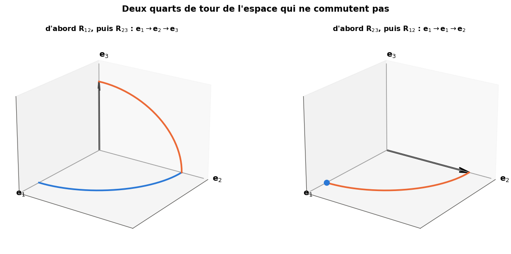
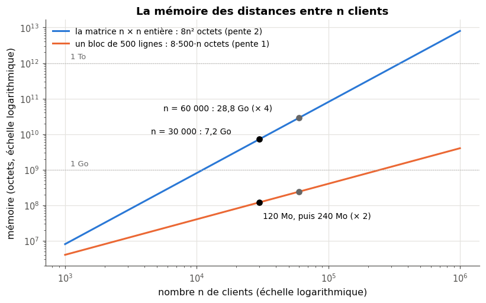

# MB3 · Rotations, moyennes pondérées et softmax en ligne — fiche de cours

> Deux familles d'outils. Les **rotations** : les **formules d'addition**, enfin démontrées ; les rotations du plan, de l'espace et de $\mathbb{R}^n$ (**Givens**, matrices **diagonales par blocs**, **permutations** des coordonnées) ; les **horloges** $(\cos, \sin)$ d'une variable cyclique, où un décalage devient une rotation. Les **moyennes pondérées par une softmax** : **Nadaraya-Watson** et sa largeur de bande, les **masques** comme conditionnement, l'**équivariance par permutation**, l'**échelle des scores** et la **saturation**, la **softmax en ligne** et la fusion de deux états, la **mémoire** de toutes les paires. Le chapitre bonus B3 de workbookIA les applique aux Transformers.

| | |
|---|---|
| **Sections** | §1 à §9 |
| **Temps total estimé** | ≈ 12,8 h : lecture et calculs de la fiche ≈ 2 h 30, exercices ≈ 9 h 50, 16 flashcards ≈ 30 min (parcours essentiel ≈ 10,6 h) |
| **Prérequis** | R4 ($\Sigma$, récurrence) ; R5 (suites géométriques, moyenne exponentielle) ; R6 (exp, ln, échelles logarithmiques) ; R8 (issues équiprobables) ; R9 (cercle trigonométrique, parité, périodicité, produit scalaire et angle, Al-Kashi) ; M02b (linéarité de l'espérance, variance d'une somme) ; M03 (loi conditionnelle) ; M05a (log-sum-exp, softmax stable) ; M07 (produit scalaire, normes, $\lVert\mathbf{a} - \mathbf{b}\rVert^2$) ; M08 (validation croisée) ; M09a (produit matriciel, transposée) ; M10 (enveloppe convexe) ; M12b (matrices orthogonales) ; M12c (rotation du plan, déterminant, nombres complexes) ; M13a (Gini) ; M14 (poids exponentiels) ; M16 (matrices de permutation) ; M17 (Boltzmann, $\operatorname{diag}(\mathbf{p}) - \mathbf{p}\mathbf{p}^\top$) ; M21 (équivariance par translation) ; M22 (forme exponentielle) ; M25a (formules de soustraction, matrices par blocs) ; M28 (température, top-k et top-p) ; MB2 (comparaisons par paires) |
| **Fichiers du chapitre** | `02_exercices.md` (quiz, papier) · `03_notebook.ipynb` · `04_indices.md` · `05_solutions.md` et `05_solutions.ipynb` · `06_mes_reponses.md` · `flashcards.csv` |
| **mymath** | `positional.py` : `givens_rotation`, `online_softmax`, `merge_softmax_states` |
| **MML** | §3.9 (*Rotations*) : §3.9.1 avant le §2 de la fiche, §3.9.2 à §3.9.4 avant le §3 ; exercice 3.10 conseillé |
| **Références** | E. A. Nadaraya et G. S. Watson (l'estimateur à noyau) ; W. Givens (les rotations d'un plan de coordonnées) ; K. V. Mardia et P. E. Jupp (la direction moyenne) ; M. Milakov et N. Gimelshein (la softmax en ligne) ; D. E. Knuth (combien de fois le maximum change) |

## Comment utiliser ce chapitre

**Ordre conseillé.**
1. `python tools/start_chapter.py MB3` (sur Colab : `00_setup/COLAB.md` §2) : il copie le notebook, ta feuille de réponses et le squelette `mymath/positional.py`.
2. Section par section : lis **crayon en main** et refais chaque calcul (avant les §2 et §3, le passage de MML que donne le guide ci-dessous) ; puis fais les exercices de la section, quiz 🧠 d'abord.
3. Les exercices ✏️ et 🔗 se font sur papier, dans ta copie de `06_mes_reponses.md`, puis se vérifient dans la **partie 0** du notebook. Les démonstrations ∂ se rédigent dans ta copie et se jugent avec la grille de relecture de `05_solutions.md`.

Le chapitre a deux moitiés. Les §1 à §4 (les rotations) se lisent dans l'ordre. Les §5 à §9 (les moyennes pondérées) demandent peu des premiers : les §6 et §7 s'appuient sur le §5, le §8 sur M05a, le §9 sur les §5 et §8.

| Section | Quiz 🧠 et rappels 🔁 | Papier et réflexion | Notebook |
|---|---|---|---|
| §1 Les formules d'addition | Q1 | MB3.1 ✏️, MB3.8 ∂ | |
| §2 Les rotations du plan | Q1, R1 | MB3.1 ✏️, MB3.8 ∂, MB3.12 📖 | |
| §3 Les rotations de ℝⁿ | Q2 | MB3.2 ✏️, MB3.12 📖 | MB3.14 🔨, MB3.20 🐛 |
| §4 Les horloges | Q3 | MB3.3 ✏️, MB3.E1 💼 | MB3.19 🎨, MB3.20 🐛, MB3.22 🏆 |
| §5 Moyenne pondérée, Nadaraya-Watson | Q4, R3 | MB3.4 ✏️, MB3.11 🔗 | MB3.17 🔮, MB3.22 🏆 |
| §6 Masques et permutations | Q4, R3 | MB3.5 ✏️, MB3.9 ∂ | |
| §7 L'échelle des scores | Q5 | MB3.6 ✏️, MB3.11 🔗 | MB3.17 🔮 |
| §8 La softmax en ligne | Q6, R2 | MB3.7 ✏️, MB3.10 ∂, MB3.13 🗣️ | MB3.15 🔨, MB3.16 🔨, MB3.18 🔬, MB3.20 🐛, MB3.21 🛠️ |
| §9 Le coût quadratique | | | MB3.18 🔬 |

Parcours essentiel : tout sauf MB3.9, MB3.12, MB3.18, MB3.21 et MB3.22 (l'énoncé de l'équivariance, au §6, en fait partie ; sa démonstration, ∂ MB3.9, non).

## Guide de lecture de MML

MML §3.9 (*Rotations*) donne des définitions et des matrices, sans démonstration : il lit les images de $\mathbf{e}_1$ et $\mathbf{e}_2$ sur une figure et énonce le §3.9.4 sans preuve. La fiche fournit les démonstrations, le livre les matrices et le vocabulaire. Lis-le en deux fois.

- **Après le §1, avant le §2** de la fiche : l'introduction de **§3.9** (une rotation est un *automorphism* qui fixe l'origine ; un angle positif tourne *counterclockwise*) et **§3.9.1** : la figure 3.16, puis (3.75) et (3.76), la matrice $\mathbf{R}(\theta)$. Les figures 3.14 et 3.15 se regardent sans s'y arrêter.
- **Avant le §3** : **§3.9.2**, les trois rotations autour des axes de coordonnées, (3.77) à (3.79), avec la convention « regarder l'axe depuis sa pointe vers l'origine » (le 📖 MB3.12 te fait comparer (3.78) à la définition suivante) ; **§3.9.3**, la Définition 3.11, la rotation de Givens (3.80)–(3.81), pour $i < j$ ; **§3.9.4**, les distances et les angles conservés, et la commutativité, réservée au plan (« en général » : le §3 de la fiche précise quand des rotations de l'espace commutent).

MML ne parle ni d'horloges, ni de moyennes pondérées, ni de softmax en ligne : pour les §4 à §9, la fiche est le cours. Exercice du livre conseillé : 3.10.

📐 **Notations.**
- **Écarts avec MML.** MML écrit $\mathbf{R}(\theta)$ ; la fiche, $\mathbf{R}_\theta$. MML note $\Phi$ l'application linéaire et $\mathbf{R}_{ij}(\theta)$ la rotation de Givens, comme ici. Les coordonnées sont numérotées à partir de 1 dans la fiche et dans MML, à partir de 0 dans `positional.py` : `givens_rotation(n, i - 1, j - 1, θ)` est $\mathbf{R}_{ij}(\theta)$. MML écrit $\log$ pour $\ln$.
- **§1 et §2.** $a$, $b$, $\alpha$, $\beta$, $\theta$, $\varphi$ sont des angles, en radians (en degrés quand un énoncé le dit), positifs dans le sens inverse des aiguilles d'une montre ; les vecteurs sont des colonnes, $\mathbf{R}_\theta\mathbf{x}$ ; $\mathbf{u}_a = (\cos a, \sin a)$ est le point d'angle $a$ du cercle unité. $i$ est l'unité imaginaire, $i^2 = -1$ ; $e^{i\theta} = \cos\theta + i\sin\theta$ est ici une **définition** (M22 l'admettait comme formule d'Euler) ; $\bar z$ est le conjugué de $z$. $\mathbf{Q}$ est une matrice orthogonale.
- **§3.** $\mathbf{e}_1, \ldots, \mathbf{e}_n$ est la base canonique de $\mathbb{R}^n$ ; $\mathbf{R}_{ij}(\theta)$ tourne $\mathbf{e}_i$ vers $\mathbf{e}_j$. $\sigma$ est une permutation de $\{1, \ldots, n\}$ et $\mathbf{P}$ sa matrice, de lignes $\mathbf{e}_{\sigma(1)}^\top, \ldots, \mathbf{e}_{\sigma(n)}^\top$, si bien que $(\mathbf{P}\mathbf{x})_k = x_{\sigma(k)}$. $\mathbf{A}$ et $\mathbf{B}$ sont deux matrices découpées en blocs.
- **§4.** $t$ est une valeur d'une variable cyclique de **période** $\tau$, $\omega = 2\pi/\tau$ sa **pulsation**, $\mathbf{e}(t) = (\cos\omega t, \sin\omega t)$ son encodage ; $\delta$ est un décalage, $\rho$ la longueur d'un vecteur moyen.
- **§5.** $s_1, \ldots, s_n$ sont des **scores**, des réels qu'on passe à la softmax (pas le score d'un classifieur, ni ceux de MB5 et MB8) ; $p_i$ est un poids, $y_i$ un nombre (ou un vecteur) moyenné, $\hat y$ la moyenne pondérée ; $\mathbf{x}_i$ (ou $x_i$ en dimension 1) sont les points de mesure, $\mathbf{x}$ le point de la prévision, $K(\mathbf{x}, \mathbf{x}_i)$ le **noyau**, $h > 0$ la **largeur de bande** ; $b$ est une constante ajoutée à tous les scores.
- **§6.** $S$ est un sous-ensemble d'indices et $p(i \mid S)$ la loi conditionnelle ; $T$ est un nombre de jours ; $\lambda \in\ ]0, 1[$ est le facteur d'une moyenne exponentielle (le $\beta$ de R5) ; $\mathbf{S}$, $\mathbf{C}$, $\mathbf{X}$ et $\mathbf{Y}$ sont les matrices des scores, des poids, des points et des nombres moyennés, une ligne par point.
- **§7.** $n$ compte des contributions de variance $v$ ; $c > 0$ multiplie les scores ; $K$ est le nombre de scores, $p_{\max}$ le plus grand poids, $\Delta$ l'écart entre le plus grand score et le suivant.
- **§8.** L'**état** est $(m, l, a)$ : $m$ le plus grand score lu, $l$ et $a$ deux sommes ; le code l'écrit `(m, l, acc)`. $v_j$ est le nombre (ou le vecteur de longueur $k$) associé au score $s_j$, `values` dans le code. $B$ est la taille d'un bloc, $N$ le nombre de blocs, $X$ un nombre de remises à l'échelle, $H_N = 1 + \frac12 + \cdots + \frac1N$.
- **Lettres à double sens.** $i$ est l'unité imaginaire aux §1 et §2, un indice ailleurs (dans $\mathbf{R}_{ij}$, $x_i$ ou $p_i$). $e$ est la base de l'exponentielle, $\mathbf{e}_i$ (en gras, indicé) un vecteur de base au §3, $\mathbf{e}(t)$ un encodage au §4. $a$ et $b$ sont des angles au §1 ; $b$ est une constante au §5, $a$ la troisième composante de l'état au §8. $\mathbf{A}$, $\mathbf{B}$ (en gras) sont des matrices au §3, $B$ une taille de bloc aux §8 et §9. $K$ est le noyau au §5, un nombre de scores au §7. $k$ indexe une horloge au §4 et compte les coordonnées d'un $v_j$ au §8. $n$ est la dimension aux §2 et §3, un nombre de points aux §5 et §6, de contributions au §7, de clients au §9. $T$ est une température aux §5 et §7, un nombre de jours au §6. $h$ (en italique) est une largeur de bande, « h » (droit) l'heure. $\mathbf{S}$ (en gras) est la matrice des scores, $S$ un sous-ensemble (§6). $\mathbf{P}$ (en gras) est une matrice de permutation, $p$ un poids, $P(\cdot)$ une probabilité (§8). $\mathbf{X}$ (en gras) est la matrice des points au §6, $X$ un nombre aléatoire au §8. $\sigma$ est une permutation, jamais un écart-type ici. Le contexte tranche.

Vocabulaire anglais de ce chapitre : *angle addition formulas*, *double-angle formulas*, *half-angle formulas*, *product-to-sum formulas*, *beats*, *counterclockwise*, *reflection*, *Givens rotation*, *commute*, *block-diagonal matrix*, *permutation matrix*, *cyclical feature*, *cyclic encoding*, *angular frequency*, *mean direction*, *mean resultant length*, *convex combination*, *kernel regression*, *Nadaraya-Watson estimator*, *bandwidth*, *nearest neighbor*, *leave-one-out*, *mask*, *filtering*, *smoothing*, *causal*, *permutation equivariant*, *saturation*, *online softmax*, *rescaling*, *invariant*, *merge*, *neutral element*, *record*, *indicator*, *harmonic number*.

## Objectifs d'apprentissage

À la fin du chapitre, tu sais :
- **démontrer** les formules d'addition (∂ MB3.8) et t'en **servir** pour des valeurs exactes, des duplications et des produits de cosinus ;
- **composer** et **inverser** des rotations du plan, **distinguer** une rotation d'une symétrie, et les **lire** comme des multiplications par $e^{i\theta}$ ;
- **écrire** une rotation de Givens, **dire** quand deux rotations commutent, et **lire** une matrice diagonale par blocs et ce qu'une permutation des coordonnées en change ;
- **encoder** une variable cyclique par $(\cos, \sin)$, **lire** un décalage comme une rotation, **exprimer** le produit scalaire de deux encodages à plusieurs horloges, et **calculer** une direction moyenne ;
- **calculer** une moyenne pondérée par une softmax et l'estimateur de Nadaraya-Watson, et **prévoir** l'effet de la largeur de bande ;
- **restreindre** une moyenne pondérée par un masque (une loi conditionnelle), et **démontrer** son équivariance par permutation (∂ MB3.9) ;
- **expliquer** la division par $\sqrt n$ d'une somme de $n$ contributions, et **mesurer** la saturation d'une softmax ;
- **calculer** une softmax en ligne par blocs, **démontrer** son invariant et la fusion (∂ MB3.10), **compter** ses remises à l'échelle, et **comparer** la mémoire de toutes les paires à celle d'un calcul par blocs.

## L'essentiel en 9 lignes

1. **Formules d'addition** (∂ MB3.8, par $\mathbf{u}_a\cdot\mathbf{u}_b = \cos(a - b)$) : $\cos(a \pm b) = \cos a\cos b \mp \sin a\sin b$, $\sin(a \pm b) = \sin a\cos b \pm \cos a\sin b$ ; duplication ; $\cos a\cos b = \frac12[\cos(a - b) + \cos(a + b)]$ ; $e^{i\alpha}e^{i\beta} = e^{i(\alpha + \beta)}$.
2. **Plan** : $\mathbf{R}_\alpha\mathbf{R}_\beta = \mathbf{R}_{\alpha + \beta} = \mathbf{R}_\beta\mathbf{R}_\alpha$ ; $\mathbf{R}_\theta^{-1} = \mathbf{R}_\theta^\top = \mathbf{R}_{-\theta}$ ; une même rotation conserve produits scalaires, normes, distances et angles ; orthogonale $2 \times 2$ : rotation (déterminant 1) ou symétrie (−1) ; $e^{i\theta}z$ tourne $z$ de $\theta$ ; $\operatorname{Re}(\bar zw)$ est le produit scalaire.
3. **$\mathbb{R}^n$** : $\mathbf{R}_{ij}(\theta)$ tourne le plan $(i, j)$ ; même plan ou plans disjoints : elles commutent ; une coordonnée commune : pas en général. Une matrice diagonale par blocs tourne chaque plan de son angle ; un produit par blocs est une somme de produits ; $\mathbf{P}^\top\mathbf{R}_{ij}(\theta)\mathbf{P}$ tourne le plan $(\sigma(i), \sigma(j))$.
4. **Horloges** : $\mathbf{e}(t) = (\cos\omega t, \sin\omega t)$, $\lVert\mathbf{e}(t) - \mathbf{e}(t')\rVert^2 = 2 - 2\cos\omega(t - t')$, $\mathbf{e}(t + \delta) = \mathbf{R}_{\omega\delta}\mathbf{e}(t)$ ; plusieurs horloges : $\sum_k\cos\omega_k(t - t')$ ; direction moyenne : l'argument du vecteur moyen.
5. **Moyenne pondérée** : $\hat y = \sum_ip_iy_i$, $p_i = e^{s_i}/\sum_je^{s_j}$, dans l'enveloppe convexe, inchangée si l'on ajoute $b$ aux scores. **Nadaraya-Watson** : softmax de $-\lVert\mathbf{x} - \mathbf{x}_i\rVert^2/(2h^2)$ ; $h \to 0$ : plus proche voisin ; $h \to \infty$ : moyenne ; à normes égales, softmax de $\mathbf{x}\cdot\mathbf{x}_i/h^2$.
6. **Masques** : un score $-\infty$ avant la softmax donne la loi conditionnelle ; un poids mis à 0 après n'en donne pas ; sous-ensemble vide : $0/0$ ; masque triangulaire : $\frac{T(T + 1)}{2}$ cases. **Équivariance** (∂ MB3.9) : renuméroter les points renumérote les sorties, sauf masque triangulaire ou score lié aux numéros.
7. **Échelle** : $n$ contributions indépendantes centrées de variance $v$ ont une somme d'écart-type $\sqrt{nv}$, ramené à $\sqrt v$ en divisant par $\sqrt n$ ; multiplier les scores par $c$ divise la température par $c$ ; $1 - p_{\max} \le (K - 1)e^{-c\Delta}$ et $1 - \sum p_i^2 \le 2(1 - p_{\max})$ : la saturation est exponentielle en $c$.
8. **En ligne** : état $(m, l, a)$, remis à l'échelle par $e^{m - m'} \le 1$ ; invariant (∂ MB3.10) : $a/l$ exact, $m + \ln l$ le log-sum-exp ; fusion commutative, associative, de neutre $(-\infty, 0, 0)$ ; ordre au hasard : $H_N - 1$ remises en moyenne.
9. **Coût** : $\binom n2$ comparaisons (MB2 §8) ; une matrice $n \times n$ : $8n^2$ octets, une pente 2 en échelles logarithmiques ; par blocs de $B$ lignes : $8nB$ octets, pour autant de calculs.

## §1 · Les formules d'addition, démontrées : le cosinus d'une différence par le produit scalaire, puis les autres

### Ce qui manquait

R9 t'a donné le cercle trigonométrique et ses symétries ; M22 a admis la règle $e^{i\alpha}e^{i\beta} = e^{i(\alpha + \beta)}$, et M25a en a tiré les formules de soustraction. Il manquait une démonstration qui n'admet rien : la voici, par le produit scalaire.

### Le cosinus d'une différence

Notons $\mathbf{u}_a = (\cos a, \sin a)$ le point d'angle $a$ du cercle unité (R9 §6), un vecteur unitaire.

> **Propriété** (∂ MB3.8). Pour tous réels $a$ et $b$,
> $$\cos(a - b) = \cos a\cos b + \sin a\sin b .$$

L'idée : calculer le produit scalaire $\mathbf{u}_a\cdot\mathbf{u}_b$ de deux façons. En coordonnées, il vaut $\cos a\cos b + \sin a\sin b$. Par l'angle (R9 §7), il vaut $\lVert\mathbf{u}_a\rVert\,\lVert\mathbf{u}_b\rVert\cos\varphi = \cos\varphi$, où $\varphi \in [0, \pi]$ est l'angle des deux vecteurs ; or $\varphi$ est égal à $a - b$ au signe et à un multiple de $2\pi$ près, ce que la parité et la périodicité du cosinus effacent. Le ∂ MB3.8 rédige ce dernier point.

**Pas de cercle vicieux.** R9 §7 a obtenu $\mathbf{u}\cdot\mathbf{v} = \lVert\mathbf{u}\rVert\,\lVert\mathbf{v}\rVert\cos\varphi$ en admettant qu'une rotation conserve le produit scalaire, ce que le §2 veut établir. Mais la formule sort aussi d'Al-Kashi, démontrée en R9.12 par une hauteur, sans rotation : dans le triangle de côtés $\mathbf{u}$, $\mathbf{v}$, $\mathbf{u} - \mathbf{v}$, compare Al-Kashi au développement $\lVert\mathbf{u} - \mathbf{v}\rVert^2 = \lVert\mathbf{u}\rVert^2 + \lVert\mathbf{v}\rVert^2 - 2\,\mathbf{u}\cdot\mathbf{v}$ (M07).

**Exemple : deux points à coordonnées rationnelles.** Le point $\mathbf{u}_a = \big(\frac{35}{37}, \frac{12}{37}\big)$ est sur le cercle unité, puisque $35^2 + 12^2 = 1\,369 = 37^2$ ; de même $\mathbf{u}_b = \big(\frac{28}{53}, \frac{45}{53}\big)$, car $28^2 + 45^2 = 2\,809 = 53^2$. Leurs angles valent $a \approx 18{,}92°$ et $b \approx 58{,}11°$. Alors
$$\cos(b - a) = \frac{28}{53}\cdot\frac{35}{37} + \frac{45}{53}\cdot\frac{12}{37} = \frac{980 + 540}{1\,961} = \frac{1\,520}{1\,961} \approx 0{,}7751,$$
le cosinus de $39{,}18°$ : vérifie à la calculatrice.

### Les trois autres, et ce qu'on en tire

> **Formules d'addition** (*angle addition formulas*). Pour tous réels $a$ et $b$,
> $$\cos(a + b) = \cos a\cos b - \sin a\sin b, \qquad \cos(a - b) = \cos a\cos b + \sin a\sin b,$$
> $$\sin(a + b) = \sin a\cos b + \cos a\sin b, \qquad \sin(a - b) = \sin a\cos b - \cos a\sin b .$$

L'idée, que le ∂ MB3.8 rédige : $\cos(a + b) = \cos\big(a - (-b)\big)$, puis la parité, $\cos(-b) = \cos b$ et $\sin(-b) = -\sin b$ ; avec $a = \frac\pi2$, la formule de $\cos(a - b)$ donne $\cos(\frac\pi2 - x) = \sin x$, puis, en remplaçant $x$ par $\frac\pi2 - x$, $\sin(\frac\pi2 - x) = \cos x$ ; enfin $\sin(a + b) = \cos\big((\frac\pi2 - a) - b\big)$, que l'on développe.

Pour l'exemple : $\sin(b - a) = \frac{45 \times 35 - 28 \times 12}{1\,961} = \frac{1\,239}{1\,961}$, $\cos(a + b) = \frac{980 - 540}{1\,961} = \frac{440}{1\,961}$ et $\sin(a + b) = \frac{336 + 1\,575}{1\,961} = \frac{1\,911}{1\,961}$ ; contrôle : $440^2 + 1\,911^2 = 1\,961^2$.

**Duplication** (*double-angle formulas*). Avec $b = a$, et $\cos^2 + \sin^2 = 1$ :
$$\cos 2a = \cos^2a - \sin^2a = 2\cos^2a - 1 = 1 - 2\sin^2a, \qquad \sin 2a = 2\sin a\cos a .$$
Pour $\mathbf{u}_a$ : $\cos 2a = \frac{1\,225 - 144}{1\,369} = \frac{1\,081}{1\,369}$ et $\sin 2a = \frac{2 \times 12 \times 35}{1\,369} = \frac{840}{1\,369}$. Lue à l'envers, $\cos^2a = \frac{1 + \cos 2a}{2}$ donne l'**angle moitié** (*half-angle formulas*) : avec $\cos\frac\pi4 = \frac{\sqrt2}{2}$,
$$\cos\frac\pi8 = \sqrt{\frac{1 + \frac{\sqrt2}{2}}{2}} = \frac{\sqrt{2 + \sqrt2}}{2} \approx 0{,}9239, \qquad \sin\frac\pi8 = \frac{\sqrt{2 - \sqrt2}}{2} \approx 0{,}3827,$$
où l'on prend les racines positives, puisque $\frac\pi8$ est dans le premier quadrant.

**Produits en sommes** (*product-to-sum formulas*). En ajoutant, puis en retranchant, les formules de $\cos(a - b)$ et de $\cos(a + b)$ :
$$\cos a\cos b = \tfrac12\big[\cos(a - b) + \cos(a + b)\big], \qquad \sin a\sin b = \tfrac12\big[\cos(a - b) - \cos(a + b)\big].$$
Vérifie : $\frac{35}{37}\cdot\frac{28}{53} = \frac{980}{1\,961} = \frac12\cdot\frac{1\,520 + 440}{1\,961}$. Le produit de deux ondes de pulsations voisines est la demi-somme d'une onde lente et d'une onde rapide : les **battements** (*beats*) de deux notes presque à l'unisson (figure, à droite).

### La règle des exponentielles, enfin démontrée

Définissons $e^{i\theta} = \cos\theta + i\sin\theta$ (M22 l'admettait comme formule d'Euler ; le §2 justifie la notation). En développant le produit $e^{i\alpha}e^{i\beta}$ avec $i^2 = -1$, la partie réelle et la partie imaginaire sont exactement les formules de $\cos(\alpha + \beta)$ et de $\sin(\alpha + \beta)$ :

> **Propriété** (∂ MB3.8). $e^{i\alpha}e^{i\beta} = e^{i(\alpha + \beta)}$ : la règle que M22 admettait n'est que les formules d'addition.

Pour l'exemple, $\frac{35 + 12i}{37}\cdot\frac{28 + 45i}{53} = \frac{440 + 1\,911\,i}{1\,961}$, le nombre $e^{i(a + b)}$. La formule de Moivre de M22, $(e^{i\theta})^t = e^{it\theta}$ pour un entier $t \ge 0$, s'en déduit par récurrence (R4).

💻 **Aujourd'hui en pratique** — `sympy.expand_trig(sympy.cos(a - b))` développe la formule, `sympy.cos(sympy.pi / 8)` rend une valeur exacte, et `sympy.simplify` vérifie une identité.

⚠️ **Erreur classique.** Écrire $\cos(a + b) = \cos a + \cos b$ : pour $a = b = \frac\pi2$, on aurait $-1 = 0$. Se tromper de signe : un moins dans $\cos(a + b)$, un plus dans $\cos(a - b)$. Oublier le facteur $\frac12$ d'un produit en somme.

🔗 **Dans workbookIA** — le chapitre B3 décale des encodages de position et tourne des vecteurs en s'appuyant sur ces formules, qu'il énonce sans les démontrer.

## §2 · Les rotations du plan : composer, inverser, conserver ; la multiplication par e^{iθ}

### La matrice d'une rotation

> **Définition** (MML §3.9.1). La **rotation** d'angle $\theta$ du plan, autour de l'origine, a pour matrice
> $$\mathbf{R}_\theta = \begin{pmatrix} \cos\theta & -\sin\theta \\ \sin\theta & \cos\theta \end{pmatrix} :$$
> ses colonnes sont les images $\mathbf{R}_\theta\mathbf{e}_1 = (\cos\theta, \sin\theta)$ et $\mathbf{R}_\theta\mathbf{e}_2 = (-\sin\theta, \cos\theta)$ des vecteurs de base, tournés de $\theta$ dans le sens direct.

M12c et M22 l'ont rencontrée. Les formules d'addition, ligne par ligne, donnent $\mathbf{R}_\theta\mathbf{u}_a = \mathbf{u}_{a + \theta}$ : le point d'angle $a$ va au point d'angle $a + \theta$.

### Composer, inverser

> **Propriétés** (∂ MB3.8).
> 1. **Composer** : $\mathbf{R}_\alpha\mathbf{R}_\beta = \mathbf{R}_{\alpha + \beta}$. Donc $\mathbf{R}_\alpha\mathbf{R}_\beta = \mathbf{R}_\beta\mathbf{R}_\alpha$ : deux rotations du plan **commutent**.
> 2. **Inverser** : $\mathbf{R}_\theta^{-1} = \mathbf{R}_\theta^\top = \mathbf{R}_{-\theta}$, et $\det\mathbf{R}_\theta = \cos^2\theta + \sin^2\theta = 1$.

L'idée : chaque coefficient du produit $\mathbf{R}_\alpha\mathbf{R}_\beta$ est l'une des formules d'addition du §1 ; $\mathbf{R}_\theta^\top$ s'écrit $\mathbf{R}_{-\theta}$ par la parité de $\cos$ et de $\sin$, et c'est l'inverse puisque $\mathbf{R}_{-\theta}\mathbf{R}_\theta = \mathbf{R}_0 = \mathbf{I}$. Par récurrence, $(\mathbf{R}_\theta)^t = \mathbf{R}_{t\theta}$ pour tout entier $t \ge 0$.

**Exemple.** Avec $\cos a = \frac{35}{37}$ et $\cos b = \frac{28}{53}$ du §1,
$$\mathbf{R}_a\mathbf{R}_b = \frac{1}{1\,961}\begin{pmatrix} 35 & -12 \\ 12 & 35 \end{pmatrix}\begin{pmatrix} 28 & -45 \\ 45 & 28 \end{pmatrix} = \frac{1}{1\,961}\begin{pmatrix} 440 & -1\,911 \\ 1\,911 & 440 \end{pmatrix} = \mathbf{R}_{a + b},$$
et l'autre ordre donne la même matrice. De même, $\mathbf{R}_a^2 = \frac{1}{1\,369}\begin{pmatrix} 1\,081 & -840 \\ 840 & 1\,081 \end{pmatrix} = \mathbf{R}_{2a}$ : on retrouve les nombres de la duplication.

### Ce qu'une rotation conserve

> **Propriété** (MML §3.9.4). Une rotation conserve les **produits scalaires** : $(\mathbf{R}_\theta\mathbf{x})\cdot(\mathbf{R}_\theta\mathbf{y}) = \mathbf{x}\cdot\mathbf{y}$ pour tous vecteurs $\mathbf{x}$ et $\mathbf{y}$ du plan. Donc aussi les **normes**, les **distances** et les **angles**.

En effet $(\mathbf{R}_\theta\mathbf{x})^\top(\mathbf{R}_\theta\mathbf{y}) = \mathbf{x}^\top\mathbf{R}_\theta^\top\mathbf{R}_\theta\mathbf{y} = \mathbf{x}^\top\mathbf{y}$ (M09a, M12b) ; les normes s'en déduisent avec $\mathbf{y} = \mathbf{x}$, les distances par $\mathbf{x} - \mathbf{y}$, les angles par leur cosinus. Les deux vecteurs sont tournés par **la même** rotation.

**Exemple : deux repères sur un plateau tournant**, en $\mathbf{x} = (2, 1)$ et $\mathbf{y} = (-1, 3)$ : $\mathbf{x}\cdot\mathbf{y} = 1$ et $\lVert\mathbf{x} - \mathbf{y}\rVert^2 = 13$. Le plateau tourne de $a$ : $\mathbf{R}_a\mathbf{x} = \frac{1}{37}(58, 59)$ et $\mathbf{R}_a\mathbf{y} = \frac{1}{37}(-71, 93)$. Leur produit scalaire vaut $\frac{-4\,118 + 5\,487}{1\,369} = 1$, et leur distance au carré $\frac{129^2 + 34^2}{1\,369} = \frac{17\,797}{1\,369} = 13$.

### Rotation ou symétrie

> **Propriété.** Une matrice orthogonale $\mathbf{Q}$ de forme $(2, 2)$ ($\mathbf{Q}^\top\mathbf{Q} = \mathbf{I}$) s'écrit, pour un angle $\theta$,
> $$\mathbf{Q} = \begin{pmatrix} \cos\theta & -\sin\theta \\ \sin\theta & \cos\theta \end{pmatrix} = \mathbf{R}_\theta \qquad\text{ou}\qquad \mathbf{Q} = \begin{pmatrix} \cos\theta & \sin\theta \\ \sin\theta & -\cos\theta \end{pmatrix}.$$
> La première, de déterminant 1, est une rotation ; la seconde, de déterminant $-1$, est la **symétrie** (*reflection*) par rapport à la droite d'angle $\frac\theta2$ passant par l'origine.

*Démonstration.* La première colonne de $\mathbf{Q}$ est unitaire : c'est un point $(\cos\theta, \sin\theta)$ du cercle. La seconde est unitaire et orthogonale à la première : les seuls vecteurs qui conviennent sont $(-\sin\theta, \cos\theta)$ et son opposé. Le premier choix donne $\mathbf{R}_\theta$, de déterminant 1 ; le second donne la seconde matrice, de déterminant $-\cos^2\theta - \sin^2\theta = -1$. Par les formules de soustraction, celle-ci envoie $\mathbf{u}_\varphi$ sur $\mathbf{u}_{\theta - \varphi}$ : elle fixe $\mathbf{u}_{\theta/2}$ et change $\mathbf{u}_{\theta/2 + \pi/2}$ en $\mathbf{u}_{\theta/2 - \pi/2}$, son opposé. C'est la symétrie annoncée. $\square$

Une rotation garde l'**orientation**, une symétrie la renverse. La matrice $\frac{1}{37}\begin{pmatrix} 35 & 12 \\ 12 & -35 \end{pmatrix}$ est la symétrie par rapport à la droite d'angle $\frac a2 \approx 9{,}46°$. L'échange des deux coordonnées, $\begin{pmatrix} 0 & 1 \\ 1 & 0 \end{pmatrix}$, est une matrice de permutation : c'est la symétrie par rapport à la droite $y = x$ ($\theta = \frac\pi2$), pas une rotation.

### La multiplication par e^{iθ}

Identifions le complexe $z = x + iy$ au point $(x, y)$. M22 §2 a montré que multiplier par $\cos\theta + i\sin\theta$ a pour matrice $\mathbf{R}_\theta$ : **multiplier par $e^{i\theta}$, c'est tourner de $\theta$**, et la règle $e^{i\alpha}e^{i\beta} = e^{i(\alpha + \beta)}$ est $\mathbf{R}_\alpha\mathbf{R}_\beta = \mathbf{R}_{\alpha + \beta}$ écrite avec des nombres ; en particulier $\lvert e^{i\theta}z\rvert = \lvert z\rvert$.

Le produit scalaire se lit aussi sur les complexes. Pour $z = x_1 + iy_1$ et $w = x_2 + iy_2$, la partie réelle de $\bar zw = (x_1 - iy_1)(x_2 + iy_2)$ vaut $x_1x_2 + y_1y_2$ :
$$\operatorname{Re}(\bar z\,w) = (x_1, y_1)\cdot(x_2, y_2).$$
Avec $z = e^{ia}$ et $w = e^{ib}$ du §1 : $\operatorname{Re}\Big(\frac{35 - 12i}{37}\cdot\frac{28 + 45i}{53}\Big) = \frac{980 + 540}{1\,961} = \frac{1\,520}{1\,961}$, le $\cos(b - a)$ du §1.

⚠️ **Erreur classique.** Mettre le signe moins en bas à gauche : on obtient $\mathbf{R}_{-\theta}$. Écrire $\mathbf{R}_\alpha\mathbf{R}_\beta = \mathbf{R}_{\alpha\beta}$. Croire qu'une matrice orthogonale est toujours une rotation. Croire qu'une rotation conserve le produit scalaire de deux vecteurs tournés d'angles **différents**.

🔗 **Dans workbookIA** — le chapitre B3 se sert de matrices de rotation $2 \times 2$, de leur composition et de leur transposée pour coder des positions ; il énonce ces propriétés, que ce paragraphe démontre.

## §3 · Les rotations de ℝⁿ : l'espace, les rotations de Givens, les matrices diagonales par blocs et les permutations des coordonnées

### Les rotations autour des axes de l'espace

Dans l'espace, une rotation tourne un plan autour d'un axe fixe. Autour de $\mathbf{e}_3$, le plan $(x_1, x_2)$ tourne comme au §2 ; autour de $\mathbf{e}_1$, le plan $(x_2, x_3)$ (MML §3.9.2) :
$$\begin{pmatrix} \cos\theta & -\sin\theta & 0 \\ \sin\theta & \cos\theta & 0 \\ 0 & 0 & 1 \end{pmatrix} = \begin{pmatrix} \mathbf{R}_\theta & \mathbf{0} \\ \mathbf{0}^\top & 1 \end{pmatrix}, \qquad \begin{pmatrix} 1 & 0 & 0 \\ 0 & \cos\theta & -\sin\theta \\ 0 & \sin\theta & \cos\theta \end{pmatrix}.$$
Le sens positif se lit en regardant l'axe depuis sa pointe vers l'origine.

### Les rotations de Givens

> **Définition** (MML §3.9.3, Définition 3.11). Pour $1 \le i < j \le n$ et un angle $\theta$, la **rotation de Givens** (*Givens rotation*) $\mathbf{R}_{ij}(\theta)$ est la matrice identité $n \times n$ dont on a changé quatre coefficients :
> $$r_{ii} = r_{jj} = \cos\theta, \qquad r_{ij} = -\sin\theta, \qquad r_{ji} = \sin\theta .$$
> Elle tourne de $\theta$ le plan des coordonnées $(x_i, x_j)$, en envoyant $\mathbf{e}_i$ sur $\cos\theta\,\mathbf{e}_i + \sin\theta\,\mathbf{e}_j$ (vers $\mathbf{e}_j$), et fixe les $n - 2$ autres vecteurs de base.

Seules les coordonnées $i$ et $j$ changent, et tout le §2 se transporte dans le plan $(i, j)$ : $\mathbf{R}_{ij}(\theta)$ est orthogonale, de déterminant 1, d'inverse $\mathbf{R}_{ij}(\theta)^\top = \mathbf{R}_{ij}(-\theta)$, et $\mathbf{R}_{ij}(\alpha)\mathbf{R}_{ij}(\beta) = \mathbf{R}_{ij}(\alpha + \beta)$. Pour $n = 2$, $\mathbf{R}_{12}(\theta) = \mathbf{R}_\theta$ ; dans l'espace, $\mathbf{R}_{12}$ et $\mathbf{R}_{23}$ tournent autour de $\mathbf{e}_3$ et de $\mathbf{e}_1$. `givens_rotation(n, i, j, theta)` (🔨 MB3.14) construit cette matrice, avec des indices à partir de 0 ; échanger $i$ et $j$ y change $\theta$ en $-\theta$.

### Quand deux rotations commutent

> **Propriété.**
> 1. Deux rotations **du même plan** commutent : $\mathbf{R}_{ij}(\alpha)\mathbf{R}_{ij}(\beta) = \mathbf{R}_{ij}(\alpha + \beta)$.
> 2. Deux rotations de **plans disjoints**, $\mathbf{R}_{ij}(\alpha)$ et $\mathbf{R}_{i'j'}(\beta)$ avec $\{i, j\} \cap \{i', j'\} = \varnothing$, commutent : chacune ne touche que ses deux coordonnées.
> 3. Deux rotations de plans **qui partagent une coordonnée**, comme $\mathbf{R}_{12}(\alpha)$ et $\mathbf{R}_{23}(\beta)$, ne commutent pas en général : elles commutent seulement si l'une est l'identité, ou si toutes deux sont des demi-tours ($\alpha$ et $\beta$ multiples de $\pi$).

Pour le point 3, la différence des deux produits a des coefficients $\pm\sin\alpha\sin\beta$, $(1 - \cos\beta)\sin\alpha$, $(1 - \cos\alpha)\sin\beta$.

**Exemple : deux quarts de tour.** $\mathbf{R}_{12}(\frac\pi2)$ envoie $\mathbf{e}_1$ sur $\mathbf{e}_2$, et $\mathbf{e}_2$ sur $-\mathbf{e}_1$ ; $\mathbf{R}_{23}(\frac\pi2)$ envoie $\mathbf{e}_2$ sur $\mathbf{e}_3$ et fixe $\mathbf{e}_1$. Dans un produit, la matrice de **droite** s'applique la première :
$$\mathbf{R}_{23}\mathbf{R}_{12}\,\mathbf{e}_1 = \mathbf{R}_{23}\,\mathbf{e}_2 = \mathbf{e}_3, \qquad \mathbf{R}_{12}\mathbf{R}_{23}\,\mathbf{e}_1 = \mathbf{R}_{12}\,\mathbf{e}_1 = \mathbf{e}_2 .$$
Fais-le avec un livre posé à plat : il ne finit pas orienté de la même façon.

### Les matrices diagonales par blocs

> **Propriété.** Une matrice **diagonale par blocs** (*block-diagonal matrix*) de rotations planes, avec des zéros hors des blocs,
> $$\mathbf{D} = \begin{pmatrix} \mathbf{R}_{\theta_1} & & \\ & \ddots & \\ & & \mathbf{R}_{\theta_r} \end{pmatrix},$$
> tourne le plan des coordonnées $(1, 2)$ de $\theta_1$, celui de $(3, 4)$ de $\theta_2$, et ainsi de suite : c'est le produit $\mathbf{R}_{12}(\theta_1)\mathbf{R}_{34}(\theta_2)\cdots$ des rotations de Givens de ces plans disjoints, pris dans n'importe quel ordre.

On peut y ajouter des blocs $1 \times 1$ égaux à 1 (des coordonnées fixes), comme la rotation autour de $\mathbf{e}_3$. Inverse, puissances et produits se calculent bloc par bloc.

### Le produit par blocs

> **Propriété.** Si l'on découpe les colonnes de $\mathbf{A}$ en blocs, $\mathbf{A} = (\mathbf{A}_1\ \mathbf{A}_2\ \cdots\ \mathbf{A}_r)$, et les lignes de $\mathbf{B}$ de la même façon, $\mathbf{B} = \begin{pmatrix} \mathbf{B}_1 \\ \vdots \\ \mathbf{B}_r \end{pmatrix}$, alors
> $$\mathbf{A}\mathbf{B} = \mathbf{A}_1\mathbf{B}_1 + \mathbf{A}_2\mathbf{B}_2 + \cdots + \mathbf{A}_r\mathbf{B}_r .$$

En effet, le coefficient $(\mathbf{AB})_{uw} = \sum_k a_{uk}b_{kw}$ est une somme sur les colonnes de $\mathbf{A}$, qu'on coupe en morceaux, un par bloc (M25a découpait aussi les lignes et les colonnes).

**Exemple : une commande rayon par rayon.** Deux clients achètent quatre produits ; $\mathbf{A}$ donne leurs quantités, $\mathbf{B}$ le prix (en euros) et la masse (en kg) de chaque produit :
$$\mathbf{A} = \begin{pmatrix} 2 & 1 & 0 & 3 \\ 1 & 0 & 4 & 2 \end{pmatrix}, \qquad \mathbf{B} = \begin{pmatrix} 3 & 1 \\ 5 & 2 \\ 2 & 1 \\ 4 & 3 \end{pmatrix}, \qquad \mathbf{A}\mathbf{B} = \begin{pmatrix} 23 & 13 \\ 19 & 11 \end{pmatrix} :$$
le premier client paie 23 € pour 13 kg. Les produits 1 et 2 sont au rayon frais, les produits 3 et 4 à l'épicerie : $\mathbf{A}_1\mathbf{B}_1 = \begin{pmatrix} 11 & 4 \\ 3 & 1 \end{pmatrix}$ et $\mathbf{A}_2\mathbf{B}_2 = \begin{pmatrix} 12 & 9 \\ 16 & 10 \end{pmatrix}$ sont les sous-totaux des deux rayons, et leur somme redonne le total.

### Renuméroter les coordonnées

Soit $\mathbf{P}$ la matrice de la permutation $\sigma$ (📐) : $(\mathbf{P}\mathbf{x})_k = x_{\sigma(k)}$, et $\mathbf{P}^{-1} = \mathbf{P}^\top$ (M12b ; M16 renumérotait ainsi les nœuds d'un graphe).

> **Propriété.** Pour $i \ne j$, $\mathbf{P}^\top\mathbf{R}_{ij}(\theta)\mathbf{P}$ est la rotation d'angle $\theta$ dans le plan des coordonnées $(\sigma(i), \sigma(j))$, qui tourne $\mathbf{e}_{\sigma(i)}$ vers $\mathbf{e}_{\sigma(j)}$ : c'est **la même rotation**, écrite dans d'autres coordonnées. Si $\sigma(i) > \sigma(j)$, c'est $\mathbf{R}_{\sigma(j)\sigma(i)}(-\theta)$ dans la convention $i < j$ de MML.

*Démonstration.* La coordonnée $u$ de $\mathbf{P}\mathbf{e}_{\sigma(k)}$ vaut 1 si $\sigma(u) = \sigma(k)$, c'est-à-dire si $u = k$, et 0 sinon : $\mathbf{P}\mathbf{e}_{\sigma(k)} = \mathbf{e}_k$, donc $\mathbf{P}^\top\mathbf{e}_k = \mathbf{e}_{\sigma(k)}$. Alors $\mathbf{P}^\top\mathbf{R}_{ij}(\theta)\mathbf{P}\,\mathbf{e}_{\sigma(i)} = \mathbf{P}^\top(\cos\theta\,\mathbf{e}_i + \sin\theta\,\mathbf{e}_j) = \cos\theta\,\mathbf{e}_{\sigma(i)} + \sin\theta\,\mathbf{e}_{\sigma(j)}$ ; de même pour $\mathbf{e}_{\sigma(j)}$, et les autres $\mathbf{e}_{\sigma(k)}$ restent fixes. $\square$

**Exemple dans l'espace.** Avec $\sigma(1) = 2$, $\sigma(2) = 3$ et $\sigma(3) = 1$,
$$\mathbf{P} = \begin{pmatrix} 0 & 1 & 0 \\ 0 & 0 & 1 \\ 1 & 0 & 0 \end{pmatrix}, \qquad \mathbf{P}^\top\mathbf{R}_{12}(\theta)\,\mathbf{P} = \mathbf{R}_{23}(\theta) :$$
la rotation autour de $\mathbf{e}_3$ devient celle de même angle autour de $\mathbf{e}_1$.

💻 **Aujourd'hui en pratique** — `scipy.spatial.transform.Rotation` représente et compose les rotations de l'espace. Une rotation de Givens bien choisie annule un coefficient d'une matrice en ne touchant que deux lignes : une suite de telles rotations donne la décomposition QR de M12b, employée pour les matrices creuses ou presque triangulaires (LAPACK préfère les réflexions de Householder pour les matrices pleines).

⚠️ **Erreur classique.** Lire le produit $\mathbf{R}_{23}\mathbf{R}_{12}$ de gauche à droite : la matrice de droite s'applique la première (🐛 MB3.20). Croire que toutes les rotations commutent, comme dans le plan. Se tromper d'indices entre la fiche (à partir de 1) et le code (à partir de 0). Confondre $\mathbf{P}^\top\mathbf{R}\mathbf{P}$ et $\mathbf{P}\mathbf{R}\mathbf{P}^\top$.

🔗 **Dans workbookIA** — le chapitre B3 tourne des vecteurs de grande dimension plan par plan, avec des matrices diagonales par blocs de rotations ; ce paragraphe en donne les propriétés.

## §4 · Encoder une variable cyclique : des horloges (cos, sin), et un décalage est une rotation

### Décembre et janvier

Le mois, l'heure ou la direction du vent sont des variables **cycliques** (*cyclical features*). Codé par son numéro, le mois met décembre à 11 de janvier : un modèle qui mesure des distances se trompe au passage de l'année.

> **Définition.** Une variable cyclique $t$ de période $\tau$ s'**encode** (*cyclic encoding*) par le point du cercle unité
> $$\mathbf{e}(t) = (\cos\omega t,\ \sin\omega t), \qquad \omega = \frac{2\pi}{\tau} :$$
> une **horloge** dont l'aiguille fait un tour par période.

Il faut les deux coordonnées : pour les mois, $\cos\omega t$ seul ne distingue pas mars de septembre ($\cos\frac\pi2 = \cos\frac{3\pi}{2} = 0$), et $\sin\omega t$ seul ne distingue pas janvier de mai.

**Les distances.** Par le §1, $\mathbf{e}(t)\cdot\mathbf{e}(t') = \cos\omega t\cos\omega t' + \sin\omega t\sin\omega t' = \cos\omega(t - t')$, donc, comme en MB2 §6,
$$\lVert\mathbf{e}(t) - \mathbf{e}(t')\rVert^2 = 2 - 2\cos\omega(t - t') :$$
la distance ne dépend que de l'**écart** $t - t'$, et elle est la même pour un écart $\delta$ et pour un écart $\tau - \delta$. Deux valeurs proches sur le cercle restent proches.

**Exemple : les mois.** $\tau = 12$ et $\omega = \frac\pi6$ (30° par mois) ; décembre a l'angle $12\omega$, c'est-à-dire 0. Entre décembre et janvier, $\lVert\mathbf{e}(12) - \mathbf{e}(1)\rVert^2 = 2 - 2\cos\frac\pi6 = 2 - \sqrt3 \approx 0{,}268$, une distance $\approx 0{,}518$ ; entre décembre et juin, $2 - 2\cos\pi = 4$, le maximum.

### Un décalage est une rotation

> **Propriété.** Pour tout décalage $\delta$ et tout $t$, $\mathbf{e}(t + \delta) = \mathbf{R}_{\omega\delta}\,\mathbf{e}(t)$ : décaler la variable, c'est tourner son encodage de l'angle $\omega\delta$, **le même pour tout $t$**.

C'est $\mathbf{R}_\theta\mathbf{u}_a = \mathbf{u}_{a + \theta}$ (§2), avec $a = \omega t$ et $\theta = \omega\delta$ : trois mois plus tard, l'encodage a tourné d'un quart de tour, quel que soit le mois de départ. Une horloge seule ne distingue pas $t$ de $t + \tau$ : c'est voulu pour une variable cyclique, gênant pour distinguer deux années.

### Plusieurs horloges

On met bout à bout plusieurs horloges, de pulsations $\omega_1, \omega_2, \ldots$ : $\mathbf{E}(t) = (\cos\omega_1t, \sin\omega_1t, \cos\omega_2t, \sin\omega_2t, \ldots)$. Horloge par horloge, le §1 donne
$$\mathbf{E}(t)\cdot\mathbf{E}(t') = \sum_k\cos\omega_k(t - t'),$$
une fonction du seul écart ; et un décalage $\delta$ tourne chaque horloge de son propre angle $\omega_k\delta$ : c'est la matrice diagonale par blocs $\operatorname{diag}(\mathbf{R}_{\omega_1\delta}, \mathbf{R}_{\omega_2\delta}, \ldots)$ du §3, la même pour tout $t$. L'encodage ne revient à lui-même que lorsque l'écart est un multiple de **toutes** les périodes à la fois.

**Exemple : une horloge à deux aiguilles.** Pour un instant $t$ compté en minutes, l'aiguille des minutes a la période 60 min et celle des heures 720 min (12 h) : $\omega_1 = \frac{2\pi}{60}$ et $\omega_2 = \frac{2\pi}{720}$ par minute. L'aiguille des minutes seule ne distingue pas 3 h 10 de 4 h 10. Avec les deux, le produit scalaire de deux encodages distants d'une heure vaut $\cos 2\pi + \cos\frac\pi6 = 1 + \frac{\sqrt3}{2} \approx 1{,}866$, contre 2 pour deux instants égaux ; il revient à 2 pour un écart de 12 h, le premier multiple commun des deux périodes : les deux aiguilles ne distinguent pas le matin du soir.

### La direction moyenne

La moyenne de valeurs cycliques se fait sur les **vecteurs**, pas sur les numéros :

> **Définition.** La **direction moyenne** (*mean direction*) de $t_1, \ldots, t_n$ est l'angle (l'argument, M22) du vecteur moyen $\bar{\mathbf{e}} = \frac1n\sum_i\mathbf{e}(t_i)$, ramené à la variable en divisant par $\omega$. Sa longueur $\rho = \lVert\bar{\mathbf{e}}\rVert$ (*mean resultant length*), entre 0 et 1, dit si les valeurs sont **groupées** (près de 1) ou **dispersées** (près de 0). Si $\bar{\mathbf{e}} = \mathbf{0}$, il n'y a pas de direction moyenne.

**Exemple : les pannes d'un chauffage.** Un chauffage collectif est tombé en panne en octobre, en novembre, en janvier et en février. La moyenne des numéros, $\frac{10 + 11 + 1 + 2}{4} = 6$, désigne juin, à quatre mois au moins de chaque panne. Les quatre vecteurs, d'angles 300°, 330°, 30° et 60°, ont pour somme
$$\Big(\tfrac12 + \tfrac{\sqrt3}{2} + \tfrac{\sqrt3}{2} + \tfrac12,\ -\tfrac{\sqrt3}{2} - \tfrac12 + \tfrac12 + \tfrac{\sqrt3}{2}\Big) = (1 + \sqrt3,\ 0) :$$
$\bar{\mathbf{e}} = \big(\frac{1 + \sqrt3}{4}, 0\big)$, d'angle 0, c'est-à-dire décembre, et de longueur $\rho \approx 0{,}683$.

💻 **Aujourd'hui en pratique** — on ajoute à un tableau de features les colonnes $\cos(2\pi\,\text{heure}/24)$ et $\sin(2\pi\,\text{heure}/24)$ ; `np.arctan2(y, x)` rend un argument, `scipy.stats.circmean` une direction moyenne.

⚠️ **Erreur classique.** Ne garder qu'une coordonnée : deux valeurs différentes ont alors le même code. Se tromper de période : les heures de 0 à 23 ont la période 24, pas 23. Faire la moyenne des numéros ou des angles au lieu de celle des vecteurs (🐛 MB3.20).

🔗 **Dans workbookIA** — le chapitre B3 donne à chaque position d'une suite un code fait de sinus et de cosinus de plusieurs fréquences ; ce paragraphe en étudie les propriétés sur des variables cycliques.

## §5 · Une moyenne pondérée par une softmax : combinaison convexe, estimateur de Nadaraya-Watson et largeur de bande

### Des poids par une softmax

> **Définition.** Des **scores** $s_1, \ldots, s_n$ donnent des **poids** par la softmax,
> $$p_i = \frac{e^{s_i}}{\sum_{j=1}^ne^{s_j}},$$
> et la **moyenne pondérée** (*weighted mean*) de nombres, ou de vecteurs, $y_1, \ldots, y_n$ est $\hat y = \sum_ip_iy_i$.

- Les poids sont positifs, de somme 1 : $\hat y$ est une **combinaison convexe** des $y_i$, donc un point de leur **enveloppe convexe** (M10). Pour des nombres, $\hat y$ est entre le plus petit et le plus grand, quels que soient les scores.
- **Ajouter une même constante** $b$ à tous les scores ne change rien : $e^{s_i + b}$ multiplie numérateur et dénominateur par $e^b$. Seuls les écarts entre scores comptent, $\frac{p_i}{p_j} = e^{s_i - s_j}$ ; c'est pourquoi on retranche le plus grand score avant l'exponentielle (M05a).
- Ce sont les poids de la loi de Boltzmann (M17), avec $s_i = -E_i/T$, et ceux de Hedge (M14), avec $s_i = -\eta L_i$.

### L'estimateur de Nadaraya-Watson

Pour prévoir une quantité en $\mathbf{x}$ à partir de mesures $(\mathbf{x}_i, y_i)$, on fait la moyenne des $y_i$ en donnant plus de poids aux mesures prises près de $\mathbf{x}$.

> **Définition.** Avec un **noyau** (*kernel*) $K(\mathbf{x}, \mathbf{x}_i) \ge 0$, grand quand $\mathbf{x}_i$ est proche de $\mathbf{x}$, l'**estimateur de Nadaraya-Watson** (*Nadaraya-Watson estimator*, une **régression à noyau**) est
> $$\hat y(\mathbf{x}) = \frac{\sum_iK(\mathbf{x}, \mathbf{x}_i)\,y_i}{\sum_jK(\mathbf{x}, \mathbf{x}_j)} .$$
> Avec le **noyau gaussien** $K(\mathbf{x}, \mathbf{x}_i) = \exp\big(-\lVert\mathbf{x} - \mathbf{x}_i\rVert^2/(2h^2)\big)$, de **largeur de bande** (*bandwidth*) $h > 0$, c'est une moyenne pondérée par une softmax, de scores $s_i = -\frac{\lVert\mathbf{x} - \mathbf{x}_i\rVert^2}{2h^2}$.

Une constante qui multiplie le noyau se simplifie (la constante d'une densité gaussienne n'importe pas).

**Exemple : l'autonomie d'un vélo électrique.** Cinq essais, à $x_i = -6$, $-1$, 4, 13 et 25 °C, ont donné des autonomies $y_i = 28$, 40, 49, 57 et 61 km. Que prévoir à $x = 7$ °C, avec $h = 3$ °C ? Les écarts au carré valent 169, 64, 9, 36 et 324, d'où les scores $-\frac{d^2}{18}$ : $-9{,}389$ ; $-3{,}556$ ; $-0{,}5$ ; $-2$ ; $-18$. On retranche le plus grand, $-0{,}5$ : les exponentielles valent $e^{-8{,}889} \approx 0{,}0001$, $e^{-3{,}056} \approx 0{,}0471$, $1$, $e^{-1{,}5} \approx 0{,}2231$ et $e^{-17{,}5} \approx 0$, de somme $\approx 1{,}2704$. Les poids valent donc $\approx (0{,}0001 ;\ 0{,}0371 ;\ 0{,}7872 ;\ 0{,}1756 ;\ 0)$, et
$$\hat y(7) \approx 0{,}0001 \times 28 + 0{,}0371 \times 40 + 0{,}7872 \times 49 + 0{,}1756 \times 57 \approx 50{,}07 \text{ km}.$$
L'essai à 4 °C, le plus proche, pèse près de 80 %.

### La largeur de bande, une température

Ces scores sont ceux d'une loi de Boltzmann d'énergies $\lVert\mathbf{x} - \mathbf{x}_i\rVert^2$ à la température $T = 2h^2$ (M17), d'où les deux limites.

> **Propriété.** Quand $h \to 0$, si le point $\mathbf{x}_i$ le plus proche de $\mathbf{x}$ est unique, $\hat y(\mathbf{x})$ tend vers son $y_i$ : c'est le **plus proche voisin** (*nearest neighbor*) ; si plusieurs points sont à la plus petite distance, vers la moyenne de leurs $y_i$. Quand $h \to \infty$, tous les poids tendent vers $\frac1n$, et $\hat y(\mathbf{x})$ tend vers la **moyenne** des $y_i$, quel que soit $\mathbf{x}$.

Pour le vélo, $h \to 0$ donne 49 km et $h \to \infty$ 47 km. Entre les deux, $h$ règle un compromis : petit, la prévision suit chaque mesure et son bruit ; grand, elle efface la tendance. On choisit souvent $h$ par **validation croisée** (M08) **« un de côté »** (*leave-one-out*) : on prévoit chaque $y_i$ à partir des $n - 1$ autres mesures, ce qui revient ici à retirer le poids de $\mathbf{x}_i$ lui-même, et l'on garde le $h$ dont l'erreur quadratique moyenne est la plus petite.

### À normes égales, des produits scalaires

En développant le carré (M07),
$$-\frac{\lVert\mathbf{x} - \mathbf{x}_i\rVert^2}{2h^2} = \frac{\mathbf{x}\cdot\mathbf{x}_i}{h^2} - \frac{\lVert\mathbf{x}\rVert^2}{2h^2} - \frac{\lVert\mathbf{x}_i\rVert^2}{2h^2}.$$
Le terme en $\lVert\mathbf{x}\rVert^2$, commun à tous les $i$, disparaît dans la softmax ; si tous les $\mathbf{x}_i$ ont la **même norme**, le dernier aussi :

> **Propriété.** Si $\lVert\mathbf{x}_1\rVert = \cdots = \lVert\mathbf{x}_n\rVert$, les poids du noyau gaussien sont la softmax des produits scalaires divisés par $h^2$ : $p_i = \dfrac{e^{\mathbf{x}\cdot\mathbf{x}_i/h^2}}{\sum_je^{\mathbf{x}\cdot\mathbf{x}_j/h^2}}$.

Le facteur $\frac{1}{h^2}$ multiplie alors tous les produits scalaires : le §7 dit ce qu'une grande échelle fait à la softmax.

⚠️ **Erreur classique.** Oublier de diviser par $\sum_jK(\mathbf{x}, \mathbf{x}_j)$. Exprimer $h$ dans une autre unité que $\mathbf{x}$. Ne pas retrancher le plus grand score : en `float64`, $e^{s}$ vaut 0 dès que $s < -746$ environ, et l'on divise $0$ par $0$ (M05a).

🔗 **Dans workbookIA** — le chapitre B3 calcule, pour chaque élément d'une suite, une moyenne pondérée par une softmax de scores ; ce paragraphe en donne les propriétés sur un estimateur classique.

## §6 · Masques et permutations : conditionner sur un sous-ensemble, ne regarder que le passé, l'équivariance par permutation

### Un score −∞ : une loi conditionnelle

Pour exclure des indices d'une moyenne pondérée, on leur donne le score $-\infty$ **avant** la softmax : $e^{-\infty} = 0$. C'est un **masque** (*mask*).

> **Propriété.** Soit $S$ un sous-ensemble non vide d'indices, et $p_1, \ldots, p_n$ les poids sans masque. Si $s_i = -\infty$ pour $i \notin S$, la softmax donne
> $$p(i \mid S) = \frac{e^{s_i}}{\sum_{j \in S}e^{s_j}} = \frac{p_i}{\sum_{j \in S}p_j} \quad\text{pour } i \in S, \qquad 0 \text{ sinon} :$$
> la **loi conditionnelle** (*conditional distribution*) sachant $S$ (M03), comme les troncatures top-k et top-p de M28. Si $S$ est vide, le dénominateur est nul : il n'y a pas de loi ($0/0$).

**Exemple : quatre parkings.** Une application répartit les conducteurs entre quatre parkings par une softmax ; les exponentielles des scores valent 6, 3, 2 et 1, d'où les probabilités $\frac12$, $\frac14$, $\frac16$ et $\frac1{12}$. Le parking 2 est complet : son score passe à $-\infty$, et la loi devient $\big(\frac69, 0, \frac29, \frac19\big) = \big(\frac23, 0, \frac29, \frac19\big)$ : les autres probabilités sont divisées par $\frac34$, la probabilité de ne pas viser le parking 2, et gardent leurs rapports.

**Un poids mis à 0 après la softmax ne donne pas une loi.** $\big(\frac12, 0, \frac16, \frac1{12}\big)$ a pour somme $\frac34$, et une moyenne pondérée par ces poids serait tirée vers 0 : il manque la renormalisation, qui revient au masque.

### Ne regarder que le passé

Pour lisser une série de relevés quotidiens $y_1, \ldots, y_T$, chaque jour $t$ prend une moyenne pondérée des $y_u$. Si $u$ parcourt tous les jours, on **lisse** (*smoothing*) ; si l'on masque les jours $u > t$ par un score $-\infty$, on **filtre** (*filtering*) : c'est ce qu'on peut calculer chaque soir, sans connaître la suite. La matrice des scores, une ligne par jour $t$ et une colonne par jour $u$, a alors des $-\infty$ au-dessus de la diagonale : c'est un **masque triangulaire**. Sur $T$ jours, il laisse $1 + 2 + \cdots + T = \frac{T(T + 1)}{2}$ cases (R4), 28 sur 49 pour une semaine.

Un tel filtre est **causal** (*causal*) : changer le relevé du jour $u$ ne change aucune sortie des jours $t < u$, puisque leurs poids sur $y_u$ sont nuls. Le futur ne change pas le passé.

**La moyenne exponentielle normalisée.** Avec un facteur $\lambda \in\ ]0, 1[$, elle donne au jour $u \le t$ le poids $\lambda^{t - u}$, normalisé :
$$\hat y_t = \frac{\sum_{u \le t}\lambda^{t - u}\,y_u}{\sum_{u \le t}\lambda^{t - u}} .$$
Ses poids forment une suite géométrique (R5). Comme $\lambda^{t - u} = e^{-(t - u)\ln(1/\lambda)}$, c'est une softmax, sur le passé, des scores $s_u = u\ln\frac1\lambda$, **linéaires en le temps** : le terme $-t\ln\frac1\lambda$, commun à tous les $u$, se simplifie. Le relevé le plus récent a le plus grand score.

### L'équivariance par permutation

Prenons $n$ points (des capteurs, des maisons), situés en $\mathbf{x}_i$, de mesures $\mathbf{y}_i$. Chaque point calcule une moyenne pondérée des mesures,
$$\hat{\mathbf{y}}_i = \sum_jp_{ij}\,\mathbf{y}_j, \qquad (p_{i1}, \ldots, p_{in}) = \operatorname{softmax}\big(s(\mathbf{x}_i, \mathbf{x}_1), \ldots, s(\mathbf{x}_i, \mathbf{x}_n)\big),$$
où le score $s(\mathbf{x}_i, \mathbf{x}_j)$ ne dépend que de la **paire** de points, comme le noyau gaussien du §5. En matrices, avec un point par ligne : $\mathbf{S} = (s(\mathbf{x}_i, \mathbf{x}_j))$, $\mathbf{C}$ la softmax de chaque ligne de $\mathbf{S}$, et $\hat{\mathbf{Y}} = \mathbf{C}\mathbf{Y}$. Renumérotons les points par une permutation $\sigma$ : le nouveau point $k$ est l'ancien point $\sigma(k)$, si bien que les matrices des points et des mesures deviennent $\mathbf{P}\mathbf{X}$ et $\mathbf{P}\mathbf{Y}$ (§3).

> **Propriété** (∂ MB3.9). Si chaque score ne dépend que de la paire de points, renuméroter les points renumérote les sorties de la même façon :
> $$\hat{\mathbf{Y}}(\mathbf{P}\mathbf{X}, \mathbf{P}\mathbf{Y}) = \mathbf{P}\,\hat{\mathbf{Y}}(\mathbf{X}, \mathbf{Y}).$$
> La moyenne pondérée est **équivariante par permutation** (*permutation equivariant*) : elle traite les points comme un **ensemble**.

L'idée : la softmax traite toutes ses coordonnées de la même façon, $\operatorname{softmax}(\mathbf{P}\mathbf{s}) = \mathbf{P}\operatorname{softmax}(\mathbf{s})$ pour un vecteur $\mathbf{s}$, et $\mathbf{P}^\top\mathbf{P} = \mathbf{I}$ ; le ∂ MB3.9 assemble ces deux remarques.

**Ce qui la casse.** Un **masque triangulaire** dépend de la numérotation : après renumérotation, un point ne regarde plus les mêmes voisins. Un **score qui dépend des numéros** (un bonus aux petits numéros) aussi. M21 a étudié un autre groupe : une convolution commute avec les **translations**, pas avec toute permutation.

💻 **Aujourd'hui en pratique** — `pandas` calcule la moyenne exponentielle normalisée d'une série par `serie.ewm(alpha=1 - λ, adjust=True).mean()` : un filtre causal, qui ne regarde que le passé.

⚠️ **Erreur classique.** Mettre des poids à 0 après la softmax sans renormaliser. Masquer par un score $0$ au lieu de $-\infty$ : un score nul garde un poids. Oublier le sous-ensemble vide (aucun relevé disponible) : $0/0$, à traiter à part.

🔗 **Dans workbookIA** — le chapitre B3 masque des scores pour qu'un élément d'une suite ne regarde pas les suivants ; ce paragraphe en donne la version probabiliste, une loi conditionnelle, et démontre l'équivariance par permutation.

## §7 · L'échelle des scores : diviser une somme de n contributions par √n, et la saturation de la softmax

### Une somme de n contributions

Un score est souvent une somme : les avis des $n$ membres d'un jury, les $n$ facteurs d'un indice de risque.

> **Rappel** (M02b). Si $Z_1, \ldots, Z_n$ sont indépendantes, centrées et de variance $v$, leur somme a pour variance $nv$ et pour écart-type $\sqrt{nv}$.

L'échelle d'une telle somme grandit comme $\sqrt n$ : pour des contributions de variance 1, l'écart-type vaut 5 pour $n = 25$ et 30 pour $n = 900$. **Diviser la somme par $\sqrt n$** ramène l'écart-type à $\sqrt v$, quel que soit $n$ : l'échelle reste fixe quand le nombre de contributions change. (Une contribution peut être un produit de facteurs indépendants : M16 a donné sa variance.)

Pourquoi tenir l'échelle ? Ajouter une constante aux scores ne change rien (§5) ; les multiplier change tout.

### Multiplier les scores par c

Pour $c > 0$, $\operatorname{softmax}(c\,\mathbf{s})_i = \frac{e^{cs_i}}{\sum_je^{cs_j}} = \frac{p_i^c}{\sum_jp_j^c}$, où $\mathbf{p} = \operatorname{softmax}(\mathbf{s})$ : c'est la **loi tempérée** de M28 à la température $T = \frac1c$. Avec une loi de Boltzmann, $cs_i = -E_i/(T/c)$ : **multiplier les scores par $c$, c'est diviser la température par $c$** (M17).

> **Propriété.** Soit $\mathbf{p} = \operatorname{softmax}(c\,\mathbf{s})$, pour des scores non tous égaux. Quand $c$ croît, le plus grand poids $p_{\max}$ croît et l'entropie de $\mathbf{p}$ décroît (M28 : l'entropie croît avec la température). Quand $c \to 0$, $\mathbf{p}$ tend vers la loi uniforme ; quand $c \to \infty$, vers le **one-hot** du plus grand score s'il est unique, et vers la loi uniforme sur les plus grands scores s'ils sont plusieurs.

Pour $p_{\max}$ : $\ln p_{\max} = cs_{\max} - \ln\sum_je^{cs_j}$ a pour dérivée en $c$ la quantité $s_{\max} - \sum_jp_js_j$, positive puisqu'une moyenne pondérée des $s_j$ ne dépasse pas le plus grand.

### La saturation

> **Définition.** La **sensibilité** d'une loi $\mathbf{p}$ est $1 - \sum_ip_i^2 = \sum_ip_i(1 - p_i)$ : la trace de la matrice $\operatorname{diag}(\mathbf{p}) - \mathbf{p}\mathbf{p}^\top$ de M17, et l'impureté de Gini de M13a.

Cette matrice, une covariance pour M17, est aussi la jacobienne de la softmax, calculée au chapitre 17 de workbookIA : son coefficient diagonal $p_i(1 - p_i)$ dit de combien bouge $p_i$ quand $s_i$ seul bouge un peu. Quand la sensibilité est proche de 0, la softmax est **saturée** (*saturation*) : de petits changements des scores ne changent presque plus les poids.

> **Propriété** (borne de saturation). Soit $K \ge 2$ scores dont le plus grand, $s_{\max}$, est unique, et $\Delta > 0$ l'écart entre $s_{\max}$ et le score suivant. Pour $\mathbf{p} = \operatorname{softmax}(c\,\mathbf{s})$,
> $$1 - p_{\max} \le (K - 1)\,e^{-c\Delta}, \qquad 1 - \sum_ip_i^2 \le 2\,(1 - p_{\max}) \le 2(K - 1)\,e^{-c\Delta} .$$
> La distance au one-hot et la sensibilité tendent vers 0 **exponentiellement vite** en $c$.

*Démonstration.* Pour tout $j$ autre que l'indice du plus grand score, $\frac{p_j}{p_{\max}} = e^{c(s_j - s_{\max})} \le e^{-c\Delta}$. En sommant ces $K - 1$ inégalités, $1 - p_{\max} = \sum_jp_j \le (K - 1)\,e^{-c\Delta}\,p_{\max} \le (K - 1)\,e^{-c\Delta}$. Ensuite $\sum_ip_i^2 \ge p_{\max}^2$, donc $1 - \sum_ip_i^2 \le 1 - p_{\max}^2 = (1 - p_{\max})(1 + p_{\max}) \le 2(1 - p_{\max})$. $\square$

En échelle logarithmique, la borne est une droite de pente $-\Delta$ (R6) ; elle ne dit rien pour de petits $c$, mais donne la vitesse.

**Exemple.** Quatre scores $(3, 2, 2, 0)$ : $K = 4$ et $\Delta = 1$. Pour $c = 4$, les exponentielles $e^{4(s_i - 3)}$ valent $1$, $e^{-4}$, $e^{-4}$ et $e^{-12}$, d'où $p_{\max} \approx 0{,}9647$ : $1 - p_{\max} \approx 0{,}0353$, sous la borne $3e^{-4} \approx 0{,}0549$, et la sensibilité vaut $\approx 0{,}0688$, sous $2 \times 0{,}0549$. À $c = 6$, $1 - p_{\max}$ tombe à $\approx 0{,}0049$.

**Pourquoi diviser par $\sqrt n$.** Des scores faits de $n$ contributions ont des écarts qui grandissent comme $\sqrt n$, comme si $c$ grandissait avec $n$ ; les diviser par $\sqrt n$ garde le même régime de la softmax, quel que soit $n$.

⚠️ **Erreur classique.** Croire qu'ajouter une constante aux scores change la loi, ou que les multiplier ne la change pas. Appliquer la borne quand le plus grand score n'est pas unique : avec $\Delta = 0$, la loi tend vers la loi uniforme sur les ex aequo.

🔗 **Dans workbookIA** — le chapitre B3 divise des scores par la racine carrée d'une dimension ; ce paragraphe donne, hors réseau, l'échelle d'une somme et la vitesse de la saturation.

## §8 · La softmax en ligne : l'état (m, l, a), son invariant, et la fusion de deux états

### Le problème

On veut $\sum_jp_jv_j$, avec $p_j = \operatorname{softmax}(\mathbf{s})_j$, pour des millions de scores qui arrivent **par blocs** : on ne peut ni tout garder, ni relire. La recette de M05a, retrancher le plus grand score, demande de le connaître d'avance ; la **softmax en ligne** (*online softmax*) le découvre en chemin.

> **Définition.** L'**état** des scores lus jusqu'ici, et des nombres $v_j$ qui les accompagnent, est le triplet
> $$m = \max_js_j, \qquad l = \sum_je^{s_j - m}, \qquad a = \sum_je^{s_j - m}\,v_j .$$
> L'**état vide**, celui d'aucun score (ou de scores tous égaux à $-\infty$), est $(-\infty, 0, 0)$.

Dès que $m$ est fini, $l \ge 1$ (le plus grand score apporte $e^0 = 1$). D'un état, on tire la moyenne $a/l = \sum_jp_jv_j$, le log-sum-exp $m + \ln l$ (M05a) et les poids $p_j = e^{s_j - m}/l$.

> **Mise à jour par un bloc.** Pour lire un bloc $\mathcal{B}$ de scores, on pose $m' = \max\big(m, \max_{j \in \mathcal{B}}s_j\big)$, puis
> $$l' = l\,e^{m - m'} + \sum_{j \in \mathcal{B}}e^{s_j - m'}, \qquad a' = a\,e^{m - m'} + \sum_{j \in \mathcal{B}}e^{s_j - m'}\,v_j .$$
> Le facteur $e^{m - m'} \le 1$ **remet à l'échelle** (*rescaling*) ce qui était accumulé quand le maximum change ; il vaut 1 sinon, et 0 au premier bloc qui contient un score fini, où $m = -\infty$ (et $l = a = 0$). Un bloc dont tous les scores valent $-\infty$ ne change rien.

Tous les exposants sont négatifs ou nuls : **aucune exponentielle d'un nombre positif**, donc aucun overflow.

> **Propriété** (∂ MB3.10). Après chaque bloc, $(m, l, a)$ est exactement l'état des scores lus jusque-là : c'est l'**invariant** (*invariant*) de la softmax en ligne. À la fin, $a/l$ est donc la moyenne pondérée **exacte**, et $m + \ln l$ le log-sum-exp de tous les scores.

L'idée, que le ∂ MB3.10 rédige par récurrence sur les blocs : si l'invariant tient avant le bloc, multiplier par $e^{m - m'}$ réécrit les anciennes sommes par rapport au nouveau maximum, puisque $e^{s_j - m}\,e^{m - m'} = e^{s_j - m'}$ ; on y ajoute les termes du bloc.

**Exemple : une note moyenne, page par page.** Chaque avis d'un site a une note $v_j$ sur 10 et un **score de fiabilité** $s_j$ ; l'avis 5, signalé comme faux, a le score $-\infty$. On lit les avis par pages de trois.

| avis | 1 | 2 | 3 | 4 | 5 | 6 | 7 |
|---|---|---|---|---|---|---|---|
| score $s_j$ | 2 | 0 | 1 | 1 | $-\infty$ | 2 | 3 |
| note $v_j$ | 7 | 4 | 8 | 9 | 2 | 6 | 5 |

Avec $e^{-1} \approx 0{,}3679$ et $e^{-2} \approx 0{,}1353$ :
- **page 1** (avis 1 à 3) : $m = 2$, $l = 1 + e^{-2} + e^{-1} \approx 1{,}5032$ et $a = 7 + 4e^{-2} + 8e^{-1} \approx 10{,}4844$ ;
- **page 2** (avis 4 à 6) : le plus grand score de la page vaut 2, le maximum ne change pas, et le facteur vaut 1 ; l'avis 5 n'apporte rien ; $l \approx 1{,}5032 + e^{-1} + 1 \approx 2{,}8711$ et $a \approx 10{,}4844 + 9e^{-1} + 6 \approx 19{,}7953$ ;
- **page 3** (avis 7) : $m' = 3$, et le facteur vaut $e^{2 - 3} = e^{-1}$ ; $l \approx 2{,}8711\,e^{-1} + 1 \approx 2{,}0562$ et $a \approx 19{,}7953\,e^{-1} + 5 \approx 12{,}2823$.

La note pondérée vaut $a/l \approx 5{,}9732$, et $m + \ln l \approx 3{,}7209$ ; le calcul en une fois donne les mêmes nombres. L'avis 7, le plus fiable, a le poids $1/l \approx 0{,}4863$.

### La fusion de deux états

> **Définition.** La **fusion** (*merge*) de deux états $(m_1, l_1, a_1)$ et $(m_2, l_2, a_2)$ est, avec $m = \max(m_1, m_2)$,
> $$(m_1, l_1, a_1) \oplus (m_2, l_2, a_2) = \big(m,\ l_1e^{m_1 - m} + l_2e^{m_2 - m},\ a_1e^{m_1 - m} + a_2e^{m_2 - m}\big),$$
> et la fusion de deux états vides est l'état vide.

> **Propriété** (∂ MB3.10). Si les deux états sont ceux de deux ensembles **disjoints** de scores, leur fusion est l'état de leur réunion. La fusion est **commutative** et **associative**, et l'état vide $(-\infty, 0, 0)$ est son **élément neutre** (*neutral element*).

L'idée : chaque état est réécrit par rapport au maximum commun ; les deux groupements d'une triple fusion donnent l'état de la même réunion. Lire un bloc, c'est fusionner l'état courant avec l'état du bloc : à la page 3, l'état des pages 1 et 2, $(2 ;\ 2{,}8711 ;\ 19{,}7953)$, fusionné avec celui de l'avis 7 seul, $(3, 1, 5)$, redonne $(3 ;\ 2{,}0562 ;\ 12{,}2823)$. On peut donc couper une longue série en morceaux, lire chacun sur une machine, et fusionner les états dans n'importe quel ordre et groupement. L'état tient en $2 + k$ nombres (pour des $v_j$ de longueur $k$), quel que soit le nombre de scores lus.

### Combien de remises à l'échelle ?

En ordre croissant, le maximum change à chaque bloc : $N - 1$ remises à l'échelle sur $N$ blocs (le premier part de l'état vide) ; en ordre décroissant, aucune. Et au hasard ?

> **Propriété.** Soit $NB$ scores **distincts**, dans un ordre tiré au hasard (tous les ordres également probables, R8), lus par $N$ blocs de **même taille** $B$. Le nombre $X$ de remises à l'échelle a pour moyenne
> $$\mathbb{E}[X] = \frac12 + \frac13 + \cdots + \frac1N = H_N - 1, \qquad H_N = 1 + \frac12 + \cdots + \frac1N .$$

*Démonstration.* Pour $b = 2, \ldots, N$, soit $I_b$ l'**indicatrice** (*indicator*) de l'événement « le maximum change au bloc $b$ » : $I_b = 1$ si le plus grand des $bB$ premiers scores est dans le bloc $b$, et 0 sinon. Alors $X = I_2 + \cdots + I_N$. Les $bB$ premiers scores sont dans un ordre au hasard, et le plus grand d'entre eux occupe chacune de leurs $bB$ places avec la même probabilité ; le bloc $b$ en contient $B$, donc $P(I_b = 1) = \frac{B}{bB} = \frac1b$. Par linéarité de l'espérance (M02b), qui ne demande aucune indépendance, $\mathbb{E}[X] = \sum_{b=2}^N\mathbb{E}[I_b] = \sum_{b=2}^N\frac1b = H_N - 1$. $\square$

Avec $B = 1$, ce sont les **records** (*records*) : le score $b$ dépasse tous les précédents avec la probabilité $\frac1b$. Le **nombre harmonique** $H_N$ croît comme $\ln N$ : $\ln(N + 1) \le H_N \le 1 + \ln N$ (compare la somme à l'intégrale de $\frac1x$, M02a). Pour $N = 10$, $H_{10} - 1 \approx 1{,}93$ ; pour $N = 100$, $\approx 4{,}19$ : les remises à l'échelle sont rares. Les deux conditions comptent : avec des scores égaux, il y a moins de remises ; avec un dernier bloc plus court, la probabilité qu'il contienne le maximum n'est plus $\frac1N$.

💻 **Aujourd'hui en pratique** — `scipy.special.logsumexp` calcule le log-sum-exp en une fois ; la version en ligne sert quand les scores arrivent en flux ou sont répartis entre machines (Milakov et Gimelshein, 2018). `online_softmax` (🔨 MB3.15) et `merge_softmax_states` (🔨 MB3.16) l'écrivent.

⚠️ **Erreur classique.** Remettre $l$ à l'échelle mais oublier $a$ (🐛 MB3.20). Multiplier par $e^{m' - m}$ au lieu de $e^{m - m'}$. Calculer $e^{m - m'}$ avec $m = m' = -\infty$ : $-\infty - (-\infty)$ n'a pas de sens, d'où le cas à part d'un bloc entièrement masqué ou de deux états vides. Croire que l'ordre de lecture change le résultat : il ne change que le nombre de remises à l'échelle.

🔗 **Dans workbookIA** — le chapitre B3 montre le code de la softmax en ligne, avec l'état `(m, l, acc)`, sans démonstration ; ce paragraphe en donne l'invariant et la fusion.

## §9 · Le coût quadratique (rappel de MB2 §8) : la mémoire de toutes les paires, et calculer par blocs

> **Rappel** (MB2 §8). Comparer $n$ éléments deux à deux coûte $\binom n2 = \frac{n(n - 1)}{2}$ comparaisons, contre $n$ résumés et un produit matriciel.

### La mémoire de toutes les paires

Pour chacun de $n = 30\,000$ clients, on veut une moyenne pondérée par une softmax des distances aux autres : un Nadaraya-Watson sur tous les clients (§5). La matrice $n \times n$ des distances compte $n^2 = 9 \times 10^8$ nombres ; en `float64` (8 octets), $7{,}2 \times 10^9$ octets, soit 7,2 Go (1 Go $= 10^9$ octets).

> **Propriété.** La mémoire d'une matrice $n \times n$ est proportionnelle à $n^2$ : doubler $n$ la multiplie par 4. En échelles logarithmiques, $\ln(8n^2) = 2\ln n + \ln 8$ : une **droite de pente 2** (R6).

Pour $n = 60\,000$ clients, il faudrait 28,8 Go.

### Calculer par blocs

On la calcule plutôt par **blocs** de $B$ lignes : on se sert de chaque bloc (les sorties de ses $B$ clients), puis on le jette. Avec $B = 500$, un bloc compte $nB = 1{,}5 \times 10^7$ distances, soit 120 Mo, et doubler $n$ ne fait que doubler cette mémoire (une pente 1). Le **nombre de calculs** ne change pas : les $n^2$ distances sont toujours calculées, chacune une fois ; seule la mémoire baisse, d'un facteur $n/B = 60$.

Si une ligne est elle-même trop longue, la softmax en ligne du §8 la lit par blocs de colonnes : il ne reste, par ligne, qu'un état $(m, l, a)$.

💻 **Aujourd'hui en pratique** — `scipy.spatial.distance.cdist(X[debut:fin], X)` calcule un bloc de lignes de la matrice des distances, et `sklearn.metrics.pairwise_distances_chunked` découpe lui-même le calcul en blocs qui tiennent dans une mémoire donnée.

⚠️ **Erreur classique.** Croire que le calcul par blocs fait moins de calculs : il fait les mêmes, avec moins de mémoire. Oublier que doubler $n$ quadruple la mémoire de la matrice entière. Chercher la pente 2 en échelles linéaires, où l'on voit une parabole.

🔗 **Dans workbookIA** — le chapitre B3 rencontre ce coût quadratique sur toutes les paires d'une suite, et une méthode qui calcule par blocs avec la softmax en ligne ; ce paragraphe en donne le décompte, sur des distances entre clients.

## Les pièges classiques ⚠️ (récapitulatif)

- **Formules** : un moins dans $\cos(a + b)$, un plus dans $\cos(a - b)$ ; le facteur $\frac12$ des produits en sommes.
- **Rotations** : le moins en haut à droite de $\mathbf{R}_\theta$ ; un produit s'applique de droite à gauche, et dans l'espace l'ordre compte ; déterminant $-1$ : une symétrie ; indices à partir de 1 dans la fiche, de 0 dans le code.
- **Horloges** : deux coordonnées, la bonne période, la moyenne des vecteurs.
- **Moyennes et masques** : diviser par la somme des poids ; retrancher le plus grand score ; $-\infty$ avant la softmax, pas 0 après ; un sous-ensemble vide n'a pas de loi.
- **Échelle** : ajouter une constante ne change rien, multiplier change tout ; la borne suppose un plus grand score unique.
- **Softmax en ligne** : remettre $l$ **et** $a$ à l'échelle, par $e^{m - m'} \le 1$ ; l'état vide à part.
- **Coût** : les blocs économisent la mémoire, pas les calculs.

## Et maintenant

**Dans ce dépôt** : MB4 factorise des matrices de rang faible et compare des classements.

**Dans workbookIA** : le chapitre B3 construit l'**attention**, une moyenne pondérée par une softmax de scores calculés comme des produits scalaires entre des requêtes et des clés, appliquée à des valeurs. Il masque la suite d'une séquence dans les modèles qui la génèrent élément par élément, divise les scores par la racine carrée de la dimension, code les positions par des sinus et des cosinus de plusieurs fréquences ou par des rotations (RoPE), et calcule l'attention par blocs avec la softmax en ligne (FlashAttention). Il assemble ensuite des blocs Transformer et entraîne un petit modèle de langue.

## Pour aller plus loin

- MML §3.9 et l'exercice 3.10.
- E. A. Nadaraya, « On Estimating Regression », *Theory of Probability and Its Applications*, vol. 9, n° 1, 1964 ; G. S. Watson, « Smooth Regression Analysis », *Sankhyā, Series A*, vol. 26, n° 4, 1964 : l'estimateur du §5.
- W. Givens, « Computation of Plane Unitary Rotations Transforming a General Matrix to Triangular Form », *Journal of the SIAM*, vol. 6, n° 1, 1958 : les rotations du §3.
- K. V. Mardia et P. E. Jupp, *Directional Statistics*, Wiley, 2000 : la direction moyenne (§4).
- M. Milakov et N. Gimelshein, « Online Normalizer Calculation for Softmax », arXiv:1805.02867, 2018 : le §8.
- D. E. Knuth, *The Art of Computer Programming*, vol. 1, §1.2.10 : le maximum d'une liste change $H_n - 1$ fois en moyenne.
- `annexes/symboles.md`, `annexes/formulaire.md` et `annexes/erreurs_frequentes.md`.
