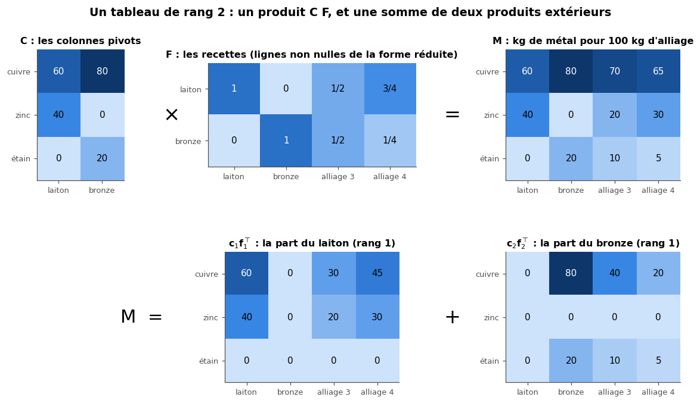
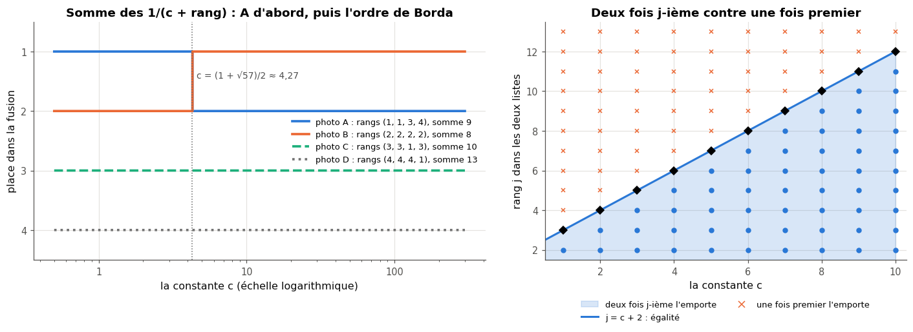

# MB4 · Rang faible et recherche d'information — fiche de cours

> Deux sens du mot « rang ». Le **rang d'une matrice** : la **factorisation de rang** $\mathbf{M} = \mathbf{C}\mathbf{F}$, ses nombres stockés et ses nombres libres, le **rang effectif** d'une matrice mesurée, l'ordre des produits. Le **rang dans un classement** : le poids d'un **indice rare**, du log du rapport des cotes de Robertson et Spärck Jones ; la **saturation** et la **normalisation par la longueur** ; la **fusion de classements** (*rank aggregation* ; Borda, somme des $\frac{1}{c + \text{rang}}$) ; recall@k, MRR et la **ligne de base** d'un ordre tiré au hasard. Le chapitre bonus B4 de workbookIA les applique.

| | |
|---|---|
| **Sections** | §1 à §6 |
| **Temps total estimé** | ≈ 9,0 h : lecture et calculs de la fiche ≈ 1 h 35, exercices ≈ 7 h 05, 12 flashcards ≈ 25 min (parcours essentiel ≈ 6,0 h) |
| **Prérequis** | R6 (cote, logit) ; R7 (dérivée, limites) ; R8 (combinaisons, espérance) ; M02a (rectangles) ; M03 (precision, recall, l'AUC ne dépend que de l'ordre) ; M04 (lissage de Laplace) ; M05a (concavité, flottants) ; M06 (information $-\ln p$) ; M07 (cosinus) ; M08 (facteur de Bayes) ; M09a (forme réduite, coût d'un produit) ; M11 et MB3 §8 (nombre harmonique) ; M12a (base, rang, rang d'un produit, rang numérique) ; M12d (SVD, Eckart-Young) ; M20 (ordre des contractions) ; MB2 §4 et §5 (rappels) |
| **Fichiers du chapitre** | `02_exercices.md` (quiz, papier) · `03_notebook.ipynb` · `04_indices.md` · `05_solutions.md` et `05_solutions.ipynb` · `06_mes_reponses.md` · `flashcards.csv` |
| **mymath** | `ranks.py` : `rank_factorization`, `borda_scores`, `random_ranking_mrr` |
| **MML** | §4.6 (*Matrix Approximation*), lu en M12d : à relire avant le §2 |
| **Références** | G. Strang et C. Moler (§1) ; M. Rudelson et R. Vershynin, M. Gavish et D. L. Donoho (§2) ; K. Spärck Jones, S. E. Robertson, W. B. Croft et D. J. Harper (§3) ; S. Robertson et H. Zaragoza (§3, §4) ; L. Michaelis et M. L. Menten (§4) ; J.-C. de Borda, G. V. Cormack et coll. (§5) ; E. M. Voorhees (§6) ; C. D. Manning, P. Raghavan et H. Schütze, ch. 6, 8 et 11 |

## Comment utiliser ce chapitre

**Ordre conseillé.**
1. `python tools/start_chapter.py MB4` (sur Colab : `00_setup/COLAB.md` §2) : il copie le notebook, ta feuille de réponses et le squelette `mymath/ranks.py`.
2. Section par section : lis **crayon en main** et refais chaque calcul (avant le §2, relis MML §4.6 avec le guide ci-dessous) ; puis fais les exercices de la section, quiz 🧠 d'abord.
3. Les ✏️ se font sur papier, dans ta copie de `06_mes_reponses.md`, et se vérifient dans la **partie 0** du notebook ; les ∂ se jugent avec la grille de relecture de `05_solutions.md`.

Le chapitre a deux moitiés. Les §1 et §2 (le rang d'une matrice) se lisent dans l'ordre. Les §3 à §6 (le rang dans un classement) ne leur demandent rien : le §4 prolonge le §3, les §5 et §6 se lisent seuls (le dernier paragraphe du §5 renvoie au §3).

| Section | Quiz 🧠 et rappels 🔁 | Papier et réflexion | Notebook |
|---|---|---|---|
| §1 La factorisation de rang | Q1, R1 | MB4.1 ✏️, MB4.5 ∂ | MB4.8 🔨, MB4.12 🐛 |
| §2 Rang effectif, ordre des produits | Q1, R2 | MB4.2 ✏️ | MB4.13 🏆 |
| §3 Le poids d'un indice rare | Q2, R3 | MB4.3 ✏️, MB4.7 🗣️ | MB4.12 🐛 |
| §4 Saturation et normalisation | Q2 | MB4.3 ✏️, MB4.7 🗣️ | MB4.11 🎨 |
| §5 Fusionner des classements | Q3 | MB4.4 ✏️, MB4.6 ∂, MB4.E1 💼 | MB4.9 🔨, MB4.12 🐛 |
| §6 Mesurer un classement | Q4 | | MB4.9 🔨, MB4.10 🔮 |

Parcours essentiel : tout sauf MB4.6, MB4.E1 et MB4.9 à MB4.13 (les énoncés du §5 en font partie ; leur démonstration, ∂ MB4.6, non).

## Guide de lecture de MML

**MML §4.6** (*Matrix Approximation*), déjà lu en M12d : relis-le **après le §1** de cette fiche et **avant le §2**.
- (4.90) à (4.92) : une matrice de rang $r$ comme somme de $r$ matrices de rang 1, et l'approximation de rang $k$ qui n'en garde que $k$ ; c'est une factorisation de rang au sens du §1. Les figures 4.11 et 4.12 et le compte des nombres stockés se relisent vite (M12d §3).
- La définition 4.23 (norme spectrale) et le théorème 4.24 ($\lVert\mathbf{A}\rVert_2 = \sigma_1$) servent au rang stable du §2. Le théorème 4.25 énonce Eckart-Young en norme spectrale ; M12d §3 et le §2 l'emploient en norme de Frobenius.
- L'esquisse de démonstration (4.96)-(4.99) et la fin de l'exemple 4.15 se survolent.

MML ne parle ni de la factorisation par les colonnes pivots (son §2.5, autour de (2.66), lit pourtant chaque colonne non pivot comme une combinaison des colonnes pivots : c'est ce que range $\mathbf{F}$), ni du rang effectif ou stable, ni de recherche d'information : pour les §1 et §3 à §6, la fiche est le cours, avec Manning, Raghavan et Schütze en lecture libre.

📐 **Notations.**
- **Écarts.** MML note $\sigma_i$ les valeurs singulières, $\operatorname{rk}$ le rang et $\hat{\mathbf{A}}(k)$ l'approximation de rang $k$ ; la fiche écrit, comme M12d, $s_i$, $\operatorname{rg}$ et $\mathbf{M}_r$. M12d et MB2 notent $k$ le rang gardé ; ici c'est $r$, car $k$ est la coupure de recall@k. La constante $c$ du §5 est notée $k$ dans workbookIA B4 et chez Cormack et coll. MML écrit $\log$ pour $\ln$.
- **Le mot « rang »** a deux sens, voulus : le rang d'une matrice (§1, §2), et la place d'un candidat ou d'un objet dans un classement (§5, §6), qui commence à 1. Dans `ranks.py`, les candidats sont numérotés à partir de 0, et un classement les liste du meilleur au moins bon : ce n'est pas la liste de leurs rangs.
- **Lettres à double sens.** $r$ : un rang de matrice (§1, §2), un nombre de dossiers (§3) ; $R$ : un nombre de dossiers (§3), le rang du premier pertinent (§6). $n$ compte des colonnes (§1, §2), des dossiers (§3), des candidats (§5), des objets (§6) ; $m$ des lignes (§1, §2), des juges (§5). $k$ est la coupure (§6), $k_1$ une constante (§4), et le rang gardé de M12d. $s_i$ est une valeur singulière (§2), $s(x)$ la saturation (§4). $c$ est la constante du §5, $\mathbf{c}_i$ (en gras) une colonne au §1. $p$ compte des vecteurs (§2), c'est une probabilité (§3) ; $q$ une probabilité (§3), un nombre d'objets (§6). $\mathbf{x}$ (en gras) est un vecteur (§2), $x$ un nombre de mentions (§4). $j$ numérote des colonnes (§1), c'est un rang (§5, §6). $\mathbf{A}$, $\mathbf{B}$, $\mathbf{C}$ (en gras) sont des matrices, A, B, C, D (en romain) des photos (§5). $\sigma$ est l'écart-type d'un bruit (§2), jamais une valeur singulière ici (MML les note $\sigma_i$). $x$ est aussi la variable de $\frac1x$ (§6) ; $u$ (en italique) un petit nombre (§5), $\mathbf{u}_i$ (en gras) un vecteur singulier (§1). Le contexte tranche.

Vocabulaire anglais de ce chapitre : *rank factorization*, *pivot column*, *outer product*, *degrees of freedom*, *effective rank*, *stable rank*, *noise level*, *surprisal*, *odds ratio*, *relevance weight*, *pseudo-count*, *saturation*, *diminishing returns*, *length normalization*, *rank aggregation*, *Borda count*, *ranking*, *recall at k*, *precision at k*, *hit rate*, *reciprocal rank*, *mean reciprocal rank (MRR)*, *baseline*, *harmonic number*.

## Objectifs d'apprentissage

À la fin du chapitre, tu sais :
- **factoriser** une matrice de rang $r$ en un produit $\mathbf{C}\mathbf{F}$ de $r$ colonnes par $r$ lignes, en **trouver** une autre, et **compter** les nombres stockés et les nombres libres ;
- **démontrer** que deux factorisations de rang diffèrent d'une matrice inversible, et que le rang est le plus petit nombre de produits extérieurs dont une matrice est la somme (∂ MB4.5) ;
- **mesurer** le rang effectif d'une matrice de mesures par l'énergie de ses valeurs singulières, et **appliquer** une matrice factorisée dans l'ordre le moins coûteux ;
- **calculer** le poids d'un indice rare comme une surprise et comme le log d'un rapport de cotes corrigé par ½, et **dire** quand il devient négatif ;
- **étudier** la saturation $x \mapsto \frac{x(k_1 + 1)}{x + k_1}$ et la normalisation par la longueur, et **prévoir** l'effet de $k_1$ et de $b$ ;
- **fusionner** des classements par les rangs (Borda, somme des $\frac{1}{c + \text{rang}}$), **démontrer** qu'ils ne dépendent pas de l'échelle des notes, et **trouver** quand une double présence bat une première place (∂ MB4.6) ;
- **définir** recall@k, precision@k, taux de succès et MRR, et **calculer** leur valeur moyenne pour un ordre tiré au hasard ($\frac kn$, $\frac{H_n}{n}$).

## L'essentiel en 6 lignes

1. **Factorisation de rang** : $\mathbf{M} = \mathbf{C}\mathbf{F} = \sum_{i=1}^r\mathbf{c}_i\mathbf{f}_i^\top$, avec $\mathbf{C}$ les colonnes pivots de $\mathbf{M}$ et $\mathbf{F}$ les lignes non nulles de sa forme réduite ; les autres sont les $(\mathbf{C}\mathbf{G})(\mathbf{G}^{-1}\mathbf{F})$ ; le rang est le plus petit nombre de produits extérieurs (∂ MB4.5) ; $r(m + n)$ nombres stockés, $r(m + n - r)$ libres.
2. **Rang effectif** : la part de l'énergie $\sum_{i \le r}s_i^2 / \lVert\mathbf{M}\rVert_F^2$ ; rang stable $\lVert\mathbf{M}\rVert_F^2/\lVert\mathbf{M}\rVert_2^2$, entre 1 et le rang ; $\mathbf{C}(\mathbf{F}\mathbf{x})$ coûte $r(m + n)$ multiplications, $(\mathbf{C}\mathbf{F})\mathbf{x}$ en coûte $mnr + mn$ ; même résultat en exact, pas en flottants.
3. **Indice rare** : surprise $-\ln\frac nN$ ; poids $\ln\frac{p(1 - q)}{q(1 - p)}$, corrigé par ½ dans chaque case ; sans information de pertinence, $\ln\frac{N - n + 1/2}{n + 1/2}$, négatif si et seulement si $n > \frac N2$ ; la variante $\ln\frac{N + 1}{n + 1/2}$, toujours positive.
4. **Saturation** : $s(x) = \frac{x(k_1 + 1)}{x + k_1}$, croissante, concave, vaut 1 en 1, plafonne à $k_1 + 1$ ; $k_1 \to 0$ : la présence, $k_1 \to \infty$ : le compte ; la normalisation $\nu = 1 - b + b\ell$ remplace $x$ par $\frac x\nu$.
5. **Fusion** : la somme des notes dépend de l'échelle de chaque juge, une fusion par les rangs non ; Borda : $mn$ moins la somme des rangs ; $\sum\frac{1}{c + j}$ : deux fois $j$-ième bat une fois premier si et seulement si $j < c + 2$ ; $c$ grand : le nombre de listes, puis la somme des rangs (∂ MB4.6).
6. **Mesures** : au hasard, $\mathbb{E}[\text{recall@k}] = \frac kn$, $\mathbb{E}[\text{precision@k}] = \frac qn$, $P(R = j) = \binom{n - j}{q - 1}\big/\binom nq$, et $\mathbb{E}[\frac1R] = \frac{H_n}{n} \approx \frac{\ln n}{n}$ pour un seul pertinent.

## §1 · La factorisation de rang : une matrice de rang r est un produit C F, et ce qu'elle coûte à stocker

### Des alliages qui sont des mélanges

Une fonderie coule quatre alliages. Le tableau donne les kilogrammes de cuivre, de zinc et d'étain (en lignes) dans 100 kg de laiton, de bronze, d'un alliage 3 et d'un alliage 4 (en colonnes) :

$$\mathbf{M} = \begin{pmatrix} 60 & 80 & 70 & 65 \cr 40 & 0 & 20 & 30 \cr 0 & 20 & 10 & 5 \end{pmatrix}.$$

L'alliage 3 est moitié laiton, moitié bronze ; l'alliage 4, trois quarts de laiton et un quart de bronze. Ses colonnes 3 et 4 combinent donc les deux premières, qui sont libres : $\operatorname{rg}(\mathbf{M}) = 2$.

### La factorisation CR

> **Définition** (la factorisation CR). Soit $\mathbf{M}$ une matrice $(m, n)$ de rang $r \ge 1$. On prend pour $\mathbf{C}$ ses $r$ **colonnes pivots**, dans l'ordre, et pour $\mathbf{F}$ les $r$ **lignes non nulles** de sa forme échelonnée réduite (M09a §6). Alors $\mathbf{M} = \mathbf{C}\mathbf{F}$, et $\mathbf{F}$ vaut l'identité $\mathbf{I}_r$ dans les colonnes pivots. C'est une **factorisation de rang** (*rank factorization*) : un produit de $r$ colonnes par $r$ lignes.

Pourquoi $\mathbf{C}\mathbf{F} = \mathbf{M}$ : la colonne $j$ de la forme réduite donne les coefficients qui écrivent la colonne $j$ de $\mathbf{M}$ avec les colonnes pivots, comme M09a §8 et M12a §2 lisent une relation dans la forme réduite ; le produit refait ces combinaisons. Pour les alliages, les pivots sont dans les colonnes 1 et 2 :

$$\mathbf{C} = \begin{pmatrix} 60 & 80 \cr 40 & 0 \cr 0 & 20 \end{pmatrix}, \qquad \mathbf{F} = \begin{pmatrix} 1 & 0 & \frac12 & \frac34 \cr 0 & 1 & \frac12 & \frac14 \end{pmatrix}.$$

Chaque colonne de $\mathbf{F}$ est une **recette** : celle de l'alliage 4 dit $\frac34(60, 40, 0) + \frac14(80, 0, 20) = (65, 30, 5)$.

### Une factorisation par matrice inversible

Pour toute matrice $r \times r$ inversible $\mathbf{G}$, $(\mathbf{C}\mathbf{G})(\mathbf{G}^{-1}\mathbf{F}) = \mathbf{C}\mathbf{F}$ par associativité : une autre factorisation de rang. Prenons pour $\mathbf{G}$ les recettes des alliages 3 et 4 :

$$\mathbf{G} = \begin{pmatrix} \frac12 & \frac34 \cr \frac12 & \frac14 \end{pmatrix}, \quad \mathbf{G}^{-1} = \begin{pmatrix} -1 & 3 \cr 2 & -2 \end{pmatrix} : \qquad \mathbf{C}\mathbf{G} = \begin{pmatrix} 70 & 65 \cr 20 & 30 \cr 10 & 5 \end{pmatrix}, \quad \mathbf{G}^{-1}\mathbf{F} = \begin{pmatrix} -1 & 3 & 1 & 0 \cr 2 & -2 & 0 & 1 \end{pmatrix}.$$

$\mathbf{C}\mathbf{G}$ est faite des alliages 3 et 4, et la première colonne de $\mathbf{G}^{-1}\mathbf{F}$ dit que le laiton vaut $-1$ fois l'alliage 3 plus 2 fois l'alliage 4 : vérifie que $-(70, 20, 10) + 2(65, 30, 5) = (60, 40, 0)$. Aucune fonderie ne « retire » d'alliage : une factorisation ne dit pas de quoi le tableau est fait, elle dit quel espace engendrent ses colonnes. MB2 §4, en répartissant les valeurs singulières entre deux facteurs, prenait une $\mathbf{G}$ diagonale.

### Une somme de produits extérieurs

Le produit $\mathbf{C}\mathbf{F}$ est la somme des « colonne $i$ de $\mathbf{C}$ fois ligne $i$ de $\mathbf{F}$ » (rappel de M09a §3) :
$$\mathbf{M} = \mathbf{c}_1\mathbf{f}_1^\top + \cdots + \mathbf{c}_r\mathbf{f}_r^\top,$$
$r$ **produits extérieurs** (*outer products*), chacun de rang 1. Pour les alliages, $\mathbf{c}_1\mathbf{f}_1^\top$ est la part du laiton dans chaque alliage, $\mathbf{c}_2\mathbf{f} _2^\top$ celle du bronze (figure). Inversement, une somme de $r$ produits extérieurs est de rang au plus $r$ : c'est le rappel de M12a §4 ($\operatorname{rg}(\mathbf{A}\mathbf{B}) \le \min(\operatorname{rg}\mathbf{A}, \operatorname{rg}\mathbf{B})$, ∂ M12a.18), qu'on ne redémontre pas. La SVD compacte de M12d, $\sum _{i=1}^r s_i\mathbf{u}_i\mathbf{v}_i^\top$, est une autre factorisation de rang : $\mathbf{C} = \mathbf{U}_r\mathbf{S}_r$ et $\mathbf{F} = \mathbf{V}_r^\top$.

> **Théorème** (∂ MB4.5). Soit $\mathbf{M}$ une matrice $(m, n)$ de rang $r \ge 1$.
> 1. **Existence** : $\mathbf{M}$ est le produit d'une matrice $(m, r)$ par une matrice $(r, n)$.
> 2. **À une matrice inversible près** : si $\mathbf{M} = \mathbf{C}\mathbf{F} = \mathbf{C}'\mathbf{F}'$, où $\mathbf{C}$ et $\mathbf{C}'$ ont $r$ colonnes, il existe $\mathbf{G}$ inversible $r \times r$ telle que $\mathbf{C}' = \mathbf{C}\mathbf{G}$ et $\mathbf{F}' = \mathbf{G}^{-1}\mathbf{F}$.
> 3. **Minimalité** : le rang est le plus petit nombre de produits extérieurs dont $\mathbf{M}$ est la somme.

Les outils, que le ∂ MB4.5 met en œuvre : une base de l'espace des colonnes et les coordonnées dans cette base (M12a §3) pour le point 1 ; deux bases d'un même espace et la matrice de passage pour le point 2 ; le point 1 et le rappel ci-dessus pour le point 3.

### Ce qu'elle coûte, et ses nombres libres

Stocker $\mathbf{C}$ et $\mathbf{F}$ demande $mr + rn = r(m + n)$ nombres, contre $mn$ (rappel de M12a §4, et des $k(m + n + 1)$ nombres d'une SVD tronquée, M12d §3). Pour les alliages, 14 contre 12 : sur un si petit tableau, rien à gagner. Sur un registre de 30 éléments mesurés dans 500 alliages, tous mélanges de 4 alliages de base, le rang est au plus 4 : $4 \times 530 = 2\thinspace120$ nombres contre $15\thinspace000$, environ 14 %.

Tous ne sont pas **libres** : la forme CR impose l'identité dans $r$ colonnes de $\mathbf{F}$, soit $r^2$ nombres. Dans le cas général, où les $r$ premières colonnes sont libres (les pivots sont alors les colonnes 1 à $r$, comme pour les alliages), une matrice de rang $r$ est décrite par
$$r(m + n) - r^2 = r(m + n - r)$$
nombres libres (*degrees of freedom*) : 10 pour les alliages, $2\thinspace104$ pour le registre. Si les pivots sont ailleurs, la forme réduite impose encore des zéros à gauche de chaque pivot, et il en reste moins : $r(m + n - r)$ est le nombre de degrés de liberté de l'ensemble de toutes les matrices de rang $r$. Les $r^2$ nombres en trop sont ceux de $\mathbf{G}$, qu'on choisit sans changer le produit. Cas limites : pour $r = \min(m, n)$, le compte vaut $mn$ (si $r = m$, $m(m + n - m) = mn$), rien n'est contraint ; pour $r = 0$, la matrice nulle, il vaut 0.

💻 **Aujourd'hui en pratique** — en flottants, on préfère au pivot de Gauss une QR avec permutation des colonnes (`scipy.linalg.qr(M, pivoting=True)`) ou la SVD tronquée. `rank_factorization` (🔨 MB4.8) reprend ton `rref` de M09a, avec une petite tolérance `tol` sur les pivots.

⚠️ **Erreur classique.** Prendre $\mathbf{C}$ dans la forme réduite au lieu de $\mathbf{M}$ : en général, le produit ne redonne pas $\mathbf{M}$ (🐛 MB4.12). Croire la factorisation unique. Compter $r(m + n)$ nombres libres.

🔗 **Dans workbookIA** — le chapitre B4 apprend une correction de rang $r$ d'une matrice (LoRA) : le compte $r(m + n)$ vaut pour cette correction, et B4 l'applique à ses propres matrices.

## §2 · Le rang effectif d'une matrice mesurée, et l'ordre des produits : C(Fx) plutôt que (CF)x

### Mesurée, une matrice a le rang plein

Le laboratoire de la fonderie dose 6 éléments dans 40 échantillons de trois alliages de base. Sans erreur de mesure, ce tableau $40 \times 6$ aurait le rang 3 ; mesuré, il a le rang 6, car le bruit ne respecte aucune relation exacte, et le rang numérique de M12a dépend de la **tolérance** choisie. Il faut une mesure plus douce.

**Rappel** (M12d §3, MML §4.6). $\lVert\mathbf{M}\rVert_F^2 = s_1^2 + s_2^2 + \cdots$ est l'**énergie** du tableau ; l'approximation de rang $r$ de la SVD, $\mathbf{M} _r$, est la meilleure de son rang (Eckart-Young), avec $\lVert\mathbf{M} - \mathbf{M} _r\rVert_F^2 = \sum _{i > r}s_i^2$, et $s _{r+1}$ en norme spectrale.

### Le rang effectif et le rang stable

> **Définitions.** La **part de l'énergie** des $r$ premières valeurs singulières est $\frac{s_1^2 + \cdots + s_r^2}{\lVert\mathbf{M}\rVert_F^2}$. Le **rang effectif** (*effective rank*) à $\tau$ est le plus petit $r$ dont la part atteint $\tau$. Le **rang stable** (*stable rank*) d'une matrice non nulle est $\frac{\lVert\mathbf{M}\rVert_F^2}{\lVert\mathbf{M}\rVert_2^2} = \frac{s_1^2 + s_2^2 + \cdots}{s_1^2}$.

M12d traçait déjà la part d'énergie gardée selon le rang (§3), et choisissait le nombre de composantes d'une ACP par un seuil sur la part cumulée (§7) : le rang effectif donne un nom à ce choix.

**Exemple.** Les valeurs singulières du laboratoire sont $(10 ;\ 6 ;\ 3 ;\ 0{,}4 ;\ 0{,}3 ;\ 0{,}2)$. Leurs carrés font une énergie de $145{,}29$, et des parts cumulées de 68,83 %, 93,61 %, 99,80 %, 99,91 %, 99,97 % et 100 % : le rang effectif vaut 2 à 90 %, 3 à 99 %. L'approximation de rang 3 laisse $0{,}16 + 0{,}09 + 0{,}04 = 0{,}29$, soit 0,2 % de l'énergie, mais une erreur relative de $\sqrt{0{,}29/145{,}29} \approx 4{,}5$ % en norme : une part d'énergie est un carré. Si l'on compte les valeurs singulières au-dessus d'un seuil, le rang numérique vaut 3 pour un seuil de 0,5, et 5 pour un seuil de 0,25. Le rang stable vaut $\frac{145{,}29}{100} \approx 1{,}45$.

Comme $\lVert\mathbf{M}\rVert_2 = s_1$ (M12d §2, MML théorème 4.24), les $\operatorname{rg}(\mathbf{M})$ termes non nuls de $\frac{s_1^2 + s_2^2 + \cdots}{s_1^2}$ valent au plus 1, et le premier vaut 1 : le rang stable est **entre 1 et le rang**, égal au rang seulement si les valeurs singulières non nulles sont égales. Il ne demande aucun seuil, et un petit bruit le change à peine (Rudelson et Vershynin l'appellent *numerical rank*, rien à voir avec le rang numérique de M12a).

### Où couper : chercher un écart

Sur un tableau bruité, on trace les valeurs singulières en échelle logarithmique et l'on cherche un **écart** (*gap*) : $s_r$ nettement au-dessus de $s_{r+1}$. Ici $s_3/s_4 = 7{,}5$, et les trois dernières valeurs ont la taille d'un bruit. C'est le « coude » de M12d §7.

💻 **Aujourd'hui en pratique** — on admet qu'un tableau $m \times n$ de bruits indépendants, de moyenne nulle et d'écart-type $\sigma$, a ses valeurs singulières sous $\sigma(\sqrt m + \sqrt n)$ environ (elles le dépassent parfois, de peu). Si le laboratoire mesure à $\sigma = 0{,}05$ près, ce niveau vaut $0{,}05(\sqrt{40} + \sqrt6) \approx 0{,}44$ : 0,4, 0,3 et 0,2 sont du bruit, 3 est loin au-dessus. `np.linalg.svd(M, compute_uv=False)` rend les valeurs singulières ; `np.linalg.matrix_rank(M, tol=...)` compte celles qui dépassent `tol`.

### L'ordre des produits

**Rappel** (M09a §3 ; M20 §3 pour l'ordre des contractions et `np.linalg.multi_dot`). Un produit d'une matrice $(m, n)$ par une matrice $(n, p)$ coûte $mnp$ multiplications, et l'associativité laisse le choix des parenthèses. Pour appliquer $\mathbf{M} = \mathbf{C}\mathbf{F}$ à un vecteur $\mathbf{x}$ :
- $\mathbf{C}(\mathbf{F}\mathbf{x})$ coûte $rn$ multiplications, puis $mr$ : $r(m + n)$ en tout ;
- $(\mathbf{C}\mathbf{F})\mathbf{x}$ coûte $mnr$ pour former $\mathbf{C}\mathbf{F}$, puis $mn$.

Pour $p$ vecteurs, $r(m + n)\thinspace p$ contre $mnr + mn\thinspace p$ : former le produit coûte à lui seul autant que $r$ applications de $\mathbf{M}$.

**Exemple.** Une commande $\mathbf{x} = (3, 1, 2, 4)$ de lingots de 100 kg des quatre alliages demande $\mathbf{F}\mathbf{x} = (7, 3)$ : sept lingots de laiton et trois de bronze, en comptant ceux des mélanges ; puis $\mathbf{C}(\mathbf{F}\mathbf{x}) = 7(60, 40, 0) + 3(80, 0, 20) = (660, 280, 60)$ kg de cuivre, de zinc et d'étain, 1 000 kg en tout, comme $\mathbf{M}\mathbf{x}$. Sur le registre $30 \times 500$ de rang 4, $\mathbf{C}(\mathbf{F}\mathbf{x})$ coûte $2\thinspace120$ multiplications, $\mathbf{M}\mathbf{x}$ $15\thinspace000$, et former $\mathbf{C}\mathbf{F}$ $60\thinspace000$.

**En flottants**, chaque multiplication et chaque addition est arrondie (M05a §6) : l'associativité et la distributivité ne tiennent plus qu'à un arrondi près, et les deux ordres peuvent différer au dernier chiffre. Avec $\mathbf{C} = (3)$, $\mathbf{F} = (0{,}3 \ \ 0{,}7)$ et $\mathbf{x} = (1, 1)$ : $\mathbf{C}(\mathbf{F}\mathbf{x}) = 3 \times (0{,}3 + 0{,}7) = 3$ exactement en `float64`, mais $(\mathbf{C}\mathbf{F})\mathbf{x} = 3 \times 0{,}3 + 3 \times 0{,}7 = 0{,}8999999999999999 + 2{,}0999999999999996 = 2{,}9999999999999996$ : ici, ce sont les produits arrondis qui font l'écart. On compare donc par `np.allclose`, jamais par `==`. `np.linalg.multi_dot` choisit lui-même l'ordre le moins coûteux.

⚠️ **Erreur classique.** Annoncer le rang d'un tableau mesuré sans dire la tolérance. Confondre la part d'énergie oubliée (un carré) et l'erreur relative en norme. Former $\mathbf{C}\mathbf{F}$ pour l'appliquer. Comparer deux flottants par `==`.

🔗 **Dans workbookIA** — le chapitre B4 parle du « rang effectif » d'une correction de rang faible, l'applique dans l'ordre le moins coûteux, et retrouve un écart d'arrondi quand il forme le produit.

## §3 · Le poids d'un indice rare : surprise, cote, et le log du rapport des cotes corrigé par ½

Une clinique vétérinaire range $N = 800$ dossiers. Pour retrouver ceux d'une maladie, on regarde des **indices**, des symptômes notés dans les dossiers : une boiterie figure dans $n = 51$ dossiers, une fatigue dans $n = 640$. Combien pèse un indice ?

### La surprise et la cote

La **surprise** d'un indice est l'information de l'événement « un dossier tiré au hasard le contient » (rappel de M06 §1), l'idf de R6.12 :
$$-\ln\frac nN = \ln\frac Nn .$$
Boiterie : $\ln\frac{800}{51} \approx 2{,}753$ nats ; fatigue : $\ln\frac54 \approx 0{,}22$ ; un indice présent partout : 0. Sa **cote** (R6) est $\frac{n}{N - n}$ : $\frac{51}{749} \approx 0{,}0681$ pour la boiterie, 4 pour la fatigue.

### Le log du rapport des cotes

Si l'on sait quels dossiers sont **pertinents** (*relevant* : ceux de la maladie cherchée), on les range dans un tableau $2 \times 2$ :

| | indice présent | indice absent | total |
|---|---|---|---|
| pertinents | $r$ | $R - r$ | $R$ |
| autres | $n - r$ | $N - n - R + r$ | $N - R$ |

Soit $p = \frac rR$ la probabilité de l'indice chez les pertinents, et $q = \frac{n - r}{N - R}$ chez les autres.

> **Définition** (le poids de Robertson et Spärck Jones). Le **poids** (*relevance weight*) d'un indice est le logarithme du **rapport des cotes** (*odds ratio*) de sa présence chez les pertinents et chez les autres :
> $$w = \ln\frac{p\thinspace(1 - q)}{q\thinspace(1 - p)} = \operatorname{logit}p - \operatorname{logit}q .$$

Il est positif quand l'indice est plus fréquent chez les pertinents, nul s'il l'est autant, négatif sinon.

**Exemple.** Parmi $R = 40$ dossiers d'une dysplasie de la hanche, $r = 32$ notent une boiterie : les cases valent 32, 8, 19 et 741, d'où $p = \frac45$ et $q = \frac{19}{760} = \frac{1}{40}$. Les cotes valent 4 et $\frac{1}{39}$, leur rapport 156, et $w = \ln 156 \approx 5{,}05$.

**Par la formule de Bayes.** La présence de l'indice multiplie la cote de pertinence d'un dossier par $\frac pq$ (le facteur de Bayes de M08 §7 ; MB2 §5 multipliait de même la cote d'un positif par $K$ ; ici 32), son absence par $\frac{1 - p}{1 - q}$ (ici $\frac{8}{39}$) : $w = \ln\frac pq - \ln\frac{1 - p}{1 - q}$ est l'écart des deux, en logarithmes.

### La correction ½

Si aucun dossier pertinent ne note l'indice ($r = 0$), la formule donne $\ln 0$ ; si tous le notent, une division par 0. On ajoute **½ à chacune des quatre cases** :
$$w = \ln\frac{(r + \frac12)(N - n - R + r + \frac12)}{(R - r + \frac12)(n - r + \frac12)} ,$$
le rapport des cotes de $\hat p = \frac{r + 1/2}{R + 1}$ et de $\hat q = \frac{n - r + 1/2}{N - R + 1}$ : des **pseudo-observations** (*pseudo-counts*) d'un demi, là où le lissage de Laplace de M04 §5 en ajoutait une. Pour la dysplasie, $w = \ln\frac{32{,}5 \times 741{,}5}{8{,}5 \times 19{,}5} \approx 4{,}979$ ; si aucun des 40 dossiers ne notait la boiterie, on trouverait $\ln\frac{0{,}5 \times 709{,}5}{40{,}5 \times 51{,}5} \approx -1{,}771$ au lieu de $-\infty$.

### Sans information de pertinence

Le plus souvent, on ne sait pas quels dossiers sont pertinents : on prend $R = r = 0$, et
$$w = \ln\frac{N - n + \frac12}{n + \frac12} .$$
C'est $\hat p = \frac12$ (on ne sait rien des pertinents) face à $\hat q = \frac{n + 1/2}{N + 1}$, la fréquence de l'indice dans tous les dossiers : le poids est l'opposé du logit de cette fréquence, le log de la cote de l'**absence**. Boiterie : $\ln\frac{749{,}5}{51{,}5} \approx 2{,}678$, proche de la surprise ; fatigue : $\ln\frac{160{,}5}{640{,}5} \approx -1{,}38$.

> **Propriété** (✏️ MB4.3 le démontre). Sans information de pertinence, le poids $\ln\frac{N - n + 1/2}{n + 1/2}$ est négatif si et seulement si $n > \frac N2$, et nul pour $n = \frac N2$.

Un indice présent dans plus de la moitié des dossiers compte **contre** la pertinence : c'est son absence qui est rare. Pour garder des poids positifs, on emploie souvent la **variante**
$$\ln\left(1 + \frac{N - n + \frac12}{n + \frac12}\right) = \ln\frac{N + 1}{n + \frac12} ,$$
toujours positive, puisque $n \le N < N + \frac12$, et proche de la surprise : 2,744 pour la boiterie, 0,22 pour la fatigue.

💻 **Aujourd'hui en pratique** — `scipy.stats.contingency.odds_ratio(tableau, kind="sample")` rend le rapport des cotes d'un tableau $2 \times 2$ (156 pour la dysplasie) ; son réglage par défaut, `kind="conditional"`, en donne une autre estimation.

⚠️ **Erreur classique.** Écrire la surprise $\ln\frac nN$ au lieu de $-\ln\frac nN$ : elle n'est jamais positive (🐛 MB4.12). Confondre la cote $\frac{n}{N - n}$ et la proportion $\frac nN$. Échanger $p$ et $q$ : le poids change de signe. Prendre un poids négatif pour une faute de calcul quand $n > \frac N2$.

🔗 **Dans workbookIA** — le chapitre B4 pondère chaque mot d'une requête par la variante $\ln\frac{N + 1}{n + 1/2}$, la fréquence inverse (*idf*) de BM25 ; ce paragraphe en donne l'origine.

## §4 · Saturation et normalisation par la longueur : deux fonctions d'un score de pertinence

### La saturation

Un dossier qui mentionne cinq fois une boiterie est-il cinq fois plus pertinent qu'un dossier qui la mentionne une fois ? Non.

> **Définition.** Pour $k_1 > 0$, la **saturation** d'un nombre de mentions $x \ge 0$ est $s(x) = \dfrac{x\thinspace(k_1 + 1)}{x + k_1}$.

> **Propriétés.**
> 1. $s(0) = 0$ et $s(1) = 1$ pour tout $k_1$ : toutes les courbes passent par $(1, 1)$.
> 2. Elle est **croissante** et **concave** : $s'(x) = \frac{k_1(k_1 + 1)}{(x + k_1)^2} > 0$ et $s''(x) = -\frac{2k_1(k_1 + 1)}{(x + k_1)^3} < 0$ (R7, M05a). Chaque mention ajoute moins que la précédente.
> 3. Elle **plafonne** : sa limite en $+\infty$ est $k_1 + 1$, et elle en atteint la moitié en $x = k_1$.
> 4. Quand $k_1 \to 0$, $s(x) \to 1$ pour tout $x > 0$ : seule la **présence** compte. Quand $k_1 \to \infty$, $s(x) \to x$ : le **compte brut**.

**Exemple**, $k_1 = 3$ : $s(x) = \frac{4x}{x + 3}$ vaut 1 pour une mention, 2 pour trois, 2,8 pour sept, 3,5 pour vingt et une, et n'atteindra jamais 4. La première mention ajoute 1 ; la troisième n'ajoute plus que $s(3) - s(2) = 0{,}4$.

C'est la forme de la **cinétique de Michaelis et Menten** (*Michaelis-Menten kinetics*) : la vitesse d'une réaction catalysée par une enzyme vaut $\frac{V_{\max}\thinspace[S]}{K_m + [S]}$ pour une concentration $[S]$ du substrat, et atteint la moitié de son plafond en $[S] = K_m$ ; ici $V_{\max} = k_1 + 1$ et $K_m = k_1$. Des **rendements décroissants** (*diminishing returns*).

### La normalisation par la longueur

Un long dossier mentionne tout plus souvent. Soit $\ell$ sa longueur rapportée à la longueur moyenne des dossiers.

> **Définition.** Pour $b \in [0, 1]$ et $\ell > 0$, la **normalisation par la longueur** (*length normalization*) est $\nu = 1 - b + b\thinspace\ell$, et la saturation normalisée est $\dfrac{x\thinspace(k_1 + 1)}{x + k_1\nu} = s\Big(\dfrac x\nu\Big)$ : $k_1$ devient $k_1\nu$ au dénominateur.

- $\nu$ est **affine** en $\ell$ et en $b$ : elle va de 1 ($b = 0$, aucune normalisation) à $\ell$ ($b = 1$). Toutes les droites passent par $(\ell, \nu) = (1, 1)$ : à longueur moyenne, $b$ ne change rien.
- La seconde écriture le dit : normaliser, c'est diviser le nombre de mentions par $\nu$ avant de saturer. Le plafond reste $k_1 + 1$ ; la demi-saturation passe de $k_1$ à $k_1\nu$.

**Exemple**, $k_1 = 3$ et $b = \frac12$, donc $\nu = \frac{1 + \ell}{2}$. Un dossier trois fois plus long que la moyenne a $\nu = 2$ et la courbe $\frac{4x}{x + 6}$ : une mention n'y vaut que $\frac47$, trois mentions $\frac43$. Un dossier deux fois plus court a $\nu = \frac34$ : une mention y vaut $\frac{16}{13} \approx 1{,}23$.

⚠️ **Erreur classique.** Croire que $k_1$ petit supprime la saturation : c'est l'inverse, seule la présence compte. Croire que $b = 1$ supprime la normalisation : c'est $b = 0$. Croire que la normalisation abaisse le plafond : elle déplace la demi-saturation.

🔗 **Dans workbookIA** — le chapitre B4 combine le poids du §3, cette saturation et cette normalisation dans BM25, avec ses deux réglages $k_1$ et $b$ ; ce paragraphe étudie les deux fonctions, chacune seule.

## §5 · Fusionner des classements : par les scores ou par les rangs, Borda et la somme des 1/(c + rang)

### Additionner des notes : une question d'échelle

Quatre juges d'un concours de photographie notent quatre photos sur 20 :

| | A | B | C | D |
|---|---|---|---|---|
| juge 1 | 15 | 14 | 12 | 9 |
| juge 2 | 16 | 13 | 12 | 10 |
| juge 3 | 8 | 12 | 17 | 6 |
| juge 4 | 11 | 13 | 12 | 14 |
| somme | 50 | 52 | **53** | 39 |

C gagne. Mais le juge 3 étale ses notes, de 6 à 17, quand les autres les resserrent. S'il notait (11, 12, 13, 10) au lieu de (8, 12, 17, 6), dans le même ordre, les sommes deviendraient 53, 52, 49 et 43 : A gagnerait. La somme donne le plus de poids au juge qui étale le plus : changer son échelle, sans changer son avis, change le gagnant.

### Fusionner par les rangs

Chaque juge donne un **classement** (*ranking*), du meilleur au moins bon : ABCD, ABCD, CBAD et DBCA. Le **rang** (*rank*) d'une photo pour un juge est sa place, à partir de 1 : A a les rangs (1, 1, 3, 4), B (2, 2, 2, 2), C (3, 3, 1, 3), D (4, 4, 4, 1).

> **Propriété** (∂ MB4.6). Une fusion qui ne dépend que des rangs ne change pas quand on applique aux notes d'un juge une transformation strictement croissante (une autre échelle, une autre unité, des notes resserrées).

L'outil est celui de l'AUC de M03 §7 (et du 🔮 M03.23), que le ∂ MB4.6 applique aux rangs.

> **Définition** (la méthode de Borda). Avec $n$ candidats, un juge donne $n - j$ **points** (*Borda count*) au candidat qu'il classe au rang $j$ : $n - 1$ au premier, 0 au dernier. Les points d'un candidat s'additionnent sur les $m$ juges.

Ils valent $mn$ moins la somme de ses rangs : classer par points décroissants, c'est classer par somme des rangs croissante. Pour les photos : A 7, B 8, C 6, D 3. B gagne, sans avoir jamais été premier. Deux notes égales reçoivent la moyenne des rangs en jeu (le réglage par défaut de `scipy.stats.rankdata`).

### La somme des 1/(c + rang)

> **Définition.** Pour une constante $c \ge 0$, chaque candidat reçoit $\sum\frac{1}{c + j}$, la somme sur les juges qui le classent, $j$ étant son rang pour ce juge ; un juge qui ne le classe pas ne lui donne rien.

Un $c$ petit donne beaucoup au premier rang ; un $c$ grand rend les rangs presque égaux. Pour les photos, avec $c = 1$ : A 1,45 ; B $\frac43 \approx 1{,}333$ ; C 1,25 ; D 1,1 ; A, deux fois premier, passe devant B. Avec $c = 20$ : A 0,1804 ; B 0,1818 ; C 0,1781 ; D 0,1726, l'ordre de Borda. A et B échangent leurs places en $c = \frac{1 + \sqrt{57}}{2} \approx 4{,}27$.

> **Propriétés** (∂ MB4.6).
> 1. **Une double présence contre une première place.** Un candidat classé $j$-ième ($j \ge 2$) par deux juges l'emporte sur un candidat classé premier par un seul juge et absent de la liste de l'autre si et seulement si $j < c + 2$ ; ils sont ex aequo pour $j = c + 2$.
> 2. **Quand $c$ grandit** : pour $c$ assez grand, la somme range les candidats selon le nombre de listes où ils figurent ; à nombre égal de listes, la plus petite somme des rangs passe devant. Pour des classements complets, c'est l'ordre de Borda (à ses ex aequo près).

Les outils, que le ∂ MB4.6 met en œuvre : la comparaison de deux fractions pour le point 1 ; l'écriture $\frac{1}{c + j} = \frac1c\cdot\frac{1}{1 + j/c}$ et l'approximation $\frac{1}{1 + u} \approx 1 - u$ de M05a pour le point 2.

**Deux systèmes, deux échelles.** Le même problème se pose quand deux systèmes classent les mêmes objets : l'un additionne les poids des indices du §3, l'autre classe les objets par **cosinus** décroissant entre deux vecteurs (rappel de M07 §4). Leurs scores n'ont aucune commune mesure : on fusionne leurs rangs.

⚠️ **Erreur classique.** Lire un classement comme la liste des rangs des candidats : le classement (3, 0, 2, 1) dit que le candidat 3 est premier, et non que le candidat 0 est quatrième (à la position 3, en comptant à partir de 0) (🐛 MB4.12). Additionner des notes d'échelles différentes. Croire qu'une fusion par les rangs ne dépend d'aucun réglage : elle dépend de $c$.

🔗 **Dans workbookIA** — le chapitre B4 fusionne les classements de BM25 et d'une recherche par cosinus par la somme des $\frac{1}{c + \text{rang}}$, la RRF de Cormack et coll. ; ce paragraphe en énonce les propriétés sur des juges, et le ∂ MB4.6 les démontre.

## §6 · Mesurer un classement : recall@k, precision@k, MRR, et ce que donne le hasard

### Quatre mesures

Au bureau des objets perdus, tu cherches les deux gants que tu as oubliés dans un train. Le logiciel du bureau te montre $n = 7$ objets qui ressemblent à ta description, du plus probable au moins probable ; tes gants sont aux rangs 2 et 5. En général, une liste ordonne $n$ objets, dont $q \ge 1$ sont **pertinents**.

> **Définitions.** Pour une coupure $k$ ($1 \le k \le n$) :
> - **recall@k** $= \dfrac{\text{nombre de pertinents parmi les } k \text{ premiers}}{q}$, la part des pertinents qu'on a vus ;
> - **precision@k** $= \dfrac{\text{nombre de pertinents parmi les } k \text{ premiers}}{k}$, la part de ce qu'on a vu qui est pertinent ;
> - **succès@k** (*hit*) vaut 1 si au moins un pertinent est parmi les $k$ premiers, 0 sinon ;
> - le **rang réciproque** (*reciprocal rank*) est $\frac1R$, où $R$ est le rang du premier pertinent.
>
> Sur plusieurs questions, on fait la moyenne : le **taux de succès@k** (*hit rate*) est la moyenne des succès@k, le **MRR** (*mean reciprocal rank*) celle des rangs réciproques.

Ce sont le recall et la precision de M03, restreints aux $k$ premiers. Pour les gants, avec $k = 3$ : recall@3 $= \frac12$, precision@3 $= \frac13$, succès@3 $= 1$, rang réciproque $\frac12$. Si l'on ne montre que les $k$ premiers objets, un premier pertinent au-delà donne un rang réciproque 0.

### La ligne de base d'un ordre tiré au hasard

Un logiciel qui ne sait rien tire l'ordre au hasard parmi les $n!$ ordres : c'est la **ligne de base** (*baseline*) que tout classement doit battre.

> **Propriété.** Pour un ordre tiré au hasard, $\mathbb{E}[\text{recall@k}] = \dfrac kn$ et $\mathbb{E}[\text{precision@k}] = \dfrac qn$.

Chaque pertinent est parmi les $k$ premiers avec la probabilité $\frac kn$ (R8) ; par linéarité de l'espérance, il y en a $q\frac kn$ en moyenne, qu'on divise par $q$ ou par $k$. La precision au hasard est la proportion de pertinents, comme en M03 §7. Pour les gants ($n = 7$, $q = 2$, $k = 3$) : $\frac37 \approx 0{,}43$ et $\frac27 \approx 0{,}29$, un peu moins que les $\frac12$ et $\frac13$ du vrai logiciel.

> **Propriété** (la loi du premier pertinent). Pour un ordre tiré au hasard, $P(R = j) = \dfrac{\binom{n - j}{q - 1}}{\binom nq}$ pour $j = 1, \ldots, n - q + 1$.

Les places des pertinents forment un sous-ensemble de $q$ places tiré au hasard parmi $\binom nq$ ; $R = j$ veut dire que $j$ en fait partie et que les $q - 1$ autres sont parmi les $n - j$ suivantes : $\binom{n - j}{q - 1}$ choix. Pour les gants, $P(R = j) = \frac{7 - j}{21}$, et
$$\mathbb{E}\Big[\frac1R\Big] = \frac{1}{21}\Big(6 + \frac52 + \frac43 + \frac34 + \frac25 + \frac16\Big) = \frac{223}{420} \approx 0{,}531 :$$
sur le rang réciproque, le hasard fait en moyenne un peu mieux que le $\frac12$ du vrai logiciel.

### Un seul pertinent : H_n/n

Avec $q = 1$, $R$ est uniforme sur $\lbrace1, \ldots, n\rbrace$, et $\mathbb{E}[\frac1R] = \frac1n\big(1 + \frac12 + \cdots + \frac1n\big) = \frac{H_n}{n}$. Pour $n = 7$ : $H_7 = \frac{363}{140}$, et $\mathbb{E}[\frac1R] = \frac{363}{980} \approx 0{,}370$. Si l'on ne montre que les $k$ premiers, la somme s'arrête à $\frac1k$ : $\frac{H_k}{n}$, soit $\frac{25}{84}$ pour $n = 7$ et $k = 4$.

**Rappel** (MB3 §8, M11). Des rectangles encadrent le **nombre harmonique** (*harmonic number* ; M02a) : le rectangle de hauteur $\frac1j$ sur $[j, j + 1]$ est au-dessus de la courbe de $\frac1x$, celui de hauteur $\frac1j$ sur $[j - 1, j]$ au-dessous. Donc $H_n \ge \int_1^{n+1}\frac{dx}{x}$ et $H_n - 1 \le \int_1^n\frac{dx}{x}$ :
$$\ln(n + 1) \le H_n \le 1 + \ln n, \qquad \frac{\ln(n + 1)}{n} \le \mathbb{E}\Big[\frac1R\Big] \le \frac{1 + \ln n}{n} .$$

Le MRR d'un ordre au hasard décroît presque comme $\frac1n$, à un facteur $\ln n$ près. Pour $n = 50$ : $H_{50} \approx 4{,}50$ et $\mathbb{E}[\frac1R] \approx 0{,}090$, entre 0,0786 et 0,0982.

![À gauche, la loi de R parmi 12 objets pour q = 1, 2 et 4. Au milieu, les rectangles qui encadrent H₇ : ln 8 ≤ H₇ ≤ 1 + ln 7. À droite, E[1/R] = H_n/n entre ln(n + 1)/n et (1 + ln n)/n](figures/premier_pertinent.png)

💻 **Aujourd'hui en pratique** — `random_ranking_mrr` (🔨 MB4.9) calcule $\mathbb{E}[\frac1R]$ exactement, en fractions, par la loi de $R$ ; `sklearn.metrics.top_k_accuracy_score` calcule un taux de succès@k quand chaque question a un seul pertinent.

⚠️ **Erreur classique.** Juger un MRR sans le comparer à $\frac{H_n}{n}$ : 0,3 est excellent parmi deux cents objets, pire que le hasard parmi trois. Croire que $\mathbb{E}[\frac1R] = \frac{1}{\mathbb{E}[R]}$ : pour $n = 7$ et $q = 1$, $\frac{1}{\mathbb{E}[R]} = \frac14$, loin de $\frac{363}{980}$. Oublier que la loi de $R$ dépend de $q$.

🔗 **Dans workbookIA** — le chapitre B4 mesure une recherche par recall@k et par MRR, en moyenne sur des questions ; ce paragraphe dit ce que le hasard obtiendrait.

## Les pièges classiques ⚠️ (récapitulatif)

- **Rang d'une matrice** : $\mathbf{C}$ se prend dans $\mathbf{M}$ ; la factorisation n'est pas unique ; $r(m + n - r)$ nombres libres ; une part d'énergie est un carré ; un rang mesuré dépend d'une tolérance ; $\mathbf{C}(\mathbf{F}\mathbf{x})$, et `np.allclose` pour comparer.
- **Indices** : $-\ln\frac nN$, pas $\ln\frac nN$ ; la cote n'est pas la proportion ; sans information de pertinence, un poids négatif pour $n > \frac N2$ est juste.
- **Saturation** : $k_1$ petit, la seule présence ; $b = 0$, aucune normalisation ; le plafond reste $k_1 + 1$.
- **Classements** : un classement n'est pas la liste des rangs ; on ne somme pas des notes d'échelles différentes ; la fusion dépend de $c$ ; un MRR se compare à $\frac{H_n}{n}$, et $\mathbb{E}[\frac1R] \ne \frac{1}{\mathbb{E}[R]}$.

## Et maintenant

**Dans ce dépôt** : MB5 passe aux modèles de diffusion : récurrences gaussiennes, rapport signal sur bruit et formule de Tweedie.

**Dans workbookIA** : le chapitre B4 se sert de grands modèles de langue pré-entraînés. Il les adapte à une tâche en n'apprenant qu'une correction de rang faible de certaines matrices (LoRA), dont il compte les nombres ; il construit une recherche qui classe des passages de texte par BM25 (le poids du §3, la saturation et la normalisation du §4) et par cosinus, fusionne les deux classements par la RRF (§5) et mesure le tout par recall@k et MRR (§6), avant de le brancher sur un modèle qui répond à des questions (RAG). Les réglages de la génération, température, top-k et top-p, sont ceux de M28 §5.

## Pour aller plus loin

- MML §4.6 et M12d §3 (relecture).
- G. Strang et C. Moler, « LU and CR Elimination », *SIAM Review*, vol. 64, n° 1, 2022, p. 181-190 : la factorisation CR (§1).
- M. Rudelson et R. Vershynin, « Sampling from Large Matrices: An Approach through Geometric Functional Analysis », *Journal of the ACM*, vol. 54, n° 4, 2007, article 21 (le rang stable) ; M. Gavish et D. L. Donoho, « The Optimal Hard Threshold for Singular Values is 4/√3 », *IEEE Transactions on Information Theory*, vol. 60, n° 8, 2014, p. 5040-5053 (où couper un tableau bruité) (§2).
- K. Spärck Jones, « A Statistical Interpretation of Term Specificity and Its Application in Retrieval », *Journal of Documentation*, vol. 28, n° 1, 1972, p. 11-21 ; S. E. Robertson et K. Spärck Jones, « Relevance Weighting of Search Terms », *Journal of the American Society for Information Science*, vol. 27, n° 3, 1976, p. 129-146 ; W. B. Croft et D. J. Harper, « Using Probabilistic Models of Document Retrieval without Relevance Information », *Journal of Documentation*, vol. 35, n° 4, 1979, p. 285-295 (§3).
- S. Robertson et H. Zaragoza, « The Probabilistic Relevance Framework: BM25 and Beyond », *Foundations and Trends in Information Retrieval*, vol. 3, n° 4, 2009, p. 333-389 : d'où viennent le poids, la saturation et la normalisation (§3, §4).
- L. Michaelis et M. L. Menten, « Die Kinetik der Invertinwirkung », *Biochemische Zeitschrift*, vol. 49, 1913, p. 333-369 ; traduction anglaise par K. A. Johnson et R. S. Goody, *Biochemistry*, vol. 50, n° 39, 2011, p. 8264-8269 (§4).
- J.-C. de Borda, « Mémoire sur les élections au scrutin », *Histoire de l'Académie royale des sciences*, année 1781 (partie des *Mémoires*), Paris, 1784, p. 657 ; G. V. Cormack, C. L. A. Clarke et S. Büttcher, « Reciprocal Rank Fusion Outperforms Condorcet and Individual Rank Learning Methods », *Proceedings of the 32nd International ACM SIGIR Conference*, 2009, p. 758-759 (§5).
- E. M. Voorhees, « The TREC-8 Question Answering Track Report », *The Eighth Text REtrieval Conference (TREC-8)*, NIST Special Publication 500-246, 2000, p. 77 et suivantes : le MRR (§6).
- C. D. Manning, P. Raghavan et H. Schütze, *Introduction to Information Retrieval*, Cambridge University Press, 2008, en lecture libre : ch. 6 (pondérer des termes), ch. 11 (le modèle probabiliste ; la correction ½ au §11.3.2), ch. 8 (évaluer un classement).
- `annexes/symboles.md`, `annexes/formulaire.md` et `annexes/erreurs_frequentes.md`.
