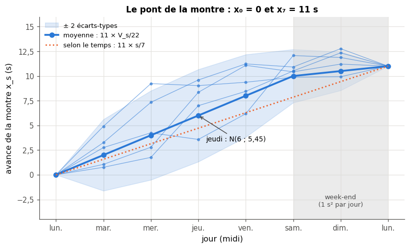

# MB5 · Les maths de la diffusion — fiche de cours

> Les outils mathématiques des modèles de diffusion, travaillés sur des exemples de tous les jours. Les **récurrences linéaires gaussiennes** : la loi sachant le départ, les **produits cumulés**, la **loi stationnaire** d'un processus autorégressif. Le **pont** d'une marche aléatoire et des trajectoires différentes aux mêmes **lois marginales**. Le **rapport signal sur bruit** et trois cibles qui portent la même information. La MSE qui apprend l'**espérance conditionnelle**, le **score** en $x$ et la **formule de Tweedie** (le débruiteur optimal), avec un aperçu de la **dynamique de Langevin**. L'**ELBO d'une chaîne** de latents. La **guidance**, un produit de puissances de densités. Les **équations différentielles** (Euler, point milieu) et le **flow matching** en dimension 1. Le chapitre bonus B5 de workbookIA les applique.

| | |
|---|---|
| **Sections** | §1 à §9 |
| **Temps total estimé** | ≈ 16,6 h : lecture et calculs de la fiche ≈ 2 h 40, exercices ≈ 13 h 15, 20 flashcards ≈ 40 min (parcours essentiel ≈ 13,0 h) |
| **Prérequis** | R4 (somme télescopique) ; R5 (suite géométrique, somme infinie, récurrence affine) ; R6 (ln d'un produit, $\log_{10}$ et décibels, cote, logit, sigmoïde, tanh) ; R7 (dérivée, tangente) ; M02a (primitive, sommes de Riemann à gauche et au point milieu, ordre d'une méthode) ; M02b (loi normale, variance d'une image affine et d'une somme indépendante) ; M02c (la moyenne et la médiane d'une série) ; M04 (Bayes) ; M05a (convexité, Taylor et son reste, log-sum-exp) ; M06 (KL discrète) ; M07 (barycentre) ; M09a (inverse d'une matrice 2 × 2) ; M09b (MSE, MAE) ; M13a (feuille d'un arbre de régression) ; M14 ($(1 + x/n)^n \to e^x$) ; M20 (Euler pour $x' = F(x)$, $1 + u \le e^u$) ; M22 (récurrence avec entrée, facteurs dans $[0, 1]$) ; M25a (images affines et sommes de gaussiennes, produit de densités, modèle linéaire gaussien, KL entre gaussiennes) ; M25b (chaîne, espérance et variance conditionnelles, responsabilités en log, ELBO d'un latent, dériver sous l'espérance) ; M26 (chaîne de Markov, loi stationnaire, propriété de la tour) ; M27 (log-loss, couplages, Wasserstein en dimension 1) ; MB3 (Nadaraya-Watson) |
| **Fichiers du chapitre** | `02_exercices.md` (quiz, papier) · `03_notebook.ipynb` · `04_indices.md` · `05_solutions.md` et `05_solutions.ipynb` · `06_mes_reponses.md` · `flashcards.csv` |
| **mymath** | `gaussian_paths.py` : `linear_gaussian_recursion`, `posterior_mean_mixture`, `euler_ode`, `midpoint_ode` |
| **MML** | §6.5 (*Gaussian Distribution*), lu en M25a, en relecture : §6.5.1 et §6.5.3 avant les §1 et §2, §6.5.2 avant le §7 ; exercice 6.5 conseillé |
| **Références** | R. E. Kalman (§1) ; R. H. Shumway et D. S. Stoffer (§1) ; J. K. Blitzstein et J. Hwang (§4) ; B. Efron (§5) ; E. Süli et D. F. Mayers (§8) |

## Comment utiliser ce chapitre

**Ordre conseillé.**
1. `python tools/start_chapter.py MB5` (sur Colab : `00_setup/COLAB.md` §2) : il copie le notebook, ta feuille de réponses et le squelette `mymath/gaussian_paths.py`.
2. Section par section : lis **crayon en main** et refais chaque calcul (avant les §1 et §7, relis le passage de MML que donne le guide ci-dessous) ; puis fais les exercices de la section, quiz 🧠 d'abord.
3. Les ✏️ et le 🔗 se font sur papier, dans ta copie de `06_mes_reponses.md`, et se vérifient dans la **partie 0** du notebook ; les ∂ se jugent avec la grille de relecture de `05_solutions.md`.

Le chapitre a trois blocs. Les §1 à §3 décrivent des processus qui atténuent et bruitent : récurrences, pont et couplages, rapport signal sur bruit. Les §4 à §6 disent ce qu'on apprend d'une mesure bruitée : l'espérance conditionnelle, le débruiteur optimal, l'ELBO d'une chaîne. Les §7 à §9 fabriquent des données : une loi guidée, des équations différentielles, un transport de loi. Le §5 s'appuie sur les §3 et §4, le §9 sur les §3, §4, §5 et §8 ; le §6 et le §7 se lisent presque seuls.

⚠️ **Erreur classique.** Confondre la **diffusion** des modèles génératifs (un bruit ajouté pas à pas, le sujet de ce chapitre) et la **diffusion** (*broadcasting*) des tableaux de M20 §2, qui étend une forme de tableau à une autre : deux sens sans rapport.

| Section | Quiz 🧠 et rappels 🔁 | Papier et réflexion | Notebook |
|---|---|---|---|
| §1 Récurrences linéaires gaussiennes | Q1, R1, R3 | MB5.1 ✏️, MB5.2 ✏️, MB5.10 ∂, MB5.15 🗣️ | MB5.16 🔨 |
| §2 Pont et couplages | Q2, R1 | MB5.3 ✏️ | MB5.23 🐛 |
| §3 Signal et bruit | Q3, R3 | MB5.4 ✏️, MB5.14 🔗 | |
| §4 La MSE et l'espérance conditionnelle | Q4, R2 | MB5.11 ∂, MB5.14 🔗, MB5.E1 💼 | |
| §5 Le débruiteur optimal | Q5 | MB5.5 ✏️, MB5.12 ∂, MB5.14 🔗 | MB5.17 🔨, MB5.20 🔮, MB5.23 🐛 |
| §6 L'ELBO d'une chaîne | Q6, R2 | MB5.6 ✏️, MB5.13 ∂ | |
| §7 Guider | Q7 | MB5.7 ✏️ | MB5.22 🎨 |
| §8 Équations différentielles | Q8, R3 | MB5.8 ✏️ | MB5.18 🔨, MB5.19 📦, MB5.21 🔬, MB5.23 🐛, MB5.24 🛠️, MB5.25 🏆 |
| §9 Le flow matching en dimension 1 | Q8 | MB5.9 ✏️ | MB5.21 🔬, MB5.25 🏆 |

Parcours essentiel : tout sauf MB5.3, MB5.12, MB5.13, MB5.E1, MB5.19, MB5.22, MB5.24 et MB5.25 (les énoncés de Tweedie et de l'ELBO d'une chaîne en font partie ; leurs démonstrations, ∂ MB5.12 et ∂ MB5.13, non).

## Guide de lecture de MML

MML §6.5 (*Gaussian Distribution*) a été lu en entier en M25a. MB5 n'en demande qu'une **relecture**, en deux fois.

- **Avant les §1 et §2** : **§6.5.3** (*Sums and Linear Transformations*) : (6.78), puis l'Exemple 6.7 et (6.79), la loi de $ax + by$ pour des gaussiennes indépendantes, qui est un pas de la récurrence du §1 ; puis (6.86) à (6.88), l'image linéaire d'un vecteur gaussien. Le Théorème 6.12 (les moments d'un mélange) se relit vite : M25b §2 l'a démontré en général. Puis **§6.5.1** (*Marginals and Conditionals of Gaussians are Gaussians*), (6.64) à (6.68) : le conditionnement qui donne le pont du §2. La remarque sur le filtre de Kalman parle de son pas de mise à jour, un conditionnement (M25a §5) ; le §1 en donne l'autre pas, la prédiction.
- **Avant le §7** : **§6.5.2** (*Product of Gaussian Densities*), (6.74) à (6.77) : le §7 élève deux densités à des puissances au lieu de les multiplier, et la précision obtenue peut devenir négative.

MML n'a de processus autorégressif que dans son exercice 6.5, et ni équations différentielles, ni diffusion : pour le reste, la fiche est le cours. Exercice du livre conseillé : 6.5 (un modèle de série temporelle), la question a, puis b.1, qui est le pas de prédiction du §1 en dimension $d$ (M25a le proposait pour aller plus loin).

📐 **Notations.**
- **Conventions.** $\mathcal{N}(\mu, v)$ a pour second paramètre une **variance**, jamais un écart-type ; $\mathcal{N}(x \mid \mu, v)$ est la valeur de sa densité en $x$. Un bruit $\varepsilon$ (§1, §2, §5, §9) ou $n$ (§3, §5) suit $\mathcal{N}(0, 1)$ et est indépendant de tout le reste. Un champ s'écrit $f(t, x)$, le temps d'abord, comme dans SciPy ; le champ moyen du §9 garde l'écriture $v(x, s)$ de workbookIA B5, et se passe à `euler_ode` sous la forme `lambda s, x: v(x, s)`. Logarithmes népériens, KL en nats. La dimension est 1 partout, sauf dans l'énoncé de Tweedie en dimension $d$ (§5). $\mathbb{E}$ et $\mathbb{V}$ sont l'espérance et la variance ; $z_{1:T}$ abrège $(z_1, \ldots, z_T)$. MML écrit $\log$ pour $\ln$.
- **Lettres à double sens.** $a$ et $b$ sont les coefficients d'une récurrence (§1, §2) et les gains d'une mesure $y = ax + bn$ (§3, §5) ; au §9, $a = 1 - s$ et $b = s$. $t$ est un instant entier (§1, §2) ou le temps continu (§8) ; $T$ le dernier instant (§1, §2) ou le dernier latent (§6). $s$ est un instant passé (§1) ou intermédiaire (§2), le score (§5), le temps du flow matching, de $s = 0$ (la donnée) à $s = 1$ (le bruit) (§9). $h$ est un risque (§1), le pas de Langevin (§5) et celui d'Euler (§8, §9). $v$ est une variance ($v_t$ au §1, $v_k$ au §5), le champ moyen $v(x, s)$ au §9 ; $V_s$ est une variance cumulée (§2), à ne pas confondre avec $\mathbb{V}$. $m$ est une moyenne ($m_t$ au §1, $m(X)$ au §4, celle des données au §9). $c$ est une condition ($p_c$, §7), la température de la pièce (§8), un coefficient avec $d$ (§3). $r$ est un seuil de SNR (§3), une responsabilité $r_k$ (§5), un taux (§8). $x$ est un état (§1, §2), un signal (§3, §5), l'observation (§6), une position (§7), la solution d'une équation (§8), la donnée $x_0$ (§9) ; $y$ une mesure (§3, §5), $Y$ une cible (§4), $y_c$ et $y_u$ deux points (§7). $z_t$ est un latent (§6), $z = x(1)$ un point de départ (§9) ; $U$ et $Z$ deux tirages (§2). $u$ est la vitesse $\varepsilon - x_0$ (§9), et l'indice $u$ (*unconditional*) de $p_u$ (§7). $\sigma$ est la part de bruit frais au §2, un écart-type ailleurs, $\sigma(s)$ celui de $x_s$ au §9, et $\sigma(\cdot)$ la sigmoïde de R6 au §8 ; $\omega$ l'écart-type visé au §2. $\lambda(w)$ est une précision (§7), $w$ le poids de la guidance (§7). $\pi_k$ est un poids de mélange, $\pi$ le nombre. $d$ est la dimension (§5, §6) ou un coefficient (§3). $g$ est une prédiction (§4) ou une vitesse $g(t)$ (§8) ; $u$ sert aussi de variable d'intégration (§8). $S$ est une survie (§1), et le score d'un classifieur dans le ⚠️ du §5 ; $H$ un risque cumulé (§1) ; $N$ un nombre de pas et $L$ une constante de Lipschitz (§8 ; M20 §6 notait $L$ le nombre de pas et $K$ la borne de la jacobienne). $\rho_t$ est une probabilité d'effacement (§6), $\gamma$ la part de variance du signal (§3), $\tau$ l'écart-type des données (§9), $\kappa_0$ et $\kappa_1$ deux constantes (§8). Au §1, $n$ est aussi le nombre d'étapes de la course, $g$ la fonction d'une démonstration, $u$ un petit nombre ($1 + u \le e^u$), $\lambda_2$ et $\boldsymbol{\pi}$ (en gras) la deuxième valeur propre et la loi stationnaire de M26. Au §2, A, B, C (en romain) sont trois façons de simuler, et $\mathbf{A}$ (en gras) la matrice du modèle linéaire gaussien de M25a. Au §4, $x_i$ et $y_i$ sont le quartier et le prix de l'appartement $i$, et $c$ une prédiction constante (figure). Au §5, $f$ est une densité non normalisée et $Z$ sa constante. Au §8, $T$ est une durée, $C$ une constante, $I$ un intervalle de temps ($\mathbf{I}$, en gras, est l'identité du §5). Le contexte tranche.

Vocabulaire anglais de ce chapitre : *linear Gaussian recursion*, *autoregressive process*, *Kalman filter*, *prediction step*, *cumulative product*, *survival*, *hazard*, *cumulative hazard*, *stationary distribution*, *continuous-state Markov chain*, *random walk*, *bridge*, *cumulative variance*, *marginal distribution*, *joint distribution*, *coupling*, *common random numbers*, *signal-to-noise ratio (SNR)*, *signal fraction of the variance*, *odds*, *logit*, *decibel*, *conditional expectation*, *best predictor*, *bimodal*, *conditional median*, *score*, *Stein score*, *Tweedie's formula*, *selection bias*, *optimal denoiser*, *responsibility*, *Langevin dynamics*, *latent chain*, *forward process*, *reverse model*, *telescoping sum*, *affine combination*, *interpolation*, *extrapolation*, *classifier-free guidance*, *product of powers*, *guided distribution*, *ordinary differential equation (ODE)*, *initial condition*, *trajectory*, *logistic growth*, *Lipschitz*, *Euler's method*, *local error*, *curvature*, *global error*, *first-order method*, *order of a method*, *midpoint method*, *straight path*, *mean velocity field*, *flow matching*.

## Objectifs d'apprentissage

À la fin du chapitre, tu sais :
- **calculer** la loi de $x_t$ sachant le départ pour une récurrence linéaire gaussienne à coefficients quelconques, et sachant un instant passé pour un coefficient constant ; **encadrer** un produit cumulé par deux exponentielles ; **trouver** la loi stationnaire d'un processus autorégressif d'ordre 1 (∂ MB5.10) ;
- **calculer** la loi d'un instant sachant deux instants qui l'encadrent (le pont d'une marche aléatoire), et **construire** des trajectoires différentes aux mêmes lois marginales ;
- **passer** du rapport signal sur bruit à la part de variance du signal (cote, logit, décibels), et d'une estimation du bruit à une estimation du signal, avec l'erreur qui l'accompagne ;
- **démontrer** que la MSE est minimale pour l'espérance conditionnelle (∂ MB5.11), et en **lire** les conséquences sur une cible à deux modes ;
- **définir** le score en $x$, **démontrer** la formule de Tweedie (∂ MB5.12), **calculer** le débruiteur optimal d'un signal gaussien ou d'un mélange, et **dire** comment la dynamique de Langevin tire des points d'une densité à partir de son score ;
- **démontrer** la décomposition de l'ELBO d'une chaîne de latents (∂ MB5.13) et la **calculer** sur une petite chaîne discrète ;
- **écrire** une combinaison affine de scores comme le score d'un produit de puissances de densités, et **calculer** la loi guidée de deux gaussiennes avec sa condition d'existence ;
- **suivre** une équation différentielle par Euler et par le point milieu, dans les deux sens du temps, et **relier** l'erreur au pas et à la courbure ;
- **calculer** le champ moyen d'un chemin droit vers des données gaussiennes de dimension 1, et le **suivre** pour transporter le bruit sur la loi des données.

## L'essentiel en 9 lignes

1. **Récurrence** $x_t = a_tx_{t-1} + b_t\varepsilon_t$ : $m_t = a_tm_{t-1}$, $v_t = a_t^2v_{t-1} + b_t^2$ ; sachant $x_0$, moyenne $(a_1\cdots a_t)x_0$, variance $\sum_kb_k^2(a_{k+1}\cdots a_t)^2$. **AR(1)** : pour $\lvert a\rvert < 1$, loi stationnaire $\mathcal{N}\big(0, \frac{b^2}{1 - a^2}\big)$, écarts en $\lvert a\rvert^t$ et $a^{2t}$ ; aucune pour $\lvert a\rvert \ge 1$. **Survie** : $e^{-H - \sum h_k^2} \le \prod(1 - h_k) \le e^{-H}$ pour des $h_k \le \frac12$.
2. **Pont** d'une marche aléatoire : $x_s \mid x_0, x_T \sim \mathcal{N}\big(x_0 + \frac{V_s}{V_T}(x_T - x_0), \frac{V_s(V_T - V_s)}{V_T}\big)$. **Couplages** : $\sqrt{\omega^2 - \sigma^2}\thinspace U + \sigma Z \sim \mathcal{N}(0, \omega^2)$ ; les marges ne fixent pas les corrélations.
3. **SNR** $= \frac{a^2}{b^2} = \frac{\gamma}{1 - \gamma}$, $\ln\operatorname{SNR} = \operatorname{logit}\gamma$, $10\log_{10}\operatorname{SNR}$ dB ; $\hat x = \frac{y - b\hat n}{a}$, erreur sur $x$ = erreur sur $n$ divisée par $\sqrt{\operatorname{SNR}}$, au signe près.
4. **MSE** : $\mathbb{E}[(Y - g(X))^2] = \mathbb{E}[\mathbb{V}(Y \mid X)] + \mathbb{E}[(\mathbb{E}[Y \mid X] - g(X))^2]$ (∂ MB5.11) : la MSE apprend $\mathbb{E}[Y \mid X]$, entre les modes ; la MAE une médiane.
5. **Score** $(\ln p)'(x)$ ; **Tweedie** : $\mathbb{E}[n \mid y] = -b\thinspace s_Y(y)$, $\mathbb{E}[x \mid y] = \frac{y + b^2s_Y(y)}{a}$ (∂ MB5.12) ; mélange : responsabilités et moyennes a posteriori ; un nuage de points est recopié quand $b \to 0$. **Langevin** : $x_{k+1} = x_k + \frac h2(\ln p)'(x_k) + \sqrt h\thinspace\varepsilon_k$.
6. **ELBO d'une chaîne** $=$ reconstruction $-$ KL finale $- \sum_{t \ge 2}\mathbb{E} _q\big[\mathrm{KL}(q(z  _{t-1} \mid z_t, x) \thinspace\Vert\thinspace p(z _{t-1} \mid z_t))\big]$ (∂ MB5.13) ; de même variance $\sigma^2$, une KL gaussienne vaut $\frac{(\mu_q - \mu_p)^2}{2\sigma^2}$.
7. **Guider** : $(1 + w)\nabla\ln p_c - w\nabla\ln p_u = \nabla\ln(p_c^{1+w}p_u^{-w})$ ; deux gaussiennes : précision $\frac{1 + w}{\sigma_c^2} - \frac{w}{\sigma_u^2}$, positive pour tout $w \ge 0$ si $\sigma_c \le \sigma_u$, sinon jusqu'à $w^\star = \frac{\sigma_u^2}{\sigma_c^2 - \sigma_u^2}$.
8. **Euler** $x_{k+1} = x_k + hf(t_k, x_k)$, $h < 0$ pour remonter ; erreur d'un pas $\frac12h^2x''(\xi)$, ordre 1 ; **point milieu** : deux évaluations par pas, exact pour une vitesse affine en $t$, ordre 2.
9. **Flow matching** : $x_s = (1 - s)x_0 + s\varepsilon$, $v(x, s) = \mathbb{E}[\varepsilon - x_0 \mid x_s = x] = \frac{x - \mathbb{E}[x_0 \mid x_s = x]}{s}$ ; données $\mathcal{N}(m, \tau^2)$ : $x(s) = (1 - s)m + \sigma(s)z$, $\sigma(s)^2 = (1 - s)^2\tau^2 + s^2$ ; un seul pas d'Euler depuis $s = 1$ rend $m$.

## §1 · Récurrences linéaires gaussiennes : la loi sachant le départ, les produits cumulés et la loi stationnaire

### Une règle qui atténue et qui bruite

Un voilier navigue sous pilote automatique. Notons $x_t$ l'écart, en degrés, entre son cap et le cap demandé, minute après minute. Chaque minute, le pilote corrige une partie de l'écart : il en reste $a_tx_{t-1}$ ; la houle ajoute un écart nouveau, $b_t\varepsilon_t$.

> **Définition.** Une **récurrence linéaire gaussienne** (*linear Gaussian recursion*) est
> $$x_t = a_tx_{t-1} + b_t\varepsilon_t, \qquad t = 1, \ldots, T,$$
> avec des coefficients réels $a_t$ et $b_t$, des bruits $\varepsilon_1, \ldots, \varepsilon_T$ indépendants de loi $\mathcal{N}(0, 1)$, indépendants du départ $x_0 \sim \mathcal{N}(m_0, v_0)$ ($v_0 = 0$ : un départ connu). Avec des coefficients constants, $a_t = a$ et $b_t = b$, c'est un **processus autorégressif d'ordre 1** (*autoregressive process*, AR(1)).

### Deux moments qui suivent le pas

En déroulant la récurrence, $x_t$ est une image affine du vecteur gaussien $(x_0, \varepsilon_1, \ldots, \varepsilon_t)$, donc une variable gaussienne (M25a §2). Comme $x_{t-1}$ ne dépend que de $x_0, \varepsilon_1, \ldots, \varepsilon_{t-1}$, il est indépendant de $\varepsilon_t$, et la variance d'une image affine et d'une somme indépendante (M02b §4 et §6, MML (6.79)) donne, pas à pas, la moyenne $m_t$ et la variance $v_t$ de $x_t$ :
$$m_t = a_tm_{t-1}, \qquad v_t = a_t^2v_{t-1} + b_t^2 .$$
C'est le **pas de prédiction** (*prediction step*) d'un **filtre de Kalman** (*Kalman filter*) en dimension 1, que M25a nommait : la prévision avant la mesure suivante.

**Exemple.** Le voilier part d'un écart connu $x_0 = 8$, puis traverse trois minutes de mer hachée, avec $a = (0{,}55 ;\ 0{,}45 ;\ 0{,}62)$ et $b^2 = (3 ;\ 1{,}5 ;\ 2)$. Les moyennes valent $8$, $4{,}4$, $1{,}98$, $1{,}2276$ ; les variances $0$, $3$, $0{,}2025 \times 3 + 1{,}5 = 2{,}1075$, puis $0{,}3844 \times 2{,}1075 + 2 \approx 2{,}810$. Après trois minutes, $x_3 \sim \mathcal{N}(1{,}23 ;\ 2{,}81)$.

> **Théorème** (∂ MB5.10). Pour des coefficients quelconques, sachant $x_0$,
> $$x_t \sim \mathcal{N}\Big((a_1\cdots a_t)\thinspace x_0,\ \sum_{k=1}^t b_k^2\thinspace(a_{k+1}\cdots a_t)^2\Big)$$
> (un produit vide vaut 1).

Chaque bruit est porté jusqu'à l'instant $t$ par les coefficients des pas suivants, au carré. Les outils : le déroulé de M22 §5 (une récurrence affine à facteurs variables) et la variance d'une somme de variables indépendantes ; le ∂ MB5.10 rédige la preuve. Dans l'exemple, les trois bruits apportent $3 \times (0{,}45 \times 0{,}62)^2 \approx 0{,}234$, $1{,}5 \times 0{,}62^2 \approx 0{,}577$ et $2$ : on retrouve $2{,}810$, et le bruit le plus récent pèse le plus, les autres ayant été atténués.

### Les produits cumulés

La moyenne est le départ multiplié par le **produit cumulé** (*cumulative product*) $a_1\cdots a_t$ : ce qui reste du départ. La même forme mesure une **survie** (*survival*). Un voilier dispute une course en quatre étapes ; à l'étape $k$, il abandonne avec la probabilité $h_k$ (le **risque** de l'étape, *hazard*), s'il a fini les précédentes. Il termine la course avec la probabilité
$$S = \prod_{k=1}^4(1 - h_k) .$$
Avec $h = (0{,}09 ;\ 0{,}03 ;\ 0{,}11 ;\ 0{,}13)$ : $S = 0{,}91 \times 0{,}97 \times 0{,}89 \times 0{,}87 \approx 0{,}6835$.

**Rappels** (R6 §3, M22 §5 ; M05a §1, M20 §6). $\ln\prod_k(1 - h_k) = \sum_k\ln(1 - h_k)$ ; et $1 - h \le e^{-h}$, car l'exponentielle, convexe, est au-dessus de sa tangente en 0 (M20 §6 l'écrivait $1 + u \le e^u$).

> **Propriété.** Pour $0 \le h \le \frac12$, $\ln(1 - h) \ge -h - h^2$ (M20 §6 se contentait de $\ln(1 - u) \ge -2u$). Donc, si chaque $h_k \le \frac12$, avec le **risque cumulé** (*cumulative hazard*) $H = \sum_kh_k$,
> $$e^{-H - \sum_kh_k^2} \ \le\ \prod_k(1 - h_k) \ \le\ e^{-H} .$$

*Démonstration.* $g(h) = \ln(1 - h) + h + h^2$ vaut 0 en 0, et $g'(h) = -\frac{1}{1 - h} + 1 + 2h = \frac{h(1 - 2h)}{1 - h} \ge 0$ sur $[0, \frac12]$ : $g$ croît, donc $g \ge 0$. On somme sur $k$, puis on prend l'exponentielle (croissante) ; l'autre côté vient de $1 - h_k \le e^{-h_k}$. $\square$

Pour la course : $H = 0{,}36$ et $\sum h_k^2 = 0{,}038$, d'où $e^{-0{,}398} \approx 0{,}6717 \le 0{,}6835 \le e^{-0{,}36} \approx 0{,}6977$. Les deux bornes ne diffèrent que d'un facteur $e^{\sum_kh_k^2}$, ici $e^{0{,}038} \approx 1{,}039$. Le **risque constant équivalent** $\bar h$, qui donnerait la même survie sur le même nombre $n$ d'étapes, vérifie $(1 - \bar h)^n = S$ : $1 - \bar h$ est la moyenne géométrique des $1 - h_k$ (M22 §5), au plus leur moyenne (Jensen, $\ln$ étant concave), donc $\bar h$ est au moins la moyenne des risques.

### La loi stationnaire d'un processus autorégressif

Par mer régulière, le pilote garde chaque minute $a = 0{,}7$ de l'écart, et la houle ajoute un écart d'écart-type $b = 1$ degré. La variance suit $v_t = 0{,}49\thinspace v_{t-1} + 1$ : la récurrence affine de R5 §5, de point fixe $\frac{1}{0{,}51}$.

> **Théorème** (∂ MB5.10). Soit $x_t = ax_{t-1} + b\varepsilon_t$, avec $b \ne 0$.
> 1. **Sachant un instant passé** $x_s$, pour $t > s$ : $x_t \sim \mathcal{N}\Big(a^{t-s}x_s,\ b^2\thinspace\dfrac{1 - a^{2(t-s)}}{1 - a^2}\Big)$ si $a^2 \ne 1$, et de variance $(t - s)\thinspace b^2$ si $a^2 = 1$.
> 2. Si $\lvert a\rvert < 1$, la loi $\mathcal{N}\big(0, v_\infty\big)$, $v_\infty = \frac{b^2}{1 - a^2}$, est **stationnaire** (*stationary distribution*) : si $x_0$ la suit, chaque $x_t$ la suit. Depuis tout départ $\mathcal{N}(m_0, v_0)$, $m_t = a^tm_0$ et $v_t - v_\infty = a^{2t}(v_0 - v_\infty)$ : la loi de $x_t$ tend vers la loi stationnaire, et le processus **oublie son départ**.
> 3. Si $\lvert a\rvert \ge 1$, aucune loi de variance finie n'est stationnaire : $v_t \ge v_{t-1} + b^2$ croît sans borne (pour $a = 1$, $v_t = v_0 + tb^2$ : la **marche aléatoire**, *random walk*).

Les outils : la propriété de Markov (M26 §1), la somme géométrique (R5 §4) et le point fixe d'une récurrence affine (R5 §5) ; le ∂ MB5.10 les met en œuvre. Cas particulier : si $b^2 = 1 - a^2$, la variance stationnaire vaut 1.

Pour le voilier : $v_\infty = \frac{1}{0{,}51} \approx 1{,}96$, un écart-type de $1{,}40$ degré. L'écart de moyenne à la loi stationnaire est multiplié par $0{,}7$ chaque minute, l'écart de variance par $0{,}49$ (figure, à gauche et au milieu) : en échelle logarithmique, le second s'éteint deux fois plus vite. Cas limites : pour $a = 0$, $x_t = b\varepsilon_t$ suit la loi stationnaire $\mathcal{N}(0, b^2)$ dès le premier pas ; pour $b = 0$ et $\lvert a\rvert < 1$, $x_t = a^tx_0 \to 0$ (la loi stationnaire est dégénérée, M25a §1).

C'est une **chaîne de Markov à états continus** (*continuous-state Markov chain*) : demain ne dépend que d'aujourd'hui (M26 §1), sa loi stationnaire joue le rôle de $\boldsymbol{\pi}$ (M26 §2), et $\lvert a\rvert$ celui de $\lvert\lambda_2\rvert$, la vitesse de l'oubli ; la condition $\lvert a\rvert < 1$ est celle de M22 §3 en dimension 1 ($a^t \to 0$).

💻 **Aujourd'hui en pratique** — `linear_gaussian_recursion` (🔨 MB5.16) propage les deux moments pas à pas, sans jamais former un produit de $t$ facteurs à part : c'est la récurrence $m_t$, $v_t$ ci-dessus. Un filtre de Kalman alterne ce pas de prédiction et le conditionnement de M25a §5 à chaque mesure ; les bibliothèques de séries temporelles estiment $a$ et $b$ sur des données (Shumway et Stoffer, ch. 3).

⚠️ **Erreur classique.** Oublier l'incertitude du départ ($v_0 > 0$), qui se transmet aussi : ce sont les variances qui se propagent, $v_t = a_t^2v_{t-1} + b_t^2$ ; croire qu'une marche aléatoire ($a = 1$) a une loi stationnaire.

🔗 **Dans workbookIA** — le chapitre B5 bruite des images pas à pas par une récurrence de ce type, dont les coefficients sont choisis pour que le bruit l'emporte à la fin, et se sert de produits cumulés de coefficients.

## §2 · Conditionner sur deux instants, changer de couplage : le pont d'une marche aléatoire, et des trajectoires différentes aux mêmes lois marginales

### Le pont d'une marche aléatoire

Une montre mécanique avance ou retarde chaque jour d'une quantité aléatoire. Mise à l'heure un lundi midi ($x_0 = 0$), elle est contrôlée le lundi suivant : $x_7 = 11$ s. Portée en semaine, elle dérive d'une quantité de variance 4 s² par jour ; du samedi midi au lundi midi, dans un tiroir, de variance 1 s² par jour. Où en était-elle le jeudi midi ?

C'est une marche aléatoire, $x_t = x_{t-1} + b_t\varepsilon_t$, de **variances cumulées** (*cumulative variances*) $V_t = b_1^2 + \cdots + b_t^2$ : ici $4, 8, 12, 16, 20, 21, 22$ pour les jours 1 à 7.

> **Propriété** (le **pont**, *bridge*). Pour une marche aléatoire et $0 < s < T$, sachant $x_0$ et $x_T$,
> $$x_s \sim \mathcal{N}\Big(x_0 + \frac{V_s}{V_T}(x_T - x_0),\ \frac{V_s(V_T - V_s)}{V_T}\Big).$$

*Démonstration.* Sachant $x_0$, l'instant $x_s \sim \mathcal{N}(x_0, V_s)$ est caché, et $x_T = x_s + \delta$, où $\delta = \sum_{k > s}b_k\varepsilon_k \sim \mathcal{N}(0, V_T - V_s)$ est indépendant de $x_s$ : c'est le modèle linéaire gaussien de M25a §5, avec $\mathbf{A} = 1$. La loi de $x_s$ sachant $x_T$ a pour moyenne $x_0 + \frac{V_s}{V_s + (V_T - V_s)}(x_T - x_0)$ et pour variance $V_s - \frac{V_s^2}{V_T} = \frac{V_s(V_T - V_s)}{V_T}$. $\square$

La moyenne parcourt le segment de $x_0$ à $x_T$ au rythme des **variances cumulées**, pas du temps. La variance est nulle aux deux bouts et maximale quand $V_s = \frac{V_T}{2}$ : au milieu du temps si les pas ont des variances égales ($V_s = sb^2$, et la variance $\frac{s(T - s)}{T}b^2$), ailleurs sinon. Pour la montre : le jeudi ($s = 3$), $x_3 \sim \mathcal{N}\big(11 \times \frac{12}{22} ;\ \frac{12 \times 10}{22}\big) = \mathcal{N}(6 ;\ 5{,}45)$, un écart-type de $2{,}34$ s. Avec sept jours de même variance, la moyenne du jeudi serait $11 \times \frac37 \approx 4{,}71$ : interpoler selon le temps se tromperait ici.

### Mêmes lois à chaque instant, d'autres trajectoires

Une autre montre, portée tous les jours (variance 4 s² par jour), est mise à l'heure au jour 0 : $x_t \sim \mathcal{N}(0, 4t)$. Trois façons de simuler des scénarios de dérive qui ont **cette loi chaque jour** :
- **A** : la marche aléatoire, un bruit frais ajouté chaque jour, $x_t = x_{t-1} + 2\varepsilon_t$ ;
- **B** : un seul tirage $U \sim \mathcal{N}(0, 1)$ pour tous les jours, $x_t = 2\sqrt t\thinspace U$ : une fois $U$ tiré, le scénario est une courbe fixée, une **trajectoire déterministe** ;
- **C** : un tirage frais chaque jour, $x_t = 2\sqrt t\thinspace Z_t$, avec des $Z_t$ indépendants.

Les trois ont la même **loi marginale** (*marginal distribution*) $\mathcal{N}(0, 4t)$ chaque jour : un relevé pris un seul jour ne les distingue pas. Leurs **lois jointes** (*joint distributions*) diffèrent. Pour A et $0 < s < t$, $x_t = x_s + (\text{des bruits frais})$, donc $\operatorname{Cov}(x_s, x_t) = \mathbb{V}(x_s)$ et la corrélation vaut $\sqrt{s/t}$ ; pour B, elle vaut 1 ; pour C, 0. Chaque façon de simuler est un **couplage** (*coupling*) des lois de chaque jour, au sens de M27 §7 : une loi jointe qui a ces lois pour marges.

> **Lemme** (garder une marge en mêlant deux tirages). Si $U$ et $Z$ sont indépendants de loi $\mathcal{N}(0, 1)$ et $0 \le \sigma \le \omega$, alors $\sqrt{\omega^2 - \sigma^2}\thinspace U + \sigma Z$ suit $\mathcal{N}(0, \omega^2)$.

C'est une somme de deux gaussiennes indépendantes (M25a §2), de variance $(\omega^2 - \sigma^2) + \sigma^2 = \omega^2$. Avec $\sigma = 0$, on réutilise le seul tirage $U$ (B) ; avec $\sigma = \omega$, on prend un bruit frais (C) ; entre les deux, on règle la part de hasard nouveau sans toucher à la marge. Par exemple, $x_t = \sqrt{2t}\thinspace U + \sqrt{2t}\thinspace Z_t$ (la moitié de la variance, fraîche chaque jour) a encore la loi $\mathcal{N}(0, 4t)$ chaque jour, avec des corrélations entre celles de B et celles de C.

**La corrélation entre deux instants n'est pas fixée par les lois marginales.** En revanche, ce qui ne regarde qu'un instant à la fois ne dépend que d'elles.

> **Énoncé.** Une loss de la forme $\mathbb{E}_t\big[\mathbb{E}[\ell(x_t, t)]\big]$, qui ne fait intervenir qu'un instant $t$ à la fois, prend la même valeur pour tous les processus qui ont les mêmes lois marginales.

💻 **Aujourd'hui en pratique** — choisir un couplage est un outil de simulation : réutiliser les mêmes tirages pour comparer deux réglages (les **nombres aléatoires communs**, *common random numbers*) rend les deux simulations corrélées, et leur différence en général moins dispersée.

⚠️ **Erreur classique.** Interpoler le pont selon le temps $\frac sT$ quand les pas n'ont pas la même variance ; croire sa variance toujours maximale au milieu du temps ; croire que des lois marginales égales donnent des trajectoires semblables ; prendre $\sigma > \omega$ dans le lemme (la racine d'un nombre négatif).

🔗 **Dans workbookIA** — le chapitre B5 remplace le tirage pas à pas de sa chaîne de débruitage par des trajectoires déterministes qui ont les mêmes lois à chaque pas de temps (DDIM) : comme sa loss ne regarde qu'un pas à la fois, le même réseau entraîné sert aux deux.

## §3 · Signal et bruit : rapport signal sur bruit, cotes et décibels, et trois cibles qui portent la même information

### Le rapport signal sur bruit

Un radiotélescope mesure $y = ax + bn$ : $x$ est le signal d'une source, $n$ le bruit du récepteur, indépendants, de moyenne nulle et de variance 1 ; $a > 0$ et $b > 0$ sont leurs gains.

> **Définitions.** Le **rapport signal sur bruit** (*signal-to-noise ratio*, SNR) de la mesure est le rapport des variances de ses deux parts, $\operatorname{SNR} = \frac{a^2}{b^2}$. La **part de variance du signal** (*signal fraction of the variance*) est $\gamma = \frac{a^2}{a^2 + b^2}$. Alors
> $$\operatorname{SNR} = \frac{\gamma}{1 - \gamma}, \qquad \ln\operatorname{SNR} = \operatorname{logit}\gamma, \qquad \gamma = \frac{\operatorname{SNR}}{1 + \operatorname{SNR}} :$$
> le SNR est la **cote** (*odds*) de $\gamma$, et son logarithme le **logit** de $\gamma$ (R6 §7). En **décibels** (R6 §6), il vaut $10\log_{10}\operatorname{SNR}$ dB. Un seuil $r$ de SNR correspond à la part $\gamma = \frac{r}{1 + r}$.

**Exemple.** Le récepteur a $b = 2$. Une source brillante, $a = 5$ : $\operatorname{SNR} = 6{,}25$, $\gamma = \frac{25}{29} \approx 0{,}862$, $\ln\operatorname{SNR} \approx 1{,}833$, soit $7{,}96$ dB. Une source faible, $a = 0{,}5$ : $\operatorname{SNR} = 0{,}0625$, $\gamma = \frac{1}{17} \approx 0{,}059$, $\ln\operatorname{SNR} \approx -2{,}773$, soit $-12{,}04$ dB.

L'échelle logarithmique étire les deux bouts : quand $\gamma$ passe de $0{,}5$ à $0{,}99$, le SNR passe de 1 à 99 ; diviser la variance du bruit par 2 fait gagner $10\log_{10}2 \approx 3$ dB, quel que soit le point de départ.

**Ce qu'une échelle ne change pas.** Multiplier $y$ par une constante non nulle multiplie $a$ et $b$ par elle : le SNR et $\gamma$ ne bougent pas. En particulier, diviser $y$ par $\sqrt{a^2 + b^2}$ donne une mesure de variance 1, de même SNR.

### Trois cibles qui portent la même information

Connaissant $y$, $a$ et $b$, connaître $x$ revient à connaître $n$ : $x = \frac{y - bn}{a}$ et $n = \frac{y - ax}{b}$. Une estimation $\hat n$ du bruit donne donc une estimation du signal, $\hat x = \frac{y - b\hat n}{a}$, et réciproquement.

> **Propriété.** $\hat x - x = -\frac ba(\hat n - n)$ : en valeur absolue, l'erreur sur $x$ est l'erreur sur $n$ divisée par $\sqrt{\operatorname{SNR}}$. En moyenne quadratique, $\mathbb{E}[(\hat x - x)^2] = \frac{1}{\operatorname{SNR}}\thinspace\mathbb{E}[(\hat n - n)^2]$ : une MSE sur $x$ est une MSE sur $n$ **pondérée** par $\frac{1}{\operatorname{SNR}}$.

Quand le SNR est petit (une source faible), retrouver le signal à partir d'une estimation du bruit amplifie l'erreur ; quand il est grand, cela la réduit.

Plus généralement, toute combinaison $cx + dn$ dont le couple $(c, d)$ n'est pas proportionnel à $(a, b)$ porte la même information : avec $y$, elle donne $x$ et $n$ par un système $2 \times 2$ de déterminant $ad - bc \ne 0$ (M09a §7). Prédire $x$, $n$ ou une telle combinaison, c'est le même problème, dont les erreurs se pèsent autrement.

💻 **Aujourd'hui en pratique** — en radio et en audio, le SNR se donne en décibels, `10 * np.log10(snr)` pour un rapport de variances (de puissances) ; `20 * np.log10(...)` s'applique à un rapport d'écarts-types (d'amplitudes).

⚠️ **Erreur classique.** Confondre la cote $\frac{\gamma}{1 - \gamma}$ et la part $\gamma$ : le SNR est la cote, le rapport des **variances** $\frac{a^2}{b^2}$, qui se met en décibels par $10\log_{10}$ ; et c'est sa racine, $\frac ab$, qui relie les erreurs sur $x$ et sur $n$.

🔗 **Dans workbookIA** — le chapitre B5 suit le SNR de ses images bruitées le long de la chaîne de bruitage, souvent en $\ln\operatorname{SNR}$, et entraîne un réseau à prédire le bruit : ce paragraphe dit comment passer d'une cible à l'autre.

## §4 · La MSE apprend l'espérance conditionnelle

### Prédire un prix

Douze appartements de trois pièces ont été vendus dans trois quartiers (prix en milliers d'euros).

| quartier | prix | moyenne |
|---|---|---|
| Gare | 180, 200, 205, 215 | 200 |
| Centre | 290, 310, 330 | 310 |
| Port | 240, 250, 260, 270, 280 | 260 |

Quelle fonction $g$ du quartier rend la plus petite MSE, $\frac{1}{12}\sum_i(y_i - g(x_i))^2$ ? Dans chaque quartier, la meilleure constante est la moyenne (rappel de M02c §1), la prédiction d'une feuille d'un arbre de régression (M13a §7). La MSE vaut alors $\frac{650 + 800 + 1\thinspace000}{12} \approx 204{,}2$ (une RMSE de $14{,}3$), contre $\approx 1\thinspace972{,}9$ pour la meilleure constante, $252{,}5$ (une RMSE de $44{,}4$). La différence, $1\thinspace768{,}75$, est la variance entre les quartiers (M25b §2, M13a §7).

### La meilleure prédiction quadratique

> **Théorème** (∂ MB5.11). Soit $X$ et $Y$ deux variables, $Y$ de variance finie, et $m(X) = \mathbb{E}[Y \mid X]$. Pour toute fonction $g$,
> $$\mathbb{E}\big[(Y - g(X))^2\big] = \mathbb{E}\big[\mathbb{V}(Y \mid X)\big] + \mathbb{E}\big[(m(X) - g(X))^2\big].$$
> La MSE est donc minimale pour $g(X) = \mathbb{E}[Y \mid X]$ (et seulement pour elle, sauf sur un ensemble de valeurs de $X$ de probabilité nulle) : c'est la **meilleure prédiction quadratique** (*best predictor*). Son minimum, $\mathbb{E}[\mathbb{V}(Y \mid X)]$, est la variance que $X$ n'explique pas.

Les outils : l'identité de M02c §1 et la propriété de la tour (M26 §3) ; le ∂ MB5.11 rédige la preuve pour une variable $X$ discrète.

Sur un échantillon, on prend la loi empirique (chaque appartement de poids $\frac{1}{12}$) : $\mathbb{E}[Y \mid X = \text{quartier}]$ est la moyenne du quartier, et le théorème redonne l'exemple, $1\thinspace972{,}9 \approx 204{,}2 + 1\thinspace768{,}75$. Un modèle entraîné à la MSE, assez souple et sur assez de données, approche $\mathbb{E}[Y \mid X]$ : **la MSE apprend l'espérance conditionnelle** (*conditional expectation*), ce que M02c §1 annonçait pour une constante.

### Une moyenne n'est pas la valeur la plus probable

Une mairie répond à une demande de permis de construire en 18 jours, ou en 42 jours quand le dossier demande un avis extérieur, une fois sur quatre : sachant $X$ = « permis de construire », $Y$ vaut 18 ou 42 avec les probabilités $0{,}75$ et $0{,}25$. La meilleure prédiction quadratique est $\mathbb{E}[Y \mid X] = 24$ jours, un délai qui n'arrive jamais. Sa MSE vaut $\mathbb{V}(Y \mid X) = 0{,}75 \times 36 + 0{,}25 \times 324 = 108$, contre $144$ en prédisant la valeur la plus probable, 18. Une cible à **deux modes** (*bimodal*) donne une prédiction **entre** les modes.

D'autres losses apprennent d'autres résumés de la loi de $Y$ sachant $X$ : la log-loss apprend la probabilité a posteriori (rappel de M27 §5) ; la MAE, $\mathbb{E}\lvert Y - g(X)\rvert$, apprend une **médiane conditionnelle** (*conditional median* ; énoncé, M02c §1 l'énonçait pour une constante). Ici la médiane vaut 18 : une MAE de 6 jours, contre 9 en prédisant 24.

💻 **Aujourd'hui en pratique** — `sklearn.tree.DecisionTreeRegressor(criterion="squared_error")` prédit la moyenne de chaque feuille, `criterion="absolute_error"` sa médiane ; le choix de la loss choisit le résumé qu'on apprend.

⚠️ **Erreur classique.** Lire la prédiction d'un modèle entraîné à la MSE comme la valeur la plus probable ; croire que la MSE minimale est nulle (elle vaut $\mathbb{E}[\mathbb{V}(Y \mid X)]$) ; oublier que la moyenne d'un groupe n'est la meilleure prédiction que pour la MSE.

🔗 **Dans workbookIA** — le chapitre B5 entraîne ses réseaux à la MSE, et lit leur sortie comme une espérance conditionnelle (§5, §9).

## §5 · Le débruiteur optimal : le score en x, la formule de Tweedie, et la dynamique de Langevin (aperçu)

### Le score en x

> **Définition.** Le **score** (*score*, ou *Stein score*) d'une densité $p$ dérivable et strictement positive est $\nabla_x\ln p(x) = \frac{\nabla p(x)}{p(x)}$ ; en dimension 1, $s(x) = (\ln p)'(x) = \frac{p'(x)}{p(x)}$.

- Il a le signe de $p'$ : il **pointe vers les régions plus probables**.
- Il s'annule en chaque **mode** (et aussi au creux entre deux bosses : en tout point où $p' = 0$).
- Il **ignore la constante de normalisation** : si $p = \frac fZ$, $\ln p = \ln f - \ln Z$ a la même dérivée que $\ln f$.
- Pour $\mathcal{N}(\mu, \sigma^2)$ : $s(x) = -\frac{x - \mu}{\sigma^2}$, une droite qui ramène vers $\mu$, d'autant plus fort que la loi est étroite.

⚠️ **Erreur classique.** Confondre les trois sens du mot **score** dans ce dépôt : ici le **score en $x$**, $\nabla_x\ln p(x)$, de la forme de $x$ ; en MB8, le **score en $\theta$** d'une loi paramétrée, $\nabla_\theta\ln p_\theta(x)$, de la forme de $\theta$ (la méthode du score que M25b §7 nommait) ; et le sens courant, un nombre calculé pour chaque exemple : le score d'un classifieur (R6, M03, M13a, et le score $S$ de MB6), une note qui classe (MB2 à MB4), ou la coordonnée d'un exemple sur un axe d'ACP (M12d).

### La formule de Tweedie

On mesure $y = ax + bn$, avec $b > 0$ et un bruit $n \sim \mathcal{N}(0, 1)$ indépendant d'un signal $x$ de loi **quelconque**. Notons $p_Y$ la densité de $y$ (toujours dérivable et strictement positive, grâce au bruit) et $s_Y = (\ln p_Y)'$ son score.

> **Théorème** (formule de **Tweedie**, *Tweedie's formula*, ∂ MB5.12). En dimension 1,
> $$\mathbb{E}[n \mid y] = -b\thinspace s_Y(y), \qquad\text{et, si } a \ne 0, \qquad \mathbb{E}[x \mid y] = \frac{y + b^2s_Y(y)}{a}.$$
> En dimension $d$ ($y = ax + bn$, $n \sim \mathcal{N}(0, \mathbf{I}){}$), les mêmes formules tiennent avec le gradient $\nabla\ln p_Y$ (énoncé).

L'outil : dériver $p_Y(y) = \mathbb{E}_x\big[\mathcal{N}(y \mid ax, b^2)\big]$ sous l'espérance (M25b §7 ; une somme finie si $x$ est discrète) ; le ∂ MB5.12 rédige la preuve et la vérifie quand $x$ est gaussien.

Tout ce qu'il faut savoir de la loi de $x$ pour débruiter $y$ est dans le score de la loi de $y$. Et **estimer le bruit, c'est estimer le score de la loi bruitée** : $\mathbb{E}[n \mid y] = -b\thinspace s_Y(y)$.

**Exemple.** Dans une forêt, la hauteur vraie d'un épicéa suit $x \sim \mathcal{N}(12, 9)$ (en mètres) ; un relevé par drone ajoute une erreur $2n$ ($a = 1$, $b = 2$). La hauteur relevée $y = x + 2n$ suit $\mathcal{N}(12, 13)$, de score $s_Y(y) = -\frac{y - 12}{13}$. Pour un arbre relevé à 18 m : $\mathbb{E}[x \mid y = 18] = 18 + 4 \times\big(-\frac{6}{13}\big) \approx 16{,}15$ m, la valeur que donne le modèle linéaire gaussien de M25a §5, $12 + \frac{9}{13} \times 6$. Et $\mathbb{E}[n \mid y = 18] = \frac{12}{13} \approx 0{,}92$ : le relevé a été, en moyenne, trop grand de $\frac{24}{13} \approx 1{,}85$ m. Les arbres relevés les plus hauts sont en moyenne moins hauts qu'on ne l'a relevé : c'est le biais du maximum de M26 §8, qu'Efron appelle biais de sélection (*selection bias* ; un autre sens que le biais de sélection d'un échantillon, M11), et qu'il corrige avec cette formule, en estimant $p_Y$ sur les hauteurs relevées elles-mêmes.

### Le débruiteur optimal d'un mélange

D'après le §4, $\mathbb{E}[x \mid y]$ est le **débruiteur optimal** (*optimal denoiser*) : aucune fonction de $y$ n'a une plus petite MSE. Quand $x$ suit un mélange $\sum_k\pi_k\thinspace\mathcal{N}(\mu_k, v_k)$, il se calcule en trois temps.
1. **Sachant la composante $k$**, $(x, y)$ est un modèle linéaire gaussien (M25a §5) : $y \sim \mathcal{N}(a\mu_k, a^2v_k + b^2)$, et $\mathbb{E}[x \mid y, k] = \mu_k + \frac{av_k(y - a\mu_k)}{a^2v_k + b^2}$.
2. **La composante est inconnue** : sa **responsabilité** (*responsibility*, M25b §3) est $r_k(y) \propto \pi_k\thinspace\mathcal{N}(y \mid a\mu_k, a^2v_k + b^2)$, une softmax calculée en logarithmes (log-sum-exp, M05a §8).
3. **L'espérance totale** (M25b §2) : $\mathbb{E}[x \mid y] = \sum_kr_k(y)\thinspace\mathbb{E}[x \mid y, k]$.

**Exemple.** Une parcelle mêle de jeunes et de vieux arbres : $x \sim 0{,}6\thinspace\mathcal{N}(8, 4) + 0{,}4\thinspace\mathcal{N}(15, 1)$, relevés par le même drone ($a = 1$, $b = 2$). Pour $y = 12$ : sachant le groupe, jeunes ou vieux arbres, $y$ suit $\mathcal{N}(8, 8)$ ou $\mathcal{N}(15, 5)$, et $\mathbb{E}[x \mid y, 1] = 8 + \frac{4 \times 4}{8} = 10$, $\mathbb{E}[x \mid y, 2] = 15 - \frac{3}{5} = 14{,}4$. Les logarithmes de $0{,}6\thinspace\mathcal{N}(12 \mid 8, 8)$ et $0{,}4\thinspace\mathcal{N}(12 \mid 15, 5)$ valent environ $-3{,}469$ et $-3{,}540$ : $r \approx (0{,}518 ;\ 0{,}482)$, et $\mathbb{E}[x \mid y = 12] \approx 0{,}518 \times 10 + 0{,}482 \times 14{,}4 \approx 12{,}12$. Le débruiteur hésite entre deux corrections de sens opposés.

**Un nuage de points.** Une variance $v_k = 0$ est une masse au point $\mu_k$ : un nuage de points pondérés (une loi empirique) est un mélange. Alors $\mathbb{E}[x \mid y, k] = \mu_k$, et $\mathbb{E}[x \mid y] = \sum_kr_k(y)\thinspace\mu_k$ avec $r_k \propto \pi_k\exp\big(-\frac{(y - a\mu_k)^2}{2b^2}\big)$ : pour $a \ne 0$, une moyenne des points pondérée par une softmax de scores $\ln\pi_k - \frac{a^2}{2b^2}\big(\mu_k - \frac ya\big)^2$, où plus un point est proche de $\frac ya$, plus il pèse, comme dans l'estimateur de Nadaraya-Watson de MB3 §5.

> **Propriété.** Pour un nuage de points de poids $\pi_k > 0$ et $a \ne 0$, quand $b \to 0$, $\mathbb{E}[x \mid y]$ tend vers le point du nuage le plus proche de $\frac ya$ ; si $\frac ya$ est à égale distance de deux points $\mu_i$ et $\mu_j$ plus proches que tous les autres, vers $\frac{\pi_i\mu_i + \pi_j\mu_j}{\pi_i + \pi_j}$. Pour $a = 0$, $\mathbb{E}[x \mid y]$ est la moyenne du nuage, $\sum_k\pi_k\mu_k$, quel que soit $y$. C'est la limite $h \to 0$ de l'estimateur de Nadaraya-Watson (MB3 §5), avec des poids.

Le débruiteur optimal d'un nuage **recopie** ses points : il ne fabrique rien de nouveau. Pour les points 2, 5 et 9, de poids $0{,}2$, $0{,}5$ et $0{,}3$, avec $a = 1$ : pour $y = 4$, il tend vers 5 ; pour $y = 3{,}5$, à égale distance de 2 et de 5, vers $\frac{0{,}2 \times 2 + 0{,}5 \times 5}{0{,}7} \approx 4{,}14$.

![À gauche, la densité du mélange des hauteurs vraies et celle des hauteurs relevées (plus étalée), avec le score de la seconde, qui s'annule en ses deux modes et au creux entre eux. Au milieu, le débruiteur optimal E[x | y] du mélange pour trois niveaux de bruit : plus le bruit est fort, plus il ramène vers les moyennes des groupes. À droite, le débruiteur du nuage 2, 5, 9 quand b diminue : il devient un escalier qui recopie les points, avec des marches en 3,5 et 7, où il vaut 4,14 et 6,5](figures/debruiteur.png)

### La dynamique de Langevin (aperçu)

M26 promettait une chaîne de Markov qui converge vers sa loi stationnaire pour **fabriquer** des données. La **dynamique de Langevin** (*Langevin dynamics*) avance vers les régions probables en suivant le score, et ajoute un bruit frais ; avec un pas $h > 0$,
$$x_{k+1} = x_k + \frac h2(\ln p)'(x_k) + \sqrt h\thinspace\varepsilon_k .$$
C'est une chaîne de Markov à états continus ; on admet que, pour une densité $p$ assez régulière, sa loi stationnaire approche $p$ quand $h \to 0$. Pour $p = \mathcal{N}(\mu, \sigma^2)$, le score est $-\frac{x - \mu}{\sigma^2}$, et $x_{k+1} - \mu = \big(1 - \frac{h}{2\sigma^2}\big)(x_k - \mu) + \sqrt h\thinspace\varepsilon_k$ : un AR(1) du §1, de coefficient $1 - \frac{h}{2\sigma^2}$. Pour $0 < h < 4\sigma^2$, sa loi stationnaire est $\mathcal{N}\big(\mu, \frac{\sigma^2}{1 - h/(4\sigma^2)}\big)$, qui tend vers $\mathcal{N}(\mu, \sigma^2)$ quand $h \to 0$. Partir d'un bruit et laisser converger la chaîne fabrique des tirages de $p$ ; il suffit de connaître le score, et la constante de normalisation n'intervient pas.

💻 **Aujourd'hui en pratique** — `posterior_mean_mixture` (🔨 MB5.17) calcule $\mathbb{E}[x \mid y]$ pour un mélange, points compris, avec un log-sum-exp (sa docstring écrit $s_k^2$ pour $v_k$, $s$ étant ici le score) ; pour des composantes de variance positive, `scipy.integrate.quad` le vérifie en intégrant $x$ sous la loi a posteriori.

⚠️ **Erreur classique.** Calculer les responsabilités avec la variance $v_k$ du signal seule au lieu de $a^2v_k + b^2$ (la loi de $y$, pas celle de $x$ ; 🐛 MB5.23) ; diviser par $a$ quand $a = 0$ ; croire que le débruiteur optimal d'un nuage invente des points nouveaux.

🔗 **Dans workbookIA** — le chapitre B5 entraîne un réseau à prédire le bruit d'une image bruitée, et admet qu'il donne, à un facteur près, le score de la loi bruitée : c'est la formule de Tweedie.

## §6 · L'ELBO d'une chaîne de variables latentes

### Une chaîne de latents

M25b §5 bornait $\ln p(x)$ par l'ELBO d'un latent. Ici, le latent est une **chaîne** (*latent chain*) $z_1, \ldots, z_T$, discrète ou continue.
- Un **processus aller** (*forward process*) fixé et markovien abîme $x$ pas à pas : $q(z_{1:T} \mid x) = q(z_1 \mid x)\thinspace q(z_2 \mid z_1)\cdots q(z_T \mid z_{T-1})$.
- Un **modèle retour** (*reverse model*) part de $z_T$ et remonte la chaîne (le tirage ancestral de M25b §1) : $p(x, z_{1:T}) = p(z_T)\thinspace p(z_{T-1} \mid z_T)\cdots p(z_1 \mid z_2)\thinspace p(x \mid z_1)$.

L'ELBO de M25b §5, avec toute la chaîne pour latent, est $\operatorname{ELBO} = \mathbb{E}  _q\big[\ln p(x, z  _{1:T}) - \ln q(z _{1:T} \mid x)\big] \le \ln p(x)$, et l'écart est $\mathrm{KL}\big(q(z  _{1:T} \mid x) \thinspace\Vert\thinspace p(z _{1:T} \mid x)\big)$.

> **Théorème** (∂ MB5.13). Pour des latents discrets ou continus,
> $$\operatorname{ELBO} = \mathbb{E} _q\big[\ln p(x \mid z_1)\big] - \mathrm{KL}\big(q(z_T \mid x) \thinspace\Vert\thinspace p(z_T)\big) - \sum _{t=2}^T\mathbb{E} _q\Big[\mathrm{KL}\big(q(z  _{t-1} \mid z_t, x) \thinspace\Vert\thinspace p(z _{t-1} \mid z_t)\big)\Big].$$

Les outils : la propriété de Markov et la formule de Bayes, qui réécrivent chaque pas aller en un pas retour qui connaît $x$, puis une somme télescopique (R4 §5) ; le ∂ MB5.13 rédige la démonstration.

**Lecture des termes.**
- $\mathbb{E}_q[\ln p(x \mid z_1)]$ est une **reconstruction** : le dernier pas du modèle redonne-t-il $x$ ?
- $\mathrm{KL}(q(z_T \mid x) \thinspace\Vert\thinspace p(z_T))$ est la **KL finale** : la fin du processus aller contre le départ du modèle. Quand $p(z_T)$ est fixée, comme le processus aller, elle n'a aucun paramètre : une constante.
- Chaque terme du milieu compare le pas retour du modèle, $p(z_{t-1} \mid z_t)$, au **pas retour qui connaît $x$**, $q(z_{t-1} \mid z_t, x)$, la loi a posteriori du processus aller. Ce dernier se calcule pour une chaîne qu'on choisit ; c'est la cible de chaque pas du modèle.

### Une case qui s'efface

Une case d'un vieux formulaire est cochée ($x = 1$) ou non ($x = 0$). À chaque période, si elle est encore lisible, l'humidité l'efface avec la probabilité $\rho_t$ ($\rho_1 = 0{,}3$, puis $\rho_2 = 0{,}5$) ; une case effacée, notée ?, le reste. Les latents $z_1, z_2$ valent 0, 1 ou ?. Le modèle retour est celui d'un restaurateur :
- $p(z_2)$ vaut $0{,}2$ pour 0, $0{,}2$ pour 1 et $0{,}6$ pour ? ;
- une case lisible le reste en remontant ($z_1 = z_2$) ; d'une case effacée, il propose 0 ou 1 avec la probabilité $0{,}15$ chacun, et ? avec $0{,}7$ ;
- $p(x \mid z_1)$ recopie une case lisible, et tire $x$ à pile ou face si $z_1 = $ ?.

Pour $x = 1$ : $q(z_1 \mid x)$ vaut $0{,}7$ pour 1 et $0{,}3$ pour ? ; $q(z_2 \mid x)$ vaut $0{,}7 \times 0{,}5 = 0{,}35$ pour 1 et $0{,}65$ pour ?. Le pas retour qui connaît $x$ : sachant $z_2 = 1$, $z_1 = 1$ ; sachant $z_2 = $ ?, $z_1 = 1$ avec la probabilité $\frac{0{,}35}{0{,}65} = \frac{7}{13}$ (Bayes : effacée seulement à la seconde période) et ? avec $\frac{6}{13}$. Les trois termes :
- reconstruction : $0{,}7\ln 1 + 0{,}3\ln\frac12 \approx -0{,}2079$ ;
- KL finale : $0{,}35\ln\frac{0{,}35}{0{,}2} + 0{,}65\ln\frac{0{,}65}{0{,}6} \approx 0{,}2479$ ;
- le pas $t = 2$ : nul si $z_2 = 1$ (deux lois certaines égales) ; si $z_2 = $ ?, $\frac{7}{13}\ln\frac{7/13}{0{,}15} + \frac{6}{13}\ln\frac{6/13}{0{,}7} \approx 0{,}4960$ ; en moyenne, $0{,}65 \times 0{,}4960 \approx 0{,}3224$.

D'où $\operatorname{ELBO} \approx -0{,}2079 - 0{,}2479 - 0{,}3224 = -0{,}7782$. Directement, $p(x = 1) = 0{,}2 + 0{,}6 \times (0{,}15 + 0{,}7 \times \frac12) = 0{,}5$, et $\ln p(x) \approx -0{,}6931$ : l'ELBO est bien en dessous, d'un écart de $0{,}0851$.

### Quand les pas sont gaussiens de même variance

Si $q(z_{t-1} \mid z_t, x)$ et $p(z_{t-1} \mid z_t)$ sont deux lois gaussiennes de dimension 1, de même variance fixée $\sigma_t^2$ et de moyennes $\mu_q$ et $\mu_p$, leur KL vaut $\frac{(\mu_q - \mu_p)^2}{2\sigma_t^2}$ (rappel de M25a §7, même covariance ; en dimension $d$ avec $\sigma_t^2\mathbf{I}$, $\frac{\lVert\boldsymbol{\mu}_q - \boldsymbol{\mu}_p\rVert^2}{2\sigma_t^2}$). Le terme de chaque pas devient une **MSE pondérée** des moyennes, de poids $\frac{1}{2\sigma_t^2}$ ; une loss simplifiée retire ces poids (une idée, pas un théorème : elle ne maximise plus exactement l'ELBO).

💻 **Aujourd'hui en pratique** — des modèles de diffusion discrets emploient des chaînes de ce type, avec un état « effacé » qui absorbe, comme la case ; leur ELBO se décompose de la même façon.

⚠️ **Erreur classique.** Ajouter les KL au lieu de les retirer ; écrire $\mathrm{KL}(p \thinspace\Vert\thinspace q)$ au lieu de $\mathrm{KL}(q \thinspace\Vert\thinspace p)$ ; prendre pour cible du pas retour $q(z_{t-1} \mid z_t)$, sans $x$, qui en général ne se calcule pas ; croire que la KL finale s'apprend.

🔗 **Dans workbookIA** — le chapitre B5 écrit l'ELBO de sa chaîne de bruitage sous cette forme, avec des pas gaussiens, l'admet, et en tire sa loss.

## §7 · Guider : combinaisons affines de scores et produits de puissances de densités

### Interpoler ou extrapoler

Pour deux points (ou deux vecteurs) $y_c$ et $y_u$ et un réel $w$,
$$(1 + w)\thinspace y_c - w\thinspace y_u = y_c + w\thinspace(y_c - y_u).$$
Les coefficients $1 + w$ et $-w$ ont pour somme 1 : c'est un **barycentre** (M07 §6) à coefficients de signes quelconques, sur la droite qui passe par $y_c$ et $y_u$. Pour $w \in [-1, 0]$, les deux coefficients sont positifs ou nuls : le point est sur le segment $[y_u, y_c]$, on **interpole** (*interpolation*). Pour $w > 0$, il est au-delà de $y_c$, du côté opposé à $y_u$, à la distance $w\thinspace\lVert y_c - y_u\rVert$ de $y_c$ : on **extrapole**. Par exemple, $y_c = 4$, $y_u = 1$ et $w = 1{,}5$ donnent $8{,}5$.

### Bayes en logarithmes : une combinaison de scores

Pour une **condition** $c$ (une classe, une saison…), la formule de Bayes $p(x \mid c) = \frac{p(c \mid x)\thinspace p(x)}{p(c)}$ donne, en logarithmes puis en dérivant en $x$ ($p(c)$ ne dépend pas de $x$),
$$\nabla_x\ln p(x \mid c) - \nabla_x\ln p(x) = \nabla_x\ln p(c \mid x) :$$
le score conditionnel est le score sans condition plus le gradient du log d'un classifieur. Notons $p_c(x) = p(x \mid c)$ et $p_u(x) = p(x)$ ($u$ pour *unconditional*).

> **Propriété.** Pour tout réel $w$,
> $$(1 + w)\nabla\ln p_c - w\nabla\ln p_u = \nabla\ln\big(p_c^{1+w}\thinspace p_u^{-w}\big), \qquad p_c^{1+w}\thinspace p_u^{-w} = p_c\Big(\frac{p_c}{p_u}\Big)^w \propto p_c\cdot p(c \mid x)^w .$$
> Une combinaison affine de scores est le score d'un **produit de puissances de densités** (*product of powers*).

Normalisé, quand son intégrale est finie, ce produit est la **loi guidée** (*guided distribution*). Pour $w > 0$, elle renforce les $x$ que le classifieur attribue à $c$.

### Deux densités gaussiennes

Pour $p_c = \mathcal{N}(\mu_c, \sigma_c^2)$ et $p_u = \mathcal{N}(\mu_u, \sigma_u^2)$, le logarithme de $p_c^{1+w}p_u^{-w}$ est un polynôme du second degré en $x$ (comme en M25a §5, avec des puissances au lieu d'un produit), de coefficient de $-\frac{x^2}{2}$ la **précision**
$$\lambda(w) = \frac{1 + w}{\sigma_c^2} - \frac{w}{\sigma_u^2} .$$
Si $\lambda(w) > 0$, la loi guidée est $\mathcal{N}\big(\mu(w), \frac{1}{\lambda(w)}\big)$, avec $\lambda(w)\thinspace\mu(w) = \frac{(1 + w)\mu_c}{\sigma_c^2} - \frac{w\mu_u}{\sigma_u^2}$, soit $\mu(w) - \mu_c = \frac{w(\mu_c - \mu_u)}{\sigma_u^2\thinspace\lambda(w)}$. Si $\lambda(w) \le 0$, le coefficient de $x^2$ du logarithme est positif ou nul, et son exponentielle n'a pas d'intégrale finie sur $\mathbb{R}$ : il n'y a plus de densité.

> **Propriété.** Pour $w \ge 0$ :
> - si $\sigma_c \le \sigma_u$, $\lambda(w) \ge \frac{1}{\sigma_c^2} > 0$ : une densité pour tout $w$ ;
> - si $\sigma_c > \sigma_u$, $\lambda(w) > 0$ seulement pour $w < w^\star = \frac{\sigma_u^2}{\sigma_c^2 - \sigma_u^2}$ : pour $w \ge w^\star$, plus de densité ;
> - pour $w > 0$, tant qu'elle existe, la loi guidée a sa moyenne poussée au-delà de $\mu_c$, à l'opposé de $\mu_u$ (si $\mu_c \ne \mu_u$), et elle est plus étroite que $p_c$ si $\sigma_c < \sigma_u$, plus large si $\sigma_c > \sigma_u$ (en $w = 0$, c'est $p_c$).

**Exemple.** La température de l'eau de mer en août suit $p_c = \mathcal{N}(22, 4)$ (en °C) ; sur toute l'année, $p_u = \mathcal{N}(16, 16)$. Ici $\sigma_c < \sigma_u$. Pour $w = 1{,}5$ : $\lambda = \frac{2{,}5}{4} - \frac{1{,}5}{16} = 0{,}53125$, une variance $\frac{1}{\lambda} \approx 1{,}88$ (un écart-type de $1{,}372$ au lieu de 2), et $\mu = 22 + \frac{1{,}5 \times 6}{16 \times 0{,}53125} \approx 23{,}06$ : une loi plus étroite, poussée vers les eaux chaudes, loin de la moyenne de l'année. Si au contraire la condition était plus dispersée que l'ensemble, avec $\sigma_c^2 = 5\sigma_u^2$ : $\lambda(w) = \frac{1 - 4w}{5\sigma_u^2}$ s'annule en $w^\star = \frac14$, et la variance $\frac{5\sigma_u^2}{1 - 4w}$ explose à l'approche.

**Avec une loi générale à plusieurs bosses.** $p_c(p_c/p_u)^w$ est petite là où $p(c \mid x)$ est petite : la masse de la loi guidée quitte les bosses de $p_u$ qui ne sont pas celles de $c$, et se concentre là où $c$ est le plus probable par rapport à l'ensemble.

💻 **Aujourd'hui en pratique** — on ne normalise pas la loi guidée : pour en tirer des points (la dynamique de Langevin du §5), son score $(1 + w)\thinspace s_c - w\thinspace s_u$ suffit, et il ne demande que deux scores.

⚠️ **Erreur classique.** Croire que la loi guidée existe pour tout $w$ ; additionner des densités au lieu de leurs logarithmes (une combinaison de scores n'est pas un mélange).

🔗 **Dans workbookIA** — le chapitre B5 combine, avec un poids $w$, deux prédictions d'un même réseau, avec et sans la classe demandée (la guidance sans classifieur, *classifier-free guidance*) : ce paragraphe dit quelle loi il vise.

## §8 · Équations différentielles : la méthode d'Euler, le point milieu, et l'erreur selon la courbure

### Une équation, une condition initiale

Une **équation différentielle** (*ordinary differential equation*, ODE) du premier ordre donne la vitesse d'un point $x(t)$ selon le temps et sa position : $x'(t) = f(t, x(t))$. Avec une **condition initiale** (*initial condition*) $x(t_0) = x_0$, une solution est une **trajectoire** (*trajectory*) $t \mapsto x(t)$. M20 §6 n'avait qu'un champ $F(x)$, sans le temps.

> **Théorème de Cauchy-Lipschitz** (énoncé). Si $f$ est continue sur $I \times \mathbb{R}$ ($I$ un intervalle de temps) et **lipschitzienne en $x$** (*Lipschitz*) — il existe $L$ tel que $\lvert f(t, x) - f(t, y)\rvert \le L\thinspace\lvert x - y\rvert$ pour tous $t$, $x$, $y$ (M27 §7, avec $L = 1$) —, alors pour toute condition initiale il existe une solution sur $I$, et une seule.

Deux trajectoires ne se croisent donc jamais : sinon, deux solutions partiraient d'un même point. Trois solutions exactes :
- **$x' = g(t)$** : $x(t) = x_0 + \int_{t_0}^tg(u)\thinspace\mathrm{d}u$, une primitive (M02a §2) ;
- **le refroidissement** (loi de Newton) $x' = -r(x - c)$, vers la température $c$ de la pièce : $x(t) = c + (x_0 - c)\thinspace e^{-r(t - t_0)}$ ;
- **la croissance logistique** (*logistic growth*) $x' = rx\big(1 - \frac xK\big)$, pour $0 < x_0 < K$ : $x(t) = \dfrac{K}{1 + (K/x_0 - 1)\thinspace e^{-r(t - t_0)}}$ ; pour $K = 1$ (la part d'une population qui a adopté une nouveauté), c'est $\sigma\big(r(t - t_0) + \operatorname{logit}x_0\big)$, la sigmoïde de R6 §7.

**Exemple.** Un pain sort du four à 95 °C dans une pièce à 22 °C, et refroidit selon $x' = -0{,}05(x - 22)$, $t$ en minutes : $x(t) = 22 + 73\thinspace e^{-0{,}05t}$, et $x(20) = 22 + 73\thinspace e^{-1} \approx 48{,}86$ °C.

### La méthode d'Euler, dans les deux sens du temps

Pour aller de $t_0$ à un instant final $t_N$ en $N$ pas de durée $h = \frac{t_N - t_0}{N}$, avec les instants $t_k = t_0 + kh$, la **méthode d'Euler** (*Euler's method*, M20 §6) avance par
$$x_{k+1} = x_k + h\thinspace f(t_k, x_k) :$$
elle lit la vitesse au début du pas et la garde tout le pas ; elle suit la **tangente** (R7). Si $t_N < t_0$, le pas $h$ est négatif, et la méthode **remonte le temps** sur le même champ.

**Pour le pain**, avec $h = 10$ (deux pas) : $95 - 10 \times 0{,}05 \times 73 = 58{,}5$, puis $58{,}5 - 10 \times 0{,}05 \times 36{,}5 = 40{,}25$ ; l'erreur vaut $8{,}6$ °C. Chaque pas multiplie $x - 22$ par $1 - rh$, et $N$ pas par $(1 - \frac{rT}{N})^N$, qui tend vers $e^{-rT}$ (M14, M20 §6). **À rebours**, pour retrouver la température d'il y a $T$ minutes à partir de celle d'aujourd'hui, on prend $h = -\frac TN$ : chaque pas multiplie alors $x - 22$ par $1 + r\lvert h\rvert$.

**Exacte pour une vitesse constante.** Si $f(t, x(t))$ garde la même valeur le long de la trajectoire ($x$ affine en $t$, une trajectoire droite), chaque pas d'Euler suit la trajectoire exactement : un seul pas suffit.

> **L'erreur d'un pas** (Taylor, M05a §3). Si la solution est deux fois dérivable, $x(t + h) = x(t) + h\thinspace x'(t) + \frac12h^2x''(\xi)$ pour un $\xi$ entre $t$ et $t + h$ : en partant du vrai $x(t)$, un pas d'Euler se trompe de $\frac12h^2x''(\xi)$. Cette **erreur locale** (*local error*) vient de la **courbure** (*curvature*) de la trajectoire ; elle est nulle pour une trajectoire droite.
>
> **L'erreur au temps final** (*global error* ; énoncé). Pour un champ régulier, sur un horizon fixé, $\lvert x_N - x(t_N)\rvert \le C\thinspace\lvert h\rvert$ : la méthode est **d'ordre 1** (*first-order method*).

L'idée : $N = \frac{t_N - t_0}{h}$ pas, chacun ajoutant une erreur de l'ordre de $h^2$, que les pas suivants transportent sans trop l'amplifier (au plus d'un facteur de l'ordre de $e^{L\lvert t_N - t_0\rvert}$, comme en M20 §6) : en tout, de l'ordre de $h$.

**Pour $x' = g(t)$**, le champ ne dépend pas de $x$ : Euler calcule $x_0 + h\sum_kg(t_k)$, la somme de Riemann **à gauche** de M02a §1, d'ordre 1 comme les rectangles (M02a §5). Un cycliste freine à la vitesse $6 - 0{,}4\thinspace t$ (en m/s) pendant 10 s : il parcourt $\int_0^{10}(6 - 0{,}4u)\thinspace\mathrm{d}u = 40$ m ; Euler à deux pas donne $5 \times (6 + 4) = 50$ m.

### Le point milieu

> **Méthode du point milieu** (*midpoint method*). Un demi-pas d'Euler estime le point au milieu du pas, $x_{k+1/2} = x_k + \frac h2f(t_k, x_k)$ ; puis la vitesse en $\big(t_k + \frac h2, x_{k+1/2}\big)$ sert pour tout le pas :
> $$x_{k+1} = x_k + h\thinspace f\big(t_k + \tfrac h2,\ x_{k+1/2}\big).$$

Deux évaluations du champ par pas, au lieu d'une. Pour $x' = g(t)$, le demi-pas ne sert à rien, et c'est la **règle du point milieu** de M02a §1, exacte pour une fonction affine (M02a §5) : le point milieu est **exact pour une vitesse affine en $t$**, $f(t, x) = \kappa_0 + \kappa_1t$. Le cycliste, en un seul pas : $10 \times (6 - 0{,}4 \times 5) = 40$ m. Son erreur au temps final est **d'ordre 2** (énoncé) : diviser le pas par 2 divise l'erreur par 4 environ.

**Pour le pain**, avec $h = 10$ : $f = -3{,}65$ au départ, $x_{1/2} = 95 - 18{,}25 = 76{,}75$, $f = -0{,}05 \times 54{,}75 = -2{,}7375$, et $x_1 = 95 - 27{,}375 = 67{,}625$. Chaque pas multiplie $x - 22$ par $1 - rh + \frac{(rh)^2}{2} = 0{,}625$ : après deux pas, $22 + 73 \times 0{,}625^2 \approx 50{,}52$, une erreur de $1{,}66$ °C, contre $8{,}6$ °C pour Euler à deux pas.

**À nombre d'évaluations égal** : le point milieu à $N$ pas coûte autant qu'Euler à $2N$ pas ; c'est à ce coût qu'il faut les comparer (figure). En échelles logarithmiques, l'erreur contre le nombre de pas suit des droites de pentes $-1$ (Euler) et $-2$ (point milieu), comme les méthodes d'intégration de M02a §5.

💻 **Aujourd'hui en pratique** — `scipy.integrate.solve_ivp(f, (t0, t1), [x0])` prend un champ `f(t, y)`, le temps d'abord, et emploie par défaut une méthode de Runge-Kutta d'ordre plus élevé à pas adaptatif ; le point milieu est la plus simple des méthodes de Runge-Kutta d'ordre 2. Tu écris `euler_ode` et `midpoint_ode` en 🔨 MB5.18 ; leur argument `t1`, comme celui de `solve_ivp`, est l'instant final $t_N$.

⚠️ **Erreur classique.** Comparer deux méthodes à nombre de pas égal au lieu de nombre d'évaluations égal ; croire qu'un petit pas rend Euler exact (l'erreur est de l'ordre de $h$) ; lire le champ à l'instant $t_0$ à chaque pas au lieu de $t_k$ (🐛 MB5.23).

🔗 **Dans workbookIA** — le chapitre B5 suit par la méthode d'Euler un champ de vitesses appris, du bruit vers les données, avec un pas négatif (§9).

## §9 · Le flow matching en dimension 1 : un chemin droit, un champ moyen, et le transport d'une loi

### Un chemin droit

Soit une donnée $x_0$, de loi quelconque, et un bruit $\varepsilon \sim \mathcal{N}(0, 1)$ indépendant. Le **chemin droit** (*straight path*) qui les relie est
$$x_s = (1 - s)\thinspace x_0 + s\thinspace\varepsilon, \qquad s \in [0, 1] :$$
$s = 0$ est la donnée, $s = 1$ le bruit.
- Sa vitesse, $\frac{\mathrm{d}x_s}{\mathrm{d}s} = \varepsilon - x_0 = u$, est **constante sur chaque chemin**.
- $x_s$ est une mesure du §3 de gains $a = 1 - s$ et $b = s$ : pour une donnée de variance 1, $\operatorname{SNR} = \big(\frac{1 - s}{s}\big)^2$, de $+\infty$ en $s = 0$ à 0 en $s = 1$.
- Connaissant $x_s$ et $u$ : $x_0 = x_s - s\thinspace u$ et $\varepsilon = x_s + (1 - s)\thinspace u$.

Pour générer, on part d'un bruit sans connaître $x_0$, donc sans connaître $u$.

### Le champ moyen

Beaucoup de chemins passent par un même point $x$ au même instant $s$, avec des vitesses différentes : ils se croisent. On les remplace par leur moyenne.

> **Définition.** Le **champ moyen** (*mean velocity field*) est $v(x, s) = \mathbb{E}[\varepsilon - x_0 \mid x_s = x]$.

Comme $\varepsilon - x_0 = \frac{x_s - x_0}{s}$, $v(x, s) = \frac{x - \mathbb{E}[x_0 \mid x_s = x]}{s}$ pour $s > 0$. Le §4 dit qu'une MSE sur $\varepsilon - x_0$ l'apprend ; le §5 le calcule par le débruiteur $\mathbb{E}[x_0 \mid x_s]$, avec $a = 1 - s$ et $b = s$ (`posterior_mean_mixture` pour un mélange).

> **Énoncé** (transport). L'équation $x' = v(x, s)$, suivie de $s = 1$ à $s = 0$ depuis $x(1)$ de loi $\mathcal{N}(0, 1)$, donne à chaque instant $s$ un point $x(s)$ de la loi de $x_s$ ; en $s = 0$, de la loi des données.

### Des données gaussiennes

Pour $x_0 \sim \mathcal{N}(m, \tau^2)$, $x_s$ suit $\mathcal{N}\big((1 - s)m, \sigma(s)^2\big)$ avec $\sigma(s)^2 = (1 - s)^2\tau^2 + s^2$, et $\mathbb{E}[x_0 \mid x_s]$ vient du modèle linéaire gaussien (M25a §5) : $v$ est **affine en $x$**. On vérifie, en dérivant, que les trajectoires de $x' = v(x, s)$ sont
$$x(s) = (1 - s)\thinspace m + \sigma(s)\thinspace z, \qquad z = x(1) :$$
chaque point garde sa position réduite $z$ dans la loi de $x_s$. En $s = 1$, $x = z \sim \mathcal{N}(0, 1)$ ; en $s = 0$, $x = m + \tau z \sim \mathcal{N}(m, \tau^2)$ : le transport est vérifié.
- Ces trajectoires sont **courbes** dès que $\tau > 0$ (sauf celle de $z = 0$) : $\sigma(s)$ n'est pas affine en $s$. Pour $\tau = 0$, une donnée certaine $m$, $\sigma(s) = s$ et elles sont droites.
- **Un seul pas d'Euler depuis $s = 1$** ($h = -1$) rend $m$ pour tout départ, parce qu'en $s = 1$, $x_s$ ne dit rien de $x_0$ (✏️ MB5.9 en fait le calcul). Le nuage de départ devient un seul point : un écart-type 0 au lieu de $\tau$.
- **Un transport rangé.** En dimension 1, les trajectoires d'un champ lipschitzien ne se croisent pas (§8) : l'ordre des points est gardé, et le transport obtenu, $z \mapsto m + \tau z$, est le couplage des quantiles de M27 §8.

**Deux points.** Si $x_0$ vaut $\mu_1$ ou $\mu_2$, $\mathbb{E}[x_0 \mid x_s = x]$ est une moyenne des deux points pondérée par une softmax (§5) : $v$ n'est plus affine, et les trajectoires se séparent pour aboutir à l'un des deux points.

💻 **Aujourd'hui en pratique** — on apprend $v$ par une MSE sur des couples $(x_0, \varepsilon)$ tirés au hasard et des instants $s$, puis on suit $x' = v(x, s)$ de $s = 1$ à $s = 0$ par Euler ou par une méthode d'ordre plus élevé (§8).

⚠️ **Erreur classique.** Prendre les trajectoires de $x' = v(x, s)$ pour les chemins droits $x_s$ : pour des données $\mathcal{N}(m, \tau^2)$, ce sont les courbes $(1 - s)m + \sigma(s)z$, droites seulement si $\tau = 0$ ou $z = 0$ ; croire qu'un seul pas d'Euler depuis $s = 1$ transporte la loi (il rend $m$ pour tout départ) ; oublier que la formule du SNR suppose une donnée de variance 1.

🔗 **Dans workbookIA** — le chapitre B5 apprend un champ de vitesses sur des images par une MSE, avec cette convention ($s = 0$ la donnée, $s = 1$ le bruit), et le suit par Euler avec quelques pas.

## Les pièges classiques ⚠️ (récapitulatif)

- **Récurrences** : des variances qui se multiplient par $a_t^2$ et s'ajoutent ; pas de loi stationnaire de variance finie pour $\lvert a\rvert \ge 1$ ; un pont s'interpole selon les variances cumulées ; des marges égales ne disent rien des trajectoires.
- **Signal et bruit** : le SNR est un rapport de variances, $10\log_{10}$ en décibels ; l'erreur sur le signal est, en valeur absolue, celle sur le bruit divisée par $\sqrt{\operatorname{SNR}}$.
- **Prédire** : la MSE apprend une moyenne conditionnelle, pas la valeur la plus probable ; trois sens du mot score ; des responsabilités avec la variance $a^2v_k + b^2$ de la mesure.
- **ELBO et guidance** : on retire les KL, $q$ en premier ; une loi guidée n'existe que si sa précision est positive.
- **Équations** : comparer à nombre d'évaluations égal ; le temps avance à chaque pas ; un pas d'Euler n'est exact, quel que soit le pas, que sur une trajectoire droite, et, pour des données gaussiennes, les trajectoires du champ moyen sont courbes dès que $\tau > 0$.

## Et maintenant

**Dans ce dépôt** : MB6 passe aux valeurs de Shapley, aux intégrales de chemin et à l'équité, où revient le score d'un classifieur, le sens courant du mot ; MB8 dérivera une espérance par rapport aux paramètres d'une loi, avec le score en $\theta$.

**Dans workbookIA** : le chapitre B5 construit des modèles de diffusion. Il bruite des images pas à pas par une récurrence gaussienne et suit leur rapport signal sur bruit (§1, §3), entraîne un réseau à prédire le bruit par une MSE (§3 à §5), écrit l'ELBO de sa chaîne (§6), échantillonne pas à pas puis par des trajectoires déterministes plus rapides (DDIM, §2), guide la génération vers une classe (§7), et termine par le flow matching, suivi par la méthode d'Euler (§8, §9).

## Pour aller plus loin

- MML §6.5 (relecture) et l'exercice 6.5.
- R. E. Kalman, « A New Approach to Linear Filtering and Prediction Problems », *Journal of Basic Engineering*, vol. 82, n° 1, 1960, p. 35-45 : le filtre dont le §1 donne le pas de prédiction.
- R. H. Shumway et D. S. Stoffer, *Time Series Analysis and Its Applications: With R Examples*, 4ᵉ éd., Springer, 2017, ch. 3 (*ARIMA Models*) : les processus autorégressifs (§1).
- J. K. Blitzstein et J. Hwang, *Introduction to Probability*, 2ᵉ éd., CRC Press, 2019, ch. 9 (*Conditional Expectation*), en lecture libre : l'espérance conditionnelle comme meilleure prédiction, aux §9.3 et §9.4 (§4).
- B. Efron, « Tweedie's Formula and Selection Bias », *Journal of the American Statistical Association*, vol. 106, n° 496, 2011, p. 1602-1614 : la formule de Tweedie et le biais de sélection (§5).
- E. Süli et D. F. Mayers, *An Introduction to Numerical Analysis*, Cambridge University Press, 2003, ch. 12 (*Initial value problems for ODEs*), §12.2 à §12.5 : les méthodes à un pas, leur consistance et leur convergence, les méthodes de Runge-Kutta (§8).
- `annexes/symboles.md`, `annexes/formulaire.md` et `annexes/erreurs_frequentes.md`.
