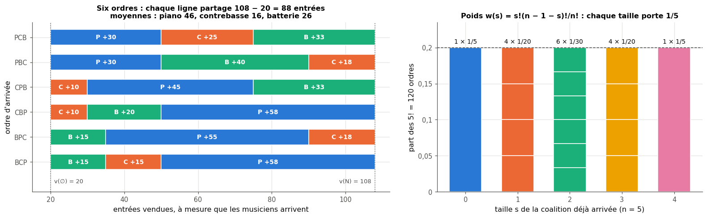
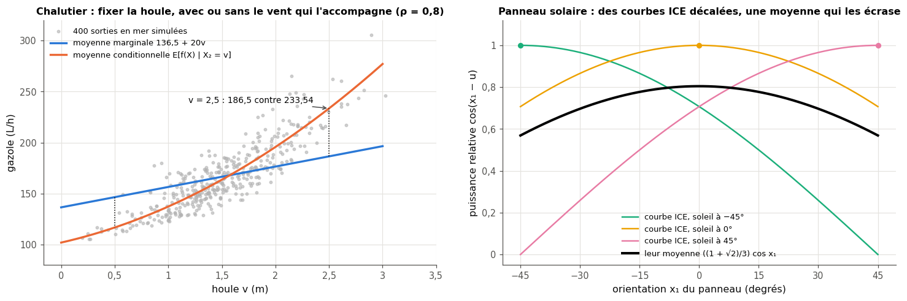
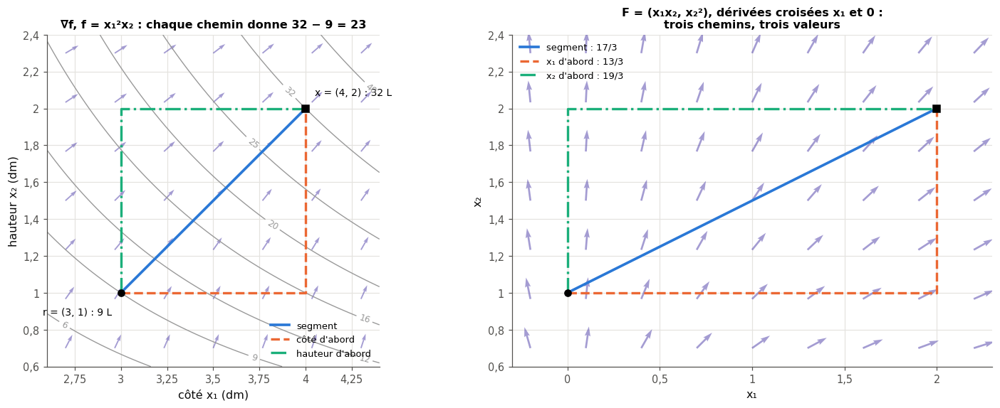
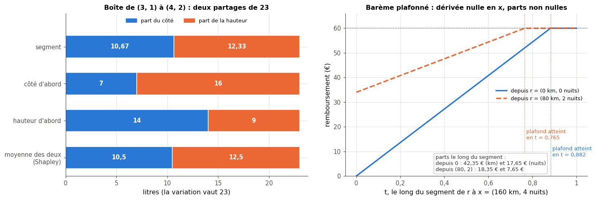
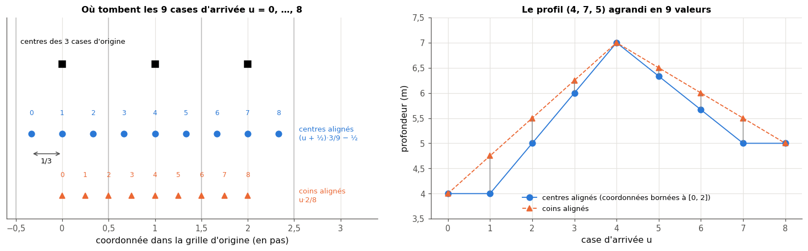
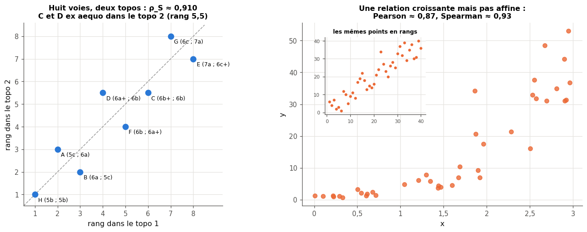
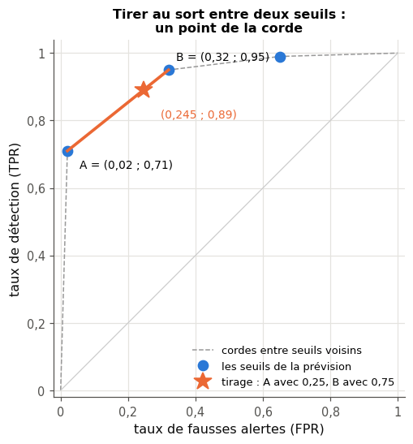

# MB6 · Shapley, intégrales de chemin et équité — fiche de cours

> Partager un gain, une variation ou une décision. La **valeur de Shapley** d'un jeu coopératif, ses **poids**, ses **axiomes** et les **dividendes de Harsanyi** ; **fixer une variable** (dépendance partielle, moyenne conditionnelle, **courbes ICE**) ; l'**intégrale d'un champ le long d'un chemin** et deux **partages d'une variation** ; l'**interpolation bilinéaire** et la corrélation de **Spearman** ; l'**équité** vue comme des indépendances, ses impossibilités, puis tirer au sort entre deux seuils, **repondérer** et mesurer l'écart de deux taux. Le chapitre bonus B6 de workbookIA les applique.

| | |
|---|---|
| **Sections** | §1 à §8 |
| **Temps total estimé** | ≈ 13,0 h : lecture et calculs de la fiche ≈ 2 h 05, exercices ≈ 10 h 25, 15 flashcards ≈ 30 min (parcours essentiel ≈ 9,3 h) |
| **Prérequis** | R3 (fonction affine par deux points) ; R4 (parties d'un ensemble, $\Sigma$, somme télescopique, démonstration) ; R8 (factorielle, combinaisons, $2^n$ parties) ; M02a (théorème fondamental, rectangles, trapèzes, Simpson) ; M02b (espérance, Bernoulli, variance d'une somme indépendante, formule du binôme) ; M02c (Pearson, estimateur sans biais, bootstrap) ; M03 (indépendance, courbe ROC, calibration, taux par groupe) ; M05b (gradient, dérivée directionnelle, Schwarz) ; M08 (Wald) ; M11 (Hoeffding, taux de base) ; M12a (base d'un espace vectoriel, ∂ MB6.8) ; M17 (règle de la chaîne) ; M20 (Horvitz-Thompson) ; M25a (couple gaussien conditionné) ; M25b (indépendance conditionnelle, espérance totale) ; MB4 (rangs) |
| **Fichiers du chapitre** | `02_exercices.md` (quiz, papier) · `03_notebook.ipynb` · `04_indices.md` · `05_solutions.md` et `05_solutions.ipynb` · `06_mes_reponses.md` · `flashcards.csv` |
| **mymath** | `attribution.py` : `coalition_weights`, `harsanyi_dividends`, `line_integral`, `spearman_rho` |
| **Références** | pas de MML (le livre ne traite ni les jeux coopératifs, ni les intégrales de chemin, ni l'équité) ; Shapley, Shubik, Harsanyi, Littlechild et Owen, Osborne et Rubinstein (§1, §2) ; Aumann et Shapley (§4) ; Spearman (§6) ; Barocas, Hardt et Narayanan, Kleinberg et coll. (§7) ; Hardt et coll., Kamiran et Calders, Agresti et Caffo (§8) |

## Comment utiliser ce chapitre

**Ordre conseillé.**
1. `python tools/start_chapter.py MB6` (sur Colab : `00_setup/COLAB.md` §2) : il copie le notebook, ta feuille de réponses et le squelette `mymath/attribution.py`.
2. Section par section : lis **crayon en main** et refais chaque calcul, puis fais les exercices de la section, quiz 🧠 d'abord. Pas de lecture de MML ici ; les références de « Pour aller plus loin » sont facultatives.
3. Les ✏️ et le 🔗 se font sur papier, dans ta copie de `06_mes_reponses.md`, et se vérifient dans la **partie 0** du notebook ; les ∂ se jugent avec la grille de relecture de `05_solutions.md`.

Trois blocs : les jeux (§1, §2, dans l'ordre) ; les fonctions de plusieurs variables (§3 à §5 ; le §4 s'appuie sur les §1 et §2), puis Spearman (§6), qui se lit à part ; l'équité (§7, §8, après M03 §8).

| Section | Quiz 🧠 et rappels 🔁 | Papier et réflexion | Notebook |
|---|---|---|---|
| §1 Jeux coopératifs | Q1, R1 | MB6.1 ✏️, MB6.12 🗣️ | MB6.13 🔨, MB6.20 🐛, MB6.22 🏆 |
| §2 Axiomes et dividendes | Q1 | MB6.2 ✏️, MB6.8 ∂, MB6.E1 💼 | MB6.14 🔨 |
| §3 Fixer une variable | Q2, R3 | MB6.3 ✏️ | MB6.18 🔬 |
| §4 Chemins et partages | Q3, R2 | MB6.4 ✏️, MB6.5 ✏️ | MB6.15 🔨, MB6.17 🔮, MB6.19 🎨, MB6.21 🛠️ |
| §5 Une grille | Q4 | MB6.6 ✏️ | MB6.20 🐛 |
| §6 Spearman | Q4 | | MB6.16 🔨, MB6.20 🐛 |
| §7 Critères d'équité | Q5 | MB6.7 ✏️, MB6.9 ∂, MB6.10 ∂ | |
| §8 Hasard, poids, écarts | Q6 | MB6.7 ✏️, MB6.10 ∂, MB6.11 🔗 | |

Parcours essentiel : tout sauf MB6.5, MB6.8, MB6.E1, MB6.14, MB6.17, MB6.19, MB6.21 et MB6.22 (les énoncés de l'unicité et du théorème multilinéaire en font partie ; leurs démonstrations, ∂ MB6.8 et le bloc repliable du §4, non).

📐 **Notations.**
- **Conventions.** Joueurs : des lettres ou 1 à $n$ sur papier, 0 à $n - 1$ dans le code ; $N$ le grand groupe, $S$ une coalition, $\bar S$ son complément, $s = \lvert S\rvert$ ; $v(\varnothing)$ quelconque. Un chemin $\boldsymbol\gamma$ a le paramètre $t \in [0, 1]$ ; la référence d'un partage est $\mathbf{r}$. Aux §7 et §8, $G$ est le groupe, $Y$ le label (1 : l'événement a lieu), $\hat Y$ la décision, $S$ le score, $p_g = P(Y = 1 \mid G = g)$ le **taux de base** (*base rate* ; M11 §3 ; la prévalence $\pi$ de M03 §8) ; le **taux de détection** est le TPR, le **taux de fausses alertes** le FPR. $\hat Y \perp G$ se lit « $\hat Y$ est indépendante de $G$ », $\hat Y \perp G \mid Y$ « … sachant $Y$ ». Au §5, $\xi(u)$ est la coordonnée d'origine de la case d'arrivée $u$.
- **Lettres à double sens.** $v$ : un jeu (§1, §2, §4), une valeur fixée (§3). $S$ : une coalition (§1 à §4), le score (§7, §8). $s$ : une taille (§1, §2), une coordonnée dans une case (§5), un rang $s_i$ (§6), une valeur du score (§7). $w$ : le poids $w(s)$ d'une coalition (§1), un poids $w(g, y)$ (§8) ; les poids de vote sont les $\omega_i$. $r$ : la référence $\mathbf{r}$ (§4), un rang $r_i$ (§6). $\rho$ : une corrélation gaussienne (§3), $\rho_S$ celle de Spearman (§6). $n$ : des joueurs (§1, §2), des objets (§6), des positifs $n_g$ (§8). $d$ : un dividende $d_T$ (§2), la dimension (§3, §4), un écart de rangs $d_i$ (§6). $h$ : une fonction (§3), un écart $h_i = x_i - r_i$ (§4), un nombre de cases (§5, avec $H$). $g$ : une fonction (§3, §4), un groupe (§7, §8). $t$ : le paramètre d'un chemin (§4), un poids d'interpolation (§5). $q$ : un quota (§1), une valeur aux coins $q_{00}, \ldots$ (§5), une probabilité de tirage (§8). $u$ : un jeu d'unanimité $u_T$ (§2, et $u_U$ au §4), la position du soleil (§3), une case d'arrivée (§5). $c$ : un coût (§1, §2), un coefficient (§4). $a_j$ : un apport (§2), un coefficient (§5). $a, b$ : les bornes des contributions (§1), deux points $\mathbf{a}, \mathbf{b}$ (§4, en gras). $\varepsilon$ : une précision (§1), un décalage (§5) ; $\delta$ : un risque (§1). $m$ : un nombre d'ordres tirés (§1), de points (§3). $\pi$ : un ordre (§1), la prévalence de M03 (rappel du 📐). $k$ : un degré (§4), un indice de somme (§6). $y$ : une fonction d'une grille (§5), une valeur du label (§8). A et B (en romain) : deux seuils (§8), $\mathbf{A}$ (en gras) une grille (§5) ; P, C et B : trois musiciens (§1, §2). $p$ : le taux de base $p_g$ (§7), une densité $p(x)$ ou $p_\theta(x)$ (⚠️ du §7) ; $\theta_g$ : une proportion du groupe $g$, ici son taux de détection (§8). Le contexte tranche.

Vocabulaire anglais de ce chapitre : *cooperative game*, *coalition*, *characteristic function*, *marginal contribution*, *Shapley value*, *weighted voting game*, *pivotal player*, *Shapley-Shubik index*, *cost-sharing game*, *airport game*, *allocation rule*, *efficiency*, *symmetry*, *null player*, *additivity*, *unanimity game*, *Harsanyi dividend*, *Möbius inversion*, *partial dependence*, *individual conditional expectation (ICE)*, *vector field*, *line integral*, *polygonal path*, *gradient theorem*, *path independence*, *mixed partial derivatives*, *reference point*, *Aumann-Shapley value*, *homogeneous function*, *bilinear interpolation*, *align corners*, *rank*, *tie*, *Spearman's rank correlation*, *independence*, *separation*, *sufficiency*, *base rate*, *chord*, *reweighing*, *difference of proportions*, *stratified bootstrap*, *cluster bootstrap*.

## Objectifs d'apprentissage

À la fin du chapitre, tu sais :
- **calculer** la valeur de Shapley d'un petit jeu par les ordres et par les poids, **dire** ce que coûte chaque méthode et combien d'ordres tirés suffisent ;
- **vérifier** les quatre axiomes, **calculer** les dividendes de Harsanyi et **en déduire** la valeur de Shapley ; **démontrer** qu'elle est la seule à respecter les axiomes (∂ MB6.8) ;
- **distinguer** moyennes marginale et conditionnelle, les **calculer** pour un couple gaussien, et **relier** des courbes ICE parallèles à l'absence d'interaction ;
- **calculer** l'intégrale d'un champ le long d'une ligne brisée ou d'un arc, **reconnaître** un champ de gradient, et **partager** une variation le long du segment ou par les chemins en escalier ;
- **agrandir** une grille par interpolation bilinéaire, dans les deux conventions, et **lire** la moyenne d'un gradient comme une dérivée directionnelle ;
- **calculer** une corrélation de Spearman, ex aequo compris, et **dire** ce qu'elle ne voit pas ;
- **écrire** les critères d'équité comme des indépendances, et **démontrer** ce qui est incompatible quand les taux de base diffèrent (∂ MB6.9, ∂ MB6.10) ;
- **atteindre** un taux de détection par tirage entre deux seuils, **repondérer** une table, **donner** l'intervalle de l'écart de deux taux.

## L'essentiel en 8 lignes

1. **Shapley** : $\varphi_i = \frac{1}{n!}\sum_\pi\big[v(S_\pi(i) \cup \lbrace i\rbrace) - v(S_\pi(i))\big] = \sum_{S \not\ni i}w(s)\big[v(S \cup \lbrace i\rbrace) - v(S)\big]$, $w(s) = \frac{s!\thinspace(n - 1 - s)!}{n!}$ ; chaque ordre partage $v(N) - v(\varnothing)$ ; $m \ge \frac{(b - a)^2\ln(2/\delta)}{2\varepsilon^2}$ ordres tirés suffisent ; vote pondéré : la part des ordres où $i$ est pivot.
2. **Axiomes** : efficacité, symétrie, joueur nul, additivité. $d_T = \sum_{S \subseteq T}(-1)^{\lvert T\rvert - \lvert S\rvert}v(S)$, $v = \sum_Td_Tu_T$, $\varphi_i = \sum_{T \ni i}\frac{d_T}{\lvert T\rvert}$, la seule règle qui respecte les axiomes (∂ MB6.8).
3. **Fixer $x_j$** : $\mathbb{E}[f(v, \mathbf{X} _{-j})]$ ou $\mathbb{E}[f(\mathbf{X}) \mid X_j = v]$, égales si $X_j \perp \mathbf{X}  _{-j}$ ; $f = g(x_j) + h(\mathbf{x} _{-j})$ ⇔ ICE parallèles ⇔ $\partial_j\partial_kf = 0$ pour $k \ne j$.
4. **Chemins** : $\int_{\boldsymbol\gamma}\mathbf{F}\cdot\mathrm{d}\boldsymbol\gamma = \int_0^1\mathbf{F}(\boldsymbol\gamma(t))\cdot\boldsymbol\gamma'(t)\thinspace\mathrm{d}t$ ; $\int_{\boldsymbol\gamma}\nabla f\cdot\mathrm{d}\boldsymbol\gamma = f(\text{fin}) - f(\text{début})$, 0 sur une boucle ; dérivées croisées différentes : pas un gradient.
5. **Partager $f(\mathbf{x}) - f(\mathbf{r})$** : le segment, $h_i\int_0^1\partial_if(\mathbf{r} + t\mathbf{h})\thinspace\mathrm{d}t$, ou la valeur de Shapley de $v(S) = f(\mathbf{x} _S, \mathbf{r} _{\bar S})$ ; égaux si $f$ est multilinéaire ; ils dépendent de $\mathbf{r}$. **Euler** : $\sum_ix_i\partial_if = kf$, part $\frac{x_i\partial_if(\mathbf{x})}{k}$ depuis $\mathbf{0}$.
6. **Grille** : $\frac{1}{HW}\sum\frac{\partial y}{\partial A_{ij}}$ = dérivée par un décalage uniforme, divisée par $HW$. Agrandir $h \to H$ : $\xi(u) = (u + \frac12)\frac hH - \frac12$ (centres) ou $u\frac{h - 1}{H - 1}$ (coins), au plus $\frac12(1 - \frac hH)$ pas d'écart.
7. **Spearman** : Pearson des rangs (rangs moyens aux ex aequo) $= 1 - \frac{6\sum d_i^2}{n(n^2 - 1)}$ sans ex aequo ; invariant par une transformation strictement croissante ; aveugle à l'ampleur des écarts.
8. **Équité** : $\hat Y \perp G$, $\hat Y \perp G \mid Y$, $Y \perp G \mid \hat Y$ ; taux de base différents : indépendance et séparation imposent $\hat Y \perp Y \mid G$ ; scores calibrés de mêmes moyennes chez les positifs et chez les négatifs : taux de base égaux ou score parfait. Corde ROC ; $w(g, y) = \frac{P(g)P(y)}{P(g, y)}$ ; erreur type de l'écart de deux proportions, $\sqrt{\sum_g\frac{\theta_g(1 - \theta_g)}{n_g}}$.

## §1 · Jeux coopératifs : contributions marginales, ordres d'arrivée et poids des coalitions

### Un gain créé ensemble

Un bar organise un concert de jazz. Sans musicien, 20 habitués viennent ; le pianiste (P), le contrebassiste (C) et la batteuse (B) attirent du monde, plus ou moins selon qui joue déjà, et la salle n'a que 108 places. Les entrées vendues selon qui jouait :

| coalition $S$ | ∅ | P | C | B | PC | PB | CB | PCB |
|---|---|---|---|---|---|---|---|---|
| $v(S)$ | 20 | 50 | 30 | 35 | 75 | 90 | 50 | 108 |

Comment partager les $108 - 20 = 88$ entrées que le trio ajoute ?

> **Définitions.** Un **jeu coopératif** (*cooperative game*) à $n$ joueurs est une fonction $v$, la **fonction caractéristique** (*characteristic function*), qui donne un nombre $v(S)$ à chaque **coalition** $S \subseteq N$. La **contribution marginale** (*marginal contribution*) de $i \notin S$ à $S$ est $v(S \cup \lbrace i\rbrace) - v(S)$.

P apporte 30 au bar vide, 45 à C, 55 à B, 58 au duo CB : cela dépend de qui est là. On fait donc arriver les joueurs un par un, dans un **ordre** $\pi$ ; chacun reçoit ce qu'il ajoute, et $S_\pi(i)$ est l'ensemble des joueurs arrivés avant $i$.

> **Définition** (Shapley, 1953). La **valeur de Shapley** (*Shapley value*) de $i$ est la moyenne de ses contributions sur les $n!$ ordres :
> $$\varphi_i = \frac{1}{n!}\sum_\pi\Big[v\big(S_\pi(i) \cup \lbrace i\rbrace\big) - v\big(S_\pi(i)\big)\Big].$$

| ordre | PCB | PBC | CPB | CBP | BPC | BCP | moyenne |
|---|---|---|---|---|---|---|---|
| P | 30 | 30 | 45 | 58 | 55 | 58 | **46** |
| C | 25 | 18 | 10 | 10 | 18 | 15 | **16** |
| B | 33 | 40 | 33 | 20 | 15 | 15 | **26** |

Chaque colonne somme à 88 : dans un ordre, les contributions se **télescopent** en $v(N) - v(\varnothing)$ (R4 §5), et la moyenne garde cette somme.

### Les poids des coalitions

Une contribution ne dépend que de l'ensemble $S$ des joueurs arrivés avant $i$. Les ordres qui placent exactement $S$ avant $i$ se comptent : $s!$ façons de ranger $S$, puis $i$, puis $(n - 1 - s)!$ façons de ranger les autres (R8 §3).

> **Propriété.** $\displaystyle\varphi_i = \sum_{S \subseteq N \setminus\lbrace i\rbrace}w(s)\big[v(S \cup \lbrace i\rbrace) - v(S)\big]$, avec le **poids d'une coalition** de taille $s$ : $\displaystyle w(s) = \frac{s!\thinspace(n - 1 - s)!}{n!} = \frac{1}{n\binom{n-1}{s}}$.

**Lecture probabiliste.** Dans un ordre uniforme, le nombre de joueurs arrivés avant $i$ est uniforme sur $\lbrace0, \ldots, n - 1\rbrace$ et, sachant ce nombre $s$, leur ensemble est uniforme parmi les $\binom{n-1}{s}$ possibles. D'où $w(s) = \frac1n\cdot\frac{1}{\binom{n-1}{s}}$, $\sum_s\binom{n-1}{s}w(s) = 1$ et $w(s) = w(n - 1 - s)$.

Pour $n = 3$, $w = (\frac13, \frac16, \frac13)$ ; pour P : $\frac13(50 - 20) + \frac16\big[(75 - 30) + (90 - 35)\big] + \frac13(108 - 50) = 10 + \frac{50}{3} + \frac{58}{3} = 46$. Pour $n = 5$, $w = (\frac15, \frac1{20}, \frac1{30}, \frac1{20}, \frac15)$, pour $1, 4, 6, 4, 1$ coalitions : chaque taille porte $\frac15$ en tout (figure, à droite).

**Le coût** (R4 §4, R8 §3) : $n!$ ordres, ou $2^{n-1}$ coalitions sans $i$, et $2^n$ valeurs $v(S)$ pour tous les joueurs. Pour $n = 30$ : $30! \approx 2{,}65 \times 10^{32}$ ordres, $2^{30} \approx 1{,}07 \times 10^9$ coalitions.

### Estimer par des ordres tirés au hasard

La moyenne $\hat\varphi_i$ des contributions de $i$ sur $m$ ordres tirés uniformément et indépendamment est **sans biais** (M02c §6) : chacune a pour espérance $\varphi_i$. Chaque ordre se télescope : $\sum_i\hat\varphi_i = v(N) - v(\varnothing)$ **exactement**. Si les contributions sont dans $[a, b]$, Hoeffding (M11 §6) donne $P(\lvert\hat\varphi_i - \varphi_i\rvert \ge \varepsilon) \le 2e^{-2m\varepsilon^2/(b - a)^2}$ : $m \ge \frac{(b - a)^2\ln(2/\delta)}{2\varepsilon^2}$ ordres suffisent pour un risque $\delta$. Contributions de 0 ou 1, $\varepsilon = 0{,}02$, $\delta = 0{,}02$ : $\frac{\ln 100}{0{,}0008} \approx 5\thinspace756{,}5$, soit 5 757 ordres, quel que soit $n$.

### Voter avec des poids

> **Définition.** Le **jeu de vote pondéré** (*weighted voting game*) $[q ;\ \omega_1, \ldots, \omega_n]$ donne $v(S) = 1$ si $\sum_{j \in S}\omega_j \ge q$, 0 sinon. La contribution de $i$ vaut 1 quand $S$ perd et $S \cup \lbrace i\rbrace$ gagne : $i$ est **pivot** (*pivotal player*). Sa valeur de Shapley, la part des ordres où il est pivot, est son **indice de Shapley-Shubik** (*Shapley-Shubik index*, 1954).

**Le poids n'est pas le pouvoir.** Une copropriété vote à 51 % ; ses trois propriétaires ont 48, 47 et 5 % des voix : $[51 ;\ 48, 47, 5]$. Aucun ne gagne seul, toute paire gagne : le pivot est toujours le deuxième arrivé, et chacun l'est dans deux ordres sur six. Indices : $\frac13$, $\frac13$, $\frac13$. À l'inverse, au Conseil des ministres de la Communauté économique européenne, en 1958, $[12 ;\ 4, 4, 4, 2, 2, 1]$, le Luxembourg n'était jamais pivot : les sommes des voix des autres sont paires, aucune ne vaut 11, la seule que sa voix ferait passer à 12. Son indice était nul.

### Partager un coût

Dans un **jeu de partage de coûts** (*cost-sharing game*), $c(S)$ est le coût d'un équipement qui sert $S$, et la valeur de Shapley partage $c(N)$. Un aérodrome sert un ULM, un avion de tourisme et un bimoteur, qui demandent 400, 700 et 1 100 m de piste ; la piste coûte 0,3 k€ le mètre, et une coalition paie celle de son plus gros appareil : $c(S) = \max_{i \in S}c_i$, avec $c_i = 120$, 210 et 330 k€. C'est un **jeu de l'aéroport** (*airport game* ; Littlechild et Owen, 1973).

> **Règle de l'aéroport.** Chaque tronçon de piste est partagé également entre les appareils qui l'utilisent.

Les 400 premiers mètres (120 k€) servent les trois : 40 chacun ; les 300 suivants (90 k€), deux appareils : 45 chacun ; les 400 derniers (120 k€), le bimoteur. Parts : 40, 85 et 205 k€. Le §2 montre que c'est la valeur de Shapley.

💻 **Aujourd'hui en pratique** — pour un petit jeu, on parcourt les coalitions (`itertools.combinations`) avec `coalition_weights` (🔨 MB6.13) ; au-delà, on tire des ordres, ou l'on exploite la forme du jeu, par exemple en comptant les coalitions d'un vote par taille et par poids total (🏆 MB6.22).

⚠️ **Erreur classique.** Croire que le pouvoir d'un votant suit son poids : 5 % des voix peuvent valoir un tiers du pouvoir (la copropriété), et une voix ne rien valoir (le Luxembourg).

🔗 **Dans workbookIA** — le chapitre B6 partage une prédiction entre les entrées d'un modèle, qui jouent les joueurs d'un jeu : ce sont les valeurs SHAP, exactes ou estimées.

## §2 · Les quatre axiomes, les jeux d'unanimité et les dividendes de Harsanyi

### Quatre règles de partage

Une **règle de partage** (*allocation rule*) associe à tout jeu $v$ à $n$ joueurs des parts $\varphi_1(v), \ldots, \varphi_n(v)$. Quatre propriétés :
- **efficacité** (*efficiency*) : $\sum_i\varphi_i(v) = v(N) - v(\varnothing)$ ;
- **symétrie** (*symmetry*) : si $v(S \cup \lbrace i\rbrace) = v(S \cup \lbrace j\rbrace)$ pour toute $S$ qui ne contient ni $i$ ni $j$, alors $\varphi_i = \varphi_j$ ;
- **joueur nul** (*null player*) : si $v(S \cup \lbrace i\rbrace) = v(S)$ pour toute $S$, alors $\varphi_i = 0$ ;
- **additivité** (*additivity*) : $\varphi_i(v + v') = \varphi_i(v) + \varphi_i(v')$.

La valeur de Shapley les vérifie : télescopage ; échanger $i$ et $j$ dans tous les ordres échange leurs contributions ; un joueur nul n'apporte rien dans aucun ordre ; chaque contribution est linéaire en $v$. Pour $n = 1$, $\varphi_1 = v(\lbrace1\rbrace) - v(\varnothing)$ ; dans un jeu constant, tous les joueurs sont nuls. Un joueur nul n'ajoute rien à **aucune** coalition (le Luxembourg).

**Un jeu additif.** Si $v(S) = v(\varnothing) + \sum_{j \in S}a_j$, la contribution de $i$ vaut $a_i$ dans tout ordre : $\varphi_i = a_i$.

**La règle de l'aéroport, justifiée.** $c = c^{(1)} + c^{(2)} + c^{(3)}$, où $c^{(k)}(S)$ vaut le coût du tronçon $k$ si $S$ contient un appareil qui l'utilise, 0 sinon. Dans $c^{(k)}$, les utilisateurs du tronçon sont symétriques, les autres nuls : l'efficacité leur donne des parts égales, et l'additivité additionne les tronçons.

### Les jeux d'unanimité et les dividendes

> **Définition.** Pour $T \ne \varnothing$, le **jeu d'unanimité** (*unanimity game*) $u_T$ vaut 1 pour les coalitions qui contiennent $T$, 0 pour les autres ; $u_\varnothing = 1$ (un jeu constant).

Dans $u_T$, la contribution de $i \in T$ vaut 1 quand $i$ est le dernier membre de $T$ à arriver ; dans un ordre uniforme, chaque membre l'est avec la même probabilité. Donc $\varphi_i(u_T) = \frac{1}{\lvert T\rvert}$ pour $i \in T$, 0 sinon, et $\varphi_i(u_\varnothing) = 0$.

> **Définition et propriété** (Harsanyi, 1963). Les **dividendes de Harsanyi** (*Harsanyi dividends*) sont $d_T = \sum_{S \subseteq T}(-1)^{\lvert T\rvert - \lvert S\rvert}\thinspace v(S)$. Ce sont les seuls nombres tels que $v(S) = \sum_{T \subseteq S}d_T$ pour toute $S$ (une **inversion de Möbius**, *Möbius inversion*, sur les parties) : $v = \sum_Td_T\thinspace u_T$.

Ainsi $d_\varnothing = v(\varnothing)$, $d_{\lbrace i\rbrace} = v(\lbrace i\rbrace) - v(\varnothing)$, $d_{\lbrace i, j\rbrace} = v(\lbrace i, j\rbrace) - v(\lbrace i\rbrace) - v(\lbrace j\rbrace) + v(\varnothing)$ : ce que $T$ crée au-delà des coalitions plus petites qu'elle contient, une **interaction**. L'inversion se démontre dans ∂ MB6.8.

Pour le trio : $d_\varnothing = 20$ ; $d_P = 30$, $d_C = 10$, $d_B = 15$ ; $d_{PC} = 75 - 50 - 30 + 20 = 15$, $d_{PB} = 25$, $d_{CB} = 5$ ; $d_{PCB} = 108 - 75 - 90 - 50 + 50 + 30 + 35 - 20 = -12$. Sans la limite de la salle, les dividendes des paires prévoyaient $20 + 30 + 10 + 15 + 15 + 25 + 5 = 120$ entrées : l'interaction des trois est négative. Contrôle : $v(PC) = 20 + 30 + 10 + 15 = 75$.

L'additivité et $\varphi_i(u_T) = \frac{1}{\lvert T\rvert}$ donnent alors :

> **Théorème.** $\displaystyle\varphi_i = \sum_{T \ni i}\frac{d_T}{\lvert T\rvert}$ : **chaque interaction est partagée également entre ses membres**.

P : $30 + \frac{15}{2} + \frac{25}{2} - \frac{12}{3} = 46$ ; C : $10 + \frac{15}{2} + \frac52 - 4 = 16$ ; B : $15 + \frac{25}{2} + \frac52 - 4 = 26$, sans parcourir un seul ordre.

> **Théorème** (unicité, Shapley, 1953 ; ∂ MB6.8, ★★★). Une règle de partage qui vérifie, pour tout jeu à $n$ joueurs, l'efficacité, la symétrie, le joueur nul et l'additivité est la valeur de Shapley.

L'outil : la décomposition $v = \sum_Td_Tu_T$, sur laquelle on fait agir les axiomes ; ∂ MB6.8 la rédige.

💻 **Aujourd'hui en pratique** — `harsanyi_dividends` (🔨 MB6.14) appelle $v$ une fois par coalition, puis fait les sommes alternées : $\sum_T2^{\lvert T\rvert} = 3^n$ termes (le binôme) ; une transformée de Möbius rapide, coordonnée par coordonnée, en fait $n\thinspace2^{n-1}$. KernelSHAP, dans workbookIA, estime des valeurs de Shapley par une régression pondérée sur des coalitions tirées au hasard.

⚠️ **Erreur classique.** Donner une interaction $d_T$ à un seul de ses membres ; oublier qu'un dividende peut être négatif.

🔗 **Dans workbookIA** — le chapitre B6 énonce ces quatre propriétés et admet l'unicité.

## §3 · Fixer une variable : espérance marginale ou conditionnelle, courbes ICE et interactions

### Deux façons de fixer une variable

Soit $f(x_1, \ldots, x_d)$ une fonction et $\mathbf{X}$ un vecteur aléatoire. On fixe la coordonnée $j$ à $v$ ; que faire des autres, $\mathbf{X}_{-j}$ ?

> **Définitions.** La **moyenne marginale**, ou **dépendance partielle** (*partial dependence*), est $\operatorname{PD} _j(v) = \mathbb{E}\big[f(v, \mathbf{X} _{-j})\big]$ : les autres coordonnées gardent leur loi marginale. La **moyenne conditionnelle** est $M_j(v) = \mathbb{E}\big[f(\mathbf{X}) \mid X_j = v\big]$ : elles prennent leur loi **sachant** $X_j = v$.

Si $X_j \perp \mathbf{X} _{-j}$, la loi de $\mathbf{X} _{-j}$ sachant $X_j = v$ est sa loi marginale, et $M_j = \operatorname{PD}_j$. Sinon, elles diffèrent en général (pas toujours : si $f$ ne dépend que de $x_j$, toutes deux valent $f(v)$).

**Un chalutier** consomme $f(x_1, x_2) = 100 + 0{,}5\thinspace x_1^2 + 20\thinspace x_2$ litres de gazole par heure, selon le vent $x_1$ (m/s) et la houle $x_2$ (m). Le vent et la houle forment un couple gaussien : le vent suit $\mathcal{N}(8, 3^2)$, la houle $\mathcal{N}(1{,}5 ;\ 0{,}5^2)$, de corrélation $\rho = 0{,}8$ (le vent lève la houle). Fixons la houle.
- **Marginale** : $\mathbb{E}[X_1^2] = 8^2 + 3^2 = 73$, donc $\operatorname{PD}_2(v) = 136{,}5 + 20v$.
- **Conditionnelle** (M25a §4) : $X_1 \mid X_2 = v \sim \mathcal{N}\big(8 + 0{,}8 \times \frac{3}{0{,}5}(v - 1{,}5) ;\ 9(1 - 0{,}64)\big) = \mathcal{N}\big(8 + 4{,}8(v - 1{,}5) ;\ 3{,}24\big)$, et $\mathbb{E}[X_1^2 \mid X_2 = v]$ est sa variance plus le carré de sa moyenne : en $v = 2{,}5$, $3{,}24 + 12{,}8^2 = 167{,}08$, et $M_2 = 100 + 83{,}54 + 50 = 233{,}54$.

| houle $v$ | 0,5 | 1,5 | 2,5 |
|---|---|---|---|
| $\operatorname{PD}_2(v)$ | 146,5 | 166,5 | 186,5 |
| $M_2(v)$ | 116,74 | 163,62 | 233,54 |

La moyenne conditionnelle prête à la houle l'effet du vent qui l'accompagne : elle répond à « que consomme le chalutier les jours de forte houle ? », la marginale à « que changerait la houle seule, au vent habituel ? ».

De même, le jeu « marginal » d'une fonction, $S \mapsto \mathbb{E}\big[f(\mathbf{x} _S, \mathbf{X} _{\bar S})\big]$, et son jeu « conditionnel », $S \mapsto \mathbb{E}\big[f(\mathbf{X}) \mid \mathbf{X}_S = \mathbf{x}_S\big]$, ont en général des valeurs de Shapley différentes quand les coordonnées sont dépendantes.

### Les courbes ICE

> **Définition.** Pour des points $\mathbf{x}_1, \ldots, \mathbf{x} _m$, la **courbe ICE** (*individual conditional expectation*) du point $i$ est $v \mapsto f(v, \mathbf{x} _{i,-j})$. La dépendance partielle estimée sur ces points est la **moyenne** des courbes.

> **Théorème.** Soit $f$ de classe $C^2$ sur un pavé (un produit d'intervalles). Sont équivalents :
> 1. $f(\mathbf{x}) = g(x_j) + h(\mathbf{x}_{-j})$ ;
> 2. les courbes ICE de $x_j$, une pour chaque $\mathbf{x}_{-j}$ du pavé, sont **parallèles** : deux d'entre elles diffèrent d'une constante ;
> 3. $\dfrac{\partial^2f}{\partial x_j\partial x_k} = 0$ partout, pour tout $k \ne j$.

*Démonstration.* (1 ⇒ 2) $f(v, \mathbf{x} _{-j}) - f(v, \mathbf{x}' _{-j}) = h(\mathbf{x} _{-j}) - h(\mathbf{x}' _{-j})$ ne dépend pas de $v$. (2 ⇒ 3) Cette différence étant constante en $v$, sa dérivée en $v$ est nulle : $\partial_jf(v, \mathbf{x} _{-j})$ ne dépend pas de $\mathbf{x}  _{-j}$, donc $\partial_k\partial_jf = 0$, et $\partial_j\partial_kf = 0$ par Schwarz (M05b §6). (3 ⇒ 1) Par Schwarz, $\partial_k(\partial_jf) = 0$ pour $k \ne j$ ; sur un pavé, faire varier la seule coordonnée $x_k$ ne sort pas du pavé, et $\partial_jf$ y est constante (M02a §2) : $\partial_jf(\mathbf{x}) = \psi(x_j)$. Si $g$ est une primitive de $\psi$, $f - g(x_j)$ a une dérivée nulle en $x_j$, donc ne dépend que de $\mathbf{x} _{-j}$ : c'est $h$. $\square$

Le chalutier est séparable en la houle : ses courbes ICE de $x_2$ sont parallèles (de pente 20), et ses deux moyennes diffèrent pourtant : l'écart vient de la corrélation, pas d'une interaction.

**Une moyenne peut cacher une interaction.** Un panneau solaire orienté vers l'azimut $x_1 \in [-45°, 45°]$ produit $\cos(x_1 - u)$ (en part du maximum) quand le soleil est à l'azimut $u$ : $-45°$, $0°$ ou $45°$, avec la même probabilité. Chaque courbe ICE culmine face au soleil ; elles ne sont pas parallèles, et $\frac{\partial^2}{\partial x_1\partial u}\cos(x_1 - u) = \cos(x_1 - u) \ne 0$. Leur moyenne, $\frac13\big[\cos(x_1 + 45°) + \cos x_1 + \cos(x_1 - 45°)\big] = \frac{1 + \sqrt2}{3}\cos x_1$ (formule d'addition), culmine en 0° et ne varie qu'entre 0,57 et 0,80 : elle cache que la meilleure orientation suit le soleil.

💻 **Aujourd'hui en pratique** — sur un échantillon, la moyenne marginale est la moyenne des $f(v, \mathbf{x}_{i,-j})$, une ligne de NumPy ; la conditionnelle s'estime avec les points dont $x_j$ tombe dans une fenêtre autour de $v$ (🔬 MB6.18).

⚠️ **Erreur classique.** Croire que des courbes ICE parallèles rendent égales les deux moyennes (le chalutier) ; lire la dépendance partielle comme l'effet de la variable en chaque point (le panneau).

🔗 **Dans workbookIA** — le chapitre B6 trace dépendances partielles et courbes ICE, et oppose des valeurs de Shapley « interventionnelles » (jeu marginal) et « observationnelles » (jeu conditionnel).

## §4 · Intégrer un gradient le long d'un chemin, et partager une variation entre les coordonnées

### Un chemin et une intégrale

Un **chemin** est une fonction $\boldsymbol\gamma : [0, 1] \to \mathbb{R}^d$, de vitesse $\boldsymbol\gamma'(t)$ (le segment de $\mathbf{a}$ à $\mathbf{b}$ : $\mathbf{a} + t(\mathbf{b} - \mathbf{a})$). Rappel (M05b §3, M17 §3) : $(f\circ\boldsymbol\gamma)'(t) = \nabla f(\boldsymbol\gamma(t))\cdot\boldsymbol\gamma'(t)$.

> **Définition.** L'**intégrale** d'un **champ de vecteurs** (*vector field*) $\mathbf{F}$ le long de $\boldsymbol\gamma$ (*line integral*) est $\displaystyle\int_{\boldsymbol\gamma}\mathbf{F}\cdot\mathrm{d}\boldsymbol\gamma = \int_0^1\mathbf{F}(\boldsymbol\gamma(t))\cdot\boldsymbol\gamma'(t)\thinspace\mathrm{d}t$ ; le long d'une **ligne brisée** (*polygonal path*), la somme des intégrales de ses segments.

Pour une force, c'est son **travail**. Parcourir le chemin à l'envers, $\boldsymbol\gamma(1 - t)$, change le signe de l'intégrale, pour tout champ.

> **Théorème du gradient** (*gradient theorem*). Si $f$ est de classe $C^1$, pour tout chemin $\boldsymbol\gamma$ de classe $C^1$ ou toute ligne brisée, $\displaystyle\int_{\boldsymbol\gamma}\nabla f\cdot\mathrm{d}\boldsymbol\gamma = f(\boldsymbol\gamma(1)) - f(\boldsymbol\gamma(0))$.

*Démonstration.* Soit $g(t) = f(\boldsymbol\gamma(t))$. Par la règle de la chaîne, $g'(t) = \nabla f(\boldsymbol\gamma(t))\cdot\boldsymbol\gamma'(t)$, l'intégrande ; par le théorème fondamental (M02a §2), $\int_0^1g' = g(1) - g(0)$. Sur une ligne brisée, les termes des segments se télescopent. $\square$

Pour un champ de gradient, l'intégrale ne dépend que des extrémités (**indépendance du chemin**, *path independence*), et elle est nulle sur toute **boucle** ($\boldsymbol\gamma(1) = \boldsymbol\gamma(0)$).

**Exemple.** Une boîte à base carrée de côté $x_1$ et de hauteur $x_2$ (dm) a pour volume $f = x_1^2x_2$ litres, de gradient $(2x_1x_2,\ x_1^2)$. Le long du segment de $\mathbf{r} = (3, 1)$ à $\mathbf{x} = (4, 2)$, $\boldsymbol\gamma(t) = (3 + t, 1 + t)$, $\boldsymbol\gamma' = (1, 1)$, et l'intégrande $2(3 + t)(1 + t) + (3 + t)^2 = 3t^2 + 14t + 15$ a pour intégrale $1 + 7 + 15 = 23 = 32 - 9$ ; les chemins en escalier aussi (figure).

**Un champ qui n'est pas un gradient.** Si $\mathbf{F} = \nabla f$ avec $f$ de classe $C^2$, Schwarz (M05b §6) impose $\frac{\partial F_1}{\partial x_2} = \frac{\partial F_2}{\partial x_1}$ : des **dérivées croisées** (*mixed partial derivatives*) différentes prouvent que $\mathbf{F}$ n'est pas un gradient. Pour $\mathbf{F} = (x_1x_2,\ x_2^2)$, elles valent $x_1$ et 0. De $(0, 1)$ à $(2, 2)$ :
- $x_1$ d'abord : $\int_0^2x_1\thinspace\mathrm{d}x_1 + \int_1^2x_2^2\thinspace\mathrm{d}x_2 = 2 + \frac73 = \frac{13}{3}$ ;
- $x_2$ d'abord : $\int_1^2x_2^2\thinspace\mathrm{d}x_2 + \int_0^22x_1\thinspace\mathrm{d}x_1 = \frac73 + 4 = \frac{19}{3}$ ;
- le segment $(2t, 1 + t)$ : $\int_0^1\big[2t(1 + t) \times 2 + (1 + t)^2\big]\thinspace\mathrm{d}t = \int_0^1(1 + 6t + 5t^2)\thinspace\mathrm{d}t = \frac{17}{3}$.

Aller par le premier et revenir par le deuxième fait une boucle d'intégrale $-2$. Réciproquement, sur un domaine convexe, un champ de classe $C^1$ aux dérivées croisées égales partout est un gradient (admis) ; une seule boucle d'intégrale nulle ne prouve rien.

**Rappel de M02a §5** : sur $[0, 1]$, rectangles d'ordre 1, trapèzes et point milieu d'ordre 2 (exacts pour une intégrande affine), Simpson d'ordre 4 (exacte jusqu'au degré 3).

### Partager une variation entre les coordonnées

On partage $f(\mathbf{x}) - f(\mathbf{r})$ entre les coordonnées, depuis une **référence** (*reference point*) $\mathbf{r}$ ; $\mathbf{h} = \mathbf{x} - \mathbf{r}$.

**Le long du segment** $\mathbf{r} + t\mathbf{h}$, le théorème du gradient s'écrit coordonnée par coordonnée :
$$f(\mathbf{x}) - f(\mathbf{r}) = \sum_i\underbrace{h_i\int_0^1\partial_if(\mathbf{r} + t\mathbf{h})\thinspace\mathrm{d}t}_{\text{part de la coordonnée } i}.$$

**Le long d'un chemin en escalier**, les coordonnées passent une à une de $r_i$ à $x_i$, dans un ordre $\pi$. La marche de $i$ rapporte sa contribution marginale dans le jeu $v(S) = f(\mathbf{x} _S, \mathbf{r} _{\bar S})$ (les coordonnées de $S$ en $\mathbf{x}$, les autres en $\mathbf{r}$), où $v(\varnothing) = f(\mathbf{r})$ et $v(N) = f(\mathbf{x})$. La moyenne sur les $d!$ ordres est donc la **valeur de Shapley** de ce jeu.

Pour la boîte : côté d'abord, $f(4, 1) - f(3, 1) = 7$, puis $f(4, 2) - f(4, 1) = 16$ ; hauteur d'abord, $f(3, 2) - f(3, 1) = 9$, puis $14$. Valeur de Shapley : 10,5 pour le côté, 12,5 pour la hauteur. Le segment : $\int_0^12(3 + t)(1 + t)\thinspace\mathrm{d}t = \frac{32}{3} \approx 10{,}67$ et $\int_0^1(3 + t)^2\thinspace\mathrm{d}t = \frac{37}{3} \approx 12{,}33$. **Deux partages de 23 qui diffèrent** : le volume n'est pas affine en $x_1$.

> **Théorème** (fonctions multilinéaires). Si $f$ est **multilinéaire**, affine en chaque coordonnée quand les autres sont fixées, soit $f(\mathbf{x}) = \sum_Tc_T\prod_{i \in T}x_i$, alors, pour toute référence, la part de chaque coordonnée le long du segment est sa valeur de Shapley dans le jeu $v(S) = f(\mathbf{x} _S, \mathbf{r} _{\bar S})$.

Démonstration (par les jeux d'unanimité ; hors parcours essentiel)

Les deux partages sont linéaires en $f$ : il suffit de traiter un monôme $f(\mathbf{x}) = \prod_{j \in T}x_j$ et une coordonnée $i \in T$ (hors de $T$, les deux parts sont nulles). Écrivons $x_j = r_j + h_j$.

*Le jeu.* $v(S) = \prod_{j \in T}\big(r_j + h_j\thinspace\mathbb{1}[j \in S]\big)$. En développant, on choisit pour chaque $j$ le terme $r_j$ ou $h_j\mathbb{1}[j \in S]$ ; si $U \subseteq T$ est l'ensemble des seconds choix, le terme vaut $\kappa_U\thinspace\mathbb{1}[U \subseteq S]$, avec $\kappa_U = \prod_{j \in T \setminus U}r_j\prod_{j \in U}h_j$. Donc $v = \sum_{U \subseteq T}\kappa_U\thinspace u_U$ : les dividendes sont les $\kappa_U$, et le §2 donne $\varphi_i = \sum_{U \ni i}\frac{\kappa_U}{\lvert U\rvert}$.

*Le segment.* $\partial_if(\boldsymbol\gamma(t))\thinspace h_i = h_i\prod_{j \in T \setminus\lbrace i\rbrace}(r_j + t\thinspace h_j)$. En développant de même, chaque $U \ni i$ donne $\kappa_U\thinspace t^{\lvert U\rvert - 1}$, et $\int_0^1t^{\lvert U\rvert - 1}\thinspace\mathrm{d}t = \frac{1}{\lvert U\rvert}$ : la part de $i$ vaut aussi $\sum_{U \ni i}\frac{\kappa_U}{\lvert U\rvert}$. $\square$

Ils coïncident aussi pour $g(x_i)$, une fonction d'une seule coordonnée (part $g(x_i) - g(r_i)$ dans les deux), donc pour une somme de telles fonctions et d'une fonction multilinéaire ; ailleurs, ils diffèrent en général. Le partage le long du segment est la **valeur d'Aumann-Shapley** (*Aumann-Shapley value* ; 1974).

**La référence compte, et la saturation.** Un barème rembourse 0,30 € par kilomètre et 5 € par nuit, plafonnés à 60 € : $f(x_1, x_2) = \min(0{,}3\thinspace x_1 + 5\thinspace x_2,\ 60)$. Un déplacement de 160 km et 4 nuits vaudrait $48 + 20 = 68$ € : plafonné, $f$ y a **deux dérivées partielles nulles**. Depuis $\mathbf{r} = (0, 0)$, $f$ vaut $68t$ jusqu'au plafond, atteint en $t = \frac{15}{17}$ ($f$ n'est pas dérivable sur la droite du plafond, que le segment ne croise qu'en un point : les intégrales n'en changent pas) : les parts valent $48 \times \frac{15}{17} \approx 42{,}35$ € (kilomètres) et $20 \times \frac{15}{17} \approx 17{,}65$ € (nuits). Depuis $\mathbf{r} = (80, 2)$, $f(\mathbf{r}) = 34$, le plafond arrive en $t = \frac{13}{17}$, et les 26 € se partagent en $24 \times \frac{13}{17} \approx 18{,}35$ et $10 \times \frac{13}{17} \approx 7{,}65$. Des coordonnées de dérivée nulle en $\mathbf{x}$ reçoivent des parts, qui changent avec $\mathbf{r}$.

### Les fonctions homogènes

> **Théorème** (Euler). Si $f$ est **homogène de degré $k$** (*homogeneous function*), $f(\lambda\mathbf{x}) = \lambda^kf(\mathbf{x})$ pour tout $\lambda > 0$, et dérivable aux points $\lambda\mathbf{x}$, alors $\sum_ix_i\thinspace\partial_if(\mathbf{x}) = k\thinspace f(\mathbf{x})$ ; et si $k > 0$, la part de $x_i$ le long du segment depuis $\mathbf{0}$ vaut $\frac{x_i\thinspace\partial_if(\mathbf{x})}{k}$.

*Démonstration.* Dériver $f(\lambda\mathbf{x}) = \lambda^kf(\mathbf{x})$ en $\lambda = 1$ donne l'identité (M18.26 l'a vue pour $k = 1$) ; la dériver en $x_i$ donne $\lambda\thinspace\partial_if(\lambda\mathbf{x}) = \lambda^k\partial_if(\mathbf{x})$ : $\partial_if$ est homogène de degré $k - 1$, et la part vaut $x_i\int_0^1t^{k-1}\partial_if(\mathbf{x})\thinspace\mathrm{d}t = \frac{x_i\partial_if(\mathbf{x})}{k}$. $\square$

**Une Cobb-Douglas.** La production $Q = K^{1/4}L^{1/2}$ (capital $K$, travail $L$) est homogène de degré $\frac34$. En $(16, 9)$, $Q = 6$, $K\partial_KQ = \frac Q4 = 1{,}5$ et $L\partial_LQ = \frac Q2 = 3$ (somme $4{,}5 = \frac34 \times 6$) ; depuis $\mathbf{0}$, les parts le long du segment valent 2 et 4, proportionnelles aux exposants. Les chemins en escalier partagent autrement : $Q$ est nulle dès qu'un facteur l'est, le jeu est $6\thinspace u_{\lbrace K, L\rbrace}$, d'où 3 et 3.

💻 **Aujourd'hui en pratique** — `line_integral` (🔨 MB6.15) intègre un champ le long d'une ligne brisée par Simpson sur chaque segment (oracle : `scipy.integrate.quad`). Les **gradients intégrés** de workbookIA approchent les parts le long du segment par une somme sur une grille de $t$ ; SHAP, des valeurs de Shapley d'un jeu de la fonction, avec des références tirées d'un échantillon.

⚠️ **Erreur classique.** Oublier qu'un chemin parcouru à l'envers change le signe ; conclure qu'un champ est un gradient parce qu'une boucle donne 0 ; croire que les deux partages coïncident toujours.

🔗 **Dans workbookIA** — le chapitre B6 partage une prédiction le long du segment depuis une référence (les gradients intégrés), et le rattache à la valeur d'Aumann-Shapley.

## §5 · Une grille : la moyenne d'un gradient, et l'agrandir par interpolation bilinéaire

### La moyenne d'un gradient

Soit $y$ une fonction d'une grille $\mathbf{A}$ de $H$ lignes et $W$ colonnes, et $\mathbf{1}$ la grille de 1. Par la règle de la chaîne, ajouter $\varepsilon$ à toutes les cases donne
$$\frac{\mathrm{d}}{\mathrm{d}\varepsilon}\thinspace y(\mathbf{A} + \varepsilon\mathbf{1})\Big| _{\varepsilon = 0} = \sum  _{i, j}\frac{\partial y}{\partial A _{ij}} :$$
la **moyenne d'un gradient** sur la grille est la dérivée de $y$ par un **décalage uniforme**, divisée par $HW$, une dérivée directionnelle (M05b §3) dans la direction de $\mathbf{1}$, non unitaire.

**Exemple.** Une ferme de $2 \times 3$ hydroliennes, dans un courant de marée de vitesses $\mathbf{A} = \begin{pmatrix} 2 & 3 & 3 \cr 1 & 4 & 2 \end{pmatrix}$ m/s, produit (dans un modèle simplifié) $y = \sum A_{ij}^3 = 135$ kW. Comme $\frac{\partial y}{\partial A_{ij}} = 3A_{ij}^2$, la dérivée de $y$ par un renforcement uniforme du courant vaut $3 \times 43 = 129$ kW par m/s (au premier ordre), et la moyenne du gradient vaut $\frac{129}{6} = 21{,}5$.

**La partie positive est positivement homogène** : $\max(0, \lambda z) = \lambda\max(0, z)$ pour $\lambda > 0$ (les deux valent $\lambda z$ si $z \ge 0$, 0 sinon) ; pour $\lambda < 0$, c'est faux : $\max(0, -2 \times 3) = 0 \ne -6$.

### Interpoler sur une case

L'**interpolation linéaire** entre $q_0$ (en 0) et $q_1$ (en 1) vaut $(1 - t)\thinspace q_0 + t\thinspace q_1$ en $t \in [0, 1]$ : la fonction affine qui passe par les deux points (R3).

> **Définition.** L'**interpolation bilinéaire** (*bilinear interpolation*) sur une case de coins $q_{00}, q_{01}$ (en haut) et $q_{10}, q_{11}$ (en bas), en $(s, t) \in [0, 1]^2$ ($s$ vers le bas, $t$ vers la droite), vaut $(1 - s)(1 - t)\thinspace q_{00} + (1 - s)\thinspace t\thinspace q_{01} + s\thinspace(1 - t)\thinspace q_{10} + s\thinspace t\thinspace q_{11}$.

C'est deux interpolations linéaires, dans un ordre **ou dans l'autre** (en $t$ sur chaque ligne puis en $s$, ou l'inverse : même développement). Des profondeurs $4$, $7$ (en haut), $6$, $9$ m (en bas), en $(s, t) = (\frac13, \frac12)$ : lignes d'abord, $5{,}5$ et $7{,}5$, puis $\frac23 \times 5{,}5 + \frac13 \times 7{,}5 = \frac{37}{6}$ ; colonnes d'abord, $\frac{14}{3}$ et $\frac{23}{3}$, puis leur moyenne, $\frac{37}{6} \approx 6{,}17$. Les poids, $\frac13, \frac13, \frac16, \frac16$, somment à 1.

Elle est **exacte pour les fonctions affines** : si les coins valent $a_0 + a_1s + a_2t$, elle redonne $a_0 + a_1s + a_2t$ partout (et même tout $a_0 + a_1s + a_2t + a_3st$). Elle n'est pas affine pour autant (le terme en $st$), et ne reproduit pas $s^2$ : avec les coins 0, 0 (en haut) et 1, 1, elle donne $\frac12$ en $s = \frac12$, au lieu de $\frac14$. L'exemple ci-dessus en est un : ses coins valent $4 + 2s + 3t$, et $4 + \frac23 + \frac32 = \frac{37}{6}$.

### Agrandir une grille : deux conventions

On veut $H$ cases à partir de $h$ (sur un axe ; l'autre se traite de même). La case d'arrivée $u = 0, \ldots, H - 1$ prend la valeur interpolée en une coordonnée d'origine $\xi(u)$, mesurée en pas de la grille de départ, dont les cases sont centrées en $0, 1, \ldots, h - 1$ :
- **centres alignés** : les bords des deux grilles coïncident, et chaque case est lue en son centre, $\xi(u) = (u + \frac12)\frac hH - \frac12$, ramené à $[0, h - 1]$ s'il en sort ;
- **coins alignés** (*align corners*) : les centres des cases extrêmes coïncident, $\xi(u) = u\frac{h - 1}{H - 1}$.

Leur écart est affine en $u$, nul au milieu, et vaut $\frac12(1 - \frac hH)$ aux bords : **moins d'un demi-pas**. Un profil de trois profondeurs $(4, 7, 5)$ m, agrandi à $H = 9$ :

| $u$ | 0 | 1 | 2 | 3 | 4 | 5 | 6 | 7 | 8 |
|---|---|---|---|---|---|---|---|---|---|
| centres $\xi = \frac{u - 1}{3}$ | $-\frac13 \to 0$ | 0 | $\frac13$ | $\frac23$ | 1 | $\frac43$ | $\frac53$ | 2 | $\frac73 \to 2$ |
| valeur | 4 | 4 | 5 | 6 | 7 | 6,33 | 5,67 | 5 | 5 |
| coins $\xi = \frac u4$ | 0 | $\frac14$ | $\frac12$ | $\frac34$ | 1 | $\frac54$ | $\frac32$ | $\frac74$ | 2 |
| valeur | 4 | 4,75 | 5,5 | 6,25 | 7 | 6,5 | 6 | 5,5 | 5 |

L'écart vaut $\frac13 = \frac12(1 - \frac39)$ aux bords, avant le retour au bord. En deux dimensions, on calcule $\xi$ sur chaque axe, puis l'on interpole sur la case qui contient le point.

💻 **Aujourd'hui en pratique** — `torch.nn.functional.interpolate(..., mode="bilinear")` aligne les centres par défaut (`align_corners=False`), les coins avec `align_corners=True` ; `scipy.ndimage.zoom(..., order=1)` aligne les coins par défaut (`grid_mode=False`), les centres avec `grid_mode=True` (et `mode="nearest"` pour ramener au bord).

⚠️ **Erreur classique.** Croire l'interpolation bilinéaire affine sur toute la case ; écrire $\max(0, \lambda z) = \lambda\max(0, z)$ pour un $\lambda$ négatif.

🔗 **Dans workbookIA** — Grad-CAM, au chapitre B6, moyenne des gradients sur des grilles, les combine avant une partie positive, et agrandit le résultat par interpolation bilinéaire.

## §6 · La corrélation de rangs de Spearman

### Des rangs au lieu des valeurs

Deux topos d'escalade donnent la cotation des mêmes huit voies. Une cotation est un ordre, pas une mesure (l'écart de 5c à 6a ne vaut pas forcément celui de 6c à 7a) : on la remplace par son **rang** (*rank*) : 1 pour la plus facile, 2 pour la suivante, etc. ; des **ex aequo** (*ties*) reçoivent la moyenne des rangs qu'ils occupent (rappel de MB4 §5).

| voie | A | B | C | D | E | F | G | H |
|---|---|---|---|---|---|---|---|---|
| topo 1 | 5c | 6a | 6b+ | 6a+ | 7a | 6b | 6c | 5b |
| rang $r_i$ | 2 | 3 | 6 | 4 | 8 | 5 | 7 | 1 |
| topo 2 | 6a | 5c | 6b | 6b | 6c+ | 6a+ | 7a | 5b |
| rang $s_i$ | 3 | 2 | 5,5 | 5,5 | 7 | 4 | 8 | 1 |

> **Définition** (Spearman, 1904). La **corrélation de rangs de Spearman** (*Spearman's rank correlation*) $\rho_S$ de deux échantillons appariés est la corrélation de Pearson (M02c §8) de leurs rangs.

Les rangs ont pour moyenne $\frac{n + 1}{2} = 4{,}5$ ; $\sum(r_i - 4{,}5)^2 = 42$, $\sum(s_i - 4{,}5)^2 = 41{,}5$ (l'ex aequo resserre les rangs), $\sum(r_i - 4{,}5)(s_i - 4{,}5) = 38$, et $\rho_S = \frac{38}{\sqrt{42 \times 41{,}5}} \approx 0{,}910$ : les topos rangent les voies presque dans le même ordre.

> **Propriété.** Sans ex aequo, $\displaystyle\rho_S = 1 - \frac{6\sum_id_i^2}{n(n^2 - 1)}$, avec $d_i = r_i - s_i$.

Démonstration

Sans ex aequo, $r_1, \ldots, r_n$ est une permutation de $1, \ldots, n$, de moyenne $\frac{n + 1}{2}$ ; de même pour les $s_i$. Avec $\sum_kk^2 = \frac{n(n + 1)(2n + 1)}{6}$ (admise en R4.7),
$$\sum_i\Big(r_i - \frac{n + 1}{2}\Big)^2 = \frac{n(n + 1)(2n + 1)}{6} - n\Big(\frac{n + 1}{2}\Big)^2 = \frac{n(n^2 - 1)}{12},$$
et de même pour les $s_i$. Avec les rangs centrés $\tilde r_i$ et $\tilde s_i$, $d_i = \tilde r_i - \tilde s_i$, donc
$$\sum_id_i^2 = \sum_i\tilde r_i^2 + \sum_i\tilde s_i^2 - 2\sum_i\tilde r_i\tilde s_i = \frac{n(n^2 - 1)}{6} - 2\sum_i\tilde r_i\tilde s_i,$$
et $\rho_S = \frac{\sum_i\tilde r_i\tilde s_i}{n(n^2 - 1)/12} = 1 - \frac{6\sum_id_i^2}{n(n^2 - 1)}$. $\square$

Avec un ex aequo, la formule n'est qu'une approximation : $\sum d_i^2 = 7{,}5$ et $1 - \frac{6 \times 7{,}5}{8 \times 63} \approx 0{,}9107$, au lieu de $0{,}9102$.

**Ce que $\rho_S$ voit et ne voit pas.** Une transformation **strictement croissante** garde l'ordre et les ex aequo, donc les rangs et $\rho_S$ (des points qui doublent d'une cotation à la suivante ne changent rien) ; une transformation seulement croissante peut créer des ex aequo (arrondir 6b+ à 6b) et changer $\rho_S$. Et $\rho_S$ ne voit pas l'**ampleur** des écarts : si le topo 2 donnait 8a à G au lieu de 7a, $\rho_S$ ne bougerait pas. $\rho_S \in [-1, 1]$ vaut $-1$ pour deux ordres inverses, et n'est pas défini si un échantillon est constant (des rangs d'écart-type nul).

💻 **Aujourd'hui en pratique** — `scipy.stats.spearmanr`, et `scipy.stats.rankdata` pour les rangs (moyens par défaut) ; `spearman_rho` (🔨 MB6.16) les refait, `nan` compris.

⚠️ **Erreur classique.** Croire exacte la formule $1 - \frac{6\sum d_i^2}{n(n^2 - 1)}$ avec des ex aequo.

🔗 **Dans workbookIA** — le chapitre B6 compare deux explications d'une même prédiction par leur corrélation de Spearman.

## §7 · Les critères d'équité comme des indépendances, et ce qui est incompatible

### Trois critères

Un service météo émet une alerte de pluie ($\hat Y = 1$) dans deux régions ($G = 1$ ou 2) ; $Y = 1$ s'il a plu. Son **score** $S \in [0, 1]$ est la probabilité de pluie qu'il annonce, et il alerte au-dessus d'un seuil. La région 1 est plus pluvieuse : 222 jours de pluie sur 600 ($p_1 = 0{,}37$), contre 68 sur 400 ($p_2 = 0{,}17$).

M03 §8 a défini les taux par groupe et la calibration. Avec l'**indépendance conditionnelle** (M25b §1), les critères s'écrivent :

> **Définitions.**
> - **Indépendance** (*independence*) : $\hat Y \perp G$, le même taux d'alerte dans chaque groupe (la parité des décisions).
> - **Séparation** (*separation*) : $\hat Y \perp G \mid Y$, les mêmes taux de détection et de fausses alertes (l'égalité des taux d'erreur).
> - **Suffisance** (*sufficiency*) : $Y \perp G \mid \hat Y$, la même precision et la même valeur prédictive négative ; pour un score, $Y \perp G \mid S$. Un score **calibré dans chaque groupe**, $P(Y = 1 \mid S = s, G = g) = s$, est suffisant ($Y \perp G \mid S$) ; la décision qu'on en tire par un seuil n'a pas pour autant la même precision dans chaque groupe (M03 §8).

En général, une indépendance n'en entraîne pas une autre : $\hat Y \perp G$ n'entraîne pas $\hat Y \perp G \mid Y$, ni l'inverse ; le théorème ci-dessous dit ce que les taux de base y changent.

### Ce qui est incompatible

La relation de M03 §8 (à precision et recall égaux, des prévalences différentes imposent des taux de faux positifs différents) dit que séparation et suffisance ne tiennent ensemble qu'avec des taux de base égaux, sauf cas extrêmes. Deux autres incompatibilités :

> **Théorème** (∂ MB6.10). Si $p_1 = p_2$, la séparation entraîne l'indépendance. Si $p_1 \ne p_2$, une décision qui vérifie l'indépendance **et** la séparation ignore le label : dans chaque groupe, son taux de détection égale son taux de fausses alertes ($\hat Y \perp Y \mid G$).

L'outil : la formule des probabilités totales (M03) pour le taux d'alerte de chaque groupe. Alerter aussi souvent dans les deux régions, quand il pleut deux fois plus dans l'une, avec des taux d'erreur égaux : seulement des alertes qui ignorent le temps.

> **Théorème** (Kleinberg, Mullainathan et Raghavan, 2017 ; ∂ MB6.9). Soit un score calibré dans chaque groupe, de taux de base $0 < p_g < 1$.
> 1. $\mathbb{E}[S \mid G = g] = p_g$, et $p_g\big(1 - \mathbb{E}[S \mid Y = 1, G = g]\big) = (1 - p_g)\thinspace\mathbb{E}[S \mid Y = 0, G = g]$.
> 2. Si deux groupes ont la même moyenne de scores chez leurs positifs, et la même chez leurs négatifs, alors leurs taux de base sont égaux, ou le score est parfait ($S = Y$).

L'outil : l'espérance totale (M25b §2), en conditionnant par le score, puis par le label. C'est la forme « scores » de l'impossibilité, dont M03 §8 donnait la forme « décisions ». Aucun de ces résultats ne dit quel critère choisir : ils disent qu'il faut choisir.

💻 **Aujourd'hui en pratique** — un audit calcule les taux par groupe comme en M03 §8, puis compare deux groupes comme on compare deux proportions, avec un intervalle (§8).

⚠️ **Erreur classique.** Le **score** $S$ d'un classifieur (M03) n'a rien à voir avec le **score en $x$** d'une densité de MB5, $\nabla_x\ln p(x)$, ni avec la **fonction score** de MB8, $\nabla_\theta\ln p_\theta(x)$ : trois sens d'un même mot. Autre erreur : croire qu'une indépendance entraîne l'indépendance conditionnelle, ou l'inverse.

🔗 **Dans workbookIA** — le chapitre B6 audite un classifieur groupe par groupe (parité démographique, égalité des chances, calibration) et énonce le théorème d'impossibilité.

## §8 · Décider au hasard, repondérer, mesurer l'écart entre deux groupes

### Tirer au sort entre deux seuils

La probabilité annoncée ne prend que quelques valeurs : chaque seuil donne un point (taux de fausses alertes, taux de détection) de la **courbe ROC** (M03 §7), rien entre deux seuils voisins. Dans la région 1, le seuil A donne $(0{,}02 ;\ 0{,}71)$, le seuil B $(0{,}32 ;\ 0{,}95)$. Pour détecter 89 % des jours de pluie, tire au sort chaque jour, indépendamment de tout le reste : A avec la probabilité $q$, B sinon.

> **Propriété.** La décision tirée au sort a pour taux de détection $q\thinspace\mathrm{TPR}_A + (1 - q)\thinspace\mathrm{TPR}_B$ et pour taux de fausses alertes $q\thinspace\mathrm{FPR}_A + (1 - q)\thinspace\mathrm{FPR}_B$ : quand $q$ va de 0 à 1, le point parcourt la **corde** (*chord*) entre les deux points de la courbe.

C'est la formule des probabilités totales, en conditionnant par le seuil tiré. Ici, $0{,}71q + 0{,}95(1 - q) = 0{,}89$ donne $q = \frac{0{,}06}{0{,}24} = 0{,}25$, et le taux de fausses alertes vaut $0{,}25 \times 0{,}02 + 0{,}75 \times 0{,}32 = 0{,}245$. Entre deux seuils qui ne sont pas voisins, la corde passe sous le seuil intermédiaire si la courbe est concave en ce point, au-dessus sinon : les meilleurs points atteignables forment l'enveloppe concave des points de la courbe (Hardt, Price et Srebro, 2016). Pour donner à deux groupes le même taux de détection, chacun tire entre ses propres seuils.

### Repondérer

Les 1 000 jours forment une table région × temps : 222 jours de pluie et 378 secs dans la région 1, 68 et 332 dans la région 2 ; $P(\text{pluie}) = 0{,}29$. Région et pluie sont dépendantes. On donne à chaque jour un **poids** selon sa case (M03 §6 repondérait les classes ; ici, les cases groupe × label) : c'est **repondérer** (*reweighing*).

> **Théorème** (∂ MB6.10). Si chaque case a $P(g, y) > 0$, les poids $w(g, y) = \frac{P(g)\thinspace P(y)}{P(g, y)}$ définissent une loi pondérée qui garde les deux marges et rend $G$ et $Y$ **indépendants**.

L'outil : calculer la loi pondérée case par case, puis ses marges. Ici, $w(1, \text{pluie}) = \frac{600 \times 290}{1\thinspace000 \times 222} \approx 0{,}784$, $w(1, \text{sec}) \approx 1{,}127$, $w(2, \text{pluie}) \approx 1{,}706$, $w(2, \text{sec}) \approx 0{,}855$ ; les comptes pondérés deviennent 174 et 426, puis 116 et 284 : 29 % de pluie dans chaque région, toujours 600 et 400 jours, 290 de pluie. Diviser par la probabilité d'une case, c'est le geste de l'estimateur de Horvitz-Thompson (M20 §5). Si une case est **vide** alors que $P(g)P(y) > 0$, le poids n'est pas défini, et aucune repondération des jours observés qui garde les deux marges ne rend $G$ et $Y$ indépendants.

### L'écart de deux taux

Sur ces 1 000 jours, avec la règle qu'il appliquait alors, le service a alerté 167 des 222 jours de pluie de la région 1, 41 des 68 de la région 2 : des taux de détection $\hat\theta_1 \approx 0{,}752$ et $\hat\theta_2 \approx 0{,}603$, un écart de $0{,}149$. Est-il établi ?

> **Propriété.** Pour deux proportions $\theta_1$ et $\theta_2$, estimées par $\hat\theta_1$ et $\hat\theta_2$ sur des échantillons indépendants de tailles $n_1$ et $n_2$, $\mathbb{V}(\hat\theta_1 - \hat\theta_2) = \frac{\theta_1(1 - \theta_1)}{n_1} + \frac{\theta_2(1 - \theta_2)}{n_2}$, et l'**intervalle de Wald** de l'écart à 95 % est $\hat\theta_1 - \hat\theta_2 \pm 1{,}96\sqrt{\frac{\hat\theta_1(1 - \hat\theta_1)}{n_1} + \frac{\hat\theta_2(1 - \hat\theta_2)}{n_2}}$.

Les variances de deux estimations indépendantes s'ajoutent (M02b §6 ; M04.14 l'a fait pour deux lois a posteriori), et $\hat\theta_g$ est une moyenne de $n_g$ variables de Bernoulli ; l'intervalle suit M08 §5. Pour un taux de détection, $n_g$ est le nombre de **positifs** du groupe (les jours de pluie). Ici, $\frac{0{,}752 \times 0{,}248}{222} \approx 0{,}00084$ et $\frac{0{,}603 \times 0{,}397}{68} \approx 0{,}00352$ : une erreur type de $0{,}066$, et $0{,}149 \pm 0{,}129$, soit $[0{,}020 ;\ 0{,}279]$. L'intervalle ne contient pas 0 : l'écart est établi, au niveau de 95 %. La région 2, avec ses 68 jours de pluie, fait 81 % de la variance. Comme pour une proportion seule, Wald se dégrade quand un $\hat\theta_g$ vaut 0 ou 1 ou qu'un $n_g$ est petit ; ajouter un succès et un échec à chaque groupe l'améliore beaucoup (Agresti et Caffo, 2000).

**Le bootstrap stratifié** (*stratified bootstrap* ; M02c §7) tire avec remise **dans chaque groupe**, en gardant $n_1$ et $n_2$ ; le bootstrap global tire dans tout l'échantillon et fait varier la taille des groupes, une variabilité que l'étude n'a pas. Quand les exemples arrivent par **groupes** dépendants (les élèves d'une même école, plusieurs relevés d'une même parcelle), on tire avec remise les groupes, pas les exemples : c'est le **bootstrap par groupes** (*cluster bootstrap*), qui garde la dépendance à l'intérieur de chaque groupe ; les unités indépendantes que suppose le bootstrap (M02c §7) sont alors les groupes, pas les exemples.

💻 **Aujourd'hui en pratique** — les corrections d'équité repondèrent les exemples avant l'apprentissage (Kamiran et Calders, 2012) ou choisissent des seuils par groupe, tirés au sort au besoin ; les intervalles viennent d'un bootstrap stratifié.

⚠️ **Erreur classique.** Croire qu'un taux de détection compris entre ceux de deux seuils voisins s'atteint par un seuil unique ; repondérer une table qui a une case vide ; garder l'intervalle de Wald quand un taux estimé vaut 0 ou 1.

🔗 **Dans workbookIA** — le chapitre B6 corrige un classifieur par repondération et par des seuils par groupe, et met des intervalles bootstrap sur ses écarts.

## Les pièges classiques ⚠️ (récapitulatif)

- **Jeux** : le poids n'est pas le pouvoir ; une interaction se partage également entre ses membres ; un dividende peut être négatif.
- **Fixer une variable** : marginal et conditionnel diffèrent en général quand les variables sont dépendantes ; une moyenne peut cacher des ICE qui se croisent.
- **Chemins** : le sens inverse change le signe ; une boucle nulle ne prouve rien ; deux partages, égaux pour une fonction multilinéaire.
- **Grilles et rangs** : bilinéaire n'est pas affine ; deux conventions ; la formule de Spearman n'est garantie exacte que sans ex aequo.
- **Équité** : trois sens du mot score ; pas de repondération avec une case vide.

## Et maintenant

**Dans ce dépôt** : MB8 dérivera une espérance par rapport aux paramètres d'une loi, avec la fonction score, le troisième sens du mot.

**Dans workbookIA** : le chapitre B6 explique des modèles et audite leur équité : valeurs de Shapley (§1, §2), dépendances partielles et courbes ICE (§3), partage le long d'un segment (§4), gradients moyennés et grilles agrandies (§5), Spearman (§6), taux par groupe et impossibilités (§7), repondération, seuils et intervalles (§8).

## Pour aller plus loin

- L. S. Shapley, « A Value for n-Person Games », *Contributions to the Theory of Games II* (H. W. Kuhn et A. W. Tucker, dir.), Princeton University Press, 1953 (§1, §2).
- L. S. Shapley et M. Shubik, « A Method for Evaluating the Distribution of Power in a Committee System », *American Political Science Review*, vol. 48, n° 3, 1954 (§1).
- J. C. Harsanyi, « A Simplified Bargaining Model for the n-Person Cooperative Game », *International Economic Review*, vol. 4, n° 2, 1963 (§2).
- S. C. Littlechild et G. Owen, « A Simple Expression for the Shapley Value in a Special Case », *Management Science*, vol. 20, n° 3, 1973 (§1, §2).
- M. J. Osborne et A. Rubinstein, *A Course in Game Theory*, MIT Press, 1994, ch. 14, §14.4 (*The Shapley Value*) ; PDF gratuit, après inscription, sur le site de M. J. Osborne (§1, §2).
- R. J. Aumann et L. S. Shapley, *Values of Non-Atomic Games*, Princeton University Press, 1974 (§4).
- C. Spearman, « The Proof and Measurement of Association between Two Things », *American Journal of Psychology*, vol. 15, n° 1, 1904 (§6).
- S. Barocas, M. Hardt et A. Narayanan, *Fairness and Machine Learning: Limitations and Opportunities*, MIT Press, 2023, en lecture libre sur fairmlbook.org : ch. 3 (*Classification*), les trois critères et leurs relations (§7).
- J. Kleinberg, S. Mullainathan et M. Raghavan, « Inherent Trade-Offs in the Fair Determination of Risk Scores », *ITCS 2017*, LIPIcs vol. 67 (§7).
- M. Hardt, E. Price et N. Srebro, « Equality of Opportunity in Supervised Learning », *NeurIPS 2016* (§8).
- F. Kamiran et T. Calders, « Data Preprocessing Techniques for Classification without Discrimination », *Knowledge and Information Systems*, vol. 33, n° 1, 2012 (§8).
- A. Agresti et B. Caffo, « Simple and Effective Confidence Intervals for Proportions and Differences of Proportions Result from Adding Two Successes and Two Failures », *The American Statistician*, vol. 54, n° 4, 2000 (§8).
- `annexes/symboles.md`, `annexes/formulaire.md` et `annexes/erreurs_frequentes.md`.
