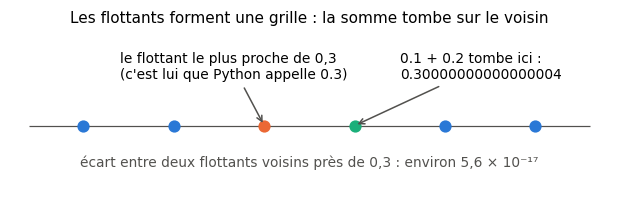

# R0 · Prise en main — fiche de cours

> La remise à niveau (R0 à R9) n'a pas de livre : **cette fiche est le cours**. R0 ne contient aucune notion de maths nouvelle : il t'apprend à te servir des outils du workbook, pour que les chapitres suivants ne parlent plus que de maths.

| | |
|---|---|
| **Sections** | §1 à §7 |
| **Temps total estimé** | ≈ 3 h : lecture et essais de la fiche ≈ 45 min, exercices ≈ 2 h, flashcards ≈ 20 min (parcours essentiel ≈ 2 h 50) |
| **Prérequis** | workbookIA 0A, sections §100.1.1 (cellules, noyau), §100.2.1 (nombres et opérateurs), §100.2.2 (chaînes de caractères), §100.3.1 (listes), §100.4.1 (conditions) et §100.5.1 (définir une fonction) |
| **Fichiers du chapitre** | `02_exercices.md` (quiz, papier) · `03_notebook.ipynb` · `04_indices.md` · `05_solutions.md` et `05_solutions.ipynb` · `06_mes_reponses.md` · `flashcards.csv` |
| **mymath** | `_example.py` : la fonction `mean` (R0.9) |

## Comment utiliser ce chapitre

R0 se fait **en même temps que le début du chapitre 0A de workbookIA**, qui t'apprend Python en profondeur. Ici, tu ne prends de Python que ce qui sert aux maths : calculer, taper une réponse, vérifier un calcul avec SymPy, écrire une formule, tracer une courbe, lancer des tests.

**Ordre conseillé.**
1. `python tools/start_chapter.py R0` (sur Colab : `00_setup/COLAB.md` §2). La commande copie le notebook et ta feuille de réponses dans `mon_travail/r0_prise_en_main/`, et crée la première fois ta librairie `mon_travail/mymath/` et tes fichiers de suivi (`mon_travail/suivi/`). Ouvre **ta copie** du notebook.
2. Ensuite, section par section : lis la section, **tape toi-même** les exemples dans une cellule de ton notebook, puis fais les exercices de la section (tableau ci-dessous), les quiz 🧠 d'abord.
3. À la fin : le test de positionnement (`python tools/start_chapter.py POS`), qui te dira quels chapitres de R1 à R9 tu peux survoler.

**Lire les exemples.** Une ligne qui commence par `>>>` est ce que tu tapes ; la ligne en dessous, sans `>>>`, est ce que Python affiche. Dans une cellule de notebook, tape le code **sans** `>>>`. Tous les exemples ont été exécutés avec les versions du workbook (Python 3.13, SymPy 1.14).

| Section | Quiz 🧠 | Papier et réflexion | Notebook |
|---|---|---|---|
| §1 Le notebook du dépôt | Q1 | | |
| §2 Python comme calculatrice | Q2 | R0.1 ✏️ | R0.4 🔮, R0.6 🐛 |
| §3 Taper une réponse et la faire vérifier | Q3 | R0.2 🗣️ | R0.3 📦 |
| §4 SymPy : vérifier un calcul à la main | Q4 | | R0.5 📦, R0.6 🐛 |
| §5 Écrire une formule en LaTeX | Q4 | R0.8 🛠️ | |
| §6 Un premier graphique | | | R0.7 🎨 |
| §7 Ta librairie mymath et ses tests | | | R0.9 🔨 |

Parcours essentiel : tout sauf R0.Q4, R0.2 et R0.7.

## Objectifs d'apprentissage

À la fin du chapitre, tu sais :
- **exécuter** un notebook du dépôt, dans le bon ordre, et y écrire tes réponses dans ta copie ;
- **calculer** avec Python en respectant ses priorités (`**`, `//`, `%`), et **expliquer** pourquoi `0.1 + 0.2` n'y vaut pas exactement `0.3` ;
- **taper** un nombre, une fraction, une expression et un intervalle pour que `wbm.check` les vérifie ;
- **vérifier** un développement ou une simplification avec SymPy ;
- **écrire** une formule en LaTeX dans une cellule Markdown ;
- **tracer** la courbe d'une fonction ;
- **écrire** une fonction de `mymath`, lancer ses tests et lire un échec.

## L'essentiel en 10 lignes

1. Tu écris **uniquement** dans `mon_travail/` ; tout le reste du dépôt est mis à jour par Claude.
2. Dans un notebook, c'est l'**ordre d'exécution** qui compte ; « Redémarrer et tout exécuter » est le test de vérité.
3. En Python, la puissance s'écrit `**` (jamais `^`), et la multiplication s'écrit toujours : `2*x`, pas `2x`.
4. `**` passe avant le signe moins : `-3**2` vaut `-9`. `//` donne le quotient et `%` le reste de la division euclidienne.
5. Les nombres à virgule sont des **flottants**, presque toujours arrondis : on ne compare jamais deux flottants avec `==`.
6. `wbm.check("ID", ta_réponse)` dit si ta réponse est juste **sans jamais la révéler** ; ⏳ veut dire « pas encore fait ».
7. Une fraction, une expression ou un intervalle se tapent **entre guillemets** : `"5/8"`, `"(x + 1)**2"`, `"[0 ; 1["`.
8. SymPy calcule **exactement**, avec des lettres : `expand`, `factor`, `simplify`, `subs` vérifient ton calcul à la main, ils ne le remplacent pas.
9. En LaTeX, `$...$` encadre une formule, et les accolades groupent : `x^{10}`, `\frac{a}{b}`, `\sqrt{x}`.
10. Une fonction de `mymath` part d'un squelette (`raise NotImplementedError`), et des tests la comparent à une bibliothèque de confiance.

## §1 · Le notebook du dépôt

### Où tu travailles

Le dépôt contient deux sortes de dossiers. Ceux que Claude met à jour (`chapitres/`, `annexes/`, `tools/`…) et **ton espace**, `mon_travail/`, qu'il ne touche jamais. Quand tu lances `python tools/start_chapter.py R0`, le script copie dans `mon_travail/r0_prise_en_main/` les fichiers sur lesquels tu vas écrire : le notebook d'exercices et ta feuille de réponses. Il ne remplace jamais un fichier déjà présent : ton travail est à l'abri des mises à jour.

> ⚠️ **Piège : écrire dans `chapitres/`.** Si tu écris dans le notebook de `chapitres/r0_prise_en_main/`, ton travail sera écrasé à la prochaine mise à jour du dépôt. Vérifie le chemin du fichier ouvert : il doit commencer par `mon_travail/`.

Chaque chapitre a les mêmes fichiers :

| Fichier | Rôle |
|---|---|
| `01_fiche.md` | le cours (ce que tu lis) |
| `02_exercices.md` | les quiz 🧠 et les exercices papier ✏️, ∂, 🗣️… |
| `03_notebook.ipynb` | la vérification de tes calculs papier (partie 0), puis les exercices de code |
| `04_indices.md` | trois indices par exercice, du plus léger au presque-solution |
| `05_solutions.md` et `05_solutions.ipynb` | les corrigés détaillés, et le notebook de solutions exécuté |
| `06_mes_reponses.md` | ta feuille de réponses (tu remplis ta copie) |
| `flashcards.csv` | les cartes à réviser dans Anki |

### La routine d'un exercice papier

1. Tu calcules **sur papier** (ou dans ta copie de `06_mes_reponses.md`), sans ordinateur.
2. Tu reportes ta réponse dans la **partie 0** du notebook, qui la vérifie avec `wbm.check`.
3. Si c'est faux, tu cherches l'erreur ; bloqué plus de 15 minutes, tu ouvres l'indice 1 de `04_indices.md`, puis le 2, puis le 3.
4. Tu lis la solution **après**, même si tu as juste : elle donne la démarche, les erreurs fréquentes et une variante.

L'ordre compte. Le notebook vérifie ton calcul, il ne le remplace pas : c'est en calculant à la main qu'on apprend.

### Exécuter un notebook

Un notebook est une suite de **cellules** : des cellules de texte (Markdown) et des cellules de code, que tu exécutes une par une avec Maj + Entrée. Le code s'exécute dans un **noyau** (*kernel*) : une mémoire qui garde les variables d'une cellule à l'autre. Le noyau ne lit pas la page : il garde ce que les cellules ont laissé, **dans l'ordre où tu les as exécutées**. Si tu exécutes une cellule du bas, puis une cellule du haut, la cellule du haut voit les variables créées par celle du bas.

Trois règles en découlent :
- la cellule **⚙️ SETUP**, la première de chaque notebook, est celle que tu exécutes en premier, à chaque ouverture : elle prépare le dépôt, les bibliothèques et `wbm` ;
- quand plus rien n'a de sens, **Redémarrer et tout exécuter** (*Restart and run all*) : le noyau repart d'une mémoire vide et exécute tout de haut en bas ;
- avant de considérer un notebook comme fini, fais ce même test : il doit aller au bout.

Dans les notebooks du workbook, « Tout exécuter » va jusqu'au bout **même quand rien n'est rempli** : un exercice pas encore fait affiche ⏳ au lieu de planter. Les cellules qui appellent ton code sont entourées d'un bloc `with wbm.attempt("R0.9"):` : il transforme « pas encore écrit » en ⏳, et laisse s'afficher normalement les vraies erreurs.

> 🔗 **Dans workbookIA** — le chapitre 0A (§100.1) explique le noyau, le terminal et le dossier `mon_travail/` de workbookIA, qui fonctionne exactement de la même façon. Les deux dépôts sont indépendants : chacun a son dossier `mon_travail/`.

## §2 · Python comme calculatrice

### Les opérateurs

| Opération | En maths | En Python | Exemple | Résultat |
|---|---|---|---|---|
| addition, soustraction | $a + b$, $a - b$ | `a + b`, `a - b` | `7 - 10` | `-3` |
| multiplication | $a \times b$, $ab$ | `a * b` | `6 * 7` | `42` |
| division | $\frac{a}{b}$ | `a / b` | `7 / 2` | `3.5` |
| quotient de la division euclidienne | | `a // b` | `23 // 4` | `5` |
| reste de la division euclidienne | | `a % b` | `23 % 4` | `3` |
| puissance | $a^b$ | `a ** b` | `2 ** 10` | `1024` |
| racine carrée | $\sqrt{a}$ | `a ** 0.5` ou `math.sqrt(a)` | `16 ** 0.5` | `4.0` |

La **division euclidienne** de $a$ par $b > 0$ donne un quotient $q$ et un reste $r$ tels que $a = bq + r$ avec $0 \le r < b$. Pour 23 et 4 : $23 = 4 \times 5 + 3$, donc `23 // 4` vaut 5 et `23 % 4` vaut 3. Le reste sert partout : `n % 2 == 0` teste si `n` est pair.

> ⚠️ **Piège : `^` n'est pas la puissance.** En Python, `2 ^ 3` vaut `1` (c'est une opération sur les bits, le « ou exclusif ») et ne donne aucun message d'erreur. La puissance s'écrit toujours `**`.

> ⚠️ **Piège : la multiplication ne se sous-entend pas.** En maths, $2x$ veut dire $2 \times x$. En Python, `2x` est une erreur de syntaxe (*SyntaxError*) : on écrit `2 * x`. De même, $3(x + 1)$ s'écrit `3 * (x + 1)`.

### Les priorités

Python suit les priorités des maths, avec deux précisions qui surprennent :

1. les parenthèses d'abord ;
2. puis `**`, **avant le signe moins** placé devant un nombre ;
3. puis `*`, `/`, `//`, `%`, de gauche à droite ;
4. enfin `+` et `-`, de gauche à droite.

```python
>>> 1 + 2 * 3
7
>>> (1 + 2) * 3
9
>>> -3 ** 2
-9
>>> (-3) ** 2
9
>>> 12 / 3 * 2
8.0
>>> 2 ** 3 ** 2
512
```

Deux lignes demandent une explication. `-3 ** 2` se lit $-(3^2)$ : la puissance passe avant le signe moins, exactement comme $-3^2 = -9$ en maths. Et `2 ** 3 ** 2` se lit $2^{(3^2)} = 2^9 = 512$ : les puissances s'enchaînent **de droite à gauche**, comme en maths, où $2^{3^2}$ veut dire $2^9$ et non $(2^3)^2 = 64$. Dans le doute, mets des parenthèses : elles ne coûtent rien.

`/` donne toujours un flottant, même quand la division tombe juste : `12 / 3` vaut `4.0`. Et `12 / 3 * 2` se calcule de gauche à droite : $(12 / 3) \times 2 = 8$, et non $12 / 6$.

### Division euclidienne avec des nombres négatifs

`//` arrondit **vers le bas**, c'est-à-dire vers $-\infty$, et pas vers zéro :

```python
>>> -23 // 4
-6
>>> -23 % 4
1
```

En effet $-23 / 4 = -5{,}75$, et l'entier juste en dessous est $-6$. Le reste suit la règle $a = bq + r$ avec $0 \le r < b$ : $-23 = 4 \times (-6) + 1$. Le reste par un nombre positif est donc toujours positif ou nul.

### Les flottants : pourquoi 0,1 + 0,2 ≠ 0,3

```python
>>> 0.1 + 0.2
0.30000000000000004
>>> 0.1 + 0.2 == 0.3
False
```

Ce n'est pas un défaut de Python. Un ordinateur range un nombre à virgule, ou **flottant** (*floating-point number*), dans un nombre fixe de chiffres **binaires** (en base 2). En base 10, $\frac{1}{3} = 0{,}333\ldots$ ne s'écrit pas avec un nombre fini de chiffres. De la même façon, en base 2, 0,1 ne s'écrit pas avec un nombre fini de chiffres : l'ordinateur garde le flottant le plus proche, avec une précision d'environ 16 chiffres significatifs. Les flottants forment donc une grille très fine, et chaque calcul tombe sur un point de la grille, parfois sur le voisin de celui qu'on attendait.



L'écart est minuscule (environ $5{,}6 \times 10^{-17}$), mais il suffit pour que `==` réponde `False`. Trois conséquences pratiques :
- on ne compare jamais deux flottants avec `==`, mais avec une tolérance : `math.isclose(0.1 + 0.2, 0.3)` vaut `True` ;
- pour un calcul **exact** sur des fractions, on utilise `fractions.Fraction` : `Fraction(1, 10) + Fraction(2, 10)` vaut exactement `Fraction(3, 10)` ;
- un résultat comme `5.551115123125783e-17` se lit en notation scientifique : `e-17` veut dire « fois $10^{-17}$ ».

> 💻 **Aujourd'hui en pratique** — tous les calculs du machine learning se font en flottants, souvent avec encore moins de chiffres (16 ou 32 bits au lieu de 64, pour aller plus vite sur les cartes graphiques). Les erreurs d'arrondi et leurs remèdes reviennent en M05a (*overflow*, *underflow*, log-sum-exp).

En maths, la virgule sépare la partie entière des décimales : 3,5. En Python, c'est le **point** : `3.5`. Dans ce workbook, le texte écrit 3,5 et le code écrit `3.5` ; `wbm.check` accepte les deux, y compris `"3,5"` entre guillemets.

## §3 · Taper une réponse et la faire vérifier

### Ce que fait `wbm.check`

`wbm.check("R0.1a", ta_réponse)` compare ta réponse à la bonne et affiche :
- ✅ si elle est juste ;
- ❌ avec un message qui dit où chercher (« la puissance passe avant le signe moins », « fraction à l'envers »…), mais **jamais** la bonne réponse ;
- ⏳ si tu n'as pas encore répondu (la variable vaut encore `...`).

Comment peut-il vérifier sans afficher la réponse ? Le fichier que lit `wbm.check` (`src/wbm/answers.json`) ne contient pas les réponses, seulement leur **empreinte** (*hash*) : un long code calculé à partir de la réponse, d'où l'on ne peut pas la retrouver. `wbm.check` calcule l'empreinte de **ta** réponse, de la même façon, et compare les deux codes. Deux réponses égales donnent la même empreinte ; un seul chiffre différent donne une empreinte complètement différente. Les messages d'erreur viennent des empreintes de quelques erreurs classiques, enregistrées avec la bonne réponse. Les réponses en clair existent ailleurs, dans les solutions du chapitre (`05_solutions.md`) : à lire **après** avoir cherché.

> ⚠️ **Piège : taper l'expression Python au lieu de la valeur.** Dans la partie 0, tape **la valeur que tu as trouvée sur papier**, pas un calcul que Python ferait pour toi : `answer = 23`, pas `answer = 5 + 2 * 3 ** 2`. Sinon tu vérifies Python, pas toi.

### Comment taper chaque sorte de réponse

Rappel de 0A (§100.2.2) : du texte entre guillemets, comme `"5/8"`, est une **chaîne de caractères** (*string*). Python ne le calcule pas : il le transmet tel quel à `wbm.check`, qui le lit lui-même.

| Réponse attendue | Exemple d'énoncé | Ce que tu tapes |
|---|---|---|
| un nombre entier | « combien vaut $2^{10}$ ? » | `1024` |
| un nombre décimal arrondi | « $\sqrt{2}$, à 2 décimales » | `1.41` ou `"1,41"` (arrondis comme l'énoncé le demande) |
| une fraction exacte | « $\frac{1}{2} + \frac{1}{8}$ » | `"5/8"` (entre guillemets) |
| une expression | « développe $(x + 1)^2$ » | `"x**2 + 2*x + 1"` |
| un intervalle | « les réels $x$ tels que $-1 < x \le 2$ » | `"]-1 ; 2]"` |
| un vrai ou faux | « 7 est-il pair ? » | `False` |
| une liste de nombres | « les solutions de… » | `[-1, 3]` |

**Les fractions.** Tape une fraction entre guillemets : `"5/8"`. Sans guillemets, `5/8` est d'abord calculé par Python, qui donne le flottant `0.625`. Ici c'est sans danger, car 0,625 est un nombre décimal exact. Mais `1/3` donnerait `0.3333333333333333`, une valeur **approchée** : `wbm.check` la refuse quand l'énoncé demande une fraction exacte, avec un message qui le dit. Quand l'énoncé demande une fraction **irréductible**, `"10/16"` est refusé avec un message qui dit que la valeur est juste mais pas simplifiée.

**Les expressions.** Tape-les comme en Python, entre guillemets : `"3*x**2 - 2*x + 5"`. Dans une chaîne de caractères, `wbm.check` est indulgent : `"3x^2 - 2x + 5"`, avec `^` et sans signe `*`, passe aussi, et `"x²"` également. Toutes les écritures **équivalentes** sont acceptées : `"(x + 1)**2"` et `"x**2 + 2*x + 1"` sont la même expression. Fonctions reconnues : `exp`, `ln` (ou `log`), `sqrt`, `abs`, `sin`, `cos`, `pi`.

**Les intervalles.** Les deux notations sont acceptées : française `"]-1 ; 2]"` ou anglaise `"(-1, 2]"`. L'infini s'écrit `oo` (deux lettres o), `inf` ou `∞`, et le crochet est toujours **ouvert** du côté de l'infini : `"[0 ; +oo["`, jamais `"[0 ; +oo]"`. Une réunion s'écrit avec `U` : `"]-oo ; 0] U [1 ; +oo["`.

> 🔗 **Dans workbookIA** — `wb.check` y fonctionne de la même façon, pour les nombres et les tableaux ; les fractions, les expressions et les intervalles sont propres à ce dépôt de maths.

## §4 · SymPy : vérifier un calcul à la main

### Calculer avec des lettres

NumPy calcule avec des **nombres**, en flottants. **SymPy** fait du **calcul symbolique** (*symbolic computation*) : il manipule des expressions avec des lettres, comme sur une feuille, et calcule **exactement**.

```python
>>> import sympy as sp
>>> x = sp.Symbol("x")
>>> sp.expand((x - 2) * (x + 4))
x**2 + 2*x - 8
>>> sp.factor(x**2 - 9)
(x - 3)*(x + 3)
>>> sp.simplify((x**2 + 2*x + 1) / (x + 1))
x + 1
>>> (x**2 + 2*x - 8).subs(x, 3)
7
>>> sp.sqrt(8)
2*sqrt(2)
>>> sp.Rational(1, 3) + sp.Rational(1, 6)
1/2
```

Ce qu'il faut retenir :
- `sp.Symbol("x")` crée une lettre ; sans elle, Python ne sait pas ce qu'est `x` ;
- `sp.expand` **développe** (produit → somme), `sp.factor` **factorise** (somme → produit), `sp.simplify` cherche une forme plus simple ;
- `.subs(x, 3)` remplace `x` par 3 ;
- SymPy garde les valeurs exactes : `sqrt(8)` reste $2\sqrt{2}$, et `sp.Rational(1, 3)` est le vrai tiers. Pour obtenir une valeur approchée, on le demande : `sp.sqrt(8).evalf()` donne `2.82842712474619`.

> ⚠️ **Piège : `1/3` dans une expression SymPy.** `x + 1/3` calcule d'abord `1/3` en flottant (`0.333…`), puis l'ajoute à `x`. Écris `x + sp.Rational(1, 3)` ou `x + 1/sp.Integer(3)` pour garder le tiers exact. En revanche `x / 3` est exact, car SymPy fait la division lui-même.

### Vérifier son propre calcul

SymPy sert à **vérifier**, pas à calculer à ta place. La méthode la plus sûre : écris ton résultat, et demande à SymPy si la différence avec l'expression de départ se simplifie en 0.

```python
>>> start = (2*x + 3)**2
>>> mine = 4*x**2 + 12*x + 9       # mon développement à la main
>>> sp.expand(start - mine)
0
```

0 : ton développement est juste. Si la différence ne vaut pas 0, ce qui reste te montre où est l'écart. Un second contrôle, rapide et utile même sans SymPy : remplacer `x` par un nombre simple dans les deux expressions. Avec $x = 1$, $(2 \times 1 + 3)^2 = 25$ et $4 + 12 + 9 = 25$ : pas de contradiction. Attention, un seul nombre ne **prouve** rien : deux expressions différentes peuvent coïncider en un point. Seule la différence qui se simplifie en 0 prouve l'égalité.

> 📐 Dans `annexes/cheatsheets/sympy.md`, tu trouveras les fonctions de SymPy dont le workbook se sert, chapitre par chapitre (dérivées en R7, intégrales en M02a, matrices en M09a…).

## §5 · Écrire une formule en LaTeX

Dans une cellule Markdown (et dans `06_mes_reponses.md`), une formule s'écrit en **LaTeX** entre deux signes `$` : `$x^2 + 1$` affiche $x^2 + 1$. Entre deux paires `$$`, la formule est centrée sur sa propre ligne. GitHub, Colab et Jupyter affichent tous les trois ces formules.

| Pour écrire | Tape | Résultat |
|---|---|---|
| une puissance | `x^2`, `e^{-x}`, `x^{10}` | $x^2$, $e^{-x}$, $x^{10}$ |
| un indice | `x_i`, `x_{12}` | $x_i$, $x_{12}$ |
| une fraction | `\frac{a}{b}` | $\frac{a}{b}$ |
| une racine | `\sqrt{x}`, `\sqrt[3]{x}` | $\sqrt{x}$, $\sqrt[3]{x}$ |
| une somme, un produit | `\sum_{i=1}^{n} x_i`, `\prod_{k=1}^{n} k` | $\sum_{i=1}^{n} x_i$, $\prod_{k=1}^{n} k$ |
| des lettres grecques | `\alpha`, `\beta`, `\sigma`, `\pi`, `\Delta` | $\alpha$, $\beta$, $\sigma$, $\pi$, $\Delta$ |
| fois, inférieur ou égal, différent | `\times`, `\leq`, `\neq` | $\times$, $\leq$, $\neq$ |
| appartient, l'infini, les réels | `\in`, `\infty`, `\mathbb{R}` | $\in$, $\infty$, $\mathbb{R}$ |
| des parenthèses qui s'adaptent | `\left( \frac{1}{2} \right)` | $\left( \frac{1}{2} \right)$ |

> ⚠️ **Piège : oublier les accolades.** `x^10` affiche $x^10$ : seul le premier caractère, le 1, monte en exposant. Les accolades groupent : `x^{10}` affiche $x^{10}$. La même règle vaut pour les indices (`x_{12}`) et pour `\frac{a+b}{2}`.

Pourquoi apprendre LaTeX ? Parce qu'une démonstration ou une réponse écrite proprement se relit mieux, par toi dans un mois comme par un recruteur. C'est aussi la langue de tous les articles scientifiques, et de MML.

## §6 · Un premier graphique

Tracer une courbe demande toujours les mêmes quatre étapes. Voici la recette ; le chapitre 0A de workbookIA (§100.8 et §100.10) en explique chaque morceau.

```python
import matplotlib.pyplot as plt
import numpy as np

xs = np.linspace(-3, 3, 200)          # 1. 200 abscisses régulièrement espacées de -3 à 3
ys = xs**3 / 4 - xs                   # 2. les ordonnées, calculées sur tout le tableau d'un coup

fig, ax = plt.subplots(figsize=(6, 3.6))
ax.plot(xs, ys, label="g(x) = x³/4 − x")   # 3. la courbe : une ligne qui relie les 200 points
ax.set_title("Un premier graphique")        # 4. titre, axes, quadrillage, légende
ax.set_xlabel("x")
ax.set_ylabel("g(x)")
ax.grid(True)
ax.legend()
plt.show()
```

![La courbe de g(x) = x³/4 − x sur [−3, 3], avec titre, axes, quadrillage et légende](figures/premier_graphique.png)

- `np.linspace(a, b, n)` crée `n` nombres régulièrement espacés de `a` à `b`, extrémités comprises ;
- les opérations sur un tableau NumPy s'appliquent **à chaque élément** : `xs**3 / 4 - xs` calcule les 200 ordonnées d'un coup ;
- matplotlib ne trace pas une « vraie » courbe : il relie les points par des segments ; avec 200 points, on ne voit plus les segments.

> ⚠️ **Piège : `math.exp` sur un tableau.** Pour tracer $e^{-x^2}$, écris `np.exp(-xs**2)`. Le module `math` ne travaille que sur un nombre à la fois : `math.exp(xs)` provoque une erreur (*TypeError*). Sur un tableau, on prend toujours les fonctions de NumPy : `np.exp`, `np.log`, `np.sqrt`, `np.cos`.

Un graphique propre a un titre, des noms d'axes et, s'il y a plusieurs courbes, une légende : c'est la règle du workbook.

## §7 · Ta librairie mymath et ses tests

### Une librairie que tu écris toi-même

Au fil des chapitres, tu construis `mymath`, ta propre librairie de maths, dans `mon_travail/mymath/` : fractions et PGCD en R1, résolution d'équations en R2, dichotomie en R7, pivot de Gauss en M09a, valeurs propres en M12c… Chaque module arrive sous forme de **squelette** : les fonctions sont déclarées, documentées (en anglais, comme tout le code du workbook), et leur corps se réduit à `raise NotImplementedError`. Tu remplaces cette ligne par ton code.

```python
def mean(values):
    """Return the arithmetic mean of a non-empty sequence of numbers.
    ...
    """
    # TODO: raise ValueError if values is empty, otherwise return sum / count.
    raise NotImplementedError("mean() is not implemented yet")
```

La docstring (le texte entre `"""`) est le **contrat** de la fonction : ce qu'elle reçoit (*Parameters*), ce qu'elle renvoie (*Returns*), les erreurs qu'elle lève (*Raises*) et un exemple (*Examples*). Lis-la entièrement avant d'écrire une ligne.

Pour `mean`, trois outils de 0A (§100.3.1) suffisent : une liste s'écrit `[2, 4, 9]`, `len(values)` donne son nombre d'éléments et `sum(values)` leur somme (ils marchent aussi sur un tuple et sur un tableau NumPy).

Deux recettes servent dès maintenant (le chapitre 0A les approfondit en §100.6.2 et §100.11.3) :
- **lever une erreur** quand une entrée n'a pas de sens : `raise ValueError("cannot average an empty sequence")` arrête la fonction avec un message clair ;
- **écrire un test** : dans le notebook, `assert mymath._example.mean([2, 4]) == 3.0` ne fait rien si c'est vrai, et lève une `AssertionError` si c'est faux. La fonction s'y appelle `mymath._example.mean` : le nom de la librairie, celui du module, puis celui de la fonction.

> ⚠️ **Piège : tester une liste vide avec `if not values`.** Les tests de `mean` lui passent aussi des tableaux NumPy, et `if not values` sur un tableau de plusieurs nombres provoque une erreur (« *truth value of an array is ambiguous* »). Écris `if len(values) == 0:`, qui marche pour une liste, un tuple et un tableau.

### Les tests : comparer à un oracle

Chaque module de `mymath` a son fichier de tests dans `tests/`. Un test ne contient pas de réponses écrites à la main : il compare ta fonction à un **oracle** (*test oracle*), une bibliothèque de confiance qui calcule la même chose (NumPy, SciPy, SymPy ou `fractions`). Pour `mean`, l'oracle est `np.mean`. Les tests vérifient aussi des propriétés et des cas limites : une seule valeur, un résultat de type `float`, une liste vide qui doit lever `ValueError`.

Pour les lancer, deux possibilités :
- dans le notebook, une cellule toute prête (exercice R0.9) les lance et affiche un résumé ;
- dans un terminal, à la racine du dépôt : `python -m pytest tests/test_example_mymath.py -q`.

Un test qui échoue affiche ❌ suivi de son nom, puis une ligne qui commence par **ce qui était attendu** : lis-la d'abord, c'est elle qui te dit quoi corriger. Un test marqué ⏳ attend que tu écrives la fonction.

> 🔗 **Dans workbookIA** — tu y construis `mylearn`, la librairie de ML, avec le même mécanisme (0A.26 y fait écrire la même fonction `mean`). Les deux librairies sont indépendantes : `mymath` contient les briques mathématiques, `mylearn` les algorithmes de ML.

## Les pièges classiques ⚠️ (récapitulatif)

| Piège | Faux | Juste |
|---|---|---|
| la puissance | `x^2` | `x**2` |
| la multiplication sous-entendue | `2x`, `3(x + 1)` | `2*x`, `3*(x + 1)` |
| le signe moins devant une puissance | croire que `-3**2` vaut 9 | `-3**2` vaut -9 ; `(-3)**2` vaut 9 |
| une fraction en Python | `1/2*x` pour $\frac{1}{2x}$ | `1/(2*x)` ; `1/2*x` veut dire $\frac{1}{2}x$ |
| comparer deux flottants | `0.1 + 0.2 == 0.3` | `math.isclose(0.1 + 0.2, 0.3)` |
| une fraction exacte pour `wbm.check` | `1/3` (flottant approché) | `"1/3"` (entre guillemets) |
| l'infini dans un intervalle | `"[0 ; +oo]"` | `"[0 ; +oo["` |
| un exposant en LaTeX | `x^10` | `x^{10}` |
| une fonction sur un tableau | `math.exp(xs)` | `np.exp(xs)` |
| une liste vide | `if not values:` | `if len(values) == 0:` |
| écrire au mauvais endroit | le notebook de `chapitres/` | ta copie, dans `mon_travail/` |

## Et maintenant

**Dans ce dépôt** : le test de positionnement (`positionnement/`), deux exercices par chapitre de R1 à R9, avec les outils que tu viens d'apprendre. Sa grille te dira quels chapitres faire en entier, survoler ou sauter. Puis R1, *Nombres et calcul*.

**Dans workbookIA** : continue le chapitre 0A ; avant R1, avance-le jusqu'à §100.6.2 (exceptions), comme l'indique ton tableau de bord. Plus tard, le chapitre 0B, *Maths du lycée au ML*, reprendra en accéléré tout ce que la remise à niveau t'aura appris : tu y retrouveras la vérification de tes calculs papier, avec `wb.check`.

## Pour aller plus loin

- Le tutoriel officiel de Python sur les flottants, *Floating-Point Arithmetic: Issues and Limitations* : [docs.python.org/3/tutorial/floatingpoint.html](https://docs.python.org/3/tutorial/floatingpoint.html) (vérifié le 2026-11-06).
- Les cheatsheets du dépôt : `annexes/cheatsheets/sympy.md` et `annexes/cheatsheets/matplotlib.md`.
- `annexes/symboles.md` : comment lire à voix haute chaque symbole mathématique ($\forall$, $\sum$, $\in$…), avec sa commande LaTeX.
