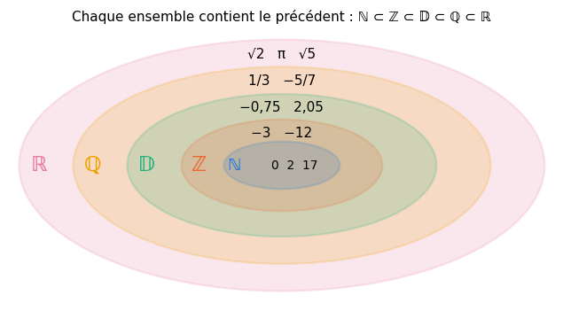
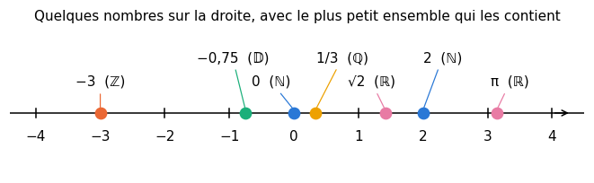
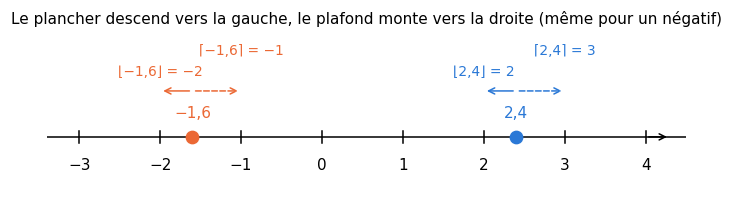
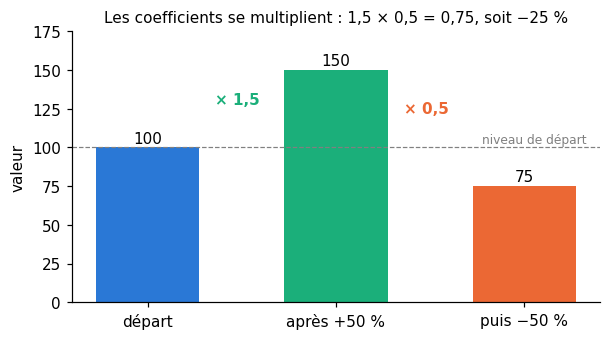
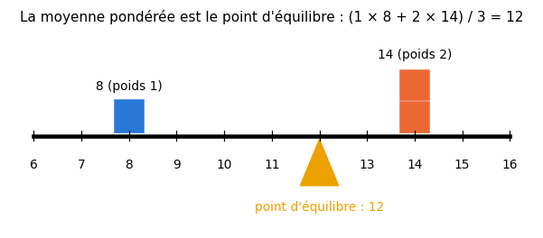

# R1 · Nombres et calcul — fiche de cours

> La remise à niveau (R0 à R9) n'a pas de livre : **cette fiche est le cours**. R1 reprend le calcul sur les nombres, du collège à la seconde : tout ce que les chapitres suivants, et le chapitre 0B de workbookIA, utiliseront sans le redire. Rien n'y est difficile ; tout y est piégeux. Le but est de calculer **juste**, vite, et de savoir pourquoi.

| | |
|---|---|
| **Sections** | §1 à §9 |
| **Temps total estimé** | ≈ 12,5 h : lecture et calculs de la fiche ≈ 2 h 15, exercices ≈ 9 h 25, flashcards ≈ 50 min (parcours essentiel ≈ 9,6 h) |
| **Prérequis** | R0 (taper une fraction et un intervalle pour `wbm.check`) ; workbookIA 0A jusqu'à §100.6.2 : listes (§100.3.1), boucles (§100.4.2), docstrings (§100.5.5), exceptions (§100.6.2) |
| **Fichiers du chapitre** | `02_exercices.md` (quiz, papier) · `03_notebook.ipynb` · `04_indices.md` · `05_solutions.md` et `05_solutions.ipynb` · `06_mes_reponses.md` · `flashcards.csv` |
| **mymath** | `arith.py` : `gcd`, `simplify_fraction`, `add_fractions`, `scientific_notation`, `successive_changes`, `weighted_mean` |

## Comment utiliser ce chapitre

**Ordre conseillé.**
1. `python tools/start_chapter.py R1` (sur Colab : `00_setup/COLAB.md` §2). La commande copie le notebook, ta feuille de réponses et le squelette `mymath/arith.py` dans `mon_travail/`.
2. Section par section : lis la section **crayon en main** (refais chaque exemple chiffré sur papier avant de lire la ligne suivante), puis fais les exercices de la section, les quiz 🧠 d'abord.
3. Les exercices ✏️ se font sur papier, dans ta copie de `06_mes_reponses.md`, puis se vérifient dans la **partie 0** du notebook.

Si le test de positionnement t'a donné « tu peux sauter » pour R1, lis seulement « L'essentiel en 10 lignes » et « Les pièges classiques », fais les quiz et les exercices 🔨 du parcours essentiel (`positionnement/05_grille.md`).

| Section | Quiz 🧠 | Papier et réflexion | Notebook |
|---|---|---|---|
| §1 Les ensembles de nombres | Q1 | R1.1 ✏️ | |
| §2 Priorités, nombres négatifs, distributivité | Q2 | R1.2 ✏️, R1.3 ✏️ | R1.29 🐛 |
| §3 Fractions | Q3, R1 🔁 | R1.4 ✏️, R1.5 ✏️, R1.6 ✏️, R1.16 ∂ | R1.21 🔨, R1.22 🔨, R1.25 📦, R1.28 🐛 |
| §4 Puissances | Q4 | R1.7 ✏️, R1.8 ✏️, R1.15 ∂ | R1.28 🐛 |
| §5 Racines carrées | Q5 | R1.9 ✏️ | |
| §6 Notation scientifique, ordres de grandeur, arrondis | Q6 | R1.10 ✏️, R1.11 ✏️, R1.17 🔗 | R1.23 🔨, R1.26 🔮, R1.30 🎨 |
| §7 Proportionnalité et pourcentages | Q7 | R1.12 ✏️, R1.13 ✏️, R1.20 🗣️ | R1.24 🔨, R1.27 🔬 |
| §8 Moyennes | Q8 | R1.14 ✏️ | R1.24 🔨, R1.31 🛠️ |
| §9 Estimations de Fermi | | R1.18 🧮, R1.19 🧮 | |

Parcours essentiel : tout sauf R1.Q8, R1.3, R1.6, R1.13, R1.16, R1.18, R1.23, R1.26, R1.27, R1.30 et R1.31.

**Lire les exemples de code.** Comme en R0 : une ligne qui commence par `>>>` est ce que tu tapes, la ligne suivante ce que Python affiche. Tous ont été exécutés avec les versions du workbook.

## Objectifs d'apprentissage

À la fin du chapitre, tu sais :
- **classer** un nombre dans ℕ, ℤ, 𝔻, ℚ ou ℝ, et ranger des nombres sur la droite, négatifs compris ;
- **calculer** sans erreur avec les priorités, les nombres négatifs et la distributivité, à la main puis en vérifiant avec Python ;
- **simplifier**, additionner, multiplier, diviser et comparer des fractions, et trouver un PGCD par l'algorithme d'Euclide ;
- **appliquer** les règles des puissances (exposants négatifs compris) et des racines carrées, et **repérer** les « règles » qui n'existent pas ;
- **écrire** un nombre en notation scientifique, l'arrondir à un nombre de chiffres significatifs, donner sa partie entière et son ordre de grandeur ;
- **calculer** une évolution en pourcentage, des évolutions successives et une évolution réciproque ;
- **calculer** une moyenne pondérée, et reconnaître la somme pondérée qui fait le calcul d'un neurone ;
- **estimer** un ordre de grandeur à la manière de Fermi.

## L'essentiel en 10 lignes

1. ℕ ⊂ ℤ ⊂ 𝔻 ⊂ ℚ ⊂ ℝ : chaque ensemble de nombres contient le précédent ; $\frac{1}{3}$ est rationnel mais pas décimal, $\sqrt{2}$ et $\pi$ ne sont même pas rationnels.
2. Priorités : parenthèses, puissances, puis × et ÷ de gauche à droite, puis + et − de gauche à droite. $-5^2 = -25$, mais $(-5)^2 = 25$.
3. Moins par moins donne plus ; soustraire un négatif, c'est ajouter : $9 - (-4) = 13$.
4. Fractions : on additionne **au même dénominateur**, on multiplie « en haut et en bas », on divise en multipliant par l'inverse. On simplifie par le PGCD, que l'algorithme d'Euclide trouve vite.
5. Puissances : $a^m \times a^n = a^{m+n}$, $\frac{a^m}{a^n} = a^{m-n}$, $(a^m)^n = a^{mn}$, $a^0 = 1$, $a^{-n} = \frac{1}{a^n}$. Mais $(a + b)^2 \ne a^2 + b^2$.
6. Racines : $\sqrt{ab} = \sqrt{a}\sqrt{b}$ et $\sqrt{a^2} = a$ pour $a \ge 0$. Mais $\sqrt{a + b} \ne \sqrt{a} + \sqrt{b}$.
7. Notation scientifique : $m \times 10^k$ avec $1 \le m < 10$ ; on arrondit à un nombre de **chiffres significatifs** ; l'ordre de grandeur est la puissance de 10 la plus proche.
8. Une évolution de $t$ % multiplie par $1 + \frac{t}{100}$ : des évolutions successives **multiplient** leurs coefficients, elles ne s'additionnent pas. +50 % puis −50 % font −25 %.
9. Moyenne pondérée : $\frac{\sum_i w_i x_i}{\sum_i w_i}$ ; sans la division, avec un biais, c'est le calcul d'un neurone, $z = \sum_i w_i x_i + b$.
10. Fermi : découpe la question en facteurs que tu sais estimer à une puissance de 10 près, multiplie, garde un chiffre significatif.

---

## §1 · Les ensembles de nombres et la droite numérique

### Cinq familles de nombres

On range les nombres en familles, de la plus petite à la plus grande :

| Ensemble | Nom | Ce qu'il contient | Exemples |
|---|---|---|---|
| ℕ | entiers naturels | 0, 1, 2, 3… | 0, 2, 17 |
| ℤ | entiers relatifs | les entiers naturels et leurs opposés | −3, −12, 2 |
| 𝔻 | nombres décimaux | les nombres qui s'écrivent avec un nombre **fini** de chiffres après la virgule | −0,75 ; 2,05 |
| ℚ | nombres rationnels | les quotients $\frac{p}{q}$ de deux entiers, avec $q \ne 0$ | $\frac{1}{3}$ ; $-\frac{5}{7}$ |
| ℝ | nombres réels | tous les nombres de la droite numérique | $\sqrt{2}$ ; $\pi$ ; $\sqrt{5}$ |



Chaque ensemble contient le précédent : un entier naturel est aussi un entier relatif, un entier est aussi un décimal ($2 = 2{,}0$), un décimal est aussi un rationnel ($2{,}05 = \frac{205}{100}$). On l'écrit avec le symbole ⊂, « est inclus dans » :

$$\mathbb{N} \subset \mathbb{Z} \subset \mathbb{D} \subset \mathbb{Q} \subset \mathbb{R}$$

Pour dire qu'un nombre **appartient** à un ensemble, on écrit $\in$ : $-3 \in \mathbb{Z}$, et $-3 \notin \mathbb{N}$ (« n'appartient pas »). Quand on demande « le plus petit ensemble qui contient $x$ », on cherche le premier de la chaîne qui le contient : pour $-0{,}75$, c'est 𝔻.

**Décimal ou pas ?** Un nombre est décimal quand il s'écrit $\frac{p}{10^k}$ : $2{,}05 = \frac{205}{10^2}$. Une fraction irréductible $\frac{p}{q}$ est décimale exactement quand son dénominateur $q$ n'a que 2 et 5 comme facteurs premiers : $\frac{7}{20} = 0{,}35$ (car $20 = 2^2 \times 5$), mais $\frac{1}{3} = 0{,}333\ldots$, avec des 3 à l'infini, n'est pas décimal.

**Rationnel ou pas ?** L'écriture décimale d'un rationnel finit toujours par se répéter ($\frac{1}{3} = 0{,}333\ldots$, $\frac{5}{7} = 0{,}714285\,714285\ldots$). Celle de $\sqrt{2} = 1{,}41421356\ldots$ ou de $\pi = 3{,}14159265\ldots$ ne se répète jamais : ces nombres sont **irrationnels**. On démontrera en R4 que $\sqrt{2}$ n'est pas rationnel ; retiens pour l'instant que $\sqrt{n}$ est irrationnel dès que l'entier $n$ n'est pas un carré parfait.

> 🔗 **Dans workbookIA** — un ordinateur ne manipule que des décimaux binaires (R0 §2, les flottants) : $\frac{1}{3}$, $\sqrt{2}$ ou même $0{,}1$ y sont arrondis. C'est pourquoi on calcule exactement avec `fractions.Fraction` (§3) ou SymPy quand il le faut.

### La droite numérique

Chaque réel est un point d'une droite graduée : 0 au milieu, les positifs à droite, les négatifs à gauche. **Plus un nombre est à droite, plus il est grand.**



Le piège est du côté des négatifs : $-7 < -2$, car $-7$ est plus à gauche (plus loin de 0, mais du mauvais côté). De même $-0{,}75 > -1$. Pour comparer deux négatifs, compare leurs distances à 0 : **le plus loin de 0 est le plus petit**.

Pour ranger des nombres écrits de façons différentes, écris-les tous de la même façon (en décimal, avec assez de chiffres) : pour comparer $\frac{1}{3}$ et $0{,}33$, écris $\frac{1}{3} = 0{,}3333\ldots$, qui dépasse $0{,}3300$. Donc $0{,}33 < \frac{1}{3}$.

```python
>>> sorted([2, -3, 1/3, -0.75, 0])
[-3, -0.75, 0, 0.3333333333333333, 2]
```

> ⚠️ **Erreur de calcul classique** — Ranger les négatifs comme les positifs : écrire $-2 < -7$ « parce que 2 < 7 ». Sur la droite, $-7$ est à gauche de $-2$.

## §2 · Priorités, nombres négatifs et distributivité

### L'ordre des opérations

Un calcul sans parenthèses se fait dans cet ordre :
1. les **parenthèses** (les plus intérieures d'abord) ;
2. les **puissances** ;
3. les **multiplications et divisions**, de gauche à droite ;
4. les **additions et soustractions**, de gauche à droite.

Exemple, étape par étape :

$$10 - 2 \times 3^2 + 8 \div 4 = 10 - 2 \times 9 + 8 \div 4 = 10 - 18 + 2 = -6$$

Le « de gauche à droite » compte : $24 \div 4 \times 2 = 6 \times 2 = 12$, et non $24 \div 8 = 3$. La division et la multiplication ont **la même** priorité ; aucune ne passe avant l'autre. Une barre de fraction, elle, groupe tout ce qui est au-dessus et tout ce qui est en dessous, comme des parenthèses invisibles : $\frac{6 + 4}{2 + 3} = \frac{10}{5} = 2$.

```python
>>> 10 - 2 * 3**2 + 8 / 4
-6.0
>>> 24 / 4 * 2
12.0
```

### Les nombres négatifs

**Ajouter et soustraire.** Ajouter un négatif, c'est soustraire : $7 + (-3) = 4$. Soustraire un négatif, c'est ajouter : $9 - (-4) = 9 + 4 = 13$. Sur la droite, soustraire $b$ revient à reculer de $b$ ; si $b$ est négatif, on avance.

**Multiplier et diviser.** La règle des signes :

| | par un positif | par un négatif |
|---|---|---|
| un positif | positif | négatif |
| un négatif | négatif | **positif** |

Ainsi $(-6) \times (-7) = 42$, $-15 \div 3 = -5$, et $(-24) \div (-8) = 3$. Avec plusieurs facteurs, **compte les signes moins** : un nombre pair donne un résultat positif, un nombre impair un résultat négatif. D'où $(-1)^n = 1$ si $n$ est pair, et $-1$ si $n$ est impair.

**Le signe moins devant une puissance.** La puissance passe avant le signe moins :

$$-5^2 = -(5^2) = -25 \qquad \text{mais} \qquad (-5)^2 = (-5) \times (-5) = 25$$

C'est la même règle qu'en Python (R0 §2) : `-5**2` vaut `-25`. Une calculatrice aussi calcule $-5^2 = -25$.

```python
>>> -5**2, (-5)**2, (-6) * (-7), 9 - (-4)
(-25, 25, 42, 13)
```

> ⚠️ **Erreur de calcul classique** — Écrire $-5^2 = 25$. Le carré ne porte que sur 5 ; pour élever $-5$ au carré, il faut des parenthèses.

### La distributivité

Multiplier une somme, c'est multiplier chacun de ses termes :

$$k \times (a + b) = k \times a + k \times b \qquad k \times (a - b) = k \times a - k \times b$$

On s'en sert dans les deux sens.

**Développer** (de gauche à droite) sert au calcul mental : $45 \times 102 = 45 \times (100 + 2) = 4500 + 90 = 4590$, et $19 \times 6 = (20 - 1) \times 6 = 120 - 6 = 114$.

**Factoriser** (de droite à gauche) repère un facteur commun : $37 \times 8 + 37 \times 2 = 37 \times (8 + 2) = 370$.

**Un signe moins devant une parenthèse** change le signe de chaque terme, car c'est une multiplication par $-1$ : $-(a - b) = -a + b$. Ainsi $5 - (3 - 8) = 5 - 3 + 8 = 10$ (ou, en calculant d'abord la parenthèse : $5 - (-5) = 10$).

> ⚠️ **Erreur de calcul classique** — Ne distribuer qu'au premier terme : $-(3 - 8) = -3 - 8$. Le moins s'applique à **tous** les termes de la parenthèse : $-(3 - 8) = -3 + 8$.

## §3 · Fractions

### Ce qu'est une fraction

$\frac{a}{b}$ (avec $b \ne 0$) est le nombre qui, multiplié par $b$, donne $a$ : $\frac{3}{4} \times 4 = 3$. On lit $a$ le **numérateur** et $b$ le **dénominateur**. Le dénominateur dit en combien de parts on coupe l'unité, le numérateur combien on en prend. **On ne divise jamais par 0** : $\frac{5}{0}$ n'existe pas.

Le signe se place où l'on veut : $-\frac{3}{4} = \frac{-3}{4} = \frac{3}{-4}$, et $\frac{-3}{-4} = \frac{3}{4}$. On le met d'habitude au numérateur, avec un dénominateur positif.

Une fraction dont le numérateur dépasse le dénominateur dépasse 1 : $\frac{7}{3} = 2 + \frac{1}{3}$ (car $7 = 2 \times 3 + 1$, la division euclidienne de R0 §2).

### Fractions égales et simplification

On ne change pas une fraction en multipliant (ou en divisant) **son numérateur et son dénominateur** par le même nombre non nul : $\frac{5}{6} = \frac{5 \times 12}{6 \times 12} = \frac{60}{72}$. Dans l'autre sens, c'est **simplifier**. Une fraction est **irréductible** quand on ne peut plus la simplifier : numérateur et dénominateur n'ont plus d'autre diviseur commun que 1.

Pour simplifier en une seule fois, on divise par le **PGCD** (plus grand commun diviseur) du numérateur et du dénominateur. Les diviseurs de 60 sont 1, 2, 3, 4, 5, 6, 10, 12, 15, 20, 30, 60 ; ceux de 72 sont 1, 2, 3, 4, 6, 8, 9, 12, 18, 24, 36, 72. Le plus grand diviseur commun est 12, donc :

$$\frac{60}{72} = \frac{60 \div 12}{72 \div 12} = \frac{5}{6}$$

### L'algorithme d'Euclide

Lister les diviseurs devient vite pénible. L'**algorithme d'Euclide** trouve le PGCD avec des divisions euclidiennes successives. Il repose sur une remarque : si $a = bq + r$, les diviseurs communs de $a$ et $b$ sont exactement les diviseurs communs de $b$ et $r$ (un nombre qui divise $a$ et $b$ divise $r = a - bq$, et inversement). Donc $\operatorname{PGCD}(a, b) = \operatorname{PGCD}(b, r)$ : on remplace le couple par un couple plus petit, jusqu'à un reste nul. **Le PGCD est le dernier reste non nul.**

Pour $\operatorname{PGCD}(1071, 462)$ :

| Division euclidienne | Reste |
|---|---|
| $1071 = 462 \times 2 + 147$ | 147 |
| $462 = 147 \times 3 + 21$ | 21 |
| $147 = 21 \times 7 + 0$ | 0 |

Le dernier reste non nul est 21 : $\operatorname{PGCD}(1071, 462) = 21$, et $\frac{462}{1071} = \frac{22}{51}$. Trois divisions, là où lister les diviseurs de 1071 aurait été long. Avec des nombres négatifs, on travaille avec leurs valeurs sans signe ; par convention, $\operatorname{PGCD}(a, 0) = a$ pour $a \ge 0$.

```python
>>> import math
>>> math.gcd(1071, 462)
21
>>> 1071 % 462, 462 % 147, 147 % 21
(147, 21, 0)
```

L'exercice R1.21 te fait écrire ta propre fonction `gcd` ; `math.gcd` servira à la tester.

### Additionner et soustraire

On n'additionne que des fractions **de même dénominateur** : on additionne alors les numérateurs, et le dénominateur ne change pas.

$$\frac{a}{d} + \frac{b}{d} = \frac{a + b}{d}$$

Sinon, on met d'abord les deux fractions au même dénominateur. Le plus simple est un **multiple commun** des deux dénominateurs ; le plus petit (le PPCM) donne les plus petits nombres. Pour $\frac{5}{6} + \frac{3}{8}$ : les multiples de 8 sont 8, 16, 24… et 24 est le premier qui est aussi un multiple de 6.

$$\frac{5}{6} + \frac{3}{8} = \frac{5 \times 4}{6 \times 4} + \frac{3 \times 3}{8 \times 3} = \frac{20}{24} + \frac{9}{24} = \frac{29}{24}$$

Le produit des dénominateurs ($6 \times 8 = 48$) marche toujours, mais donne des nombres plus grands, qu'il faut simplifier à la fin : $\frac{40}{48} + \frac{18}{48} = \frac{58}{48} = \frac{29}{24}$.

> ⚠️ **Erreur de calcul classique** — Additionner les numérateurs **et** les dénominateurs : $\frac{1}{2} + \frac{1}{2} = \frac{2}{4}$ ? C'est $\frac{1}{2}$, alors que deux moitiés font 1. L'exercice R1.16 te demande d'expliquer pourquoi cette « règle » est fausse.

### Multiplier et diviser

**Multiplier** : on multiplie les numérateurs entre eux et les dénominateurs entre eux. On a intérêt à simplifier **avant** de multiplier :

$$\frac{4}{9} \times \frac{3}{10} = \frac{4 \times 3}{9 \times 10} = \frac{2 \times 2 \times 3}{3 \times 3 \times 2 \times 5} = \frac{2}{15}$$

Prendre une fraction d'une quantité, c'est multiplier : les $\frac{2}{5}$ de 35, c'est $\frac{2}{5} \times 35 = \frac{70}{5} = 14$.

**Diviser** par une fraction, c'est multiplier par son **inverse** (la fraction retournée) :

$$\frac{5}{8} \div \frac{15}{4} = \frac{5}{8} \times \frac{4}{15} = \frac{20}{120} = \frac{1}{6}$$

L'inverse de $\frac{a}{b}$ est $\frac{b}{a}$ (pour $a \ne 0$) ; l'inverse d'un entier $n$ est $\frac{1}{n}$. Une « fraction de fractions » se calcule de la même façon : $\dfrac{\frac{a}{b}}{\frac{c}{d}} = \frac{a}{b} \times \frac{d}{c}$.

### Comparer

Deux fractions de même dénominateur se rangent comme leurs numérateurs. Sinon, on les met au même dénominateur. Pour comparer $\frac{5}{7}$ et $\frac{7}{10}$ : $\frac{5}{7} = \frac{50}{70}$ et $\frac{7}{10} = \frac{49}{70}$, donc $\frac{5}{7} > \frac{7}{10}$. Un raccourci, pour deux fractions à dénominateurs positifs : comparer les **produits en croix**, $5 \times 10 = 50$ et $7 \times 7 = 49$. Un autre : écrire les deux en décimal avec assez de chiffres ($0{,}714\ldots$ contre $0{,}7$).

### Calculer exactement avec Python

`fractions.Fraction` calcule avec des fractions exactes, toujours simplifiées :

```python
>>> from fractions import Fraction
>>> Fraction(60, 72)
Fraction(5, 6)
>>> Fraction(5, 6) + Fraction(3, 8)
Fraction(29, 24)
>>> Fraction(5, 8) / Fraction(15, 4)
Fraction(1, 6)
>>> Fraction(5, 7) > Fraction(7, 10)
True
```

À comparer avec les flottants de R0, où `0.1 + 0.2` vaut `0.30000000000000004`. Pour `wbm.check`, tu tapes une fraction entre guillemets, `"29/24"` (R0 §3).

> 💻 **Aujourd'hui en pratique** — le calcul exact sur les fractions coûte cher (les numérateurs et dénominateurs grandissent vite) : le ML calcule en flottants, et accepte de petits arrondis. Les fractions servent quand l'exactitude compte, par exemple pour **vérifier** un calcul.

## §4 · Puissances

### Définition et règles

Pour un nombre $a$ et un entier $n \ge 1$, $a^n$ est le produit de $n$ facteurs égaux à $a$ : $5^3 = 5 \times 5 \times 5 = 125$. On lit « $a$ puissance $n$ » ; $n$ est l'**exposant**. $a^2$ se lit « $a$ au carré » et $a^3$ « $a$ au cube ».

Toutes les règles viennent de cette définition : il suffit de compter les facteurs.

| Règle | Pourquoi | Exemple |
|---|---|---|
| $a^m \times a^n = a^{m+n}$ | $m$ facteurs, puis $n$ facteurs | $5^3 \times 5^4 = 5^7$ |
| $\dfrac{a^m}{a^n} = a^{m-n}$ ($a \ne 0$) | on simplifie $n$ facteurs | $\dfrac{6^8}{6^5} = 6^3 = 216$ |
| $(a^m)^n = a^{m \times n}$ | $n$ paquets de $m$ facteurs | $(3^2)^4 = 3^8$ |
| $(a \times b)^n = a^n \times b^n$ | on regroupe les $a$, puis les $b$ | $(2 \times 7)^2 = 4 \times 49 = 196$ |
| $\left(\dfrac{a}{b}\right)^n = \dfrac{a^n}{b^n}$ ($b \ne 0$) | même idée | $\left(\dfrac{2}{3}\right)^4 = \dfrac{16}{81}$ |

Pour $5^3 \times 5^4$, on écrit trois facteurs 5, puis quatre : sept facteurs 5 en tout, $5^7$. Pour $(3^2)^4$, on écrit quatre fois $3 \times 3$ : huit facteurs 3.

### Exposant nul et exposants négatifs

Que vaut $a^0$, ou $a^{-2}$ ? La définition (« $n$ facteurs ») n'a plus de sens. On **choisit** une valeur, pour que les règles du tableau restent vraies. Regarde les puissances de 3 en descendant : chaque ligne se déduit de la précédente en **divisant par 3**.

| $3^3$ | $3^2$ | $3^1$ | $3^0$ | $3^{-1}$ | $3^{-2}$ |
|---|---|---|---|---|---|
| 27 | 9 | 3 | 1 | $\frac{1}{3}$ | $\frac{1}{9}$ |

Prolonger le motif donne les définitions, pour tout $a \ne 0$ et tout entier $n \ge 1$ :

$$a^0 = 1 \qquad\qquad a^{-n} = \frac{1}{a^n}$$

L'exercice R1.15 te fait démontrer que ce sont les **seules** valeurs qui gardent la règle $a^m \times a^n = a^{m+n}$ vraie. Avec elles, toutes les règles du tableau marchent pour des exposants entiers quelconques : $5^4 \times 5^{-6} = 5^{-2} = \frac{1}{25}$, et $\left(\frac{2}{3}\right)^{-2} = \frac{1}{(2/3)^2} = \frac{9}{4}$ : un exposant négatif **retourne** la fraction.

> ⚠️ **Erreur de calcul classique** — Croire qu'un exposant négatif rend le nombre négatif : $3^{-2} = \frac{1}{9}$, un nombre positif (petit). Le signe moins de l'exposant veut dire « inverse », pas « opposé ».

### Les « règles » qui n'existent pas

Les règles portent sur des **produits**, jamais sur des sommes :
- $(a + b)^2 \ne a^2 + b^2$ : $(2 + 3)^2 = 25$, alors que $2^2 + 3^2 = 13$. Le bon développement, $(a + b)^2 = a^2 + 2ab + b^2$, vient en R2 ;
- $a^m + a^n \ne a^{m+n}$ : $3^2 + 3^3 = 9 + 27 = 36$, alors que $3^5 = 243$ ;
- $a^m \times b^n$ ne se simplifie pas quand $a \ne b$ et $m \ne n$ ;
- $(-a)^n$ et $-a^n$ diffèrent quand $n$ est pair : $(-2)^4 = 16$, mais $-2^4 = -16$.

### Puissances de 10 et préfixes

Les puissances de 10 se lisent en comptant les zéros : $10^6 = 1\,000\,000$ (six zéros), $10^{-4} = 0{,}0001$ (le 1 est en quatrième position après la virgule). Multiplier par $10^k$ déplace la virgule de $k$ rangs vers la droite ; par $10^{-k}$, de $k$ rangs vers la gauche. Les règles s'appliquent : $10^7 \times 10^{-5} = 10^2$.

Les préfixes du système international nomment les puissances de 10 qui vont de trois en trois :

| Préfixe | téra (T) | giga (G) | méga (M) | kilo (k) | milli (m) | micro (µ) | nano (n) |
|---|---|---|---|---|---|---|---|
| Puissance | $10^{12}$ | $10^9$ | $10^6$ | $10^3$ | $10^{-3}$ | $10^{-6}$ | $10^{-9}$ |

Ainsi 3 GHz font $3 \times 10^9$ hertz, et 250 nm font $250 \times 10^{-9} = 2{,}5 \times 10^{-7}$ m.

```python
>>> 5**7, 6**8 // 6**5
(78125, 216)
>>> 3**-2
0.1111111111111111
>>> Fraction(3)**-2
Fraction(1, 9)
```

En Python, une puissance d'entiers à exposant négatif donne un **flottant** (arrondi) ; `Fraction` la garde exacte.

## §5 · Racines carrées

### Définition

Pour un nombre $a \ge 0$, la **racine carrée** $\sqrt{a}$ est le nombre **positif ou nul** dont le carré vaut $a$ : $\sqrt{49} = 7$ car $7^2 = 49$ et $7 \ge 0$. Le nombre $-7$ a aussi pour carré 49, mais ce n'est pas $\sqrt{49}$ : par définition, une racine carrée n'est jamais négative. Un nombre négatif n'a pas de racine carrée réelle : $\sqrt{-4}$ n'existe pas dans ℝ.

Deux conséquences, à bien distinguer :
- $(\sqrt{a})^2 = a$ pour tout $a \ge 0$ : $(\sqrt{7})^2 = 7$ ;
- $\sqrt{a^2} = a$ seulement si $a \ge 0$ : $\sqrt{(-4)^2} = \sqrt{16} = 4$, et non $-4$. (En R2, on écrira $\sqrt{a^2} = |a|$, la valeur absolue.)

Les carrés parfaits à connaître : 1, 4, 9, 16, 25, 36, 49, 64, 81, 100, 121, 144, 169, 196, 225. Et deux valeurs approchées : $\sqrt{2} \approx 1{,}414$, $\sqrt{3} \approx 1{,}732$.

### Règles de calcul

Pour $a \ge 0$ et $b \ge 0$ (et $b \ne 0$ pour le quotient) :

$$\sqrt{a \times b} = \sqrt{a} \times \sqrt{b} \qquad\qquad \sqrt{\frac{a}{b}} = \frac{\sqrt{a}}{\sqrt{b}}$$

Pourquoi ? $(\sqrt{a}\sqrt{b})^2 = (\sqrt{a})^2 (\sqrt{b})^2 = ab$, et $\sqrt{a}\sqrt{b} \ge 0$ : c'est donc bien la racine carrée de $ab$.

**Simplifier une racine** : on cherche le plus grand carré parfait qui divise le nombre sous la racine.

$$\sqrt{48} = \sqrt{16 \times 3} = \sqrt{16} \times \sqrt{3} = 4\sqrt{3}$$

De même $\sqrt{\frac{9}{25}} = \frac{3}{5}$, et $\sqrt{1{,}44} = 1{,}2$ (car $1{,}2^2 = 1{,}44$).

**Racines « semblables »** : $a\sqrt{3}$ et $b\sqrt{3}$ s'additionnent comme des quantités du même objet, $4\sqrt{3} + 2\sqrt{3} = 6\sqrt{3}$ (c'est la distributivité : $(4 + 2)\sqrt{3}$). Mais $\sqrt{2} + \sqrt{3}$ ne se simplifie pas.

**Pas de racine au dénominateur** (on le préfère, sans que ce soit obligatoire) : on multiplie en haut et en bas par la racine, $\frac{1}{\sqrt{3}} = \frac{\sqrt{3}}{\sqrt{3}\sqrt{3}} = \frac{\sqrt{3}}{3}$.

### La racine comme une puissance

La racine carrée est la puissance $\frac{1}{2}$ : $\sqrt{a} = a^{1/2}$. C'est cohérent avec la règle $(a^m)^n = a^{mn}$ : $(a^{1/2})^2 = a^{1} = a$. C'est ainsi que Python et NumPy l'écrivent souvent (R0 : `x**(1/2)`).

> ⚠️ **Erreur de calcul classique** — $\sqrt{a + b} = \sqrt{a} + \sqrt{b}$ ? Non : $\sqrt{4 + 9} = \sqrt{13} \approx 3{,}6$, alors que $\sqrt{4} + \sqrt{9} = 5$. Comme les puissances, la racine respecte les produits, pas les sommes.

```python
>>> import math
>>> import sympy as sp
>>> math.sqrt(48)
6.928203230275509
>>> sp.sqrt(48)
4*sqrt(3)
>>> sp.sqrt(sp.Rational(9, 25))
3/5
>>> 81 ** 0.5
9.0
```

`math.sqrt` donne une valeur approchée ; SymPy simplifie exactement, et vérifie donc tes simplifications à la main.

## §6 · Notation scientifique, ordres de grandeur et arrondis

### La notation scientifique

Un nombre non nul s'écrit de façon unique sous la forme

$$x = m \times 10^k \qquad \text{avec } 1 \le |m| < 10 \text{ et } k \text{ entier}$$

$m$ s'appelle la **mantisse** et $k$ l'**exposant**. Pour l'obtenir, on déplace la virgule jusqu'à n'avoir qu'**un chiffre non nul avant elle**, et on compte les rangs :
- $586\,000\,000 = 5{,}86 \times 10^8$ : la virgule a reculé de 8 rangs vers la gauche, l'exposant est positif ;
- $0{,}000\,037\,2 = 3{,}72 \times 10^{-5}$ : la virgule a avancé de 5 rangs vers la droite, l'exposant est négatif.

Repère : un nombre plus grand que 10 a un exposant positif, un nombre entre 0 et 1 un exposant négatif. $45{,}2 \times 10^3$ n'est **pas** en notation scientifique ($45{,}2 \ge 10$) : c'est $4{,}52 \times 10^4$.

Pour multiplier ou diviser, on traite les mantisses et les puissances de 10 séparément, puis on remet en forme :

$$(5 \times 10^{4}) \times (6 \times 10^{-9}) = 30 \times 10^{-5} = 3 \times 10^{-4}$$

En Python, `5.86e8` et `3.72e-5` sont des flottants écrits en notation scientifique (le `e` se lit « fois 10 puissance »).

```python
>>> 3.72e-5
3.72e-05
>>> f"{586000000:.2e}"
'5.86e+08'
```

### Chiffres significatifs et arrondis

Les **chiffres significatifs** d'un nombre sont ses chiffres à partir du premier chiffre non nul : $0{,}040\,50$ a quatre chiffres significatifs (4, 0, 5, 0) ; les zéros de tête ne comptent pas, ceux de la fin oui (ils disent la précision). En notation scientifique, ce sont les chiffres de la mantisse : $4{,}050 \times 10^{-2}$.

**Arrondir à $n$ chiffres significatifs** : on garde les $n$ premiers, et on regarde le suivant ; s'il vaut 5 ou plus, le dernier chiffre gardé monte de 1.
- $2\,718\,281$ à 3 chiffres significatifs : 2, 7, 1, et le suivant est 8, donc $2\,720\,000 = 2{,}72 \times 10^6$ ;
- $0{,}014\,96$ à 2 chiffres significatifs : 1, 4, puis 9, donc $0{,}015$ ;
- quand l'arrondi « déborde » : $9{,}97$ à 2 chiffres significatifs donne $10$, qu'on écrit $1{,}0 \times 10^1$.

**Arrondir à $n$ décimales** est un autre réglage : $3{,}14159$ à 2 décimales donne $3{,}14$. **Tronquer**, c'est couper sans regarder la suite : $3{,}149$ tronqué à 2 décimales donne $3{,}14$, arrondi $3{,}15$.

> ⚠️ **Erreur de calcul classique** — Arrondir en plusieurs fois : arrondir d'abord au centième, puis le résultat au dixième, peut donner un autre nombre qu'arrondir directement au dixième. On arrondit **une seule fois**, à la fin, depuis la valeur complète (l'exercice R1.26 le montre en Python).

```python
>>> f"{2718281:.3g}", f"{0.01496:.2g}"
('2.72e+06', '0.015')
>>> round(3.14159, 2)
3.14
```

Le format `.3g` arrondit à 3 chiffres significatifs ; `round(x, 2)` arrondit à 2 décimales. Rappel de workbookIA 0A (§100.2.3) : quand on tombe pile au milieu, `round` va au chiffre pair, et un flottant n'est pas toujours stocké exactement ; sur papier, on applique la règle « 5 ou plus, on monte ».

### Partie entière : plancher et plafond

Pour un réel $x$ :
- le **plancher** $\lfloor x \rfloor$ (la partie entière) est le plus grand entier **inférieur ou égal** à $x$ ;
- le **plafond** $\lceil x \rceil$ est le plus petit entier **supérieur ou égal** à $x$.



Ainsi $\lfloor 2{,}4 \rfloor = 2$ et $\lceil 2{,}4 \rceil = 3$ ; pour un négatif, attention : $\lfloor -1{,}6 \rfloor = -2$ (l'entier juste **en dessous**, donc plus à gauche) et $\lceil -1{,}6 \rceil = -1$. Un entier est son propre plancher et son propre plafond : $\lfloor 5 \rfloor = \lceil 5 \rceil = 5$.

Le plafond sert dès qu'on compte des « paquets » qu'on ne peut pas couper : pour ranger 50 livres sur des étagères de 8, il faut $\lceil 50 / 8 \rceil = \lceil 6{,}25 \rceil = 7$ étagères.

```python
>>> math.floor(2.4), math.ceil(2.4), math.floor(-1.6), math.ceil(-1.6)
(2, 3, -2, -1)
>>> int(-1.6)
-1
```

> ⚠️ **Erreur de calcul classique** — Prendre `int` pour un plancher. `int(-1.6)` vaut $-1$ : `int` **coupe vers 0** (il tronque), alors que $\lfloor -1{,}6 \rfloor = -2$. Pour les positifs, les deux coïncident ; pour les négatifs, non.

### Ordres de grandeur

L'**ordre de grandeur** d'un nombre est la puissance de 10 la plus proche de lui. On écrit le nombre $m \times 10^k$, puis :
- si $m < \sqrt{10} \approx 3{,}16$, l'ordre de grandeur est $10^k$ ;
- si $m \ge 3{,}16$, c'est $10^{k+1}$.

Le seuil $\sqrt{10}$ vient de ce que « proche » se juge en **multipliant** : $\sqrt{10}$ est aussi loin de 1 que de 10, puisque $\frac{\sqrt{10}}{1} = \frac{10}{\sqrt{10}}$. Ainsi $586\,000\,000 = 5{,}86 \times 10^8$ a pour ordre de grandeur $10^9$, et $0{,}000\,024 = 2{,}4 \times 10^{-5}$ a pour ordre de grandeur $10^{-5}$. Certains manuels coupent à 5 au lieu de 3,16 ; les deux règles ne diffèrent que pour une mantisse entre 3,16 et 5, et les exercices du workbook évitent ce cas.

Comparer deux ordres de grandeur dit combien de **fois** l'un est plus grand que l'autre : de $10^3$ à $10^9$, il y a un facteur $10^6$, un million. C'est souvent tout ce qu'il faut savoir pour décider si un calcul tiendra en mémoire ou en temps.

**Les unités de l'informatique.** Un **bit** vaut 0 ou 1 ; un **octet** (*byte*) groupe 8 bits. Un ko vaut $10^3$ octets, un Mo $10^6$, un Go $10^9$, un To $10^{12}$. Un flottant ordinaire de Python (un `float64`) occupe 8 octets : un million de flottants occupent $8 \times 10^6$ octets, soit 8 Mo. (On rencontre aussi le Kio, $2^{10} = 1024$ octets, et le Mio, $2^{20}$ : à peine plus grands.)

> 🔗 **Dans workbookIA** — le nombre de paramètres d'un modèle, la taille d'un dataset, le nombre d'opérations d'un produit de matrices s'estiment en ordres de grandeur, avant d'écrire la moindre ligne de code (exercice R1.17 ; chapitre 0B).

## §7 · Proportionnalité et pourcentages

### Proportionnalité et règle de trois

Deux grandeurs sont **proportionnelles** quand on passe de l'une à l'autre en multipliant toujours par le même nombre, le **coefficient de proportionnalité**. Le prix de stylos identiques est proportionnel à leur nombre :

| Nombre de stylos | 2 | 6 | 10 |
|---|---|---|---|
| Prix (€) | 1,50 | 4,50 | 7,50 |

Ici, le coefficient vaut $1{,}50 \div 2 = 0{,}75$ € par stylo. Un tableau est un tableau de proportionnalité exactement quand tous les quotients « ligne du bas ÷ ligne du haut » sont égaux.

La **règle de trois** (ou produit en croix) trouve une valeur manquante : si 6 stylos coûtent 4,50 €, alors 10 stylos coûtent $\frac{4{,}50 \times 10}{6} = 7{,}50$ €. On passe par l'unité (1 stylo coûte $4{,}50 \div 6 = 0{,}75$ €), puis on multiplie par 10.

> ⚠️ **Erreur de calcul classique** — Appliquer une règle de trois à des grandeurs qui ne sont **pas** proportionnelles : si 1 peintre repeint un mur en 6 heures, 2 peintres ne mettent pas 12 heures. Avant de faire un produit en croix, demande-toi si doubler l'une double vraiment l'autre.

### Pourcentages

**Un pourcentage est une fraction de dénominateur 100** : $15\,\% = \frac{15}{100} = 0{,}15$. Prendre 15 % de 80, c'est multiplier : $0{,}15 \times 80 = 12$.

**Taux d'évolution.** Quand une valeur passe de $V_d$ (départ) à $V_a$ (arrivée), son **taux d'évolution** est

$$t = \frac{V_a - V_d}{V_d}$$

De 250 à 210 : $t = \frac{210 - 250}{250} = \frac{-40}{250} = -0{,}16$, soit une baisse de 16 %. On divise toujours par la valeur **de départ**.

**Coefficient multiplicateur.** Augmenter de $t$ (écrit en décimal), c'est multiplier par $1 + t$ ; baisser de $t$, multiplier par $1 - t$ :
- +15 %, c'est multiplier par 1,15 : 80 € deviennent $80 \times 1{,}15 = 92$ € ;
- −16 %, c'est multiplier par 0,84 : $250 \times 0{,}84 = 210$.

Le coefficient est le bon outil : une seule multiplication, et il se compose facilement.

### Évolutions successives

Deux évolutions de suite **multiplient** leurs coefficients. Une hausse de 50 % puis une baisse de 50 % :

$$100 \times 1{,}5 \times 0{,}5 = 75$$

Le coefficient global vaut $1{,}5 \times 0{,}5 = 0{,}75$, soit une **baisse de 25 %**, et non 0 %. La baisse s'applique à une valeur déjà augmentée : la moitié de 150, c'est 75, pas 100.



Avec $n$ évolutions de taux $t_1, \dots, t_n$, le coefficient global est le produit $(1 + t_1)(1 + t_2)\cdots(1 + t_n)$, et le taux global vaut ce produit moins 1. En particulier, $n$ hausses de même taux $t$ donnent le coefficient $(1 + t)^n$ : une **puissance**, qui grandit bien plus vite que $1 + nt$ (l'exercice R1.27 le trace).

### Évolution réciproque

L'évolution **réciproque** ramène à la valeur de départ : son coefficient est l'**inverse** du coefficient de départ. Après une baisse de 20 % (coefficient 0,8), il faut multiplier par $\frac{1}{0{,}8} = 1{,}25$, c'est-à-dire une **hausse de 25 %**, pour revenir au départ.

### Pourcentage ou point de pourcentage ?

Quand la grandeur est elle-même un pourcentage, deux langages s'opposent. Un taux qui passe de 4 % à 5 % augmente d'**un point** de pourcentage (on soustrait), mais de **25 %** (on calcule le taux d'évolution, $\frac{5 - 4}{4} = 0{,}25$). Une accuracy qui passe de 90 % à 92 % gagne 2 points ; son taux d'erreur passe de 10 % à 8 %, une baisse de 20 %. Les deux phrases sont vraies ; dis toujours laquelle tu emploies.

```python
>>> (210 - 250) / 250
-0.16
>>> 1.5 * 0.5
0.75
>>> 1 / 0.8
1.25
```

> ⚠️ **Erreur de calcul classique** — Additionner des pourcentages successifs (« +50 % puis −50 %, ça fait 0 % ») ; diviser par la valeur d'arrivée au lieu de la valeur de départ ; prendre l'opposé du taux pour l'évolution réciproque (après −20 %, il faut +25 %, pas +20 %).

## §8 · Moyennes

### Moyenne arithmétique

La **moyenne** de $n$ nombres $x_1, \dots, x_n$ est leur somme divisée par leur nombre. Avec le symbole $\sum$ (« somme », R4 le détaillera ; ici il se lit « la somme des $x_i$ pour $i$ allant de 1 à $n$ ») :

$$\bar{x} = \frac{x_1 + x_2 + \dots + x_n}{n} = \frac{1}{n}\sum_{i=1}^{n} x_i$$

La moyenne de 7, 11, 15 et 3 est $\frac{36}{4} = 9$. C'est le nombre qu'il faudrait mettre à la place de chacun pour garder la même somme. Elle est sensible aux valeurs extrêmes : la moyenne de 7, 11, 15 et 3 000 vaut $\frac{3\,033}{4} \approx 758$, un nombre qui ne ressemble à aucune des valeurs.

### Moyenne pondérée

Quand les valeurs n'ont pas la même importance, on leur donne des **poids** $w_i \ge 0$ (des coefficients) :

$$\bar{x}_w = \frac{w_1 x_1 + w_2 x_2 + \dots + w_n x_n}{w_1 + w_2 + \dots + w_n} = \frac{\sum_{i} w_i x_i}{\sum_{i} w_i}$$

Un 8 de coefficient 1 et un 14 de coefficient 2 donnent $\frac{1 \times 8 + 2 \times 14}{1 + 2} = \frac{36}{3} = 12$. Tout se passe comme si le 14 comptait deux fois. On peut la voir comme le point d'équilibre d'un levier : chaque valeur est un poids posé sur une règle graduée.



Trois propriétés utiles :
- des poids tous égaux redonnent la moyenne ordinaire ;
- multiplier **tous** les poids par le même nombre ne change rien (les coefficients 2 et 4 font la même moyenne que 1 et 2) ; on peut donc toujours ramener les poids à une somme de 1, et la moyenne pondérée s'écrit alors $\sum_i w_i x_i$ ;
- la moyenne pondérée est toujours comprise entre la plus petite et la plus grande valeur.

> ⚠️ **Erreur de calcul classique** — La moyenne de deux moyennes n'est pas la moyenne de l'ensemble : une classe de 10 élèves à 12 de moyenne et une classe de 30 élèves à 8 ne font pas 10 de moyenne, mais $\frac{10 \times 12 + 30 \times 8}{40} = 9$. Il faut pondérer par les effectifs.

### Somme pondérée : le calcul d'un neurone

Retire la division par la somme des poids, autorise des poids **négatifs**, ajoute un nombre $b$ : tu obtiens une **somme pondérée**,

$$z = w_1 x_1 + w_2 x_2 + \dots + w_n x_n + b = \sum_{i=1}^{n} w_i x_i + b$$

C'est exactement le calcul d'un neurone artificiel : les $x_i$ sont les entrées (les features), les $w_i$ les **poids**, $b$ le **biais**. Avec $\mathbf{w} = (0{,}4 \;;\; -1 \;;\; 2)$, $\mathbf{x} = (5 \;;\; 3 \;;\; 1{,}5)$ et $b = -0{,}5$ :

$$z = 0{,}4 \times 5 + (-1) \times 3 + 2 \times 1{,}5 + (-0{,}5) = 2 - 3 + 3 - 0{,}5 = 1{,}5$$

Un poids positif dit « cette entrée pousse $z$ vers le haut », un poids négatif « vers le bas », un poids nul « cette entrée ne compte pas ». Ce n'est plus une moyenne : $z$ peut sortir de l'intervalle des valeurs.

> 🔗 **Dans workbookIA** — la somme pondérée $z = \sum_i w_i x_i + b$ est la brique de base de tous les réseaux de neurones (chapitre 10, le perceptron) ; les poids $w_i$ et le biais $b$ sont appris. Les gras $\mathbf{w}$, $\mathbf{x}$ désignent des vecteurs, des listes de nombres : le chapitre 0B les étudie.

### Moyenne harmonique (aperçu)

Un aller à 90 km/h et un retour à 60 km/h sur la même distance ne font pas une moyenne de 75 km/h : le retour, plus lent, dure plus longtemps. Sur 180 km aller, le trajet prend 2 h à l'aller et 3 h au retour, soit 360 km en 5 h : **72 km/h**. C'est la **moyenne harmonique**, l'inverse de la moyenne des inverses :

$$H = \frac{n}{\frac{1}{x_1} + \frac{1}{x_2} + \dots + \frac{1}{x_n}} \qquad H(90, 60) = \frac{2}{\frac{1}{90} + \frac{1}{60}} = \frac{2}{\frac{5}{180}} = 72$$

Elle est toujours inférieure ou égale à la moyenne arithmétique, et elle est tirée vers la plus petite valeur.

> 🔗 **Dans workbookIA** — le score F1, qui résume un classifieur (chapitre 3), est la moyenne harmonique de deux nombres, la précision et le rappel : il reste bas dès que l'un des deux est bas.

```python
>>> sum([7, 11, 15, 3]) / 4
9.0
>>> (1 * 8 + 2 * 14) / (1 + 2)
12.0
>>> 2 / (1/90 + 1/60)
72.0
```

## §9 · Estimations de Fermi

Combien de fois ton cœur bat-il dans une vie ? Personne ne le sait au battement près, mais on peut en trouver l'**ordre de grandeur** en deux minutes. C'est une **estimation de Fermi**, du nom du physicien Enrico Fermi, qui posait ce genre de question à ses étudiants.

**La méthode.**
1. **Découper** la question en facteurs que tu sais estimer : battements par minute, minutes par jour, jours par an, années.
2. **Estimer** chaque facteur grossièrement, sans chercher : un ordre de grandeur, ou un chiffre significatif, suffit.
3. **Multiplier**, en notation scientifique.
4. **Arrondir** le résultat à un chiffre significatif, et le **juger** : est-il plausible ?

Pour le cœur : environ 70 battements par minute, 60 minutes par heure, 24 heures par jour, 365 jours par an, 80 ans.

$$70 \times 60 \times 24 \times 365 \times 80 \approx (7 \times 10^1) \times (6 \times 10^1) \times (2{,}4 \times 10^1) \times (3{,}65 \times 10^2) \times (8 \times 10^1)$$

Les mantisses : $7 \times 6 \approx 40$, $\times 2{,}4 \approx 100$, $\times 3{,}65 \approx 365$, $\times 8 \approx 3\,000 = 3 \times 10^3$ ; les puissances de 10 : $10^{1+1+1+2+1} = 10^6$. Résultat : environ $3 \times 10^9$, **trois milliards** de battements.

Pourquoi ça marche ? Les erreurs se compensent souvent : on surestime un facteur, on en sous-estime un autre. Et on ne cherche qu'un ordre de grandeur : savoir que la réponse est de l'ordre du milliard, et non du million ou du billion, est déjà très utile.

```python
>>> 70 * 60 * 24 * 365 * 80
2943360000
>>> f"{70 * 60 * 24 * 365 * 80:.1e}"
'2.9e+09'
```

> 💼 **En entreprise** — « Combien de requêtes par seconde notre service doit-il supporter ? », « Ce dataset tiendra-t-il en mémoire ? » : ces questions de Fermi se posent en réunion et en entretien. On attend une démarche claire et un ordre de grandeur défendable, pas un chiffre exact.

---

## Les pièges classiques ⚠️ (récapitulatif)

| Piège | Faux | Juste |
|---|---|---|
| ranger des négatifs | $-2 < -7$ | $-7 < -2$ (le plus loin de 0 est le plus petit) |
| le signe moins devant une puissance | $-5^2 = 25$ | $-5^2 = -25$ ; $(-5)^2 = 25$ |
| × et ÷ de gauche à droite | $24 \div 4 \times 2 = 3$ | $24 \div 4 \times 2 = 12$ |
| un moins devant une parenthèse | $-(3 - 8) = -3 - 8$ | $-(3 - 8) = -3 + 8$ |
| additionner des fractions | $\frac{1}{2} + \frac{1}{3} = \frac{2}{5}$ | $\frac{1}{2} + \frac{1}{3} = \frac{5}{6}$ |
| diviser par une fraction | $\frac{a}{b} \div \frac{c}{d} = \frac{a \div c}{b \div d}$ (rarement entier) | multiplier par l'inverse : $\frac{a}{b} \times \frac{d}{c}$ |
| une puissance d'une somme | $(a + b)^2 = a^2 + b^2$ | $(a + b)^2 = a^2 + 2ab + b^2$ (R2) |
| une somme de puissances | $3^2 + 3^3 = 3^5$ | $3^2 \times 3^3 = 3^5$ ; la somme ne se simplifie pas |
| un exposant négatif | $3^{-2} = -9$ | $3^{-2} = \frac{1}{9}$ |
| la racine d'une somme | $\sqrt{4 + 9} = 5$ | $\sqrt{4 + 9} = \sqrt{13}$ ; seul le produit se sépare |
| la racine d'un carré | $\sqrt{(-4)^2} = -4$ | $\sqrt{(-4)^2} = 4$ |
| la notation scientifique | $45{,}2 \times 10^3$ | $4{,}52 \times 10^4$ (mantisse entre 1 et 10) |
| arrondir deux fois | arrondir l'arrondi | arrondir une seule fois, depuis la valeur complète |
| le plancher d'un négatif | $\lfloor -1{,}6 \rfloor = -1$, ou `int(-1.6)` | $\lfloor -1{,}6 \rfloor = -2$ |
| des évolutions successives | +50 % puis −50 % = 0 % | coefficient $1{,}5 \times 0{,}5 = 0{,}75$ : −25 % |
| l'évolution réciproque | après −20 %, +20 % | après −20 %, +25 % (coefficient $\frac{1}{0{,}8}$) |
| la moyenne de deux moyennes | moyenne simple des deux | pondérer par les effectifs |

## Et maintenant

**Dans ce dépôt** : R2, *Calcul littéral et équations*. Les règles de ce chapitre s'y appliquent à des lettres : la distributivité devient le développement, les fractions deviennent des fractions rationnelles, et les égalités deviennent des équations à résoudre.

**Dans workbookIA** : continue le chapitre 0A au rythme de ton tableau de bord. Le chapitre 0B, *Maths du lycée au ML*, que tu ouvriras après la remise à niveau, reprend en accéléré les puissances, la notation scientifique et les ordres de grandeur (pour estimer la taille d'un dataset ou d'un modèle), la moyenne pondérée et la somme pondérée d'un neurone ; tu les y retrouveras avec des vecteurs.

## Pour aller plus loin

- Le module `fractions` de Python, documentation officielle : [docs.python.org/fr/3/library/fractions.html](https://docs.python.org/fr/3/library/fractions.html) (vérifié le 2026-11-06).
- Maths et tiques (Yvan Monka), cours et vidéos gratuits du collège et du lycée sur les fractions, les puissances et les pourcentages : [maths-et-tiques.fr](https://www.maths-et-tiques.fr).
- `annexes/formulaire.md` (les règles des puissances et des racines sur une page) et `annexes/erreurs_frequentes.md` (les erreurs de ce chapitre).
