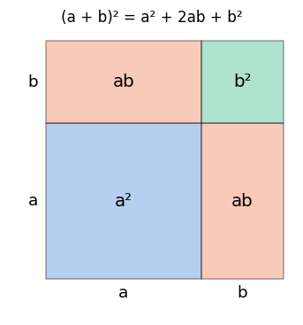
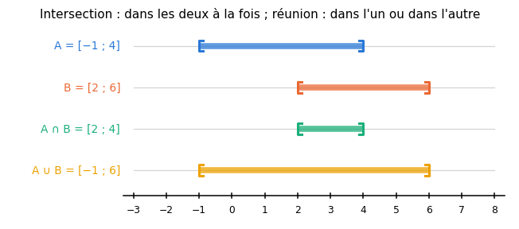
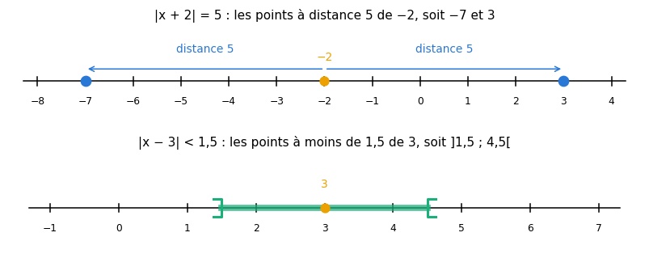
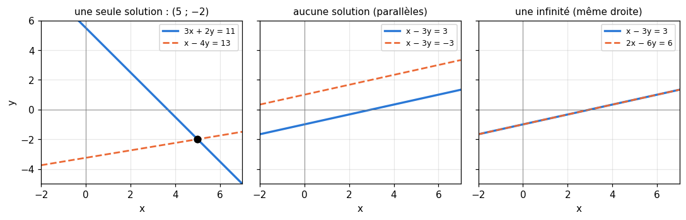

# R2 · Calcul littéral et équations — fiche de cours

> La remise à niveau (R0 à R9) n'a pas de livre : **cette fiche est le cours**. R2 apprend à calculer avec des lettres : transformer une expression sans changer sa valeur, puis trouver les nombres qui rendent une égalité ou une inégalité vraie. C'est la langue de tout le reste : une loss, une couche de neurones, une règle de mise à jour s'écrivent avec des lettres.

| | |
|---|---|
| **Sections** | §1 à §8 |
| **Temps total estimé** | ≈ 13,6 h : lecture et calculs de la fiche ≈ 2 h 30, exercices ≈ 10 h 15, flashcards ≈ 50 min (parcours essentiel ≈ 10,1 h) |
| **Prérequis** | R1 (fractions, priorités, puissances, distributivité) ; R0 (taper une expression et un intervalle pour `wbm.check`) ; workbookIA 0A : boucles (§100.4.2), exceptions (§100.6.2) |
| **Fichiers du chapitre** | `02_exercices.md` (quiz, papier) · `03_notebook.ipynb` · `04_indices.md` · `05_solutions.md` et `05_solutions.ipynb` · `06_mes_reponses.md` · `flashcards.csv` |
| **mymath** | `algebra.py` : `solve_linear`, `solve_linear_inequality`, `solve_abs_equation`, `solve_2x2` |

## Comment utiliser ce chapitre

**Ordre conseillé.**
1. `python tools/start_chapter.py R2` (sur Colab : `00_setup/COLAB.md` §2) : il copie le notebook, ta feuille de réponses et le squelette `mymath/algebra.py`.
2. Section par section : lis **crayon en main** (refais chaque calcul avant de lire la ligne suivante), puis fais les exercices de la section, quiz 🧠 d'abord.
3. Les exercices ✏️ se font sur papier, dans ta copie de `06_mes_reponses.md`, puis se vérifient dans la **partie 0** du notebook.

Si le test de positionnement t'a donné « tu peux sauter » pour R2, lis « L'essentiel en 10 lignes » et « Les pièges classiques », fais les quiz et les exercices 🔨 du parcours essentiel (`positionnement/05_grille.md`).

| Section | Quiz 🧠 | Papier et réflexion | Notebook |
|---|---|---|---|
| §1 Expressions littérales | Q1, R1 🔁 | R2.1 ✏️ | |
| §2 Développer et factoriser | Q2 | R2.2 ✏️, R2.3 ✏️ | R2.22 📦, R2.27 🐛 |
| §3 Identités remarquables | Q3 | R2.4 ✏️, R2.13 ∂ | R2.22 📦, R2.27 🐛 |
| §4 Équations du premier degré | Q4 | R2.5 ✏️, R2.6 ✏️, R2.17 🗣️ | R2.18 🔨, R2.23 📦, R2.28 🛠️ |
| §5 Inéquations et intervalles | Q5, R3 🔁 | R2.7 ✏️, R2.8 ✏️, R2.14 ∂ | R2.19 🔨, R2.27 🐛 |
| §6 Valeur absolue et fonction signe | Q6 | R2.9 ✏️ | R2.20 🔨 |
| §7 Systèmes de deux équations | Q7 | R2.10 ✏️, R2.11 ✏️, R2.15 ∂, R2.16 🔗 | R2.21 🔨, R2.23 📦, R2.24 🔮, R2.25 🔬, R2.26 🎨 |
| §8 Mettre un problème en équation | Q8, R2 🔁 | R2.12 ✏️, R2.16 🔗 | |

Parcours essentiel : tout sauf R2.Q6, R2.Q8, R2.R2, R2.R3, R2.8, R2.14, R2.15, R2.19, R2.20, R2.23, R2.25 et R2.28.

**Vocabulaire anglais.** Les termes de ce chapitre, avec leur nom anglais (leur définition courte est dans `annexes/glossaire.md`) : borne, intervalle (*bound, interval*) ; coefficient (*coefficient*) ; déterminant (*determinant*) ; développer, factoriser (*expand, factor*) ; ensemble des solutions (*solution set*) ; équation (*equation*) ; équations équivalentes (*equivalent equations*) ; expression littérale, variable (*algebraic expression, variable*) ; fonction signe (*sign function*) ; formule de Cramer (*Cramer's rule*) ; identité remarquable (*special product, algebraic identity*) ; inégalité, inéquation (*inequality*) ; intersection, réunion (*intersection, union*) ; mal conditionné (*ill-conditioned*) ; mise en équation (*setting up an equation, translating a word problem*) ; produit nul (règle du) (*zero-product property*) ; substituer (*substitute, plug in*) ; système linéaire (*system of linear equations, linear system*) ; termes semblables, réduire (*like terms, collect like terms*) ; valeur absolue (*absolute value*) ; valeur interdite (*excluded value*).

## Objectifs d'apprentissage

À la fin du chapitre, tu sais :
- **substituer** une valeur dans une expression et **réduire** une expression ;
- **développer** et **factoriser**, identités remarquables comprises, et vérifier ton calcul par une valeur test ou avec SymPy ;
- **résoudre** une équation du premier degré, une équation produit nul et une équation avec des fractions ;
- **résoudre** une inéquation du premier degré et écrire ses solutions en intervalles, avec réunions et intersections ;
- **résoudre** une équation ou une inéquation avec une valeur absolue, en la lisant comme une distance ;
- **résoudre** un système 2 × 2 par substitution, par combinaison et par la formule de Cramer, et dire quand il a une seule solution ;
- **mettre** un problème concret en équation.

## L'essentiel en 10 lignes

1. Une lettre remplace un nombre : $3x^2$ veut dire $3 \times x \times x$. Substituer $x = -2$ s'écrit avec des parenthèses : $3 \times (-2)^2$.
2. Réduire, c'est regrouper les termes **semblables** (même lettre, même puissance) : $5x^2 - 3x + 2x^2 + x = 7x^2 - 2x$.
3. Développer : $(a + b)(c + d) = ac + ad + bc + bd$. Factoriser, c'est l'inverse : sortir un facteur commun.
4. Identités remarquables : $(a + b)^2 = a^2 + 2ab + b^2$, $(a - b)^2 = a^2 - 2ab + b^2$, $(a + b)(a - b) = a^2 - b^2$.
5. Une équation garde ses solutions si l'on ajoute le même nombre aux deux membres, ou si on les multiplie par le même nombre **non nul**. $ax + b = 0$ a la solution $x = -\frac{b}{a}$ si $a \ne 0$.
6. Un produit est nul si et seulement si l'un de ses facteurs est nul. On ne divise jamais par une expression qui peut valoir 0.
7. Inéquation : multiplier ou diviser par un nombre **négatif** retourne le sens. Les solutions s'écrivent en intervalles ; $\cap$ veut dire « et », $\cup$ veut dire « ou ».
8. $|a - b|$ est la distance entre $a$ et $b$ : $|x - a| = c$ a deux solutions $a \pm c$ si $c > 0$, une si $c = 0$, aucune si $c < 0$.
9. Un système $ax + by = e$, $cx + dy = f$ a une seule solution exactement quand son **déterminant** $ad - bc$ n'est pas nul ; chaque équation est une droite, la solution est leur point commun.
10. Mettre en équation : choisir l'inconnue, traduire chaque phrase, résoudre, **vérifier** dans l'énoncé, répondre par une phrase.

---

## §1 · Expressions littérales : substituer, réduire

### Des lettres à la place des nombres

Une **expression littérale** contient des lettres, les **variables**, qui représentent des nombres : $3x^2 - 2x + 5$, ou $\frac{a + b}{2}$. Les conventions d'écriture, à connaître par cœur :
- le signe × se sous-entend entre un nombre et une lettre, ou entre deux lettres : $2x = 2 \times x$, $xy = x \times y$ ;
- $x^2 = x \times x$ et $-x = -1 \times x$ ;
- le nombre s'écrit devant la lettre : $x \times 3$ s'écrit $3x$.

Une expression n'est **pas** une équation : il n'y a pas de signe $=$ à résoudre ; elle a seulement une valeur quand on donne une valeur à chaque lettre.

### Substituer

**Substituer**, c'est remplacer chaque lettre par un nombre, puis calculer avec les priorités de R1. Pour $E = 3x^2 - 2x + 5$ et $x = -2$ :

$$E = 3 \times (-2)^2 - 2 \times (-2) + 5 = 3 \times 4 + 4 + 5 = 21$$

**Les parenthèses** autour d'une valeur négative sont obligatoires : sans elles, on écrirait $3 \times -2^2$, qui vaut $-12$ (R1 §2 : la puissance passe avant le signe moins).

```python
>>> import sympy as sp
>>> x = sp.Symbol("x")
>>> (3*x**2 - 2*x + 5).subs(x, -2)
21
```

### Réduire

Deux termes sont **semblables** quand ils ont la même partie littérale (mêmes lettres, mêmes puissances) : $5x^2$ et $2x^2$ le sont, $5x^2$ et $5x$ ne le sont pas. **Réduire**, c'est additionner les termes semblables, en additionnant leurs coefficients (c'est la distributivité de R1 : $5x^2 + 2x^2 = (5 + 2)x^2$) :

$$4a + 3b - a + 2b - 7 = (4 - 1)a + (3 + 2)b - 7 = 3a + 5b - 7$$

$$5x^2 - 3x + 2x^2 + x = 7x^2 - 2x$$

On range d'habitude les termes par puissances décroissantes : $7x^2 - 2x$ plutôt que $-2x + 7x^2$.

> ⚠️ **Erreur de calcul classique** — Additionner des termes qui ne sont pas semblables : $3x + 2x^2 \ne 5x^3$, et $2a + 3b \ne 5ab$. Ces sommes restent telles quelles.

## §2 · Développer et factoriser

### Développer

**Développer**, c'est transformer un produit en somme. La distributivité de R1, $k(a + b) = ka + kb$, s'applique avec des lettres et des signes : $-3(2x - 4) = -6x + 12$.

La **double distributivité** multiplie chaque terme de la première parenthèse par chaque terme de la seconde :

$$(a + b)(c + d) = ac + ad + bc + bd$$

Exemple :

$$(x + 3)(2x - 5) = 2x^2 - 5x + 6x - 15 = 2x^2 + x - 15$$

Avec deux termes dans chaque parenthèse, on obtient quatre produits, qu'on réduit ensuite. Avec trois termes dans la seconde, on en obtient six.

**Vérifier par une valeur test.** Si deux expressions sont égales, elles prennent la même valeur pour **tout** $x$. Pour $x = 1$ : $(1 + 3)(2 - 5) = 4 \times (-3) = -12$, et $2 + 1 - 15 = -12$. Un seul test ne prouve rien (deux expressions différentes peuvent coïncider en un point), mais un test raté prouve une erreur. SymPy, lui, prouve l'égalité (R0 §4) :

```python
>>> sp.expand((x + 3)*(2*x - 5))
2*x**2 + x - 15
```

> ⚠️ **Erreur de calcul classique** — Oublier des produits croisés : $(x + 3)(2x - 5) \ne 2x^2 - 15$. Il y a **quatre** produits, pas deux.

### Factoriser

**Factoriser**, c'est l'inverse : transformer une somme en produit, en repérant un **facteur commun** à tous les termes :

$$10x^2 - 4x = 2x \times 5x - 2x \times 2 = 2x(5x - 2)$$

On cherche le plus grand facteur commun possible : le PGCD des coefficients (R1 §3), et la plus petite puissance de chaque lettre. Le facteur commun peut être une parenthèse entière :

$$(x - 1)(x + 4) + (x - 1) \times 2x = (x - 1)\big[(x + 4) + 2x\big] = (x - 1)(3x + 4)$$

Attention au terme qui « disparaît » : dans $(2x + 3) - x(2x + 3)$, le premier terme vaut $1 \times (2x + 3)$, donc $(2x + 3)(1 - x)$.

**Pourquoi factoriser ?** Une forme factorisée dit d'un coup d'œil quand l'expression s'annule (§4) et quel est son signe (§5). Une forme développée sert à additionner ou à dériver (R7).

```python
>>> sp.factor(10*x**2 - 4*x)
2*x*(5*x - 2)
```

## §3 · Identités remarquables

Trois produits reviennent si souvent qu'on les apprend par cœur. Pour tous nombres $a$ et $b$ :

$$(a + b)^2 = a^2 + 2ab + b^2 \qquad (a - b)^2 = a^2 - 2ab + b^2 \qquad (a + b)(a - b) = a^2 - b^2$$

Elles se démontrent en développant (l'exercice R2.13 te le fait faire), et la première se voit sur un carré de côté $a + b$ : il se découpe en un carré $a^2$, un carré $b^2$ et deux rectangles $ab$.



**Développer avec une identité** : on repère $a$ et $b$, puis on applique.
- $(x + 4)^2 = x^2 + 2 \times x \times 4 + 4^2 = x^2 + 8x + 16$ ;
- $(2x - 5)^2 = (2x)^2 - 2 \times 2x \times 5 + 5^2 = 4x^2 - 20x + 25$ : le carré porte sur **tout** $2x$ ;
- $(x + 6)(x - 6) = x^2 - 36$.

**Factoriser avec une identité** : on reconnaît la forme développée.
- $x^2 - 49 = x^2 - 7^2 = (x - 7)(x + 7)$, une différence de deux carrés ;
- $9x^2 + 12x + 4 = (3x)^2 + 2 \times 3x \times 2 + 2^2 = (3x + 2)^2$ : on vérifie que le terme du milieu est bien le double produit ;
- $x^2 - 6x + 9 = (x - 3)^2$.

**Calcul mental** : $51^2 = (50 + 1)^2 = 2500 + 100 + 1 = 2601$, et $39 \times 41 = (40 - 1)(40 + 1) = 1600 - 1 = 1599$.

```python
>>> sp.factor(9*x**2 + 12*x + 4), sp.factor(x**2 - 49)
((3*x + 2)**2, (x - 7)*(x + 7))
```

> ⚠️ **Erreur de calcul classique** — $(a + b)^2 = a^2 + b^2$ : il manque le double produit $2ab$. Avec $a = b = 1$ : $(1 + 1)^2 = 4$, alors que $1 + 1 = 2$. Et $(2x)^2 = 4x^2$, pas $2x^2$.

## §4 · Équations du premier degré

### Ce que veut dire « résoudre »

Une **équation** est une égalité qui contient une inconnue, par exemple $7x - 4 = 3x + 10$. Un nombre est **solution** quand l'égalité devient vraie en le substituant. **Résoudre**, c'est trouver **toutes** les solutions (il peut n'y en avoir aucune, comme il peut y en avoir une, plusieurs ou une infinité), et l'ensemble de ces solutions s'appelle l'**ensemble des solutions**.

On transforme l'équation en équations **équivalentes** (qui ont exactement les mêmes solutions), de plus en plus simples. Deux opérations sont permises :
- **ajouter** (ou soustraire) le même nombre, ou la même expression, aux deux membres ;
- **multiplier** (ou diviser) les deux membres par le même nombre **non nul**.

Pour $7x - 4 = 3x + 10$ : on retire $3x$ aux deux membres, $4x - 4 = 10$ ; on ajoute 4, $4x = 14$ ; on divise par 4, $x = \frac{14}{4} = \frac{7}{2}$. **On vérifie** : $7 \times 3{,}5 - 4 = 20{,}5$ et $3 \times 3{,}5 + 10 = 20{,}5$. L'ensemble des solutions est $\left\{\frac{7}{2}\right\}$.

### L'équation $ax + b = 0$

Toute équation du premier degré se ramène à $ax + b = 0$. Trois cas :
- si $a \ne 0$ : une seule solution, $x = -\frac{b}{a}$ ;
- si $a = 0$ et $b \ne 0$ : l'équation dit $b = 0$, ce qui est faux, quel que soit $x$ : **aucune** solution ;
- si $a = 0$ et $b = 0$ : l'équation dit $0 = 0$, vrai pour tout $x$ : **tous les réels** sont solutions.

Le deuxième et le troisième cas arrivent quand les $x$ disparaissent : $2(x + 1) = 2x + 5$ devient $2 = 5$, faux (aucune solution) ; $3(x + 2) = 3x + 6$ devient $6 = 6$, vrai (tous les réels). C'est ce que programme `solve_linear` (R2.18).

### Équation produit nul

Un produit est nul **si et seulement si** l'un au moins de ses facteurs est nul (si $a \ne 0$ et $b \ne 0$, alors $ab \ne 0$). D'où, pour une équation déjà factorisée :

$$(x - 2)(3x + 1) = 0 \iff x - 2 = 0 \ \text{ou}\ 3x + 1 = 0 \iff x = 2 \ \text{ou}\ x = -\frac{1}{3}$$

Pour une équation du second degré, on fait passer tout dans un membre, on factorise, puis on applique la règle : $x^2 = 3x \iff x^2 - 3x = 0 \iff x(x - 3) = 0$, donc $x = 0$ ou $x = 3$.

> ⚠️ **Erreur de calcul classique** — Diviser par $x$ : $x^2 = 3x$, « donc » $x = 3$. On a perdu la solution $x = 0$. On ne divise jamais par une expression qui peut valoir 0 ; on factorise.

### Équations avec des fractions

On multiplie les deux membres par un **dénominateur commun** pour chasser les fractions :

$$\frac{x}{3} + \frac{x - 1}{2} = 4 \quad \xrightarrow{\ \times 6\ } \quad 2x + 3(x - 1) = 24 \iff 5x = 27 \iff x = \frac{27}{5}$$

Les parenthèses autour de $x - 1$ sont indispensables : le 3 multiplie tout le numérateur. Quand l'inconnue est au dénominateur, on note d'abord les valeurs **interdites** (celles qui annulent un dénominateur) : $\frac{4}{x + 1} = 2$ demande $x \ne -1$, puis $4 = 2(x + 1)$, donc $x = 1$, qui n'est pas interdit.

```python
>>> sp.solve(7*x - 4 - (3*x + 10), x)
[7/2]
>>> sp.solve((x - 2)*(3*x + 1), x)
[-1/3, 2]
```

`sp.solve(expression, x)` résout « expression = 0 » : pour une équation $A = B$, on lui donne $A - B$. Elle renvoie la liste des solutions (l'exercice R2.23 apprend à lire son résultat).

## §5 · Inéquations du premier degré et intervalles

### Les règles

Une **inéquation** compare deux expressions avec $<$, $\le$, $>$ ou $\ge$. On la résout comme une équation, avec **une** différence :
- ajouter ou soustraire le même nombre aux deux membres garde le sens ;
- multiplier ou diviser par un nombre **positif** garde le sens ;
- multiplier ou diviser par un nombre **négatif** **retourne** le sens : $<$ devient $>$, $\le$ devient $\ge$.

Pourquoi ? Multiplier par $-1$ échange la place des nombres sur la droite : $2 < 5$, mais $-2 > -5$ (R1 §1). L'exercice R2.14 le démontre.

Exemple : $4 - 3x > 10 \iff -3x > 6 \iff x < -2$ (on divise par $-3$ : le sens change).

**Une double inéquation** se traite membre à membre, les trois à la fois :

$$-1 \le 2x + 3 < 7 \iff -4 \le 2x < 4 \iff -2 \le x < 2$$

### Les intervalles

L'ensemble des solutions d'une inéquation s'écrit avec un **intervalle**. Le crochet est **fermé** (tourné vers les nombres) quand la borne est incluse, **ouvert** (tourné vers l'extérieur) quand elle est exclue ; du côté de l'infini, il est toujours ouvert.

| Inégalité | Intervalle | Pour `wbm.check` |
|---|---|---|
| $-2 \le x < 2$ | $[-2 \;;\; 2[$ | `"[-2 ; 2["` |
| $x < -2$ | $]-\infty \;;\; -2[$ | `"]-oo ; -2["` |
| $x \ge 1{,}5$ | $[1{,}5 \;;\; +\infty[$ | `"[1.5 ; +oo["` |
| tous les réels | $]-\infty \;;\; +\infty[ = \mathbb{R}$ | `"]-oo ; +oo["` |

Les solutions de $4 - 3x > 10$ forment donc $]-\infty \;;\; -2[$. (En anglais, les crochets ouverts s'écrivent avec des parenthèses : $(-\infty, -2)$.)

### Intersection et réunion

- L'**intersection** $A \cap B$ (« A inter B ») contient les nombres qui sont dans $A$ **et** dans $B$.
- La **réunion** $A \cup B$ (« A union B ») contient les nombres qui sont dans $A$ **ou** dans $B$ (ou dans les deux).



Avec $A = [-1 \;;\; 4]$ et $B = [2 \;;\; 6]$ : $A \cap B = [2 \;;\; 4]$ et $A \cup B = [-1 \;;\; 6]$. Deux intervalles sans point commun ont une intersection vide, notée $\varnothing$ : $]-\infty \;;\; 0[ \;\cap\; [3 \;;\; +\infty[ = \varnothing$. Leur réunion ne se simplifie pas et s'écrit telle quelle : $]-\infty \;;\; 0[ \;\cup\; [3 \;;\; +\infty[$ (pour `wbm.check` : `"]-oo ; 0[ U [3 ; +oo["`).

Deux inéquations reliées par « et » donnent une intersection ; reliées par « ou », une réunion.

```python
>>> sp.solve_univariate_inequality(4 - 3*x > 10, x, relational=False)
Interval.open(-oo, -2)
```

> ⚠️ **Erreur de calcul classique** — Garder le sens en divisant par un négatif : $-3x > 6 \iff x > -2$ ? Non : $x < -2$. Vérifie avec une valeur : $x = 0$ donne $4 > 10$, faux ; $x = -3$ donne $13 > 10$, vrai.

## §6 · Valeur absolue et fonction signe

### La valeur absolue

La **valeur absolue** de $x$, notée $|x|$, est $x$ « sans son signe » :

$$|x| = x \ \text{si}\ x \ge 0, \qquad |x| = -x \ \text{si}\ x < 0$$

Ainsi $|5| = 5$, $|-8| = 8$ (car $-(-8) = 8$) et $|0| = 0$. Une valeur absolue n'est **jamais négative**. Le lien avec R1 : $\sqrt{x^2} = |x|$ pour tout réel $x$.

**C'est une distance.** $|x|$ est la distance de $x$ à 0 sur la droite, et $|a - b|$ est la distance entre $a$ et $b$ : la distance entre $-1$ et $6$ vaut $|-1 - 6| = |-7| = 7$ (dans un sens ou dans l'autre : $|6 - (-1)| = 7$ aussi).

### Équations et inéquations

Lire $|x - a|$ comme « la distance de $x$ à $a$ » résout tout :

| Équation ou inéquation | Lecture | Solutions |
|---|---|---|
| $\lvert x - a \rvert = c$ avec $c > 0$ | les points à distance $c$ de $a$ | $a - c$ et $a + c$ |
| $\lvert x - a \rvert = 0$ | le point à distance 0 de $a$ | $a$ seul |
| $\lvert x - a \rvert = c$ avec $c < 0$ | une distance négative | aucune |
| $\lvert x - a \rvert \le r$ | les points à au plus $r$ de $a$ | $[a - r \;;\; a + r]$ |
| $\lvert x - a \rvert > r$ | les points à plus de $r$ de $a$ | $]-\infty \;;\; a - r[ \;\cup\; ]a + r \;;\; +\infty[$ |



Exemples :
- $|x + 2| = 5$ : on écrit $x + 2 = x - (-2)$, la distance de $x$ à $-2$ ; les solutions sont $-2 - 5 = -7$ et $-2 + 5 = 3$ ;
- $|x - 3| < 1{,}5$ : les points à moins de 1,5 de 3 forment $]1{,}5 \;;\; 4{,}5[$ ;
- $|x - 1| \ge 2$ : les points à au moins 2 de 1 forment $]-\infty \;;\; -1] \cup [3 \;;\; +\infty[$.

Quand le coefficient de $x$ n'est pas 1, on revient à la définition : $|2x - 1| = 7$ veut dire $2x - 1 = 7$ ou $2x - 1 = -7$, soit $x = 4$ ou $x = -3$.

### La fonction signe

La **fonction signe** donne le signe d'un nombre :

$$\operatorname{sign}(x) = -1 \ \text{si}\ x < 0, \qquad 0 \ \text{si}\ x = 0, \qquad 1 \ \text{si}\ x > 0$$

Avec elle, tout nombre s'écrit $x = \operatorname{sign}(x) \times |x|$ : $-8 = (-1) \times 8$.

```python
>>> abs(-8), abs(-1 - 6)
(8, 7)
```

> 🔗 **Dans workbookIA** — la valeur absolue mesure une erreur sans tenir compte de son sens : l'erreur absolue moyenne (MAE) fait la moyenne des $|y - \hat{y}|$ (chapitre 9). La fonction signe revient avec la régularisation L1 et le perceptron (chapitres 9 et 10).

> ⚠️ **Erreur de calcul classique** — Oublier la deuxième solution de $|x - a| = c$, ou croire que $|-x| = -x$. Pour $x = -3$, $|-x| = |3| = 3$, et $-x = 3$ aussi ; mais pour $x = 3$, $|-x| = 3$ alors que $-x = -3$.

## §7 · Systèmes de deux équations à deux inconnues

### Ce qu'est un système

Un **système de deux équations à deux inconnues** demande les couples $(x, y)$ qui vérifient **les deux** équations à la fois :

$$\begin{cases} 3x + 2y = 11 \\ x - 4y = 13 \end{cases}$$

Le couple $(5, -2)$ est solution : $3 \times 5 + 2 \times (-2) = 11$ et $5 - 4 \times (-2) = 13$. Trois méthodes pour le trouver.

### Par substitution

On exprime une inconnue avec la seconde équation, puis on la **remplace** dans la première :
- la seconde donne $x = 13 + 4y$ ;
- la première devient $3(13 + 4y) + 2y = 11$, soit $39 + 14y = 11$, donc $y = -2$ ;
- on revient à $x = 13 + 4 \times (-2) = 5$.

C'est la méthode la plus sûre quand une inconnue a le coefficient 1 ou −1.

### Par combinaison

On multiplie les équations par des nombres bien choisis pour qu'une inconnue **disparaisse** quand on les soustrait (ou additionne) :
- on multiplie la seconde par 3 : $3x - 12y = 39$ ;
- on la soustrait de la première : $(3x + 2y) - (3x - 12y) = 11 - 39$, soit $14y = -28$, donc $y = -2$ ;
- puis $x$ par l'une des équations.

### Par la formule de Cramer

Pour le système $\begin{cases} ax + by = e \\ cx + dy = f \end{cases}$, le nombre

$$D = ad - bc$$

s'appelle le **déterminant** du système. S'il n'est pas nul, le système a **une seule** solution :

$$x = \frac{ed - bf}{D} \qquad\qquad y = \frac{af - ec}{D}$$

Le numérateur de $x$ est le déterminant obtenu en remplaçant la colonne des coefficients de $x$ par celle des seconds membres ; de même pour $y$. Pour notre système, $a = 3$, $b = 2$, $c = 1$, $d = -4$, $e = 11$, $f = 13$ :

$$D = 3 \times (-4) - 2 \times 1 = -14, \qquad x = \frac{11 \times (-4) - 2 \times 13}{-14} = \frac{-70}{-14} = 5, \qquad y = \frac{3 \times 13 - 11 \times 1}{-14} = \frac{28}{-14} = -2$$

C'est la méthode que programme `solve_2x2` (R2.21) : une formule, pas de choix à faire.

### Le regard géométrique : deux droites

Chaque équation $px + qy = r$ (avec $p$ et $q$ non tous les deux nuls) est l'équation d'une **droite** du plan : l'ensemble des points $(x, y)$ qui la vérifient. Si $q = 0$, c'est une droite verticale ($2x = 6$ est la droite $x = 3$). Pour la tracer, deux points suffisent : pour $3x + 2y = 11$, $x = 1$ donne $y = 4$, et $x = 3$ donne $y = 1$. Résoudre le système, c'est chercher le **point commun** des deux droites. Trois cas seulement :



- les droites se coupent en un point : **une seule** solution, et $D \ne 0$ ;
- elles sont parallèles et distinctes : **aucune** solution, et $D = 0$ ;
- elles sont confondues : **une infinité** de solutions (tous les points de la droite), et $D = 0$.

Quand $D = 0$, les coefficients de $x$ et de $y$ sont proportionnels d'une équation à l'autre ($x - 3y$ et $2x - 6y$) : les droites ont la même direction. On compare alors les seconds membres pour savoir si elles sont confondues ou parallèles. L'exercice R2.15 démontre ce critère.

```python
>>> y = sp.Symbol("y")
>>> sp.solve([3*x + 2*y - 11, x - 4*y - 13], [x, y])
{x: 5, y: -2}
```

> 🔗 **Dans workbookIA** — un système linéaire est la forme la plus simple d'un problème que le ML résout sans cesse : trouver les paramètres qui collent aux données. Le chapitre 0B l'écrit avec des matrices, et le chapitre 9 (moindres carrés) le généralise à plus d'équations que d'inconnues. Le déterminant y reviendra (M12c).

> 💻 **Aujourd'hui en pratique** — personne ne résout un grand système par la formule de Cramer : elle coûte beaucoup trop d'opérations dès qu'il y a plus de trois inconnues. Les bibliothèques (`numpy.linalg.solve`) utilisent une version organisée de la combinaison, le pivot de Gauss (M09a). Cramer reste précieux pour comprendre le rôle du déterminant.

## §8 · Mettre un problème en équation

C'est souvent l'étape la plus difficile : le calcul vient après. **La méthode** :
1. **Choisir l'inconnue** (ou les inconnues), et l'écrire en toutes lettres : « $x$ = le nombre de places à plein tarif ».
2. **Traduire** chaque information de l'énoncé en égalité.
3. **Résoudre**.
4. **Vérifier** la solution dans l'énoncé (pas seulement dans l'équation : une erreur de traduction se voit là).
5. **Répondre** par une phrase, avec l'unité.

**Exemple 1, un système.** Un cinéma vend des places à 9 € (plein tarif) et à 6 € (tarif réduit). Un soir, il vend 120 places pour 930 €. Combien de places à plein tarif ?
- Inconnues : $x$ places à plein tarif, $y$ places à tarif réduit.
- Traduction : $x + y = 120$ (le nombre de places) et $9x + 6y = 930$ (la recette).
- Résolution par substitution : $y = 120 - x$, donc $9x + 6(120 - x) = 930$, $3x + 720 = 930$, $x = 70$, puis $y = 50$.
- Vérification : $70 + 50 = 120$ places, et $630 + 300 = 930$ €.
- Réponse : 70 places ont été vendues à plein tarif.

**Exemple 2, un pourcentage (R1 §7).** Après une hausse de 15 %, un abonnement coûte 69 €. Quel était son prix ? Avec $p$ le prix de départ : $1{,}15\,p = 69$, donc $p = \frac{69}{1{,}15} = 60$ €. (Et non $69 - 15\,\%$ de 69 : la hausse portait sur $p$.)

**Exemple 3, des entiers consécutifs.** Trois entiers consécutifs ont pour somme 72. Avec $n$ le plus petit : $n + (n + 1) + (n + 2) = 72$, $3n + 3 = 72$, $n = 23$. Les entiers sont 23, 24 et 25.

> 💼 **En entreprise** — « si le prix monte de 10 %, combien de clients faut-il garder pour conserver le chiffre d'affaires ? », « combien d'exemples d'entraînement pour tant d'heures de calcul ? » : traduire une question floue en équation est une compétence qu'on attend autant que la résolution.

---

## Les pièges classiques ⚠️ (récapitulatif)

| Piège | Faux | Juste |
|---|---|---|
| substituer un négatif | $3 \times -2^2 = -12$ | $3 \times (-2)^2 = 12$ |
| des termes non semblables | $3x + 2x^2 = 5x^3$ | la somme reste $2x^2 + 3x$ |
| oublier des produits | $(x + 3)(2x - 5) = 2x^2 - 15$ | quatre produits : $2x^2 + x - 15$ |
| un moins devant une parenthèse | $-(x - 4) = -x - 4$ | $-(x - 4) = -x + 4$ |
| le carré d'une somme | $(a + b)^2 = a^2 + b^2$ | $a^2 + 2ab + b^2$ |
| le carré d'un produit | $(2x)^2 = 2x^2$ | $(2x)^2 = 4x^2$ |
| diviser par l'inconnue | $x^2 = 3x \Rightarrow x = 3$ | $x(x - 3) = 0$ : $x = 0$ ou $x = 3$ |
| une fraction sans parenthèses | $\frac{x - 1}{2} \times 6 = 3x - 1$ | $3(x - 1) = 3x - 3$ |
| diviser une inéquation par un négatif | $-3x > 6 \Rightarrow x > -2$ | $x < -2$ |
| un crochet à l'infini | $[1 ; +\infty]$ | $[1 ; +\infty[$ |
| « et » et « ou » | « et » donne une réunion | « et » : intersection ; « ou » : réunion |
| la valeur absolue | une seule solution à $\lvert x + 2 \rvert = 5$ | deux : $-7$ et $3$ |
| un système à déterminant nul | « une solution » | aucune ou une infinité : compare les seconds membres |
| ne pas vérifier | répondre $x = \ldots$ sans contrôle | substituer la solution dans l'énoncé |

## Et maintenant

**Dans ce dépôt** : R3, *Fonctions*. Une expression en $x$ y devient une fonction $f(x)$ ; les équations deviennent des lectures de graphique (où la courbe coupe-t-elle l'axe ?), et la factorisation du second degré mène au discriminant.

**Dans workbookIA** : continue le chapitre 0A au rythme de ton tableau de bord. Le chapitre 0B, après la remise à niveau, reprend les droites $y = ax + b$ et les systèmes, puis les écrit avec des matrices.

## Pour aller plus loin

- SymPy, tutoriel officiel sur la résolution d'équations (*Solvers*) : [docs.sympy.org/latest/tutorials/intro-tutorial/solvers.html](https://docs.sympy.org/latest/tutorials/intro-tutorial/solvers.html) (vérifié le 2026-11-06).
- Maths et tiques (Yvan Monka), cours et vidéos gratuits sur le calcul littéral, les équations et les systèmes : [maths-et-tiques.fr](https://www.maths-et-tiques.fr).
- `annexes/formulaire.md` (les identités et la formule de Cramer sur une page) et `annexes/erreurs_frequentes.md`.
