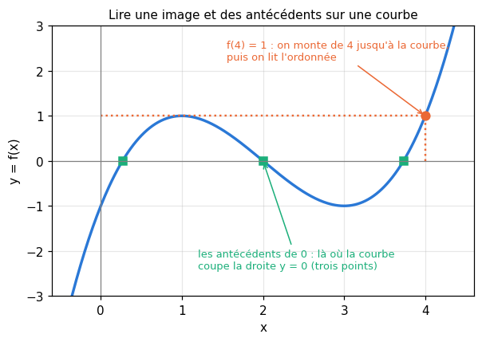
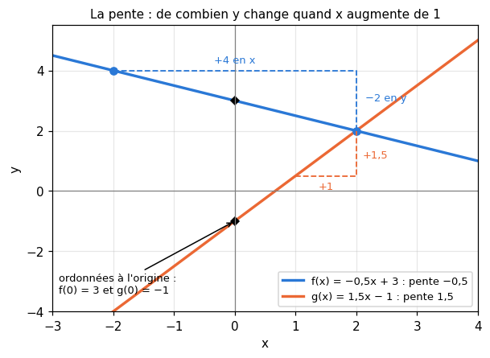
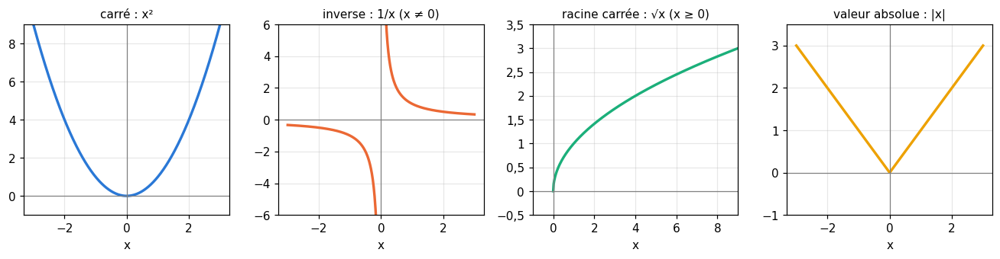
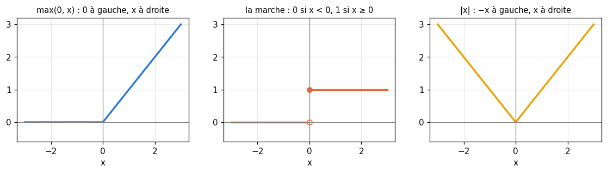
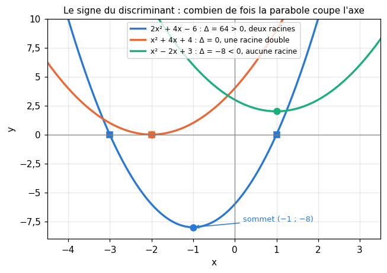
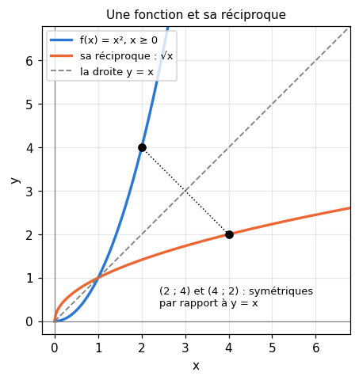

# R3 · Fonctions — fiche de cours

> La remise à niveau (R0 à R9) n'a pas de livre : **cette fiche est le cours**. R3 apprend ce qu'est une fonction, comment la lire sur un graphique, et les familles qui reviennent partout : les fonctions affines, les fonctions de référence, le second degré. Puis deux opérations qui structurent tout le machine learning : **composer** des fonctions (un réseau de neurones est une composition de couches) et **revenir en arrière** avec une réciproque (défaire une normalisation).

| | |
|---|---|
| **Sections** | §1 à §9 |
| **Temps total estimé** | ≈ 12,8 h : lecture et calculs de la fiche ≈ 2 h 45, exercices ≈ 9 h 15, flashcards ≈ 50 min (parcours essentiel ≈ 10,4 h) |
| **Prérequis** | R2 (développer, factoriser, identités remarquables, équations, intervalles) ; R1 (puissances, racines) ; workbookIA 0A : fonctions comme valeurs, `lambda` (§100.5.3), fermetures (§100.5.4) |
| **Fichiers du chapitre** | `02_exercices.md` (quiz, papier) · `03_notebook.ipynb` · `04_indices.md` · `05_solutions.md` et `05_solutions.ipynb` · `06_mes_reponses.md` · `flashcards.csv` |
| **mymath** | `functions.py` : `polyval`, `affine_from_points`, `quadratic_roots`, `quadratic_vertex`, `compose` |

## Comment utiliser ce chapitre

**Ordre conseillé.**
1. `python tools/start_chapter.py R3` (sur Colab : `00_setup/COLAB.md` §2) : il copie le notebook, ta feuille de réponses et le squelette `mymath/functions.py`.
2. Section par section : lis **crayon en main** (refais chaque calcul avant de lire la ligne suivante, trace les courbes à main levée), puis fais les exercices de la section, quiz 🧠 d'abord.
3. Les exercices ✏️ et 📈 se font sur papier, dans ta copie de `06_mes_reponses.md`, puis se vérifient dans la **partie 0** du notebook.

Si le test de positionnement t'a donné « tu peux sauter » pour R3, lis « L'essentiel en 10 lignes » et « Les pièges classiques », fais les quiz et les exercices 🔨 du parcours essentiel (`positionnement/05_grille.md`).

| Section | Quiz 🧠 | Papier et réflexion | Notebook |
|---|---|---|---|
| §1 Image, antécédent, ensemble de définition | Q1, R2 🔁 | R3.1 ✏️, R3.16 🗣️ | |
| §2 Représentation graphique | Q2 | R3.2 📈 | R3.26 🛠️ |
| §3 Fonctions affines | Q3 | R3.3 ✏️, R3.4 ✏️, R3.14 ∂ | R3.18 🔨 |
| §4 Fonctions de référence | Q4, R3 🔁 | R3.5 ✏️, R3.11 ✏️ | R3.21 📦 |
| §5 Second degré | Q5, R1 🔁 | R3.6 ✏️, R3.7 ✏️, R3.8 ✏️, R3.13 ∂, R3.15 🔗 | R3.19 🔨, R3.22 🎨, R3.24 🔬, R3.25 🐛 |
| §6 Variations, maximum et minimum | Q6 | R3.5 ✏️, R3.8 ✏️, R3.11 ✏️, R3.14 ∂, R3.15 🔗 | |
| §7 Composition | Q7 | R3.9 ✏️ | R3.20 🔨, R3.23 🔮, R3.25 🐛 |
| §8 Fonction réciproque | Q8 | R3.10 ✏️ | R3.25 🐛 |
| §9 Polynômes (aperçu) | | R3.12 ✏️ | R3.17 🔨 |

Parcours essentiel : tout sauf R3.Q6, R3.R3, R3.12, R3.13, R3.14, R3.17, R3.23, R3.24 et R3.26.

## Objectifs d'apprentissage

À la fin du chapitre, tu sais :
- **calculer** des images et des antécédents, **lire** un graphique, **déterminer** un ensemble de définition ;
- **trouver** la fonction affine qui passe par deux points, et **interpréter** sa pente et son ordonnée à l'origine (une normalisation min-max en est une) ;
- **reconnaître** les fonctions de référence et les fonctions définies par morceaux ($\max(0, x)$, la marche, $|x|$) ;
- **mettre** un polynôme du second degré sous forme canonique, **trouver** ses racines par le discriminant et **lire** son sommet ;
- **étudier** un sens de variation, **trouver** un maximum, un minimum, un argmax ;
- **composer** deux fonctions dans le bon ordre, et **trouver** une réciproque ;
- **évaluer** un polynôme par le schéma de Horner.

## L'essentiel en 10 lignes

1. Une **fonction** $f$ associe à chaque $x$ de son **ensemble de définition** un **unique** nombre $f(x)$, l'**image** de $x$ ; un **antécédent** de $y$ est un $x$ tel que $f(x) = y$ (il peut y en avoir zéro, un ou plusieurs).
2. On ne divise pas par 0 et on ne prend pas la racine d'un négatif : c'est ce qui restreint l'ensemble de définition.
3. La **courbe** de $f$ est l'ensemble des points $(x, f(x))$ : l'image se lit en ordonnée, les antécédents en abscisse.
4. Une fonction **affine** $f(x) = mx + c$ a pour courbe une droite de **pente** $m = \frac{y_2 - y_1}{x_2 - x_1}$ et d'**ordonnée à l'origine** $c = f(0)$.
5. Les fonctions de référence : $x^2$, $\frac{1}{x}$, $\sqrt{x}$, $|x|$. Et des fonctions **par morceaux** : $\max(0, x)$, la marche.
6. Second degré : $ax^2 + bx + c = a(x - \alpha)^2 + \beta$ avec $\alpha = -\frac{b}{2a}$ ; le **sommet** est $(\alpha, \beta)$, un minimum si $a > 0$, un maximum si $a < 0$.
7. **Discriminant** $\Delta = b^2 - 4ac$ : deux racines $\frac{-b \pm \sqrt{\Delta}}{2a}$ si $\Delta > 0$, une racine double $-\frac{b}{2a}$ si $\Delta = 0$, aucune si $\Delta < 0$.
8. $f$ est **croissante** sur $I$ si $a < b$ entraîne $f(a) \le f(b)$ ; le **maximum** est la plus grande valeur, l'**argmax** l'endroit où il est atteint.
9. **Composer** : $(f \circ g)(x) = f(g(x))$, on applique $g$ **d'abord** ; en général $f \circ g \ne g \circ f$.
10. La **réciproque** $f^{-1}$ défait $f$ : $f^{-1}(f(x)) = x$ ; ce n'est **pas** $\frac{1}{f}$.

---

## §1 · Image, antécédent, ensemble de définition

### Une machine à transformer des nombres

Une **fonction** (*function*) est une règle qui, à chaque nombre $x$ qu'on lui donne, associe **un seul** nombre, noté $f(x)$. On l'écrit

$$f : x \mapsto 2x^2 - 3 \qquad \text{ou} \qquad f(x) = 2x^2 - 3$$

et on lit « $f$ de $x$ égale $2x^2 - 3$ ». La lettre $x$ est la **variable** : $f(t) = 2t^2 - 3$ définit exactement la même fonction.

Une fonction, c'est comme une fonction Python qui prend un nombre et en renvoie un (workbookIA 0A §100.5.3) :

```python
>>> def f(x):
...     return 2 * x**2 - 3
...
>>> f(-1), f(2)
(-1, 5)
```

### Image et antécédent

- L'**image** de $x$ par $f$ est le nombre $f(x)$. Pour $f(x) = 2x^2 - 3$, l'image de $-1$ est $f(-1) = 2 \times (-1)^2 - 3 = -1$ (parenthèses autour du négatif, R2 §1).
- Un **antécédent** de $y$ est un nombre $x$ tel que $f(x) = y$. Chercher les antécédents de 5, c'est **résoudre l'équation** $f(x) = 5$ : $2x^2 - 3 = 5 \iff x^2 = 4 \iff x = -2$ ou $x = 2$. Le nombre 5 a donc **deux** antécédents.

Un nombre a **toujours une seule image** (c'est la définition d'une fonction), mais il peut avoir **zéro, un ou plusieurs antécédents**. Ici, $-5$ n'a aucun antécédent : $2x^2 - 3 = -5$ donnerait $x^2 = -1$, impossible.

> ⚠️ **Erreur de calcul classique** — Confondre les deux sens. « L'image de 2 » se **calcule** (on remplace $x$ par 2) ; « les antécédents de 2 » se **cherchent** (on résout $f(x) = 2$).

### Ensemble de définition

L'**ensemble de définition** (*domain*) de $f$, noté $\mathcal{D}_f$, est l'ensemble des $x$ pour lesquels $f(x)$ a un sens. Deux interdits seulement dans ce chapitre :
- **on ne divise pas par 0** : $f(x) = \frac{1}{x + 2}$ demande $x + 2 \ne 0$, donc $\mathcal{D}_f = \mathbb{R} \setminus \{-2\} = \;]-\infty \;;\; -2[ \;\cup\; ]-2 \;;\; +\infty[$ ;
- **on ne prend pas la racine carrée d'un négatif** : $g(x) = \sqrt{x - 5}$ demande $x - 5 \ge 0$, donc $\mathcal{D}_g = [5 \;;\; +\infty[$.

Quand les deux se combinent, on écrit **toutes** les conditions : $h(x) = \frac{\sqrt{x}}{x - 3}$ demande $x \ge 0$ **et** $x \ne 3$, donc $\mathcal{D}_h = [0 \;;\; 3[ \;\cup\; ]3 \;;\; +\infty[$. Un polynôme, lui, est défini partout : $\mathcal{D} = \mathbb{R}$.

On écrit $\mathbb{R} \setminus \{-2\}$ (« R privé de $-2$ ») pour tous les réels sauf $-2$. Pour `wbm.check`, on tape la réunion : `"]-oo ; -2[ U ]-2 ; +oo["`.

## §2 · Représentation graphique et lecture graphique

### La courbe d'une fonction

Dans un repère, la **courbe représentative** (*graph*) de $f$ est l'ensemble des points de coordonnées $(x, f(x))$, pour $x$ dans $\mathcal{D}_f$. Pour la tracer à la main, on calcule un **tableau de valeurs**, on place les points, et on les relie (en sachant que la fonction ne fait rien de bizarre entre eux) :

| $x$ | $0$ | $1$ | $2$ | $3$ | $4$ |
|---|---|---|---|---|---|
| $f(x) = \frac{x^3 - 6x^2 + 9x}{2} - 1$ | $-1$ | $1$ | $0$ | $-1$ | $1$ |



**Une courbe ne peut pas revenir en arrière à la verticale** : à chaque $x$ correspond un seul point. Un cercle, par exemple, n'est pas la courbe d'une fonction (il a deux points au-dessus de chaque $x$ intérieur).

### Lire une courbe

Sur la figure :
- **lire une image** : on part de $x$ sur l'axe horizontal, on monte (ou on descend) jusqu'à la courbe, on lit l'ordonnée. Ici $f(4) = 1$ ;
- **lire les antécédents de $y$** : on trace la droite horizontale d'ordonnée $y$, et on lit les abscisses de **tous** ses points d'intersection avec la courbe. Les antécédents de 0 sont trois nombres : environ 0,27, exactement 2 et environ 3,73 ;
- **résoudre graphiquement $f(x) = k$** : c'est la même chose, les antécédents de $k$ ;
- **résoudre graphiquement $f(x) \ge k$** : on garde les $x$ où la courbe est **au-dessus** (ou sur) la droite $y = k$. Ici $f(x) \ge 1$ pour $x = 1$ et pour $x \ge 4$ : l'ensemble des solutions est $\{1\} \cup [4 \;;\; 4{,}5]$ sur la fenêtre tracée.

Une lecture graphique est **approchée** : 0,27 est une lecture, pas une valeur exacte. Quand on veut la valeur exacte, on la calcule (§5 pour le second degré).

### Lire les variations

En suivant la courbe de gauche à droite, elle monte de $x = -0{,}5$ à $x = 1$, descend de $x = 1$ à $x = 3$, puis remonte : $f$ est **croissante** sur $[-0{,}5 \;;\; 1]$, **décroissante** sur $[1 \;;\; 3]$, croissante sur $[3 \;;\; 4{,}5]$ (§6 donne les définitions). On le résume dans un **tableau de variations** :

| $x$ | $-0{,}5$ | | $1$ | | $3$ | | $4{,}5$ |
|---|---|---|---|---|---|---|---|
| $f(x)$ | $\approx -4{,}1$ | ↗ | $1$ | ↘ | $-1$ | ↗ | $\approx 4{,}1$ |

> 🛠️ **Un graphique propre** — un titre, des axes nommés (avec l'unité s'il y en a une), une légende quand il y a plusieurs courbes, une fenêtre choisie pour montrer ce qui compte. L'exercice R3.26 te fait construire ce réflexe avec matplotlib.

## §3 · Fonctions affines

### Définition

Une fonction **affine** (*affine function*) s'écrit

$$f(x) = mx + c$$

avec deux nombres fixés : $m$, la **pente** (ou coefficient directeur, *slope*), et $c$, l'**ordonnée à l'origine** (*intercept*). Sa courbe est une **droite**. Deux cas particuliers : $c = 0$ donne une fonction **linéaire** ($f(x) = mx$, une situation de proportionnalité, R1 §7) ; $m = 0$ donne une fonction **constante** (une droite horizontale).



### Lire la pente et l'ordonnée à l'origine

- $c = f(0)$ : c'est l'ordonnée du point où la droite coupe l'axe vertical.
- $m$ dit **de combien $f(x)$ change quand $x$ augmente de 1**. Pour $g(x) = 1{,}5x - 1$, chaque pas de 1 vers la droite fait monter de 1,5.
- Le signe de $m$ donne le sens : $m > 0$, la droite monte (fonction croissante) ; $m < 0$, elle descend ; $m = 0$, elle est horizontale. L'exercice R3.14 le démontre.

### La droite qui passe par deux points

Entre deux points $(x_1, y_1)$ et $(x_2, y_2)$ de la droite, avec $x_1 \ne x_2$, le **taux de variation** est constant et vaut la pente :

$$m = \frac{y_2 - y_1}{x_2 - x_1} = \frac{\Delta y}{\Delta x}$$

puis on trouve $c$ en écrivant que l'un des points est sur la droite : $y_1 = m x_1 + c$, donc $c = y_1 - m x_1$.

Exemple : la droite qui passe par $(-2, 4)$ et $(2, 2)$. Pente $m = \frac{2 - 4}{2 - (-2)} = \frac{-2}{4} = -0{,}5$ ; puis $c = 2 - (-0{,}5) \times 2 = 3$. Donc $f(x) = -0{,}5x + 3$. **Vérification** avec l'autre point : $f(-2) = 1 + 3 = 4$. Elle coupe l'axe horizontal là où $f(x) = 0$ : $-0{,}5x + 3 = 0 \iff x = 6$, la **racine** de $f$.

Si $x_1 = x_2$, les deux points sont l'un au-dessus de l'autre : la droite est verticale, et ce n'est **pas** la courbe d'une fonction (un même $x$ aurait deux images). C'est ce que `affine_from_points` refuse (R3.18).

> ⚠️ **Erreur de calcul classique** — Mélanger l'ordre des points : $\frac{y_2 - y_1}{x_1 - x_2}$ donne l'opposé de la pente. Le point qu'on met en premier en haut doit être en premier en bas.

### Ramener des données entre 0 et 1 : la normalisation min-max

Des durées de visionnage vont de 2 à 10 minutes. On veut les ramener entre 0 et 1, en envoyant 2 sur 0 et 10 sur 1, avec une fonction affine. C'est la droite qui passe par $(2, 0)$ et $(10, 1)$ :

$$N(x) = \frac{x - \min}{\max - \min} = \frac{x - 2}{8} = 0{,}125\,x - 0{,}25$$

Une durée de 6 minutes devient $N(6) = \frac{4}{8} = 0{,}5$, exactement au milieu. C'est la **normalisation min-max** (*min-max scaling*) : une fonction affine de pente $\frac{1}{\max - \min}$, qui garde l'ordre des valeurs et les proportions entre leurs écarts. Pour revenir aux minutes, on la **défait** (§8) : $x = 8\,N + 2$.

> 🔗 **Dans workbookIA** — le chapitre 12 met les features à la même échelle avant d'entraîner un modèle ; la normalisation min-max y est l'une des deux transformations de base, et revenir aux unités d'origine (`inverse_transform`) est une réciproque. Un neurone sans fonction d'activation calcule une fonction affine de ses entrées (chapitre 10).

## §4 · Fonctions de référence : carré, inverse, racine carrée, valeur absolue

Quatre fonctions dont il faut connaître l'**allure** par cœur, parce que tant d'autres s'en déduisent.



| Fonction | Définie sur | Variations | À retenir |
|---|---|---|---|
| carré, $x^2$ | $\mathbb{R}$ | décroissante sur $]-\infty \;;\; 0]$, croissante sur $[0 \;;\; +\infty[$ | toujours $\ge 0$ ; $(-x)^2 = x^2$ : courbe symétrique par rapport à l'axe vertical (une **parabole**) |
| inverse, $\frac{1}{x}$ | $\mathbb{R} \setminus \{0\}$ | décroissante sur $]-\infty \;;\; 0[$ et sur $]0 \;;\; +\infty[$ | du signe de $x$ ; grande quand $x$ est proche de 0 ; une **hyperbole** en deux morceaux |
| racine carrée, $\sqrt{x}$ | $[0 \;;\; +\infty[$ | croissante | $\sqrt{x^2} = \lvert x \rvert$ (R2 §6) ; elle « défait » le carré sur $[0 \;;\; +\infty[$ (§8) |
| valeur absolue, $\lvert x \rvert$ | $\mathbb{R}$ | décroissante sur $]-\infty \;;\; 0]$, croissante sur $[0 \;;\; +\infty[$ | un « V » ; c'est la distance à 0 (R2 §6) |

### S'en servir pour comparer et résoudre

Le sens de variation permet de comparer sans calculer, et de résoudre des inéquations :
- $-1{,}5 < -0{,}5$, et le carré est **décroissant** sur les négatifs : il **retourne** l'ordre, donc $(-1{,}5)^2 > (-0{,}5)^2$ (en effet $2{,}25 > 0{,}25$) ;
- $x^2 \le 4 \iff -2 \le x \le 2$ : les nombres dont le carré ne dépasse pas 4 sont entre $-2$ et $2$, soit $[-2 \;;\; 2]$ ;
- pour $x > 0$, $\frac{1}{x} < \frac{1}{2} \iff x > 2$ : l'inverse est décroissant, il retourne l'ordre ;
- l'image de l'intervalle $[-3 \;;\; 1]$ par le carré n'est **pas** $[1 \;;\; 9]$ : le carré passe par 0 en $x = 0$. C'est $[0 \;;\; 9]$. Trace la courbe avant de conclure.

> ⚠️ **Erreur de calcul classique** — Croire que $\frac{1}{x}$ est décroissante « partout » et en déduire $\frac{1}{-1} > \frac{1}{1}$. Elle est décroissante sur **chacun** des deux morceaux, pas d'un morceau à l'autre : $-1 < 1$ et $\frac{1}{-1} = -1 < 1 = \frac{1}{1}$.

### Fonctions définies par morceaux

Une fonction peut suivre une formule sur une partie de son ensemble de définition, et une autre ailleurs. Trois exemples qui reviennent sans cesse en ML :

$$\max(0, x) = \begin{cases} 0 & \text{si } x < 0 \\ x & \text{si } x \ge 0 \end{cases} \qquad H(x) = \begin{cases} 0 & \text{si } x < 0 \\ 1 & \text{si } x \ge 0 \end{cases} \qquad |x| = \begin{cases} -x & \text{si } x < 0 \\ x & \text{si } x \ge 0 \end{cases}$$



- $\max(0, x)$ garde les nombres positifs et remplace les négatifs par 0 : $\max(0, -1{,}7) = 0$, $\max(0, 2{,}4) = 2{,}4$.
- La **marche** (ou fonction de Heaviside, *step function*) $H$ vaut 0 avant 0 et 1 après. La valeur en 0 est une **convention** : ici $H(0) = 1$ ; d'autres textes prennent 0 ou $\frac{1}{2}$. Un énoncé doit toujours la dire.
- $|x|$ s'écrit aussi $\max(x, -x)$ : le plus grand des deux nombres $x$ et $-x$.

Pour calculer une fonction par morceaux, on regarde **d'abord** dans quel morceau tombe $x$, puis on applique la bonne formule.

```python
>>> max(0, -1.7), max(0, 2.4)
(0, 2.4)
```

> 🔗 **Dans workbookIA** — $\max(0, x)$ est la fonction d'activation **ReLU**, la plus utilisée dans les réseaux de neurones (chapitres 16 et 17) ; la marche est la décision du perceptron (chapitre 10). R6 ajoutera la sigmoïde et tanh, R7 leurs dérivées.

## §5 · Polynômes du second degré

Une fonction **polynôme du second degré** (*quadratic function*) s'écrit

$$f(x) = ax^2 + bx + c \qquad \text{avec } a \ne 0$$

Sa courbe est une **parabole** : tournée vers le haut (un « U ») si $a > 0$, vers le bas (un « ∩ ») si $a < 0$. Trois questions : où est son sommet, où coupe-t-elle l'axe horizontal (ses **racines**), et quel est son signe ?



### La forme canonique

L'idée : faire apparaître une identité remarquable (R2 §3) pour écrire $f$ sous la forme

$$f(x) = a(x - \alpha)^2 + \beta$$

appelée **forme canonique**. Exemple avec $f(x) = 2x^2 + 4x - 6$ :
1. on met $a$ en facteur dans les deux premiers termes : $f(x) = 2(x^2 + 2x) - 6$ ;
2. $x^2 + 2x$ est le début de $(x + 1)^2 = x^2 + 2x + 1$ : donc $x^2 + 2x = (x + 1)^2 - 1$ ;
3. on remplace : $f(x) = 2\big[(x + 1)^2 - 1\big] - 6 = 2(x + 1)^2 - 8$.

Donc $\alpha = -1$ et $\beta = -8$. **Vérification** en redéveloppant : $2(x^2 + 2x + 1) - 8 = 2x^2 + 4x - 6$.

Dans le cas général, la même méthode donne

$$\alpha = -\frac{b}{2a} \qquad \beta = f(\alpha) = c - \frac{b^2}{4a}$$

### Le sommet

Dans $a(x - \alpha)^2 + \beta$, le carré $(x - \alpha)^2$ est toujours positif ou nul, et nul seulement en $x = \alpha$. Donc :
- si $a > 0$ : $f(x) \ge \beta$ pour tout $x$, avec égalité en $\alpha$ : $\beta$ est le **minimum** de $f$, atteint en $x = \alpha$ ;
- si $a < 0$ : $f(x) \le \beta$, et $\beta$ est le **maximum**.

Le point $S(\alpha, \beta)$ est le **sommet** (*vertex*) de la parabole, et la droite verticale $x = \alpha$ est son **axe de symétrie**. Pour $2x^2 + 4x - 6$ : sommet $(-1, -8)$, un minimum. C'est la fonction `quadratic_vertex` (R3.19).

### Le discriminant et les racines

On pose $\Delta = b^2 - 4ac$, le **discriminant** (*discriminant*). La forme canonique s'écrit alors $f(x) = a\left[\left(x + \frac{b}{2a}\right)^2 - \frac{\Delta}{4a^2}\right]$ (l'exercice R3.13 le démontre), et tout dépend du signe de $\Delta$ :

| Signe de $\Delta$ | Racines de $ax^2 + bx + c$ | Factorisation | La parabole |
|---|---|---|---|
| $\Delta > 0$ | deux : $x_1 = \frac{-b - \sqrt{\Delta}}{2a}$ et $x_2 = \frac{-b + \sqrt{\Delta}}{2a}$ | $a(x - x_1)(x - x_2)$ | coupe l'axe en deux points |
| $\Delta = 0$ | une racine double : $x_0 = -\frac{b}{2a}$ | $a(x - x_0)^2$ | touche l'axe en son sommet |
| $\Delta < 0$ | aucune racine réelle | ne se factorise pas | ne coupe pas l'axe |

Pour $2x^2 + 4x - 6$ : $\Delta = 4^2 - 4 \times 2 \times (-6) = 16 + 48 = 64$, $\sqrt{\Delta} = 8$, donc $x_1 = \frac{-4 - 8}{4} = -3$ et $x_2 = \frac{-4 + 8}{4} = 1$. **Vérification** : $2 \times 9 - 12 - 6 = 0$ et $2 + 4 - 6 = 0$. Factorisation : $2x^2 + 4x - 6 = 2(x + 3)(x - 1)$.

Les deux autres paraboles de la figure : $x^2 + 4x + 4$ a $\Delta = 16 - 16 = 0$, racine double $-2$ (c'est $(x + 2)^2$) ; $x^2 - 2x + 3$ a $\Delta = 4 - 12 = -8 < 0$, aucune racine (c'est $(x - 1)^2 + 2$, toujours $\ge 2$).

> 💡 **Avant le discriminant, regarde** — si $c = 0$, factorise par $x$ : $3x^2 - 5x = x(3x - 5)$. Si $b = 0$, isole $x^2$ : $4x^2 - 9 = 0 \iff x^2 = \frac{9}{4}$. Si tu reconnais une identité remarquable, factorise directement. Le discriminant marche toujours, mais ce n'est pas toujours le plus court.

### Le signe

Une fois les racines connues, le signe se lit sur la parabole : **$f(x)$ est du signe de $a$, sauf entre les racines**. Pour $2x^2 + 4x - 6$ ($a = 2 > 0$) : $f(x) > 0$ sur $]-\infty \;;\; -3[ \;\cup\; ]1 \;;\; +\infty[$, $f(x) < 0$ sur $]-3 \;;\; 1[$. Si $\Delta < 0$, $f(x)$ a le signe de $a$ partout.

```python
>>> import sympy as sp
>>> x = sp.Symbol("x")
>>> sp.factor(2*x**2 + 4*x - 6), sp.solve(2*x**2 + 4*x - 6, x)
(2*(x - 1)*(x + 3), [-3, 1])
```

> ⚠️ **Erreur de calcul classique** — Oublier le signe de $b$ dans $-b$, ou le carré de $b$ quand $b$ est négatif : pour $b = -4$, $b^2 = 16$ (pas $-16$) et $-b = 4$. Et diviser seulement $\sqrt{\Delta}$ par $2a$ : c'est tout le numérateur $-b \pm \sqrt{\Delta}$ qui est divisé.

> 🔗 **Dans workbookIA** — l'erreur au carré $(\hat{y} - y)^2$ est une parabole en $\hat{y}$, avec un unique minimum : c'est pour cela qu'elle est si commode à minimiser. Le chapitre 0B reprend le sommet et le discriminant, le chapitre 9 minimise des sommes de carrés.

## §6 · Sens de variation, maximum et minimum

### Croissante, décroissante

Soit $f$ définie sur un intervalle $I$.
- $f$ est **croissante** sur $I$ si, pour tous $a < b$ dans $I$, $f(a) \le f(b)$ : elle conserve l'ordre.
- $f$ est **décroissante** sur $I$ si, pour tous $a < b$ dans $I$, $f(a) \ge f(b)$ : elle retourne l'ordre.
- Avec des inégalités strictes ($f(a) < f(b)$), on dit **strictement** croissante (ou décroissante).

Ce qu'il faut bien voir : ces mots portent sur un **intervalle**. « Le carré est croissant » est faux ; « le carré est croissant sur $[0 \;;\; +\infty[$ » est vrai.

Pour le second degré, le sommet sépare les deux sens : si $a > 0$, $f$ est décroissante sur $]-\infty \;;\; \alpha]$ et croissante sur $[\alpha \;;\; +\infty[$ ; si $a < 0$, c'est l'inverse. Pour $2x^2 + 4x - 6$ :

| $x$ | $-\infty$ | | $-1$ | | $+\infty$ |
|---|---|---|---|---|---|
| $f(x)$ | | ↘ | $-8$ | ↗ | |

R7 donnera un outil général pour les variations : la dérivée.

### Maximum, minimum

- Le **maximum** de $f$ sur $I$ est la plus grande valeur $f(x)$ pour $x \in I$, s'il y en a une ; le **minimum**, la plus petite. Ensemble, ce sont les **extremums** (*extrema*).
- L'endroit où le maximum est atteint s'appelle l'**argmax** (« l'argument du maximum ») : $\arg\max_{x \in I} f(x)$. De même pour l'**argmin**. Le maximum est une **valeur** de $f$ ; l'argmax est une **valeur de $x$**.

Pour $2x^2 + 4x - 6$ sur $\mathbb{R}$ : le minimum vaut $-8$, l'argmin est $-1$, et il n'y a pas de maximum (la parabole monte sans fin).

**Sur un intervalle fermé**, le sommet n'est pas forcément dedans : les extremums peuvent être aux **bornes**. Sur $[0 \;;\; 2]$, $2x^2 + 4x - 6$ est croissante (on est à droite du sommet), donc son minimum est $f(0) = -6$ et son maximum $f(2) = 8 + 8 - 6 = 10$. Méthode : regarder les variations sur l'intervalle, puis comparer le sommet (s'il est dedans) et les deux bornes.

### Le maximum d'une liste

Pour une liste de nombres, le maximum est la plus grande valeur, et l'argmax sa **position**. Dans la liste $[3, 8, 5, 8]$, le maximum est 8 ; il est atteint deux fois. Par convention, NumPy rend la **première** position, en comptant à partir de 0 :

```python
>>> import numpy as np
>>> max([3, 8, 5, 8]), int(np.argmax([3, 8, 5, 8]))
(8, 1)
```

> 🔗 **Dans workbookIA** — un classifieur prédit la classe de plus grande probabilité : c'est un **argmax** (on veut la classe, pas la probabilité). Entraîner un modèle, c'est chercher l'**argmin** d'une loss : les paramètres qui la rendent la plus petite (chapitres 7, 9 et suivants).

> 💼 **En entreprise** — « quel prix maximise la recette ? », « combien de stock minimise le coût ? » : une fois le problème mis en équation, on cherche un maximum ou un minimum, et c'est souvent une parabole (R3.8).

## §7 · Composition de fonctions

### Enchaîner deux fonctions

**Composer** (*compose*), c'est appliquer une fonction au résultat d'une autre. On note

$$(f \circ g)(x) = f(g(x))$$

et on lit « $f$ rond $g$ ». **On applique $g$ d'abord**, puis $f$ : on lit de droite à gauche, comme les parenthèses de $f(g(x))$.

Exemple avec $f(x) = \frac{1}{x}$ et $g(x) = x + 4$ :
- $(f \circ g)(x) = f(x + 4) = \frac{1}{x + 4}$ : on ajoute 4, **puis** on prend l'inverse ;
- $(g \circ f)(x) = g\left(\frac{1}{x}\right) = \frac{1}{x} + 4$ : on prend l'inverse, **puis** on ajoute 4.

En $x = 1$ : $(f \circ g)(1) = \frac{1}{5}$, mais $(g \circ f)(1) = 5$. **L'ordre compte** : en général, $f \circ g \ne g \circ f$. Même les ensembles de définition diffèrent : $f \circ g$ demande $x \ne -4$, $g \circ f$ demande $x \ne 0$.

Pour calculer une composée en un point, on fait les étapes une par une : $(f \circ g)(1)$, c'est $g(1) = 5$, puis $f(5) = \frac{1}{5}$. Pour trouver sa formule, on **remplace la variable de $f$ par toute l'expression de $g(x)$**, entre parenthèses.

### Décomposer

Dans l'autre sens, reconnaître une composition dans une formule aide à la comprendre : $h(x) = (5x - 1)^2$ s'écrit $u(v(x))$ avec $v(x) = 5x - 1$ (l'intérieur, calculé en premier) et $u(t) = t^2$ (l'extérieur). R7 s'en servira pour dériver une composée.

### En Python : une fonction qui fabrique une fonction

Une composée est une nouvelle fonction. En Python, on la fabrique avec une **fermeture** (workbookIA 0A §100.5.4) : une fonction définie à l'intérieur d'une autre, qui se souvient de $f$ et de $g$.

```python
>>> def then_add(k):
...     def add(t):
...         return t + k
...     return add
...
>>> add4 = then_add(4)
>>> add4(1), add4(10)
(5, 14)
```

`compose(f, g)` (R3.20) suit le même principe : elle **ne calcule rien** au moment où on l'appelle, elle **renvoie** une fonction, qui calculera $f(g(x))$ quand on lui donnera $x$.

> ⚠️ **Erreur de calcul classique** — Appliquer les fonctions dans l'ordre de lecture : $(f \circ g)(x)$ n'est pas « $f$ puis $g$ ». C'est $g$ d'abord. En cas de doute, écris $f(g(x))$ et calcule depuis les parenthèses intérieures.

> 🔗 **Dans workbookIA** — un réseau de neurones est une composition : chaque couche applique une fonction affine, puis une activation, au résultat de la précédente, $\hat{y} = f_3(f_2(f_1(\mathbf{x})))$ (chapitre 16). Sans l'activation, la composée de fonctions affines resterait affine (R3.9 le montre sur un exemple) : c'est pourquoi on en met une.

## §8 · Fonction réciproque

### Défaire une fonction

Si $f(x) = 3x + 2$, on peut toujours **revenir en arrière** : connaissant $y = 3x + 2$, on retrouve $x = \frac{y - 2}{3}$. La fonction $y \mapsto \frac{y - 2}{3}$ s'appelle la **réciproque** de $f$ (*inverse function*), notée $f^{-1}$ :

$$f^{-1}(y) = \frac{y - 2}{3} \qquad\text{et}\qquad f^{-1}(f(x)) = x, \quad f(f^{-1}(y)) = y$$

**Méthode** : on écrit $y = f(x)$, on **résout en $x$**, et la formule obtenue est $f^{-1}(y)$. Vérification : $f(5) = 17$ et $f^{-1}(17) = \frac{15}{3} = 5$.

### Quand une réciproque existe-t-elle ?

Il faut que chaque $y$ atteint ait **un seul** antécédent ; sinon, on ne saurait pas lequel rendre. Le carré sur $\mathbb{R}$ n'a pas de réciproque : 4 a deux antécédents, $-2$ et $2$. Mais **restreint à** $[0 \;;\; +\infty[$, le carré est strictement croissant, chaque $y \ge 0$ a un seul antécédent positif, et la réciproque est la racine carrée : $\sqrt{x^2} = x$ pour $x \ge 0$.

En général, une fonction **strictement monotone** (strictement croissante ou strictement décroissante) sur un intervalle a une réciproque. Son ensemble de définition est l'ensemble des valeurs prises par $f$ : pour le carré sur $[0 \;;\; +\infty[$, c'est $[0 \;;\; +\infty[$.



**Graphiquement**, les courbes de $f$ et de $f^{-1}$ sont symétriques par rapport à la droite $y = x$ : si $(2, 4)$ est sur la courbe de $f$, alors $(4, 2)$ est sur celle de $f^{-1}$.

### Réciproque n'est pas inverse

La notation $f^{-1}$ est trompeuse : ce n'est **pas** $\frac{1}{f}$. Pour $f(x) = 3x + 2$, la réciproque est $\frac{y - 2}{3}$, alors que l'inverse est $\frac{1}{3x + 2}$, une tout autre fonction. Pour un nombre, $3^{-1} = \frac{1}{3}$ ; pour une fonction, $f^{-1}$ veut dire « la fonction qui défait $f$ ».

> ⚠️ **Erreur de calcul classique** — Écrire $f^{-1}(x) = \frac{1}{f(x)}$, ou oublier de vérifier que $f^{-1}(f(x)) = x$. La vérification prend dix secondes et attrape presque toutes les erreurs.

Retour à la normalisation min-max du §3 : $N(x) = \frac{x - 2}{8}$ a pour réciproque $N^{-1}(y) = 8y + 2$ ; une valeur normalisée de 0,75 correspond à $8 \times 0{,}75 + 2 = 8$ minutes. R6 rencontrera la réciproque la plus célèbre : le logarithme, qui défait l'exponentielle.

## §9 · Polynômes de degré quelconque (aperçu)

### Définition

Un **polynôme** (*polynomial*) est une somme de puissances entières positives ou nulles de $x$, chacune multipliée par un **coefficient** :

$$p(x) = 2x^3 + x^2 - 5x + 4$$

Le **degré** est la plus grande puissance qui a un coefficient non nul (ici 3). Les fonctions affines non constantes sont les polynômes de degré 1, les fonctions du second degré ceux de degré 2. Comme en R2, on décrit un polynôme par la **liste de ses coefficients, du plus haut degré au terme constant, zéros compris** : $p$ est $[2, 1, -5, 4]$, et $x^3 - 1$ est $[1, 0, 0, -1]$. C'est la convention de `numpy.polyval`.

### Le schéma de Horner

Pour calculer $p(2)$, on peut calculer chaque puissance ; mais il y a plus astucieux. On réécrit $p$ en mettant $x$ en facteur de proche en proche :

$$p(x) = \big((2x + 1)x - 5\big)x + 4$$

et on calcule de l'intérieur vers l'extérieur : on part du premier coefficient, puis, à chaque étape, **on multiplie par $x$ et on ajoute le coefficient suivant**. Pour $x = 2$ :

| coefficient | $2$ | $1$ | $-5$ | $4$ |
|---|---|---|---|---|
| valeur courante | $2$ | $2 \times 2 + 1 = 5$ | $5 \times 2 - 5 = 5$ | $5 \times 2 + 4 = 14$ |

Donc $p(2) = 14$. **Vérification** directe : $16 + 4 - 10 + 4 = 14$. C'est le **schéma de Horner** (*Horner's method*) : pour un polynôme de degré $n$, $n$ multiplications et $n$ additions seulement, sans calculer aucune puissance. C'est ce que programme `polyval` (R3.17).

```python
>>> print(np.polyval([2, 1, -5, 4], 2))
14
```

> 💻 **Aujourd'hui en pratique** — `numpy.polyval` utilise exactement ce schéma. Il est aussi plus **précis** en flottants : moins d'opérations, donc moins d'arrondis (R0 §2).

> 🔗 **Dans workbookIA** — la régression polynomiale (chapitre 9) ajoute des colonnes $x^2$, $x^3$… (des *features polynomiales*) et cherche les meilleurs coefficients : un modèle polynôme. Plus le degré est grand, plus la courbe peut coller aux données… jusqu'à l'overfitting.

---

## Les pièges classiques ⚠️ (récapitulatif)

| Piège | Faux | Juste |
|---|---|---|
| image et antécédent | « les antécédents de 2 » : calculer $f(2)$ | résoudre $f(x) = 2$ |
| un seul antécédent | $x^2 = 4 \Rightarrow x = 2$ | deux antécédents : $-2$ et $2$ |
| ensemble de définition | oublier une condition (racine **et** dénominateur) | écrire toutes les conditions, puis les combiner |
| ordre des points | $m = \frac{y_2 - y_1}{x_1 - x_2}$ | même ordre en haut et en bas |
| variations sans intervalle | « $x^2$ est croissante » | croissante sur $[0 \;;\; +\infty[$ |
| l'inverse « décroissante partout » | $\frac{1}{-1} > \frac{1}{1}$ | décroissante sur chaque morceau seulement |
| image d'un intervalle | carré de $[-3 \;;\; 1]$ = $[1 \;;\; 9]$ | $[0 \;;\; 9]$ : la courbe passe par 0 |
| $b$ négatif | $b = -4$ : $b^2 = -16$, $-b = -4$ | $b^2 = 16$, $-b = 4$ |
| la formule des racines | $-b \pm \frac{\sqrt{\Delta}}{2a}$ | $\frac{-b \pm \sqrt{\Delta}}{2a}$ |
| maximum et argmax | « le maximum est en $x = 2$ » pour une valeur | maximum = valeur de $f$ ; argmax = valeur de $x$ |
| extremum sur un intervalle | prendre le sommet hors de l'intervalle | comparer les bornes (et le sommet s'il est dedans) |
| ordre d'une composée | $(f \circ g)(x)$ : $f$ puis $g$ | $g$ d'abord : $f(g(x))$ |
| réciproque | $f^{-1} = \frac{1}{f}$ | $f^{-1}$ défait $f$ : $f^{-1}(f(x)) = x$ |
| réciproque sans restriction | le carré a pour réciproque $\sqrt{\phantom{x}}$ sur $\mathbb{R}$ | seulement sur $[0 \;;\; +\infty[$ |

## Et maintenant

**Dans ce dépôt** : R4, *Logique, ensembles, Σ et Π*. Tu y apprendras à écrire une démonstration courte (hypothèses, étapes, conclusion), les quantificateurs « pour tout » et « il existe » que les définitions de ce chapitre utilisaient déjà, et les sommes avec Σ.

**Dans workbookIA** : continue le chapitre 0A au rythme de ton tableau de bord (les fonctions comme valeurs et les fermetures, §100.5.3 et §100.5.4, sont exactement ce que `compose` utilise). Le chapitre 0B, après la remise à niveau, reprend droites, paraboles et composition, puis les relie aux fonctions d'activation et à la règle de la chaîne.

## Pour aller plus loin

- Maths et tiques (Yvan Monka), cours et vidéos gratuits sur les fonctions de référence, le second degré et les variations : [maths-et-tiques.fr](https://www.maths-et-tiques.fr).
- NumPy, documentation de `numpy.polyval` (la convention des coefficients, du plus haut degré au terme constant) : [numpy.org/doc/stable/reference/generated/numpy.polyval.html](https://numpy.org/doc/stable/reference/generated/numpy.polyval.html) (vérifié le 2026-11-06).
- `annexes/formulaire.md` (le second degré et la réciproque sur une page) et `annexes/erreurs_frequentes.md`.
