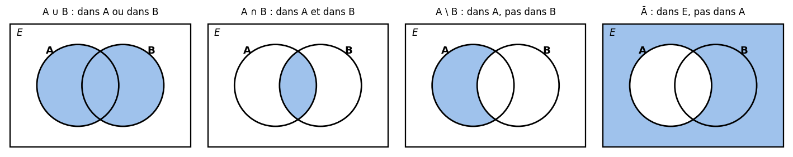
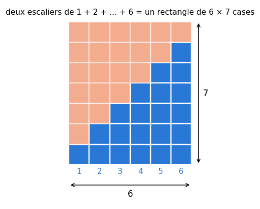
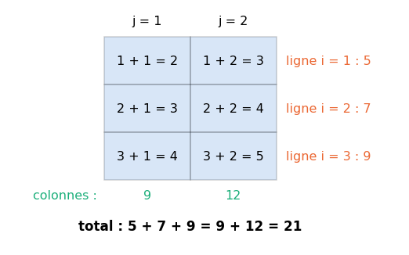
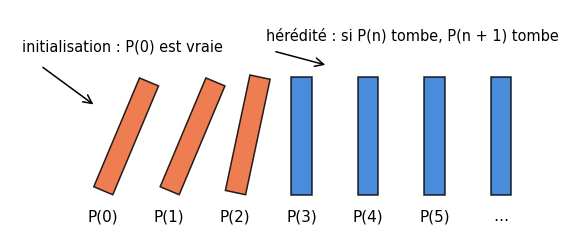

# R4 · Logique, ensembles, Σ et Π — fiche de cours

> La remise à niveau (R0 à R9) n'a pas de livre : **cette fiche est le cours**. R4 apprend le langage dans lequel les mathématiques sont écrites : les propositions et les connecteurs (« et », « ou », « non », « si… alors »), les quantificateurs « pour tout » et « il existe », les ensembles, les sommes Σ et les produits Π. Puis la façon dont on **démontre** : directement, par contraposée, par l'absurde, par un contre-exemple, par récurrence, et comment rédiger une démonstration courte. C'est ce qui te permettra de lire MML et les fiches des chapitres suivants, où presque chaque formule contient un Σ et chaque définition un « pour tout ».

| | |
|---|---|
| **Sections** | §1 à §8 |
| **Temps total estimé** | ≈ 12,4 h : lecture et calculs de la fiche ≈ 2 h 30, exercices ≈ 9 h 10, flashcards ≈ 45 min (parcours essentiel ≈ 9,1 h) |
| **Prérequis** | R2 (équations, inéquations, intervalles) ; R3 (fonctions) ; R1 (fractions) ; workbookIA 0A : ensembles en Python (§100.3.4), `itertools` (§100.6.6, aperçu) |
| **Fichiers du chapitre** | `02_exercices.md` (quiz, papier) · `03_notebook.ipynb` · `04_indices.md` · `05_solutions.md` et `05_solutions.ipynb` · `06_mes_reponses.md` · `flashcards.csv` |
| **mymath** | `logic.py` : `truth_table`, `implies`, `sum_over`, `prod_over`, `find_counterexample` |

## Comment utiliser ce chapitre

**Ordre conseillé.**
1. `python tools/start_chapter.py R4` (sur Colab : `00_setup/COLAB.md` §2) : il copie le notebook, ta feuille de réponses et le squelette `mymath/logic.py`.
2. Section par section : lis **crayon en main** (refais chaque table, chaque somme, chaque étape de démonstration avant de lire la suivante), puis fais les exercices de la section, quiz 🧠 d'abord.
3. Les exercices ✏️ et 🔗 se font sur papier, dans ta copie de `06_mes_reponses.md`, puis se vérifient dans la **partie 0** du notebook. Les démonstrations ∂ se rédigent dans ta copie et se jugent avec la grille de relecture de `05_solutions.md`.

Si le test de positionnement t'a donné « tu peux sauter » pour R4, lis « L'essentiel en 10 lignes » et « Les pièges classiques », fais les quiz et les exercices 🔨 du parcours essentiel (`positionnement/05_grille.md`). Garde quand même §6 à §8 : la rédaction d'une démonstration se pratique, elle ne se devine pas.

| Section | Quiz 🧠 | Papier et réflexion | Notebook |
|---|---|---|---|
| §1 Propositions, « et », « ou », « non » | Q1 | R4.1 ✏️ | R4.17 🔨 |
| §2 Implication, réciproque, contraposée, équivalence | Q2, R2 🔁 | R4.1 ✏️, R4.2 ✏️, R4.15 ⚖️, R4.16 🗣️ | R4.17 🔨 |
| §3 Quantificateurs et négation | Q3, R1 🔁 | R4.2 ✏️, R4.3 ✏️ | |
| §4 Ensembles | Q4 | R4.4 ✏️, R4.5 ✏️ | R4.20 📦, R4.23 🎨 |
| §5 Notations Σ et Π | Q5, R3 🔁 | R4.6 ✏️, R4.7 ✏️, R4.14 🔗 | R4.18 🔨, R4.22 🔬 |
| §6 Raisonnements | Q6 | R4.8 ✏️, R4.9 ∂, R4.10 ∂, R4.11 ∂, R4.15 ⚖️ | R4.19 🔨, R4.21 🔮 |
| §7 Raisonnement par récurrence | Q7 | R4.12 ∂, R4.13 ∂ | R4.22 🔬, R4.24 🐛 |
| §8 Rédiger une démonstration courte | Q8 | R4.9 ∂ | R4.24 🐛, R4.25 🛠️ |

Parcours essentiel : tout sauf R4.Q7, R4.Q8, R4.R2, R4.5, R4.11, R4.13, R4.15, R4.17, R4.22, R4.23 et R4.25.

## Objectifs d'apprentissage

À la fin du chapitre, tu sais :
- **construire** une table de vérité, et **nier** une phrase qui contient « et », « ou », « pour tout » ou « il existe » ;
- **distinguer** une implication, sa réciproque et sa contraposée, et **reconnaître** une équivalence ;
- **calculer** une union, une intersection, un complémentaire, un produit cartésien et leurs cardinaux ;
- **lire, écrire et calculer** une somme Σ, un produit Π et une somme double, et **changer d'indice** ;
- **choisir** un type de raisonnement (direct, contraposée, absurde, contre-exemple, disjonction de cas, récurrence) ;
- **rédiger** une démonstration courte : hypothèses, étapes justifiées, conclusion.

## L'essentiel en 10 lignes

1. Une **proposition** est une phrase qui est soit vraie, soit fausse. « Non P » est vraie quand P est fausse ; « P et Q » quand les deux sont vraies ; « P ou Q » quand **au moins une** l'est.
2. **Lois de De Morgan** : non (P et Q) = (non P) ou (non Q) ; non (P ou Q) = (non P) et (non Q).
3. **P ⇒ Q** (« si P, alors Q ») n'est fausse que si P est vraie et Q fausse. Elle a la même valeur que sa **contraposée** (non Q) ⇒ (non P), mais pas forcément que sa **réciproque** Q ⇒ P.
4. **P ⇔ Q** (« P si et seulement si Q ») : P ⇒ Q **et** Q ⇒ P.
5. **Quantificateurs** : ∀ « pour tout », ∃ « il existe ». La négation échange les deux : non (∀x, P(x)) = ∃x, non P(x). L'**ordre** de ∀ et ∃ change le sens.
6. **Ensembles** : $A \cup B$ (ou), $A \cap B$ (et), $\bar{A}$ (non), $A \setminus B$ ; $\lvert A \cup B \rvert = \lvert A \rvert + \lvert B \rvert - \lvert A \cap B \rvert$ ; $\lvert A \times B \rvert = \lvert A \rvert \times \lvert B \rvert$.
7. $\sum_{k=m}^{n} a_k = a_m + \dots + a_n$ a $n - m + 1$ termes ; l'indice est muet ; on sort les constantes et on sépare les sommes, mais **pas** les produits : $\sum a_k b_k \ne \left(\sum a_k\right)\left(\sum b_k\right)$. Une somme vide vaut 0, un produit vide vaut 1.
8. **Démontrer** un « pour tout » demande un argument qui marche pour **tous** les cas ; le **réfuter** ne demande qu'un **contre-exemple**.
9. **Récurrence** : si P(n₀) est vraie (**initialisation**) et si P(n) entraîne P(n + 1) pour tout $n \ge n_0$ (**hérédité**), alors P(n) est vraie pour tout $n \ge n_0$.
10. Une démonstration se **rédige** : ce qu'on suppose (« Soit… »), chaque étape et sa justification, ce qu'on conclut.

---

## §1 · Propositions, « et », « ou », « non »

### Vrai ou faux, sans entre-deux

Une **proposition** est une phrase qui a une **valeur de vérité** : vraie (V) ou fausse (F), jamais les deux. « 13 est un nombre premier » est une proposition vraie ; « 15 est un nombre premier » est une proposition fausse. En revanche :
- « Ouvre la fenêtre » n'est pas une proposition : un ordre n'est ni vrai ni faux ;
- « $x + 1 = 4$ » n'en est pas une tant que $x$ n'est pas fixé : elle est vraie pour $x = 3$, fausse sinon. On parle de **prédicat**, une phrase qui **dépend d'une variable**, et on la note $P(x)$. Elle devient une proposition dès qu'on choisit $x$, ou dès qu'on la quantifie (§3).

En Python, une proposition est un **booléen** : `True` ou `False`. `13 > 5` vaut `True`.

### Les trois connecteurs

À partir de propositions P et Q, on en fabrique d'autres :
- **non P** (on écrit aussi $\neg P$) est vraie quand P est fausse, et fausse quand P est vraie ;
- **P et Q** ($P \land Q$) est vraie quand P et Q sont **toutes les deux** vraies ;
- **P ou Q** ($P \lor Q$) est vraie quand **au moins une** des deux est vraie.

Une **table de vérité** liste toutes les combinaisons de valeurs de P et Q, et la valeur de la proposition pour chacune. Avec deux propositions, il y a $2 \times 2 = 4$ lignes ; on les écrit toujours dans le même ordre : VV, VF, FV, FF.

| P | Q | non P | P et Q | P ou Q |
|---|---|---|---|---|
| V | V | F | V | V |
| V | F | F | F | V |
| F | V | V | F | V |
| F | F | V | F | F |

Avec trois propositions, il y a $2^3 = 8$ lignes ; avec $n$, il y en a $2^n$ : chaque proposition double le nombre de cas.

⚠️ **Le « ou » des maths est inclusif.** « P ou Q » est vraie aussi quand P et Q sont vraies toutes les deux. Le « ou » du menu « fromage ou dessert » est exclusif (l'un ou l'autre, pas les deux) : en maths, on le dirait « ou bien… ou bien », et on l'écrit avec « ou » et « non (P et Q) ».

Exemple : pour un entier $n$, on pose P = « $n$ est pair » et Q = « $n > 10$ ». Pour $n = 14$ : P et Q sont vraies, donc « P et Q » et « P ou Q » sont vraies. Pour $n = 7$ : P et Q sont fausses, donc « P ou Q » est fausse. Pour $n = 21$ : P est fausse et Q vraie, donc « P et Q » est fausse et « P ou Q » vraie.

### Nier « et » et « ou » : les lois de De Morgan

Que veut dire « il est faux que $n$ soit pair **et** plus grand que 10 » ? Que l'une des deux conditions au moins manque : $n$ est impair, **ou** $n \le 10$. De même, « il est faux que $n$ soit pair **ou** plus grand que 10 » veut dire que $n$ est impair **et** $n \le 10$. Ce sont les **lois de De Morgan** :

$$\text{non}\,(P \text{ et } Q) = (\text{non } P) \text{ ou } (\text{non } Q) \qquad \text{non}\,(P \text{ ou } Q) = (\text{non } P) \text{ et } (\text{non } Q)$$

On les démontre avec une table de vérité : on calcule les deux colonnes, et on constate qu'elles sont **égales sur les quatre lignes** (c'est R4.1). Deux propositions qui ont la même table de vérité sont dites **équivalentes** : on peut remplacer l'une par l'autre dans tout raisonnement.

⚠️ **Nier un encadrement.** La négation de « $2 \le x \le 5$ », c'est-à-dire de « $x \ge 2$ et $x \le 5$ », est « $x < 2$ ou $x > 5$ ». Le « et » devient « ou », et chaque inégalité large devient stricte dans l'autre sens.

En Python, les connecteurs s'écrivent `not`, `and`, `or`, et une table de vérité se parcourt avec `itertools.product`, qui énumère les combinaisons dans l'ordre VV, VF, FV, FF :

```python
>>> import itertools
>>> for p, q in itertools.product([True, False], repeat=2):
...     print(p, q, (not p) and (not q))
True True False
True False False
False True False
False False True
```

---

## §2 · Implication, réciproque, contraposée, équivalence

### « Si… alors » : quand une promesse est-elle trahie ?

L'**implication** $P \Rightarrow Q$ se lit « si P, alors Q » ou « P implique Q ». P s'appelle l'**hypothèse**, Q la **conclusion**. Pense à une promesse : « si tu as ton permis, je te prête ma voiture ». Quand cette promesse est-elle **trahie** ? Seulement si tu as ton permis et que je ne te prête pas la voiture. Si tu n'as pas ton permis, je n'ai rien promis : que je te prête la voiture ou non, je ne mens pas.

| P | Q | P ⇒ Q |
|---|---|---|
| V | V | V |
| V | F | **F** |
| F | V | V |
| F | F | V |

$P \Rightarrow Q$ n'est fausse que dans **un seul** cas : P vraie et Q fausse. En particulier, quand l'hypothèse est fausse, l'implication est vraie (« si 2 + 2 = 5, alors je suis le pape » est une implication vraie, et sans intérêt). Remarque : la colonne de $P \Rightarrow Q$ est exactement celle de « (non P) ou Q » ; les deux propositions sont équivalentes.

Une implication porte presque toujours sur une variable, et sous-entend « pour tout » : « si un entier se termine par 0, alors il est divisible par 5 » veut dire « pour tout entier $n$, si $n$ se termine par 0, alors $n$ est divisible par 5 ». Elle est vraie si elle n'est trahie par **aucun** entier.

### Réciproque, contraposée, négation

À partir de $P \Rightarrow Q$, on forme :

| Nom | Forme | Sur l'exemple « si $n$ se termine par 0, alors $n$ est divisible par 5 » | Vraie ? |
|---|---|---|---|
| implication | $P \Rightarrow Q$ | si $n$ se termine par 0, alors $n$ est divisible par 5 | oui |
| **réciproque** | $Q \Rightarrow P$ | si $n$ est divisible par 5, alors $n$ se termine par 0 | **non** : $n = 35$ |
| **contraposée** | $\text{non } Q \Rightarrow \text{non } P$ | si $n$ n'est pas divisible par 5, alors $n$ ne se termine pas par 0 | oui |
| négation | $P \text{ et non } Q$ | il existe un entier qui se termine par 0 et n'est pas divisible par 5 | non |

Deux faits à retenir :
- **une implication et sa contraposée ont toujours la même valeur de vérité** : elles sont équivalentes (leurs tables sont égales, c'est R4.1). Démontrer la contraposée, c'est donc démontrer l'implication (§6) ;
- **la réciproque est une autre phrase** : elle peut être vraie ou fausse, quelle que soit la valeur de l'implication.

⚠️ **La négation d'une implication n'est pas une implication.** « Non ($P \Rightarrow Q$) » veut dire : P est vraie et Q est fausse. Nier « s'il pleut, je prends mon parapluie », c'est dire « il pleut et je ne prends pas mon parapluie », pas « s'il ne pleut pas, je ne le prends pas ».

### Équivalence, condition nécessaire, condition suffisante

Quand l'implication **et** sa réciproque sont vraies, on dit que P et Q sont **équivalentes** : $P \Leftrightarrow Q$, « P si et seulement si Q ». Par exemple, pour tout réel $x$ : $2x + 6 = 0 \Leftrightarrow x = -3$. Résoudre une équation (R2), c'est enchaîner des équivalences ; quand une étape n'est qu'une implication (élever au carré, par exemple), il faut **vérifier** les solutions trouvées.

Le vocabulaire des conditions : dans $P \Rightarrow Q$,
- P est une **condition suffisante** pour Q : il suffit d'avoir P pour avoir Q ;
- Q est une **condition nécessaire** pour P : sans Q, pas de P (c'est la contraposée).

« Se terminer par 0 » est suffisant pour être divisible par 5, pas nécessaire. « Être divisible par 5 » est nécessaire pour se terminer par 0, pas suffisant.

### Déduire

Si $P \Rightarrow Q$ est vraie **et** si P est vraie, alors Q est vraie : c'est le pas élémentaire de toute démonstration, la **déduction** (les logiciens l'appellent *modus ponens*). Et les implications s'enchaînent : si $P \Rightarrow Q$ et $Q \Rightarrow R$, alors $P \Rightarrow R$. Une démonstration n'est rien d'autre qu'une chaîne de telles étapes, chacune justifiée par une définition, une propriété déjà démontrée ou une hypothèse.

🔗 **Dans workbookIA** — le chapitre 11 oppose la **déduction** (la conclusion découle sûrement des prémisses) et l'**induction** (on généralise à partir d'exemples, sans certitude). Un modèle de ML qui apprend sur des données fait de l'induction ; une démonstration mathématique fait de la déduction. La « récurrence » du §7 est, malgré son nom anglais (*mathematical induction*), une déduction.

---

## §3 · Quantificateurs et négation

### « Pour tout » et « il existe »

Un prédicat $P(x)$ devient une proposition quand on dit **pour quels** $x$ il doit être vrai :
- **∀** se lit « pour tout » : $\forall x \in \mathbb{R},\ x^2 \ge 0$ (« pour tout réel $x$, $x^2$ est positif ou nul ») est **vraie** ;
- **∃** se lit « il existe » (au moins un) : $\exists x \in \mathbb{R},\ x^2 = 7$ est **vraie** ($x = \sqrt{7}$ convient) ; $\exists n \in \mathbb{N},\ n^2 = 7$ est **fausse** (aucun entier n'a pour carré 7).

Le domaine compte : la même phrase peut être vraie sur $\mathbb{R}$ et fausse sur $\mathbb{N}$. Et les implications cachent un ∀ : « si $x > 3$, alors $x^2 > 9$ » veut dire $\forall x \in \mathbb{R},\ (x > 3 \Rightarrow x^2 > 9)$.

### Nier une phrase quantifiée

Pour montrer qu'il est **faux** que « tous les élèves ont rendu leur devoir », il suffit d'**un** élève qui ne l'a pas rendu. La négation de « pour tout » est « il existe… qui ne… pas » :

$$\text{non}\,\big(\forall x,\ P(x)\big) = \exists x,\ \text{non } P(x) \qquad \text{non}\,\big(\exists x,\ P(x)\big) = \forall x,\ \text{non } P(x)$$

Exemples :
- non ($\forall x \in \mathbb{R},\ x^2 \ge x$) = ($\exists x \in \mathbb{R},\ x^2 < x$). La négation est vraie ($x = 0{,}5$ donne $0{,}25 < 0{,}5$), donc la phrase de départ est fausse.
- non ($\exists n \in \mathbb{N},\ n^2 = 7$) = ($\forall n \in \mathbb{N},\ n^2 \ne 7$), qui est vraie.

⚠️ **« Tous les… ne… pas » est ambigu.** « Tous les élèves n'ont pas rendu leur devoir » veut dire, à l'oral, « certains ne l'ont pas rendu » ; écrit, on le lit souvent « aucun ne l'a rendu ». En maths, on évite cette tournure : on écrit « il existe un élève qui… » ou « aucun élève… ».

### L'ordre des quantificateurs

Avec deux quantificateurs, l'**ordre** change tout. Comparons, sur $\mathbb{R}$ :
- $\forall x,\ \exists y,\ y > x$ : « pour tout réel, il y a un réel plus grand ». **Vrai** : à $x$ donné, $y = x + 1$ convient. Le $y$ peut **dépendre** de $x$.
- $\exists y,\ \forall x,\ y > x$ : « il y a un réel plus grand que tous les réels ». **Faux** : ce $y$ devrait être plus grand que lui-même. Ici, le même $y$ doit marcher pour tous les $x$.

Pour nier une phrase à plusieurs quantificateurs, on avance de gauche à droite : chaque ∀ devient ∃, chaque ∃ devient ∀, et on nie la propriété à la fin. La négation de « $\forall x \in \mathbb{R},\ \exists n \in \mathbb{N},\ n > x$ » (il y a toujours un entier plus grand) est « $\exists x \in \mathbb{R},\ \forall n \in \mathbb{N},\ n \le x$ » (un réel qui dépasse tous les entiers), qui est fausse.

📖 **Dans MML** — les définitions du livre sont pleines de quantificateurs : « for all $\mathbf{x} \in V$ », « there exists $\lambda \in \mathbb{R}$ such that… ». Les traduire mot à mot, puis se demander lequel peut dépendre de l'autre, est la moitié du travail de lecture.

---

## §4 · Ensembles

### Écrire un ensemble

Un **ensemble** est une collection d'objets, ses **éléments**, sans ordre et sans répétition. On l'écrit :
- **en extension**, en listant ses éléments entre accolades : $A = \{2, 3, 5, 7\}$, les nombres premiers inférieurs à 10 ;
- **en compréhension**, par une propriété : $B = \{n \in \mathbb{N} \mid n < 10 \text{ et } n \text{ impair}\} = \{1, 3, 5, 7, 9\}$ ; la barre verticale se lit « tels que ».

$x \in A$ se lit « $x$ appartient à $A$ » ($3 \in A$), et $x \notin A$ le contraire ($4 \notin A$). L'**ensemble vide** $\varnothing$ n'a aucun élément. Le **cardinal** $\lvert A \rvert$ est le nombre d'éléments d'un ensemble fini : $\lvert A \rvert = 4$. Comme il n'y a pas de répétition, $\{1, 1, 2\} = \{1, 2\}$, de cardinal 2, et comme il n'y a pas d'ordre, $\{1, 2\} = \{2, 1\}$.

$A$ est **inclus** dans $B$ ($A \subset B$) si **tout** élément de $A$ est aussi dans $B$ : $\{3, 5\} \subset A$. Ne confonds pas $3 \in A$ (un élément) et $\{3\} \subset A$ (un ensemble à un élément, inclus dans $A$). L'ensemble vide est inclus dans tout ensemble. Deux ensembles sont **égaux** quand chacun est inclus dans l'autre.

Les **ensembles de nombres** s'emboîtent : $\mathbb{N} \subset \mathbb{Z} \subset \mathbb{Q} \subset \mathbb{R}$ (entiers naturels, entiers relatifs, rationnels, réels ; R1). Les **intervalles** de R2 sont des ensembles de réels : $[2 \;;\; 5[\, = \{x \in \mathbb{R} \mid 2 \le x < 5\}$.

### Les opérations

On travaille dans un **univers** $E$, l'ensemble de tous les objets dont on parle. Ici, $E = \{0, 1, \dots, 9\}$, $A = \{2, 3, 5, 7\}$ et $B = \{1, 3, 5, 7, 9\}$.

| Opération | Notation | Contient | Logique | Sur l'exemple |
|---|---|---|---|---|
| union | $A \cup B$ | les éléments de $A$ **ou** de $B$ | ou | $\{1, 2, 3, 5, 7, 9\}$ |
| intersection | $A \cap B$ | les éléments de $A$ **et** de $B$ | et | $\{3, 5, 7\}$ |
| complémentaire | $\bar{A}$ | les éléments de $E$ qui ne sont **pas** dans $A$ | non | $\{0, 1, 4, 6, 8, 9\}$ |
| différence | $A \setminus B$ | les éléments de $A$ qui ne sont pas dans $B$ | et non | $\{2\}$ |



Le parallèle avec le §1 n'est pas un hasard : $x \in A \cup B$ veut dire « $x \in A$ ou $x \in B$ ». Les lois de De Morgan deviennent donc :

$$\overline{A \cup B} = \bar{A} \cap \bar{B} \qquad \overline{A \cap B} = \bar{A} \cup \bar{B}$$

Deux ensembles sans élément commun ($A \cap B = \varnothing$) sont **disjoints**.

### Compter une union

Pour compter les éléments de $A \cup B$, on additionne $\lvert A \rvert$ et $\lvert B \rvert$, mais les éléments de $A \cap B$ ont alors été comptés **deux fois** : on les retire une fois.

$$\lvert A \cup B \rvert = \lvert A \rvert + \lvert B \rvert - \lvert A \cap B \rvert$$

Sur l'exemple : $4 + 5 - 3 = 6$, et l'union a bien 6 éléments. Et dans l'univers : $\lvert \bar{A} \rvert = \lvert E \rvert - \lvert A \rvert = 10 - 4 = 6$.

Exemple sans liste : dans un groupe de 40 personnes, 18 parlent anglais, 11 parlent espagnol et 6 parlent les deux. Combien ne parlent ni l'un ni l'autre ? Ceux qui parlent au moins une langue sont $18 + 11 - 6 = 23$ ; il en reste $40 - 23 = 17$.

### Le produit cartésien

Le **produit cartésien** $A \times B$ est l'ensemble des **couples** $(a, b)$ avec $a \in A$ et $b \in B$. Un couple est **ordonné** : $(1, 2) \ne (2, 1)$, contrairement à l'ensemble $\{1, 2\} = \{2, 1\}$. Avec $A = \{\text{pile}, \text{face}\}$ et $B = \{1, 2, 3\}$ :

$$A \times B = \{(\text{pile}, 1), (\text{pile}, 2), (\text{pile}, 3), (\text{face}, 1), (\text{face}, 2), (\text{face}, 3)\}$$

Il y a 2 choix pour la première coordonnée et, pour chacun, 3 pour la seconde : $\lvert A \times B \rvert = \lvert A \rvert \times \lvert B \rvert = 6$. Le plan $\mathbb{R}^2 = \mathbb{R} \times \mathbb{R}$ est l'ensemble des couples de réels, les points d'un repère (R9). Et $\{V, F\}^n$, les $n$-uplets de valeurs de vérité, a $2^n$ éléments : ce sont les lignes d'une table de vérité.

En Python (workbookIA 0A §100.3.4), un `set` est un ensemble : `|` pour l'union, `&` pour l'intersection, `-` pour la différence, `len` pour le cardinal, `in` pour l'appartenance.

```python
>>> A = {2, 3, 5, 7}
>>> B = {1, 3, 5, 7, 9}
>>> A | B, A & B, A - B
({1, 2, 3, 5, 7, 9}, {3, 5, 7}, {2})
>>> len(A | B) == len(A) + len(B) - len(A & B)
True
```

🔗 **Dans workbookIA** — un événement de probabilité est un ensemble d'issues (0B, puis ch. 3) : « A ou B » est une union, « A et B » une intersection, et la formule du cardinal de l'union devient $P(A \cup B) = P(A) + P(B) - P(A \cap B)$.

---

## §5 · Notations Σ et Π

### Lire une somme

Le symbole $\Sigma$ (sigma majuscule, le S grec de « somme ») abrège une addition de termes qui suivent une règle :

$$\sum_{k=m}^{n} a_k = a_m + a_{m+1} + \dots + a_n$$

On lit « somme pour $k$ allant de $m$ à $n$ de $a_k$ ». $k$ est l'**indice**, $m$ et $n$ les **bornes** (toutes deux **incluses**), $a_k$ le **terme général**. Par exemple :

$$\sum_{k=1}^{4} (3k + 1) = 4 + 7 + 10 + 13 = 34 \qquad \sum_{j=2}^{5} \frac{1}{j} = \frac{1}{2} + \frac{1}{3} + \frac{1}{4} + \frac{1}{5} = \frac{77}{60}$$

Trois remarques qui évitent la plupart des erreurs :
- **le nombre de termes** de $\sum_{k=m}^{n}$ est $n - m + 1$, pas $n - m$ : de 3 à 7, il y a 5 termes (3, 4, 5, 6, 7) ;
- **l'indice est muet** : $\sum_{k=1}^{4} k^3$ et $\sum_{i=1}^{4} i^3$ sont le même nombre, la lettre ne sert qu'à l'intérieur ;
- **une somme de termes constants** compte les termes : $\sum_{k=1}^{n} c = c + c + \dots + c = n\,c$ (le terme ne dépend pas de $k$, mais il y a bien $n$ termes).

Quand $n < m$, la somme ne contient aucun terme : c'est une **somme vide**, et elle vaut 0 (l'élément neutre de l'addition).

### Calculer avec Σ

Trois règles, qui sont la distributivité et l'associativité de l'addition écrites avec Σ :
1. **Linéarité** : $\sum_{k} (\lambda a_k + \mu b_k) = \lambda \sum_{k} a_k + \mu \sum_{k} b_k$ pour des constantes $\lambda$ et $\mu$ (qui ne dépendent pas de $k$).
2. **Découpage** (relation de Chasles) : pour $m \le p < n$, $\sum_{k=m}^{n} a_k = \sum_{k=m}^{p} a_k + \sum_{k=p+1}^{n} a_k$.
3. **Changement d'indice** : on pose $j = k + d$ ; les bornes bougent avec l'indice. Ainsi $\sum_{k=1}^{5} a_{k+2} = \sum_{j=3}^{7} a_j$ : quand $k$ va de 1 à 5, $j = k + 2$ va de 3 à 7.

⚠️ **On ne sépare pas un produit.** $\sum_{k} a_k b_k \ne \left(\sum_{k} a_k\right)\left(\sum_{k} b_k\right)$ en général : avec deux termes, $a_1 b_1 + a_2 b_2$ n'est pas $(a_1 + a_2)(b_1 + b_2)$, qui contient en plus $a_1 b_2 + a_2 b_1$. De même $\sum a_k^2 \ne \left(\sum a_k\right)^2$.

### Deux sommes à connaître

La somme des $n$ premiers entiers :

$$\sum_{k=1}^{n} k = 1 + 2 + \dots + n = \frac{n(n+1)}{2}$$

L'idée se voit sur une figure : deux « escaliers » $1 + 2 + \dots + n$, l'un retourné sur l'autre, forment un rectangle de $n$ cases sur $n + 1$. Le double de la somme vaut donc $n(n + 1)$. Pour $n = 6$ : $6 \times 7 / 2 = 21$. Tu en feras une démonstration par récurrence en R4.12.



Avec la linéarité, elle donne beaucoup d'autres sommes : $\sum_{k=1}^{20} (2k - 5) = 2 \sum_{k=1}^{20} k - \sum_{k=1}^{20} 5 = 2 \times 210 - 100 = 320$.

La seconde est une **somme télescopique** : quand chaque terme est une différence $b_{k+1} - b_k$, tout se simplifie sauf le premier et le dernier.

$$\sum_{k=1}^{n} (b_{k+1} - b_k) = (b_2 - b_1) + (b_3 - b_2) + \dots + (b_{n+1} - b_n) = b_{n+1} - b_1$$

Par exemple, $\frac{1}{k(k+1)} = \frac{1}{k} - \frac{1}{k+1}$ (réduis au même dénominateur pour le vérifier), donc $\sum_{k=1}^{n} \frac{1}{k(k+1)} = 1 - \frac{1}{n+1}$ : pour $n = 4$, $\frac{1}{2} + \frac{1}{6} + \frac{1}{12} + \frac{1}{20} = \frac{4}{5}$.

### Le produit Π

Le symbole $\Pi$ (pi majuscule, le P de « produit ») fait la même chose pour la multiplication : $\prod_{k=m}^{n} a_k = a_m \times a_{m+1} \times \dots \times a_n$. Par exemple $\prod_{k=1}^{3} (2k + 1) = 3 \times 5 \times 7 = 105$. La **factorielle** est un produit : $n! = \prod_{k=1}^{n} k$, et $6! = 720$. Un **produit vide** vaut 1, l'élément neutre de la multiplication (c'est pourquoi $0! = 1$).

⚠️ **Une constante sort à la puissance $n$.** $\prod_{k=1}^{n} (c\,a_k) = c^n \prod_{k=1}^{n} a_k$, car $c$ apparaît dans chacun des $n$ facteurs. Le logarithme (R6) transformera un produit en somme : c'est ainsi que workbookIA calcule la probabilité d'un dataset.

### Les sommes doubles

Une **somme double** additionne les cases d'un tableau $a_{i,j}$ à deux indices :

$$\sum_{i=1}^{3} \sum_{j=1}^{2} (i + j) = \sum_{i=1}^{3} \big[(i + 1) + (i + 2)\big] = \sum_{i=1}^{3} (2i + 3) = 5 + 7 + 9 = 21$$

On calcule la somme intérieure (sur $j$, à $i$ fixé), puis l'extérieure. Pour une somme finie, l'**ordre ne compte pas** : on peut additionner ligne par ligne ou colonne par colonne.



Quand le terme est un produit d'un facteur qui ne dépend que de $i$ et d'un facteur qui ne dépend que de $j$, la somme double se **factorise** : $\sum_{i} \sum_{j} x_i\,y_j = \left(\sum_{i} x_i\right)\left(\sum_{j} y_j\right)$. Ce n'est pas la même chose que la règle interdite plus haut : ici, on additionne **tous** les produits $x_i y_j$, pas seulement ceux de même indice.

En Python, une somme est une boucle ou un `sum` sur un `range`, dont la borne de droite est **exclue** : $\sum_{k=m}^{n}$ s'écrit avec `range(m, n + 1)`.

```python
>>> sum(3 * k + 1 for k in range(1, 5))
34
>>> sum(i + j for i in range(1, 4) for j in range(1, 3))
21
>>> import math
>>> math.prod(2 * k + 1 for k in range(1, 4)), math.factorial(6)
(105, 720)
```

🔗 **Dans workbookIA** — la moyenne de $n$ valeurs s'écrit $\bar{x} = \frac{1}{n}\sum_{i=1}^{n} x_i$, et presque toutes les losses sont une moyenne sur les exemples ; une couche de neurones calcule des sommes $\sum_j w_{ij} x_j$, et un produit de matrices des sommes de produits. Les sommes doubles reviennent dès qu'il y a deux indices : exemples et classes, lignes et colonnes.

---

## §6 · Raisonnements : direct, contraposée, absurde, contre-exemple, disjonction de cas

Pour toute la section : un entier $n$ est **pair** s'il existe un entier $k$ tel que $n = 2k$, et **impair** s'il existe un entier $k$ tel que $n = 2k + 1$. Tout entier est pair ou impair, jamais les deux.

### Raisonnement direct

On part des hypothèses et on enchaîne des déductions jusqu'à la conclusion.

> **Propriété.** Le produit de deux entiers impairs est impair.
>
> *Démonstration.* Soient $a$ et $b$ deux entiers impairs. Il existe des entiers $k$ et $\ell$ tels que $a = 2k + 1$ et $b = 2\ell + 1$. Alors $ab = 4k\ell + 2k + 2\ell + 1 = 2(2k\ell + k + \ell) + 1$. Comme $2k\ell + k + \ell$ est un entier, $ab$ est impair. ∎

Note les deux lettres $k$ et $\ell$ : prendre la même lettre pour $a$ et $b$ supposerait $a = b$.

### Raisonnement par contraposée

Pour démontrer $P \Rightarrow Q$, on démontre $\text{non } Q \Rightarrow \text{non } P$, qui lui est équivalente (§2). C'est utile quand « non Q » donne une information plus facile à exploiter que P.

> **Propriété.** Pour deux réels $a$ et $b$, si $a + b > 10$, alors $a > 5$ ou $b > 5$.
>
> *Démonstration.* Montrons la contraposée : si $a \le 5$ et $b \le 5$, alors $a + b \le 10$ (la négation de « $a > 5$ ou $b > 5$ » est « $a \le 5$ et $b \le 5$ », par De Morgan). En additionnant les deux inégalités, $a + b \le 5 + 5 = 10$. ∎

### Raisonnement par l'absurde

On suppose que la conclusion est **fausse**, et on en déduit une contradiction (une proposition à la fois vraie et fausse). La supposition était donc impossible.

> **Propriété.** Il n'existe pas de plus petit réel strictement positif.
>
> *Démonstration.* Supposons par l'absurde qu'il existe un plus petit réel strictement positif, que l'on note $\varepsilon$. Alors $\frac{\varepsilon}{2}$ est un réel strictement positif, et $\frac{\varepsilon}{2} < \varepsilon$ : c'est un réel strictement positif plus petit que le plus petit. Contradiction. Un tel $\varepsilon$ n'existe donc pas. ∎

La démonstration la plus célèbre de ce type montre que $\sqrt{2}$ n'est pas une fraction : c'est R4.11.

### Le contre-exemple

Pour montrer qu'une phrase « pour tout $x$, $P(x)$ » est **fausse**, il suffit de **un** $x$ pour lequel $P(x)$ est fausse : c'est la négation du §3. « Tout nombre premier est impair » est faux : 2 est premier et pair. « Pour tous réels $a$ et $b$, $(a + b)^2 = a^2 + b^2$ » est faux : $a = b = 1$ donne $4 \ne 2$.

⚠️ **Des exemples ne démontrent pas un « pour tout ».** Vérifier une propriété sur 10, 1 000 ou un milliard de cas ne prouve rien pour les suivants (R4.21 en montre une qui tient longtemps avant de tomber). À l'inverse, **un seul** contre-exemple suffit à réfuter. Un ordinateur est donc très bon pour chercher des contre-exemples, et ne remplace jamais une démonstration.

### La disjonction de cas

Quand la démonstration dépend de la situation, on découpe en cas qui couvrent **toutes** les possibilités, et on traite chacun.

> **Propriété.** Pour tout entier $n$, le reste de la division de $n^2$ par 4 vaut 0 ou 1.
>
> *Démonstration.* Soit $n$ un entier. *Premier cas* : $n$ est pair, $n = 2k$. Alors $n^2 = 4k^2$, de reste 0. *Second cas* : $n$ est impair, $n = 2k + 1$. Alors $n^2 = 4k^2 + 4k + 1 = 4(k^2 + k) + 1$, de reste 1. Tout entier étant pair ou impair, les deux cas couvrent tous les entiers. ∎

Conséquence immédiate : aucun carré ne s'écrit $4m + 2$ ou $4m + 3$.

En Python, chercher un contre-exemple, c'est essayer les cas dans l'ordre et s'arrêter au premier qui échoue :

```python
>>> next(n for n in range(100) if not 3 ** n > n ** 3)
3
```

La phrase « pour tout entier $n$, $3^n > n^3$ » tient pour $n = 0, 1, 2$ ($1 > 0$, $3 > 1$, $9 > 8$), échoue en $n = 3$ ($27$ n'est pas strictement plus grand que $27$), puis redevient vraie à partir de $n = 4$ ($81 > 64$). Un seul contre-exemple suffit pourtant : le « pour tout » est faux.

---

## §7 · Raisonnement par récurrence

### Le principe des dominos

Comment démontrer une propriété $P(n)$ pour **tous** les entiers $n \ge n_0$, une infinité de cas ? Pense à une file de dominos. Pour être sûr qu'ils tombent tous, il suffit de deux choses : le premier tombe, et chaque domino qui tombe fait tomber le suivant.



> **Principe de récurrence.** Soit $P(n)$ une propriété qui dépend d'un entier $n$, et $n_0$ un entier. Si
> 1. **initialisation** : $P(n_0)$ est vraie ;
> 2. **hérédité** : pour tout entier $n \ge n_0$, si $P(n)$ est vraie, alors $P(n + 1)$ est vraie ;
>
> alors $P(n)$ est vraie pour tout entier $n \ge n_0$.

Dans l'hérédité, on **suppose** $P(n)$ vraie pour un $n$ quelconque (c'est l'**hypothèse de récurrence**) et on **démontre** $P(n + 1)$. On ne suppose pas ce qu'on veut démontrer : on démontre une implication.

### Un exemple de somme

> **Propriété.** Pour tout entier $n \ge 1$, $\sum_{k=1}^{n} (2k - 1) = n^2$ : la somme des $n$ premiers nombres impairs est un carré.
>
> *Démonstration.* Pour $n \ge 1$, notons $P(n)$ : « $\sum_{k=1}^{n} (2k - 1) = n^2$ ».
>
> *Initialisation.* Pour $n = 1$, la somme a un seul terme, $2 \times 1 - 1 = 1$, et $1^2 = 1$ : $P(1)$ est vraie.
>
> *Hérédité.* Soit $n \ge 1$ tel que $P(n)$ est vraie. On découpe la somme jusqu'à $n + 1$ en ses $n$ premiers termes et le dernier :
> $$\sum_{k=1}^{n+1} (2k - 1) = \sum_{k=1}^{n} (2k - 1) + \big(2(n + 1) - 1\big) = n^2 + 2n + 1 = (n + 1)^2,$$
> où l'on a utilisé l'hypothèse de récurrence, puis une identité remarquable (R2). Donc $P(n + 1)$ est vraie.
>
> *Conclusion.* Par récurrence, $P(n)$ est vraie pour tout $n \ge 1$. ∎

Le geste clé de l'hérédité est presque toujours le même pour une somme : **isoler le dernier terme** pour faire apparaître la somme jusqu'à $n$, que l'hypothèse de récurrence permet de remplacer.

### Un exemple de divisibilité

> **Propriété.** Pour tout entier $n \ge 0$, $4^n - 1$ est divisible par 3.
>
> *Démonstration.* *Initialisation* : $4^0 - 1 = 0 = 3 \times 0$. *Hérédité* : soit $n \ge 0$ tel que $4^n - 1 = 3m$ pour un entier $m$. Alors $4^{n+1} - 1 = 4 \times 4^n - 1 = 4(3m + 1) - 1 = 12m + 3 = 3(4m + 1)$, divisible par 3. *Conclusion* : par récurrence, la propriété est vraie pour tout $n \ge 0$. ∎

### Les deux étapes sont indispensables

- **Sans initialisation**, on peut « démontrer » des propriétés fausses. Prenons « $4^n$ est divisible par 3 ». L'hérédité marche : si $4^n = 3m$, alors $4^{n+1} = 4 \times 3m = 3 \times 4m$. Pourtant la propriété est fausse pour **tout** $n$ : $4^n = 2^{2n}$ n'a que des facteurs 2. Aucun domino ne tombe, parce que le premier ne tombe pas : $4^0 = 1$ n'est pas divisible par 3.
- **Une hérédité qui ne marche pas pour tous les $n \ge n_0$** ne démontre rien : il suffit qu'un seul domino ne fasse pas tomber le suivant pour que la chaîne s'arrête. R4.24 te fera chercher ce domino.

⚠️ **Initialiser au bon endroit.** Pour une propriété annoncée « pour tout $n \ge 4$ », l'initialisation se fait en $n = 4$, et l'hérédité pour $n \ge 4$.

---

## §8 · Rédiger une démonstration courte

### Ce qu'une démonstration doit contenir

Une démonstration est un **texte** : des phrases complètes, avec des symboles quand ils aident. Elle contient :
1. **l'énoncé** de ce qu'on démontre, avec ses quantificateurs ;
2. **l'introduction des objets** : « Soit $n$ un entier pair » pour un « pour tout », « Posons $x = 3$ » pour un « il existe » ; chaque lettre est introduite avant d'être utilisée, avec ce qu'on sait d'elle ;
3. **des étapes justifiées** : chaque « donc » s'appuie sur une hypothèse, une définition ou une propriété connue, que l'on cite (« par définition d'un nombre pair », « d'après l'hypothèse de récurrence », « par l'identité $(a+b)^2 = \dots$ ») ;
4. **une conclusion** qui reprend l'énoncé, et un signe de fin (∎, ou « ce qui conclut la démonstration »).

Un exemple complet, en quatre lignes :

> **Propriété.** Pour tous réels $a$ et $b$, $a^2 + b^2 \ge 2ab$.
>
> *Démonstration.* Soient $a$ et $b$ deux réels. Un carré est toujours positif ou nul, donc $(a - b)^2 \ge 0$. Or $(a - b)^2 = a^2 - 2ab + b^2$ (identité remarquable). Donc $a^2 - 2ab + b^2 \ge 0$, c'est-à-dire $a^2 + b^2 \ge 2ab$. ∎

On l'a trouvée **à l'envers** (on voulait $a^2 + b^2 - 2ab \ge 0$ et on a reconnu un carré), mais on la **rédige à l'endroit**, des hypothèses vers la conclusion.

### Les fautes de rédaction les plus fréquentes

- **Vérifier sur des exemples** au lieu de démontrer (§6) : « 2 + 4 = 6, 8 + 10 = 18, donc la somme de deux pairs est paire » n'est pas une démonstration.
- **Démontrer la réciproque** : pour montrer $P \Rightarrow Q$, on part de P. Partir de Q et arriver à P démontre $Q \Rightarrow P$, une autre phrase.
- **Partir de la conclusion** : écrire « $a^2 + b^2 \ge 2ab$, donc … donc $0 \le (a - b)^2$, vrai » enchaîne des implications dans le mauvais sens ; elle ne montre rien, sauf si chaque étape est une équivalence (et il faut alors l'écrire avec ⇔).
- **Utiliser une lettre sans l'introduire**, ou la même lettre pour deux objets différents.
- **Oublier un cas** dans une disjonction de cas, ou l'**initialisation** d'une récurrence.

### Écrire une démonstration en LaTeX

Dans un notebook ou un fichier Markdown, une démonstration s'écrit en texte, avec les formules entre `$`. Quelques commandes utiles ici : `\forall`, `\exists`, `\in`, `\notin`, `\subset`, `\cup`, `\cap`, `\setminus`, `\varnothing`, `\Rightarrow`, `\Leftrightarrow`, `\neg`, `\land`, `\lor`, `\sum_{k=1}^{n}`, `\prod_{k=1}^{n}`, `\mathbb{N}`, `\mathbb{R}`. Le signe de fin ∎ s'écrit `$\blacksquare$` ou se tape directement. Tu mettras tout cela en pratique dans R4.25.

---

## Les pièges classiques ⚠️ (récapitulatif)

| Piège | Faux | Juste |
|---|---|---|
| « ou » exclusif | « P ou Q » est fausse si P et Q sont vraies | le « ou » des maths est inclusif : vraie |
| nier un « et » | non (P et Q) = (non P) et (non Q) | (non P) **ou** (non Q) |
| implication et réciproque | si $P \Rightarrow Q$ est vraie, $Q \Rightarrow P$ aussi | la réciproque est une autre phrase |
| négation d'une implication | non ($P \Rightarrow Q$) = (non P ⇒ non Q) | P **et** non Q |
| nier « pour tout » | non (tous sont rouges) = aucun n'est rouge | **il existe** un qui n'est pas rouge |
| nier une inégalité | non ($x > 2$) = $x < 2$ | $x \le 2$ |
| ordre des quantificateurs | $\forall x\, \exists y$ = $\exists y\, \forall x$ | le $y$ ne peut dépendre de $x$ que dans $\forall x\, \exists y$ |
| élément et sous-ensemble | $\{3\} \in \{2, 3, 5\}$ | $3 \in \{2, 3, 5\}$ et $\{3\} \subset \{2, 3, 5\}$ |
| cardinal d'une union | $\lvert A \cup B \rvert = \lvert A \rvert + \lvert B \rvert$ | retirer $\lvert A \cap B \rvert$ |
| nombre de termes | $\sum_{k=3}^{7}$ a 4 termes | $7 - 3 + 1 = 5$ termes |
| somme d'une constante | $\sum_{k=1}^{n} 5 = 5$ | $5n$ |
| séparer un produit | $\sum a_k b_k = \left(\sum a_k\right)\left(\sum b_k\right)$ | faux en général |
| constante dans un Π | $\prod (2 a_k) = 2 \prod a_k$ | $2^n \prod a_k$ |
| bornes en Python | $\sum_{k=1}^{n}$ = `range(1, n)` | `range(1, n + 1)` |
| exemples et démonstration | « vrai pour $n = 1, \dots, 100$, donc pour tout $n$ » | il faut un argument pour tous les $n$ |
| récurrence | oublier l'initialisation | initialisation **et** hérédité |

## Et maintenant

**Dans ce dépôt** : R5, *Suites*. Les sommes Σ y deviennent des sommes de suites arithmétiques et géométriques, et la récurrence sert à démontrer des propriétés de suites définies pas à pas ; la définition d'une limite utilise trois quantificateurs à la suite.

**Dans workbookIA** : continue le chapitre 0A au rythme de ton tableau de bord (les ensembles de Python, §100.3.4, sont exactement ceux du §4 ; `itertools.product`, §100.6.6, énumère les lignes d'une table de vérité). Le chapitre 0B, après la remise à niveau, reprend Σ, Π et les ensembles, et les relie aux losses, aux probabilités et au dénombrement. Le chapitre 11 reviendra sur la déduction et l'induction.

## Pour aller plus loin

- R. Hammack, *Book of Proof* (3ᵉ éd.), gratuit sous licence CC BY-NC-ND 4.0, en anglais : chapitres 1 à 2 (ensembles, logique), 4 à 6 (démonstrations directes, par contraposée, par l'absurde) et 10 (récurrence) ; le détail et la date de vérification sont dans `annexes/ressources.md`.
- Maths et tiques (Yvan Monka), cours et vidéos gratuits sur le raisonnement par récurrence et les ensembles : [maths-et-tiques.fr](https://www.maths-et-tiques.fr).
- `annexes/symboles.md` (lire ∀, ∃, ∈, ⊂, Σ, Π à voix haute), `annexes/formulaire.md` et `annexes/erreurs_frequentes.md`.
