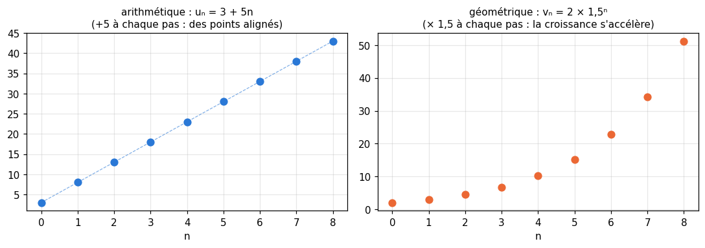
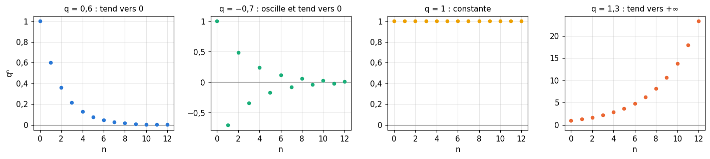
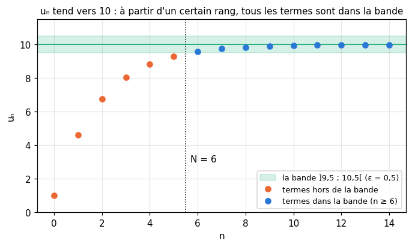
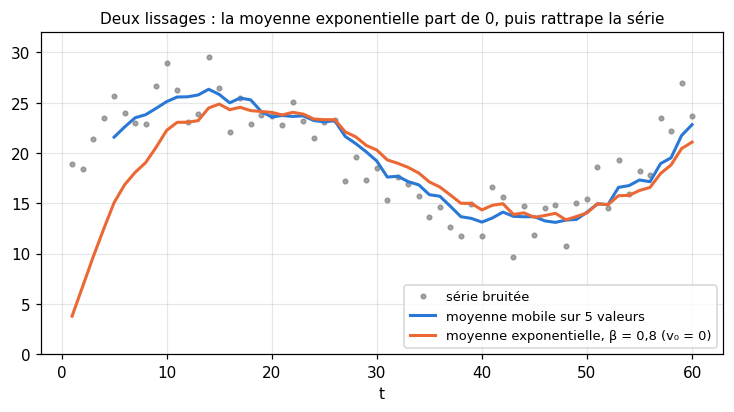

# R5 · Suites — fiche de cours

> La remise à niveau (R0 à R9) n'a pas de livre : **cette fiche est le cours**. R5 t'apprend à manier des listes de nombres qui se suivent selon une règle : les **suites**. Tu les définiras par une formule ou pas à pas, tu reconnaîtras les deux familles qu'on rencontre partout (arithmétique : on ajoute ; géométrique : on multiplie), tu additionneras leurs termes sans les écrire tous, et tu verras qu'une somme infinie peut avoir une valeur finie. Pour finir, deux façons de **lisser** une série de mesures bruitées, la moyenne mobile et la moyenne exponentielle : un entraînement de réseau de neurones est une suite (les valeurs successives des paramètres), et la moyenne exponentielle est au cœur des optimiseurs de workbookIA.

| | |
|---|---|
| **Sections** | §1 à §6 |
| **Temps total estimé** | ≈ 10,2 h : lecture et calculs de la fiche ≈ 3 h, exercices ≈ 6 h 30, flashcards ≈ 40 min (parcours essentiel ≈ 8,2 h) |
| **Prérequis** | R4 (Σ, changement d'indice, récurrence) ; R1 (puissances, pourcentages) ; R3 (fonctions affines) ; workbookIA 0A : créer des arrays (§100.8.1), calcul vectorisé (§100.8.3), réductions (§100.8.5) |
| **Fichiers du chapitre** | `02_exercices.md` (quiz, papier) · `03_notebook.ipynb` · `04_indices.md` · `05_solutions.md` et `05_solutions.ipynb` · `06_mes_reponses.md` · `flashcards.csv` |
| **mymath** | `sequences.py` : `arithmetic_term`, `geometric_sum`, `iterate`, `moving_average`, `exponential_moving_average` |

## Comment utiliser ce chapitre

**Ordre conseillé.**
1. `python tools/start_chapter.py R5` (sur Colab : `00_setup/COLAB.md` §2) : il copie le notebook, ta feuille de réponses et le squelette `mymath/sequences.py`.
2. Section par section : lis **crayon en main** (calcule les premiers termes de chaque exemple avant de lire la ligne suivante), puis fais les exercices de la section, quiz 🧠 d'abord.
3. Les exercices ✏️ et 🔗 se font sur papier, dans ta copie de `06_mes_reponses.md`, puis se vérifient dans la **partie 0** du notebook. Les démonstrations ∂ se rédigent dans ta copie et se jugent avec la grille de relecture de `05_solutions.md`.

**La calculatrice** (ou Python) est permise dans ce chapitre pour les puissances décimales comme $1{,}03^{10}$ ; tout le reste se calcule à la main.

Si le test de positionnement t'a donné « tu peux sauter » pour R5, lis « L'essentiel en 10 lignes » et « Les pièges classiques », fais les quiz et les exercices 🔨 du parcours essentiel (`positionnement/05_grille.md`). Garde quand même le §6 : les moyennes mobiles et exponentielles ne sont pas au programme du lycée.

| Section | Quiz 🧠 | Papier et réflexion | Notebook |
|---|---|---|---|
| §1 Suites : explicites et par récurrence | Q1, R2 🔁 | R5.1 ✏️ | R5.15 🔨, R5.18 🔮 |
| §2 Suites arithmétiques | Q2 | R5.2 ✏️, R5.8 ✏️, R5.10 ∂ | R5.14 🔨 |
| §3 Suites géométriques | Q2, R3 🔁 | R5.3 ✏️, R5.6 ✏️, R5.8 ✏️ | |
| §4 Sommes de termes | Q3, R1 🔁 | R5.4 ✏️, R5.9 ∂, R5.10 ∂ | R5.14 🔨, R5.17 📦, R5.21 🐛, R5.22 🛠️ |
| §5 Limite d'une suite et somme infinie | Q4 | R5.5 ✏️, R5.6 ✏️, R5.11 🔗, R5.13 🗣️ | R5.18 🔮, R5.20 🎨 |
| §6 Moyennes mobiles et exponentielles | Q5, Q6 | R5.7 ✏️, R5.12 🔗 | R5.16 🔨, R5.17 📦, R5.19 🔬 |

Parcours essentiel : tout sauf R5.Q6, R5.R2, R5.6, R5.10, R5.17, R5.19, R5.20 et R5.22.

## Objectifs d'apprentissage

À la fin du chapitre, tu sais :
- **calculer** les termes d'une suite définie par une formule ou par récurrence, et **étudier** son sens de variation ;
- **reconnaître** une suite arithmétique ou géométrique, et **calculer** un terme quelconque à partir de deux termes ;
- **calculer** la somme de termes consécutifs d'une suite arithmétique ou géométrique, sans les additionner un par un ;
- **dire** si une suite converge, avec la définition de la limite, et **calculer** la somme infinie d'une suite géométrique de raison $\lvert q \rvert < 1$ ;
- **calculer** une moyenne mobile et une moyenne exponentielle, et **relier** les poids de la seconde à une suite géométrique.

## L'essentiel en 10 lignes

1. Une **suite** $(u_n)$ associe un nombre $u_n$ à chaque entier $n$ : $u_0, u_1, u_2, \dots$ On la définit **explicitement** ($u_n = n^2 - 1$) ou **par récurrence** (un premier terme et une règle $u_{n+1} = f(u_n)$).
2. **Arithmétique** : on ajoute la même **raison** $r$ à chaque pas, $u_{n+1} = u_n + r$, donc $u_n = u_0 + n\,r$.
3. **Géométrique** : on multiplie par la même **raison** $q$ à chaque pas, $u_{n+1} = q\,u_n$, donc $u_n = u_0\,q^n$. Une hausse de $t\,\%$ est une multiplication par $1 + \frac{t}{100}$.
4. Somme de termes consécutifs d'une suite arithmétique : **nombre de termes × (premier + dernier) / 2**.
5. Somme de $n$ termes consécutifs d'une suite géométrique de raison $q \ne 1$ : **premier terme × $\frac{1 - q^n}{1 - q}$** ; si $q = 1$, $n$ fois le premier terme.
6. $u_n$ **tend vers** $\ell$ si, pour tout écart $\varepsilon > 0$, tous les termes sont à moins de $\varepsilon$ de $\ell$ à partir d'un certain rang.
7. $q^n$ tend vers 0 si $\lvert q \rvert < 1$, vers $+\infty$ si $q > 1$ ; il reste égal à 1 si $q = 1$ et n'a pas de limite si $q \le -1$.
8. Si $\lvert q \rvert < 1$, la **somme infinie** $u_0 + u_0 q + u_0 q^2 + \dots$ vaut $\frac{u_0}{1 - q}$ ; sinon elle n'a pas de valeur finie (pour $u_0 \ne 0$).
9. **Moyenne mobile** sur $k$ valeurs : la moyenne des $k$ dernières valeurs, chacune de poids $\frac{1}{k}$.
10. **Moyenne exponentielle** : $v_0 = 0$ et $v_t = \beta\,v_{t-1} + (1 - \beta)\,x_t$ ; les poids des valeurs passées forment une suite géométrique de raison $\beta$, et les premières valeurs de $v$ sont tirées vers 0.

---

## §1 · Suites : explicites et par récurrence

### Une liste infinie de nombres numérotés

Une **suite** est une liste infinie de nombres, numérotés par les entiers naturels : $u_0, u_1, u_2, u_3, \dots$ Le nombre $u_n$ est le **terme** de **rang** $n$ (ou d'**indice** $n$) ; la suite entière se note $(u_n)$, avec des parenthèses, pour la distinguer de son terme $u_n$. C'est une fonction de $\mathbb{N}$ dans $\mathbb{R}$ (R3), dont on écrit la variable en indice : $u_n$ plutôt que $u(n)$. Les deux écritures se rencontrent, et le code de `mymath` écrit `u(n)`.

Une suite peut commencer au rang 1 plutôt qu'au rang 0, par exemple quand $u_n$ est la mesure du jour $n$ : son premier terme est alors $u_1$. Lis toujours le **premier rang** dans l'énoncé.

### Définition explicite

Une suite est définie **explicitement** quand une formule donne $u_n$ directement en fonction de $n$. Par exemple $u_n = n^2 - 1$ :

$$u_0 = 0^2 - 1 = -1, \quad u_1 = 0, \quad u_2 = 3, \quad u_3 = 8, \quad u_{10} = 100 - 1 = 99.$$

On obtient $u_{10}$ **sans** calculer les termes précédents : il suffit de remplacer $n$ par 10.

### Définition par récurrence

Une suite est définie **par récurrence** quand on donne son **premier terme** et une **règle** qui calcule chaque terme à partir du précédent : $u_{n+1} = f(u_n)$. Par exemple :

$$u_0 = 5 \quad \text{et} \quad u_{n+1} = 2u_n - 3 \text{ pour tout } n \ge 0.$$

On calcule pas à pas : $u_1 = 2 \times 5 - 3 = 7$, $u_2 = 2 \times 7 - 3 = 11$, $u_3 = 19$, $u_4 = 35$. Pour connaître $u_{10}$, il faut d'abord $u_9$, donc $u_8$, et ainsi de suite jusqu'à $u_0$ : la règle ne donne pas de raccourci (on en trouvera un au §5 pour ce type de règle). Sans le premier terme, la suite n'est pas définie : la même règle, partie de $u_0 = 3$, donne $3, 3, 3, \dots$

En Python, une définition par récurrence est une **boucle** qui remplace la valeur courante par la suivante :

```python
>>> [n**2 - 1 for n in range(5)]
[-1, 0, 3, 8, 15]
>>> u = 5
>>> for n in range(4):
...     u = 2 * u - 3
>>> u
35
```

Après quatre passages dans la boucle, `u` contient $u_4$.

⚠️ **Le rang et la valeur.** $u_{n+1}$ est le terme qui **suit** $u_n$ ; $u_n + 1$ est le terme $u_n$ augmenté de 1. Avec la suite ci-dessus, $u_{2+1} = u_3 = 19$, mais $u_2 + 1 = 12$.

### Sens de variation

Une suite est **croissante** si chaque terme est supérieur ou égal au précédent, $u_{n+1} \ge u_n$ pour tout $n$ ; **décroissante** si $u_{n+1} \le u_n$ pour tout $n$ ; strictement, avec des inégalités strictes. Pour le savoir, on étudie le **signe de la différence** $u_{n+1} - u_n$.

Pour $u_n = n^2 - 1$ : $u_{n+1} - u_n = (n+1)^2 - 1 - (n^2 - 1) = 2n + 1 > 0$ pour tout $n \ge 0$, donc la suite est strictement croissante.

Une suite peut n'être ni l'une ni l'autre : $(-1)^n$ vaut $1, -1, 1, -1, \dots$ Et une suite peut ne devenir croissante qu'à partir d'un certain rang : on le dit alors avec ce rang.

### La récurrence au service des suites

Pour une suite définie par récurrence, une propriété de **tous** ses termes se démontre naturellement par récurrence (R4 §7) : la propriété du rang $n + 1$ découle de celle du rang $n$, exactement comme le terme $u_{n+1}$ découle de $u_n$.

> **Propriété.** Pour la suite $u_0 = 5$, $u_{n+1} = 2u_n - 3$, on a $u_n \ge 5$ pour tout $n \ge 0$.
>
> *Démonstration.* *Initialisation* : $u_0 = 5 \ge 5$. *Hérédité* : soit $n \ge 0$ tel que $u_n \ge 5$. Alors $2u_n \ge 10$, donc $u_{n+1} = 2u_n - 3 \ge 7 \ge 5$. *Conclusion* : par récurrence, $u_n \ge 5$ pour tout $n \ge 0$. ∎

On en déduit son sens de variation : $u_{n+1} - u_n = 2u_n - 3 - u_n = u_n - 3 \ge 5 - 3 > 0$, donc la suite est strictement croissante.

🔗 **Dans workbookIA** — un entraînement est une suite définie par récurrence : les paramètres $w_{t+1}$ d'un modèle se calculent à partir de $w_t$ par une règle de mise à jour (la descente de gradient, ch. 10 et 19), et l'on suit la suite des valeurs de la loss. L'état caché d'un réseau récurrent (ch. 22) est lui aussi une suite : $h_t$ se calcule à partir de $h_{t-1}$ et de l'entrée du moment.

---

## §2 · Suites arithmétiques

### On ajoute toujours le même nombre

Une suite est **arithmétique** quand on passe d'un terme au suivant en **ajoutant** toujours le même nombre $r$, la **raison** :

$$u_{n+1} = u_n + r \quad \text{pour tout } n.$$

Par exemple, si tu as 50 € de côté et que tu en ajoutes 20 chaque mois, ton épargne au mois $n$ est une suite arithmétique de premier terme 50 et de raison 20 : 50, 70, 90, 110…

Partons de $u_0 = 3$ et $r = 5$ : $u_1 = 8$, $u_2 = 13$, $u_3 = 18$. Pour aller de $u_0$ à $u_n$, on ajoute $n$ fois la raison, d'où le **terme général** :

$$u_n = u_0 + n\,r, \qquad \text{ici } u_n = 3 + 5n, \quad u_8 = 3 + 40 = 43.$$

Plus généralement, pour aller du rang $p$ au rang $n$, on ajoute $(n - p)$ fois la raison : $u_n = u_p + (n - p)\,r$. Si la suite commence au rang 1, $u_n = u_1 + (n - 1)\,r$.



$u_n = u_0 + n\,r$ est une **fonction affine** de $n$ (R3), de coefficient directeur $r$ : les points $(n, u_n)$ sont **alignés**, sur une droite de pente $r$ (figure, à gauche). Une suite arithmétique est donc strictement croissante si $r > 0$, constante si $r = 0$, strictement décroissante si $r < 0$.

### Reconnaître une suite arithmétique

Une suite est arithmétique si et seulement si la **différence** $u_{n+1} - u_n$ est la même pour tous les $n$ ; cette différence est la raison. Pour des termes donnés, on calcule les différences successives :
- 9, 5, 1, −3 : les différences valent toutes −4, la suite peut être arithmétique de raison −4 ;
- 1, 2, 4, 7 : les différences valent 1, 2, 3, elle n'est pas arithmétique.

Quelques termes ne **prouvent** pas qu'une suite infinie est arithmétique (R4 §6 : des exemples ne démontrent pas un « pour tout ») ; une formule le prouve. Pour $u_n = 7 - 4n$, $u_{n+1} - u_n = 7 - 4(n + 1) - (7 - 4n) = -4$ pour tout $n$ : elle est arithmétique de raison −4.

### Retrouver une suite à partir de deux termes

Si l'on connaît deux termes d'une suite arithmétique, on connaît toute la suite. Supposons $u_2 = 8$ et $u_7 = 23$. Entre le rang 2 et le rang 7, on a ajouté $7 - 2 = 5$ fois la raison : $u_7 = u_2 + 5r$, donc $5r = 23 - 8 = 15$ et $r = 3$. Puis $u_0 = u_2 - 2r = 8 - 6 = 2$ : $u_n = 2 + 3n$. Vérification : $u_7 = 2 + 21 = 23$.

🔗 **Dans workbookIA** — les suites arithmétiques sont les grilles régulières : `np.arange(0, 1, 0.1)` et `np.linspace` (0A §100.8.1) fabriquent des valeurs également espacées, qu'on utilise pour tracer une courbe ou pour essayer plusieurs valeurs d'un hyperparamètre. Un compteur de pas d'entraînement est la plus simple des suites arithmétiques.

---

## §3 · Suites géométriques

### On multiplie toujours par le même nombre

Une suite est **géométrique** quand on passe d'un terme au suivant en **multipliant** toujours par le même nombre $q$, la **raison** :

$$u_{n+1} = q\,u_n \quad \text{pour tout } n.$$

Partons de $v_0 = 2$ et $q = 1{,}5$ : $v_1 = 3$, $v_2 = 4{,}5$, $v_3 = 6{,}75$. Pour aller de $v_0$ à $v_n$, on multiplie $n$ fois par $q$, d'où le **terme général** :

$$v_n = v_0\,q^n, \qquad \text{ici } v_n = 2 \times 1{,}5^n, \quad v_4 = 2 \times 5{,}0625 = 10{,}125.$$

Plus généralement, $v_n = v_p\,q^{\,n - p}$ ; si la suite commence au rang 1, $v_n = v_1\,q^{\,n - 1}$. Sur la figure du §2 (à droite), les points ne sont plus alignés : chaque pas ajoute la moitié du terme précédent, et la croissance s'accélère.

### Reconnaître une suite géométrique

Pour une suite dont aucun terme n'est nul, elle est géométrique si et seulement si le **quotient** $\frac{u_{n+1}}{u_n}$ est le même pour tous les $n$ ; ce quotient est la raison.
- 48, 12, 3, 0,75 : les quotients valent tous $\frac{1}{4}$ ;
- 2, 6, 12, 20 : les quotients valent 3, 2, $\frac{5}{3}$, elle n'est pas géométrique.

Avec deux termes, on retrouve la raison en divisant : si $v_1 = 6$ et $v_4 = 162$, alors $v_4 = v_1\,q^3$, donc $q^3 = 27$ et $q = 3$ (le seul réel dont le cube vaut 27). Avec un écart de rang pair, attention : $q^2 = 9$ donne $q = 3$ **ou** $q = -3$.

### Pourcentages et intérêts composés

Augmenter une quantité de $t\,\%$, c'est la multiplier par le **coefficient multiplicateur** $1 + \frac{t}{100}$ ; la diminuer de $t\,\%$, c'est la multiplier par $1 - \frac{t}{100}$ (R1). Une hausse de 4 % multiplie par 1,04, une baisse de 15 % par 0,85. Une quantité qui évolue chaque année du **même pourcentage** est donc une suite géométrique.

Un capital de 2 000 € placé à 3 % par an, à **intérêts composés** (les intérêts de chaque année s'ajoutent au capital et rapportent à leur tour), vaut $C_n = 2\,000 \times 1{,}03^n$ au bout de $n$ années :

$$C_5 = 2\,000 \times 1{,}03^5 \approx 2\,318{,}55 \text{ €}.$$

À intérêts **simples** (3 % du capital de départ chaque année, soit 60 €), on aurait $2\,000 + 5 \times 60 = 2\,300$ € : une suite arithmétique. L'écart est petit au début, puis il se creuse, comme sur la figure du §2.

**Actualiser**, c'est faire le chemin inverse : quelle somme faut-il placer **aujourd'hui** pour obtenir une somme donnée plus tard ? Pour avoir 5 000 € dans 3 ans à 2 % par an, il faut placer $x$ tel que $x \times 1{,}02^3 = 5\,000$, soit $x = \frac{5\,000}{1{,}02^3} \approx 4\,711{,}61$ €. On dit que 5 000 € reçus dans 3 ans **valent aujourd'hui** 4 711,61 € : c'est leur **valeur actuelle**. La valeur actuelle de 1 € reçu dans $n$ années, $\frac{1}{1{,}02^n} = \left(\frac{1}{1{,}02}\right)^n$, est une suite géométrique de raison $\frac{1}{1{,}02} < 1$ : un euro promis compte d'autant moins qu'il est lointain.

```python
>>> 2 * 1.5**4
10.125
>>> round(2000 * 1.03**5, 2), round(5000 / 1.02**3, 2)
(2318.55, 4711.61)
```

### Le comportement dépend de la raison



Pour un premier terme $u_0 > 0$ :
- si $q > 1$, la suite est strictement croissante, et elle **explose** : sur la figure, $1{,}3^{12} \approx 23$ ;
- si $q = 1$, elle est constante ;
- si $0 < q < 1$, elle est strictement décroissante, et elle **s'écrase** vers 0 ;
- si $q < 0$, les termes changent de signe à chaque pas (un nombre négatif élevé à une puissance paire est positif, à une puissance impaire négatif) : la suite n'est ni croissante ni décroissante. Avec $q = -0{,}7$, ils oscillent autour de 0 en se rapprochant de lui.

Le §5 donnera un sens précis à « s'écraser vers 0 » et « exploser ».

⚠️ **Ne confonds pas $q^n$ et $q \times n$.** Une suite géométrique ne se calcule pas comme une suite arithmétique : $2 \times 1{,}5^4 = 10{,}125$, alors que $2 \times 1{,}5 \times 4 = 12$. Et $u_0\,q^n$ n'est pas $(u_0\,q)^n$ : la puissance ne porte que sur $q$.

🔗 **Dans workbookIA** — un signal multiplié par le même facteur à chaque couche d'un réseau profond, ou à chaque pas de temps d'un réseau récurrent, suit une suite géométrique : il s'évanouit ou explose (le chapitre 0B en donne les ordres de grandeur, et le chapitre 22 en tire les conséquences). En apprentissage par renforcement (ch. 26), une récompense future est actualisée par un facteur $\gamma < 1$ à chaque pas, comme l'euro promis ci-dessus.

---

## §4 · Sommes de termes

### Écrire la somme et compter ses termes

On veut souvent additionner des termes consécutifs : $u_0 + u_1 + \dots + u_{n-1} = \sum_{k=0}^{n-1} u_k$ (R4 §5). Cette somme a $n$ termes (de 0 à $n - 1$, il y a $(n - 1) - 0 + 1 = n$ termes) ; la somme $\sum_{k=0}^{n} u_k$ en a $n + 1$. Avant toute formule, **compte les termes** : c'est là que se cachent la plupart des erreurs.

### Somme de termes d'une suite arithmétique

Additionnons les termes de $u_k = 3 + 5k$ de $k = 0$ à $k = 8$, c'est-à-dire $3 + 8 + 13 + \dots + 43$. Avec la linéarité de Σ et la somme des premiers entiers (R4 §5), sans rien de nouveau :

$$\sum_{k=0}^{8} (3 + 5k) = \sum_{k=0}^{8} 3 + 5\sum_{k=0}^{8} k = 9 \times 3 + 5 \times \frac{8 \times 9}{2} = 27 + 180 = 207.$$

(La somme $\sum_{k=0}^{8} k$ vaut $\sum_{k=1}^{8} k$, car le terme $k = 0$ est nul.) Le même calcul, pour une suite arithmétique quelconque et $n$ termes, donne

$$\sum_{k=0}^{n-1} (u_0 + k\,r) = n\,u_0 + r\,\frac{(n - 1)\,n}{2} = n \times \frac{u_0 + \big(u_0 + (n - 1)\,r\big)}{2}.$$

Or $u_0 + (n - 1)\,r = u_{n-1}$ est le **dernier** terme. D'où la règle, qui vaut pour n'importe quels termes consécutifs d'une suite arithmétique :

> **Somme de termes consécutifs d'une suite arithmétique** = nombre de termes × $\dfrac{\text{premier terme} + \text{dernier terme}}{2}$.

Ici : $9 \times \frac{3 + 43}{2} = 9 \times 23 = 207$. La somme vaut le nombre de termes multiplié par leur **moyenne**, et la moyenne de termes également espacés est celle du premier et du dernier. R5.10 t'en fera trouver une autre démonstration, celle de Gauss.

### Somme de termes d'une suite géométrique

Pour une suite géométrique de raison $q \ne 1$, la somme de $n$ termes consécutifs à partir de $u_0$ vaut

$$\sum_{k=0}^{n-1} u_0\,q^k = u_0 + u_0\,q + \dots + u_0\,q^{n-1} = u_0\,\frac{1 - q^n}{1 - q} \qquad (q \ne 1).$$

> **Somme de $n$ termes consécutifs d'une suite géométrique de raison $q \ne 1$** = premier terme × $\dfrac{1 - q^n}{1 - q}$.

Tu la démontreras par récurrence en R5.9 (le chapitre 0B de workbookIA en donne une autre démonstration). Vérifions-la sur la suite $v_k = 2 \times 1{,}5^k$, avec cinq termes :

$$2 + 3 + 4{,}5 + 6{,}75 + 10{,}125 = 26{,}375 \quad \text{et} \quad 2 \times \frac{1 - 1{,}5^5}{1 - 1{,}5} = 2 \times \frac{1 - 7{,}59375}{-0{,}5} = 2 \times 13{,}1875 = 26{,}375.$$

La règle ne parle que du **premier terme** de la somme et du **nombre de termes** : elle vaut aussi pour une somme qui ne commence pas au rang 0. Pour $\sum_{k=2}^{5} 3^k = 9 + 27 + 81 + 243$, le premier terme est $3^2 = 9$, il y a $5 - 2 + 1 = 4$ termes, et la raison vaut 3 :

$$\sum_{k=2}^{5} 3^k = 9 \times \frac{1 - 3^4}{1 - 3} = 9 \times \frac{-80}{-2} = 360.$$

Quand $q > 1$, on préfère souvent écrire $\frac{q^n - 1}{q - 1}$, qui donne le même nombre sans signes moins : $\frac{1 - 3^4}{1 - 3} = \frac{3^4 - 1}{3 - 1} = 40$.

Si $q = 1$, la formule divise par zéro : elle ne s'applique pas. Mais tous les termes valent alors $u_0$, et la somme vaut simplement $n\,u_0$.

En Python, `sum` additionne les termes un par un ; la formule donne le même nombre en une opération, quel que soit le nombre de termes (R5.22 mesure la différence) :

```python
>>> sum(2 * 1.5**k for k in range(5))
26.375
>>> 2 * (1 - 1.5**5) / (1 - 1.5)
26.375
>>> sum(3**k for k in range(2, 6))
360
```

⚠️ **Le nombre de termes, pas le dernier rang.** Dans $\frac{1 - q^n}{1 - q}$, $n$ est le **nombre de termes**. Pour $\sum_{k=0}^{6} q^k$, il y a 7 termes : la puissance est $q^7$, pas $q^6$.

🔗 **Dans workbookIA** — les sommes géométriques reviennent dès qu'un poids est multiplié par le même facteur à chaque pas : le retour actualisé du RL (ch. 26) additionne des récompenses pondérées par $1, \gamma, \gamma^2, \dots$, et le momentum des optimiseurs (ch. 19) additionne des gradients passés pondérés par $1, \beta, \beta^2, \dots$ (voir le §6). Ces chapitres font eux-mêmes les calculs ; tu y arriveras avec la formule en tête.

---

## §5 · Limite d'une suite et somme infinie

### « Se rapprocher autant qu'on veut, et y rester »

Revenons à une suite définie par récurrence, $u_0 = 2$ et $u_{n+1} = 0{,}6\,u_n + 4$. Ses termes valent environ

$$2 \quad 5{,}2 \quad 7{,}12 \quad 8{,}27 \quad 8{,}96 \quad 9{,}38 \quad 9{,}63 \quad 9{,}78 \quad 9{,}87 \quad 9{,}92 \quad \dots$$

Ils se rapprochent de 10, sans jamais l'atteindre. Dire que $u_n$ **tend vers 10**, c'est dire que l'écart $\lvert u_n - 10 \rvert$ finit par devenir aussi petit qu'on veut, **et le reste**. On fixe un écart toléré $\varepsilon$ (« epsilon ») : à partir d'un certain rang $N$, tous les termes sont dans la bande $]10 - \varepsilon \;;\; 10 + \varepsilon[$.



Ici (on le montrera plus bas), $u_n = 10 - 8 \times 0{,}6^n$, donc $\lvert u_n - 10 \rvert = 8 \times 0{,}6^n$. Pour $\varepsilon = 0{,}5$ : $8 \times 0{,}6^5 \approx 0{,}62$ est trop grand, mais $8 \times 0{,}6^6 \approx 0{,}37 < 0{,}5$, et l'écart ne fait que diminuer ensuite : $N = 6$ convient (figure). Pour $\varepsilon = 0{,}01$, il faut aller plus loin : $N = 14$. Plus l'écart toléré est petit, plus $N$ est grand, mais il existe **toujours**.

> **Définition.** La suite $(u_n)$ **tend vers** le réel $\ell$, ou **converge vers** $\ell$, si : pour tout $\varepsilon > 0$, il existe un entier $N$ tel que, pour tout $n \ge N$, $\lvert u_n - \ell \rvert < \varepsilon$. On écrit $\lim_{n \to +\infty} u_n = \ell$, ou $u_n \to \ell$. Le nombre $\ell$ est la **limite** de la suite.

Trois quantificateurs à la suite, dans cet ordre (R4 §3) : l'écart $\varepsilon$ est choisi d'abord, et $N$ dépend de lui. Une suite qui converge n'a qu'une limite.

### Suites qui divergent

Une suite qui ne converge pas **diverge**. Elle peut le faire de deux façons.
- Elle **tend vers $+\infty$** si elle finit par dépasser n'importe quel seuil, et ne redescend plus en dessous : pour tout réel $A$, il existe $N$ tel que, pour tout $n \ge N$, $u_n > A$. C'est le cas de $n^2$, de $3 + 5n$, de $2 \times 1{,}5^n$. De même, $u_n$ tend vers $-\infty$ si $-u_n$ tend vers $+\infty$.
- Elle peut aussi n'avoir **aucune limite** : $(-1)^n$ oscille entre 1 et −1 sans se fixer, et $(-2)^n$ oscille en s'écartant de plus en plus de 0.

Les limites à connaître :

| Suite | Limite |
|---|---|
| $\frac{1}{n}$, $\frac{1}{n^2}$, $\frac{1}{\sqrt{n}}$ | 0 |
| $n$, $n^2$, $\sqrt{n}$ | $+\infty$ |
| $q^n$ avec $-1 < q < 1$ | 0 |
| $q^n$ avec $q = 1$ | 1 (suite constante) |
| $q^n$ avec $q > 1$ | $+\infty$ |
| $q^n$ avec $q \le -1$ | aucune limite |

Pour $q^n$ avec $\lvert q \rvert < 1$, l'intuition est celle du §3 : chaque pas multiplie $\lvert q^n \rvert$ par un nombre plus petit que 1, si bien qu'il finit par passer sous n'importe quel seuil. Pour $q = 0{,}6$, $0{,}6^{10} \approx 0{,}006$ et $0{,}6^{20} \approx 0{,}00004$.

### Calculer avec les limites

Si $u_n \to \ell$ et $v_n \to \ell'$ (deux réels), alors $u_n + v_n \to \ell + \ell'$, $c\,u_n \to c\,\ell$ pour toute constante $c$, et $u_n\,v_n \to \ell\,\ell'$ ; si de plus $\ell' \ne 0$, $\frac{u_n}{v_n} \to \frac{\ell}{\ell'}$. Ces règles, qu'on admet ici, font presque tout le travail :
- $10 - 8 \times 0{,}6^n \to 10 - 8 \times 0 = 10$ ;
- $3 + \frac{2}{n} \to 3 + 0 = 3$ ;
- pour un quotient, on divise en haut et en bas par la plus grande puissance de $n$ : $\frac{2n + 1}{n + 3} = \frac{2 + \frac{1}{n}}{1 + \frac{3}{n}} \to \frac{2 + 0}{1 + 0} = 2$.

### Une récurrence affine : $u_{n+1} = a\,u_n + b$

La suite du début, $u_{n+1} = 0{,}6\,u_n + 4$, est de la forme $u_{n+1} = a\,u_n + b$. Deux idées suffisent à l'étudier.

**Si elle converge, sa limite est un point fixe.** Si $u_n \to \ell$, alors $u_{n+1} \to \ell$ aussi (c'est la même suite, décalée d'un rang), et $a\,u_n + b \to a\,\ell + b$. Donc $\ell = a\,\ell + b$ : la limite est la solution de cette équation (R2). Ici, $\ell = 0{,}6\,\ell + 4$ donne $0{,}4\,\ell = 4$, soit $\ell = 10$.

**L'écart au point fixe est une suite géométrique.** Posons $e_n = u_n - \ell$. En soustrayant $\ell = a\,\ell + b$ à $u_{n+1} = a\,u_n + b$, on obtient $u_{n+1} - \ell = a\,(u_n - \ell)$, c'est-à-dire $e_{n+1} = a\,e_n$ : l'écart est multiplié par $a$ à chaque pas. Donc $e_n = e_0\,a^n$ et

$$u_n = \ell + (u_0 - \ell)\,a^n, \qquad \text{ici } u_n = 10 + (2 - 10) \times 0{,}6^n = 10 - 8 \times 0{,}6^n.$$

C'est la formule utilisée plus haut. Si $\lvert a \rvert < 1$, $a^n \to 0$ et $u_n \to \ell$, **quel que soit le premier terme** ; si $\lvert a \rvert > 1$, l'écart explose (sauf si $u_0 = \ell$ : la suite reste alors égale à $\ell$). Ce raisonnement donne aussi le raccourci promis au §1 : pour $u_0 = 5$ et $u_{n+1} = 2u_n - 3$, le point fixe vaut 3, et $u_n = 3 + 2 \times 2^n$. Vérifie : $u_4 = 3 + 2 \times 16 = 35$.

⚠️ **Le point fixe n'est la limite que si la suite converge.** L'équation $\ell = 2\ell - 3$ a une solution, $\ell = 3$, mais la suite $u_{n+1} = 2u_n - 3$ partie de $u_0 = 5$ tend vers $+\infty$ : passer à la limite suppose qu'il y en ait une.

### Somme infinie d'une suite géométrique

Additionnons sans fin les termes d'une suite géométrique : $1 + 0{,}6 + 0{,}36 + 0{,}216 + \dots$ La **somme partielle** $S_n$ des $n$ premiers termes vaut 1 ; 1,6 ; 1,96 ; 2,176 ; 2,3056 ; 2,3834… Elle augmente, mais de moins en moins, et semble se rapprocher de 2,5. La formule du §4 le confirme :

$$S_n = \frac{1 - 0{,}6^n}{1 - 0{,}6} = \frac{1 - 0{,}6^n}{0{,}4} \longrightarrow \frac{1 - 0}{0{,}4} = 2{,}5.$$

La **somme infinie** est, par définition, la limite des sommes partielles : on écrit $\sum_{k=0}^{+\infty} 0{,}6^k = 2{,}5$. Le même calcul, avec un premier terme $u_0$ et une raison $q$, donne :

> **Somme infinie d'une suite géométrique.** Si $\lvert q \rvert < 1$ : $\displaystyle\sum_{k=0}^{+\infty} u_0\,q^k = u_0 + u_0\,q + u_0\,q^2 + \dots = \frac{u_0}{1 - q}$ = premier terme ÷ (1 − raison).
>
> Si $\lvert q \rvert \ge 1$ (et $u_0 \ne 0$), les sommes partielles n'ont pas de limite finie : la somme infinie n'a pas de valeur.

Avec une raison négative, par exemple $12 - 4 + \frac{4}{3} - \frac{4}{9} + \dots$ (premier terme 12, raison $-\frac{1}{3}$) : la somme vaut $\frac{12}{1 + \frac{1}{3}} = \frac{12}{4/3} = 9$. Les sommes partielles 12, 8, 9,33, 8,89… sautent au-dessus et en dessous de 9, en s'en rapprochant.

Pourquoi une somme d'une infinité de nombres positifs peut-elle être finie ? Parce que ce qui **reste à ajouter** fond aussi vite que les termes : l'écart entre la somme infinie et la somme partielle vaut $\frac{u_0}{1 - q} - u_0\,\frac{1 - q^n}{1 - q} = \frac{u_0\,q^n}{1 - q}$, qui tend vers 0. Chaque nouveau terme comble une part fixe de ce qui manque.

⚠️ **Des termes qui tendent vers 0 ne suffisent pas.** $1 + \frac{1}{2} + \frac{1}{3} + \frac{1}{4} + \dots$ n'a pas de valeur finie, alors que ses termes tendent vers 0 : ses sommes partielles grossissent sans fin, très lentement (environ 7,5 après mille termes, 14,4 après un million). On l'admet ici ; ce qui compte pour une suite géométrique, c'est que $\lvert q \rvert < 1$.

```python
>>> [round(10 - 8 * 0.6**n, 2) for n in range(6)]
[2.0, 5.2, 7.12, 8.27, 8.96, 9.38]
>>> round(sum(0.6**k for k in range(50)), 6), 1 / (1 - 0.6)
(2.5, 2.5)
```

Cinquante termes suffisent déjà : $0{,}6^{50}$ est de l'ordre de $10^{-11}$.

🔗 **Dans workbookIA** — la somme infinie d'une suite géométrique est ce qui rend fini le retour actualisé d'un agent qui joue sans fin (ch. 26) : tant que $\gamma < 1$, des récompenses bornées donnent une somme bornée. Le chapitre 0B en donne un premier exemple, et le chapitre 26 en tire l'« horizon » d'un agent.

---

## §6 · Moyennes mobiles et exponentielles

### Lisser une série bruitée

Une série de mesures (la température de chaque jour, la loss à chaque pas d'un entraînement) est souvent **bruitée** : elle monte et descend d'une valeur à l'autre, et la tendance se voit mal. **Lisser** la série, c'est remplacer chaque valeur par une moyenne de valeurs voisines, pour atténuer le bruit et faire apparaître la tendance.



### La moyenne mobile

La **moyenne mobile** sur une **fenêtre** de $k$ valeurs remplace la valeur de l'instant $t$ par la moyenne des $k$ dernières valeurs, celle de l'instant $t$ comprise :

$$m_t = \frac{x_{t-k+1} + \dots + x_{t-1} + x_t}{k} = \frac{1}{k}\sum_{j=t-k+1}^{t} x_j.$$

Avec les six valeurs $x = (12, 15, 9, 18, 21, 12)$ et une fenêtre de 3 :

$$m_3 = \frac{12 + 15 + 9}{3} = 12, \quad m_4 = \frac{15 + 9 + 18}{3} = 14, \quad m_5 = \frac{9 + 18 + 21}{3} = 16, \quad m_6 = \frac{18 + 21 + 12}{3} = 17.$$

La fenêtre **glisse** d'un cran à chaque instant : une valeur entre, la plus ancienne sort. Trois remarques :
- elle donne $N - k + 1$ moyennes pour $N$ valeurs (ici $6 - 3 + 1 = 4$) : les $k - 1$ premiers instants n'ont pas de moyenne, faute de valeurs assez nombreuses ;
- chaque valeur de la fenêtre a le **même poids** $\frac{1}{k}$, et les valeurs plus anciennes ont un poids nul : la moyenne oublie d'un coup ;
- une fenêtre plus large lisse davantage, mais **réagit plus tard** à un changement de tendance (sur la figure, la courbe bleue est en retard sur la série).

```python
>>> x = [12, 15, 9, 18, 21, 12]
>>> sum(x[0:3]) / 3, sum(x[1:4]) / 3, sum(x[3:6]) / 3
(12.0, 14.0, 17.0)
```

### La moyenne exponentielle

La **moyenne exponentielle** (*exponential moving average*, EMA) est une suite définie par récurrence. On choisit un nombre $\beta$ entre 0 (inclus) et 1 (exclu), et l'on pose

$$v_0 = 0 \quad \text{et} \quad v_t = \beta\,v_{t-1} + (1 - \beta)\,x_t \quad \text{pour } t \ge 1.$$

Chaque nouvelle moyenne garde une part $\beta$ de la précédente et prend une part $1 - \beta$ de la nouvelle valeur. Avec $\beta = 0{,}6$ et les valeurs $x = (20, 10, 25)$ :

$$v_1 = 0{,}6 \times 0 + 0{,}4 \times 20 = 8, \quad v_2 = 0{,}6 \times 8 + 0{,}4 \times 10 = 8{,}8, \quad v_3 = 0{,}6 \times 8{,}8 + 0{,}4 \times 25 = 15{,}28.$$

Elle n'a besoin que de sa **dernière valeur** pour calculer la suivante : pas de fenêtre à garder en mémoire, et une valeur à chaque instant dès le premier.

```python
>>> v = 0
>>> for x in [20, 10, 25]:
...     v = 0.6 * v + 0.4 * x
...     print(round(v, 2))
8.0
8.8
15.28
```

### Ses poids forment une suite géométrique

D'où vient le nom « exponentielle » ? Remplaçons $v_2$, puis $v_1$, dans l'expression de $v_3$ :

$$v_3 = (1 - \beta)\,x_3 + \beta\,v_2 = (1 - \beta)\,x_3 + \beta(1 - \beta)\,x_2 + \beta^2\,v_1 = (1 - \beta)\,x_3 + \beta(1 - \beta)\,x_2 + \beta^2(1 - \beta)\,x_1.$$

Avec $\beta = 0{,}6$ : $v_3 = 0{,}4 \times 25 + 0{,}24 \times 10 + 0{,}144 \times 20 = 10 + 2{,}4 + 2{,}88 = 15{,}28$, le même nombre. La valeur la plus récente a le poids $1 - \beta$, la précédente $(1 - \beta)\,\beta$, celle d'avant $(1 - \beta)\,\beta^2$ : **chaque pas en arrière multiplie le poids par $\beta$**. Les poids des valeurs, de la plus récente à la plus ancienne, forment une **suite géométrique de raison $\beta$** (une suite « exponentielle », $\beta^k$ étant une exponentielle de $k$) : la moyenne oublie le passé progressivement, au lieu d'un coup comme la moyenne mobile. Le chapitre 19 de workbookIA démontre cette écriture pour tout $t$ et en tire les propriétés de la moyenne.

Le choix de $\beta$ règle ce compromis :
- $\beta$ **proche de 1** : la moyenne garde beaucoup de passé, elle lisse fort, mais réagit lentement ;
- $\beta$ **proche de 0** : elle suit les valeurs de près ; pour $\beta = 0$, $v_t = x_t$, aucun lissage.

⚠️ **Un démarrage trop bas.** Parce que $v_0 = 0$, les premières valeurs de la moyenne sont tirées vers 0 : sur la figure, la courbe orange part de 4 alors que la série tourne autour de 20, et ne rattrape la série qu'au bout d'une dizaine de pas. Les premiers poids ne « remplissent » pas encore toute la moyenne. Le chapitre 19 de workbookIA montre comment l'optimiseur Adam corrige ce démarrage.

🔗 **Dans workbookIA** — le **momentum** (ch. 19) remplace le gradient de chaque pas par une moyenne exponentielle des gradients passés, pour amortir leurs oscillations ; Adam en garde deux. Les courbes d'entraînement sont souvent lissées par une moyenne exponentielle avant d'être tracées. Et la mise à jour d'une estimation par petits pas en apprentissage par renforcement (ch. 11 et 26) a la même forme : garder une part de l'ancienne valeur, ajouter une part de la nouvelle.

---

## Les pièges classiques ⚠️ (récapitulatif)

| Piège | Faux | Juste |
|---|---|---|
| rang et valeur | $u_{n+1} = u_n + 1$ | $u_{n+1}$ est le terme suivant ; $u_n + 1$ est $u_n$ augmenté de 1 |
| récurrence sans premier terme | $u_{n+1} = 2u_n - 3$ définit une suite | il faut aussi $u_0$ |
| premier rang | $u_n = u_0 + n\,r$ pour une suite qui commence à $u_1$ | $u_n = u_1 + (n - 1)\,r$ |
| géométrique comme arithmétique | $u_n = u_0 \times q \times n$ | $u_n = u_0\,q^n$ |
| puissance du premier terme | $u_0\,q^n = (u_0\,q)^n$ | la puissance ne porte que sur $q$ |
| raison à partir de $q^2$ | $q^2 = 9$ donne $q = 3$ | $q = 3$ ou $q = -3$ |
| nombre de termes | $\sum_{k=0}^{n} u_k$ a $n$ termes | $n + 1$ termes |
| puissance dans la somme géométrique | $\sum_{k=0}^{6} q^k = \frac{1 - q^6}{1 - q}$ | 7 termes : $\frac{1 - q^7}{1 - q}$ |
| raison 1 | $\frac{1 - q^n}{1 - q}$ pour $q = 1$ | division par zéro : la somme vaut $n\,u_0$ |
| somme infinie | $\sum q^k = \frac{1}{1 - q}$ pour tout $q$ | seulement si $\lvert q \rvert < 1$ |
| premier terme de la somme infinie | $\sum_{k=1}^{+\infty} q^k = \frac{1}{1 - q}$ | premier terme $q$ : $\frac{q}{1 - q}$ |
| termes qui tendent vers 0 | la somme infinie est donc finie | $1 + \frac{1}{2} + \frac{1}{3} + \dots$ est infinie |
| point fixe | la solution de $\ell = a\ell + b$ est toujours la limite | seulement si la suite converge ($\lvert a \rvert < 1$) |
| quantificateurs de la limite | « il existe $N$ » choisi avant $\varepsilon$ | $\varepsilon$ d'abord, puis $N$ qui dépend de lui |
| moyenne mobile | elle donne une moyenne par valeur | $N - k + 1$ moyennes pour $N$ valeurs |
| sens de $\beta$ | un grand $\beta$ suit les valeurs de près | un grand $\beta$ lisse fort et réagit lentement |
| démarrage de la moyenne exponentielle | $v_1 \approx x_1$ | $v_1 = (1 - \beta)\,x_1$, tiré vers 0 |

## Et maintenant

**Dans ce dépôt** : R6, *Exponentielle et logarithmes*. La suite $(1 + \frac{1}{n})^n$ y définira le nombre $e$, les logarithmes résoudront enfin $q^n = c$ (combien de pas pour passer sous un seuil, ce que tu as fait ici par essais), et une suite géométrique y deviendra une fonction exponentielle.

**Dans workbookIA** : continue le chapitre 0A au rythme de ton tableau de bord (les arrays de §100.8.1 à §100.8.5 servent aux exercices 📦 et 🔬 du notebook). Le chapitre 0B reprendra les suites géométriques, leur somme et leur somme infinie, et les reliera au gradient évanescent, au RL et au momentum ; tu les reverras en détail aux chapitres 19 (moyennes exponentielles des optimiseurs) et 26 (retour actualisé).

## Pour aller plus loin

- Maths et tiques (Yvan Monka), cours et vidéos gratuits sur les suites arithmétiques et géométriques, les sommes et les limites de suites : [maths-et-tiques.fr](https://www.maths-et-tiques.fr).
- R. Hammack, *Book of Proof* (3ᵉ éd.), gratuit sous licence CC BY-NC-ND 4.0, en anglais : chapitre 10 (récurrence), pour d'autres démonstrations de formules de sommes ; le détail et la date de vérification sont dans `annexes/ressources.md`.
- `annexes/symboles.md` (lire $u_n$, $\lim$, $\varepsilon$, $\sum_{k=0}^{+\infty}$ à voix haute), `annexes/formulaire.md` et `annexes/erreurs_frequentes.md`.
