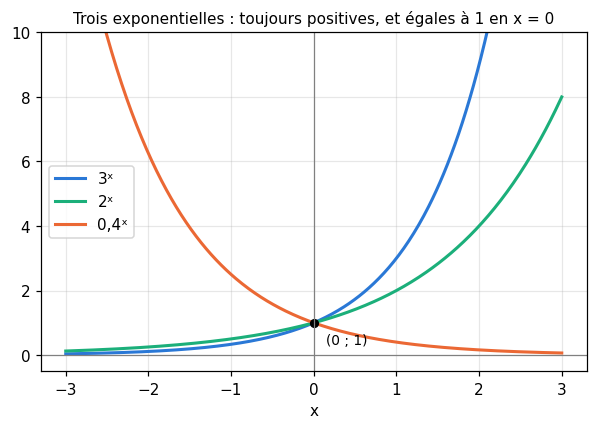
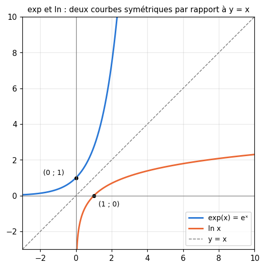
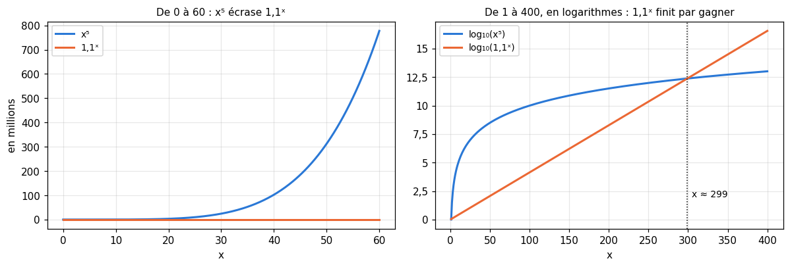
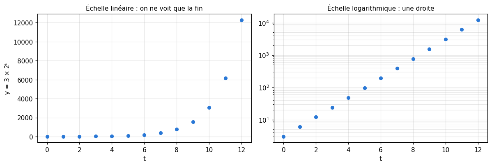
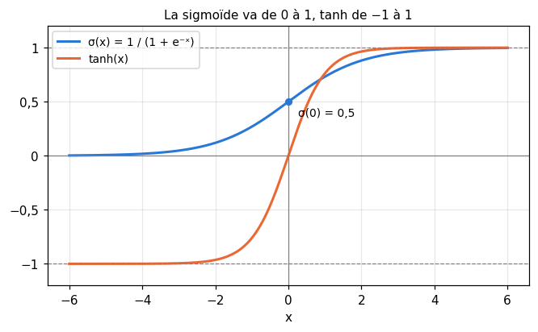

# R6 · Exponentielle et logarithmes — fiche de cours

> La remise à niveau (R0 à R9) n'a pas de livre : **cette fiche est le cours**. R6 prolonge les suites géométriques de R5 : multiplier par le même nombre à chaque pas devient une **fonction exponentielle**, définie pour tous les réels. Le nombre $e$ en sort naturellement, puis sa réciproque, le **logarithme**, qui répond à la question « combien de fois faut-il multiplier ? ». Les logarithmes transforment les produits en sommes, comptent les chiffres, les doublements et les **bits**, et rendent lisibles les grandeurs qui changent d'échelle. Pour finir, deux fonctions faites d'exponentielles que tu retrouveras dans chaque réseau de neurones de workbookIA : la **sigmoïde** et la **tangente hyperbolique**.

| | |
|---|---|
| **Sections** | §1 à §7 |
| **Temps total estimé** | ≈ 10,4 h : lecture et calculs de la fiche ≈ 2 h 50, exercices ≈ 6 h 50, flashcards ≈ 45 min (parcours essentiel ≈ 8 h) |
| **Prérequis** | R1 (puissances, racines, notation scientifique) ; R3 (fonctions, réciproque) ; R5 (suites géométriques, limite d'une suite) ; workbookIA 0A : calcul vectorisé (§100.8.3) |
| **Fichiers du chapitre** | `02_exercices.md` (quiz, papier) · `03_notebook.ipynb` · `04_indices.md` · `05_solutions.md` et `05_solutions.ipynb` · `06_mes_reponses.md` · `flashcards.csv` |
| **mymath** | `explog.py` : `log_base`, `sigmoid`, `tanh`, `doubling_time` |

## Comment utiliser ce chapitre

**Ordre conseillé.**
1. `python tools/start_chapter.py R6` (sur Colab : `00_setup/COLAB.md` §2) : il copie le notebook, ta feuille de réponses et le squelette `mymath/explog.py`.
2. Section par section : lis **crayon en main** (refais chaque calcul, et vérifie les valeurs approchées à la calculatrice), puis fais les exercices de la section, quiz 🧠 d'abord.
3. Les exercices ✏️ et 🔗 se font sur papier, dans ta copie de `06_mes_reponses.md`, puis se vérifient dans la **partie 0** du notebook. Les démonstrations ∂ se rédigent dans ta copie et se jugent avec la grille de relecture de `05_solutions.md`.

**La calculatrice** (ou Python) est permise pour les valeurs approchées de $e^x$, de $\ln x$ et des logarithmes. Les simplifications se font à la main.

Si le test de positionnement t'a donné « tu peux sauter » pour R6, lis « L'essentiel en 10 lignes » et « Les pièges classiques », fais les quiz et les exercices 🔨 du parcours essentiel (`positionnement/05_grille.md`). Garde quand même le §4 (les bits) et le §7 (la cote et le logit) : ils ne sont pas au programme du lycée.

| Section | Quiz 🧠 | Papier et réflexion | Notebook |
|---|---|---|---|
| §1 La fonction exponentielle et ses propriétés | Q1, R1 🔁 | R6.1 ✏️, R6.6 ✏️ | R6.16 🔨 |
| §2 Le nombre e | Q1 | R6.1 ✏️ | |
| §3 Le logarithme népérien | Q2, R2 🔁 | R6.2 ✏️, R6.3 ✏️, R6.6 ✏️, R6.9 ∂, R6.11 🔗, R6.13 🗣️ | R6.16 🔨, R6.21 🐛 |
| §4 Logarithmes en base 2 et 10, changement de base, bits | Q3 | R6.4 ✏️, R6.5 ✏️, R6.12 🔗 | R6.14 🔨, R6.17 📦, R6.22 🛠️ |
| §5 Croissances comparées | Q4 | | R6.18 🔮, R6.19 🔬 |
| §6 Échelles logarithmiques | Q5, R3 🔁 | R6.8 ✏️ | R6.20 🎨 |
| §7 Sigmoïde et tangente hyperbolique | Q6 | R6.7 ✏️, R6.10 ∂ | R6.15 🔨, R6.17 📦 |

Parcours essentiel : tout sauf R6.Q5, R6.R3, R6.6, R6.8, R6.10, R6.12, R6.16, R6.17, R6.19 et R6.22.

## Objectifs d'apprentissage

À la fin du chapitre, tu sais :
- **utiliser** les propriétés de exp et de ln pour simplifier une expression et **résoudre** une équation ou une inéquation ;
- **passer** d'une base de logarithme à une autre, et **compter** en bits et en nats ;
- **comparer** les croissances des puissances, des exponentielles et des logarithmes ;
- **lire et tracer** un graphique en échelle logarithmique ;
- **étudier** la sigmoïde et la tangente hyperbolique, les écrire avec exp, et passer d'une probabilité à sa cote et à son logit.

## L'essentiel en 10 lignes

1. Pour $a > 0$, la fonction $x \mapsto a^x$ prolonge la suite géométrique $a^n$ à tous les réels : $a^0 = 1$, $a^{x+y} = a^x\,a^y$, $a^{-x} = \frac{1}{a^x}$, $(a^x)^y = a^{xy}$, et $a^x > 0$.
2. $e = \lim_{n \to +\infty} \left(1 + \frac{1}{n}\right)^n \approx 2{,}718$ ; l'**exponentielle** est $\exp(x) = e^x$.
3. Le **logarithme népérien** $\ln$ est la réciproque de exp : pour $x > 0$, $\ln x$ est le nombre $y$ tel que $e^y = x$. Donc $\ln(e^y) = y$, $e^{\ln x} = x$, $\ln 1 = 0$, $\ln e = 1$.
4. $\ln(ab) = \ln a + \ln b$, $\ln \frac{a}{b} = \ln a - \ln b$, $\ln(a^k) = k \ln a$ ; mais $\ln(a + b)$ ne se simplifie pas.
5. exp et ln sont strictement croissantes : $e^x = c \iff x = \ln c$ (pour $c > 0$), et elles gardent le sens des inégalités.
6. $\log_b x$ est l'exposant $y$ tel que $b^y = x$ ; $\log_b x = \frac{\ln x}{\ln b}$. $\log_{10}$ compte les chiffres, $\log_2$ les doublements et les **bits** : un événement de probabilité $p$ apporte $-\log_2 p$ bits, ou $-\ln p$ nats.
7. Pour $x$ très grand : $\ln x \ll x^k \ll a^x$ (avec $k > 0$, $a > 1$) : l'exponentielle finit toujours par gagner, le logarithme par perdre.
8. Sur une **échelle logarithmique**, des écarts égaux sont des **rapports** égaux ; une exponentielle y devient une droite.
9. **Sigmoïde** : $\sigma(x) = \frac{1}{1 + e^{-x}} \in\ ]0 \;;\; 1[$, $\sigma(0) = \frac{1}{2}$, $\sigma(-x) = 1 - \sigma(x)$. Sa réciproque est le **logit** $\ln \frac{p}{1 - p}$, le logarithme de la **cote**.
10. **Tangente hyperbolique** : $\tanh x = \frac{e^x - e^{-x}}{e^x + e^{-x}} \in\ ]-1 \;;\; 1[$, impaire, et $\tanh x = 2\,\sigma(2x) - 1$.

---

## §1 · La fonction exponentielle et ses propriétés

### Des suites géométriques aux fonctions exponentielles

En R5, une quantité multipliée par 3 chaque année valait $3^n$ fois sa valeur de départ au bout de $n$ années : une suite géométrique, définie seulement aux entiers. Mais que vaut-elle au bout d'**une demi-année** ? Si la croissance est régulière, une demi-année multiplie par un nombre $m$ tel que deux demi-années fassent une année : $m \times m = 3$, donc $m = \sqrt{3} \approx 1{,}732$. C'est ce qu'on note $3^{1/2}$ (R1 : la racine carrée est la puissance $\frac{1}{2}$).

On définit ainsi $a^x$ pour **tout réel** $x$, quand $a > 0$ :
- pour une fraction $x = \frac{p}{q}$, $a^{p/q} = \left(\sqrt[q]{a}\right)^p$, la racine $q$-ième (le nombre positif dont la puissance $q$-ième vaut $a$) élevée à la puissance $p$ : $27^{2/3} = 3^2 = 9$ ;
- pour un réel quelconque, comme $\sqrt{2}$, on prend des fractions de plus en plus proches ($1{,}4$ ; $1{,}41$ ; $1{,}414$…) : les puissances correspondantes se rapprochent d'un nombre, qu'on note $a^{\sqrt{2}}$ (une limite de suite, R5). La calculatrice et Python font ce calcul pour toi : `3 ** 0.5`, `10 ** 0.3`.

La fonction $x \mapsto a^x$ s'appelle la **fonction exponentielle de base $a$**. Pour $a = 1$, elle vaut toujours 1 ; on prend en général $a > 0$ et $a \ne 1$.

### Ses propriétés : celles des puissances

Les règles des puissances entières de R1 restent vraies pour tous les exposants réels. Pour $a > 0$, $b > 0$ et tous réels $x$, $y$ :

$$a^0 = 1 \qquad a^{x+y} = a^x\,a^y \qquad a^{x-y} = \frac{a^x}{a^y} \qquad a^{-x} = \frac{1}{a^x} \qquad (a^x)^y = a^{xy} \qquad (ab)^x = a^x\,b^x$$

Et surtout : **$a^x > 0$ pour tout $x$**. Une exponentielle n'est jamais nulle ni négative, même pour un exposant très négatif ($2^{-20} \approx 0{,}000\,001$, petit mais positif).

Exemples : $5^{1{,}5} \times 5^{0{,}5} = 5^{2} = 25$ ; $\frac{4^{x+1}}{4^{x}} = 4$ ; $(9^x)^{1/2} = 9^{x/2} = 3^x$ ; $2^x \times 5^x = 10^x$.

⚠️ **Exposant d'une somme, somme d'exponentielles.** $a^{x+y} = a^x \times a^y$, un **produit** : $2^{3+1} = 16$, alors que $2^3 + 2^1 = 10$. Et la base n'est pas l'exposant : $2^x$ (exponentielle) n'est pas $x^2$ (puissance).

### Croissante ou décroissante selon la base



Toutes les courbes $y = a^x$ passent par le point $(0 \;;\; 1)$. Ensuite :
- si $a > 1$, $a^x$ est **strictement croissante** ; elle tend vers $+\infty$ quand $x$ devient très grand, et vers 0 quand $x$ devient très négatif ;
- si $0 < a < 1$, elle est **strictement décroissante**, et c'est l'inverse : $0{,}4^x = \frac{1}{2{,}5^x}$.

Parce qu'elle est strictement monotone, une exponentielle ne prend jamais deux fois la même valeur : $a^x = a^y \iff x = y$, et pour $a > 1$, $a^x < a^y \iff x < y$.

### La croissance exponentielle

Une grandeur a une **croissance exponentielle** quand elle est **multipliée** par le même nombre sur des durées égales : $N(t) = N_0\,a^t$. Une croissance linéaire (affine, R3), elle, **ajoute** la même quantité sur des durées égales. Un capital placé à 3 % par an vaut $C(t) = C_0 \times 1{,}03^t$ au bout de $t$ années, même pour $t = 0{,}5$ : au bout de six mois, $1{,}03^{0{,}5} \approx 1{,}0149$, soit un peu moins de la moitié de 3 %.

Si une grandeur double toutes les $T$ unités de temps, elle vaut $N(t) = N_0 \times 2^{t/T}$ : au bout de $T$, elle a doublé ; au bout de $2T$, quadruplé ; au bout de $\frac{T}{2}$, elle est multipliée par $\sqrt{2} \approx 1{,}414$. Le §3 dira comment trouver $T$ à partir du pourcentage de hausse.

```python
>>> 3 ** 0.5, 27 ** (2 / 3)
(1.7320508075688772, 8.999999999999998)
>>> 5 ** 1.5 * 5 ** 0.5
25.000000000000004
```

Les derniers chiffres trahissent les arrondis des flottants (R1) : $27^{2/3}$ vaut exactement 9, mais `2 / 3` n'est pas exactement $\frac{2}{3}$.

🔗 **Dans workbookIA** — une croissance exponentielle se repère partout où l'on multiplie : le nombre de configurations possibles de $n$ bits ($2^n$), la taille d'une grille de recherche d'hyperparamètres ($k^d$ combinaisons quand on essaie $k$ valeurs pour chacun de $d$ réglages), la décroissance d'un learning rate multiplié par le même facteur à chaque pas (ch. 19).

---

## §2 · Le nombre e

### Des intérêts de plus en plus fréquents

Place 1 € à 100 % d'intérêts par an. Versés une fois par an, ils donnent 2 € au bout d'un an. Versés deux fois par an (50 % chaque semestre, R5 : intérêts composés), ils donnent $1{,}5^2 = 2{,}25$ €. Quatre fois (25 % par trimestre) : $1{,}25^4 \approx 2{,}441$ €. En général, $n$ versements de $\frac{100}{n}\,\%$ donnent $\left(1 + \frac{1}{n}\right)^n$ euros :

| $n$ | 1 | 2 | 4 | 12 | 365 | 1 000 000 |
|---|---|---|---|---|---|---|
| $\left(1 + \frac{1}{n}\right)^n$ | 2 | 2,25 | 2,4414 | 2,6130 | 2,7146 | 2,718 28 |

Le gain augmente, mais de moins en moins : la suite converge (R5 §5). Sa limite est un nombre célèbre, noté $e$ (en l'honneur d'Euler) :

$$e = \lim_{n \to +\infty} \left(1 + \frac{1}{n}\right)^n \approx 2{,}718\,281\,828$$

Comme $\pi$, $e$ n'est pas une fraction, et son écriture décimale ne s'arrête jamais.

### La fonction exponentielle

La **fonction exponentielle** est l'exponentielle de base $e$ : $\exp(x) = e^x$. Elle a toutes les propriétés du §1 :

$$e^0 = 1 \qquad e^{x+y} = e^x\,e^y \qquad e^{-x} = \frac{1}{e^x} \qquad (e^x)^y = e^{xy} \qquad e^x > 0$$

Elle est strictement croissante (car $e > 1$), tend vers $+\infty$ quand $x$ devient très grand et vers 0 quand $x$ devient très négatif. Quelques valeurs : $e^{0{,}5} \approx 1{,}649$, $e^{4} \approx 54{,}6$, $e^{-1{,}5} \approx 0{,}223$.

Exemples de simplification : $e^{2x} \times e^{3 - x} = e^{x + 3}$ ; $\frac{e^{5}}{e^{2}} = e^{3}$ ; $\left(e^{x}\right)^2 = e^{2x}$ ; $e^{x} \times e^{-x} = e^{0} = 1$.

Pourquoi cette base plutôt que 2 ou 10 ? Parce qu'elle simplifie l'analyse : la pente de la courbe de $e^x$ au point $(0 \;;\; 1)$ vaut exactement 1, et, plus généralement, la pente en tout point vaut $e^x$ elle-même. R7 le démontrera, à partir de la définition de $e$ comme limite. C'est pourquoi les mathématiques du ML (et NumPy) écrivent leurs exponentielles en base $e$.

L'exemple des intérêts va plus loin : avec un taux annuel $r$ versé $n$ fois par an, pendant $t$ années, on obtient $\left(1 + \frac{r}{n}\right)^{nt}$, qui tend vers $e^{rt}$ quand $n$ grandit. C'est la **croissance continue** : $N(t) = N_0\,e^{rt}$.

```python
>>> import math
>>> [round((1 + 1 / n) ** n, 4) for n in (1, 2, 4, 12, 365)]
[2.0, 2.25, 2.4414, 2.613, 2.7146]
>>> math.e, round(math.exp(0.5), 3), round(math.exp(4), 1)
(2.718281828459045, 1.649, 54.6)
```

🔗 **Dans workbookIA** — comme $e^x > 0$ pour tout $x$, l'exponentielle change n'importe quel score en un nombre positif. La sigmoïde (§7) est faite ainsi, et le softmax du chapitre 17 s'en sert pour fabriquer des probabilités à partir de plusieurs scores. On la retrouve aussi dans la loi normale, $e^{-x^2/2}$ (R8, M02b).

---

## §3 · Le logarithme népérien

### La réciproque de l'exponentielle

L'exponentielle est strictement croissante, et elle prend une fois et une seule chaque valeur strictement positive. Elle a donc une **réciproque** (R3) : le **logarithme népérien**, noté $\ln$ (« logarithme naturel »).

> **Définition.** Pour tout réel $x > 0$, $\ln x$ est l'unique réel $y$ tel que $e^y = x$.

Autrement dit, $\ln x$ répond à la question : **à quelle puissance faut-il élever $e$ pour obtenir $x$ ?** Les deux fonctions se défont l'une l'autre :

$$\ln\left(e^y\right) = y \text{ pour tout réel } y \qquad e^{\ln x} = x \text{ pour tout } x > 0$$

Valeurs à connaître : $\ln 1 = 0$ (car $e^0 = 1$), $\ln e = 1$, $\ln \frac{1}{e} = -1$. Et $\ln 2 \approx 0{,}693$, $\ln 10 \approx 2{,}303$.



Comme pour toute réciproque, la courbe de $\ln$ est la symétrique de celle de exp par rapport à la droite $y = x$ (figure). On y lit ses propriétés :
- $\ln$ n'est définie que pour $x > 0$ : $\ln 0$ et $\ln(-3)$ n'existent pas (aucune puissance de $e$ ne vaut 0 ou un nombre négatif) ;
- elle est strictement croissante ; $\ln x < 0$ pour $0 < x < 1$, $\ln x > 0$ pour $x > 1$ ;
- elle tend vers $-\infty$ quand $x$ se rapproche de 0, et vers $+\infty$ quand $x$ devient très grand, mais **très lentement** : $\ln(1\,000\,000) \approx 13{,}8$.

### Des produits aux sommes

Le logarithme transforme les multiplications en additions. Pour tous $a > 0$, $b > 0$ et tout réel $k$ :

$$\ln(ab) = \ln a + \ln b \qquad \ln\frac{a}{b} = \ln a - \ln b \qquad \ln\frac{1}{b} = -\ln b \qquad \ln(a^k) = k \ln a \qquad \ln\sqrt{a} = \frac{1}{2}\ln a$$

L'idée : $\ln a$ est l'exposant de $e$ qui donne $a$, $\ln b$ celui qui donne $b$ ; et multiplier deux puissances de $e$, c'est **additionner** leurs exposants ($e^{x}\,e^{y} = e^{x+y}$). Tu en feras la démonstration en R6.9.

Exemples : $\ln 12 = \ln(3 \times 4) = \ln 3 + 2 \ln 2$ ; $\ln \frac{e^4}{e^{1{,}5}} = 4 - 1{,}5 = 2{,}5$ ; $\ln 45 - \ln 5 = \ln 9 = 2 \ln 3$ ; $e^{3 \ln 2} = e^{\ln(2^3)} = 8$.

⚠️ **Le logarithme d'une somme ne se simplifie pas.** $\ln(a + b) \ne \ln a + \ln b$ : $\ln(1 + 1) = \ln 2 \approx 0{,}693$, alors que $\ln 1 + \ln 1 = 0$. De même, $\ln(ab) \ne \ln a \times \ln b$, et $(\ln a)^2 \ne 2 \ln a$ (c'est $\ln(a^2)$ qui vaut $2 \ln a$).

### Résoudre des équations et des inéquations

Puisque exp et ln sont réciproques et strictement croissantes :
- pour $c > 0$, $e^x = c \iff x = \ln c$ ; pour $c \le 0$, l'équation $e^x = c$ n'a **pas** de solution ;
- $\ln x = c \iff x = e^c$, pour tout réel $c$ (et $x$ doit être $> 0$) ;
- **elles gardent le sens des inégalités** : $e^x < c \iff x < \ln c$ (pour $c > 0$), et $\ln x < c \iff 0 < x < e^c$.

Exemples : $e^{x} = 12 \iff x = \ln 12 \approx 2{,}485$ ; $e^{3x + 1} = 4 \iff 3x + 1 = \ln 4 \iff x = \frac{\ln 4 - 1}{3} \approx 0{,}129$ ; $\ln(2x) = 3 \iff 2x = e^3 \iff x = \frac{e^3}{2}$. Pense au **domaine** : pour $\ln(x - 5) = 0$, il faut $x - 5 > 0$, puis $x - 5 = 1$, donc $x = 6$.

Pour une exponentielle d'une autre base, on prend le logarithme des deux membres. C'est ce qui remplace les essais de R5 :

$$1{,}06^n \ge 2 \iff n \ln 1{,}06 \ge \ln 2 \iff n \ge \frac{\ln 2}{\ln 1{,}06} \approx 11{,}9$$

donc il faut 12 années à 6 % par an pour doubler un capital. Attention au signe : si la base est entre 0 et 1, son logarithme est **négatif**, et diviser par lui **change le sens** de l'inégalité (R2) :

$$0{,}8^n \le 0{,}1 \iff n \ln 0{,}8 \le \ln 0{,}1 \iff n \ge \frac{\ln 0{,}1}{\ln 0{,}8} \approx 10{,}3 \quad (\text{car } \ln 0{,}8 < 0)$$

soit $n \ge 11$ : vérifie que $0{,}8^{10} \approx 0{,}107$ et $0{,}8^{11} \approx 0{,}086$.

### Temps de doublement et demi-vie

Une grandeur qui augmente de $r$ (en décimal : 5 % s'écrit 0,05) par période est multipliée par $(1 + r)^n$ en $n$ périodes. Elle double quand $(1 + r)^n = 2$, c'est-à-dire au bout du **temps de doublement**

$$T = \frac{\ln 2}{\ln(1 + r)}.$$

À 5 % par an, $T = \frac{0{,}693}{\ln 1{,}05} \approx 14{,}2$ ans. Pour un petit taux, $\ln(1 + r) \approx r$, d'où la **règle de 70** : le temps de doublement vaut environ $\frac{70}{\text{taux en \%}}$, ici $\frac{70}{5} = 14$. De même, une grandeur qui **diminue** de $r$ par période est divisée par 2 au bout de sa **demi-vie** $\frac{\ln 0{,}5}{\ln(1 - r)}$ (deux logarithmes négatifs, un quotient positif). Pour une croissance continue $e^{rt}$, le temps de doublement vaut exactement $\frac{\ln 2}{r}$.

### Les log-probabilités

La probabilité que plusieurs événements **indépendants** se produisent tous est le **produit** de leurs probabilités (R8 y reviendra). Trois événements de probabilités 0,6, 0,3 et 0,2 se produisent ensemble avec la probabilité $0{,}6 \times 0{,}3 \times 0{,}2 = 0{,}036$. Son logarithme est une **somme** :

$$\ln(0{,}6 \times 0{,}3 \times 0{,}2) = \ln 0{,}6 + \ln 0{,}3 + \ln 0{,}2 \approx -0{,}511 - 1{,}204 - 1{,}609 = -3{,}324.$$

Le logarithme d'une probabilité est négatif (une probabilité est au plus 1), et il est d'autant plus négatif que l'événement est rare. Avec des milliers d'événements, le produit devient minuscule, si petit qu'un flottant ne peut plus l'écrire (§5 donne les limites des flottants). La somme des logarithmes, elle, reste un nombre ordinaire. Et comme $\ln$ est croissante, le plus grand produit est aussi celui qui a la plus grande somme de logarithmes : on peut comparer des modèles sur leurs **log-probabilités**.

```python
>>> math.log(math.e), round(math.log(12), 4), round(math.log(3) + 2 * math.log(2), 4)
(1.0, 2.4849, 2.4849)
>>> math.log(2) / math.log(1.06)
11.895661045941875
>>> round(math.log(0.6) + math.log(0.3) + math.log(0.2), 4), round(math.log(0.036), 4)
(-3.3242, -3.3242)
```

En Python, `math.log(x)` est $\ln x$ ; `math.log` d'un nombre négatif ou nul lève une erreur (`math domain error`).

🔗 **Dans workbookIA** — quand un texte de ML ou une bibliothèque écrit « log » sans préciser de base, il s'agit presque toujours de $\ln$ : c'est ce que calcule `np.log`. La loss de classification (la *cross-entropy*, ch. 6 et 13) est une moyenne de $-\ln p$, où $p$ est la probabilité que le modèle donne à la bonne réponse : c'est une moyenne de log-probabilités changée de signe. Le chapitre 0B y revient, avec ses propres exemples.

---

## §4 · Logarithmes en base 2 et 10, changement de base, bits

### Le logarithme en base b

Ce que $\ln$ fait pour la base $e$, on peut le faire pour toute base $b > 0$, $b \ne 1$ :

> **Définition.** Pour $x > 0$, $\log_b x$ est l'unique réel $y$ tel que $b^y = x$ : l'exposant qu'il faut donner à $b$ pour obtenir $x$.

$\log_3 81 = 4$ car $3^4 = 81$ ; $\log_5 0{,}2 = -1$ car $5^{-1} = 0{,}2$ ; $\log_b 1 = 0$ et $\log_b b = 1$ pour toute base. Toutes les règles du §3 restent vraies : $\log_b(xy) = \log_b x + \log_b y$, $\log_b(x^k) = k \log_b x$, $\log_b(b^y) = y$, $b^{\log_b x} = x$.

Deux bases ont un nom :
- $\log_{10}$, le **logarithme décimal**, **compte les chiffres** : $\log_{10} 100\,000 = 5$, $\log_{10} 0{,}01 = -2$, et un entier qui s'écrit avec $d$ chiffres a un logarithme décimal entre $d - 1$ et $d$. Ainsi $\log_{10} 50\,000 \approx 4{,}70$ : 50 000 a 5 chiffres. Le nombre de chiffres d'un entier $N \ge 1$ vaut $\lfloor \log_{10} N \rfloor + 1$ (R1 : la partie entière) ;
- $\log_2$, le **logarithme binaire**, **compte les doublements** : $\log_2 4\,096 = 12$, car il faut doubler 12 fois 1 pour atteindre 4 096 ; $\log_2 \frac{1}{16} = -4$.

### Changer de base

Tous les logarithmes sont proportionnels les uns aux autres. On les ramène à $\ln$ par la **formule de changement de base** :

$$\log_b x = \frac{\ln x}{\ln b}$$

(workbookIA 0B.16 te la fera démontrer). Par exemple $\log_2 4\,096 = \frac{\ln 4\,096}{\ln 2} \approx \frac{8{,}318}{0{,}693} = 12$, et $\log_2 3 = \frac{\ln 3}{\ln 2} \approx 1{,}585$ : il faut à peu près 1,6 doublement pour tripler. C'est ainsi qu'on calcule un logarithme dans une base que la calculatrice n'a pas.

⚠️ **Une base, deux calculs.** Avec deux arguments, `math.log(x, b)` divise deux logarithmes népériens, arrondis chacun : le quotient peut tomber à côté, et `math.log(125, 5)` renvoie `3.0000000000000004`. Les fonctions faites pour une base, `math.log2` et `math.log10`, n'ont pas cette division ; dans une autre base, arrondis le résultat quand tu sais qu'il doit être entier.

```python
>>> math.log2(4096), round(math.log10(50000), 2), math.log(125, 5)
(12.0, 4.7, 3.0000000000000004)
>>> math.floor(math.log10(50000)) + 1
5
```

### Combien de questions oui ou non ? Les bits

Pour deviner le jour d'anniversaire de quelqu'un (un jour parmi 365) en posant des questions auxquelles on répond par oui ou non (« est-il avant le 2 juillet ? »), la meilleure stratégie coupe à chaque fois les possibilités restantes en deux. Après $k$ questions, on distingue au plus $2^k$ possibilités ; il en faut donc $k$ tel que $2^k \ge 365$, soit $k \ge \log_2 365 \approx 8{,}51$ : **9 questions** suffisent, et 8 ne suffisent pas toujours ($2^8 = 256$).

C'est la définition du **bit** : la quantité d'information d'une réponse oui ou non, quand les deux réponses sont également probables. Un choix parmi $N$ possibilités également probables apporte $\log_2 N$ bits ; un **événement de probabilité $p$** apporte

$$I = \log_2 \frac{1}{p} = -\log_2 p \text{ bits}.$$

Un événement de probabilité $\frac{1}{16}$ apporte 4 bits (autant que quatre réponses oui ou non). Un événement certain ($p = 1$) n'apporte rien : 0 bit. Plus il est rare, plus il informe.

En base $e$, la même quantité se mesure en **nats** : $-\ln p$. Le changement de base relie les deux unités : 1 bit vaut $\ln 2 \approx 0{,}693$ nat, et nos 4 bits valent $4 \ln 2 \approx 2{,}77$ nats. Bits et nats sont deux unités de la même grandeur, comme les heures et les minutes pour une durée.

Quand deux événements **indépendants** se produisent, leurs probabilités se multiplient (§3) : leurs informations s'additionnent, puisque le logarithme d'un produit est la somme des logarithmes. Tirer une carte précise parmi 52, puis lancer une pièce, apporte $\log_2 52 + 1$ bits.

🔗 **Dans workbookIA** — le chapitre 6 mesure l'information et l'entropie en bits, et la loss d'un modèle de langage en nats (parce qu'elle utilise $\ln$) ; le passage de l'un à l'autre est une multiplication par $\ln 2$. La **perplexité** d'un modèle de langage est $e^{\text{loss}}$ : une loss en nats remise à l'échelle d'un nombre de choix.

---

## §5 · Croissances comparées

### Qui gagne à la fin ?

Comparons une puissance et une exponentielle : $x^5$ et $1{,}1^x$. Pour $x = 10$, $x^5 = 100\,000$ et $1{,}1^{10} \approx 2{,}6$ : la puissance écrase l'exponentielle. Pour $x = 100$, $x^5 = 10^{10}$ et $1{,}1^{100} \approx 13\,781$ : toujours. Et pourtant, à partir d'environ $x = 299$, $1{,}1^x$ passe devant, et l'écart ne cesse plus de grandir.



Pour comparer deux nombres aussi grands, on compare leurs **logarithmes** : $\log_{10}(x^5) = 5 \log_{10} x$ grandit comme un logarithme, alors que $\log_{10}(1{,}1^x) = x \log_{10} 1{,}1 \approx 0{,}0414\,x$ grandit comme une droite. Une droite finit toujours par dépasser un logarithme : c'est la figure de droite.

> **Croissances comparées** (quand $x$ devient très grand). Pour tous $k > 0$ et $a > 1$ :
> - toute exponentielle $a^x$ finit par dépasser toute puissance $x^k$, et $\frac{x^k}{a^x} \to 0$ ;
> - toute puissance $x^k$ finit par dépasser $\ln x$, et $\frac{\ln x}{x^k} \to 0$.

« Finit par » est essentiel : la comparaison ne dit rien des petites valeurs. $x^2$ et $2^x$ sont égales en $x = 2$ et $x = 4$, $x^2$ est plus grande entre les deux, puis $2^x$ l'emporte pour toujours. Et $\sqrt{x}$ reste plus grande que $\ln x$ pour tout $x > 0$, alors que $\ln x$ dépasse longtemps $x^{0{,}1}$ avant de se faire rattraper (R6.19).

On résume souvent : **le logarithme est plus lent que toute puissance, l'exponentielle plus rapide que toute puissance.**

### Ce que cela veut dire pour un calcul

Un algorithme qui fait $\log_2 n$ étapes (la recherche par dichotomie, celle des questions oui ou non du §4) reste rapide pour un $n$ énorme : 30 étapes pour un milliard de possibilités. Un algorithme qui fait $2^n$ étapes (essayer tous les sous-ensembles de $n$ objets) devient impraticable dès $n \approx 60$.

Les **flottants** (R1) ont eux aussi leurs limites : un `float64` ne représente pas les nombres plus grands qu'environ $1{,}8 \times 10^{308}$, ni les nombres positifs plus petits qu'environ $10^{-308}$ (un peu moins en perdant des chiffres). Une exponentielle atteint ces bornes très vite : $e^x$ dépasse $10^{308}$ pour un $x$ de quelques centaines seulement. Que font alors Python et NumPy ? R6.18 te le fera prédire, puis voir.

🔗 **Dans workbookIA** — les croissances comparées expliquent pourquoi certaines méthodes passent à l'échelle et d'autres non : le nombre de cases d'une grille en $d$ dimensions croît en $k^d$ (la « malédiction de la dimension », ch. 7 et 12), alors qu'un arbre de décision équilibré répond en $\log_2 n$ comparaisons. Elles disent aussi pourquoi l'exponentielle du softmax déborde si l'on ne prend pas de précautions (ch. 17).

---

## §6 · Échelles logarithmiques

### Des écarts égaux pour des rapports égaux

Sur un axe ordinaire, des graduations également espacées sont séparées par la même **différence** : 0, 10, 20, 30. Sur un axe **logarithmique**, elles sont séparées par le même **rapport** : 1, 10, 100, 1 000. On place chaque nombre $x$ à la position $\log_{10} x$ : 1 en 0, 10 en 1, 100 en 2. Chaque intervalle d'un facteur 10 s'appelle une **décade**.

Entre 1 et 10, les nombres ne sont pas régulièrement espacés : 2 est à la position $\log_{10} 2 \approx 0{,}30$ de la décade, 5 à $\log_{10} 5 \approx 0{,}70$. Et 20, 200, 2 000 sont tous à 0,30 de leur décade. Sur un tel axe, on ne peut placer ni 0 ni un nombre négatif (leur logarithme n'existe pas) : l'axe descend vers 0 sans jamais l'atteindre.

Une échelle logarithmique sert quand les valeurs s'étalent sur plusieurs ordres de grandeur (R1) : sur un axe ordinaire de 0 à 1 000 000, toutes les valeurs inférieures à 1 000 seraient écrasées au même endroit.

### Une exponentielle devient une droite



Avec un axe vertical logarithmique (on parle de graphique **semi-logarithmique**), la courbe de $y = C\,a^t$ devient une **droite**, parce que

$$\log_{10} y = \log_{10} C + t \log_{10} a,$$

une fonction affine de $t$ (R3), de pente $\log_{10} a$. Sur la figure, $y = 3 \times 2^t$ monte de $\log_{10} 2 \approx 0{,}30$ décade à chaque pas : une décade tous les 3,3 pas environ. C'est le test de la croissance exponentielle : des points alignés sur un graphique semi-logarithmique. Une courbe qui s'infléchit vers le bas sur ce graphique ralentit.

Avec les **deux** axes logarithmiques (un graphique **log-log**), c'est une puissance $y = C\,x^k$ qui devient une droite, de pente $k$ : $\log y = \log C + k \log x$.

### Les décibels

Le **décibel** (dB) mesure un **rapport** $R$ de deux puissances (sonores, électriques…) sur une échelle logarithmique : $10 \log_{10} R$ dB. Un rapport de 10 vaut 10 dB, un rapport de 100 vaut 20 dB, un rapport de 2 vaut $10 \log_{10} 2 \approx 3$ dB. Multiplier un rapport, c'est additionner des décibels.

```python
>>> import numpy as np
>>> np.log10(np.array([1, 2, 5, 10, 200]))
array([0.     , 0.30103, 0.69897, 1.     , 2.30103])
>>> np.logspace(-3, 0, 4)
array([0.001, 0.01 , 0.1  , 1.   ])
```

`np.logspace(-3, 0, 4)` fabrique des valeurs également espacées **sur une échelle logarithmique**, de $10^{-3}$ à $10^0$ : une grille de valeurs à essayer quand on ne connaît même pas l'ordre de grandeur. En matplotlib, `ax.set_yscale("log")` (ou `ax.set_xscale("log")`) passe un axe en échelle logarithmique.

🔗 **Dans workbookIA** — les courbes de loss se tracent souvent en échelle logarithmique (les dernières améliorations, petites, restent visibles), et un hyperparamètre dont on ignore l'ordre de grandeur (la force d'une régularisation, un learning rate) se cherche sur une grille logarithmique (ch. 9, 15 et 24). La qualité d'une image débruitée se mesure en décibels (le PSNR, ch. 25 ; R6.12).

---

## §7 · Sigmoïde et tangente hyperbolique

### La sigmoïde : écraser un nombre dans ]0 ; 1[

La **sigmoïde** (ou fonction logistique) est

$$\sigma(x) = \frac{1}{1 + e^{-x}}.$$



Ses propriétés se lisent sur la formule :
- $e^{-x} > 0$, donc le dénominateur dépasse 1 et $0 < \sigma(x) < 1$ : une sigmoïde n'atteint **jamais** 0 ni 1 ;
- $\sigma(0) = \frac{1}{1 + 1} = \frac{1}{2}$ ;
- quand $x$ devient très grand, $e^{-x}$ tend vers 0 et $\sigma(x)$ vers 1 ; quand $x$ devient très négatif, $e^{-x}$ devient énorme et $\sigma(x)$ tend vers 0 ;
- elle est strictement croissante, en forme de « S ».

Quelques valeurs : $\sigma(0{,}5) \approx 0{,}622$, $\sigma(4) \approx 0{,}982$, $\sigma(-4) \approx 0{,}018$.

**La symétrie.** $\sigma(4) + \sigma(-4) = 1$ : ce n'est pas un hasard. Pour tout $x$, en multipliant le haut et le bas par $e^{x}$ :

$$1 - \sigma(x) = \frac{1 + e^{-x} - 1}{1 + e^{-x}} = \frac{e^{-x}}{1 + e^{-x}} = \frac{1}{e^{x} + 1} = \sigma(-x).$$

Donc $\sigma(-x) = 1 - \sigma(x)$ : la courbe est symétrique par rapport au point $(0 \;;\; \frac{1}{2})$. Si $\sigma(x)$ est la probabilité d'un événement, $\sigma(-x)$ est celle de son contraire.

### La cote, le logit : remonter de la probabilité au score

Une probabilité $p$ peut aussi s'écrire comme une **cote** (*odds*), le rapport de la probabilité que l'événement se produise à celle qu'il ne se produise pas : $\frac{p}{1 - p}$. Pour $p = 0{,}99$, la cote vaut $\frac{0{,}99}{0{,}01} = 99$ : « 99 contre 1 ». Une cote va de 0 à $+\infty$, et vaut 1 pour $p = \frac{1}{2}$.

Son logarithme, la **log-cote** (*log-odds*) ou **logit**, va de $-\infty$ à $+\infty$ :

$$\operatorname{logit}(p) = \ln \frac{p}{1 - p}.$$

Le logit est la **réciproque de la sigmoïde** : si $\sigma(x) = p$, alors $1 + e^{-x} = \frac{1}{p}$, donc $e^{-x} = \frac{1 - p}{p}$, et $x = \ln \frac{p}{1 - p}$. Pour $p = 0{,}99$ : $x = \ln 99 \approx 4{,}595$, et l'on vérifie que $\sigma(\ln 99) = \frac{1}{1 + \frac{1}{99}} = 0{,}99$. En résumé : la sigmoïde transforme un **score** réel en probabilité ; le logit transforme une probabilité en score.

Une remarque qui sert : ajouter $\ln 2$ au logit multiplie la cote par 2 ($e^{x + \ln 2} = 2\,e^x$), ajouter $\ln 3$ la multiplie par 3. Le logit transforme les multiplications de la cote en additions, comme tout logarithme.

⚠️ **Deux sens du mot « logit ».** En statistique, le logit est la fonction $\ln \frac{p}{1 - p}$. En deep learning, on appelle **logits** les scores bruts qu'un réseau produit **avant** la sigmoïde ou le softmax. Les deux sens se rejoignent : si $p = \sigma(z)$, le score $z$ est bien le logit de $p$.

### La tangente hyperbolique : la même forme, de −1 à 1

La **tangente hyperbolique** est

$$\tanh x = \frac{e^{x} - e^{-x}}{e^{x} + e^{-x}}.$$

- Le numérateur est plus petit que le dénominateur en valeur absolue, donc $-1 < \tanh x < 1$ ;
- $\tanh 0 = 0$, $\tanh x \to 1$ quand $x$ devient très grand, $\to -1$ quand $x$ devient très négatif ;
- elle est **impaire** : $\tanh(-x) = -\tanh x$ (échanger $x$ et $-x$ change le signe du numérateur, pas celui du dénominateur) ;
- elle est strictement croissante. Quelques valeurs : $\tanh 1{,}5 \approx 0{,}905$, $\tanh 2 \approx 0{,}964$.

C'est une sigmoïde agrandie et recentrée : $\tanh x = 2\,\sigma(2x) - 1$, un calcul de fractions que workbookIA te fera faire au chapitre 17. Elle va de −1 à 1 au lieu de 0 à 1, et elle est centrée en 0 au lieu de $\frac{1}{2}$. R6.10 te fera démontrer ses propriétés avec les seules règles de l'exponentielle.

```python
>>> def sigmoid(x):
...     return 1 / (1 + math.exp(-x))
>>> round(sigmoid(0.5), 3), round(sigmoid(4) + sigmoid(-4), 12)
(0.622, 1.0)
>>> round(math.log(0.99 / 0.01), 3), round(sigmoid(math.log(99)), 4)
(4.595, 0.99)
>>> round(math.tanh(1.5), 3), round(math.tanh(-1.5), 3)
(0.905, -0.905)
```

Ces formules marchent sans problème pour des $x$ raisonnables ($\lvert x \rvert \le 30$, par exemple). Pour des $x$ énormes, le calcul de $e^{-x}$ demande des précautions (§5) : workbookIA les prend au chapitre 17.

🔗 **Dans workbookIA** — la sigmoïde transforme le score d'un classifieur en probabilité : c'est la régression logistique (ch. 13), et la sortie d'un réseau qui répond oui ou non. Le logit est alors exactement le score du modèle. La tangente hyperbolique sert de fonction d'activation, en particulier dans les réseaux récurrents du chapitre 22 ; le chapitre 17 étudie les dérivées de ces deux fonctions. Pour plus de deux classes, la sigmoïde se généralise en **softmax** (ch. 17).

---

## Les pièges classiques ⚠️ (récapitulatif)

| Piège | Faux | Juste |
|---|---|---|
| exponentielle d'une somme | $e^{a+b} = e^a + e^b$ | $e^{a+b} = e^a \times e^b$ |
| puissance d'une puissance | $(e^a)^b = e^{a+b}$ | $(e^a)^b = e^{ab}$ |
| base et exposant | $2^x$ et $x^2$ sont la même fonction | $2^x$ est une exponentielle, $x^2$ une puissance |
| signe d'une exponentielle | $e^{-x} < 0$ pour $x > 0$ | $e^{-x} > 0$ toujours ; $e^x = 0$ n'a pas de solution |
| logarithme d'une somme | $\ln(a + b) = \ln a + \ln b$ | ne se simplifie pas ; c'est $\ln(ab)$ qui vaut $\ln a + \ln b$ |
| carré d'un logarithme | $(\ln a)^2 = 2 \ln a$ | $\ln(a^2) = 2 \ln a$, mais $(\ln a)^2$ est autre chose |
| quotient de logarithmes | $\ln \frac{a}{b} = \frac{\ln a}{\ln b}$ | $\ln \frac{a}{b} = \ln a - \ln b$ |
| domaine | $\ln(-2)$ ou $\ln 0$ | $\ln$ n'est défini que pour $x > 0$ |
| équation sans solution | $e^x = -3 \iff x = \ln(-3)$ | pas de solution : $e^x > 0$ |
| inéquation avec $\ln q < 0$ | $n \ln 0{,}8 \le \ln 0{,}1 \iff n \le \frac{\ln 0{,}1}{\ln 0{,}8}$ | diviser par un négatif change le sens : $n \ge \dots$ |
| changement de base | $\log_2 x = \ln x \times \ln 2$ | $\log_2 x = \frac{\ln x}{\ln 2}$ |
| « log » en Python | `np.log` est le logarithme décimal | `np.log` est $\ln$ ; `np.log10` le décimal |
| comparer des croissances | $x^5 > 1{,}1^x$ pour $x = 100$, donc pour toujours | l'exponentielle finit par gagner |
| zéro sur un axe logarithmique | placer 0 sur l'axe | impossible : $\log 0$ n'existe pas |
| sigmoïde | $\sigma(x)$ peut valoir 1 | $0 < \sigma(x) < 1$ strictement |
| symétrie de la sigmoïde | $\sigma(-x) = -\sigma(x)$ | $\sigma(-x) = 1 - \sigma(x)$ ; c'est tanh qui est impaire |
| logit | $\operatorname{logit}(p) = \ln p$ | $\ln \frac{p}{1 - p}$, le logarithme de la cote |

## Et maintenant

**Dans ce dépôt** : R7, *Limites et dérivation*. Il démontrera que la pente de $e^x$ vaut $e^x$, à partir de la définition de $e$ comme limite, et dérivera $\ln$, la sigmoïde et tanh.

**Dans workbookIA** : continue le chapitre 0A au rythme de ton tableau de bord (le calcul vectorisé de §100.8.3 sert aux exercices 📦 et 🔬 du notebook : `np.exp`, `np.log` s'appliquent à tout un tableau). Le chapitre 0B reprendra l'exponentielle, les logarithmes, les bits et la sigmoïde, et les reliera aux log-probabilités ; tu les retrouveras aux chapitres 6 (information), 13 (régression logistique) et 17 (fonctions d'activation).

## Pour aller plus loin

- Maths et tiques (Yvan Monka), cours et vidéos gratuits sur la fonction exponentielle et le logarithme népérien : [maths-et-tiques.fr](https://www.maths-et-tiques.fr).
- `annexes/symboles.md` (lire $e^x$, $\ln$, $\log_b$, $\sigma$, $\tanh$ à voix haute), `annexes/formulaire.md` et `annexes/erreurs_frequentes.md`.
