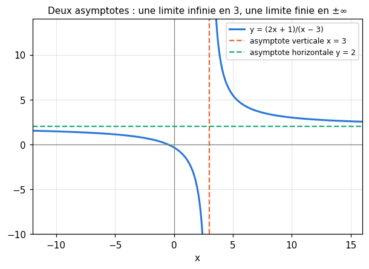
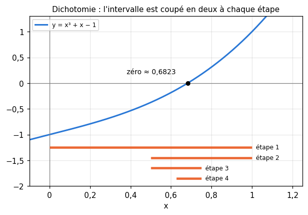
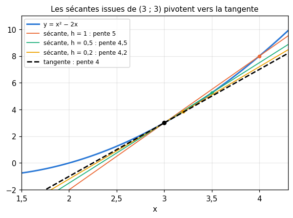
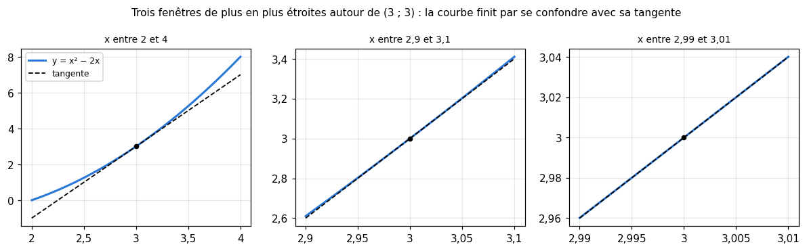
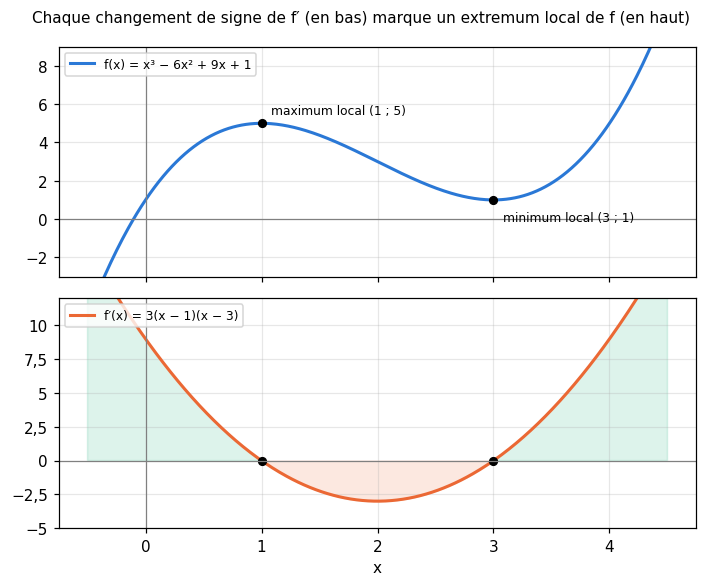

# R7 · Limites et dérivation — fiche de cours

> La remise à niveau (R0 à R9) n'a pas de livre : **cette fiche est le cours**. R5 a étudié la limite d'une suite, R6 l'exponentielle et le logarithme. R7 passe aux fonctions : ce que devient $f(x)$ quand $x$ devient très grand ou s'approche d'un point (les **limites**), puis la question qui fonde toute l'optimisation : à quelle **vitesse** $f(x)$ change-t-il quand $x$ bouge un peu ? La réponse est la **dérivée**. Avec quelques dérivées usuelles et quatre règles, dont la **règle de la chaîne**, tu sauras dériver toutes les fonctions de workbookIA, et trouver où une fonction atteint son minimum : c'est exactement ce que fait l'entraînement d'un modèle.

| | |
|---|---|
| **Sections** | §1 à §9 |
| **Temps total estimé** | ≈ 13,2 h : lecture et calculs de la fiche ≈ 3 h 20, exercices ≈ 9 h, flashcards ≈ 50 min (parcours essentiel ≈ 11 h) |
| **Prérequis** | R3 (fonctions de référence, composition) ; R5 (limite d'une suite) ; R6 (exponentielle, logarithme, croissances comparées) ; workbookIA 0A : fonctions comme valeurs, `lambda` (§100.5.3) |
| **Fichiers du chapitre** | `02_exercices.md` (quiz, papier) · `03_notebook.ipynb` · `04_indices.md` · `05_solutions.md` et `05_solutions.ipynb` · `06_mes_reponses.md` · `flashcards.csv` |
| **mymath** | `deriv.py` : `difference_quotient`, `tangent_line`, `bisection` |

## Comment utiliser ce chapitre

**Ordre conseillé.**
1. `python tools/start_chapter.py R7` (sur Colab : `00_setup/COLAB.md` §2) : il copie le notebook, ta feuille de réponses et le squelette `mymath/deriv.py`.
2. Section par section : lis **crayon en main** (refais chaque calcul), puis fais les exercices de la section, quiz 🧠 d'abord. Le chapitre est long : deux ou trois sections par séance suffisent.
3. Les exercices ✏️ et 🔗 se font sur papier, dans ta copie de `06_mes_reponses.md`, puis se vérifient dans la **partie 0** du notebook. Les démonstrations ∂ se rédigent dans ta copie et se jugent avec la grille de relecture de `05_solutions.md`.

**La calculatrice** (ou Python) est permise pour les valeurs approchées. Les dérivées, elles, se calculent à la main : c'est le savoir-faire que workbookIA suppose acquis.

Si le test de positionnement t'a donné « tu peux sauter » pour R7, lis « L'essentiel en 10 lignes » et « Les pièges classiques », fais les quiz et les exercices 🔨 du parcours essentiel (`positionnement/05_grille.md`). Garde quand même le §2 (la dichotomie), le §7 (dériver par rapport à une lettre, les autres fixées) et le §9 (le grand O) : le lycée les traite peu.

| Section | Quiz 🧠 | Papier et réflexion | Notebook |
|---|---|---|---|
| §1 Limites et asymptotes | Q1, R1 🔁, R2 🔁 | R7.1 ✏️, R7.2 ✏️ | |
| §2 Continuité, valeurs intermédiaires, dichotomie | Q2 | | R7.19 🔨 |
| §3 Taux d'accroissement et nombre dérivé | Q3 | R7.3 ✏️, R7.12 ∂, R7.16 🗣️ | R7.17 🔨, R7.21 🔮 |
| §4 Tangente | Q3 | R7.4 ✏️ | R7.18 🔨, R7.22 🔬, R7.23 🎨 |
| §5 Dérivées usuelles | Q4 | R7.5 ✏️, R7.11 ✏️ | R7.20 📦, R7.25 🛠️ |
| §6 Règles : somme, produit, quotient | Q5 | R7.6 ✏️, R7.13 ∂, R7.14 ∂ | R7.20 📦, R7.24 🐛 |
| §7 Dérivée d'une composée : la règle de la chaîne | Q6 | R7.7 ✏️, R7.10 ✏️, R7.11 ✏️ | R7.20 📦, R7.24 🐛 |
| §8 Dérivée, variations et extremums | Q7, R3 🔁 | R7.8 ✏️, R7.9 ✏️, R7.15 🔗 | R7.23 🎨 |
| §9 Comparer des croissances (grand O) | Q8, R1 🔁 | | |

Parcours essentiel : tout sauf R7.Q8, R7.R3, R7.2, R7.13, R7.18, R7.21, R7.23 et R7.25.

## Objectifs d'apprentissage

À la fin du chapitre, tu sais :
- **calculer** des limites simples, en l'infini et en un point, et **repérer** une asymptote ;
- **calculer** un taux d'accroissement, en déduire le nombre dérivé et l'**équation de la tangente** ;
- **dériver** les fonctions usuelles avec les règles de somme, de produit, de quotient et de composition (la règle de la chaîne) ;
- **étudier** les variations d'une fonction et **trouver** ses extremums avec la dérivée ;
- **approcher** un zéro par dichotomie et une dérivée par un taux d'accroissement, en Python.

## L'essentiel en 10 lignes

1. $\lim_{x \to +\infty} f(x) = L$ : $f(x)$ se rapproche de $L$ autant qu'on veut quand $x$ est assez grand. Une limite finie en l'infini donne une **asymptote horizontale** $y = L$ ; une limite infinie en un point $a$, une **asymptote verticale** $x = a$.
2. Pour une fraction de polynômes en l'infini, on met en facteur le terme de plus haut degré en haut et en bas. Les croissances comparées de R6 lèvent les autres formes indéterminées.
3. $f$ est **continue** en $a$ si $\lim_{x \to a} f(x) = f(a)$. Une fonction continue sur $[a \;;\; b]$ qui change de signe s'y annule (**valeurs intermédiaires**) ; la **dichotomie** trouve ce zéro en coupant l'intervalle en deux à chaque pas.
4. Le **taux d'accroissement** $\frac{f(a + h) - f(a)}{h}$ est la pente de la sécante ; sa limite quand $h \to 0$ est le **nombre dérivé** $f'(a)$, la pente de la tangente.
5. Tangente en $a$ : $y = f(a) + f'(a)(x - a)$. Près de $a$, $f(a + h) \approx f(a) + f'(a)\,h$.
6. Dérivées usuelles : $(x^n)' = n x^{n-1}$, $(\sqrt{x})' = \frac{1}{2\sqrt{x}}$, $(\frac{1}{x})' = -\frac{1}{x^2}$, $(e^x)' = e^x$, $(\ln x)' = \frac{1}{x}$.
7. $(u + v)' = u' + v'$, $(ku)' = k u'$, $(uv)' = u'v + uv'$, $\left(\frac{u}{v}\right)' = \frac{u'v - uv'}{v^2}$.
8. **Règle de la chaîne** : $\big(g(u(x))\big)' = g'(u(x)) \times u'(x)$, ou $\frac{dz}{dx} = \frac{dz}{du} \times \frac{du}{dx}$ : on dérive chaque étage, et on multiplie.
9. $f' > 0$ sur un intervalle : $f$ y croît ; $f' < 0$ : elle décroît. En un extremum intérieur, $f' = 0$ ; mais $f' = 0$ ne suffit pas : on regarde le **signe** de $f'$ autour.
10. $f = O(g)$ : $f$ ne grandit pas plus vite que $g$, à une constante près. Chercher dans une liste triée en coupant en deux demande $O(\log n)$ étapes, une double boucle $O(n^2)$.

---

## §1 · Limites et asymptotes

### Quand x devient très grand

En R5, la suite $u_n = \frac{1}{n}$ se rapprochait de 0. Pour une fonction, $x$ n'avance plus d'entier en entier, mais l'idée est la même : $\frac{1}{x}$ vaut 0,1 pour $x = 10$, 0,001 pour $x = 1\,000$, et devient aussi proche de 0 qu'on veut, pourvu que $x$ soit assez grand. On écrit

$$\lim_{x \to +\infty} \frac{1}{x} = 0,$$

et l'on lit « la limite de $\frac{1}{x}$ quand $x$ tend vers plus l'infini est 0 ».

> **Définition (intuitive).** $\lim_{x \to +\infty} f(x) = L$ veut dire : on peut rendre $f(x)$ aussi proche de $L$ qu'on veut, en prenant $x$ assez grand. Et $\lim_{x \to +\infty} f(x) = +\infty$ veut dire : $f(x)$ dépasse n'importe quel nombre, pourvu que $x$ soit assez grand.

C'est la définition de R5 (« à partir d'un certain rang »), où le rang devient « à partir d'un certain $x$ ». On définit de même les limites en $-\infty$.

Les limites des fonctions de référence se lisent sur leurs courbes (R3, R6) :
- $x$, $x^2$, $x^3$, $\sqrt{x}$, $e^x$, $\ln x$ tendent vers $+\infty$ en $+\infty$ (ln très lentement) ;
- $\frac{1}{x}$, $\frac{1}{x^2}$, $\frac{1}{\sqrt{x}}$, $e^{-x}$ tendent vers 0 en $+\infty$ ;
- en $-\infty$ : $x^2 \to +\infty$, $x^3 \to -\infty$, $e^x \to 0$, $\frac{1}{x} \to 0$.

### Les règles de calcul, et les formes indéterminées

Les limites se combinent comme on l'attend : si $f \to 3$ et $g \to 5$, alors $f + g \to 8$ et $fg \to 15$. Ainsi $\lim_{x \to +\infty} \left(4 + \frac{2}{x}\right) = 4 + 0 = 4$. Avec l'infini aussi, tant que le résultat est évident : $+\infty + \infty = +\infty$, $3 \times (+\infty) = +\infty$, $\frac{5}{+\infty} = 0$.

Quatre situations, en revanche, ne se décident pas d'avance : ce sont les **formes indéterminées**, $\infty - \infty$, $\frac{\infty}{\infty}$, $0 \times \infty$ et $\frac{0}{0}$. Le résultat dépend de **qui l'emporte**. La méthode : **mettre en facteur le terme qui domine**.

$$x^2 - 50x = x^2\left(1 - \frac{50}{x}\right) \xrightarrow[x \to +\infty]{} +\infty \times 1 = +\infty$$

Pour une **fraction de polynômes** en l'infini, on met en facteur le terme de plus haut degré en haut et en bas :

$$\frac{5x^2 + 2}{2x^2 - x} = \frac{x^2\left(5 + \frac{2}{x^2}\right)}{x^2\left(2 - \frac{1}{x}\right)} = \frac{5 + \frac{2}{x^2}}{2 - \frac{1}{x}} \xrightarrow[x \to +\infty]{} \frac{5}{2}.$$

En pratique : même degré en haut et en bas, la limite est le quotient des coefficients dominants ; degré plus grand en bas, la limite est 0 ($\frac{x + 1}{x^2 + 3} \to 0$) ; degré plus grand en haut, elle est infinie ($\frac{x^3}{x + 1} \to +\infty$).

Pour une forme indéterminée qui mêle exponentielle, puissance et logarithme, ce sont les **croissances comparées** de R6 qui décident : l'exponentielle l'emporte sur toute puissance, toute puissance sur le logarithme. Ainsi $\frac{x^{10}}{e^x} \to 0$ et $\frac{\ln x}{x} \to 0$ en $+\infty$.

### Quand x s'approche d'un point

On peut aussi regarder $f(x)$ quand $x$ s'approche d'un nombre $a$, sans forcément l'atteindre : $\lim_{x \to a} f(x)$. Pour une fonction « sans accident » en $a$ (§2), c'est simplement $f(a)$ : $\lim_{x \to 2} (x^2 + 1) = 5$.

Les cas intéressants sont ceux où $f(a)$ n'existe pas. Avec $f(x) = \frac{1}{x - 3}$, qui n'est pas définie en 3 :

| $x$ | 3,1 | 3,01 | 3,001 | 2,9 | 2,99 | 2,999 |
|---|---|---|---|---|---|---|
| $\frac{1}{x - 3}$ | 10 | 100 | 1 000 | −10 | −100 | −1 000 |

Par la droite ($x > 3$, noté $x \to 3^+$), le dénominateur est un petit nombre positif et $f(x) \to +\infty$ ; par la gauche ($x \to 3^-$), il est petit et négatif, et $f(x) \to -\infty$. Ce sont deux **limites à droite et à gauche** ; elles diffèrent, donc $f$ n'a pas de limite en 3 tout court.

Quand le numérateur tend vers un nombre non nul et le dénominateur vers 0, la limite est infinie, et son **signe suit la règle des signes** de la division. Pour $\frac{-2}{x - 3}$ : à droite de 3, on divise un nombre proche de −2 par un petit nombre positif, et le quotient tend vers $-\infty$ ; à gauche, par un petit nombre négatif, et il tend vers $+\infty$.

Une limite en un point peut aussi être finie alors que $f(a)$ n'existe pas : la forme $\frac{0}{0}$. Pour $\frac{x^2 - 9}{x - 3}$ en 3, on factorise : $\frac{(x - 3)(x + 3)}{x - 3} = x + 3$ pour $x \ne 3$, donc la limite vaut 6. La courbe est une droite à laquelle il manque un point.

### Les asymptotes



Une **asymptote** est une droite dont la courbe se rapproche indéfiniment :
- si $\lim_{x \to \pm\infty} f(x) = L$ (une limite finie), la droite $y = L$ est une **asymptote horizontale** ;
- si $f(x) \to \pm\infty$ quand $x \to a$ (au moins d'un côté), la droite $x = a$ est une **asymptote verticale**.

Pour $f(x) = \frac{2x + 1}{x - 3}$ (figure) : en $\pm\infty$, la limite est $\frac{2}{1} = 2$, d'où l'asymptote $y = 2$ ; en 3, le numérateur tend vers 7 et le dénominateur vers 0, d'où l'asymptote $x = 3$. Une asymptote verticale se cherche là où le **dénominateur s'annule** sans que le numérateur s'annule aussi (sinon, c'est peut-être un trou, comme ci-dessus).

```python
>>> f = lambda x: (2 * x + 1) / (x - 3)
>>> [round(f(x), 4) for x in (100, 10_000, 1_000_000)]
[2.0722, 2.0007, 2.0]
>>> [round(f(x), 1) for x in (3.01, 3.0001)]
[702.0, 70002.0]
```

🔗 **Dans workbookIA** — les limites décrivent ce que deviennent les choses « à la fin » : une loss qui se stabilise, un learning rate qui décroît vers 0 au fil des pas, une sigmoïde qui s'aplatit loin de 0 (ses asymptotes $y = 0$ et $y = 1$, R6). Elles servent surtout à définir la dérivée : c'est la suite de ce chapitre.

---

## §2 · Continuité, valeurs intermédiaires, dichotomie

### Une fonction sans saut

Intuitivement, une fonction est **continue** sur un intervalle si l'on trace sa courbe sans lever le crayon.

> **Définition.** $f$ est **continue en $a$** si $\lim_{x \to a} f(x) = f(a)$ : la valeur en $a$ est celle dont les valeurs voisines se rapprochent. $f$ est continue sur un intervalle si elle l'est en chacun de ses points.

Les fonctions usuelles (polynômes, $\sqrt{x}$, $\frac{1}{x}$, $e^x$, $\ln x$, $\lvert x \rvert$) sont continues **là où elles sont définies**, et leurs sommes, produits, quotients et composées aussi. Contre-exemples :
- la **partie entière** $\lfloor x \rfloor$ (R1) saute de 1 à chaque entier : en $x = 2$, elle vaut 2, mais elle vaut 1 juste à gauche ;
- la **fonction marche** (*step*), qui vaut 0 pour $x < 0$ et 1 pour $x \ge 0$, saute en 0 ; c'était la fonction de sortie du premier neurone artificiel, le perceptron (workbookIA, ch. 10).

### Le théorème des valeurs intermédiaires

> **Théorème des valeurs intermédiaires** (admis). Si $f$ est continue sur $[a \;;\; b]$, elle prend toutes les valeurs comprises entre $f(a)$ et $f(b)$. En particulier, si $f(a)$ et $f(b)$ sont de **signes contraires**, $f$ s'annule au moins une fois entre $a$ et $b$.

C'est l'évidence du crayon : pour passer d'en dessous de l'axe à au-dessus sans le lever, il faut traverser l'axe. Sans continuité, c'est faux : la fonction marche passe de 0 à 1 sans jamais valoir 0,5.

Exemple : $f(x) = x^3 + x - 1$ est continue, $f(0) = -1 < 0$ et $f(1) = 1 > 0$ : l'équation $x^3 + x - 1 = 0$, qu'aucune formule simple ne résout, a une solution entre 0 et 1.

### La dichotomie : couper en deux

Le théorème dit qu'un zéro existe, pas où il est. La **dichotomie** (*bisection*) le localise : on coupe l'intervalle en deux, on garde la moitié où le signe change, et on recommence.

| Étape | Intervalle | Milieu $m$ | $f(m)$ | On garde |
|---|---|---|---|---|
| 1 | $[0 \;;\; 1]$ | 0,5 | −0,375 | $[0{,}5 \;;\; 1]$ |
| 2 | $[0{,}5 \;;\; 1]$ | 0,75 | 0,172 | $[0{,}5 \;;\; 0{,}75]$ |
| 3 | $[0{,}5 \;;\; 0{,}75]$ | 0,625 | −0,131 | $[0{,}625 \;;\; 0{,}75]$ |
| 4 | $[0{,}625 \;;\; 0{,}75]$ | 0,6875 | 0,012 | $[0{,}625 \;;\; 0{,}6875]$ |

Après 4 étapes, le zéro est dans un intervalle de longueur $\frac{1}{16}$ ; il vaut environ 0,6823. À chaque étape, la longueur est **divisée par 2** : après $n$ étapes, elle vaut $\frac{b - a}{2^n}$. Pour descendre sous $10^{-6}$ en partant d'un intervalle de longueur 1, il faut $2^n \ge 10^6$, soit $n \ge \log_2(10^6) \approx 19{,}9$ : **20 étapes** (R6 §4). La dichotomie est lente mais sûre : elle marche pour toute fonction continue qui change de signe. Tu la programmeras en R7.19.



🔗 **Dans workbookIA** — les bibliothèques de calcul (`scipy.optimize`) proposent la dichotomie, et des méthodes plus rapides qui s'y ramènent quand elles échouent. La même idée, « couper l'espace de recherche en deux », est celle des questions oui ou non de R6 et de la recherche dans une liste triée (§9).

---

## §3 · Taux d'accroissement et nombre dérivé

### Une vitesse moyenne

Une voiture a parcouru 120 km en 1 h 30 : sa vitesse **moyenne** est $\frac{120}{1{,}5} = 80$ km/h. Mais le compteur, lui, affiche une vitesse **instantanée**, qui change à chaque instant. Comment la définir, alors qu'en un instant on ne parcourt aucune distance ? Réponse : en prenant des durées de plus en plus courtes.

Pour une fonction $f$, le **taux d'accroissement** entre $a$ et $a + h$ ($h \ne 0$) est

$$\frac{f(a + h) - f(a)}{h} :$$

la variation de $f$ divisée par la variation de $x$. C'est la **pente de la sécante**, la droite qui passe par les points $(a \;;\; f(a))$ et $(a + h \;;\; f(a + h))$ de la courbe. Si $f$ est une position, c'est une vitesse moyenne.

### Le nombre dérivé

Prenons $f(x) = x^2 - 2x$ et $a = 3$, où $f(3) = 3$. Le taux d'accroissement vaut

$$\frac{(3 + h)^2 - 2(3 + h) - 3}{h} = \frac{9 + 6h + h^2 - 6 - 2h - 3}{h} = \frac{4h + h^2}{h} = 4 + h.$$

| $h$ | 1 | 0,1 | 0,01 | −0,1 |
|---|---|---|---|---|
| taux | 5 | 4,1 | 4,01 | 3,9 |

Quand $h$ se rapproche de 0, de part et d'autre, le taux se rapproche de 4.

> **Définition.** $f$ est **dérivable en $a$** si le taux d'accroissement a une limite finie quand $h$ tend vers 0. Cette limite est le **nombre dérivé** de $f$ en $a$ :
> $$f'(a) = \lim_{h \to 0} \frac{f(a + h) - f(a)}{h}.$$

Ici, $f'(3) = 4$. Géométriquement, quand $h \to 0$, la sécante pivote autour du point $(a \;;\; f(a))$ et se rapproche d'une droite limite, la **tangente** (§4) : $f'(a)$ est sa pente.



**Trois lectures d'un nombre dérivé.** Si $f'(a) = 4$, comme ici :
- une **vitesse** : au voisinage de $a$, un petit pas de $x$ est reproduit environ 4 fois par $f(x)$ ; un pas de 0,01 change $f$ d'environ 0,04 ;
- une **direction** : un nombre dérivé positif veut dire que la courbe monte quand on la parcourt vers la droite, un négatif qu'elle descend ;
- une **sensibilité** : plus $\lvert f'(a) \rvert$ est grand, plus $f$ réagit à un petit changement de $x$.

Les **unités** aident à interpréter : si $f(t)$ est une distance en mètres et $t$ un temps en secondes, $f'(t)$ est en mètres par seconde ; si $C(q)$ est un coût en euros pour $q$ pièces, $C'(q)$ est le coût d'une pièce de plus (le coût marginal).

### La fonction dérivée et ses notations

Quand $f$ est dérivable en tout point d'un intervalle, la fonction $x \mapsto f'(x)$ est la **fonction dérivée** de $f$. Pour $f(x) = x^2 - 2x$, le même calcul en un point $x$ quelconque donne un taux $2x - 2 + h$, donc $f'(x) = 2x - 2$.

On écrit aussi $\frac{df}{dx}$ (« d f sur d x », la notation de Leibniz) : un rapport de deux petites variations, $df$ pour $f$ et $dx$ pour $x$. Avec $y = f(x)$, on écrit $y'$ ou $\frac{dy}{dx}$. Cette notation dit **par rapport à quelle lettre** on dérive, ce qui comptera au §7.

### Dérivable ou non

Une fonction continue n'est pas toujours dérivable. Prends $\operatorname{relu}(x) = \max(0, x)$, la fonction d'activation ReLU de workbookIA (ch. 17), en $a = 0$ :
- pour $h > 0$, le taux vaut $\frac{h - 0}{h} = 1$ ;
- pour $h < 0$, il vaut $\frac{0 - 0}{h} = 0$.

Les taux à droite et à gauche se rapprochent de deux nombres différents : il n'y a pas de limite, donc **pas de nombre dérivé en 0**. La courbe y fait un **coin** : deux demi-tangentes, de pentes 0 et 1. Partout ailleurs, ReLU est dérivable (pente 0 à gauche, 1 à droite). La valeur absolue a le même défaut en 0 (tu le démontreras en R7.12).

Une courbe peut aussi avoir une tangente **verticale** : pour $\sqrt{x}$ en 0, le taux $\frac{\sqrt{h}}{h} = \frac{1}{\sqrt{h}}$ tend vers $+\infty$, et la dérivée n'existe pas non plus.

🔗 **Dans workbookIA** — tout l'apprentissage repose sur cette question : si je change un peu ce poids, de combien la loss change-t-elle ? C'est un nombre dérivé. Et quand on ne sait pas le calculer, on l'**estime** par un taux d'accroissement avec un petit $h$ (tu le programmeras en R7.17) ; le chapitre 5 de workbookIA et M05a étudient comment choisir ce $h$.

---

## §4 · Tangente

### L'équation de la tangente

La tangente en $a$ passe par le point $(a \;;\; f(a))$ et a pour pente $f'(a)$. Une droite de pente $m$ qui passe par $(a \;;\; b)$ a pour équation $y = b + m(x - a)$ (R3), d'où :

$$y = f(a) + f'(a)(x - a).$$

Pour $f(x) = x^2 - 2x$ en $a = 3$ : $f(3) = 3$ et $f'(3) = 4$, donc $y = 3 + 4(x - 3) = 4x - 9$. Elle touche la courbe en $(3 \;;\; 3)$ et reste en dessous partout ailleurs (la parabole est tournée vers le haut).

Une tangente **horizontale** a une pente nulle : elle se trouve là où $f'(a) = 0$. On s'en servira au §8 pour trouver les sommets et les creux d'une courbe.

### L'approximation affine

Près de $a$, la courbe et sa tangente se confondent presque. D'où l'**approximation affine** (ou linéaire) :

$$f(a + h) \approx f(a) + f'(a)\,h \quad \text{pour } h \text{ petit}.$$

Un exemple concret : un carré a un côté de 3 m, qui s'allonge de 2 cm. Son aire $x^2$ a pour dérivée $2x$, qui vaut 6 en 3 : l'aire augmente d'environ $6 \times 0{,}02 = 0{,}12$ m². La vraie augmentation est $3{,}02^2 - 9 = 0{,}1204$ m² : l'erreur, $0{,}0004 = 0{,}02^2$, est le petit carré du coin, bien plus petit que le pas lui-même. Quand on divise le pas par 10, l'erreur est divisée par 100 : c'est tout l'intérêt de l'approximation.



C'est ce que montre un **zoom** : une courbe dérivable, vue de très près, ressemble à une droite, sa tangente (tu le mesureras en R7.22). Un coin, comme celui de ReLU en 0, reste un coin à toutes les échelles.

```python
>>> f = lambda x: x ** 2 - 2 * x
>>> tangent = lambda x: 4 * x - 9
>>> for h in (0.1, 0.01, 0.001):
...     print(h, round(f(3 + h) - tangent(3 + h), 8))
0.1 0.01
0.01 0.0001
0.001 1e-06
```

🔗 **Dans workbookIA** — la descente de gradient (ch. 5) repose sur l'approximation affine : près du point où l'on est, la loss se comporte comme sa tangente, donc un petit pas dans le sens où la tangente descend fait baisser la loss. Le pas doit rester **petit** : loin du point, la tangente ne dit plus rien de la courbe.

---

## §5 · Dérivées usuelles

Repasser par la limite à chaque fois serait long. On calcule une fois pour toutes les dérivées des fonctions de référence ; les règles des §6 et §7 font le reste.

| $f(x)$ | $f'(x)$ | où |
|---|---|---|
| $k$ (une constante) | $0$ | $\mathbb{R}$ |
| $x$ | $1$ | $\mathbb{R}$ |
| $x^n$ ($n$ entier) | $n\,x^{n-1}$ | $\mathbb{R}$ (sauf 0 si $n < 0$) |
| $x^r$ ($r$ réel) | $r\,x^{r-1}$ | $]0 \;;\; +\infty[$ |
| $\frac{1}{x}$ | $-\frac{1}{x^2}$ | $x \ne 0$ |
| $\sqrt{x}$ | $\frac{1}{2\sqrt{x}}$ | $]0 \;;\; +\infty[$ |
| $e^x$ | $e^x$ | $\mathbb{R}$ |
| $\ln x$ | $\frac{1}{x}$ | $]0 \;;\; +\infty[$ |

Une constante ne varie pas : sa dérivée est nulle. Une droite $y = mx + p$ a partout la pente $m$.

### Les puissances

La règle $(x^n)' = n\,x^{n-1}$ : l'exposant descend devant, et diminue de 1. $(x^5)' = 5x^4$, $(x^{-2})' = -2x^{-3}$. Elle reste vraie pour un exposant réel, sur $]0 \;;\; +\infty[$ : $(x^{3/2})' = \frac{3}{2}x^{1/2}$. Les cas $\frac{1}{x} = x^{-1}$ et $\sqrt{x} = x^{1/2}$ en sont des exemples : $(x^{-1})' = -x^{-2}$ et $(x^{1/2})' = \frac{1}{2}x^{-1/2}$. Pour les entiers positifs, tu la démontreras en R7.13 ; on l'admet pour les autres exposants.

**Deux démonstrations par la définition.** Pour $\frac{1}{x}$ :

$$\frac{\frac{1}{x + h} - \frac{1}{x}}{h} = \frac{x - (x + h)}{h\,x(x + h)} = \frac{-1}{x(x + h)} \xrightarrow[h \to 0]{} -\frac{1}{x^2}.$$

Pour $\sqrt{x}$, avec la **quantité conjuguée** (on multiplie en haut et en bas par $\sqrt{x + h} + \sqrt{x}$, et $(\sqrt{A} - \sqrt{B})(\sqrt{A} + \sqrt{B}) = A - B$) :

$$\frac{\sqrt{x + h} - \sqrt{x}}{h} = \frac{(x + h) - x}{h\left(\sqrt{x + h} + \sqrt{x}\right)} = \frac{1}{\sqrt{x + h} + \sqrt{x}} \xrightarrow[h \to 0]{} \frac{1}{2\sqrt{x}}.$$

### L'exponentielle est sa propre dérivée

En R6, $e^x$ a été définie sans dérivée, à partir de $e = \lim (1 + \frac{1}{n})^n$. Voici sa dérivée. Avec $e^{x + h} = e^x e^h$ :

$$\frac{e^{x + h} - e^x}{h} = e^x \times \frac{e^h - 1}{h}.$$

Tout revient donc à la limite de $\frac{e^h - 1}{h}$ quand $h \to 0$, c'est-à-dire au nombre dérivé de exp en 0 :

| $h$ | 0,2 | 0,02 | 0,002 | −0,02 |
|---|---|---|---|---|
| $\frac{e^h - 1}{h}$ | 1,10701 | 1,01007 | 1,00100 | 0,99007 |

La limite vaut 1, donc $(e^x)' = e^x \times 1 = e^x$ : **la pente de la courbe de exp en un point est égale à sa hauteur**. C'est la propriété qui fait de $e$ la « bonne » base (R6 §2).

<details><summary>Pourquoi la limite vaut exactement 1 (pour les curieux)</summary>

On admet deux encadrements de $e$ par des suites de R5 : $\left(1 + \frac{1}{n}\right)^n \le e$ (la suite croît vers $e$) et $e \le \left(1 + \frac{1}{n - 1}\right)^{n} = \left(\frac{n}{n - 1}\right)^n$ (une autre suite, qui décroît vers $e$), pour tout entier $n \ge 2$. En élevant à la puissance $\frac{1}{n}$, avec $h = \frac{1}{n}$ :

$$1 + h \le e^h \le \frac{n}{n - 1} = \frac{1}{1 - h}.$$

En retirant 1 et en divisant par $h > 0$ : $1 \le \frac{e^h - 1}{h} \le \frac{1}{h}\left(\frac{1}{1 - h} - 1\right) = \frac{1}{1 - h}$. Quand $h \to 0$, le majorant tend vers 1 : le taux, coincé entre 1 et un nombre qui tend vers 1, tend lui aussi vers 1 (c'est le théorème d'encadrement, dit « des gendarmes », que l'on admet). Cela prouve la limite pour $h$ de la forme $\frac{1}{n}$ ; on admet que l'encadrement reste vrai pour tout $h$ de $]0 \;;\; 1[$, et un calcul semblable traite les $h$ négatifs.
</details>

### Le logarithme

$(\ln x)' = \frac{1}{x}$ pour $x > 0$ : la courbe de ln monte de moins en moins vite, avec une pente qui tend vers 0 quand $x$ grandit. On le démontrera au §7, avec la règle de la chaîne, à partir de $e^{\ln x} = x$.

### Deux approximations à connaître

L'approximation affine du §4 donne, pour $h$ petit :
- $e^h \approx 1 + h$ (la tangente de exp en 0 est $y = 1 + x$) : $e^{0{,}05} \approx 1{,}05$, pour une vraie valeur de 1,0513 ;
- $\ln(1 + h) \approx h$ (la tangente de ln en 1 est $y = x - 1$, puisque $\ln 1 = 0$ et $(\ln)'(1) = 1$ : en $x = 1 + h$, elle vaut $h$) : $\ln 1{,}05 \approx 0{,}05$, pour une vraie valeur de 0,0488.

La seconde explique la règle de 70 de R6 : le temps de doublement $\frac{\ln 2}{\ln(1 + r)}$ vaut à peu près $\frac{0{,}693}{r}$ quand $r$ est petit.

🔗 **Dans workbookIA** — ce tableau est celui que tu utiliseras sans cesse : $(\ln p)' = \frac{1}{p}$ dans les losses qui contiennent des log-probabilités (ch. 6 et 13), $(e^x)' = e^x$ dans tout ce qui contient une exponentielle (le softmax du ch. 17), $(x^2)' = 2x$ dans les erreurs quadratiques.

---

## §6 · Règles : somme, produit, quotient

### Somme et constante

> $(u + v)' = u' + v'$ et $(k\,u)' = k\,u'$ pour une constante $k$.

On dérive terme à terme, et une constante multiplicative reste devant. Ainsi tout polynôme se dérive d'un coup : $(6x^4 - x^3 + 9)' = 24x^3 - 3x^2$. Une constante ajoutée disparaît : $f$ et $f + 7$ ont la même dérivée (leurs courbes sont décalées verticalement, avec les mêmes pentes).

### Produit

> $(u\,v)' = u'\,v + u\,v'$.

⚠️ **Produit de fonctions, pas produit de dérivées.** $x^3 = x^2 \times x$ a pour dérivée $3x^2$, alors que $(x^2)' \times (x)' = 2x \times 1 = 2x$ : multiplier les dérivées ne donne pas la bonne réponse.

L'idée : pense à un rectangle de côtés $u$ et $v$. Si $u$ grandit de $du$ et $v$ de $dv$, l'aire $uv$ grandit de deux bandes, $du \times v$ et $u \times dv$, plus un petit coin $du \times dv$, négligeable quand les deux variations sont petites. D'où $d(uv) \approx v\,du + u\,dv$. Tu en feras la démonstration en R7.13.

Exemple : $f(x) = (3x + 2) \ln x$, avec $u = 3x + 2$ ($u' = 3$) et $v = \ln x$ ($v' = \frac{1}{x}$) :

$$f'(x) = 3 \ln x + (3x + 2) \times \frac{1}{x} = 3 \ln x + 3 + \frac{2}{x}.$$

### Quotient

> $\left(\frac{u}{v}\right)' = \frac{u'\,v - u\,v'}{v^2}$, là où $v \ne 0$. En particulier $\left(\frac{1}{v}\right)' = -\frac{v'}{v^2}$.

L'ordre compte au numérateur (un signe moins) : $u'v$ **moins** $uv'$. Tu la déduiras de la règle du produit en R7.14.

Exemple : $f(x) = \frac{3x + 1}{x - 2}$, avec $u' = 3$ et $v' = 1$ :

$$f'(x) = \frac{3(x - 2) - (3x + 1) \times 1}{(x - 2)^2} = \frac{-7}{(x - 2)^2}.$$

La dérivée est toujours négative : $f$ décroît sur chacun des intervalles $]-\infty \;;\; 2[$ et $]2 \;;\; +\infty[$.

Avant d'utiliser la règle du quotient, regarde si une écriture plus simple existe : $\frac{x^2 + 1}{x} = x + \frac{1}{x}$ se dérive en $1 - \frac{1}{x^2}$, sans quotient.

```python
>>> import sympy as sp
>>> x = sp.symbols("x")
>>> derivative = sp.diff((3 * x + 1) / (x - 2), x)
>>> derivative
3/(x - 2) - (3*x + 1)/(x - 2)**2
>>> sp.simplify(derivative)
-7/(x - 2)**2
```

SymPy donne une forme brute, que `sp.simplify` met en ordre : deux écritures différentes peuvent désigner la même dérivée. Pour vérifier un calcul à la main, on teste si la différence se simplifie en 0 (R7.20).

🔗 **Dans workbookIA** — les règles du produit et du quotient servent dès qu'une loss multiplie ou divise deux quantités qui dépendent du même paramètre ; la règle du quotient donne, par exemple, la dérivée de fonctions d'activation que le chapitre 17 étudie.

---

## §7 · Dérivée d'une composée : la règle de la chaîne

### Des engrenages

Trois roues dentées sont engrenées : quand la première fait un tour, la deuxième en fait 3 ; quand la deuxième fait un tour, la troisième en fait 2. Quand la première fait un tour, la troisième en fait $3 \times 2 = 6$. Les **vitesses se multiplient**.

C'est la règle de la chaîne. Une **composée** (R3) $f(x) = g(u(x))$ se calcule en deux étages : d'abord $u = u(x)$, puis $z = g(u)$. Si $u$ varie $u'(x)$ fois plus vite que $x$, et $z$ varie $g'(u)$ fois plus vite que $u$, alors $z$ varie $g'(u) \times u'(x)$ fois plus vite que $x$.

> **Règle de la chaîne.** $\big(g(u(x))\big)' = g'\big(u(x)\big) \times u'(x)$. Avec la notation de Leibniz, en nommant $u$ l'étage intermédiaire et $z$ le résultat :
> $$\frac{dz}{dx} = \frac{dz}{du} \times \frac{du}{dx}.$$

La notation de Leibniz se lit comme une simplification de fractions ($du$ « se simplifie ») ; ce n'en est pas une, mais c'est un bon moyen mnémotechnique.

### Comment s'y prendre

Demande-toi quelle opération tu ferais **en dernier** pour calculer $f(x)$ à la main : c'est l'étage extérieur, et ce qu'elle reçoit est l'étage intérieur, que l'on baptise $u$. On dérive l'extérieur comme si $u$ était la variable, puis l'intérieur par rapport à $x$ ; on multiplie les deux dérivées, et l'on remet l'expression de $u$ à sa place.

Exemple : $f(x) = (x^2 + 3)^4$. On pose $u = x^2 + 3$ et $z = u^4$. Alors $\frac{dz}{du} = 4u^3$ et $\frac{du}{dx} = 2x$, donc

$$f'(x) = 4(x^2 + 3)^3 \times 2x = 8x\,(x^2 + 3)^3.$$

L'erreur classique : oublier la dérivée de l'intérieur, et écrire $4(x^2 + 3)^3$. Développer $(x^2 + 3)^4$ pour dériver terme à terme donnerait le même résultat, mais au prix de calculs bien plus longs.

### Les formes à reconnaître

| Composée | Dérivée | Exemple |
|---|---|---|
| $u^n$ | $n\,u^{n-1} \times u'$ | $\big((x^2 + 3)^4\big)' = 8x(x^2 + 3)^3$ |
| $e^{u}$ | $u' \times e^{u}$ | $(e^{3x})' = 3e^{3x}$ |
| $\ln u$ | $\frac{u'}{u}$ ($u > 0$) | $\big(\ln(2x + 5)\big)' = \frac{2}{2x + 5}$ |
| $\sqrt{u}$ | $\frac{u'}{2\sqrt{u}}$ ($u > 0$) | $\big(\sqrt{x^2 + 9}\big)' = \frac{2x}{2\sqrt{x^2 + 9}} = \frac{x}{\sqrt{x^2 + 9}}$ |
| $g(ax + b)$ | $a\,g'(ax + b)$ | $\left(e^{2 - x}\right)' = -e^{2 - x}$ |

La dernière ligne, une fonction d'une expression affine, revient sans cesse : l'intérieur a pour dérivée la constante $a$.

### Plus de deux étages

Les étages s'enchaînent : on multiplie toutes les dérivées. Pour $f(x) = \ln(1 + \sqrt{x})$, trois étages : $v = \sqrt{x}$, $u = 1 + v$, $z = \ln u$.

$$\frac{dz}{dx} = \frac{dz}{du} \times \frac{du}{dv} \times \frac{dv}{dx} = \frac{1}{1 + \sqrt{x}} \times 1 \times \frac{1}{2\sqrt{x}} = \frac{1}{2\sqrt{x}\,(1 + \sqrt{x})}.$$

⚠️ **L'ordre de la composition compte.** $(e^x)^2 = e^{2x}$ et $e^{x^2}$ sont deux fonctions différentes, avec des dérivées différentes ($2e^{2x}$ et $2x\,e^{x^2}$). Avant de dériver, demande-toi quelle opération est faite **en dernier** : c'est l'étage extérieur.

### Deux conséquences

**La dérivée de ln.** Pour $x > 0$, $e^{\ln x} = x$ (R6). Dérivons les deux membres, la gauche avec la règle de la chaîne ($u = \ln x$, $z = e^u$) : $e^{\ln x} \times (\ln x)' = 1$, soit $x \times (\ln x)' = 1$, donc $(\ln x)' = \frac{1}{x}$. (On a admis que ln est dérivable ; sa courbe, symétrique de celle de exp, n'a ni coin ni tangente verticale.)

**La dérivée de $a^x$.** Comme $a^x = e^{x \ln a}$ (R6), la règle de la chaîne donne $(a^x)' = \ln a \times e^{x \ln a} = a^x \ln a$. Pour $a = e$, on retrouve $(e^x)' = e^x$, puisque $\ln e = 1$.

### Dériver par rapport à une lettre, les autres fixées

Une formule contient souvent plusieurs lettres. Quand on dérive **par rapport à l'une d'elles**, les autres sont traitées comme des **constantes**. La notation de Leibniz dit laquelle : $\frac{dp}{dt}$ ou $\frac{dp}{dr}$.

Exemple : une somme placée à $r$ par an vaut $p = p_0(1 + r)^t$ au bout de $t$ années (R6).
- Par rapport à $t$ ($p_0$ et $r$ fixés), c'est une exponentielle de base $1 + r$ : $\frac{dp}{dt} = p_0(1 + r)^t \ln(1 + r)$.
- Par rapport à $r$ ($p_0$ et $t$ fixés), c'est une puissance de $1 + r$ : $\frac{dp}{dr} = p_0\,t\,(1 + r)^{t - 1}$ (règle de la chaîne, avec $u = 1 + r$ et $\frac{du}{dr} = 1$).

La même formule, dérivée par rapport à deux lettres différentes, donne deux dérivées qui n'ont rien à voir : la première dit l'effet d'une année de plus, la seconde celui d'un taux un peu plus élevé. Quand une grandeur dépend de plusieurs lettres, on écrit souvent $\partial$ (« d rond ») au lieu de $d$ : $\frac{\partial p}{\partial r}$. Ce sont les **dérivées partielles** de workbookIA 0B et de M05b ; ce chapitre garde le $d$.

```python
>>> p0, r, t = sp.symbols("p0 r t", positive=True)
>>> p = p0 * (1 + r) ** t
>>> sp.diff(p, t), sp.simplify(sp.diff(p, r))
(p0*(r + 1)**t*log(r + 1), p0*t*(r + 1)**(t - 1))
```

🔗 **Dans workbookIA** — un réseau de neurones est une composée de dizaines d'étages, et la **rétropropagation** (ch. 18) n'est rien d'autre que la règle de la chaîne appliquée étage par étage, en partant de la loss et en multipliant les dérivées. Et une loss dépend de nombreux paramètres : on la dérive par rapport à chacun, les autres fixés (les dérivées partielles de workbookIA 0B, puis M05b).

---

## §8 · Dérivée, variations et extremums

### Le signe de la dérivée

> **Théorème** (admis). Sur un intervalle :
> - si $f'(x) > 0$ partout (sauf peut-être en quelques points isolés), $f$ y est **strictement croissante** ;
> - si $f'(x) < 0$ partout (même réserve), $f$ y est **strictement décroissante** ;
> - si $f'(x) = 0$ partout, $f$ y est **constante**.

C'est le lien entre la pente locale et le comportement global : une route dont la pente est positive en chaque point ne fait que monter. Attention au mot « intervalle » : $f(x) = \frac{1}{x}$ a une dérivée négative partout où elle est définie, mais elle n'est pas décroissante sur $]-\infty \;;\; 0[ \cup ]0 \;;\; +\infty[$ tout entier ($f(-1) = -1 < f(1) = 1$) : elle décroît sur chacun des deux intervalles séparément.

### Le tableau de variations

La méthode pour étudier une fonction :
1. calculer $f'(x)$ et la **factoriser** ;
2. étudier son **signe** (tableau de signes, R2 et R3) ;
3. en déduire les **variations**, et calculer $f$ aux points où $f'$ change de signe.

Exemple : $f(x) = x^3 - 6x^2 + 9x + 1$. Alors $f'(x) = 3x^2 - 12x + 9 = 3(x^2 - 4x + 3) = 3(x - 1)(x - 3)$, qui s'annule en 1 et en 3, et $f(1) = 5$, $f(3) = 1$.

| $x$ | $-\infty$ | | $1$ | | $3$ | | $+\infty$ |
|---|---|---|---|---|---|---|---|
| signe de $f'(x)$ | | $+$ | $0$ | $-$ | $0$ | $+$ | |
| variations de $f$ | | ↗ | **5** | ↘ | **1** | ↗ | |



$f$ monte jusqu'à 5 en $x = 1$, descend jusqu'à 1 en $x = 3$, puis remonte : un **maximum local** 5 en 1, un **minimum local** 1 en 3. « Local » : ce sont la plus grande et la plus petite valeur **au voisinage** de ces points, pas forcément partout ; ici $f(x) \to +\infty$ en $+\infty$, et $f$ dépasse 5 dès $x > 4$.

### Extremums : dérivée nulle, mais pas seulement

> Si $f$ est dérivable et atteint un extremum local en un point $c$ **intérieur** à l'intervalle, alors $f'(c) = 0$ (la tangente y est horizontale).

⚠️ **La réciproque est fausse.** $f(x) = x^5$ a pour dérivée $5x^4$, nulle en 0 ; mais $5x^4 \ge 0$ partout : $f$ ne fait que monter, et 0 n'est ni un maximum ni un minimum. Pour conclure, il faut que $f'$ **change de signe** : de $+$ à $-$, un maximum ; de $-$ à $+$, un minimum.

Et un extremum peut se trouver **ailleurs** qu'en un point où $f' = 0$ :
- **au bord** de l'intervalle : sur $[0 \;;\; 5]$, notre $f$ vaut $f(0) = 1$ et $f(5) = 21$ ; son maximum sur cet intervalle est 21, atteint au bord $x = 5$, et non 5 ; son minimum, 1, est atteint deux fois, en 0 et en 3 ;
- **en un point où $f$ n'est pas dérivable** : $\lvert x \rvert$ a son minimum en 0, où elle fait un coin.

Pour trouver le **maximum global** sur $[a \;;\; b]$ d'une fonction dérivable, on compare donc les valeurs aux points où $f' = 0$ **et** aux bords.

### Un problème d'optimisation

Une boîte de conserve doit contenir 1 litre (1 000 cm³). Quel rayon $r$ demande le moins de métal ? Avec une hauteur $h$, le volume vaut $\pi r^2 h = 1\,000$, donc $h = \frac{1\,000}{\pi r^2}$ ; la surface de métal (deux disques et un tube) vaut

$$S(r) = 2\pi r^2 + 2\pi r h = 2\pi r^2 + \frac{2\,000}{r}.$$

Alors $S'(r) = 4\pi r - \frac{2\,000}{r^2}$, qui s'annule quand $4\pi r^3 = 2\,000$, soit $r = \sqrt[3]{\frac{500}{\pi}} \approx 5{,}42$ cm. $S'$ est négative avant (le terme $-\frac{2\,000}{r^2}$ domine pour $r$ petit), positive après : c'est un minimum. La hauteur vaut alors $h \approx 10{,}84$ cm $= 2r$ : la boîte la plus économe est aussi haute que large.

Les étapes sont toujours les mêmes : exprimer la grandeur à optimiser en fonction d'**une seule** variable (ici, grâce à la contrainte du volume), préciser son domaine, dériver, chercher où la dérivée s'annule, vérifier qu'il s'agit bien du minimum (ou du maximum) cherché.

🔗 **Dans workbookIA** — entraîner un modèle, c'est **minimiser une loss**. Quand la dérivée s'annule en un point qu'on sait calculer, on obtient une formule directe (la régression linéaire, ch. 9). Le plus souvent, on ne sait pas résoudre $f' = 0$ : on part d'un point et on descend dans le sens où la dérivée indique que la loss diminue (la descente de gradient, ch. 5). Les pièges vus ici, extremums **locaux** et points où la dérivée s'annule sans extremum, y deviennent de vraies difficultés.

---

## §9 · Comparer des croissances (grand O)

### La notation grand O

Pour dire qu'une quantité « ne grandit pas plus vite qu'une autre », sans s'encombrer des constantes, on utilise la notation de Landau.

> **Définition.** $f(n) = O\big(g(n)\big)$ (« grand O de $g$ ») s'il existe une constante $C$ telle que $\lvert f(n) \rvert \le C\,\lvert g(n) \rvert$ pour tout $n$ assez grand.

Exemple : $4n^2 + 3n + 10 = O(n^2)$. En effet, pour $n \ge 5$, $3n + 10 \le n^2$ (pour $n = 5$ : $25 \le 25$, et l'écart ne fait que grandir), donc $4n^2 + 3n + 10 \le 5n^2$ : $C = 5$ convient. On ne garde que le terme qui domine, et on oublie son coefficient.

Le grand O prolonge les croissances comparées (R6) et les limites du §1 : si $\frac{f(n)}{g(n)}$ a une limite finie quand $n \to +\infty$, alors $f = O(g)$. Les fonctions qui reviennent, de la plus lente à la plus rapide :

$$1 \ll \log n \ll \sqrt{n} \ll n \ll n \log n \ll n^2 \ll n^3 \ll 2^n.$$

(La base du logarithme ne compte pas : $\log_2 n = \frac{\ln n}{\ln 2}$ est égal à $\ln n$ à une constante près, R6 §4.)

### Le coût d'un algorithme

Le grand O sert surtout à dire comment le **temps de calcul** d'un algorithme grandit avec la taille $n$ des données, sans dépendre de la machine :

| Coût | Exemple | $n = 1\,000$ | $n = 1\,000\,000$ |
|---|---|---|---|
| $O(\log n)$ | chercher dans une liste triée en coupant en deux, l'idée de la dichotomie (§2) | 10 étapes | 20 étapes |
| $O(n)$ | parcourir une liste une fois (une somme, un maximum) | $10^3$ | $10^6$ |
| $O(n^2)$ | comparer chaque élément à chaque autre (deux boucles imbriquées) | $10^6$ | $10^{12}$ |
| $O(2^n)$ | essayer tous les sous-ensembles | impossible | impossible |

Multiplier $n$ par 1 000 multiplie un coût en $O(n)$ par 1 000, mais un coût en $O(n^2)$ par un million : une méthode en $O(n^2)$ qui prend une seconde sur 1 000 exemples prendrait onze jours et demi sur un million.

```python
>>> def count_pairs(n):
...     count = 0
...     for i in range(n):
...         for j in range(n):
...             count += 1
...     return count
>>> count_pairs(10), count_pairs(100)
(100, 10000)
```

La notation sert aussi près de 0, avec $h \to 0$ au lieu de $n \to +\infty$ : l'erreur de l'approximation affine du §4 (le petit carré du coin) était $h^2 = O(h^2)$. M05a reprendra cette idée pour mesurer la précision des calculs numériques.

🔗 **Dans workbookIA** — le coût en grand O dit pourquoi certaines méthodes passent à l'échelle et d'autres non : chercher les plus proches voisins demande de comparer un point à tous les autres (ch. 7), un produit de matrices coûte $O(n^3)$ opérations (M09a), et l'attention d'un transformer compare chaque mot à chaque autre (B3).

---

## Les pièges classiques ⚠️ (récapitulatif)

| Piège | Faux | Juste |
|---|---|---|
| forme indéterminée | $\infty - \infty = 0$ ; $\frac{\infty}{\infty} = 1$ | on met en facteur le terme dominant |
| fraction en l'infini | $\frac{5x^2 + 2}{2x^2 - x} \to \frac{2}{0}$ ou $\infty$ | même degré : le quotient des coefficients dominants, $\frac{5}{2}$ |
| asymptote verticale | là où le **numérateur** s'annule | là où le **dénominateur** s'annule (et pas le numérateur) |
| valeurs intermédiaires | une fonction qui change de signe s'annule | seulement si elle est **continue** sur l'intervalle |
| dérivable ou non | continue, donc dérivable | $\lvert x \rvert$ et $\max(0, x)$ sont continues, non dérivables en 0 |
| puissance | $(x^5)' = 5x^5$ ou $4x^5$ | $(x^5)' = 5x^4$ |
| racine | $(\sqrt{x})' = \sqrt{x}$ ou $\frac{1}{\sqrt{x}}$ | $\frac{1}{2\sqrt{x}}$ |
| inverse | $\left(\frac{1}{x}\right)' = \frac{1}{x^2}$ ou $\ln x$ | $-\frac{1}{x^2}$ (et c'est $\ln x$ qui a pour dérivée $\frac{1}{x}$) |
| produit | $(uv)' = u'v'$ | $(uv)' = u'v + uv'$ |
| quotient | $\left(\frac{u}{v}\right)' = \frac{u'}{v'}$, ou $\frac{uv' - u'v}{v^2}$ | $\frac{u'v - uv'}{v^2}$ |
| règle de la chaîne | $\big((x^2 + 3)^4\big)' = 4(x^2 + 3)^3$ | multiplier par la dérivée de l'intérieur : $\times\, 2x$ |
| exponentielle composée | $(e^{3x})' = e^{3x}$ | $3e^{3x}$ |
| ordre de composition | $(e^x)^2$ et $e^{x^2}$ ont la même dérivée | $2e^{2x}$ et $2x\,e^{x^2}$ |
| dérivée nulle | $f'(c) = 0$, donc extremum | il faut que $f'$ change de signe ($x^5$ en 0) |
| extremum sur $[a \;;\; b]$ | seulement là où $f' = 0$ | aussi aux bords, et aux points non dérivables |
| tangente | $y = f'(a)(x - a)$ | $y = f(a) + f'(a)(x - a)$ |
| plusieurs lettres | dériver $p_0(1 + r)^t$ « en tout » | dire par rapport à quelle lettre ; les autres sont des constantes |

## Et maintenant

**Dans ce dépôt** : R8, *Probabilités de base*, puis R9, *Géométrie du plan, vecteurs et trigonométrie*, et l'examen blanc CP0. La dérivée reviendra en M05a (dérivée seconde, approximation de Taylor, choix du pas $h$) et en M05b (fonctions de plusieurs variables, gradient).

**Dans workbookIA** : continue le chapitre 0A au rythme de ton tableau de bord (les fonctions passées en argument et les `lambda` de §100.5.3 servent à `difference_quotient` et `bisection`). Le chapitre 0B reprendra les dérivées, les étendra aux fonctions de plusieurs variables et au gradient, et montrera la règle de la chaîne à l'œuvre sur une loss ; le chapitre 5 en fera la descente de gradient, et le chapitre 18 la rétropropagation.

## Pour aller plus loin

- Maths et tiques (Yvan Monka), cours et vidéos gratuits sur les limites de fonctions, la continuité et la dérivation : [maths-et-tiques.fr](https://www.maths-et-tiques.fr).
- `annexes/symboles.md` (lire $\lim$, $f'$, $\frac{df}{dx}$, $O(\cdot)$ à voix haute), `annexes/formulaire.md` et `annexes/erreurs_frequentes.md`.
