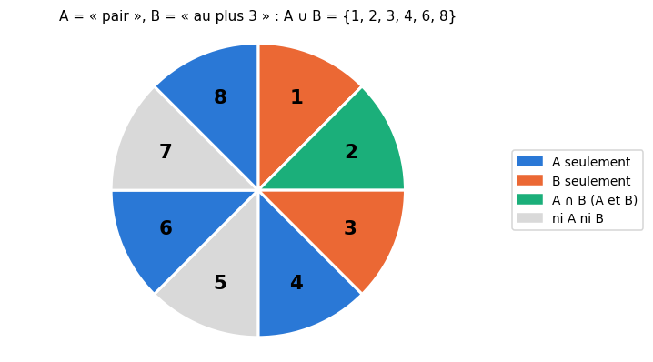
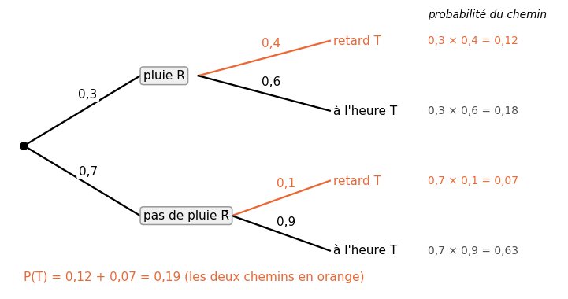
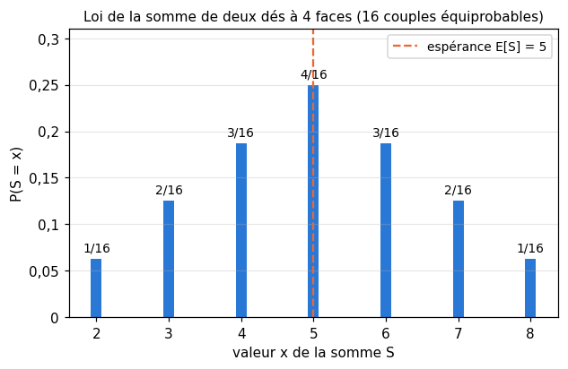
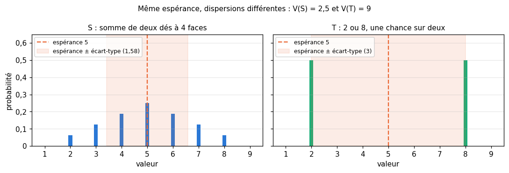
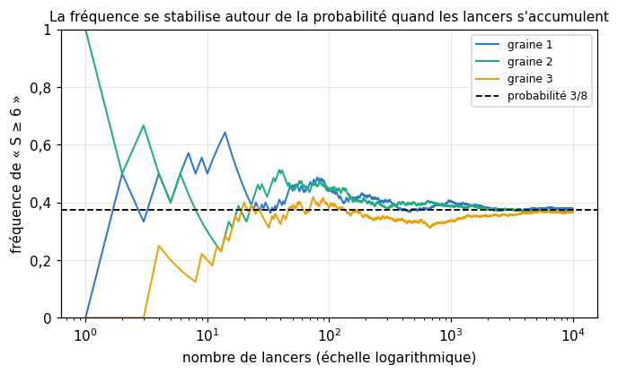

# R8 · Probabilités de base — fiche de cours

> La remise à niveau (R0 à R9) n'a pas de livre : **cette fiche est le cours**. Les probabilités sont la langue du machine learning : un classifieur ne répond pas « c'est un chat », il répond « chat avec une probabilité de 0,92 » ; une loss est une moyenne d'erreurs, que les maths appellent une **espérance** ; et chaque expérience de workbookIA dépend d'un **générateur aléatoire**. Ce chapitre reprend les probabilités du lycée, à partir de zéro : décrire une expérience aléatoire, compter ses issues, calculer une probabilité, enchaîner des épreuves avec un arbre, reconnaître des événements indépendants, résumer une variable aléatoire par son espérance et sa variance, et vérifier tout cela par simulation.

| | |
|---|---|
| **Sections** | §1 à §8 |
| **Temps total estimé** | ≈ 10,9 h : lecture et calculs de la fiche ≈ 2 h 30, exercices ≈ 7 h 55, flashcards ≈ 30 min (parcours essentiel ≈ 9,1 h) |
| **Prérequis** | R1 (fractions) ; R4 (ensembles, complémentaire, notations Σ et Π) ; workbookIA 0A : aléatoire reproductible, `np.random.default_rng` (§100.8.7) |
| **Fichiers du chapitre** | `02_exercices.md` (quiz, papier) · `03_notebook.ipynb` · `04_indices.md` · `05_solutions.md` et `05_solutions.ipynb` · `06_mes_reponses.md` · `flashcards.csv` |
| **mymath** | `proba_basics.py` : `factorial`, `binomial`, `enumerate_probability`, `expectation`, `variance`, `simulate_frequency` |

## Comment utiliser ce chapitre

**Ordre conseillé.**
1. `python tools/start_chapter.py R8` (sur Colab : `00_setup/COLAB.md` §2) : il copie le notebook, ta feuille de réponses et le squelette `mymath/proba_basics.py`.
2. Section par section : lis **crayon en main** (refais chaque calcul, et dessine les arbres), puis fais les exercices de la section, quiz 🧠 d'abord.
3. Les exercices ✏️ et 🔗 se font sur papier, dans ta copie de `06_mes_reponses.md`, puis se vérifient dans la **partie 0** du notebook. Les démonstrations ∂ se rédigent dans ta copie et se jugent avec la grille de relecture de `05_solutions.md`.

**Garde les fractions** jusqu'au bout : une probabilité comme $\frac{21}{44}$ se calcule exactement, et ne s'arrondit qu'à la fin si l'énoncé le demande (R1).

Si le test de positionnement t'a donné « tu peux sauter » pour R8, lis « L'essentiel en 10 lignes » et « Les pièges classiques », fais les quiz et les exercices 🔨 du parcours essentiel (`positionnement/05_grille.md`). Garde quand même le §8 (simuler avec une graine) : le lycée le traite peu, et workbookIA s'en sert à chaque chapitre.

| Section | Quiz 🧠 | Papier et réflexion | Notebook |
|---|---|---|---|
| §1 Expérience aléatoire, univers, événements | Q1, R1 🔁 | R8.1 ✏️ | |
| §2 Probabilités | Q2, R3 🔁 | R8.2 ✏️, R8.3 ✏️, R8.14 🧮, R8.15 🗣️ | R8.17 🔨, R8.20 🔮, R8.23 🐛 |
| §3 Dénombrer | Q3 | R8.4 ✏️, R8.5 ✏️, R8.11 ∂, R8.13 🔗 | R8.16 🔨, R8.20 🔮 |
| §4 Arbres pondérés | Q4 | R8.6 ✏️ | |
| §5 Indépendance | Q5 | R8.7 ✏️ | R8.23 🐛 |
| §6 Variable aléatoire discrète | Q6 | R8.8 ✏️ | R8.22 🎨 |
| §7 Espérance, variance, écart-type | Q6, R2 🔁 | R8.9 ✏️, R8.10 ✏️, R8.12 ∂ | R8.18 🔨 |
| §8 Simuler pour estimer | Q7 | R8.15 🗣️ | R8.19 🔨, R8.21 🔬, R8.24 🛠️ |

Parcours essentiel : tout sauf R8.Q7, R8.R3, R8.10, R8.11, R8.14, R8.17 et R8.22.

## Objectifs d'apprentissage

À la fin du chapitre, tu sais :
- **décrire** une expérience aléatoire par son univers, et **traduire** une phrase (« au moins un », « ni… ni… ») en opérations sur les événements ;
- **calculer** une probabilité par équiprobabilité, par le complémentaire ou par la formule de l'union ;
- **dénombrer** avec le principe multiplicatif, les factorielles et les coefficients binomiaux $\binom{n}{k}$ ;
- **enchaîner** des épreuves avec un arbre pondéré, et **reconnaître** des événements indépendants ;
- **calculer** la loi, l'espérance, la variance et l'écart-type d'une variable aléatoire discrète ;
- **estimer** une probabilité par simulation, avec une graine, et **dire** ce qu'affirme la loi des grands nombres.

## L'essentiel en 10 lignes

1. Une **expérience aléatoire** a un ensemble d'**issues** possibles, l'**univers** $\Omega$ ; un **événement** est une partie de $\Omega$. « Non $A$ » est le complémentaire $\bar{A}$, « $A$ et $B$ » l'intersection $A \cap B$, « $A$ ou $B$ » la réunion $A \cup B$ (l'un, l'autre, ou les deux).
2. Une **probabilité** donne à chaque issue un poids positif, de somme 1 ; $P(A)$ est la somme des poids des issues de $A$. Quand les issues sont **équiprobables**, $P(A) = \frac{|A|}{|\Omega|}$.
3. $P(\bar{A}) = 1 - P(A)$ ; $P(A \cup B) = P(A) + P(B) - P(A \cap B)$, qui devient $P(A) + P(B)$ quand $A$ et $B$ sont **incompatibles** ($A \cap B = \varnothing$). « Au moins un » se calcule presque toujours par le complémentaire, « aucun ».
4. **Principe multiplicatif** : $a$ choix puis $b$ choix font $a \times b$ possibilités. $k$ choix avec répétition parmi $n$ : $n^k$ ; sans répétition, dans l'ordre : $n(n - 1)\cdots(n - k + 1)$ ; ranger $n$ objets : $n!$.
5. $\binom{n}{k} = \frac{n!}{k!\,(n - k)!}$ compte les façons de **choisir** $k$ objets parmi $n$, sans ordre. Triangle de Pascal : $\binom{n}{k} = \binom{n - 1}{k - 1} + \binom{n - 1}{k}$.
6. **Arbre pondéré** : les branches issues d'un même nœud ont une somme de 1 ; la probabilité d'un chemin est le **produit** des probabilités le long du chemin ; celle d'un événement, la **somme** des chemins qui y mènent.
7. $A$ et $B$ sont **indépendants** si $P(A \cap B) = P(A)\,P(B)$ : savoir que $A$ s'est produit ne change pas la probabilité de $B$. Incompatibles et de probabilités non nulles, ils ne sont **jamais** indépendants.
8. Une **variable aléatoire** $X$ associe un nombre à chaque issue ; sa **loi** est le tableau des $P(X = x)$, de somme 1.
9. $\mathbb{E}[X] = \sum x\,P(X = x)$ (la moyenne à long terme) ; $\mathbb{V}(X) = \mathbb{E}\big[(X - \mathbb{E}[X])^2\big] = \mathbb{E}[X^2] - \mathbb{E}[X]^2$ ; $\sigma = \sqrt{\mathbb{V}(X)}$. $\mathbb{E}[aX + b] = a\,\mathbb{E}[X] + b$ et $\mathbb{V}(aX + b) = a^2\,\mathbb{V}(X)$.
10. **Loi des grands nombres** : sur $n$ répétitions indépendantes, la fréquence d'un événement se rapproche de sa probabilité quand $n$ grandit. Simuler (avec une **graine**, pour pouvoir refaire l'expérience) vérifie un calcul, ou remplace un calcul trop difficile.

---

## §1 · Expérience aléatoire, univers, événements

### Issues et univers

Une **expérience aléatoire** est une expérience dont on connaît tous les résultats possibles, sans pouvoir prédire celui qui sortira : lancer une pièce, faire tourner une roue, tirer une carte, mesurer le temps d'attente d'un bus. Chaque résultat possible est une **issue** (*outcome*) ; l'ensemble de toutes les issues est l'**univers** (*sample space*), noté $\Omega$ (« oméga »).

- Une roue partagée en 8 secteurs numérotés de 1 à 8 : $\Omega = \{1, 2, 3, 4, 5, 6, 7, 8\}$, et $|\Omega| = 8$ (le **cardinal**, le nombre d'éléments, R4).
- Trois lancers d'une pièce, en notant P pour pile et F pour face : une issue est une suite de trois lettres, et
$$\Omega = \{\text{PPP}, \text{PPF}, \text{PFP}, \text{PFF}, \text{FPP}, \text{FPF}, \text{FFP}, \text{FFF}\}.$$
Il y a $2 \times 2 \times 2 = 8$ issues (§3). L'ordre compte : PPF (pile, pile, puis face) et FPP sont deux issues différentes.

Choisir l'univers fait partie du travail. Pour trois lancers, on pourrait noter seulement le nombre de piles, $\{0, 1, 2, 3\}$ : c'est un univers plus petit, mais ses issues n'ont pas toutes les mêmes chances (§2). On préfère un univers dont les issues sont **équiprobables** quand c'est possible.

### Événements

Un **événement** (*event*) est une **partie** de l'univers : l'ensemble des issues pour lesquelles une phrase est vraie. Sur la roue, « le numéro est pair » est l'événement $A = \{2, 4, 6, 8\}$ ; « le numéro vaut au plus 3 » est $B = \{1, 2, 3\}$. On dit que $A$ « se réalise » quand l'issue obtenue est dans $A$.

Deux événements particuliers : $\Omega$ lui-même, l'événement **certain**, et l'ensemble vide $\varnothing$, l'événement **impossible** (« le numéro vaut 9 »). Un événement qui ne contient qu'une issue, comme $\{5\}$, est **élémentaire**.

Les mots de tous les jours deviennent les opérations sur les ensembles de R4 :

| En mots | Notation | Sur la roue, avec $A = \{2, 4, 6, 8\}$ et $B = \{1, 2, 3\}$ |
|---|---|---|
| non $A$ (le **contraire** de $A$) | $\bar{A}$ | $\{1, 3, 5, 7\}$ : « impair » |
| $A$ **et** $B$ | $A \cap B$ | $\{2\}$ |
| $A$ **ou** $B$ (l'un, l'autre, ou les deux) | $A \cup B$ | $\{1, 2, 3, 4, 6, 8\}$ |
| ni $A$ ni $B$ | $\bar{A} \cap \bar{B}$ | $\{5, 7\}$ |

Le « ou » des probabilités est **inclusif** : le numéro 2, pair et inférieur ou égal à 3, est bien dans $A \cup B$. La dernière ligne utilise une loi de De Morgan (R4) : « ni $A$ ni $B$ » est le contraire de « $A$ ou $B$ », $\bar{A} \cap \bar{B} = \overline{A \cup B}$.

Deux événements sans issue commune, $A \cap B = \varnothing$, sont **incompatibles** (*mutually exclusive*, on dit aussi disjoints) : ils ne peuvent pas se réaliser ensemble. « Pair » et « impair » sont incompatibles ; « pair » et « au plus 3 » ne le sont pas, à cause du 2.



En Python, les ensembles de workbookIA 0A font exactement ces opérations :

```python
>>> omega = set(range(1, 9))
>>> A = {n for n in omega if n % 2 == 0}
>>> B = {n for n in omega if n <= 3}
>>> sorted(omega - A), sorted(A & B), sorted(A | B), sorted(omega - (A | B))
([1, 3, 5, 7], [2], [1, 2, 3, 4, 6, 8], [5, 7])
```

🔗 **Dans workbookIA** — une prédiction de classification est une issue (« Adélie », « Gentoo » ou « Chinstrap ») ; « le modèle se trompe » est un événement. Les ensembles et leur cardinal reviennent au chapitre 0B, puis au chapitre 3 pour compter les vrais et faux positifs.

---

## §2 · Probabilités

### De la fréquence à la probabilité

Fais tourner la roue 1 000 fois et compte les numéros pairs : tu en trouveras environ 500, rarement exactement 500. La **fréquence** d'un événement, le nombre de fois où il se réalise divisé par le nombre d'essais, change d'une série à l'autre ; mais plus la série est longue, plus elle se stabilise autour d'un nombre, ici $\frac{1}{2}$. Ce nombre, qui ne dépend pas de la série, est la **probabilité** de l'événement. Le §8 précisera ce lien (la loi des grands nombres) ; retiens pour l'instant qu'une probabilité est une fréquence « idéale », et qu'une fréquence est une probabilité mesurée.

### Définition

Sur un univers fini, une **probabilité** donne à chaque issue $\omega$ un poids $p(\omega) \ge 0$, avec une somme de tous les poids égale à 1. La probabilité d'un événement $A$ est la somme des poids de ses issues :

$$P(A) = \sum_{\omega \in A} p(\omega).$$

Les règles suivantes en découlent :
- $0 \le P(A) \le 1$ pour tout événement ; $P(\varnothing) = 0$ et $P(\Omega) = 1$ ;
- **complémentaire** : $P(\bar{A}) = 1 - P(A)$, car les poids de $A$ et de $\bar{A}$ font, ensemble, tous les poids ;
- **incompatibles** : si $A \cap B = \varnothing$, alors $P(A \cup B) = P(A) + P(B)$ ;
- **réunion**, dans tous les cas : $P(A \cup B) = P(A) + P(B) - P(A \cap B)$.

La dernière formule retire ce qui a été compté deux fois : les issues de $A \cap B$ sont à la fois dans $A$ et dans $B$. C'est la même idée que $|A \cup B| = |A| + |B| - |A \cap B|$ pour les cardinaux (R4).

Une roue dont les secteurs n'ont pas la même taille montre que les issues n'ont pas toujours les mêmes chances : si le rouge occupe la moitié de la roue, le bleu un tiers et le vert un sixième, alors $p(\text{rouge}) = \frac{1}{2}$, $p(\text{bleu}) = \frac{1}{3}$, $p(\text{vert}) = \frac{1}{6}$ (somme 1), et $P(\text{pas rouge}) = \frac{1}{3} + \frac{1}{6} = \frac{1}{2}$.

### Équiprobabilité

Quand les $|\Omega|$ issues ont toutes le même poids (une pièce équilibrée, une roue aux secteurs égaux, une carte tirée « au hasard »), chaque poids vaut $\frac{1}{|\Omega|}$, et une probabilité se calcule en **comptant** :

$$P(A) = \frac{|A|}{|\Omega|} = \frac{\text{nombre d'issues favorables}}{\text{nombre d'issues possibles}}.$$

Sur la roue de 8 secteurs égaux : $P(A) = \frac{4}{8} = \frac{1}{2}$, $P(B) = \frac{3}{8}$, $P(A \cap B) = \frac{1}{8}$, et

$$P(A \cup B) = \frac{1}{2} + \frac{3}{8} - \frac{1}{8} = \frac{6}{8} = \frac{3}{4},$$

ce que confirme le comptage direct : $A \cup B$ a 6 issues sur 8.

⚠️ **Les issues d'un univers mal choisi ne sont pas équiprobables.** On lance deux pièces : « deux piles », « deux faces » ou « un de chaque » ont-ils chacun une chance sur trois ? Non. Dans l'univers $\{\text{PP}, \text{PF}, \text{FP}, \text{FF}\}$, dont les quatre issues sont équiprobables, « un de chaque » contient deux issues (PF et FP) : sa probabilité est $\frac{2}{4} = \frac{1}{2}$, contre $\frac{1}{4}$ pour chacune des deux autres. Le mathématicien d'Alembert lui-même s'y est trompé, au XVIIIᵉ siècle. Le remède : distinguer les objets (la première pièce, la seconde), même quand ils se ressemblent.

### « Au moins un » : passer par le contraire

Pour trois lancers de pièce, « au moins un pile » regroupe 7 des 8 issues ; son contraire, « aucun pile », n'en a qu'une, FFF. D'où

$$P(\text{au moins un pile}) = 1 - P(\text{FFF}) = 1 - \frac{1}{8} = \frac{7}{8}.$$

C'est un réflexe à prendre : le contraire de « au moins un » est « aucun », presque toujours plus simple à compter.

En Python, on compte avec une compréhension de liste, et `Fraction` (R1) garde la valeur exacte :

```python
>>> from fractions import Fraction
>>> omega = [a + b + c for a in "PF" for b in "PF" for c in "PF"]
>>> len(omega), Fraction(sum("P" in w for w in omega), len(omega))
(8, Fraction(7, 8))
```

`sum` d'une suite de booléens compte les `True` : c'est ce que fera ta fonction `enumerate_probability` (R8.17).

🔗 **Dans workbookIA** — un classifieur renvoie une probabilité par classe, de somme 1 (le softmax du chapitre 17) ; l'accuracy d'un modèle est la fréquence de ses bonnes réponses sur un jeu de test, une estimation de la probabilité qu'il réponde juste (chapitre 3).

---

## §3 · Dénombrer

Avec l'équiprobabilité, une probabilité est un rapport de deux nombres d'issues. Quand il y en a des milliers, on ne les liste plus : on les **compte** avec quelques outils.

### Le principe multiplicatif

Si un choix se fait en plusieurs étapes, avec $a$ possibilités pour la première, $b$ pour la deuxième (quelle que soit la première), $c$ pour la troisième…, il y a $a \times b \times c \times \cdots$ possibilités en tout. Avec 3 pantalons, 4 t-shirts et 2 paires de chaussures, on compose $3 \times 4 \times 2 = 24$ tenues : un arbre à 3 branches, puis 4 sur chacune, puis 2 sur chacune, a 24 feuilles.

**Avec répétition.** Un code de 3 lettres (26 lettres, une lettre peut revenir) : $26 \times 26 \times 26 = 26^3 = 17\,576$ codes. En général, $k$ choix successifs parmi $n$ possibilités, avec répétition, donnent $n^k$ suites : c'est pour cela qu'un mot de passe plus long est beaucoup plus difficile à deviner, chaque caractère multipliant le nombre de possibilités.

**Sans répétition, l'ordre compte** (arrangements). Parmi 5 candidats, on élit un président, puis un secrétaire, qui ne peut pas être le président : $5 \times 4 = 20$ bureaux possibles. En général, choisir $k$ objets parmi $n$, dans l'ordre, sans répétition, donne
$$n \times (n - 1) \times \cdots \times (n - k + 1) \quad \text{possibilités ($k$ facteurs)}.$$

### La factorielle

Ranger $n$ objets distincts dans un ordre, c'est choisir le premier ($n$ possibilités), puis le deuxième ($n - 1$), et ainsi de suite jusqu'au dernier (1 possibilité) : il y a
$$n! = n \times (n - 1) \times \cdots \times 2 \times 1$$
rangements, et l'on lit $n!$ « factorielle $n$ » (*n factorial*). Les trois lettres A, B, C se rangent de $3! = 6$ façons : ABC, ACB, BAC, BCA, CAB, CBA. La factorielle grandit très vite : $12! = 479\,001\,600$, et les façons de mélanger un jeu de 52 cartes, $52! \approx 8 \times 10^{67}$, dépassent de loin le nombre d'atomes de la Terre.

Par convention, $0! = 1$ : il y a une seule façon de ranger zéro objet (ne rien faire), et c'est la valeur du produit vide, comme $x^0 = 1$ (R4). Avec elle, les formules qui suivent restent vraies pour $k = 0$ et $k = n$.

Le nombre d'arrangements s'écrit aussi avec des factorielles : $n(n - 1)\cdots(n - k + 1) = \frac{n!}{(n - k)!}$, car les facteurs de $(n - k)!$ se simplifient.

### Les combinaisons

Souvent, l'ordre ne compte pas : une équipe de 3 joueurs parmi 9, une main de cartes, un groupe de features. Compte d'abord les choix **ordonnés** : $9 \times 8 \times 7 = 504$. Chaque équipe y apparaît plusieurs fois, une fois pour chaque rangement de ses 3 membres, soit $3! = 6$ fois. Il y a donc $\frac{504}{6} = 84$ équipes.

Le même raisonnement, en général, donne le **coefficient binomial** (*binomial coefficient*), noté $\binom{n}{k}$ et lu « $k$ parmi $n$ » (au lycée, on écrit aussi $C_n^k$) : le nombre de façons de choisir $k$ objets parmi $n$, sans ordre ni répétition,

$$\binom{n}{k} = \frac{n(n - 1)\cdots(n - k + 1)}{k!} = \frac{n!}{k!\,(n - k)!} \qquad (0 \le k \le n).$$

Quelques valeurs à connaître : $\binom{n}{0} = \binom{n}{n} = 1$ (ne rien prendre, ou tout prendre), $\binom{n}{1} = n$, et $\binom{n}{2} = \frac{n(n - 1)}{2}$, le nombre de **paires** parmi $n$ objets. **Symétrie** : $\binom{n}{k} = \binom{n}{n - k}$, car choisir les $k$ objets qu'on garde revient à choisir les $n - k$ qu'on laisse. Pour $k < 0$ ou $k > n$, il n'y a aucune façon de choisir, et l'on pose $\binom{n}{k} = 0$.

⚠️ **Ordre ou pas ordre ?** Avant de compter, demande-toi si deux choix qui ne diffèrent que par l'ordre comptent pour un ou pour plusieurs. Un podium (or, argent, bronze) : l'ordre compte, arrangements. Un comité de trois membres égaux : il ne compte pas, combinaisons. Une erreur fréquente est de multiplier comme pour un podium quand on demande un comité : le résultat est alors $k!$ fois trop grand.

### Le triangle de Pascal

Rangés en triangle, ligne $n$ par ligne $n$ (de $k = 0$ à $k = n$), les coefficients binomiaux forment le **triangle de Pascal** : chaque nombre est la somme des deux nombres au-dessus de lui.

```text
n = 0:                1
n = 1:              1   1
n = 2:            1   2   1
n = 3:          1   3   3   1
n = 4:        1   4   6   4   1
n = 5:      1   5  10  10   5   1
n = 6:    1   6  15  20  15   6   1
```

C'est la **formule de Pascal**, $\binom{n}{k} = \binom{n - 1}{k - 1} + \binom{n - 1}{k}$ ; tu la démontreras en R8.11, par le calcul et par un raisonnement de comptage. Deux propriétés se lisent sur le triangle : chaque ligne est symétrique, et la somme de la ligne $n$ vaut $2^n$, le nombre total de sous-ensembles d'un ensemble à $n$ éléments (chaque élément est pris ou non : $2 \times 2 \times \cdots \times 2$).

### Probabilités et dénombrement

Un sac contient 12 tickets, dont 5 gagnants. On en tire 3 d'un coup, au hasard : toutes les poignées de 3 tickets sont équiprobables, et il y en a $\binom{12}{3} = \frac{12 \times 11 \times 10}{6} = 220$. Pour avoir **exactement un** gagnant, on choisit 1 gagnant parmi 5, et 2 perdants parmi les 7 autres : $\binom{5}{1} \times \binom{7}{2} = 5 \times 21 = 105$ poignées (principe multiplicatif). D'où

$$P(\text{exactement un gagnant}) = \frac{105}{220} = \frac{21}{44} \approx 0{,}477.$$

En Python, `math.factorial`, `math.perm` et `math.comb` font ces calculs exactement ; tu écriras tes propres versions de la factorielle et de $\binom{n}{k}$ en R8.16 :

```python
>>> import math
>>> math.factorial(12), math.perm(9, 3), math.comb(9, 3), math.comb(12, 3)
(479001600, 504, 84, 220)
```

🔗 **Dans workbookIA** — les réglages d'une recherche par grille se comptent avec le principe multiplicatif (0A) ; comparer chaque exemple d'un dataset à tous les autres demande $\binom{n}{2}$ comparaisons, un nombre qui croît comme $n^2$ (R8.13, chapitre 7).

---

## §4 · Arbres pondérés

### Enchaîner des épreuves

Beaucoup d'expériences se déroulent en étapes : un tirage, puis un autre ; il pleut ou non, puis le bus est en retard ou non. Un **arbre pondéré** représente ces étapes. Chaque nœud ouvre une branche par issue possible de l'étape suivante, et chaque branche porte la probabilité de cette issue, **sachant le chemin déjà parcouru**.

Exemple : un matin, il pleut avec la probabilité 0,3. Quand il pleut, le bus est en retard avec la probabilité 0,4 ; sinon, avec la probabilité 0,1. On note $R$ l'événement « il pleut » et $T$ « le bus est en retard ».



Trois règles permettent de tout calculer :
1. **Les branches issues d'un même nœud ont une somme de 1** : 0,3 et 0,7 au départ ; 0,4 et 0,6 après « pluie » ; 0,1 et 0,9 après « pas de pluie ».
2. **La probabilité d'un chemin est le produit des probabilités de ses branches** : « il pleut et le bus est en retard » a la probabilité $0{,}3 \times 0{,}4 = 0{,}12$.
3. **La probabilité d'un événement est la somme des probabilités des chemins qui y mènent** : le bus est en retard par deux chemins, donc
$$P(T) = 0{,}3 \times 0{,}4 + 0{,}7 \times 0{,}1 = 0{,}12 + 0{,}07 = 0{,}19.$$

La somme des probabilités de tous les chemins vaut 1 : $0{,}12 + 0{,}18 + 0{,}07 + 0{,}63 = 1$. C'est une bonne vérification.

### Un premier contact avec le conditionnement

Les probabilités du second niveau ne sont pas des probabilités « tout court » : 0,4 est la probabilité du retard **sachant qu'il pleut**. On la note $P(T \mid R)$ (lire « probabilité de $T$ sachant $R$ » ; au lycée, $P_R(T)$). La règle 2 s'écrit alors

$$P(R \cap T) = P(R) \times P(T \mid R).$$

Ce n'est qu'un premier contact : les probabilités conditionnelles auront leur chapitre (M03), et la règle 3 y deviendra la **formule des probabilités totales**.

### Tirages avec ou sans remise

Un sac contient 6 billes, dont 2 rouges. On en tire deux, l'une après l'autre. **Sans remise** (la première bille reste dehors), la composition du sac change entre les deux tirages : après une bille rouge, il reste 1 bille rouge sur 5. Le chemin « rouge, puis rouge » a la probabilité
$$\frac{2}{6} \times \frac{1}{5} = \frac{2}{30} = \frac{1}{15}.$$
**Avec remise** (on remet la bille et on mélange), le second tirage se fait dans le même sac que le premier : $\frac{2}{6} \times \frac{2}{6} = \frac{1}{9}$.

⚠️ **On multiplie le long d'un chemin, on additionne entre les chemins.** Additionner les probabilités d'un même chemin, ou multiplier celles de deux chemins différents, donne des nombres qui n'ont pas de sens (parfois plus grands que 1).

🔗 **Dans workbookIA** — un modèle de langage écrit un texte mot après mot : la probabilité d'une phrase est le produit des probabilités de chaque mot **sachant les mots précédents**, exactement comme un chemin dans un arbre (chapitre 6, et les chapitres bonus B2 à B4).

---

## §5 · Indépendance

### Définition

Deux événements sont **indépendants** (*independent*) quand savoir que l'un s'est réalisé ne change pas la probabilité de l'autre. Dans un arbre, cela veut dire que les branches du second niveau portent les mêmes probabilités quel que soit le premier : $P(B \mid A) = P(B)$. La règle du produit devient alors $P(A \cap B) = P(A) \times P(B)$, que l'on prend comme définition :

$$A \text{ et } B \text{ sont indépendants} \iff P(A \cap B) = P(A)\,P(B).$$

**Deux épreuves sans lien.** On fait tourner deux fois la roue de 8 secteurs. « Le premier numéro est pair » ($\frac{1}{2}$) et « le second vaut au plus 3 » ($\frac{3}{8}$) : parmi les $8 \times 8 = 64$ couples équiprobables, $4 \times 3 = 12$ réalisent les deux, et $\frac{12}{64} = \frac{3}{16} = \frac{1}{2} \times \frac{3}{8}$. Indépendants, comme on s'y attend : la roue n'a pas de mémoire.

**Une seule épreuve.** L'indépendance n'est pas toujours une question de « lien physique » : elle se **calcule**. On lance un dé à 6 faces. Avec $A$ = « pair » $= \{2, 4, 6\}$ et $B$ = « au plus 2 » $= \{1, 2\}$ : $P(A \cap B) = P(\{2\}) = \frac{1}{6}$ et $P(A)\,P(B) = \frac{1}{2} \times \frac{1}{3} = \frac{1}{6}$. Les deux événements sont indépendants : savoir que le résultat vaut au plus 2 laisse une chance sur deux qu'il soit pair. Mais avec $B'$ = « au plus 3 » $= \{1, 2, 3\}$, $P(A \cap B') = \frac{1}{6}$ alors que $P(A)\,P(B') = \frac{1}{4}$ : savoir que le résultat vaut au plus 3 rend « pair » moins probable (une chance sur trois). Pas indépendants.

⚠️ **Indépendants n'est pas incompatibles.** Deux événements incompatibles, chacun de probabilité non nulle, ne sont **jamais** indépendants : $P(A \cap B) = 0$, alors que $P(A)\,P(B) > 0$. Si l'un se réalise, l'autre devient impossible : c'est le contraire de « ne rien changer ».

Quand $A$ et $B$ sont indépendants, $\bar{A}$ et $B$ le sont aussi, ainsi que $A$ et $\bar{B}$, et $\bar{A}$ et $\bar{B}$ : savoir que $A$ ne s'est **pas** réalisé n'apprend rien non plus sur $B$.

### Répéter une épreuve

Quand on répète une épreuve **dans les mêmes conditions et de façon indépendante** (des lancers successifs, des tirages avec remise), les probabilités se multiplient. Si une épreuve réussit avec la probabilité $p$, alors $n$ répétitions réussissent toutes avec la probabilité $p^n$, et aucune ne réussit avec la probabilité $(1 - p)^n$. D'où, par le contraire :

$$P(\text{au moins une réussite en } n \text{ essais}) = 1 - (1 - p)^n.$$

Exemple : un test automatique échoue au hasard, avec la probabilité 0,02, à chaque exécution, indépendamment des autres. Sur 50 exécutions, la probabilité qu'il échoue au moins une fois est $1 - 0{,}98^{50} \approx 0{,}636$ : un défaut rare à chaque essai devient probable sur beaucoup d'essais. Les puissances d'un nombre entre 0 et 1 décroissent vite (R5, R6).

🔗 **Dans workbookIA** — on suppose presque toujours que les exemples d'un dataset sont **indépendants** et tirés de la même loi (« i.i.d. », chapitre 2) : la probabilité de tout le dataset est alors un **produit** de probabilités, qu'un logarithme transforme en somme (R6). Le classifieur « Naïve Bayes » du chapitre 13 suppose, lui, des features indépendantes.

---

## §6 · Variable aléatoire discrète

### Définition

Une **variable aléatoire** (*random variable*) $X$ associe un **nombre** à chaque issue d'une expérience : le nombre de piles en trois lancers, le gain d'un jeu, la somme de deux dés. Elle est **discrète** quand elle ne prend qu'un nombre fini (ou dénombrable) de valeurs. Malgré son nom, ce n'est pas une variable au sens de Python : c'est une **fonction** de l'univers dans les nombres (R3), $X : \Omega \to \mathbb{R}$.

Exemple : on lance deux dés à 4 faces (des tétraèdres, numérotés de 1 à 4), et $S$ est la somme des deux numéros. L'univers a $4 \times 4 = 16$ couples équiprobables, et $S$ prend les valeurs 2 à 8.

### La loi d'une variable aléatoire

Pour chaque valeur $x$, $\{S = x\}$ (« $S$ vaut $x$ ») est un événement : l'ensemble des issues qui donnent $x$. La **loi** (*distribution*) de $S$ est le tableau des probabilités $P(S = x)$. On l'obtient en comptant les couples :

| $x$ | 2 | 3 | 4 | 5 | 6 | 7 | 8 |
|---|---|---|---|---|---|---|---|
| couples | (1, 1) | (1, 2), (2, 1) | 3 couples | 4 couples | 3 couples | 2 couples | (4, 4) |
| $P(S = x)$ | $\frac{1}{16}$ | $\frac{2}{16}$ | $\frac{3}{16}$ | $\frac{4}{16}$ | $\frac{3}{16}$ | $\frac{2}{16}$ | $\frac{1}{16}$ |

Les probabilités d'une loi sont positives et ont une somme de 1 (ici $\frac{16}{16}$) : les événements $\{S = x\}$ sont incompatibles, et ensemble ils forment tout l'univers. Une loi permet de calculer la probabilité de tout événement qui porte sur $S$, en additionnant : $P(S \ge 6) = \frac{3 + 2 + 1}{16} = \frac{6}{16} = \frac{3}{8}$.

On la représente par un **diagramme en bâtons** : un bâton de hauteur $P(S = x)$ au-dessus de chaque valeur $x$.



Deux variables peuvent avoir la même loi sans être la même variable : le numéro du premier dé et celui du second valent chacun 1, 2, 3 ou 4 avec la probabilité $\frac{1}{4}$, mais ils diffèrent souvent lors d'un même lancer. Une loi décrit les **chances** de chaque valeur, pas la valeur obtenue.

🔗 **Dans workbookIA** — la sortie d'un classifieur à $K$ classes est une loi sur $\{1, \dots, K\}$ (la loi catégorielle du chapitre 2) ; le nombre de bonnes réponses d'un modèle sur un jeu de test est une variable aléatoire, qui change avec le jeu de test tiré.

---

## §7 · Espérance, variance, écart-type

### L'espérance

L'**espérance** (*expected value*) d'une variable aléatoire discrète est la moyenne de ses valeurs, **pondérée par leurs probabilités** :

$$\mathbb{E}[X] = \sum_{x} x \, P(X = x).$$

Au lycée, on la note $E(X)$. Pour la somme de deux dés à 4 faces :

$$\mathbb{E}[S] = \frac{2 \times 1 + 3 \times 2 + 4 \times 3 + 5 \times 4 + 6 \times 3 + 7 \times 2 + 8 \times 1}{16} = \frac{80}{16} = 5.$$

On pouvait le prévoir : la loi est symétrique autour de 5. L'espérance est le **centre de gravité** du diagramme en bâtons, et la moyenne à laquelle on s'attend sur un très grand nombre de répétitions (§8). Elle n'est pas forcément une valeur possible : une variable qui vaut 0 ou 1 avec une chance sur deux a pour espérance $\frac{1}{2}$.

**Un jeu équitable.** Une roue de loterie a 10 secteurs égaux : un secteur rapporte 15 €, trois rapportent 5 €, les six autres rien ; le ticket coûte 3 €. Le gain net $G$ (somme gagnée moins prix du ticket) vaut 12 €, 2 € ou −3 €, avec les probabilités 0,1, 0,3 et 0,6 :

$$\mathbb{E}[G] = 12 \times 0{,}1 + 2 \times 0{,}3 + (-3) \times 0{,}6 = 1{,}2 + 0{,}6 - 1{,}8 = 0.$$

Un jeu d'espérance nulle est dit **équitable** : en moyenne, sur beaucoup de parties, ni le joueur ni l'organisateur ne gagne. Avec une espérance négative, le joueur perd en moyenne, et l'organisateur gagne.

**Linéarité.** Si l'on multiplie toutes les valeurs par $a$ et qu'on ajoute $b$, l'espérance suit le même chemin :

$$\mathbb{E}[aX + b] = a\,\mathbb{E}[X] + b.$$

Exemple : chaque point de la somme $S$ rapporte 2 €, et la partie coûte 9 € ; le gain $2S - 9$ a pour espérance $2 \times 5 - 9 = 1$ €. Plus généralement, l'espérance d'une **somme** de variables aléatoires est la somme de leurs espérances, $\mathbb{E}[X + Y] = \mathbb{E}[X] + \mathbb{E}[Y]$, même quand $X$ et $Y$ dépendent l'une de l'autre : tu le démontreras en R8.12.

### La variance et l'écart-type

L'espérance ne dit rien de la **dispersion**. Le jeu de la roue et un jeu où l'on ne gagne et ne perd jamais rien ont tous deux une espérance nulle ; l'un fait gagner 12 € ou perdre 3 €, l'autre rien. La **variance** (*variance*) mesure l'écart à l'espérance, élevé au carré et moyenné :

$$\mathbb{V}(X) = \mathbb{E}\big[(X - \mathbb{E}[X])^2\big] = \sum_x \big(x - \mathbb{E}[X]\big)^2\, P(X = x).$$

On la note $V(X)$ au lycée, $\mathrm{Var}(X)$ dans workbookIA. Le carré rend tous les écarts positifs (sinon les écarts au-dessus et au-dessous de l'espérance se compenseraient, et la somme vaudrait toujours 0) et donne plus de poids aux grands écarts. Une variance est toujours positive ou nulle, et elle n'est nulle que si $X$ est constante.

Comme la variance est dans une unité au carré (des euros au carré), on utilise aussi l'**écart-type** (*standard deviation*), sa racine carrée, dans l'unité de $X$ :

$$\sigma(X) = \sqrt{\mathbb{V}(X)}.$$

Pour $S$, avec $\mathbb{E}[S] = 5$, les écarts au carré valent 9, 4, 1, 0, 1, 4, 9 pour $x = 2, \dots, 8$ :

$$\mathbb{V}(S) = \frac{9 \times 1 + 4 \times 2 + 1 \times 3 + 0 \times 4 + 1 \times 3 + 4 \times 2 + 9 \times 1}{16} = \frac{40}{16} = 2{,}5, \qquad \sigma(S) = \sqrt{2{,}5} \approx 1{,}58.$$

**Une formule plus rapide** (démontrée au chapitre 0B de workbookIA) :

$$\mathbb{V}(X) = \mathbb{E}[X^2] - \mathbb{E}[X]^2, \qquad \text{où } \mathbb{E}[X^2] = \sum_x x^2\, P(X = x).$$

Pour $S$ : $\mathbb{E}[S^2] = \frac{4 \times 1 + 9 \times 2 + 16 \times 3 + 25 \times 4 + 36 \times 3 + 49 \times 2 + 64 \times 1}{16} = \frac{440}{16} = 27{,}5$, et $\mathbb{V}(S) = 27{,}5 - 5^2 = 2{,}5$, comme avant. Pour le jeu de la roue : $\mathbb{E}[G^2] = 144 \times 0{,}1 + 4 \times 0{,}3 + 9 \times 0{,}6 = 21$, donc $\mathbb{V}(G) = 21 - 0^2 = 21$ et $\sigma(G) \approx 4{,}58$ €.

⚠️ **$\mathbb{E}[X^2]$ n'est pas $\mathbb{E}[X]^2$.** Le premier est la moyenne des carrés, le second le carré de la moyenne ; leur différence est justement la variance, qui est positive. Pour $S$ : 27,5 contre 25.

**Changer d'échelle.** Ajouter une constante décale toutes les valeurs, et l'espérance avec elles, sans changer les écarts ; multiplier par $a$ multiplie chaque écart par $a$, donc chaque écart au carré par $a^2$ :

$$\mathbb{V}(aX + b) = a^2\,\mathbb{V}(X), \qquad \sigma(aX + b) = \lvert a \rvert\, \sigma(X).$$

Pour le gain $2S - 9$ : $\mathbb{V} = 4 \times 2{,}5 = 10$ et $\sigma = 2 \times 1{,}58 \approx 3{,}16$ €. Le $-9$ n'a rien changé à la dispersion.



🔗 **Dans workbookIA** — la loss qu'un modèle minimise est l'**espérance** de son erreur, estimée par une moyenne sur les données (chapitres 2 et 8) ; **standardiser** une feature, c'est lui retirer sa moyenne et la diviser par son écart-type (chapitre 12) ; l'écart-type d'un score sur plusieurs graines dit si une amélioration est réelle ou due au hasard (chapitre 8).

---

## §8 · Simuler pour estimer

### Un générateur et une graine

Un ordinateur ne tire pas vraiment au hasard : un **générateur pseudo-aléatoire** calcule une suite de nombres qui en a toutes les apparences. Il part d'une **graine** (*seed*) : la même graine redonne toujours la même suite, ce qui rend une expérience **reproductible** (workbookIA 0A §100.8.7). Avec NumPy, on crée **un** générateur, une fois, puis on tire avec lui :

```python
>>> import numpy as np
>>> rng = np.random.default_rng(0)
>>> rolls = rng.integers(1, 5, size=(100_000, 2))     # 100 000 lancers de deux dés à 4 faces
>>> s = rolls.sum(axis=1)
>>> round(float((s >= 6).mean()), 4), 3 / 8
(0.3736, 0.375)
>>> round(float(s.mean()), 3), round(float(s.var()), 3)
(4.999, 2.483)
```

`rng.integers(1, 5, ...)` tire des entiers de 1 à 4 (la borne 5 est exclue). La fréquence de « $S \ge 6$ » (la moyenne d'un tableau de booléens, R0) est proche de la probabilité $\frac{3}{8}$ calculée au §6, et la moyenne et la variance des 100 000 sommes sont proches de $\mathbb{E}[S] = 5$ et $\mathbb{V}(S) = 2{,}5$. Simuler, c'est donc **vérifier un calcul** ; c'est aussi la seule méthode quand le calcul exact est trop difficile (on parle de méthode de Monte-Carlo).

### La loi des grands nombres

Que se passe-t-il quand on fait de plus en plus de lancers ?

```python
>>> rng = np.random.default_rng(7)
>>> [float((rng.integers(1, 5, size=(n, 2)).sum(axis=1) >= 6).mean()) for n in (10, 100, 1_000, 10_000)]
[0.5, 0.4, 0.397, 0.3684]
```

Sur 10 lancers, la fréquence peut être loin de 0,375 ; sur 10 000, elle en est proche. C'est la **loi des grands nombres** (*law of large numbers*) : quand on répète une expérience un grand nombre de fois, de façon indépendante et dans les mêmes conditions, la fréquence d'un événement se rapproche de sa probabilité, et la moyenne des valeurs d'une variable aléatoire se rapproche de son espérance. Les écarts diminuent environ comme $\frac{1}{\sqrt{n}}$ : pour une précision dix fois meilleure, il faut cent fois plus d'essais. M02c donnera l'énoncé précis et en tirera des intervalles de confiance.



⚠️ **Le hasard n'a pas de mémoire.** Après cinq piles de suite, une pièce équilibrée a toujours une chance sur deux de donner pile : les lancers sont indépendants (§5). La loi des grands nombres ne « compense » pas les écarts passés ; elle les **dilue** : cinq piles de trop pèsent beaucoup sur 10 lancers, presque rien sur 10 000. Croire le contraire s'appelle l'erreur du joueur (*gambler's fallacy*).

### Bonnes pratiques

- Crée le générateur **une seule fois** (`rng = np.random.default_rng(graine)`), et passe-le aux fonctions qui tirent au hasard, comme le fera ta fonction `simulate_frequency(experiment, n_trials, seed)` (R8.19).
- Note la graine avec les résultats : une autre graine donne d'autres fréquences, toutes proches de la probabilité si $n$ est grand.
- Une simulation ne remplace pas une preuve, mais elle détecte vite une erreur de calcul : si ta probabilité exacte est 0,6 et que 100 000 essais donnent 0,375, l'un des deux est faux.

🔗 **Dans workbookIA** — chaque chapitre fixe ses graines pour que tes résultats soient ceux du corrigé ; un score mesuré sur un jeu de test est une fréquence, qui fluctue d'autant moins que le jeu est grand (chapitres 2 et 8) ; l'apprentissage par renforcement (chapitre 26) estime des espérances de récompenses par simulation.

---

## Les pièges classiques ⚠️ (récapitulatif)

| Piège | Faux | Juste |
|---|---|---|
| univers mal choisi | deux pièces : 0, 1 ou 2 piles, chacun $\frac{1}{3}$ | $\frac{1}{4}$, $\frac{1}{2}$, $\frac{1}{4}$ (distinguer les deux pièces) |
| réunion | $P(A \cup B) = P(A) + P(B)$ toujours | retirer $P(A \cap B)$, sauf si $A$ et $B$ sont incompatibles |
| « au moins un » | additionner les probabilités de chaque essai | $1 - P(\text{aucun})$ |
| ordre ou pas | compter un comité comme un podium | combinaisons : diviser par $k!$ |
| factorielle | $0! = 0$ | $0! = 1$ (le produit vide) |
| arbre | additionner le long d'un chemin | multiplier le long d'un chemin, additionner entre les chemins |
| sans remise | garder les mêmes probabilités au second tirage | la composition change : $\frac{2}{6}$ puis $\frac{1}{5}$ |
| indépendance | incompatibles, donc indépendants | incompatibles (non impossibles), donc **dépendants** |
| indépendance | « pas de lien physique » ou « un lien », sans calculer | comparer $P(A \cap B)$ et $P(A)\,P(B)$ |
| espérance | une valeur que $X$ peut prendre | une moyenne pondérée, pas forcément une valeur possible |
| variance | $\mathbb{E}[X^2] = \mathbb{E}[X]^2$ | $\mathbb{V}(X) = \mathbb{E}[X^2] - \mathbb{E}[X]^2 \ge 0$ |
| changement d'échelle | $\mathbb{V}(aX + b) = a\,\mathbb{V}(X) + b$ | $a^2\,\mathbb{V}(X)$ ; la constante $b$ disparaît |
| loi des grands nombres | après une série de piles, face devient plus probable | les lancers sont indépendants ; les écarts se diluent |
| graine | recréer le générateur avec la même graine à chaque tirage | un seul générateur, créé une fois |

## Et maintenant

**Dans ce dépôt** : R9, *Géométrie du plan, vecteurs et trigonométrie*, puis l'examen blanc CP0. Les probabilités reviendront en M02b (les lois usuelles : Bernoulli, binomiale, normale…), en M02c (échantillons, loi des grands nombres précise, intervalles de confiance), en M03 (probabilités conditionnelles) et en M04 (formule de Bayes).

**Dans workbookIA** : continue le chapitre 0A au rythme de ton tableau de bord (son §100.8.7, l'aléatoire reproductible, sert au §8 et à `simulate_frequency`). Le chapitre 0B reprendra les probabilités, l'espérance et la variance, et démontrera la formule $\mathbb{V}(X) = \mathbb{E}[X^2] - \mathbb{E}[X]^2$ ; les chapitres 2 et 3 s'en serviront pour décrire des données et mesurer des classifieurs.

## Pour aller plus loin

- Maths et tiques (Yvan Monka), cours et vidéos gratuits sur les probabilités, les arbres, le dénombrement et les variables aléatoires : [maths-et-tiques.fr](https://www.maths-et-tiques.fr).
- J. K. Blitzstein et J. Hwang, *Introduction to Probability* (2ᵉ éd.), chapitres 1 et 4, gratuit en ligne (`annexes/ressources.md`) : en anglais, et plus approfondi ; il servira de nouveau à partir de M02b.
- `annexes/symboles.md` (lire $\Omega$, $\bar{A}$, $\cap$, $\cup$, $n!$, $\binom{n}{k}$, $\mathbb{E}$, $\mathbb{V}$ à voix haute), `annexes/formulaire.md` et `annexes/erreurs_frequentes.md`.
