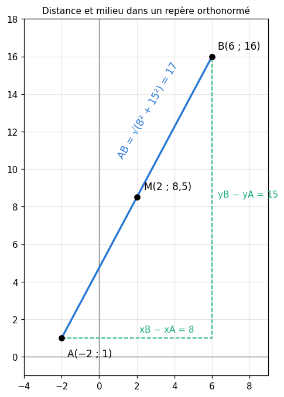
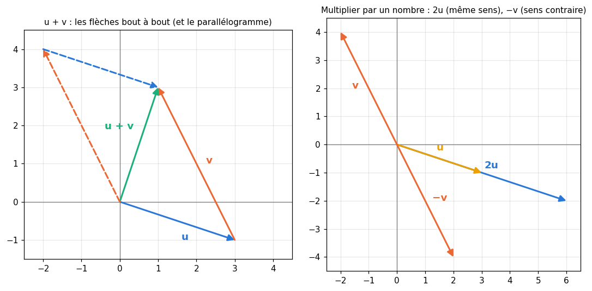
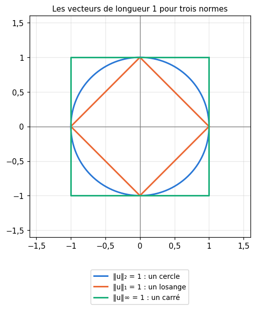
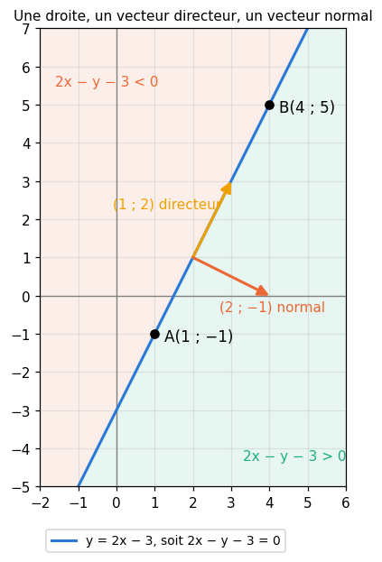
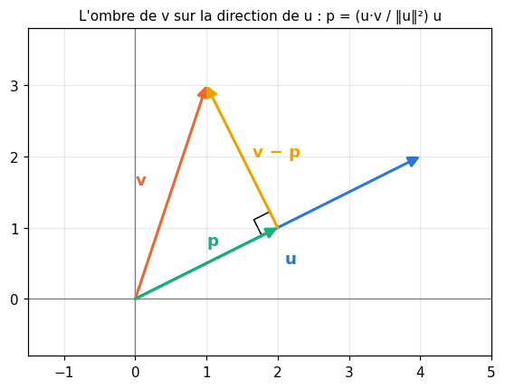
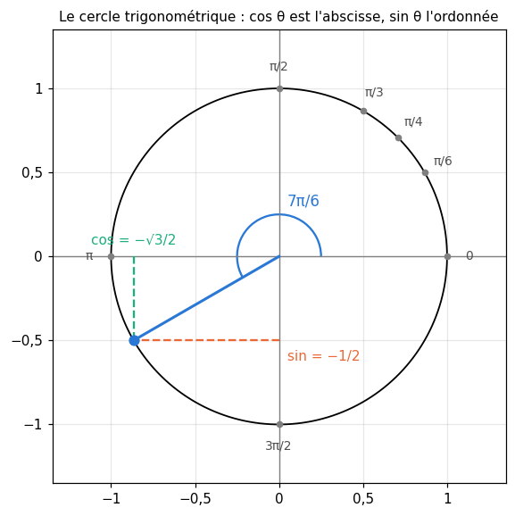
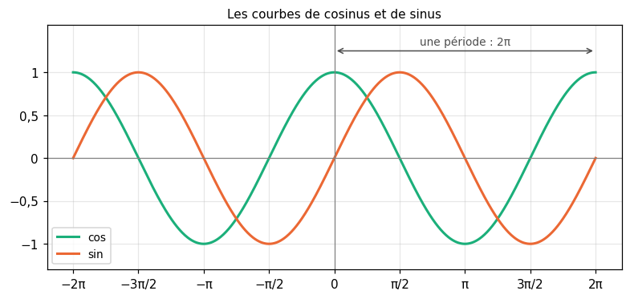
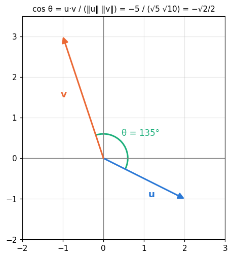
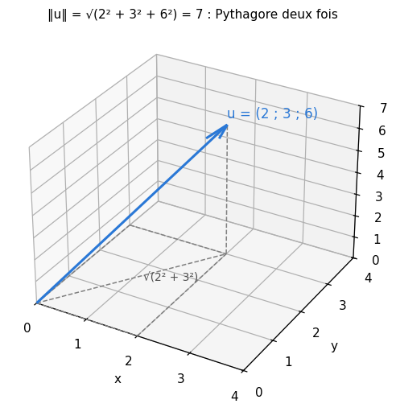

# R9 · Géométrie du plan, vecteurs et trigonométrie — fiche de cours

> La remise à niveau (R0 à R9) n'a pas de livre : **cette fiche est le cours**. En machine learning, un exemple est une liste de nombres, donc un **vecteur** ; comparer deux exemples, c'est mesurer une **distance** ou un **angle** entre deux vecteurs ; et un neurone calcule un **produit scalaire**. Ce chapitre reprend la géométrie du lycée avec des coordonnées : repère, distance, vecteurs, norme, équations de droites, produit scalaire et orthogonalité ; puis le cercle trigonométrique, les radians, le cosinus et le sinus, qui donnent l'angle entre deux vecteurs ; enfin, les mêmes calculs avec trois coordonnées, puis autant qu'on veut. C'est le dernier chapitre de la remise à niveau.

| | |
|---|---|
| **Sections** | §1 à §8 |
| **Temps total estimé** | ≈ 11 h : lecture et calculs de la fiche ≈ 2 h 30, exercices ≈ 7 h 40, flashcards ≈ 50 min (parcours essentiel ≈ 8,8 h) |
| **Prérequis** | R1 (racines carrées) ; R2 (valeur absolue, distance sur une droite, déterminant d'un système) ; R3 (fonctions affines, pente) ; R4 (Σ) ; R7 (dérivation, règle de la chaîne) ; workbookIA 0A : créer des arrays et calcul vectorisé (§100.8.1 et §100.8.3) |
| **Fichiers du chapitre** | `02_exercices.md` (quiz, papier) · `03_notebook.ipynb` · `04_indices.md` · `05_solutions.md` et `05_solutions.ipynb` · `06_mes_reponses.md` · `flashcards.csv` |
| **mymath** | `plane.py` : `vector`, `norm`, `dot`, `angle_between`, `line_through`, `deg_to_rad` |

## Comment utiliser ce chapitre

**Ordre conseillé.**
1. `python tools/start_chapter.py R9` (sur Colab : `00_setup/COLAB.md` §2) : il copie le notebook, ta feuille de réponses et le squelette `mymath/plane.py`.
2. Section par section : lis **crayon en main**, avec du papier quadrillé : place chaque point, dessine chaque vecteur, refais chaque calcul ; puis fais les exercices de la section, quiz 🧠 d'abord.
3. Les exercices ✏️ et 🔗 se font sur papier, dans ta copie de `06_mes_reponses.md`, puis se vérifient dans la **partie 0** du notebook. Les démonstrations ∂ se rédigent dans ta copie et se jugent avec la grille de relecture de `05_solutions.md`.

**Garde les valeurs exactes** ($\sqrt{5}$, $\frac{\sqrt{3}}{2}$, $\frac{3\pi}{4}$) jusqu'au bout, et n'arrondis qu'à la fin, si l'énoncé le demande (R1).

Si le test de positionnement t'a donné « tu peux sauter » pour R9, lis « L'essentiel en 10 lignes » et « Les pièges classiques », fais les quiz et les exercices 🔨 du parcours essentiel (`positionnement/05_grille.md`). Garde quand même le §7 (similarité cosinus) et le §8 (au-delà de trois coordonnées) : le lycée ne les traite pas, et workbookIA s'en sert dès le chapitre 0B.

| Section | Quiz 🧠 | Papier et réflexion | Notebook |
|---|---|---|---|
| §1 Repère, coordonnées, distance | Q1 | R9.1 ✏️ | |
| §2 Vecteurs | Q2 | R9.2 ✏️ | R9.16 🔨, R9.21 🎨 |
| §3 Norme d'un vecteur | Q2, R2 🔁 | R9.3 ✏️ | R9.16 🔨, R9.19 📦 |
| §4 Équations de droites | Q3, R1 🔁 | R9.4 ✏️, R9.14 🔗 | R9.18 🔨 |
| §5 Produit scalaire et orthogonalité | Q4 | R9.5 ✏️, R9.6 ✏️, R9.12 ∂, R9.14 🔗, R9.15 🗣️ | R9.17 🔨, R9.19 📦, R9.24 🛠️ |
| §6 Cercle trigonométrique, radians, cosinus et sinus | Q5, R3 🔁 | R9.7 ✏️, R9.8 ✏️, R9.11 ∂ | R9.18 🔨, R9.22 🔬, R9.23 🐛 |
| §7 Angle entre deux vecteurs et similarité cosinus | Q6 | R9.8 ✏️, R9.9 ✏️, R9.12 ∂, R9.13 🔗 | R9.17 🔨, R9.20 🔮, R9.21 🎨 |
| §8 Vecteurs de l'espace et au-delà | Q7 | R9.10 ✏️ | |

Parcours essentiel : tout sauf R9.Q7, R9.R3, R9.6, R9.11, R9.12, R9.18, R9.22 et R9.24.

## Objectifs d'apprentissage

À la fin du chapitre, tu sais :
- **placer** des points dans un repère, et **calculer** une distance et un milieu ;
- **calculer** avec des vecteurs : coordonnées, somme, produit par un nombre, norme, vecteur unitaire ;
- **écrire** l'équation d'une droite (réduite ou cartésienne) et en lire un vecteur directeur et un vecteur normal ;
- **calculer** un produit scalaire, et **reconnaître** des vecteurs orthogonaux ;
- **passer** des degrés aux radians, et **lire** cosinus et sinus sur le cercle trigonométrique ;
- **calculer** l'angle entre deux vecteurs et leur similarité cosinus ;
- **refaire** ces calculs avec trois coordonnées, puis avec $n$.

## L'essentiel en 10 lignes

1. Dans un **repère orthonormé**, un point est repéré par ses **coordonnées** $(x ; y)$. La **distance** entre $A$ et $B$ vient de Pythagore : $AB = \sqrt{(x_B - x_A)^2 + (y_B - y_A)^2}$ ; le **milieu** de $[AB]$ a pour coordonnées les moyennes de celles de $A$ et $B$.
2. Le **vecteur** $\overrightarrow{AB}$ (un déplacement) a pour coordonnées $(x_B - x_A ; y_B - y_A)$. On **additionne** deux vecteurs et on les **multiplie par un nombre** coordonnée par coordonnée ; $\overrightarrow{AB} + \overrightarrow{BC} = \overrightarrow{AC}$ (Chasles).
3. La **norme** $\lVert \vec{u} \rVert = \sqrt{x^2 + y^2}$ est la longueur du vecteur ; $\lVert k\vec{u} \rVert = \lvert k \rvert\,\lVert \vec{u} \rVert$, et $\frac{\vec{u}}{\lVert \vec{u} \rVert}$ est **unitaire** (de norme 1). La distance $AB$ est la norme de $\overrightarrow{AB}$.
4. Une droite a une **équation réduite** $y = mx + p$ (sauf si elle est verticale, $x = k$) et une **équation cartésienne** $ax + by + c = 0$ ; $(-b ; a)$ est un **vecteur directeur**, $(a ; b)$ un **vecteur normal**.
5. Le **produit scalaire** $\vec{u} \cdot \vec{v} = xx' + yy'$ est un **nombre** ; $\vec{u} \cdot \vec{u} = \lVert \vec{u} \rVert^2$. Deux vecteurs sont **orthogonaux** quand leur produit scalaire est nul.
6. Un tour complet vaut $2\pi$ **radians** : $180° = \pi$ rad. Sur le **cercle trigonométrique** (rayon 1), le point d'angle $\theta$ a pour coordonnées $(\cos\theta ; \sin\theta)$, et $\cos^2\theta + \sin^2\theta = 1$.
7. À connaître : $\cos 0 = 1$, $\cos\frac{\pi}{6} = \frac{\sqrt{3}}{2}$, $\cos\frac{\pi}{4} = \frac{\sqrt{2}}{2}$, $\cos\frac{\pi}{3} = \frac{1}{2}$, $\cos\frac{\pi}{2} = 0$ (et les sinus dans l'ordre inverse) ; cos et sin sont **périodiques** de période $2\pi$ ; $\arccos$ rend un angle de $[0 ; \pi]$.
8. **Angle** entre deux vecteurs non nuls : $\vec{u} \cdot \vec{v} = \lVert \vec{u} \rVert\,\lVert \vec{v} \rVert \cos\theta$, donc $\theta = \arccos \frac{\vec{u} \cdot \vec{v}}{\lVert \vec{u} \rVert\,\lVert \vec{v} \rVert}$ ; le quotient est la **similarité cosinus**, entre $-1$ et $1$.
9. Le signe du produit scalaire donne la nature de l'angle : positif, **aigu** ; nul, **droit** ; négatif, **obtus**.
10. Avec $n$ coordonnées, rien ne change : $\lVert \mathbf{x} \rVert = \sqrt{\sum x_i^2}$, $\mathbf{x} \cdot \mathbf{y} = \sum x_i y_i$, et le même cosinus. En Python : `np.linalg.norm(x)` et `x @ y`.

---

## §1 · Repère, coordonnées, distance

### Un repère et des coordonnées

Un **repère** du plan est formé d'une origine $O$ et de deux axes gradués qui se coupent en $O$ : l'axe des **abscisses** (horizontal) et l'axe des **ordonnées** (vertical). Il est **orthonormé** quand les axes sont perpendiculaires et ont la même unité : c'est toujours le cas dans ce chapitre (sur papier quadrillé, une unité est un même nombre de carreaux sur les deux axes).

Chaque point $M$ du plan a alors deux **coordonnées** (*coordinates*) : son abscisse $x$, lue sur l'axe horizontal, et son ordonnée $y$, lue sur l'axe vertical. On écrit $M(x ; y)$, ou $M = (x, y)$ comme en Python. L'origine est $O(0 ; 0)$. Les axes partagent le plan en quatre **quadrants** : en haut à droite, $x > 0$ et $y > 0$ ; en haut à gauche, $x < 0$ et $y > 0$ ; et ainsi de suite.

📐 En France, on sépare les coordonnées par un point-virgule, $(x ; y)$, pour ne pas les confondre avec la virgule décimale : $(2{,}5 ; 3)$. En Python et dans les livres en anglais, on écrit `(2.5, 3)`.

### La distance entre deux points

Sur une droite graduée, la distance entre $a$ et $b$ est $\lvert b - a \rvert$ (R2). Dans le plan, on se déplace de $x_B - x_A$ horizontalement et de $y_B - y_A$ verticalement : ces deux déplacements sont les côtés de l'angle droit d'un triangle rectangle, dont le segment $[AB]$ est l'hypoténuse. Par le **théorème de Pythagore** :

$$AB = \sqrt{(x_B - x_A)^2 + (y_B - y_A)^2}.$$

Exemple : $A(-2 ; 1)$ et $B(6 ; 16)$. Les écarts valent $6 - (-2) = 8$ et $16 - 1 = 15$, donc $AB = \sqrt{8^2 + 15^2} = \sqrt{64 + 225} = \sqrt{289} = 17$.

Les carrés rendent le signe des écarts sans importance : $AB = BA$. Le résultat est souvent une racine non entière, que l'on garde exacte : entre $C(1 ; 2)$ et $D(4 ; 0)$, $CD = \sqrt{3^2 + (-2)^2} = \sqrt{13} \approx 3{,}61$.

### Le milieu d'un segment

Le **milieu** de $[AB]$ a pour coordonnées les **moyennes** des coordonnées de $A$ et $B$ :

$$M\left(\frac{x_A + x_B}{2} ; \frac{y_A + y_B}{2}\right).$$

Pour l'exemple : $M\left(\frac{-2 + 6}{2} ; \frac{1 + 16}{2}\right) = M(2 ; 8{,}5)$. On peut vérifier que $AM = MB = 8{,}5$, la moitié de 17.



En Python, la formule s'écrit telle quelle ; `math.dist` fait le même calcul (tu l'écriras toi-même en R9.16) :

```python
>>> import math
>>> xa, ya, xb, yb = -2, 1, 6, 16
>>> math.sqrt((xb - xa) ** 2 + (yb - ya) ** 2), math.dist((xa, ya), (xb, yb))
(17.0, 17.0)
>>> ((xa + xb) / 2, (ya + yb) / 2)
(2.0, 8.5)
```

⚠️ **Erreur de calcul classique.** $\sqrt{a^2 + b^2} \ne a + b$ : la racine d'une somme n'est pas la somme des racines. Pour $A$ et $B$, $8 + 15 = 23$, mais $AB = 17$.

🔗 **Dans workbookIA** — une donnée à deux features est un point du plan ; la distance entre deux points dit à quel point deux exemples se ressemblent. Les k plus proches voisins du chapitre 13 classent un exemple d'après les exemples les plus proches de lui.

---

## §2 · Vecteurs

### Un vecteur, c'est un déplacement

Le **vecteur** (*vector*) $\overrightarrow{AB}$ décrit le déplacement qui mène de $A$ à $B$ : une direction, un sens et une longueur. On le dessine par une flèche de $A$ vers $B$. Ses **coordonnées** sont les déplacements horizontal et vertical :

$$\overrightarrow{AB} = (x_B - x_A ; y_B - y_A) \qquad \text{(arrivée moins départ)}.$$

Pour $A(-2 ; 1)$ et $B(6 ; 16)$ : $\overrightarrow{AB} = (8 ; 15)$, et $\overrightarrow{BA} = (-8 ; -15)$, le déplacement inverse.

Un vecteur ne dépend pas de son point de départ : deux flèches parallèles, de même sens et de même longueur représentent le même vecteur, qui a les mêmes coordonnées. On note souvent un vecteur par une lettre, $\vec{u}$ (ou $\mathbf{u}$ en gras, comme dans workbookIA). Le **vecteur nul** $\vec{0} = (0 ; 0)$ ne déplace rien.

Quatre points $A$, $B$, $C$, $D$ forment un **parallélogramme** $ABCD$ (éventuellement aplati, si les quatre points sont alignés) exactement quand $\overrightarrow{AB} = \overrightarrow{DC}$ : les côtés opposés $[AB]$ et $[DC]$ sont alors parallèles et de même longueur.

### Additionner deux vecteurs

Enchaîner deux déplacements, c'est **additionner** leurs vecteurs. On met les flèches bout à bout, et les coordonnées s'additionnent :

$$\vec{u} = (x ; y), \ \vec{v} = (x' ; y') \quad \Longrightarrow \quad \vec{u} + \vec{v} = (x + x' ; y + y').$$

Avec trois points, c'est la **relation de Chasles** : aller de $A$ à $B$, puis de $B$ à $C$, revient à aller de $A$ à $C$, $\overrightarrow{AB} + \overrightarrow{BC} = \overrightarrow{AC}$.

Exemple : $\vec{u} = (3 ; -1)$ et $\vec{v} = (-2 ; 4)$ donnent $\vec{u} + \vec{v} = (1 ; 3)$. Le résultat ne dépend pas de l'ordre ($\vec{u} + \vec{v} = \vec{v} + \vec{u}$) : les deux chemins forment un parallélogramme, dont $\vec{u} + \vec{v}$ est la diagonale.

### Multiplier un vecteur par un nombre

Pour un nombre $k$, le vecteur $k\vec{u} = (kx ; ky)$ a la même direction que $\vec{u}$ ; il a le même sens si $k > 0$, le sens contraire si $k < 0$, et sa longueur est multipliée par $\lvert k \rvert$. Avec $\vec{u} = (3 ; -1)$ : $3\vec{u} = (9 ; -3)$, $-\vec{u} = (-3 ; 1)$ (l'**opposé** de $\vec{u}$), $\frac{1}{2}\vec{u} = (1{,}5 ; -0{,}5)$.

On combine les deux opérations : $\vec{u} - 2\vec{v} = (3 ; -1) - (-4 ; 8) = (7 ; -9)$. Soustraire, c'est ajouter l'opposé.



### Vecteurs colinéaires

Deux vecteurs sont **colinéaires** (*collinear*) quand l'un est un multiple de l'autre : ils ont la même direction. Leurs coordonnées sont alors proportionnelles. Pour $\vec{u} = (x ; y)$ et $\vec{v} = (x' ; y')$, cela se teste par un seul calcul, le **déterminant** de R2 :

$$\vec{u} \text{ et } \vec{v} \text{ colinéaires} \iff xy' - x'y = 0.$$

$(3 ; -1)$ et $(-9 ; 3)$ : $3 \times 3 - (-9) \times (-1) = 9 - 9 = 0$, colinéaires (le second vaut $-3$ fois le premier). $(3 ; -1)$ et $(-2 ; 4)$ : $3 \times 4 - (-2) \times (-1) = 10 \ne 0$, pas colinéaires. Trois points $A$, $B$, $C$ sont **alignés** quand $\overrightarrow{AB}$ et $\overrightarrow{AC}$ sont colinéaires.

### En Python

Un vecteur s'écrit comme un tuple de nombres. Mais l'opérateur `+` de Python, appliqué à deux tuples, les met bout à bout : il ne fait pas la somme des vecteurs. Pour additionner, on parcourt les coordonnées deux à deux avec `zip`, ou l'on convertit en arrays de NumPy (workbookIA 0A, §100.8.3), sur lesquels les opérations se font case par case :

```python
>>> u, v = (3, -1), (-2, 4)
>>> tuple(a + b for a, b in zip(u, v)), u + v
((1, 3), (3, -1, -2, 4))
>>> import numpy as np
>>> (np.array(u) - 2 * np.array(v)).tolist()
[7, -9]
```

🔗 **Dans workbookIA** — chaque pas de la descente de gradient (chapitre 19) remplace le vecteur des poids $\mathbf{w}$ par $\mathbf{w} - \eta\,\mathbf{g}$ : un vecteur moins un multiple d'un autre, calculé coordonnée par coordonnée.

---

## §3 · Norme d'un vecteur

### La longueur d'un vecteur

La **norme** (*norm*) d'un vecteur $\vec{u} = (x ; y)$ est sa longueur, toujours par Pythagore :

$$\lVert \vec{u} \rVert = \sqrt{x^2 + y^2}.$$

La distance entre deux points est la norme du vecteur qui les relie : $AB = \lVert \overrightarrow{AB} \rVert$. Avec les vecteurs du §2 : $\lVert \vec{u} \rVert = \sqrt{3^2 + (-1)^2} = \sqrt{10} \approx 3{,}16$ et $\lVert \vec{v} \rVert = \sqrt{4 + 16} = \sqrt{20} = 2\sqrt{5} \approx 4{,}47$.

Trois propriétés :
- $\lVert \vec{u} \rVert \ge 0$, et $\lVert \vec{u} \rVert = 0$ seulement pour le vecteur nul ;
- $\lVert k\vec{u} \rVert = \lvert k \rvert\,\lVert \vec{u} \rVert$ : $\lVert -2\vec{u} \rVert = 2\sqrt{10}$, jamais $-2\sqrt{10}$ ;
- l'**inégalité triangulaire** $\lVert \vec{u} + \vec{v} \rVert \le \lVert \vec{u} \rVert + \lVert \vec{v} \rVert$ : un côté d'un triangle est plus court que la somme des deux autres. Ici, $\lVert \vec{u} + \vec{v} \rVert = \lVert (1 ; 3) \rVert = \sqrt{10} \approx 3{,}16$, bien moins que $\sqrt{10} + 2\sqrt{5} \approx 7{,}63$. L'égalité n'a lieu que si l'un des deux vecteurs est nul, ou s'ils ont la même direction et le même sens.

⚠️ **La norme d'une somme n'est pas la somme des normes**, sauf pour deux vecteurs de même direction et de même sens.

### Vecteur unitaire

Un vecteur de norme 1 est **unitaire** (*unit vector*). Diviser un vecteur non nul par sa norme le rend unitaire, sans changer ni sa direction ni son sens : c'est le **normaliser**.

$$\frac{\vec{u}}{\lVert \vec{u} \rVert} = \frac{1}{\sqrt{10}}(3 ; -1) = \left(\frac{3}{\sqrt{10}} ; -\frac{1}{\sqrt{10}}\right) \approx (0{,}949 ; -0{,}316).$$

Vérification : $\frac{9}{10} + \frac{1}{10} = 1$. Le vecteur nul, de norme 0, ne se normalise pas.

### D'autres façons de mesurer (aperçu)

La norme $\lVert \vec{u} \rVert$ s'appelle aussi la **norme euclidienne**, ou **norme L2**, notée $\lVert \vec{u} \rVert_2$. Deux autres mesures servent en machine learning :
- la **norme L1**, $\lVert \vec{u} \rVert_1 = \lvert x \rvert + \lvert y \rvert$ : la longueur d'un trajet fait seulement de pas horizontaux et verticaux, comme dans les rues d'un quartier en damier ;
- la **norme L∞**, $\lVert \vec{u} \rVert_\infty = \max(\lvert x \rvert, \lvert y \rvert)$, le plus grand écart sur une seule coordonnée.

Pour $\vec{w} = (-6 ; 2)$ : $\lVert \vec{w} \rVert_2 = \sqrt{40} = 2\sqrt{10} \approx 6{,}32$, $\lVert \vec{w} \rVert_1 = 6 + 2 = 8$ et $\lVert \vec{w} \rVert_\infty = 6$. On a toujours $\lVert \vec{w} \rVert_\infty \le \lVert \vec{w} \rVert_2 \le \lVert \vec{w} \rVert_1$. Dans ce dépôt, $\lVert \vec{w} \rVert$ sans indice désigne toujours la norme euclidienne.



```python
>>> w = (-6, 2)
>>> round(math.sqrt(sum(x * x for x in w)), 4), sum(abs(x) for x in w), max(abs(x) for x in w)
(6.3246, 8, 6)
```

🔗 **Dans workbookIA** — au chapitre 9, la régularisation pénalise la norme L2 (ou L1) du vecteur des poids d'un modèle, pour l'empêcher de prendre des poids trop grands.

---

## §4 · Équations de droites

### L'équation réduite

R3 a montré que la courbe d'une fonction affine $f(x) = mx + p$ est une droite : sa **pente** $m$ dit de combien $y$ change quand $x$ augmente de 1, et son **ordonnée à l'origine** $p$ est l'ordonnée du point d'abscisse 0 (R3 écrivait $c$, R7 écrit $p$ pour une tangente). Une droite non verticale a donc une **équation réduite** $y = mx + p$ : un point $(x ; y)$ est sur la droite exactement quand ses coordonnées vérifient l'équation. Une droite verticale n'est pas la courbe d'une fonction ; son équation est $x = k$.

Par deux points d'abscisses différentes, la pente est le rapport des écarts. Exemple : la droite $(AB)$ avec $A(1 ; -1)$ et $B(4 ; 5)$.

$$m = \frac{y_B - y_A}{x_B - x_A} = \frac{5 - (-1)}{4 - 1} = \frac{6}{3} = 2, \qquad p = y_A - m x_A = -1 - 2 = -3.$$

Donc $(AB) : y = 2x - 3$. Vérification avec $B$ : $2 \times 4 - 3 = 5$.

### Vecteur directeur

Un **vecteur directeur** (*direction vector*) d'une droite est un vecteur non nul qui a sa direction : $\overrightarrow{AB} = (3 ; 6)$ en est un, et tous ses multiples non nuls aussi, comme $(1 ; 2)$. Pour la droite $y = mx + p$, le vecteur $(1 ; m)$ est directeur : un pas de 1 vers la droite fait monter de $m$.

Une droite est donc déterminée par un point et un vecteur directeur : les points de la droite passant par $A$ et dirigée par $\vec{d}$ sont les points $A + t\,\vec{d}$, pour tous les nombres $t$. Avec $A(1 ; -1)$ et $\vec{d} = (1 ; 2)$ : $t = 3$ donne le point $(4 ; 5)$, c'est-à-dire $B$ ; $t = -1$ donne $(0 ; -3)$, le point d'abscisse 0. Cette écriture marche aussi pour les droites verticales, et pour les droites de l'espace (§8).

Deux droites sont **parallèles** quand leurs vecteurs directeurs sont colinéaires (§2), c'est-à-dire, pour deux droites non verticales, quand elles ont la même pente.

### L'équation cartésienne

Toute droite, verticale comprise, a une **équation cartésienne** de la forme

$$ax + by + c = 0, \qquad \text{avec } (a ; b) \ne (0 ; 0).$$

R2 l'écrivait $px + qy = r$. Pour passer de l'équation réduite à une équation cartésienne, on fait tout passer d'un côté : $y = 2x - 3$ devient $2x - y - 3 = 0$. Dans l'autre sens, si $b \ne 0$, on isole $y$ : $3x + 6y - 12 = 0$ donne $y = -0{,}5x + 2$, de pente $-0{,}5$. Si $b = 0$, la droite est verticale : $2x - 8 = 0$ est la droite $x = 4$.

Une droite a une infinité d'équations cartésiennes : on peut multiplier $a$, $b$ et $c$ par un même nombre non nul. $2x - y - 3 = 0$ et $-4x + 2y + 6 = 0$ décrivent la même droite.

Deux vecteurs se lisent directement dans l'équation $ax + by + c = 0$ :
- $(-b ; a)$ est un **vecteur directeur** : pour $2x - y - 3 = 0$, c'est $(1 ; 2)$, comme plus haut ;
- $(a ; b)$ est un **vecteur normal** (*normal vector*), perpendiculaire à la droite : ici $(2 ; -1)$. Le §5 dira pourquoi.

### De quel côté de la droite ?

Une droite partage le plan en deux **demi-plans**. Le signe de $ax + by + c$ dit dans lequel se trouve un point : il est nul sur la droite, positif d'un côté, négatif de l'autre. Pour $2x - y - 3$ : l'origine donne $-3 < 0$, le point $(4 ; 0)$ donne $5 > 0$ ; ils sont de part et d'autre de la droite. Le côté positif est celui vers lequel pointe le vecteur normal $(a ; b)$.



🔗 **Dans workbookIA** — un neurone à deux entrées calcule $z = w_1 x_1 + w_2 x_2 + b$ et répond selon le signe de $z$ : il range chaque point d'un côté de la droite $w_1 x_1 + w_2 x_2 + b = 0$, sa **frontière de décision** (chapitre 10). L'exercice R9.14 fait ce calcul sur un exemple.

---

## §5 · Produit scalaire et orthogonalité

### Définition en coordonnées

Le **produit scalaire** (*dot product*) de $\vec{u} = (x ; y)$ et $\vec{v} = (x' ; y')$ est le **nombre**

$$\vec{u} \cdot \vec{v} = xx' + yy'.$$

On multiplie les coordonnées de même rang, puis on additionne. Avec $\vec{u} = (3 ; -1)$ et $\vec{v} = (-2 ; 4)$ : $\vec{u} \cdot \vec{v} = 3 \times (-2) + (-1) \times 4 = -6 - 4 = -10$. Le résultat n'est pas un vecteur : le mot « scalaire » veut dire « nombre ».

Les règles de calcul se vérifient directement sur les coordonnées :
- **symétrie** : $\vec{u} \cdot \vec{v} = \vec{v} \cdot \vec{u}$ ;
- **linéarité** : $(k\vec{u}) \cdot \vec{v} = k\,(\vec{u} \cdot \vec{v})$ et $\vec{u} \cdot (\vec{v} + \vec{w}) = \vec{u} \cdot \vec{v} + \vec{u} \cdot \vec{w}$ ;
- **lien avec la norme** : $\vec{u} \cdot \vec{u} = x^2 + y^2 = \lVert \vec{u} \rVert^2$, qui n'est jamais négatif. Pour $\vec{u}$ : $\vec{u} \cdot \vec{u} = 9 + 1 = 10 = (\sqrt{10})^2$.

⚠️ Le produit scalaire de deux vecteurs est un **nombre**, et l'on ne « simplifie » pas par un vecteur : $\vec{u} \cdot \vec{v} = \vec{u} \cdot \vec{w}$ n'entraîne pas $\vec{v} = \vec{w}$.

### Orthogonalité

Deux vecteurs sont **orthogonaux** (*orthogonal*) quand leurs directions sont perpendiculaires. Pour le reconnaître sur les coordonnées, fais tourner $\vec{u} = (x ; y)$ d'un quart de tour dans le sens inverse des aiguilles d'une montre : le déplacement « $x$ vers la droite, $y$ vers le haut » devient « $x$ vers le haut, $y$ vers la gauche », soit le vecteur $(-y ; x)$. Les vecteurs perpendiculaires à $\vec{u}$ sont donc les multiples $k(-y ; x)$, et leur produit scalaire avec $\vec{u}$ vaut $k(-xy + yx) = 0$. Réciproquement, pour $\vec{u}$ non nul, si $xx' + yy' = 0$, le déterminant de $(x' ; y')$ et $(-y ; x)$ vaut $x'x - (-y)y' = xx' + yy' = 0$ : $(x' ; y')$ est colinéaire à $(-y ; x)$ (§2), donc perpendiculaire à $\vec{u}$. D'où le critère :

$$\vec{u} \perp \vec{v} \iff \vec{u} \cdot \vec{v} = 0.$$

Exemple : $\vec{u} = (3 ; -1)$ et $\vec{u} + \vec{v} = (1 ; 3)$ : $3 \times 1 + (-1) \times 3 = 0$, orthogonaux. Le quart de tour de $\vec{u}$ est justement $(1 ; 3)$.

Par convention, le vecteur nul est orthogonal à tout vecteur. C'est aussi ce qui explique le vecteur normal du §4 : pour la droite $ax + by + c = 0$, le produit scalaire de $(a ; b)$ avec le vecteur directeur $(-b ; a)$ vaut $-ab + ba = 0$.

### Le signe du produit scalaire

Le produit scalaire mesure à quel point deux vecteurs vont dans le même sens. Le §7 montrera que $\vec{u} \cdot \vec{v} = \lVert \vec{u} \rVert\,\lVert \vec{v} \rVert \cos\theta$, où $\theta$ est l'angle entre eux ; son signe est celui du cosinus :
- $\vec{u} \cdot \vec{v} > 0$ : l'angle est **aigu** (moins de 90°), les vecteurs vont plutôt dans le même sens ;
- $\vec{u} \cdot \vec{v} = 0$ : l'angle est **droit** ;
- $\vec{u} \cdot \vec{v} < 0$ : l'angle est **obtus** (plus de 90°), les vecteurs vont plutôt en sens contraires.

Pour $\vec{u} \cdot \vec{v} = -10$ : un angle obtus, ce que confirme la figure du §7.

### Projeter un vecteur sur une direction

Éclaire $\vec{v}$ par une lumière perpendiculaire à $\vec{u}$ : son ombre sur la direction de $\vec{u}$ est la **projection** de $\vec{v}$ sur cette direction,

$$\vec{p} = \frac{\vec{u} \cdot \vec{v}}{\lVert \vec{u} \rVert^2}\,\vec{u}.$$

C'est le seul multiple de $\vec{u}$ tel que le reste $\vec{v} - \vec{p}$ soit orthogonal à $\vec{u}$ : avec $\vec{p} = k\vec{u}$, la condition $(\vec{v} - k\vec{u}) \cdot \vec{u} = 0$ donne $\vec{u} \cdot \vec{v} - k\,\lVert \vec{u} \rVert^2 = 0$. Sa longueur est $\frac{\lvert \vec{u} \cdot \vec{v} \rvert}{\lVert \vec{u} \rVert}$ ; sans la valeur absolue, $\frac{\vec{u} \cdot \vec{v}}{\lVert \vec{u} \rVert}$ est positif quand $\vec{p}$ a le sens de $\vec{u}$ (un angle aigu), négatif pour un angle obtus, nul pour un angle droit.

Exemple : $\vec{u} = (4 ; 2)$ et $\vec{v} = (1 ; 3)$. $\vec{u} \cdot \vec{v} = 4 + 6 = 10$ et $\lVert \vec{u} \rVert^2 = 20$, donc $\vec{p} = \frac{10}{20}(4 ; 2) = (2 ; 1)$. Le reste $\vec{v} - \vec{p} = (-1 ; 2)$ vérifie bien $(-1) \times 4 + 2 \times 2 = 0$.



🔗 **Dans workbookIA** — le calcul d'un neurone, $z = \mathbf{w} \cdot \mathbf{x} + b$, est un produit scalaire plus un nombre (chapitre 10) ; et le vecteur des poids $\mathbf{w}$ est un vecteur normal de la frontière $\mathbf{w} \cdot \mathbf{x} + b = 0$ du §4.

---

## §6 · Cercle trigonométrique, radians, cosinus et sinus

### Le cercle trigonométrique

Le **cercle trigonométrique** (*unit circle*) est le cercle de centre $O$ et de rayon 1. Partons du point $I(1 ; 0)$ et tournons sur le cercle, dans le sens inverse des aiguilles d'une montre (le sens **direct**, ou positif) : chaque angle $\theta$ désigne un point $M(\theta)$ du cercle. Un angle négatif fait tourner dans l'autre sens, un angle de plus d'un tour fait plusieurs tours.

### Les radians

Les mathématiques mesurent les angles en **radians** (*radians*) : l'angle $\theta$, en radians, est la **longueur de l'arc** parcouru sur le cercle de rayon 1. Le périmètre du cercle vaut $2\pi$, donc un tour complet vaut $2\pi$ radians, et

$$180° = \pi \text{ rad}, \qquad \theta_{\text{rad}} = \theta_{\text{deg}} \times \frac{\pi}{180}, \qquad \theta_{\text{deg}} = \theta_{\text{rad}} \times \frac{180}{\pi}.$$

| degrés | 0 | 30 | 45 | 60 | 90 | 120 | 135 | 180 | 270 | 360 |
|---|---|---|---|---|---|---|---|---|---|---|
| radians | 0 | $\frac{\pi}{6}$ | $\frac{\pi}{4}$ | $\frac{\pi}{3}$ | $\frac{\pi}{2}$ | $\frac{2\pi}{3}$ | $\frac{3\pi}{4}$ | $\pi$ | $\frac{3\pi}{2}$ | $2\pi$ |

Un radian vaut $\frac{180}{\pi} \approx 57{,}3$ degrés. Pourquoi cette unité ? Parce qu'avec elle les formules d'analyse sont simples : la dérivée de $\sin$ est $\cos$ (plus bas) seulement si l'angle est en radians. Toutes les fonctions `math.cos`, `np.sin`… de Python attendent des radians.

### Cosinus et sinus

Le point $M(\theta)$ du cercle trigonométrique a pour coordonnées

$$M(\theta) = (\cos\theta ; \sin\theta) :$$

le **cosinus** (*cosine*) est son abscisse, le **sinus** (*sine*) son ordonnée. Pour un angle aigu, on retrouve les définitions du collège dans le triangle rectangle $OHM$ ($H$ le pied de la perpendiculaire sur l'axe des abscisses) : $\cos\theta = \frac{OH}{OM}$, côté adjacent sur hypoténuse, et $\sin\theta = \frac{HM}{OM}$, côté opposé sur hypoténuse, avec $OM = 1$.

Conséquences immédiates :
- $-1 \le \cos\theta \le 1$ et $-1 \le \sin\theta \le 1$ ;
- $\cos^2\theta + \sin^2\theta = 1$ : $M(\theta)$ est à la distance 1 de $O$ (Pythagore ; R9.11 le rédige). On écrit $\cos^2\theta$ pour $(\cos\theta)^2$.

Les **valeurs remarquables** se retrouvent dans un demi-carré (pour $\frac{\pi}{4}$) et un demi-triangle équilatéral (pour $\frac{\pi}{6}$ et $\frac{\pi}{3}$) :

| $\theta$ | $0$ | $\frac{\pi}{6}$ | $\frac{\pi}{4}$ | $\frac{\pi}{3}$ | $\frac{\pi}{2}$ |
|---|---|---|---|---|---|
| $\cos\theta$ | $1$ | $\frac{\sqrt{3}}{2}$ | $\frac{\sqrt{2}}{2}$ | $\frac{1}{2}$ | $0$ |
| $\sin\theta$ | $0$ | $\frac{1}{2}$ | $\frac{\sqrt{2}}{2}$ | $\frac{\sqrt{3}}{2}$ | $1$ |

Moyen mnémotechnique : les sinus valent $\frac{\sqrt{0}}{2}, \frac{\sqrt{1}}{2}, \frac{\sqrt{2}}{2}, \frac{\sqrt{3}}{2}, \frac{\sqrt{4}}{2}$, et les cosinus la même liste à l'envers. Les valeurs approchées à retenir : $\frac{\sqrt{2}}{2} \approx 0{,}707$ et $\frac{\sqrt{3}}{2} \approx 0{,}866$.

### Les symétries du cercle

Les autres angles se ramènent à ceux du tableau par symétrie :
- **angle opposé** (symétrie par rapport à l'axe des abscisses) : $\cos(-\theta) = \cos\theta$ et $\sin(-\theta) = -\sin\theta$ ;
- **angle supplémentaire** (symétrie par rapport à l'axe des ordonnées) : $\cos(\pi - \theta) = -\cos\theta$ et $\sin(\pi - \theta) = \sin\theta$ ;
- **demi-tour** (symétrie par rapport à $O$) : $\cos(\theta + \pi) = -\cos\theta$ et $\sin(\theta + \pi) = -\sin\theta$.

Exemples : $\frac{7\pi}{6} = \pi + \frac{\pi}{6}$, donc $\cos\frac{7\pi}{6} = -\frac{\sqrt{3}}{2}$ et $\sin\frac{7\pi}{6} = -\frac{1}{2}$. Et $\cos\left(-\frac{\pi}{4}\right) = \frac{\sqrt{2}}{2}$, $\sin\left(-\frac{\pi}{4}\right) = -\frac{\sqrt{2}}{2}$. Dessine toujours le point sur le cercle : le signe se lit sur la figure (à gauche de l'axe vertical, le cosinus est négatif ; sous l'axe horizontal, le sinus l'est).



### Périodicité et courbes

Ajouter un tour complet ramène au même point : $\cos(\theta + 2\pi) = \cos\theta$ et $\sin(\theta + 2\pi) = \sin\theta$. Les fonctions $\cos$ et $\sin$ sont **périodiques**, de période $2\pi$ : leurs courbes se répètent tous les $2\pi$. La courbe de $\cos$ est symétrique par rapport à l'axe des ordonnées (on dit que $\cos$ est **paire**), celle de $\sin$ par rapport à l'origine ($\sin$ est **impaire**). Le cosinus s'annule en $\frac{\pi}{2} + k\pi$, le sinus en $k\pi$, pour tout entier $k$.

Plus généralement, $t \mapsto \cos(\omega t)$ a pour période $\frac{2\pi}{\omega}$ (pour $\omega > 0$) : multiplier l'angle par $\omega$ fait tourner $\omega$ fois plus vite. $\cos(4t)$ fait un tour complet quand $t$ avance de $\frac{\pi}{2}$.



### Retrouver un angle : arccos

Connaissant le cosinus, peut-on retrouver l'angle ? Pas sans précaution : $\frac{\pi}{3}$, $-\frac{\pi}{3}$ et $\frac{\pi}{3} + 2\pi$ ont le même cosinus. Mais sur l'intervalle $[0 ; \pi]$, chaque valeur entre $-1$ et $1$ est le cosinus d'**un seul** angle (le cosinus y décroît de 1 à $-1$). On appelle **arccosinus** (*arccosine*) la fonction réciproque (R3) : pour $-1 \le c \le 1$, $\arccos c$ est l'unique angle de $[0 ; \pi]$ dont le cosinus vaut $c$. Ainsi $\arccos\frac{1}{2} = \frac{\pi}{3}$, $\arccos 0 = \frac{\pi}{2}$ et $\arccos\left(-\frac{\sqrt{2}}{2}\right) = \frac{3\pi}{4}$.

⚠️ $\arccos(\cos\theta)$ ne redonne $\theta$ que si $\theta$ est dans $[0 ; \pi]$ : sinon, on obtient l'angle de $[0 ; \pi]$ qui a le même cosinus.

### Dérivées (aperçu)

Quand l'angle est en radians, $\sin' = \cos$ et $\cos' = -\sin$. Avec la règle de la chaîne (R7) : la dérivée de $\sin(\omega t)$ est $\omega\cos(\omega t)$. Au voisinage de 0, la tangente à la courbe de $\sin$ est la droite $y = x$ : $\sin x \approx x$ pour $x$ petit, en radians. Avec des degrés, il faudrait un facteur $\frac{\pi}{180}$ partout.

### En Python : des radians, toujours

```python
>>> math.cos(30), math.cos(math.radians(30))
(0.15425144988758405, 0.8660254037844387)
>>> round(math.degrees(math.acos(-math.sqrt(2) / 2)), 6)
135.0
```

`math.cos(30)` calcule le cosinus de 30 **radians** (presque cinq tours), pas de 30°. On convertit avec `math.radians` (ou `np.radians` pour un array), et l'on revient aux degrés avec `math.degrees`. `math.acos` rend un angle en radians, dans $[0 ; \pi]$.

🔗 **Dans workbookIA** — les sinus et cosinus de fréquences différentes donnent à chaque position d'une phrase un code numérique dans les transformers (chapitre bonus B3) ; et le chapitre 19 fait décroître le learning rate en suivant une courbe en cosinus.

---

## §7 · Angle entre deux vecteurs et similarité cosinus

### Le produit scalaire et l'angle

L'**angle** $\theta$ entre deux vecteurs non nuls est l'angle entre leurs flèches, posées à partir d'un même point ; on le prend entre 0 et $\pi$ (entre 0° et 180°). Le produit scalaire le contient :

$$\vec{u} \cdot \vec{v} = \lVert \vec{u} \rVert\,\lVert \vec{v} \rVert \cos\theta.$$

**Pourquoi.** Choisissons les axes pour que $\vec{u}$ soit sur l'axe des abscisses, dans le sens positif : $\vec{u} = (\lVert \vec{u} \rVert ; 0)$. Le vecteur $\vec{v}$ fait l'angle $\theta$ avec cet axe, donc $\vec{v} = \lVert \vec{v} \rVert\,(\cos\theta ; \sin\theta)$ s'il est au-dessus de l'axe, ou $\lVert \vec{v} \rVert\,(\cos\theta ; -\sin\theta)$ s'il est en dessous (§6, sur un cercle de rayon $\lVert \vec{v} \rVert$ au lieu de 1). Dans les deux cas, $\vec{u} \cdot \vec{v} = \lVert \vec{u} \rVert\,\lVert \vec{v} \rVert\cos\theta + 0$. On admet ici que faire tourner les deux vecteurs du même angle ne change pas leur produit scalaire, ce qui permet de choisir ainsi les axes.

On en tire l'angle :

$$\cos\theta = \frac{\vec{u} \cdot \vec{v}}{\lVert \vec{u} \rVert\,\lVert \vec{v} \rVert}, \qquad \theta = \arccos\frac{\vec{u} \cdot \vec{v}}{\lVert \vec{u} \rVert\,\lVert \vec{v} \rVert}.$$

Exemple : $\vec{u} = (3 ; -1)$ et $\vec{v} = (-2 ; 4)$. $\vec{u} \cdot \vec{v} = -10$, $\lVert \vec{u} \rVert = \sqrt{10}$, $\lVert \vec{v} \rVert = \sqrt{20}$, donc

$$\cos\theta = \frac{-10}{\sqrt{10}\sqrt{20}} = \frac{-10}{\sqrt{200}} = \frac{-10}{10\sqrt{2}} = -\frac{1}{\sqrt{2}} = -\frac{\sqrt{2}}{2}, \qquad \theta = \frac{3\pi}{4} = 135°.$$



### La similarité cosinus

Le nombre $\cos\theta = \frac{\vec{u} \cdot \vec{v}}{\lVert \vec{u} \rVert\,\lVert \vec{v} \rVert}$ s'appelle la **similarité cosinus** (*cosine similarity*) de $\vec{u}$ et $\vec{v}$. Elle compare les **directions** des deux vecteurs :
- elle vaut 1 quand ils ont la même direction et le même sens ;
- 0 quand ils sont orthogonaux ;
- $-1$ quand ils ont la même direction et des sens contraires.

Et puisque $\lvert \cos\theta \rvert \le 1$, la formule du produit scalaire donne aussitôt une majoration utile, l'**inégalité de Cauchy-Schwarz** : le produit scalaire de deux vecteurs ne dépasse jamais, en valeur absolue, le produit de leurs normes, $\lvert \vec{u} \cdot \vec{v} \rvert \le \lVert \vec{u} \rVert\,\lVert \vec{v} \rVert$.

### La formule d'Al-Kashi

Dans un triangle quelconque $ABC$, avec $a = BC$, $b = CA$, $c = AB$ et $\hat{C}$ l'angle en $C$,

$$c^2 = a^2 + b^2 - 2ab\cos\hat{C}.$$

C'est Pythagore corrigé d'un terme qui dépend de l'angle : pour $\hat{C} = 90°$, $\cos\hat{C} = 0$ et l'on retrouve $c^2 = a^2 + b^2$. Elle donne un côté à partir des deux autres et de l'angle qu'ils forment, ou un angle à partir des trois côtés. R9.12 la démontre avec la hauteur du triangle.

### En Python

```python
>>> u, v = (3, -1), (-2, 4)
>>> dot = sum(a * b for a, b in zip(u, v))
>>> norm_u, norm_v = math.sqrt(sum(a * a for a in u)), math.sqrt(sum(b * b for b in v))
>>> cos = dot / (norm_u * norm_v)
>>> dot, round(cos, 4), round(math.degrees(math.acos(cos)), 6)
(-10, -0.7071, 135.0)
```

⚠️ Avec des flottants, le quotient peut sortir très légèrement de $[-1 ; 1]$ pour deux vecteurs colinéaires, à cause des arrondis des racines carrées, et `math.acos` lève alors une erreur. Ta fonction `angle_between` (R9.17) ramènera le quotient dans $[-1 ; 1]$ avant d'appeler `math.acos`.

🔗 **Dans workbookIA** — la similarité cosinus compare des **embeddings**, les vecteurs qui représentent des mots ou des textes (chapitres bonus B1, B2 et B4) : deux textes proches par le sens ont des vecteurs de directions proches.

---

## §8 · Vecteurs de l'espace et au-delà

### Trois coordonnées

Dans l'espace, un repère orthonormé a trois axes perpendiculaires deux à deux, et un point a trois coordonnées $(x ; y ; z)$. Tout ce qui précède se prolonge en ajoutant une coordonnée : le vecteur $\overrightarrow{AB}$ a trois coordonnées (arrivée moins départ), on additionne et l'on multiplie coordonnée par coordonnée, et

$$\lVert \vec{u} \rVert = \sqrt{x^2 + y^2 + z^2}, \qquad \vec{u} \cdot \vec{v} = xx' + yy' + zz'.$$

La norme vient de Pythagore appliqué deux fois : la diagonale de la base de la boîte mesure $\sqrt{x^2 + y^2}$, puis la diagonale de la boîte $\sqrt{(x^2 + y^2) + z^2}$. Exemple : $\vec{u} = (2 ; 3 ; 6)$ a pour norme $\sqrt{4 + 9 + 36} = \sqrt{49} = 7$.



L'angle se calcule avec la même formule, et deux vecteurs de produit scalaire nul sont orthogonaux : $\vec{v} = (3 ; -2 ; 0)$ vérifie $\vec{u} \cdot \vec{v} = 6 - 6 + 0 = 0$.

Une différence : dans l'espace, une équation $ax + by + cz + d = 0$ (avec $a$, $b$, $c$ non tous nuls) décrit un **plan**, pas une droite. Une droite de l'espace se décrit par un point et un vecteur directeur, $A + t\,\vec{d}$ (§4).

### $n$ coordonnées

Rien n'oblige à s'arrêter à trois. Une liste ordonnée de $n$ nombres, $\mathbf{x} = (x_1, x_2, \dots, x_n)$, est un vecteur de **dimension** $n$ ; on dit que $\mathbf{x}$ appartient à $\mathbb{R}^n$. On ne le dessine plus, mais on calcule exactement de la même façon, avec les sommes Σ de R4 :

$$\lVert \mathbf{x} \rVert = \sqrt{\sum_{i=1}^{n} x_i^2}, \qquad \mathbf{x} \cdot \mathbf{y} = \sum_{i=1}^{n} x_i y_i, \qquad d(\mathbf{x}, \mathbf{y}) = \lVert \mathbf{x} - \mathbf{y} \rVert, \qquad \cos\theta = \frac{\mathbf{x} \cdot \mathbf{y}}{\lVert \mathbf{x} \rVert\,\lVert \mathbf{y} \rVert}.$$

Exemple dans $\mathbb{R}^4$ : $\mathbf{x} = (1, 0, 2, -1)$ et $\mathbf{y} = (3, 1, 0, 1)$. $\mathbf{x} \cdot \mathbf{y} = 3 + 0 + 0 - 1 = 2$ ; $\mathbf{x} - \mathbf{y} = (-2, -1, 2, -2)$, donc $d(\mathbf{x}, \mathbf{y}) = \sqrt{4 + 1 + 4 + 4} = \sqrt{13} \approx 3{,}61$ ; $\lVert \mathbf{x} \rVert = \sqrt{6}$ et $\lVert \mathbf{y} \rVert = \sqrt{11}$, d'où $\cos\theta = \frac{2}{\sqrt{66}} \approx 0{,}246$, un angle d'environ 76°. Les normes L1 et L∞ du §3 se prolongent de même : $\lVert \mathbf{x} \rVert_1 = \sum \lvert x_i \rvert$ et $\lVert \mathbf{x} \rVert_\infty = \max_i \lvert x_i \rvert$.

Pourquoi ces formules gardent-elles un sens géométrique, alors qu'on ne voit plus rien ? Parce qu'elles vérifient les mêmes propriétés qu'en dimension 2 ou 3 (inégalité triangulaire, Cauchy-Schwarz…) : on raisonne sur $\mathbb{R}^n$ comme sur le plan, en se méfiant seulement des intuitions visuelles.

### En Python : NumPy

Pour des vecteurs de grande dimension, on utilise des arrays de NumPy (workbookIA 0A, §100.8.1 et §100.8.3) : l'opérateur `@` calcule le produit scalaire, et `np.linalg.norm` la norme (L2 par défaut ; `ord=1` et `ord=np.inf` pour les deux autres) :

```python
>>> x, y = np.array([1, 0, 2, -1]), np.array([3, 1, 0, 1])
>>> int(x @ y), round(float(np.linalg.norm(x - y)), 4)
(2, 3.6056)
>>> round(float(x @ y / (np.linalg.norm(x) * np.linalg.norm(y))), 4)
0.2462
>>> float(np.linalg.norm(x, ord=1)), float(np.linalg.norm(x, ord=np.inf))
(4.0, 2.0)
```

Tu écriras tes propres versions, en Python pur, dans `mymath/plane.py` (R9.16 et R9.17), puis tu les compareras à NumPy (R9.19).

🔗 **Dans workbookIA** — dès le chapitre 0B, un exemple d'un dataset est un vecteur de $\mathbb{R}^p$ (une coordonnée par feature : un exemple décrit par 12 features est un vecteur de $\mathbb{R}^{12}$), et tout le dataset une **matrice**.

---

## Les pièges classiques ⚠️ (récapitulatif)

| Piège | Faux | Juste |
|---|---|---|
| distance | $AB = (x_B - x_A) + (y_B - y_A)$, ou $\sqrt{a^2 + b^2} = a + b$ | $AB = \sqrt{(x_B - x_A)^2 + (y_B - y_A)^2}$ |
| coordonnées d'un vecteur | $\overrightarrow{AB} = A - B$ | arrivée moins départ : $B - A$ |
| somme en Python | `(3, -1) + (-2, 4)` additionne | elle met les tuples bout à bout : additionner coordonnée par coordonnée, ou NumPy |
| norme d'un multiple | $\lVert -2\vec{u} \rVert = -2\lVert \vec{u} \rVert$ | $\lvert -2 \rvert\,\lVert \vec{u} \rVert = 2\lVert \vec{u} \rVert$ |
| norme d'une somme | $\lVert \vec{u} + \vec{v} \rVert = \lVert \vec{u} \rVert + \lVert \vec{v} \rVert$ | $\le$ (inégalité triangulaire) |
| vecteur directeur | $(a ; b)$ dirige la droite $ax + by + c = 0$ | $(-b ; a)$ la dirige ; $(a ; b)$ lui est normal |
| droite verticale | $x = 4$ a une pente infinie, ou pas d'équation | pas d'équation réduite, mais une équation cartésienne $x - 4 = 0$ |
| produit scalaire | un vecteur, $(xx' ; yy')$ | un nombre, $xx' + yy'$ |
| orthogonalité | $\vec{u} \cdot \vec{v} = 0$ donc $\vec{u}$ ou $\vec{v}$ est nul | ils peuvent être orthogonaux, non nuls |
| radians | `math.cos(30)` pour cos 30° | `math.cos(math.radians(30))` |
| conversion | $\theta_{\text{rad}} = \theta_{\text{deg}} \times \frac{180}{\pi}$ | $\times \frac{\pi}{180}$ (180° doit donner π) |
| valeurs remarquables | $\cos\frac{\pi}{3} = \frac{\sqrt{3}}{2}$ | $\frac{1}{2}$ ; c'est $\sin\frac{\pi}{3}$ qui vaut $\frac{\sqrt{3}}{2}$ |
| signe | $\sin\frac{7\pi}{6} = \frac{1}{2}$ | dessine le point : sous l'axe horizontal, le sinus est négatif |
| arccos | $\arccos(\cos\theta) = \theta$ toujours | seulement pour $\theta \in [0 ; \pi]$ |
| angle de deux vecteurs | oublier de diviser par les normes | $\cos\theta = \frac{\vec{u} \cdot \vec{v}}{\lVert \vec{u} \rVert\,\lVert \vec{v} \rVert}$ |
| flottants | `math.acos(1.0000000000000002)` | ramener le quotient dans $[-1 ; 1]$ avant `math.acos` |

## Et maintenant

**Dans ce dépôt** : la remise à niveau est finie. L'examen blanc **CP0** fait le bilan de R1 à R9, avant d'ouvrir le chapitre 0B de workbookIA. Les vecteurs reviendront en M07 (la géométrie de $\mathbb{R}^n$ : normes, distances, hyperplans, grande dimension), puis avec les matrices en M09a et M12a à M12d ; les sinus et cosinus en MB3.

**Dans workbookIA** : termine le chapitre 0A au rythme de ton tableau de bord (ses §100.8.1 et §100.8.3, les arrays et le calcul vectorisé, servent au §8 et à R9.19). Le chapitre 0B reprendra les vecteurs dans $\mathbb{R}^n$, la norme, le produit scalaire et la similarité cosinus, et les prolongera par les matrices ; le chapitre 10 s'en servira pour le neurone et sa frontière de décision.

## Pour aller plus loin

- Maths et tiques (Yvan Monka), cours et vidéos gratuits sur les vecteurs, le produit scalaire, les équations de droites et la trigonométrie : [maths-et-tiques.fr](https://www.maths-et-tiques.fr).
- Exo7 (Université de Lille), cours de géométrie et de trigonométrie, niveau première année d'université (`annexes/ressources.md`).
- `annexes/symboles.md` (lire $\overrightarrow{AB}$, $\lVert \vec{u} \rVert$, $\vec{u} \cdot \vec{v}$, $\perp$, $\cos$, $\arccos$, $\mathbb{R}^n$ à voix haute), `annexes/formulaire.md` et `annexes/erreurs_frequentes.md`.
