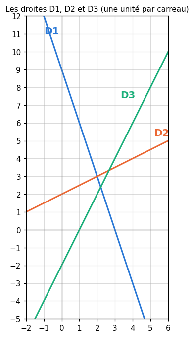

# CP0 · Examen blanc de la remise à niveau (R1 à R9)

| | |
|---|---|
| **Durée** | 122 minutes (environ 2 heures), d'une traite |
| **Note** | sur 20 points |
| **Chapitres** | R1 à R9 : nombres, calcul littéral, fonctions, logique et Σ, suites, exponentielle et logarithme, dérivation, probabilités, vecteurs et trigonométrie |
| **Ta copie** | `04_mes_reponses.md` (ta copie, dans `mon_travail/checkpoints/partie_0/`), ou une feuille de papier |
| **Après** | le notebook `02_examen_notebook.ipynb` vérifie tes réponses chiffrées ; `03_examen_corrige.md` donne le corrigé détaillé, le barème et la remédiation |

## Règles

- **Fiches, notes, flashcards, annexes et corrigés fermés.** Pas d'assistant IA, pas de recherche sur le web.
- **Calculatrice autorisée**, ou Python comme simple calculatrice (`+`, `*`, `**`, `math.sqrt`, `math.log`, `math.exp`, `math.acos`) ; ni SymPy, ni `mymath`, ni les notebooks des chapitres.
- Donne les valeurs **exactes** quand la question le demande (une fraction irréductible, une valeur avec `ln` ou une racine), et sinon le nombre de décimales demandé. **N'arrondis qu'à la fin** du calcul.
- Écris ta démarche : la moitié des points d'une question de calcul vont à la méthode. Quand une question dit « justifie », une réponse sans justification ne rapporte qu'une partie des points.
- Les durées sont indicatives : commence par ce que tu sais faire ; si tu bloques, passe à la question suivante et reviens-y à la fin.

| Question | Type | Sujet | Points | ⏱️ |
|---|---|---|---|---|
| CP0.Q1 | 🧠 | Dix affirmations sur toute la remise à niveau : vrai ou faux | 2,5 | 10 min |
| CP0.1 | ✏️ | Fractions, puissances et notation scientifique | 1,25 | 8 min |
| CP0.2 | ✏️ | Développer, factoriser, résoudre | 1,25 | 8 min |
| CP0.3 | ✏️ | Un système 2 × 2 et sa lecture graphique | 1,5 | 10 min |
| CP0.4 | ✏️ | Second degré : racines et sommet | 1,5 | 10 min |
| CP0.5 | ✏️ | Exponentielle et logarithme | 1,25 | 8 min |
| CP0.6 | ✏️ | Dériver et étudier les variations | 2 | 12 min |
| CP0.7 | ✏️ | Un arbre de probabilités et une espérance | 1,5 | 10 min |
| CP0.8 | ✏️ | Vecteurs, produit scalaire, angle | 1,25 | 8 min |
| CP0.9 | ∂ | Une démonstration courte par récurrence | 1,5 | 10 min |
| CP0.10 | 🐛 | Corriger une copie : cinq erreurs | 1,25 | 8 min |
| CP0.11 | ✏️ | Une somme écrite avec Σ et une somme géométrique | 1,25 | 8 min |
| CP0.12 | 🔗 | Problème de synthèse : étudier une fonction de coût donnée par une formule | 2 | 12 min |
| | | **Total** | **20** | **122 min** |

Le barème de chaque sous-question est entre crochets. Sauf mention contraire, une sous-question vaut 0,25 point.

---

### CP0.Q1 — Dix affirmations sur toute la remise à niveau : vrai ou faux 🧠 ★ ⏱️ 10 min · 2,5 points

Pour chaque affirmation, réponds **Vrai** ou **Faux**, puis justifie en une phrase : une règle, un calcul ou un contre-exemple. Chaque affirmation vaut 0,25 point : 0,1 pour le verdict, 0,15 pour la justification.

a) $(2^3)^2 = 2^5$.
b) Pour tout réel $x$, $\sqrt{x^2} = x$.
c) Une fonction strictement croissante sur $\mathbb{R}$ ne prend jamais deux fois la même valeur.
d) La contraposée de « s'il pleut, alors le sol est mouillé » est « si le sol est mouillé, alors il pleut ».
e) La suite géométrique de premier terme 2 et de raison 0,9 tend vers 0.
f) $e^{2\ln 5} = 25$.
g) Une fonction continue en $a$ est dérivable en $a$.
h) Deux événements incompatibles, de probabilités non nulles, sont indépendants.
i) Deux vecteurs non nuls dont le produit scalaire est négatif font un angle obtus.
j) Pour toute variable aléatoire $X$, $\mathbb{V}(X + 3) = \mathbb{V}(X) + 3$.

### CP0.1 — Fractions, puissances et notation scientifique ✏️ ★ ⏱️ 8 min · 1,25 point

Sans calculatrice pour a) et b).

| | Question | Réponse attendue |
|---|---|---|
| a | $\dfrac{7}{4} - \dfrac{5}{6} \div \dfrac{4}{9}$ | une fraction irréductible |
| b | $\dfrac{5^{4} \times 25^{-3}}{5^{-1}}$ | une fraction irréductible |
| c | $(4 \times 10^{-5}) \times (7 \times 10^{8})$, en notation scientifique $a \times 10^{n}$ | la liste $[a, n]$ |
| d | $\dfrac{9 \times 10^{-4}}{1{,}5 \times 10^{-7}}$, en notation scientifique $a \times 10^{n}$ | la liste $[a, n]$ |
| e | un prix augmente de 20 %, puis baisse de 25 % : son évolution totale, en pourcentage (négative pour une baisse) | un nombre |

### CP0.2 — Développer, factoriser, résoudre ✏️ ★ ⏱️ 8 min · 1,25 point

| | Question | Réponse attendue |
|---|---|---|
| a | développe et réduis $(3x - 2)(3x + 2) - (x - 1)^2$ | une expression en $x$, développée |
| b | les solutions de $x^2 = 7x$ | une liste, dans l'ordre croissant |
| c | résous $4 - 3(2x - 1) = 2(x + 5)$ | une fraction irréductible |
| d | résous $5 - 2x > 11$ | un intervalle |
| e | résous $\lvert x - 3 \rvert \le 4$ | un intervalle |

### CP0.3 — Un système 2 × 2 et sa lecture graphique ✏️ ★★ ⏱️ 10 min · 1,5 point

La figure montre trois droites : $D_1$ d'équation $3x + y = 9$, $D_2$ d'équation $x - 2y = -4$, et une droite $D_3$ dont l'équation n'est pas donnée.

| | Question | Réponse attendue |
|---|---|---|
| a | la solution du système formé par les équations de $D_1$ et $D_2$ | la liste $[x, y]$ |
| b | le déterminant de ce système, $\begin{vmatrix} 3 & 1 \\ 1 & -2 \end{vmatrix}$ | un nombre |
| c | la pente de $D_2$ | une fraction irréductible |
| d | l'équation réduite $y = mx + p$ de $D_3$, lue sur la figure | la liste $[m, p]$ |
| e | le point d'intersection de $D_1$ et $D_3$, **par le calcul** (la figure sert à vérifier) | la liste $[x, y]$ (1 décimale) |
| f | le nombre de solutions du système $\begin{cases} 3x + y = 9 \\ 6x + 2y = 18 \end{cases}$ : 1. aucune ; 2. une seule ; 3. une infinité | le numéro 1, 2 ou 3 |

### CP0.4 — Second degré : racines et sommet ✏️ ★★ ⏱️ 10 min · 1,5 point

On pose $f(x) = -2x^2 + 8x - 6$, définie sur $\mathbb{R}$.

| | Question | Réponse attendue |
|---|---|---|
| a | le discriminant de $f$ | un nombre |
| b | les racines de $f$ | une liste, dans l'ordre croissant |
| c | les coordonnées du sommet de la parabole | la liste $[x, y]$ |
| d | l'ensemble des $x$ tels que $f(x) > 0$ | un intervalle |
| e | le nombre de solutions de l'équation $f(x) = 3$ | un nombre |
| f | la plus grande valeur de $f$ sur l'intervalle $[-1 ; 0]$ | un nombre |

### CP0.5 — Exponentielle et logarithme ✏️ ★ ⏱️ 8 min · 1,25 point

| | Question | Réponse attendue |
|---|---|---|
| a | $\ln\left(e^{4}\right) + e^{\ln 3} - \ln 1$ | un nombre |
| b | la solution de $e^{3x - 2} = 4$ | une valeur exacte, avec `ln` |
| c | la solution de $\ln(2x - 1) = 3$ | un nombre (2 décimales) |
| d | $\log_{10}(1\,000) + \log_2\left(\frac{1}{8}\right)$ | un nombre |
| e | $\sigma(\ln 4)$, où $\sigma(z) = \dfrac{1}{1 + e^{-z}}$ est la sigmoïde | une fraction irréductible |

### CP0.6 — Dériver et étudier les variations ✏️ ★★ ⏱️ 12 min · 2 points

On pose $f(x) = x^3 - 12x + 5$, définie sur $\mathbb{R}$.

| | Question | Réponse attendue |
|---|---|---|
| a | $f'(x)$ | une expression en $x$ |
| b | les nombres où $f'$ s'annule | une liste, dans l'ordre croissant |
| c | la valeur du maximum local de $f$, puis celle de son minimum local | la liste [maximum, minimum] |
| d | le plus grand intervalle sur lequel $f$ est décroissante | un intervalle |
| e | l'équation de la tangente à la courbe de $f$ au point d'abscisse 1, sous la forme $y = mx + p$ | la liste $[m, p]$ |
| f | la dérivée de $g(x) = (3x - 1)\,e^{2x}$ | une expression en $x$ |
| g | la dérivée de $h(x) = \sqrt{2x + 5}$, pour $x > -\frac{5}{2}$ | une expression en $x$ |
| h | la limite de $x^2 e^{-x}$ quand $x$ tend vers $+\infty$ | un nombre, ou `"+oo"` |

### CP0.7 — Un arbre de probabilités et une espérance ✏️ ★★ ⏱️ 10 min · 1,5 point

Un atelier fabrique des pièces sur deux machines : la machine $A$ produit 60 % des pièces, la machine $B$ le reste. 5 % des pièces de $A$ sont défectueuses, et 10 % de celles de $B$. On prend une pièce au hasard ; $D$ est l'événement « la pièce est défectueuse ».

| | Question | Réponse attendue |
|---|---|---|
| a | $P(D)$ (dessine l'arbre) | un nombre (2 décimales) |
| b | $P(B \cap D)$ | un nombre (2 décimales) |
| c | on prend deux pièces, de façon indépendante : la probabilité qu'**au moins une** des deux soit défectueuse | un nombre (4 décimales) |

L'atelier gagne 3 € sur une pièce bonne et perd 5 € sur une pièce défectueuse. On note $X$ son gain sur une pièce prise au hasard (en euros : 3 ou $-5$).

| | Question | Réponse attendue |
|---|---|---|
| d | $\mathbb{E}[X]$ | un nombre (2 décimales) |
| e | $\mathbb{V}(X)$ | un nombre (2 décimales) |
| f | $\mathbb{E}[2X - 1]$ | un nombre (2 décimales) |

### CP0.8 — Vecteurs, produit scalaire, angle ✏️ ★ ⏱️ 8 min · 1,25 point

On donne les points $A(-3 ; 1)$, $B(3 ; -3)$ et $C(0 ; 3)$.

| | Question | Réponse attendue |
|---|---|---|
| a | les coordonnées de $\overrightarrow{AB}$ | une liste |
| b | la distance $AB$ | un nombre (2 décimales) |
| c | $\overrightarrow{AB} \cdot \overrightarrow{AC}$ | un nombre |
| d | le cosinus de l'angle $\widehat{BAC}$, entre $\overrightarrow{AB}$ et $\overrightarrow{AC}$ | une fraction irréductible |
| e | l'angle $\widehat{BAC}$, en degrés | un nombre (1 décimale) |

### CP0.9 — Une démonstration courte par récurrence ∂ ★★ ⏱️ 10 min · 1,5 point

La suite $(u_n)$ est définie par $u_0 = 1$ et $u_{n+1} = 2u_n + 5$ pour tout entier $n \ge 0$.

1. Calcule $u_1$, $u_2$ et $u_3$. **[0,25]**
2. Démontre par récurrence que, pour tout entier $n \ge 0$, $u_n = 6 \times 2^n - 5$. Rédige l'initialisation, l'hérédité et la conclusion. **[0,75]**
3. Déduis-en la limite de la suite $(u_n)$. **[0,25]**
4. Quel est le plus petit entier $n$ tel que $u_n > 1\,000$ ? Justifie. **[0,25]**

### CP0.10 — Corriger une copie : cinq erreurs 🐛 ★★ ⏱️ 8 min · 1,25 point

Voici huit lignes extraites de la copie d'un élève. **Cinq** sont fausses.

- **(A)** $\sqrt{36 + 64} = 6 + 8 = 14$
- **(B)** $(x - 5)^2 = x^2 - 10x + 25$
- **(C)** $\ln 4 + \ln 5 = \ln 20$
- **(D)** $\dfrac{2}{5} + \dfrac{1}{3} = \dfrac{3}{8}$
- **(E)** $3^{4} \times 3^{5} = 3^{20}$
- **(F)** la dérivée de $x \mapsto e^{-4x}$ est $x \mapsto e^{-4x}$
- **(G)** $\cos\dfrac{\pi}{4} = \dfrac{\sqrt{2}}{2}$
- **(H)** si $\mathbb{V}(X) = 4$, alors $\mathbb{V}(-2X) = -8$

a) Les lettres des cinq lignes fausses, dans l'ordre alphabétique (un texte, comme `"ABCDE"`). **[0,5]**
b) Pour chaque ligne fausse, écris le résultat juste et la règle oubliée, en une ligne. **[0,75]** (0,15 par ligne)

### CP0.11 — Une somme écrite avec Σ et une somme géométrique ✏️ ★ ⏱️ 8 min · 1,25 point

| | Question | Réponse attendue |
|---|---|---|
| a | $\displaystyle\sum_{k=1}^{4} (k^2 - 1)$ | un nombre |
| b | $\displaystyle\sum_{k=0}^{4} 5 \times 2^{k}$ (avec la formule de la somme géométrique) | un nombre |
| c | $\displaystyle\sum_{k=4}^{12} 3$ | un nombre |
| d | $\displaystyle\sum_{k=0}^{+\infty} \left(\frac{2}{5}\right)^{k}$ | une fraction irréductible |
| e | $\displaystyle\prod_{k=2}^{6} \left(1 - \frac{1}{k}\right)$ | une fraction irréductible |

### CP0.12 — Problème de synthèse : étudier une fonction de coût donnée par une formule 🔗 ★★ ⏱️ 12 min · 2 points

Un modèle n'a qu'un seul paramètre, $w$, un réel quelconque. Sa fonction de coût vaut $L(w) = e^{w} - 2w$ : l'entraîner, c'est chercher le $w$ qui rend $L$ le plus petit possible.

| | Question | Réponse attendue |
|---|---|---|
| a | $L(0)$ | un nombre |
| b | $L'(w)$ | une expression en $w$ |
| c | le nombre $w^*$ où $L'$ s'annule | une valeur exacte, avec `ln` |
| d | le coût minimal $L(w^*)$ | un nombre (3 décimales) |
| e | le plus grand intervalle sur lequel $L$ est décroissante | un intervalle |
| f | la limite de $L(w)$ quand $w$ tend vers $+\infty$ | un nombre, ou `"+oo"` |
| g | l'équation de la tangente à la courbe de $L$ au point d'abscisse 0, sous la forme $y = mw + p$ | la liste $[m, p]$ |
| h | vrai ou faux : $L(w) > 0$ pour tout réel $w$ | `True` ou `False` |

---

**Fin de l'examen.** Note l'heure, relis ta copie, puis passe à la vérification : le notebook `02_examen_notebook.ipynb` (ta copie), puis le corrigé `03_examen_corrige.md`.
