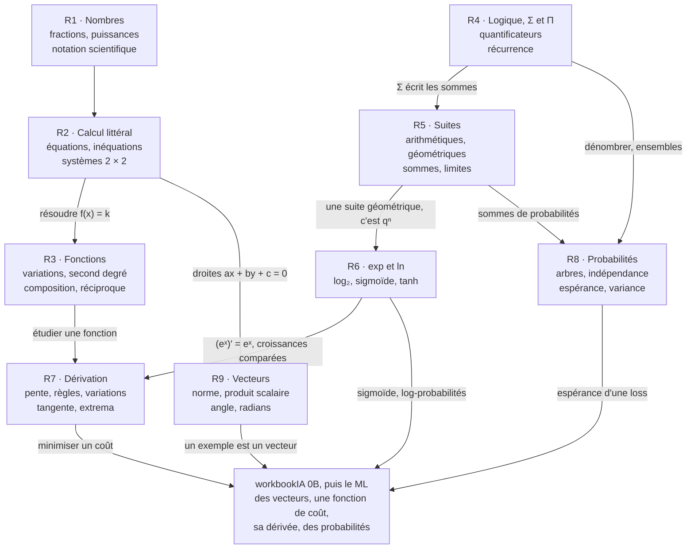

# CP0 · Synthèse de la remise à niveau (R1 à R9)

> La synthèse se fait **avant** l'examen blanc, un autre jour si possible. Commence par l'exercice CP0.13 : construire **ta** carte mentale et **ta** fiche d'une page. Ensuite seulement, compare-les avec les versions de référence des sections 1 à 5 : ce que tu as oublié, c'est ce qu'il faut revoir.

**Les neuf chapitres en une phrase chacun**
1. **R1 · Nombres et calcul** : priorités, fractions, puissances, racines, notation scientifique et pourcentages, pour calculer juste et estimer un ordre de grandeur.
2. **R2 · Calcul littéral et équations** : développer, factoriser, résoudre une équation, une inéquation ou un système 2 × 2, et mettre un problème en équation.
3. **R3 · Fonctions** : lire et étudier une fonction (graphe, variations, second degré, composition, réciproque), l'outil qui décrit une relation entre deux grandeurs.
4. **R4 · Logique, ensembles, Σ et Π** : écrire juste (quantificateurs, implication, intervalles, sommes) et démontrer (direct, contraposée, absurde, récurrence).
5. **R5 · Suites** : suites arithmétiques et géométriques, leurs sommes et leurs limites, et les moyennes qui glissent sur des données.
6. **R6 · Exponentielle et logarithmes** : $e^x$, $\ln$, $\log_2$, les échelles logarithmiques, la sigmoïde et tanh, qui transforment des produits en sommes et des scores en probabilités.
7. **R7 · Limites et dérivation** : la dérivée mesure la pente ; ses règles (produit, quotient, chaîne) donnent les variations, les extrema et les tangentes.
8. **R8 · Probabilités de base** : événements, arbres, dénombrement, indépendance, variable aléatoire, espérance et variance.
9. **R9 · Géométrie du plan, vecteurs et trigonométrie** : coordonnées, vecteurs, normes, produit scalaire, droites, radians, cosinus et sinus, et l'angle entre deux vecteurs.

## CP0.13 — Ta carte mentale et ta fiche d'une page 🗣️ ★ ⏱️ 60 min

**Objectif :** organiser toute la remise à niveau dans ta tête, avant l'examen, et repérer ce qui manque.

1. **De mémoire, sans rien ouvrir (20 min).** Sur une grande feuille, écris les neuf chapitres, puis, autour de chacun, les notions et les formules qui te viennent. Relie les notions qui se servent l'une de l'autre (« la dérivée sert à trouver le sommet d'une parabole »), et écris sur chaque flèche **pourquoi**.
2. **Avec les fiches (25 min).** Ouvre les fiches des chapitres (sections « L'essentiel ») et l'annexe `annexes/formulaire.md`. Complète ta carte d'une autre couleur : tout ce que tu ajoutes maintenant est à revoir.
3. **Ta fiche d'une page (15 min).** Sur une seule page, écris les 20 à 25 formules ou règles que tu veux avoir en tête le jour de l'examen, et les cinq pièges qui te concernent le plus (dans tes copies et dans `annexes/erreurs_frequentes.md`).
4. **Compare** avec les sections 1 à 3 ci-dessous, puis garde ta carte et ta fiche dans `mon_travail/checkpoints/partie_0/` (une photo suffit).

**Grille de relecture.** Une bonne synthèse : (1) contient les neuf chapitres ; (2) a au moins huit flèches justifiées entre chapitres ; (3) donne chaque formule avec ses conditions ($\ln x$ pour $x > 0$, $\lvert q \rvert < 1$ pour une somme infinie, $\vec{u} \ne \vec{0}$ pour un angle) ; (4) a des pièges tirés de tes propres erreurs ; (5) tient sur une page pour la fiche.

## 1. Carte mentale

Redessine-la de mémoire, puis compare : chaque flèche doit pouvoir se justifier par un exemple (« le sommet d'une parabole, c'est là où sa dérivée s'annule »).

## 2. Fiche d'une page : les formules clés

| Chapitre | Formules et règles |
|---|---|
| R1 | $\frac{a}{b} + \frac{c}{d} = \frac{ad + bc}{bd}$ ; $\frac{a}{b} \div \frac{c}{d} = \frac{a}{b} \times \frac{d}{c}$ ; $a^m a^n = a^{m+n}$, $(a^m)^n = a^{mn}$, $a^{-n} = \frac{1}{a^n}$ ; $\sqrt{ab} = \sqrt{a}\sqrt{b}$ ; évolutions successives : on multiplie les coefficients $1 + \frac{t}{100}$ |
| R2 | $(a \pm b)^2 = a^2 \pm 2ab + b^2$, $(a - b)(a + b) = a^2 - b^2$ ; un produit est nul si l'un de ses facteurs l'est ; multiplier une inégalité par un négatif la retourne ; $\lvert x - a \rvert \le r \iff a - r \le x \le a + r$ ; système 2 × 2 : déterminant $ad - bc \ne 0$ ⇔ une seule solution |
| R3 | droite par deux points : $m = \frac{y_B - y_A}{x_B - x_A}$ ; $ax^2 + bx + c$ : $\Delta = b^2 - 4ac$, racines $\frac{-b \pm \sqrt{\Delta}}{2a}$, sommet en $-\frac{b}{2a}$ ; $(g \circ f)(x) = g(f(x))$ |
| R4 | contraposée de $P \Rightarrow Q$ : non $Q \Rightarrow$ non $P$ ; négation de « pour tout $x$, $P(x)$ » : « il existe $x$ tel que non $P(x)$ » ; $\sum_{k=1}^{n} k = \frac{n(n + 1)}{2}$ ; de $k = p$ à $k = q$ : $q - p + 1$ termes ; récurrence : initialisation, hérédité, conclusion |
| R5 | arithmétique : $u_n = u_0 + nr$ ; géométrique : $u_n = u_0 q^n$, $\sum_{k=0}^{n-1} q^k = \frac{1 - q^n}{1 - q}$ ($q \ne 1$), $\sum_{k=0}^{+\infty} q^k = \frac{1}{1 - q}$ ($\lvert q \rvert < 1$) ; $q^n \to 0$ si $\lvert q \rvert < 1$, $\to +\infty$ si $q > 1$ |
| R6 | $e^{a + b} = e^a e^b$ ; $\ln(ab) = \ln a + \ln b$, $\ln(a^n) = n \ln a$ ; $e^{\ln x} = x$ ($x > 0$), $\ln(e^x) = x$ ; $\log_2 x = \frac{\ln x}{\ln 2}$ ; $\sigma(z) = \frac{1}{1 + e^{-z}}$ |
| R7 | $(uv)' = u'v + uv'$ ; $\left(\frac{u}{v}\right)' = \frac{u'v - uv'}{v^2}$ ; $(f(g(x)))' = g'(x)\,f'(g(x))$ ; $(e^x)' = e^x$, $(\ln x)' = \frac{1}{x}$, $(\sqrt{x})' = \frac{1}{2\sqrt{x}}$ ; tangente : $y = f'(a)(x - a) + f(a)$ ; $f' > 0$ ⇒ $f$ croissante |
| R8 | $P(\bar{A}) = 1 - P(A)$ ; $P(A \cup B) = P(A) + P(B) - P(A \cap B)$ ; indépendance : $P(A \cap B) = P(A)\,P(B)$ ; $\binom{n}{k} = \frac{n!}{k!\,(n - k)!}$ ; $\mathbb{E}[X] = \sum x_i p_i$, $\mathbb{V}(X) = \mathbb{E}[X^2] - \mathbb{E}[X]^2$ ; $\mathbb{E}[aX + b] = a\,\mathbb{E}[X] + b$, $\mathbb{V}(aX + b) = a^2\,\mathbb{V}(X)$ |
| R9 | $\overrightarrow{AB} = (x_B - x_A ; y_B - y_A)$ ; $\lVert \vec{u} \rVert = \sqrt{x^2 + y^2}$ ; $\vec{u} \cdot \vec{v} = xx' + yy' = \lVert \vec{u} \rVert\,\lVert \vec{v} \rVert\cos\theta$ ; orthogonaux ⇔ produit scalaire nul ; $180° = \pi$ rad ; $\cos^2\theta + \sin^2\theta = 1$ |

## 3. Les pièges de la partie

Les dix erreurs les plus fréquentes de la remise à niveau, avec leur correction (le détail, chapitre par chapitre, est dans `annexes/erreurs_frequentes.md`) :

| Piège | Faux | Juste |
|---|---|---|
| racine d'une somme | $\sqrt{a^2 + b^2} = a + b$ | on ne simplifie pas : $\sqrt{9 + 16} = 5$ |
| carré d'une somme | $(a + b)^2 = a^2 + b^2$ | $a^2 + 2ab + b^2$ |
| fractions | $\frac{a}{b} + \frac{c}{d} = \frac{a + c}{b + d}$ | un dénominateur commun |
| signe moins devant une parenthèse | $-(2a - 3) = -2a - 3$ | $-2a + 3$ : tous les signes changent |
| inégalité et négatif | $-3t \le 12 \Rightarrow t \le -4$ | $t \ge -4$ : le sens change |
| logarithme d'une somme | $\ln(a + b) = \ln a + \ln b$ | c'est $\ln(ab)$ qui vaut $\ln a + \ln b$ |
| règle de la chaîne | $(e^{5t})' = e^{5t}$ | $5e^{5t}$ |
| compter les termes | de $k = 5$ à $k = 20$ : 15 termes | $20 - 5 + 1 = 16$ termes |
| variance | $\mathbb{V}(3X) = 3\,\mathbb{V}(X)$ | $9\,\mathbb{V}(X)$ ; une variance n'est jamais négative |
| radians | `math.cos(60)` pour $\cos 60°$ | `math.cos(math.radians(60))` |

## 4. Ce qui sert dans workbookIA

Le chapitre 0B de workbookIA reprend toutes ces notions et les étend ; il devient une consolidation. Ce qui t'y attend, sans en dévoiler les exercices :
- **les vecteurs de R9** passent à $n$ coordonnées : un exemple d'un dataset est un vecteur, et tout le dataset une **matrice** ; norme, distance et produit scalaire se calculent comme dans le plan ;
- **la dérivée de R7** devient le **gradient**, quand une fonction dépend de plusieurs variables ; la règle de la chaîne y prend toute sa place ;
- **Σ (R4)** écrit les moyennes et les sommes de tout le ML, et **les suites (R5)** décrivent des calculs répétés, pas à pas ;
- **exp et ln (R6)** reviennent dans chaque loss de classification, et la sigmoïde dans chaque neurone de sortie ;
- **les probabilités (R8)** deviennent la langue de l'incertitude : espérance, variance, puis lois de probabilité.

Ensuite, chaque chapitre de maths se fait juste avant le chapitre de workbookIA qui porte son numéro (la suite de ce dépôt commence par M02a, avant workbookIA 2).

## 5. Vocabulaire à maîtriser à l'oral

Dis chaque mot à voix haute, en français puis en anglais, et donne un exemple en une phrase.

| Français | Anglais |
|---|---|
| fraction irréductible, notation scientifique | irreducible fraction, scientific notation |
| développer, factoriser | expand, factor |
| inéquation, intervalle | inequality, interval |
| discriminant, racine, sommet | discriminant, root, vertex |
| fonction croissante, réciproque, composée | increasing function, inverse, composition |
| contraposée, réciproque (d'une implication), contre-exemple | contrapositive, converse, counterexample |
| raisonnement par récurrence | proof by induction |
| suite géométrique, raison, limite | geometric sequence, common ratio, limit |
| logarithme népérien, sigmoïde | natural logarithm, sigmoid |
| dérivée, tangente, règle de la chaîne | derivative, tangent line, chain rule |
| événement, indépendance, espérance, variance | event, independence, expected value, variance |
| vecteur, norme, produit scalaire, orthogonal | vector, norm, dot product, orthogonal |

## Mode d'emploi (≈ 75 minutes)

1. CP0.13 d'abord (60 min) : ta carte et ta fiche, de mémoire puis avec les fiches.
2. Compare avec les sections 1 à 3 (10 min) : note ce qui te manquait.
3. Lis les sections 4 et 5 (5 min), en disant le vocabulaire à voix haute.
4. L'examen blanc, un autre jour : `01_examen_sujet.md`, en conditions réelles.
