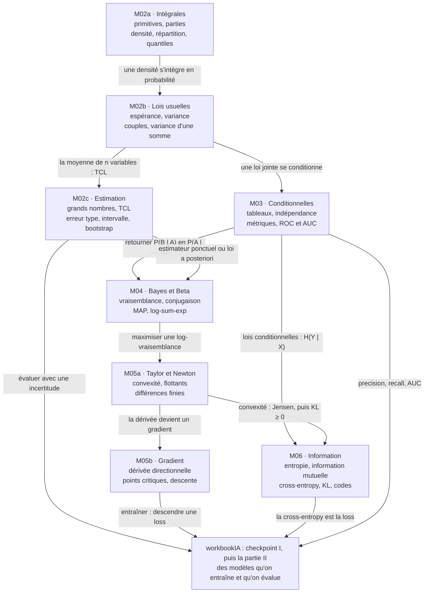

# CP1 · Synthèse de la partie I (M02a à M06)

> La synthèse se fait **avant** l'examen blanc, un autre jour si possible. Commence par l'exercice CP1.13 : construire **ta** carte mentale et **ta** fiche d'une page. Ensuite seulement, compare-les avec les versions de référence des sections 1 à 3, puis lis les sections 4 et 5 : ce que tu as oublié, c'est ce qu'il faut revoir.

**Les huit chapitres en une phrase chacun**
1. **M02a · Intégrales et densités** : l'intégrale mesure une aire ; elle se calcule par une primitive, par parties ou par changement de variable, et décrit une variable continue par sa densité, sa fonction de répartition et ses quantiles.
2. **M02b · Variables aléatoires et lois usuelles** : Bernoulli, binomiale, géométrique, Poisson, uniforme, exponentielle et normale, avec leur espérance et leur variance, puis les couples de variables et la variance d'une somme.
3. **M02c · Échantillons et estimation** : un échantillon i.i.d., la loi des grands nombres et le théorème central limite, les estimateurs (biais, variance, ddof), l'erreur type, l'intervalle de confiance et le bootstrap, la covariance empirique.
4. **M03 · Probabilités conditionnelles** : jointe, marginale, conditionnelle, indépendance et probabilités totales, lues dans un tableau de contingence ; les métriques d'un classifieur sont des probabilités conditionnelles, et l'AUC une probabilité sur des paires.
5. **M04 · Bayes, vraisemblance et loi Beta** : retourner une probabilité conditionnelle, mettre à jour une croyance, maximiser une vraisemblance par son logarithme, et suivre un taux avec la loi Beta, conjuguée de la binomiale.
6. **M05a · Dérivées, Taylor et calcul numérique** : la dérivée seconde et la convexité, les polynômes de Taylor, la méthode de Newton, les différences finies, et les pièges des nombres flottants (arrondis, overflow, log-sum-exp).
7. **M05b · Fonctions de plusieurs variables et gradient** : lignes de niveau, dérivées partielles, gradient et dérivée directionnelle, points critiques et leur nature, descente de gradient.
8. **M06 · Théorie de l'information** : la surprise, l'entropie, les entropies conjointe et conditionnelle, l'information mutuelle, la cross-entropy et la divergence KL (positive, par Jensen), les codes et l'inégalité de Kraft.

## CP1.13 — Ta carte mentale et ta fiche d'une page 🗣️ ★ ⏱️ 60 min

**Objectif :** organiser toute la partie I dans ta tête, avant l'examen, et repérer ce qui manque.

1. **De mémoire, sans rien ouvrir (20 min).** Sur une grande feuille, écris les huit chapitres, puis, autour de chacun, les notions et les formules qui te viennent. Relie les notions qui se servent l'une de l'autre (« la loi Beta a posteriori se trouve en multipliant un a priori par une vraisemblance binomiale »), et écris sur chaque flèche **pourquoi**.
2. **Avec les fiches (25 min).** Ouvre les fiches des chapitres (sections « L'essentiel ») et l'annexe `annexes/formulaire.md`. Complète ta carte d'une autre couleur : tout ce que tu ajoutes maintenant est à revoir.
3. **Ta fiche d'une page (15 min).** Sur une seule page, écris les 20 à 25 formules ou règles que tu veux avoir en tête le jour de l'examen, et les cinq pièges qui te concernent le plus (dans tes copies et dans `annexes/erreurs_frequentes.md`).
4. **Compare** avec les sections 1 à 3 ci-dessous, puis garde ta carte et ta fiche dans `mon_travail/checkpoints/partie_1/` (une photo suffit).

**Grille de relecture.** Une bonne synthèse : (1) contient les huit chapitres ; (2) a au moins huit flèches justifiées entre chapitres ; (3) donne chaque formule avec ses conditions (indépendance pour additionner des variances, $f'(x_k) \ne 0$ pour un pas de Newton, $q > 0$ là où $p > 0$ pour une KL finie) ; (4) a des pièges tirés de tes propres erreurs ; (5) tient sur une page pour la fiche.

## 1. Carte mentale

Redessine-la de mémoire, puis compare : chaque flèche doit pouvoir se justifier par un exemple (« la log loss d'un classifieur est une cross-entropy moyenne : M06 rejoint M04 et M03 »).

## 2. Fiche d'une page : les formules clés

| Chapitre | Formules et règles |
|---|---|
| M02a | $\int_a^b f = F(b) - F(a)$ avec $F' = f$ ; par parties : $\int_a^b u v' = [uv]_a^b - \int_a^b u' v$ ; densité : $f \ge 0$ et $\int f = 1$ ; $P(a < X \le b) = F(b) - F(a) = \int_a^b f$ ; médiane : $F(m) = \frac{1}{2}$ ; quantile d'ordre $\alpha$ : $F(x_\alpha) = \alpha$ |
| M02b | binomiale $\binom{n}{k} p^k (1 - p)^{n - k}$, espérance $np$, variance $np(1 - p)$ ; Poisson $e^{-\lambda}\frac{\lambda^k}{k!}$, espérance et variance $\lambda$ (proportionnel à la durée) ; exponentielle : espérance $\frac{1}{\lambda}$ ; normale : $Z = \frac{X - \mu}{\sigma}$ ; $\mathbb{E}[X] = \sum x\,p(x)$ ou $\int x f(x)\,dx$ ; $\mathbb{V}(X) = \mathbb{E}[X^2] - \mathbb{E}[X]^2$ ; $\mathbb{V}(aX + b) = a^2\,\mathbb{V}(X)$ ; $\mathbb{V}(X + Y) = \mathbb{V}(X) + \mathbb{V}(Y) + 2\,\mathrm{Cov}(X, Y)$, sans la covariance si indépendantes |
| M02c | $\bar{X}$ : espérance $\mu$, variance $\frac{\sigma^2}{n}$ ; $s^2 = \frac{1}{n - 1}\sum (x_i - \bar{x})^2$ (ddof = 1) ; erreur type $\frac{s}{\sqrt{n}}$ ; intervalle à 95 % : $\bar{x} \pm 1{,}96\,\frac{s}{\sqrt{n}}$, et $\hat{p} \pm 1{,}96\sqrt{\frac{\hat{p}(1 - \hat{p})}{n}}$ ; la largeur varie comme $\frac{1}{\sqrt{n}}$ ; bootstrap : rééchantillonner avec remise |
| M03 | $P(A \mid B) = \frac{P(A \cap B)}{P(B)}$ ; indépendance : $P(A \cap B) = P(A)\,P(B)$ ; probabilités totales : $P(A) = \sum_i P(A \mid B_i)\,P(B_i)$ ; precision $\frac{TP}{TP + FP}$, recall $\frac{TP}{TP + FN}$, spécificité $\frac{TN}{TN + FP}$ ; $F_1 = \frac{2PR}{P + R}$ ; AUC $= P(\text{score d'un positif} > \text{score d'un négatif})$ |
| M04 | $P(H \mid D) = \frac{P(D \mid H)\,P(H)}{P(D)}$, $P(D) = \sum_H P(D \mid H)\,P(H)$ ; maximum de vraisemblance : annuler la dérivée de $\ell = \ln L$ ; $\mathrm{Beta}(a, b)$ : moyenne $\frac{a}{a + b}$, mode $\frac{a - 1}{a + b - 2}$ ; conjugaison : $\mathrm{Beta}(a + k, b + n - k)$ ; prédictive : la moyenne a posteriori ; $\ln \sum_j e^{z_j} = m + \ln \sum_j e^{z_j - m}$, $m = \max_j z_j$ |
| M05a | $f'' \ge 0$ : convexe ; Taylor : $f(a + h) \approx f(a) + f'(a)\,h + \frac{f''(a)}{2}\,h^2$ ; Newton : $x_{k+1} = x_k - \frac{f(x_k)}{f'(x_k)}$, convergence quadratique près d'une racine simple ; différence centrée $\frac{f(x + h) - f(x - h)}{2h}$, erreur en $h^2$ ; `float64` : environ 16 chiffres significatifs |
| M05b | $\nabla f = \left(\frac{\partial f}{\partial x}, \frac{\partial f}{\partial y}\right)$, orthogonal aux lignes de niveau ; $D_{\mathbf{u}} f = \nabla f \cdot \mathbf{u}$ avec $\lVert \mathbf{u} \rVert = 1$, au plus $\lVert \nabla f \rVert$ ; point critique : $\nabla f = \mathbf{0}$ ; $D = f_{xx} f_{yy} - f_{xy}^2$ : $D > 0$ et $f_{xx} > 0$ minimum local, $D > 0$ et $f_{xx} < 0$ maximum local, $D < 0$ selle ; descente : $\mathbf{x} \leftarrow \mathbf{x} - \eta\,\nabla f(\mathbf{x})$ |
| M06 | surprise $-\log_2 p$ ; $H(p) = -\sum p_i \log_2 p_i \le \log_2 n$ ; $H(Y \mid X) = \sum_x p(x)\,H(Y \mid X = x)$ ; $H(X, Y) = H(X) + H(Y \mid X)$ ; $I(X ; Y) = H(Y) - H(Y \mid X) \ge 0$ ; $H(p, q) = -\sum p_i \log_2 q_i$ ; $\mathrm{KL}(p \,\|\, q) = \sum p_i \log_2 \frac{p_i}{q_i} = H(p, q) - H(p) \ge 0$ ; Kraft : $\sum 2^{-\ell_i} \le 1$ ; 1 nat $= \frac{1}{\ln 2}$ bit |

## 3. Les pièges de la partie

Dix erreurs fréquentes de la partie I, avec leur correction (le détail, chapitre par chapitre, est dans `annexes/erreurs_frequentes.md`) :

| Piège | Faux | Juste |
|---|---|---|
| densité et probabilité | « $f(3) = 1{,}2$, donc $P(X = 3) = 1{,}2$ » | pour une variable continue, $P(X = 3) = 0$ ; une densité peut dépasser 1, seule son aire vaut 1 |
| intégrale d'une fonction qui explose | « $\int_0^1 \frac{dx}{x^3} = \left[-\frac{1}{2x^2}\right]_0^1 = -\frac{1}{2}$ » | la primitive n'existe pas en 0 : l'intégrale impropre diverge (vers $+\infty$) |
| écarts-types additionnés | « $\sigma(X + Y) = 3 + 4 = 7$ » | pour des variables indépendantes, ce sont les **variances** qui s'additionnent : $\sqrt{9 + 16} = 5$ |
| intervalle de confiance lu comme une plage de valeurs | « 95 % des mesures sont dans $[\ldots]$ » | il encadre la **moyenne** (la vraie valeur du paramètre), avec une méthode qui réussit 95 fois sur 100 |
| incompatibles et indépendants | « $A \cap B = \varnothing$, donc $A$ et $B$ sont indépendants » | si $P(A) > 0$ et $P(B) > 0$, des événements incompatibles sont dépendants : savoir $A$ exclut $B$ |
| agréger des groupes (Simpson) | « le taux global dit qui fait le mieux dans chaque groupe » | un taux agrégé peut s'inverser par rapport aux taux de chaque groupe ; comparer groupe par groupe |
| a posteriori non normalisé | multiplier a priori et vraisemblance, et garder ces nombres | diviser par leur somme (l'évidence) : les probabilités a posteriori somment à 1 |
| Newton lancé n'importe où | « Newton converge toujours » | là où $f'(x_k) = 0$, le pas n'existe pas ; loin de la racine, la suite peut cycler ou diverger |
| descendre ou monter | $\mathbf{x} \leftarrow \mathbf{x} + \eta\,\nabla f(\mathbf{x})$ pour minimiser | le gradient pointe vers la plus forte **montée** : on retranche $\eta\,\nabla f$ |
| $0 \log 0$ en code | `-(p * np.log2(p)).sum()` avec une probabilité nulle donne `nan` | on écarte les probabilités nulles, ou `scipy.special.xlogy` applique la convention $0 \log 0 = 0$ |

## 4. Ce qui sert dans workbookIA

Le checkpoint I de workbookIA se fait juste après cet examen blanc. Ce qui t'y attend, et ensuite, sans en dévoiler les exercices :
- **les estimateurs et les intervalles (M02c)** servent chaque fois qu'on dit l'incertitude d'un score de test, et le bootstrap revient quand il n'y a pas de formule simple ;
- **les probabilités conditionnelles (M03)** et **Bayes (M04)** décrivent ce que veut dire un score de classifieur, et pourquoi il dépend de la population sur laquelle on l'évalue ;
- **la vraisemblance (M04)** et **la cross-entropy (M06)** sont deux noms de la même loss de classification ;
- **le gradient (M05b)** et **Newton (M05a)** sont les deux façons d'entraîner un modèle à paramètres : suivre la pente, ou utiliser aussi la courbure ;
- **le log-sum-exp (M04, M05a)** est dans chaque softmax qu'une bibliothèque calcule.

Ensuite, la partie II de ce dépôt commence par M07 (vecteurs et géométrie de $\mathbb{R}^n$), avant workbookIA 7.

## 5. Vocabulaire à maîtriser à l'oral

Dis chaque mot à voix haute, en français puis en anglais, et donne un exemple en une phrase.

| Français | Anglais |
|---|---|
| intégrale, primitive, intégration par parties | integral, antiderivative, integration by parts |
| densité, fonction de répartition, quantile | probability density, cumulative distribution function, quantile |
| espérance, variance, covariance | expected value, variance, covariance |
| échantillon i.i.d., théorème central limite | i.i.d. sample, central limit theorem |
| estimateur, biais, erreur type, intervalle de confiance | estimator, bias, standard error, confidence interval |
| probabilité conditionnelle, indépendance, probabilités totales | conditional probability, independence, law of total probability |
| a priori, vraisemblance, a posteriori, conjuguée | prior, likelihood, posterior, conjugate |
| maximum de vraisemblance, maximum a posteriori | maximum likelihood, maximum a posteriori (MAP) |
| polynôme de Taylor, méthode de Newton, convexe | Taylor polynomial, Newton's method, convex |
| dérivée partielle, gradient, point selle | partial derivative, gradient, saddle point |
| entropie, information mutuelle, divergence KL | entropy, mutual information, KL divergence |

## Mode d'emploi (≈ 75 minutes)

1. CP1.13 d'abord (60 min) : ta carte et ta fiche, de mémoire puis avec les fiches.
2. Compare avec les sections 1 à 3 (10 min) : note ce qui te manquait.
3. Lis les sections 4 et 5 (5 min), en disant le vocabulaire à voix haute.
4. L'examen blanc, un autre jour : `01_examen_sujet.md`, en conditions réelles.

Ces 15 minutes de comparaison et de lecture sont la « lecture » du bilan ; avec CP1.13, la synthèse prend environ 75 minutes.
