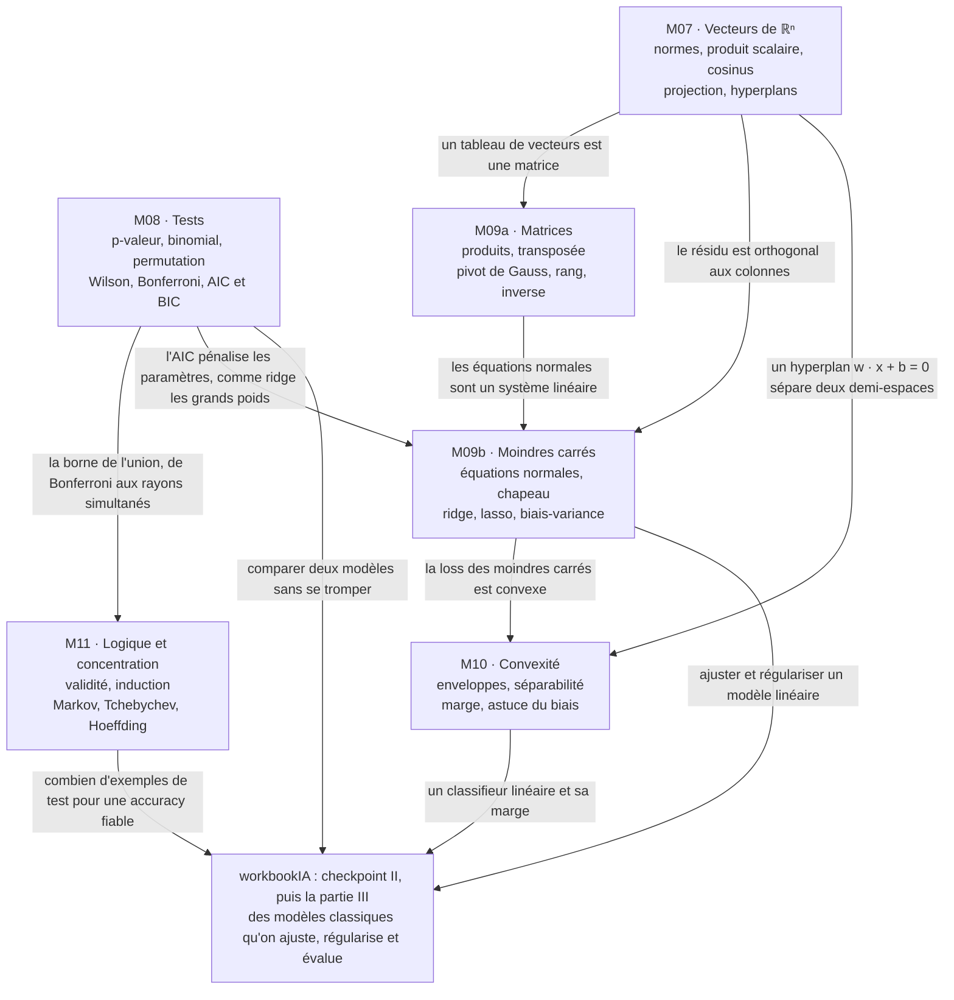

# CP2 · Synthèse de la partie II (M07 à M11)

> La synthèse se fait **avant** l'examen blanc, un autre jour si possible. Commence par l'exercice CP2.12 : construire **ta** carte mentale et **ta** fiche d'une page. Ensuite seulement, compare-les avec les versions de référence des sections 1 à 3, puis lis les sections 4 et 5 : ce que tu as oublié, c'est ce qu'il faut revoir.

**Les six chapitres en une phrase chacun**
1. **M07 · Vecteurs et géométrie de ℝⁿ** : un exemple est un point de $\mathbb{R}^n$ ; normes, distances, produit scalaire, cosinus, projection, hyperplans et distance à un hyperplan, centroïdes et inertie, et ce que deviennent les distances quand la dimension grandit.
2. **M08 · Tests statistiques** : une hypothèse nulle, une statistique, une p-valeur ; le test binomial exact, le test par permutation, les erreurs de type I et II, la puissance, les intervalles de Wald, de Wilson et de Student, les comparaisons multiples, puis le choix de modèle par AIC, BIC et facteur de Bayes.
3. **M09a · Matrices et systèmes linéaires** : un dataset est une matrice ; produits, transposées, une couche dense en écriture matricielle, le pivot de Gauss, la forme échelonnée réduite, le rang et l'inverse.
4. **M09b · Moindres carrés et régularisation** : mesurer une erreur (MSE, MAE, Huber, $R^2$), les équations normales, la matrice chapeau, les features polynomiales, ridge et lasso, le lien avec le maximum de vraisemblance, et la décomposition biais-variance.
5. **M10 · Séparabilité linéaire et convexité** : ensembles et fonctions convexes, enveloppe convexe, séparabilité (deux nuages sont séparables quand leurs enveloppes ne se coupent pas), astuce du biais, marge géométrique, et les activations appliquées à un score linéaire.
6. **M11 · Logique, induction et inégalités de concentration** : juger un raisonnement (validité, contre-exemple, pièges de l'induction), puis borner ce que les données garantissent : Markov, Tchebychev, Hoeffding, le rayon de confiance, et ce qu'ils disent des bandits.

## CP2.12 — Ta carte mentale et ta fiche d'une page 🗣️ ★ ⏱️ 60 min

**Objectif :** organiser toute la partie II dans ta tête, avant l'examen, et repérer ce qui manque.

1. **De mémoire, sans rien ouvrir (20 min).** Sur une grande feuille, écris les six chapitres, puis, autour de chacun, les notions et les formules qui te viennent. Relie les notions qui se servent l'une de l'autre (« les équations normales sont un système linéaire, qu'on résout par le pivot de Gauss »), et écris sur chaque flèche **pourquoi**.
2. **Avec les fiches (25 min).** Ouvre les fiches des chapitres (sections « L'essentiel ») et l'annexe `annexes/formulaire.md`. Complète ta carte d'une autre couleur : tout ce que tu ajoutes maintenant est à revoir.
3. **Ta fiche d'une page (15 min).** Sur une seule page, écris les 20 à 25 formules ou règles que tu veux avoir en tête le jour de l'examen, et les cinq pièges qui te concernent le plus (dans tes copies et dans `annexes/erreurs_frequentes.md`).
4. **Compare** avec les sections 1 à 3 ci-dessous, puis garde ta carte et ta fiche dans `mon_travail/checkpoints/partie_2/` (une photo suffit).

**Grille de relecture.** Une bonne synthèse : (1) contient les six chapitres ; (2) a au moins six flèches justifiées entre chapitres ; (3) donne chaque formule avec ses conditions (colonnes de $\mathbf{X}$ indépendantes pour que $\mathbf{X}^\top\mathbf{X}$ soit inversible, $X \ge 0$ pour Markov, variables indépendantes et bornées pour Hoeffding, des tests fixés d'avance pour une p-valeur) ; (4) a des pièges tirés de tes propres erreurs ; (5) tient sur une page pour la fiche.

## 1. Carte mentale

Redessine-la de mémoire, puis compare : chaque flèche doit pouvoir se justifier par un exemple (« la marge géométrique est une distance à un hyperplan, divisée par $\lVert \mathbf{w} \rVert$ : M10 rejoint M07 »).

## 2. Fiche d'une page : les formules clés

| Chapitre | Formules et règles |
|---|---|
| M07 | $\lVert \mathbf{x} \rVert_1 = \sum \lvert x_i \rvert$, $\lVert \mathbf{x} \rVert_2 = \sqrt{\sum x_i^2}$, $\lVert \mathbf{x} \rVert_\infty = \max \lvert x_i \rvert$ ; $\mathbf{u} \cdot \mathbf{v} = \sum u_i v_i = \lVert \mathbf{u} \rVert\,\lVert \mathbf{v} \rVert \cos\theta$ ; Cauchy-Schwarz $\lvert \mathbf{u} \cdot \mathbf{v} \rvert \le \lVert \mathbf{u} \rVert\,\lVert \mathbf{v} \rVert$ ; projection sur la droite de $\mathbf{u}$ : $\frac{\mathbf{u} \cdot \mathbf{v}}{\lVert \mathbf{u} \rVert^2}\,\mathbf{u}$ ; distance signée à l'hyperplan $\mathbf{w} \cdot \mathbf{x} + b = 0$ : $\frac{\mathbf{w} \cdot \mathbf{x} + b}{\lVert \mathbf{w} \rVert}$ ; le centroïde minimise la somme des carrés des distances |
| M08 | p-valeur : $P(\text{statistique au moins aussi extrême} \mid H_0)$ ; rejet si $p \le \alpha$ (risque de type I $\alpha$) ; puissance $= 1 - \beta$ ; test binomial : $\sum \binom{n}{j} p_0^j (1 - p_0)^{n - j}$ sur les valeurs extrêmes ; Wald $\hat{p} \pm z\sqrt{\hat{p}(1 - \hat{p})/n}$ ; Wilson : centre $\frac{\hat{p} + z^2/(2n)}{1 + z^2/n}$, reste dans $[0 ; 1]$ ; Bonferroni : seuil $\frac{\alpha}{m}$ ou $p$ ajustée $\min(1, mp)$ ; $\mathrm{AIC} = 2k - 2\ln L$, $\mathrm{BIC} = k\ln n - 2\ln L$ (le plus petit gagne) |
| M09a | $(\mathbf{A}\mathbf{B})_{ij} = \sum_k a_{ik} b_{kj}$, forme $(m, n) \times (n, p) \to (m, p)$ ; $(\mathbf{A}\mathbf{B})^\top = \mathbf{B}^\top\mathbf{A}^\top$, $(\mathbf{A}\mathbf{B})^{-1} = \mathbf{B}^{-1}\mathbf{A}^{-1}$ ; pivot : $L_i \leftarrow L_i - \lambda L_j$, puis remontée ; rang = nombre de pivots ; $2 \times 2$ : $\begin{pmatrix} a & b \\ c & d \end{pmatrix}^{-1} = \frac{1}{ad - bc}\begin{pmatrix} d & -b \\ -c & a \end{pmatrix}$ ; un système a 0, 1 ou une infinité de solutions |
| M09b | équations normales $\mathbf{X}^\top\mathbf{X}\,\mathbf{w} = \mathbf{X}^\top\mathbf{y}$, puis $\mathbf{X}^\top\mathbf{r} = \mathbf{0}$ ; avec une colonne de 1, $\sum r_i = 0$ ; $R^2 = 1 - \frac{\mathrm{SCR}}{\mathrm{SCT}}$ ; ridge $(\mathbf{X}^\top\mathbf{X} + \lambda\mathbf{I})\,\mathbf{w} = \mathbf{X}^\top\mathbf{y}$ ; lasso : seuillage doux, des poids exactement nuls ; $\binom{p + d}{d}$ monômes de degré au plus $d$ ; bruit gaussien : moindres carrés $=$ maximum de vraisemblance, $\hat{\sigma}^2 = \frac{\mathrm{SCR}}{n}$ ; $\mathrm{EQM} = \text{biais}^2 + \text{variance}$ |
| M10 | convexe : $(1 - t)\mathbf{a} + t\mathbf{b} \in C$ ; une intersection de convexes est convexe, une réunion pas forcément ; $f$ convexe : $f\big((1 - t)\mathbf{a} + t\mathbf{b}\big) \le (1 - t)f(\mathbf{a}) + t f(\mathbf{b})$ ; produit vectoriel du plan $u_1 v_2 - u_2 v_1 > 0$ : virage à gauche ; séparables $\iff$ enveloppes disjointes ; marge $\min_i \frac{y_i(\mathbf{w} \cdot \mathbf{x}_i + b)}{\lVert \mathbf{w} \rVert}$, au plus la moitié de la distance des enveloppes ; astuce du biais $\tilde{\mathbf{x}} = (1, \mathbf{x})$ |
| M11 | valide : aucune ligne « prémisses vraies, conclusion fausse » ; un contre-exemple réfute un « pour tout » ; Markov ($X \ge 0$) : $P(X \ge a) \le \frac{\mathbb{E}[X]}{a}$ ; Tchebychev : $P(\lvert X - \mu \rvert \ge t) \le \frac{\sigma^2}{t^2}$, moyenne : $\frac{\sigma^2}{nt^2}$ ; Hoeffding ($[a, b]$, indépendance) : $2e^{-2nt^2/(b - a)^2}$ ; rayon $(b - a)\sqrt{\frac{\ln(2/\delta)}{2n}}$, unilatéral avec $\ln(1/\delta)$ ; $K$ quantités à la fois : $\frac{\delta}{K}$ ; regret $\sum_k \Delta_k\,\mathbb{E}[N_k(T)]$ |

## 3. Les pièges de la partie

Dix erreurs fréquentes de la partie II, avec leur correction (le détail, chapitre par chapitre, est dans `annexes/erreurs_frequentes.md`) :

| Piège | Faux | Juste |
|---|---|---|
| distance sans racine | « la distance de $(0, 0)$ à $(6, 8)$ vaut 100 » | c'est le carré de la distance ; la distance vaut $\sqrt{100} = 10$ (comparer des carrés suffit pour trouver le plus proche) |
| projection sur un vecteur non unitaire | projeter $\mathbf{v}$ sur $\mathbf{u}$ par $(\mathbf{u} \cdot \mathbf{v})\,\mathbf{u}$ | diviser par $\lVert \mathbf{u} \rVert^2$ : $\frac{\mathbf{u} \cdot \mathbf{v}}{\lVert \mathbf{u} \rVert^2}\,\mathbf{u}$ |
| p-valeur lue à l'envers | « $p = 0{,}2$ : $H_0$ est vraie à 80 % » | un test ne prouve jamais $H_0$ ; une grande p-valeur dit seulement que les données ne la contredisent pas |
| test choisi après coup | regarder les données, puis choisir le côté du test ou le sous-groupe qui donne $p < 0{,}05$ | fixer l'hypothèse, le test et le seuil **avant** de regarder ; sinon, corriger pour tous les essais |
| produit de matrices commuté | « $\mathbf{A}\mathbf{B} = \mathbf{B}\mathbf{A}$ » | le produit n'est pas commutatif ; $(\mathbf{A}\mathbf{B})^\top = \mathbf{B}^\top\mathbf{A}^\top$, l'ordre s'inverse |
| inverser pour résoudre | calculer $(\mathbf{X}^\top\mathbf{X})^{-1}$ puis le multiplier par $\mathbf{X}^\top\mathbf{y}$ en code | résoudre le système (`np.linalg.solve`, ou `lstsq`) : plus précis et plus rapide |
| $R^2$ d'entraînement pour choisir | ajouter des features tant que le $R^2$ d'entraînement monte | il monte toujours : comparer les modèles avec un critère pénalisé (AIC, BIC) |
| $\mathbf{X}\mathbf{X}^\top$ au lieu de $\mathbf{X}^\top\mathbf{X}$ | des équations normales écrites avec une matrice $n \times n$ | $\mathbf{X}^\top\mathbf{X}$, de forme $(p, p)$ : les produits scalaires des colonnes |
| Hoeffding sans ses hypothèses | appliquer le rayon de Hoeffding à des mesures successives d'une série temporelle | il faut des variables **indépendantes** et bornées dans un intervalle connu d'avance |
| Tchebychev avec l'écart-type | « $P(\lvert X - \mu \rvert \ge t) \le \frac{\sigma}{t^2}$ » | diviser la **variance** $\sigma^2$ par $t^2$ (et, pour une moyenne de $n$ variables, par $n t^2$) |

## 4. Ce qui sert dans workbookIA

Le checkpoint II de workbookIA se fait juste après cet examen blanc. Ce qui t'y attend, et ensuite, sans en dévoiler les exercices :
- **les distances et les produits scalaires (M07)** sont le cœur des méthodes fondées sur la proximité ;
- **les tests et les intervalles (M08)** disent si une différence de score entre deux modèles est réelle, et **la borne de l'union (M08, M11)** ce que coûte une garantie sur plusieurs quantités à la fois ;
- **l'écriture matricielle (M09a)** et **les équations normales (M09b)** sont ce que calcule une bibliothèque quand elle ajuste un modèle linéaire, et **ridge et lasso** ce qu'elle ajoute pour régulariser ;
- **la convexité (M10)** explique pourquoi certains modèles s'entraînent sans risque de minimum local, et **la marge** prépare les machines à vecteurs de support de la partie III ;
- **les inégalités de concentration (M11)** disent combien d'exemples il faut pour croire un score.

Ensuite, la partie III de ce dépôt commence par M12a (espaces vectoriels et applications linéaires), avant workbookIA 12.

## 5. Vocabulaire à maîtriser à l'oral

Dis chaque mot à voix haute, en français puis en anglais, et donne un exemple en une phrase.

| Français | Anglais |
|---|---|
| norme, produit scalaire, similarité cosinus | norm, dot product, cosine similarity |
| projection orthogonale, hyperplan, vecteur normal | orthogonal projection, hyperplane, normal vector |
| hypothèse nulle, p-valeur, puissance | null hypothesis, p-value, power |
| comparaisons multiples, correction de Bonferroni | multiple comparisons, Bonferroni correction |
| critère d'information d'Akaike, critère bayésien | Akaike information criterion, Bayesian information criterion |
| pivot de Gauss, forme échelonnée, rang, inverse | Gaussian elimination, row echelon form, rank, inverse |
| équations normales, résidu, matrice chapeau | normal equations, residual, hat matrix |
| régularisation ridge, lasso, compromis biais-variance | ridge regularization, lasso, bias-variance trade-off |
| ensemble convexe, enveloppe convexe, marge | convex set, convex hull, margin |
| argument valide, contre-exemple, induction | valid argument, counterexample, induction |
| inégalité de concentration, rayon de confiance, borne de l'union | concentration inequality, confidence radius, union bound |

## Mode d'emploi (≈ 75 minutes)

1. CP2.12 d'abord (60 min) : ta carte et ta fiche, de mémoire puis avec les fiches.
2. Compare avec les sections 1 à 3 (10 min) : note ce qui te manquait.
3. Lis les sections 4 et 5 (5 min), en disant le vocabulaire à voix haute.
4. L'examen blanc, un autre jour : `01_examen_sujet.md`, en conditions réelles.

Ces 15 minutes de comparaison et de lecture sont la « lecture » du bilan ; avec CP2.12, la synthèse prend environ 75 minutes.
